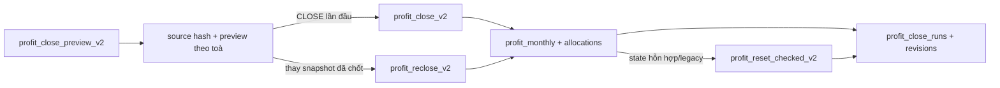

# Cổ đông, Profit Close V2 và ví cá nhân

> **Reviewed:** 2026-10-21
> Nguồn hiện hành: `src/components/shareholders/**`, `src/hooks/useShareholderProfit.ts`, `src/hooks/income-expenses/specialized.ts` và migrations `20260720210000`–`20260720223000`.

## 1. Phạm vi

Domain này trả lời bốn câu hỏi:

1. Lợi nhuận của từng toà trong tháng là bao nhiêu?
2. Sau lương điều hành và điều chỉnh có lý do, mỗi cổ đông được chia bao nhiêu?
3. Đã chi cho cổ đông/quản lý bao nhiêu, còn phải trả bao nhiêu?
4. User tự ghi chép ví cá nhân thế nào mà không lẫn với sổ quỹ doanh nghiệp?

Trang chính là `/reports/finance/profit-distribution` (`ProfitHubPage`). Cổ đông/quản lý được gắn tài khoản chỉ xem phần của mình; người có quyền quản trị thấy các tab Tổng quan, Chốt LN tháng và Cổ đông & tỷ lệ.

Từ 11/10/2026 (Q9) tab **Chốt LN tháng** và **Cổ đông & tỷ lệ** hiện theo quyền (chốt/mở chốt; `shareholder_profit.manage_shareholders`), **Lương của tôi** luôn hiện với quản lý điều hành; bỏ cơ chế nhấp 3 lần vào logo. Bản mobile không render tab chốt/cấu hình (thao tác quản trị dùng desktop) nhưng có tab **Lương** cho quản lý điều hành.

## 2. Bất biến hiện hành

- **Server tính nguồn:** client không gửi P&L, lương điều hành, tỷ lệ hay allocation cuối cùng. `profit_close_preview_v2` tự đọc nguồn accrual và cấu hình trong organization.
- **Tính cả tháng, ghi phần được chọn (từ 27/08/2026):** CLOSE/RECLOSE tính preview canonical trên MỌI toà thật của organization nhưng chỉ GHI các toà trong `p_building_ids`. Vì phạm vi tính không đổi, `source_hash` (CAS) và `building_source_hash` giữ nguyên công thức cũ — chốt lẻ không làm snapshot đã chốt trước đó hoá `is_stale`.
- **Tập ghi đóng theo `TOTAL_GROUP`:** với mỗi quy tắc lương điều hành `basis=TOTAL_GROUP` đang active, tập ghi phải chứa TẤT CẢ hoặc KHÔNG toà nào của quy tắc đó. Chốt nửa nhóm sẽ dồn sai khoản lương của cả nhóm vào phần toà đã chốt mà không có gì báo; server từ chối bằng `[TOTAL_GROUP_KHONG_DU]` kèm tên toà còn thiếu. Đây là bất biến THAY THẾ luật "chốt toàn tháng" cũ, không phải nới nó.
- **Điều chỉnh minh bạch:** `adjusted_profit = computed_profit + adjustment_amount`. Điều chỉnh khác 0 bắt buộc lý do 8–500 ký tự và lưu người/thời điểm.
- **Chống nguồn đổi:** preview trả `source_hash`; close/reclose chỉ ghi nếu hash vẫn khớp. Dữ liệu đổi giữa xem trước và xác nhận trả conflict, không chốt mù.
- **Idempotency:** mỗi write dùng idempotency key; replay cùng payload trả kết quả cũ, tái dùng key cho payload khác bị từ chối.
- **Revision bất biến:** close, reclose, reset và baseline đều ghi `profit_close_runs` + `profit_close_revisions` append-only.
- **Không chia cho người ngừng hoạt động:** cổ đông/quản lý `is_active=false` hoặc `deleted_at` khác null không nhận allocation mới. Mapping cross-organization hoặc cấu hình sống thiếu organization fail closed.

## 3. Mô hình dữ liệu

### 3.1. Cổ đông và tỷ lệ

- `shareholders`: danh bạ cổ đông, `organization_id`, `auth_user_id`, `name`, `is_active`, `deleted_at`.
- `building_shareholders`: tỷ lệ của cổ đông theo toà. Tổng tỷ lệ active không được vượt 100 khi preview/chốt.
- `auth_user_id` cho phép self-view nhưng không mở quyền đọc dữ liệu vận hành khác.

### 3.2. Snapshot tháng

`profit_monthly` có một dòng cho mỗi `(building_id, period_month)` và lưu:

- `computed_profit`: lợi nhuận canonical từ nguồn accrual.
- `adjustment_amount`, `adjustment_reason`, `adjustment_by`, `adjustment_at`.
- `adjusted_profit`: `computed_profit + adjustment_amount`.
- `management_salary`: lương điều hành bị trừ trước khi chia.
- `source_revenue`, `source_expense`, `source_net_profit`, `source_hash`, `source_captured_at`.
- `status`, `is_stale`, `stale_reason`, `revision_number`, `locked_at/by`.

`profit_allocations` chụp phần cổ đông; `profit_manager_allocations` chụp phần lương điều hành. Hai bảng này là nguồn số đã chốt, không đọc lại tỷ lệ/quy tắc live cho kỳ LOCKED.

### 3.3. Audit close

- `profit_close_runs`: một record append-only cho mỗi operation `BASELINE`, `CLOSE`, `RECLOSE`, `RESET` hoặc `UNLOCK`, gồm request hash, source snapshot và result snapshot.
- `profit_close_revisions`: revision theo từng toà/tháng, giữ previous/current snapshot cùng allocations. `profit_monthly_id` cố ý không là FK để reset snapshot hiện tại không xoá lịch sử.

### 3.4. Lương điều hành

- `profit_managers`: danh bạ quản lý điều hành.
- `profit_manager_salaries`: quy tắc `FIXED|PERCENT` × `PER_BUILDING|TOTAL_GROUP`.
- `profit_manager_salary_buildings`: tập toà áp dụng.
- Chỉ manager và rule đang active, chưa xoá, đúng organization mới tham gia preview/chốt.

### 3.5. Ví cá nhân

`personal_transactions` là sổ thu/chi own-only của từng user. Nó không đi vào `income_expenses`, sổ quỹ, KQKD, Profit Close hay approval engine.

## 4. Luồng Profit Close V2

### 4.1. Preview

`profit_close_preview_v2(organization, month, building_ids?, adjustments?)`:

- xác thực organization và quyền;
- đọc tất cả toà thật đang hoạt động;
- đối chiếu hai nguồn accrual canonical;
- tính revenue, expense, net profit, điều chỉnh, lương điều hành và allocations;
- trả source hash toàn kỳ và hash theo toà;
- so snapshot hiện tại để đánh dấu `is_stale`/`stale_reason`.

UI chỉ gửi `adjustment_amount` có dấu và `adjustment_reason`; server tính phần còn lại.

### 4.2. Chốt lần đầu

`profit_close_v2` yêu cầu source hash preview (của TOÀN THÁNG) và idempotency key. Trong transaction, server khoá nguồn cần thiết, dựng lại preview trên toàn bộ toà thật, kiểm hash, rồi upsert `profit_monthly` + thay allocations CHỈ cho các toà trong `p_building_ids`, tăng revision và ghi audit.

`profit_close_runs.source_snapshot` luôn là tài liệu nguồn TOÀN THÁNG — `app_private.current_profit_building_source_hash_v1` dựng lại hash từ `run.source_snapshot->'pnl'` để canh độ tươi của phiếu chi cổ đông. `result_snapshot.buildings`/`totals` mới là phần đã ghi, kèm `scope_building_ids` và `written_building_ids`.

Lý do lần chốt đầu có thể dùng mặc định; điều chỉnh khác 0 vẫn phải có lý do riêng.

### 4.3. Chốt lại

`profit_reclose_v2` dùng khi các toà ĐƯỢC CHỌN đều đã LOCKED nhưng nguồn/cấu hình thay đổi. UI bắt buộc nhập lý do; server tạo revision mới và thay snapshot hiện tại sau khi source hash vẫn khớp. Vùng chọn lẫn toà đã chốt với toà chưa chốt là không hợp lệ — CLOSE và RECLOSE là hai RPC, mỗi cái đòi trạng thái đồng nhất trong tập ghi.

Không cần mở khoá/xoá allocation bằng nhiều DML client như flow cũ.

**Tháng đã chốt khoá phiếu thế nào** (từ 25/09/2026, migration
[20260925073251](../../supabase/migrations/20260925073251_khoa_thang_loi_nhuan_tuyet_doi.sql)):
- Trigger `a02_ie_profit_lock_*` / `a02_ie_items_profit_lock` chặn lập, sửa, xoá phiếu và hạng mục có
  **ngày phiếu** thuộc tháng đã chốt của toà, với **mọi người** (kể cả chủ công ty, super admin, job không
  đăng nhập) và mọi loại phiếu (kể cả ngoài KQKD). Ngoại lệ không đổi tiền, trigger tự kiểm delta: dời lịch
  phiếu lặp, gắn/nhả phiên bàn giao, đánh dấu đã kiểm, tắt lặp (`STOP_RECURRING`), gắn hợp đồng vào phiếu cọc
  giữ chỗ (`LINK_CONTRACT`).
- `app_private.assert_period_open_for_edit_v1` (cửa của mọi writer sửa/huỷ/đổi hình thức thu) chặn thêm
  **phiếu thu của hoá đơn thuộc tháng đã chốt** dù ngày phiếu ở tháng sau. Thu mới nợ cũ và duyệt khoản thu đó
  không đi qua cửa này nên vẫn làm được.
- Không chốt được khi toà còn phiếu **Chờ duyệt** có ngày trong tháng (trigger
  `a10_profit_month_lock_requires_no_pending` trên `profit_monthly`, phủ mọi đường đặt `locked_at`).
- Mở khoá: `profit_unlock_v2` kèm lý do 8–1000 ký tự (lưu `profit_close_runs` + `profit_close_revisions`).

### 4.4. Đặt lại tháng

Toà đã chốt xen toà chưa chốt KHÔNG còn là trạng thái hỏng — đó chính là thứ chốt-theo-từng-toà tạo ra. Chỉ khi tháng còn snapshot nằm trên toà ảo/đã xoá (`has_out_of_scope_snapshots`) hoặc không thể reclose an toàn thì UI mới dùng **Đặt lại**.

`profit_reset_checked_v2` bắt buộc:

- lý do 8–1000 ký tự;
- `expected_state_hash` của toàn bộ snapshot/allocation hiện tại;
- danh sách chính xác `expected_snapshot_ids`;
- idempotency key.

Tham số `p_target_building_ids` (thêm 27/08/2026) thu hẹp TÁC ĐỘNG về vài toà, nhưng CAS vẫn ở mức TOÀN KỲ — không đặt lại được trên trạng thái đã cũ dù chỉ nhắm một toà. `NULL` = đặt lại cả kỳ (hành vi cũ).

Nếu snapshot đổi trước lúc reset, server trả conflict. Reset bỏ snapshot hiện tại nhưng lịch sử revision vẫn giữ để kiểm toán.

## 5. Chi lợi nhuận và lương điều hành

- `distribute_shareholder_profit_v1` tạo request chi lợi nhuận canonical với idempotency và đi qua approval engine.
- `manager_salary_payout_v1` làm tương tự cho lương điều hành, nhưng writer hiện yêu cầu operation `shareholder_profit.pay_manager` trong backend trong khi permission catalog/UI chưa expose action này. Nút hiện có thể hiện ra từ tab Tổng quan nhưng request sẽ bị backend từ chối nếu actor chưa được grant trực tiếp; đây là gap authorization cần xử lý riêng.
- Sau duyệt/post, phiếu chi nằm trên toà ảo `Chung`, gắn `shareholder_id` hoặc `profit_manager_id`, và `business_result_accounting=false` để không trừ ngược KQKD đã dùng làm nguồn chia.
- Tổng quan tính `Còn lại = allocation đã chốt − phiếu chi hợp lệ đã post/duyệt`.

Các adapter frontend vẫn có fallback coexistence được phân loại cho tới T7 drain; trạng thái 15/15 writer ON nằm ở [authorization/README.md](../authorization/README.md).

## 6. Quyền

| Action | Ý nghĩa |
|---|---|
| `shareholder_profit.view` | Xem báo cáo/phần được chia trong phạm vi cho phép; cũng là quyền đọc `profit_total_group_peers_v2` (bản đồ toà nào phải chốt cùng toà nào) |
| `shareholder_profit.lock` | Preview, close và reclose toàn kỳ |
| `shareholder_profit.unlock` | Xem state và reset/unlock theo guard |
| `shareholder_profit.distribute` | Lập request chi lợi nhuận |
| `shareholder_profit.pay_manager` | Backend operation dự kiến để lập request trả lương điều hành; **chưa có trong permission catalog/UI**, không coi là quyền đã cấp được từ màn Phân quyền |
| `shareholder_profit.manage_shareholders` | Quản lý cổ đông, tỷ lệ và cấu hình liên quan |

RPC/RLS kiểm organization và scope; ẩn/hiện tab ở frontend không phải lớp bảo vệ cuối.

## 7. Trang và hook chính

- `ProfitLockTab.tsx`: chọn organization/tháng, **tick từng toà**, preview, điều chỉnh, close/reclose/unlock/reset theo đúng vùng chọn. Tick một toà thuộc nhóm `TOTAL_GROUP` thì cả nhóm được chọn theo (và bỏ tick cũng bỏ cả nhóm) — logic thuần ở `expandTotalGroupSelection` trong `src/lib/profitClose.ts`.
- `useProfitCloseOrganizations`, `useProfitCloseState`, `useProfitClosePreview`, `useCloseProfitPeriod`, `useResetProfitPeriod`: client của RPC V2.
- `ProfitOverviewTab.tsx`: tổng allocation, đã chi và còn lại.
- `ShareConfigTab.tsx`: cổ đông, tỷ lệ và quản lý điều hành.
- `ShareholderSelfView.tsx`, `ProfitManagerSelfView.tsx`: self-view.
- `ProfitDistributeDialog.tsx`, `ManagerSalaryPayoutDialog.tsx`: tạo request chi tiền.

## 8. Kiểm tra khi thay đổi

1. Test preview và close/reclose với nguồn đổi giữa hai bước; phải conflict thay vì ghi.
2. Test idempotency replay và key reuse khác payload.
3. Test active/inactive/deleted shareholder/manager và cross-org mapping.
4. Test tháng hỗn hợp dùng reset guard với state hash/snapshot IDs.
5. Test chốt lẻ: chốt 2 toà rồi mở lại preview toàn tháng — 2 toà đó phải KHÔNG `is_stale`. Đây là bất biến dễ vỡ nhất khi ai đó "tối ưu" preview về đúng tập ghi.
6. Test guard nhóm: dựng một quy tắc `TOTAL_GROUP` phủ 3 toà rồi chốt 1 toà — phải nhận `[TOTAL_GROUP_KHONG_DU]`.
7. Chạy test liên quan, `npm run typecheck:baseline` và `node scripts/reconcile-money.mjs [YYYY-MM]`.
8. Nếu migration đụng view, chạy `node scripts/check-view-invoker.mjs`.

Xem hướng dẫn thao tác: [Chia lợi nhuận](../huong-dan-su-dung/03-quan-ly-van-hanh/chia-loi-nhuan/).

## 9. Toà vận hành cho chủ nhà — quyết toán tháng (chủ chốt 21/10/2026)

Toà do chủ nhà sở hữu, công ty vận hành và nhận % lợi nhuận tháng theo thoả thuận riêng từng toà — không thuê lại, không có tiền nhà. Toà loại này **không** quyết toán qua Profit Close V2 hay chia cổ đông ở trên.

- Màn `/reports/finance/quyet-toan-van-hanh` (chủ công ty / super admin, RPC chặn 42501) và link chỉ đọc `/qt/:token` cho chủ nhà (không đăng nhập, thu hồi được, không lộ id nội bộ).
- Công thức một nơi: `app_private.landlord_settlement_compute_v1` ([migration](../../supabase/migrations/20261021083438_quyet_toan_van_hanh_chu_nha.sql)). Phiếu đã duyệt; dòng lãi lỗ (đúng vị ngữ KQKD canonical: `business_result_accounting IS DISTINCT FROM false` và (`IS TRUE` hoặc `accounting_class = 'PNL'`)) chia tháng **theo kỳ** ghi trên hạng mục — chủ chốt 22/10 — bằng `app_private.landlord_kqkd_lines_v1`, bản chép đúng luật xếp tháng của `fa_accrual_allocations` (hoá đơn ⇒ tháng hoá đơn; kỳ nhiều tháng ⇒ chia đều; không kỳ ⇒ ngày phiếu) nhưng không xét quyền người gọi (link chủ nhà) và có cả phiếu chờ duyệt; test PGlite so từng đồng với định nghĩa sống của `fa_accrual_allocations`. Lợi nhuận quyết toán vì thế bằng đúng lợi nhuận toà trên Báo cáo LN (phần đã duyệt). Cọc / tiền khách trả thừa / dòng không tính / tiền thối là dòng tiền thật ⇒ theo **ngày phiếu**. Phiếu ở sổ quỹ thuộc danh sách sổ chủ nhà ⇒ chủ nhà giữ; mọi sổ khác ⇒ quản lý giữ.
- Phần quản lý = `round(LN × %)` khi LN > 0, ngược lại 0đ. Chủ nhà trả quản lý = phần quản lý + quản lý chi − quản lý thu + cọc/tiền khách trả thừa/tiền thối đang nằm ở sổ chủ nhà (âm ⇒ quản lý trả lại chủ nhà). Làm tròn **không** tính (là phần khách trả thiếu được bỏ qua). Cọc ở sổ quản lý chỉ hiển thị.
- % quản lý và sổ chủ nhà theo **phiên bản tháng** (`app_private.landlord_operation_terms`, tháng M dùng `valid_from` lớn nhất ≤ M). Sửa "từ tháng X" (mặc định ngay sau tháng chốt gần nhất): so với điều khoản đang áp ở X, **trường nào đổi thì ghi trường đó** cho X và mọi mốc sau X — đổi % không kéo theo sổ của mốc khác và ngược lại; tháng trước X giữ nguyên; X không được là tháng đã chốt. Không dời "áp dụng từ tháng" ra sau tháng đã chốt (55000). Sổ chủ nhà thêm mới phải là sổ quỹ thật, chưa xoá (sổ đang có mà sau bị xoá vẫn giữ được).
- Thanh lý tách theo `system_source` (`termination.revenue`, `forfeit_revenue`, `extra_receipt`, `refund`, `offset`, `rent_refund_*`); mọi dòng thuộc đúng một nhóm (tính KQKD / cọc / không tính) — nhóm "không tính" vẫn liệt kê kèm lý do.
- Chốt tháng: chỉ tháng đã qua, không còn phiếu chờ duyệt, không có phiếu đã duyệt mà bút toán sổ quỹ bị đảo hoặc chưa ghi sổ (UNPOSTED), không có phiếu dùng sổ chủ nhà của toà vận hành khác, không có phiếu của toà khác ghi vào sổ chủ nhà của toà này, tháng đầu tiên không còn phiếu chờ duyệt ghi ngày trước tháng áp dụng, số dư đầu kỳ đã được đánh dấu "đã đối chiếu với chủ nhà" (khi số dư hoặc cọc trước kỳ ở sổ chủ nhà khác 0). Dấu đối chiếu gắn với **cơ sở** lúc xác nhận (tháng áp dụng + cọc trước kỳ): dời tháng hay cọc trước kỳ đổi (phiếu nhập muộn, đổi sổ) thì hết hiệu lực; xác nhận mới chỉ được nhận khi cơ sở không đổi ngay trong lần lưu đó và đúng số cọc trước kỳ màn đã hiện (`p_opening_seen_pre_start`) — không ai "xác nhận" một con số chưa thấy. CAS theo `source_hash` (chỉ dòng KQKD và cọc ở sổ chủ nhà — duyệt cọc giữ chỗ ở sổ quản lý không làm tháng "đã đổi"), append-only. Chốt **không khoá phiếu**: phiếu đổi sau khi chốt ⇒ màn báo "đổi sau khi chốt"; mở chốt (lý do ≥ 8 ký tự) rồi chốt lại.
- Màn quản trị (không có trên link chủ nhà) kèm: khối **đối chiếu với Báo cáo LN** (`fa_accrual_allocations`) — cùng luật kỳ nên khớp từng đồng; lệch chỉ khi tháng đã chốt mà phiếu đổi sau đó, hoặc luật kỳ của `fa_accrual_allocations` đổi mà bản chép chưa đổi (lỗi kỹ thuật, màn báo đỏ); cảnh báo khoản chi cố định chưa có phiếu (theo Phí cố định theo toà, điện/nước mặc định, bỏ tiền nhà; hạng mục đã gắn khoá là nguồn đúng), phiếu ở toà khác/toà ảo có nhắc tên toà (bỏ dấu), phiếu toà khác ghi vào sổ chủ nhà, phiếu chờ duyệt trước tháng áp dụng, khoản lãi lỗ có **kỳ trước tháng áp dụng** mà phiếu lập sau (không tính, không chặn chốt). Dòng lãi lỗ mà hạng mục không còn tồn tại (KQKD bỏ qua) hiện ở "không tính" kèm lý do. Hộp cài đặt đánh dấu sổ "dùng chung với N toà khác" và không gợi ý sổ dùng chung.
- Link chủ nhà: không lộ id, tên sổ chỉ còn "Sổ chủ nhà" / "Sổ quản lý" / "Cấn trừ cọc (nội bộ)", tên phiếu có hạng mục hạn chế bị che; ghi chú chốt và ghi chú thanh toán chủ nhà xem được. Toà bị xoá mềm / chuyển toà ảo ⇒ link chết. Huỷ thanh toán / thu hồi link: id/token không có và không có quyền trả cùng lỗi 42501.
- Thanh toán quyết toán giữa hai bên ghi ở `app_private.landlord_settlement_payments` (không sinh phiếu thu/chi, huỷ phải có lý do). Còn lại = số dư đầu kỳ + Σ quyết toán tháng đã chốt − chủ nhà đã trả + quản lý đã trả; chưa chốt tháng nào thì màn ghi "Chưa chốt tháng nào" thay vì 0 đ.
- Báo cáo Lợi Nhuận giữ **tổng lợi nhuận** như cũ và thêm **một dòng "Lợi nhuận của iHome"** = tổng − phần chủ nhà của các toà vận hành trong phạm vi đang xem (chủ chốt 22/10: phần chủ nhà vẫn tính, không hiện thành dòng riêng). Phần chủ nhà lấy từ `public.landlord_ihome_profit_v1` theo toà × tháng: tháng đã chốt lấy số đã chốt, tháng mở là số tạm tính; chỉ toà người gọi xem được (`can_access_building`). Chốt LN tháng (Profit Close) **chưa đổi**: vẫn chốt lợi nhuận toàn toà.
