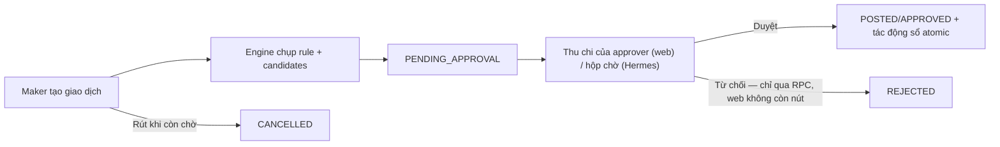

# Phê duyệt tài chính

> **Reviewed:** 2026-09-27  
> Màn người dùng: **Thu chi** (`/income-expense`, tab **Chờ xử lý**). Màn **Chờ duyệt** (`/approvals`) đã bỏ ngày 25/11/2026; đường dẫn cũ tự chuyển về Thu chi — xem mục "Màn hình duyệt (từ 25/11/2026)".

> **Phạm vi file này:** LUẬT phê duyệt tài chính — khi nào cần duyệt, ngưỡng, `force_approval`,
> đặc quyền. **KHÔNG nói về:** cơ chế posting phiếu và số dư — `08-thu-chi-so-quy.md`; SOP tay —
> `19-sop-tien-va-so-quy.md`. Audit mới nhất: `docs/audits/AUDIT-THANH-TOAN-2026-08-31.md`.
> Từ 01/09/2026: đặc quyền "Đóng thêm" (`p_force`) neo theo **VAI `TENANT_OWNER`** (migration live
> prod, vá P1-02 audit 31/08) — không còn lọt qua `is_org_owner_v1` vốn chặn nhầm chủ công ty thật.

## Khi nào cần duyệt — MỘT bộ máy quyết (từ 26/09/2026)

Phiếu chi sinh ra đã duyệt hay chờ do **một** hàm luật quyết: `app_private.ie_spend_decide_v1`
(migration `20260926150000`). Luật khai **trên hạng mục** (`income_expense_types.spend_mode`),
mỗi hạng mục một trong ba kiểu:

| Kiểu | Hạng mục (org THẬT) | Máy duyệt khi | Chờ duyệt khi |
|---|---|---|---|
| **CAM_KET** — theo cam kết | Tiền nhà, internet, quản lý, vệ sinh, công an, rác, thang máy | Mọi dòng nằm trong phần **còn lại** của cam kết tháng (toà × hạng mục × tháng, kỳ lấy theo kỳ áp dụng của dòng) | Vượt phần còn lại — **kể cả người có quyền duyệt**; tháng chưa ký cam kết |
| **TRAN** — theo trần | Điện, nước | Dưới trần đã công bố (trần mỗi phiếu) | Vượt trần; toà chưa khai trần |
| **TUNG_PHIEU** — từng phiếu (mặc định cho hạng mục mới) | Mọi hạng mục khác | Người lập **có quyền duyệt** (ghi dấu `SELF_APPROVER`); hoặc dưới ngưỡng | Hạng mục `force_approval=true`; tổng ≥ ngưỡng (600.000đ) |

Luôn đi trước ba kiểu trên: **phiếu THU** giữ nguyên (tự duyệt); **18 nguồn hệ thống** chủ đã duyệt
(thu hoá đơn, cọc, bàn giao quỹ, bút toán thanh lý, chi lương…) tự cân đối; **phiếu CHI không có sổ
quỹ thật** thì chờ. Phiếu có nhiều dòng: **một dòng chờ ⇒ cả phiếu chờ**. Phiếu chờ duyệt **giữ chỗ**
trong cam kết (không được có phiếu thứ hai cho cùng phần tiền). Duyệt phần vượt vẫn được, nhưng sổ
tiêu ghi "đã chi vượt" và cam kết **không tự nới**.

**Trạng thái áp dụng hiện nay: ĐANG ÁP DỤNG (từ 27/09/2026).** Chủ ra lệnh bật luôn, bỏ kỳ chạy thử
14 ngày / 7 ngày (migration `20260926172614`). Cờ `spend.engine.v1` = `ON` và `spend.cashbook_chi.v1` =
`ON`. 5 cửa chi (`create_income_expense_v1`, `pay_period_fee`, `pay_utility_bill`,
`generate_special_fees_v1`, `generate_recurring_vouchers`) hỏi bộ máy; bộ máy **áp** khi mọi dòng
có luật (CAM_KET/TRAN) của phiếu rơi vào toà × hạng mục × tháng đã bật công tắc
(`app_private.spend_policy_switches`). Công tắc đang bật cho org THẬT:

- **7 hạng mục cam kết** (tiền nhà, internet, quản lý, vệ sinh, công an, rác, thang máy): mọi toà, từ
  **kỳ 10/2026** — tháng đầu có cam kết (câu 01). Kỳ 09/2026 trở về trước vẫn theo luật cũ.
- **Điện** 17 toà, **nước** 12 toà — những toà đã có trần — từ **kỳ 09/2026**. Toà chưa có trần: luật cũ.
- **G6 — quyền CHI trên sổ**: ở 3 cửa Thanh toán (`pay_period_fee`, `pay_utility_bill`,
  `generate_special_fees_v1`), người lập không phải chủ sổ / CUSTODIAN / OPERATOR của sổ chi ⇒ phiếu
  **về chờ duyệt** (không chặn tạo). Luật này không cần công tắc.
- Phiếu chỉ có dòng "Từng phiếu": kết quả như luật cũ (bộ máy chỉ ghi dấu). Máy lỗi lúc đang áp ⇒ phiếu có
  dòng cam kết/trần **về chờ**, không bao giờ tự duyệt vì lỗi (`app_private.spend_engine_errors`).
- Org DEMO: cờ là toàn cục nhưng DEMO chưa bật công tắc nào ⇒ chỉ G6 có hiệu lực ở đó.

Lùi về chạy thử (một lệnh, qua lane): đặt cả hai cờ `mode = 'SHADOW'`; hoặc tắt công tắc từng bucket ở
`/settings/finance/cam-ket-chi` (màn **Cam kết chi**, thẻ **Bật áp dụng**).

Luật cũ (còn chạy cho bucket chưa bật): người lập có quyền duyệt ⇒ tự duyệt; hạng mục `force_approval` ⇒
chờ; chi ≥ ngưỡng ⇒ chờ; trang Thanh toán: phí cố định theo `special_fee_rule_check_v1`, điện nước theo
ngưỡng + trần (`utility_ceiling_check_v1`). Writer chuyên biệt khác giữ invariant riêng của nó.

**Hạng mục "công an" là TIỀN CÔNG AN, không gồm làm tạm trú** (chủ chốt 27/09/2026): bộ khớp tên
`fee_type_matches('cong_an', …)` loại dòng có chữ "tạm trú"; bản TS `feeTypeMatches` /
`FIXED_EXPENSE_CATEGORIES` giữ cùng luật.

## Luồng

- Hộp chờ (`list_my_pending_approvals_v1`, server lọc theo `auth.uid()`) không còn màn web riêng từ 25/11/2026; Hermes vẫn đọc hộp này, web duyệt qua Thu chi.
- Quyết định dùng `decide_financial_request_v2` với compare-and-swap; rút dùng `withdraw_financial_request_v1`.
- Maker không thể dùng các RPC approve legacy để vòng qua request engine.
- Duyệt và post sổ diễn ra trong transaction; retry dùng idempotency/CAS, không tạo bút toán đôi.

## Màn hình duyệt (từ 25/11/2026)

Chủ công ty chốt **duyệt phiếu MỘT đường duy nhất ở Thu chi**:

- Màn **Chờ duyệt** (`/approvals`, menu Tài chính → Chờ duyệt) **đã bỏ**; mục menu không còn, đường dẫn cũ tự chuyển về `/income-expense?approval_status=UNAPPROVED&layer=PENDING`. Nút **Từ chối** chỉ màn đó có nên bỏ theo; bỏ phiếu chờ duyệt dùng **Huỷ** (bắt buộc lý do).
- Web duyệt bằng nút **Duyệt** trên dòng phiếu / hộp chi tiết → hộp **Xác nhận duyệt phiếu** → `approve_income_expense_v2` (Chỉ duyệt) hoặc `approve_and_post_income_expense_v2` (Duyệt và Chi… / Duyệt và Thu…, khi người duyệt giữ sổ quỹ của phiếu).
- Phiếu chi theo **sổ tổng lợi nhuận** (chi lợi nhuận cổ đông, tạm ứng lợi nhuận, lương điều hành) trước đây bắt sang màn Chờ duyệt; nay cũng duyệt ở Thu chi, hộp có thêm thẻ số dư sổ tổng và chỉ chi từ đúng sổ quỹ đã chọn lúc lập. Luật ai được duyệt không đổi (xem `12-co-dong-loi-nhuan.md`).
- **Phía máy chủ không đổi:** bảng `approval_requests`, quy tắc duyệt, `list_my_pending_approvals_v1`, `decide_financial_request_v2`… vẫn chạy ngầm — chốt sổ tổng vẫn đòi phiếu có yêu cầu duyệt đang chờ, Hermes vẫn đọc hộp chờ. Chỉ bỏ màn hình web. Các hook `src/hooks/useApprovals.ts` còn trong mã (dọn ở đợt sau) nhưng không màn nào dùng.

## Cấu hình ngưỡng

Owner mở `/settings/general` → tab **Thu chi**:

- Bỏ trống/bỏ ngưỡng: phiếu chi thường tự duyệt.
- Đặt số dương: chi thường dưới ngưỡng tự duyệt; từ ngưỡng trở lên sinh nháp chờ duyệt.
- Chỉ owner organization được đổi bằng `set_ie_auto_approve_threshold_v1`.

## Xử lý sự cố

- Hộp chờ (Hermes) rỗng: request có thể không chỉ định người dùng hiện tại, đã được quyết định hoặc tài khoản/binding đã bị off-board.
- Người lập **có quyền duyệt** thì phiếu tự duyệt — chủ chốt 25/07 và giữ nguyên 26/09 (câu 05), chỉ ghi
  dấu vết để lọc/đếm: màn Cam kết chi → thẻ **Tự duyệt** (`list_self_approved_vouchers_v1`). Người không có
  quyền duyệt thì không tự duyệt được; chuyển người duyệt đúng rule.
- Câu 25 (chủ chốt 21/10/2026; migration `20261021231237`, **chờ áp**): phiếu CHI có tổng **từ ngưỡng trở
  lên** thì người lập không có quyền duyệt **không tự duyệt được** — "có quyền duyệt" = đúng rào duyệt của
  writer: `income_expenses.approve` ở toà của phiếu (`app_private.has_building_perm_v1` — hàm boolean dùng
  chung, `require_building_perm_v1` của câu 26 cũng gọi hàm này); phiếu không gắn toà chỉ super admin. Mọi đường cùng một hàm luật
  `app_private.ie_self_approve_over_threshold_blocked_v1`: REST thẳng `approve_income_expense_v1`/`approve_voucher`,
  nút Duyệt của công ty còn luồng LEGACY, Thanh toán phiếu phí nháp và Chốt lương. Hermes cũng kiểm hàm này khi xử lý `expense.approve`. Khi duyệt qua RPC của CRM, bị chặn ⇒ 42501 +
  HINT `ie_self_approve_over_threshold`; web hỏi cổng `ie_self_approve_gate_v1` ở hộp **Xác nhận duyệt phiếu**
  (mọi nơi bấm Duyệt đều qua hộp này): khoá nút + giải thích, và hỏi lại ngay trước khi lưu đổi sổ/ảnh hay
  duyệt. Người khác có quyền duyệt vẫn duyệt bình thường. Phiếu chờ duyệt **dưới** ngưỡng (hạng mục bắt buộc
  duyệt, bộ máy chi, G6) người lập vẫn tự duyệt được — ngoài câu 25.
- Phiếu tiền nhà/điện/… bất ngờ về chờ duyệt khi bộ máy đã bật: xem thẻ **Máy chấm thử** — lý do nằm ở cột
  "Máy quyết" (vượt cam kết, tháng chưa ký, vượt trần, phiếu chờ khác đang giữ chỗ…). Tắt công tắc của
  bucket đó ở thẻ **Bật áp dụng** là về luật cũ ngay; tắt hẳn: cờ `spend.engine.v1` ≠ `ON`.
- Không sửa trực tiếp `approval_status`/sổ quỹ. Dùng quyết định, withdraw hoặc reversal canonical để giữ audit.

Xem [hướng dẫn Thu chi](../huong-dan-su-dung/03-quan-ly-van-hanh/thu-chi/) và [authorization status](../authorization/README.md).
