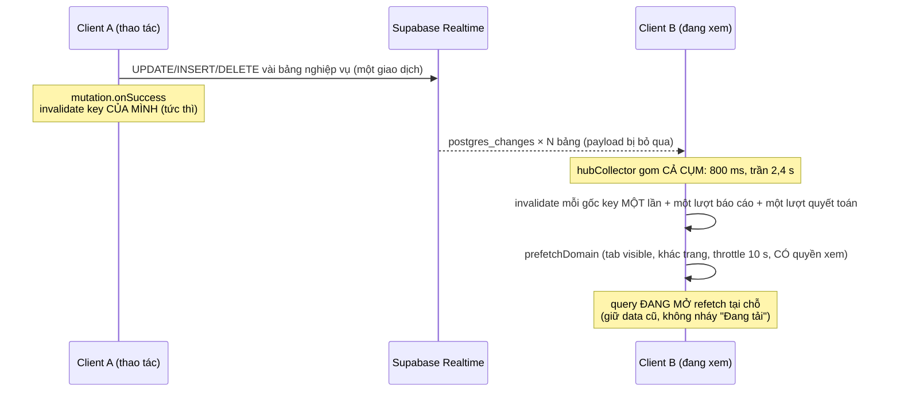

# Đồng bộ Realtime (5 họ kênh, bắt kịp, chỉ báo kết nối)

> **Phạm vi**: cơ chế đồng bộ dữ liệu thời gian thực giữa các client (nhiều thiết bị, nhiều nhân
> viên cùng lúc): *bảng nào phát event → invalidate query key nào → màn nào tự làm mới*, chuyện gì xảy
> ra khi kết nối rớt, và **luật bảo trì** để không tái phát lỗi "màn kẹt dữ liệu cũ".
>
> **Bài học gốc**: 2026-07-07 — xoá 3 phiếu điện T7 bên Thu chi nhưng màn mobile "Đóng điện nước" vẫn
> hiện "Đã đóng" vì `["utility-payments"]` không nằm trong danh sách invalidate của hub. Viết lại
> 21/10/2026 theo [plan realtime + thông báo](../plans/2026-10-21-realtime-thong-bao-toi-uu.md) (gói A).
>
> **Nguồn sự thật là code + gate, không phải đoạn văn này**: danh sách bảng
> [syncTables.ts](../../src/lib/realtime/syncTables.ts), descriptor
> [src/hooks/realtime/](../../src/hooks/realtime/), bề mặt
> [realtime-surface.json](../../contracts/surfaces/realtime-surface.json); gate
> `check-realtime-descriptors` / `-surface` / `-query-keys` / `-key-ownership`.

---

## 1. Năm họ kênh

| Kênh (topic) | Bảng · filter · event | Gom | Bắt kịp (onResync) | Mount |
|---|---|---|---|---|
| **Hub** `crm-data-sync-<uid>` (id `hub`) | 19 bảng nghiệp vụ ([syncTables.ts](../../src/lib/realtime/syncTables.ts)) · không filter · `*` | cụm xuyên bảng 800 ms, trần 2,4 s ([hubCollector.ts](../../src/lib/realtime/hubCollector.ts)) | `catchUp`: một lượt invalidate query **active** theo gốc key descriptor + `business-performance` + nhóm quyết toán | `<RealtimeDataSync/>` ở [AppProviders](../../src/app/providers/AppProviders.tsx) (ngoài OrganizationProvider), ref-count |
| **Chuông** `notif-<uid>` (id `notif`) | `notifications` · `user_id=eq.<uid>` | gói C | gói C: invalidate `["notifications"]` | `NotificationsRealtime` ở AppProviders — xem [useNotifications.ts](../../src/hooks/useNotifications.ts) |
| **Zalo danh sách** `zalo-convs-<org>` (id `zalo-convs`) | `zalo_conversations`, `zalo_accounts`, `zalo_labels` · `organization_id=eq.<org>` · `*` | 800 ms, trần 2,5 s, tab ẩn giữ cờ; key **exact** theo org | invalidate exact danh sách/tài khoản/nhãn của org | `/chat-zalo` ([useZaloChat.ts](../../src/hooks/useZaloChat.ts) `useZaloRealtime`) |
| **Zalo luồng tin** `zalo-msg-<conv>` (id `zalo-msg`) | `zalo_messages` · `conversation_id=eq.<conv>` · `*` | như trên; chỉ làm mới luồng tin đang mở | invalidate exact `["zalo","messages",conv]` | `/chat-zalo`; hội thoại mặc định được CHỐT một lần (useActiveConversation) |
| **Network Center** `network-center-<actor>` (id `network-center`) | `network_device_current`, `network_interface_current`, `network_incidents`, `network_command_events` · không filter · `*` | 5 s, trần 15 s, tab ẩn giữ cờ; toà đang chọn đọc qua ref lúc nhả | invalidate mọi query `["network-center",<actor>]` đang hiện | trang Network Center ([realtimeSync.ts](../../src/lib/network-center/realtimeSync.ts)) |

Mỗi tab đăng nhập luôn có 2 kênh (hub 19 binding, chuông); `/chat-zalo` thêm 2 kênh (4 binding),
Network Center thêm 1 kênh (4 binding). Chi phí Realtime tính theo binding, không theo kênh — gộp kênh
không đáng làm; cái đáng gộp là **vòng đời kênh**, và nó đã gộp vào
[subscribeResilient](../../src/lib/realtime/subscribeResilient.ts) (§4).

Mọi kênh chỉ dùng event làm **tín hiệu** (bỏ payload) rồi invalidate cache React Query — dữ liệu luôn
refetch qua query/RPC đã kiểm quyền. Event không phải ranh giới phân quyền (§6).

---

## 2. Điều kiện phía database

Bảng phải nằm trong publication `supabase_realtime`. Subscribe một bảng **không** được publish thì
`subscribe()` vẫn trả SUBSCRIBED, không lỗi, không log — giao diện chỉ lặng lẽ ngừng tự cập nhật. Vì vậy:

- `check-realtime-descriptors` (cần PAT) đối chiếu `REALTIME_SYNC_TABLES` với publication production;
- `check-realtime-surface` giữ toàn cảnh: ai nghe bảng nào, bảng publish mà không ai nghe, REPLICA
  IDENTITY từng bảng. Sinh lại bằng `node scripts/generate-realtime-surface.mjs` **sau khi** migration
  publication đã áp production.

Thay đổi 21/10/2026 ([20261021170902_realtime_publication_toi_uu.sql](../../supabase/migrations/20261021170902_realtime_publication_toi_uu.sql)):

- **Chưa bỏ** `network_worker_building_status` (client mới đã thôi nghe; heartbeat ~6.300 lần/ngày): client
  NC production cũ còn nghe bảng này trong cùng kênh — DROP để migration riêng sau promote (known-gap
  `realtime-nhip-tim-nc-con-trong-publication`).
- **Thêm** `meter_readings`, `meters`: có policy SELECT theo phạm vi toà cho người xem màn Chỉ số.
- **Không thêm** `approval_requests` / `approval_request_steps`: chỉ có policy RESTRICTIVE, không có
  policy SELECT cho phép nào ⇒ Realtime (chỉ giao event cho dòng người nghe SELECT được) sẽ không giao
  cho ai. Hộp duyệt bù bằng poll 60 s + focus (§8).

---

## 3. Hub trung tâm

- **Gom theo cụm xuyên bảng** (RT-HUB-7, 21/10): trước đây mỗi bảng một timer, nên một giao dịch chạm
  3–5 bảng làm cùng một danh sách refetch 2–4 lần (lần sau huỷ lần trước bằng `cancelRefetch`, mà request
  cũ vẫn chạy trên server). Nay một timer cho cả cụm; hợp key rồi invalidate mỗi key một lần.
- **Trần chờ**: debounce trailing thuần bị đẩy lùi vô hạn khi bulk (sinh HĐ hàng loạt, import thu chi);
  `MAX_WAIT_MS = DEBOUNCE_MS × 3` tính từ event **đầu** cụm ([hubDebounce.ts](../../src/lib/realtime/hubDebounce.ts)).
- **Invalidate theo PREFIX mảng**: `["income-expenses"]` phủ `["income-expenses","stats",…]`, nhưng key có
  **phần tử đầu khác** (`["invoice"]` số ít, `["room-detail-invoices"]`…) phải liệt kê tường minh — đây là
  lớp lỗi đã gặp nhiều nhất. Chỉ query đang mounted refetch; thêm key gần như miễn phí.
- **Tiếng vọng** ([localWriteEcho.ts](../../src/lib/realtime/localWriteEcho.ts)): event tới ≤3 s sau
  `markLocalWrite` của chính máy cho đúng bảng đó ⇒ gộp key của bảng về một lời gọi (chỉ query active),
  bỏ prefetch. Cờ tính theo bảng và nhân VÀ qua mọi event của bảng trong cụm.
- **Prefetch** ([prefetchGate.ts](../../src/lib/realtime/prefetchGate.ts) +
  `prefetchDomainTuHub`): chỉ khi tab visible, không đứng ở chính trang đó, throttle 10 s/domain, và
  **có quyền xem module** (RT-HUB-13) — quyền đọc từ cache `["my-permissions",org]` vì hub nằm ngoài
  OrganizationProvider; chưa có bảng quyền thì không prefetch.
- Hub **không** lọc theo công ty (RT-HUB-12): refetch thừa cho người đa công ty, không phải rò rỉ — dữ liệu
  vẫn đi qua RLS. Đừng thêm filter org (§6, RT-DB-10). Ghim ở `realtimeTenantBoundary.test.ts`.
- Hub có trần độ dài (`realtimeOrchestratorThin.test.ts`): code mới đặt ở `src/lib/realtime/*`.

---

## 4. Rớt kết nối & bắt kịp

`postgres_changes` **không phát lại** event đã lỡ (slot tạm thời). realtime-js tự nối lại socket và join
lại kênh sau CHANNEL_ERROR/TIMED_OUT, nhưng mọi thay đổi trong lúc rớt — máy ngủ, PWA vào nền, Wi-Fi
chập chờn, Realtime khởi động lại — là mất. `refetchOnWindowFocus` tắt toàn cục; `refetchOnReconnect` chỉ
chạy khi trình duyệt phát `online` và chỉ với query đã stale, nên không đủ.

Hợp đồng [subscribeResilient](../../src/lib/realtime/subscribeResilient.ts) (mọi kênh dùng chung):

| Tình huống | Hành vi |
|---|---|
| SUBSCRIBED lần đầu | không làm gì (dữ liệu vừa tải là mới) |
| SUBSCRIBED sau CHANNEL_ERROR / TIMED_OUT / CLOSED | `onResync()` một lần |
| Tab ẩn ≥ 60 s rồi hiện lại, hoặc window `online` | `onResync()` |
| Nhiều nguồn bắn cùng lúc | giãn cách 10 s/kênh chống dồn |
| CLOSED ngoài ý muốn (server `phx_close`, binding lệch) | dựng lại kênh, backoff 1→2→5→10→30 s, topic thêm hậu tố `:r<n>` (bắt buộc: `channel()` trả lại kênh cũ trùng topic đang leave ⇒ subscribe no-op, kênh chết im) |
| Nút "Tải lại dữ liệu" (`requestResyncAll`) | `onResync()` mọi kênh ngay, bỏ giãn cách |
| Teardown chủ động | không cảnh báo, không dựng lại, rời store sức khoẻ |

`onResync` chỉ làm tươi query **active** (`refetchType: 'active'`); query nền bị đánh dấu cũ, tải lại lúc
mở. Kênh nào có bộ gom thì `onResync` hủy việc chờ (lượt bắt kịp đã phủ).

Chưa làm (ghi để người sau khỏi đoán): `realtime: { worker: true }` / `onHeartbeat` trong
`createClient` (CRITIC-3) — file client là file sinh tự động, cần quyết định riêng; iOS PWA treo hẳn JS ở
nền nên vẫn cần nhánh visibilitychange.

---

## 5. Chỉ báo kết nối

[channelHealth.ts](../../src/lib/realtime/channelHealth.ts) là MỘT store cho mọi kênh: các kênh đi chung
một WebSocket nên thường rớt cùng lúc, người dùng cần một tín hiệu chứ không phải bốn dòng console.
Trạng thái tổng hợp: có một kênh `interrupted` là cả cụm `interrupted`, mốc là kênh rớt sớm nhất.

[RealtimeSyncBanner](../../src/components/layout/RealtimeSyncBanner.tsx) (gói C mount ở MainLayout): hiện
"Mất kết nối cập nhật tự động — đang nối lại…" khi gián đoạn **≥ 10 s** (chập 2 giây là chuyện thường),
tự ẩn khi nối lại; nút "Tải lại dữ liệu" gọi `requestResyncAll()` — không hứa "đã cập nhật", kết quả hiện
ở từng màn.

---

## 6. Giới hạn của postgres_changes (đo 21/10/2026)

- **Không phát lại (RT-DB-3)** — §4.
- **RLS xét dòng HIỆN TẠI (RT-DB-4, RT-HUB-M1)**: UPDATE làm dòng vô hình với người nghe thì người đó không
  nhận event. Ví dụ: 4 policy SELECT của `income_expenses` (fund_member, profit_manager, salary_staff,
  shareholder) có `deleted_at IS NULL` ⇒ thủ quỹ/cổ đông chỉ thấy phiếu qua các đường đó **không** nhận
  event xoá mềm; phiếu nằm lại trên màn tới lần bắt kịp/refetch kế. Cùng lớp: bảng không có policy SELECT
  cho phép (approval_*) thì publish cũng vô ích. **Không** nới policy để realtime nhận được event.
- **DELETE bỏ qua RLS (RT-DB-5)**: event DELETE tới mọi subscriber của bảng (kể cả công ty khác, kể cả anon
  nếu anon có SELECT trên bảng — đo 21/10: 15 bảng publish; migration 21/10 thêm `meters`,
  `meter_readings` cũng có SELECT cho anon) kèm khoá chính dòng bị xoá. Lộ siêu dữ liệu (bảng nào xoá dòng nào lúc nào), không lộ nội dung. Chặn hẳn cần kênh
  private (Broadcast, RT-DB-1) — chưa làm. Chưa REVOKE SELECT anon trên `meters`/`meter_readings`: anon còn EXECUTE hai
  hàm INVOKER đọc chúng và chưa chứng minh kênh nào không join dưới vai anon (thiếu quyền một bảng có thể làm hỏng cả
  kênh) — known-gap `realtime-delete-cong-to-toi-anon`.
- **Filter + DELETE không bao giờ khớp (RT-DB-10)**: REPLICA IDENTITY DEFAULT ⇒ `old_record` của DELETE chỉ
  có khoá chính, filter `organization_id=eq…` / `conversation_id=eq…` trượt. Zalo (59 hard delete trên
  `zalo_messages`) chỉ thấy tin bị xoá ở lần tải kế; **thêm filter org cho hub sẽ làm rơi mọi hard delete
  nghiệp vụ**. Muốn nhận DELETE qua filter phải đặt REPLICA IDENTITY FULL cho bảng đó (cân WAL).
- **Payload đầy đủ dù client bỏ (RT-DB-M1)**: chưa dùng tuỳ chọn `select` cột; ở quy mô hiện tại tải nhỏ.

---

## 7. Chi phí poll WAL (RT-DB-1)

`realtime.list_changes` là câu lệnh đơn tốn DB nhất (15,8% tổng thời gian SQL, ~4 ms và ~3,7 nghìn buffer
**mỗi lượt poll kể cả khi không có thay đổi**; ≈1,9% một core tính trung bình 24 h). Đây là phí cố định
theo nhịp poll, không theo số bảng hay subscriber — bỏ bớt bảng khỏi publication không cắt được nó. Cách bền
là chuyển listener chỉ cần tín hiệu sang Broadcast phân quyền theo topic công ty/user (kênh private, policy
trên `realtime.messages` so chuỗi topic) — ngoài phạm vi đợt 21/10.

---

## 8. Poll còn lại và lý do

| Query | Nhịp | Vì sao còn poll |
|---|---|---|
| `["pending-approvals"]` | 60 s + focus | từ chối/duyệt bước giữa chỉ ghi `approval_*` — không publish được (§2) |
| `["contract-meter-followups"]` | 60 s | hàng chờ theo HĐ đọc qua app_private — `meter_readings` (hub từ 21/10) chỉ phủ một phần nguồn |
| `["my-available-rooms"]`, phòng trống công khai | 5 s khi trang hiện | trang công khai/sale, có chủ ý |
| `dashboard-summary` | 5 phút | đọc leads/issues/deposits — bảng không publish |
| `["cash-handovers"]`, Zalo accounts | 5 phút (từ 60 s) | hub/kênh Zalo đã phủ + bắt kịp; poll chỉ là lưới an toàn |
| Zalo worker status | 60 s | nhịp tim worker, không có realtime |
| Business Performance (pnl, snapshot, occupancy…) | theo hook | báo cáo; Sidebar **không** poll `organizations` (chỉ là cờ menu) |
| Quay số công khai | 1,2–10 s, **dừng khi quay xong**; trang xem không poll ở nền | link công khai cho nhiều khách |

Báo cáo nặng: `financial-analysis`, `settlement-report`, `monthly-building-profit` đã nằm trong descriptor
`income_expenses`; từ 21/10 thêm `["reports"]` vào `invoices`/`income_expenses`/`contracts` (RT-HUB-11).
Chỉ query đang mở refetch và tối đa một lần mỗi cụm (2,4 s), nên một đợt bulk khi trang báo cáo đang mở
tốn vài lượt chứ không theo từng dòng.

---

## 9. Bản đồ bảng → key (tóm tắt — nguồn: `src/hooks/realtime/*.ts`)

| Miền | File | Ghi chú dễ sai |
|---|---|---|
| Tiền: `invoices`, `income_expenses`, `income_expense_items`, `income_expense_supplements`, `payments`, `accounts`, `cash_handovers`, `reservation_deposit_settlements`, `building_fee_accounts`, `building_utility_accounts` | [finance.ts](../../src/hooks/realtime/finance.ts) | màn chi tiết đọc phiếu bằng key riêng: `contract-pending-forfeit`, `contract-termination-info`, `invoice-vouchers`, `cashbook-closing-blockers`, `income-cancel-eligibility`, `ie-related-invoice`, `room-detail-invoices`, `payments-summary` (RT-HUB-5) |
| Hợp đồng: `contracts`, `contract_terminations`, `contract_transfers` | [contracts.ts](../../src/hooks/realtime/contracts.ts) | `deposit-dashboard` gắn ở `contracts` vì queryFn đọc contracts + terminations; `rooms-with-contracts`, `room-*`, `building-detail-contracts`, `customer-contracts` (RT-HUB-3) |
| Vận hành: `rooms`, `buildings`, `jobs`, `customers`, `meter_readings`, `meters` | [operations.ts](../../src/hooks/realtime/operations.ts) | `rooms` không còn "chỉ business-performance" — Sơ đồ toà kẹt cả trên máy tự sửa trước 21/10 |
| Báo cáo `["business-performance",…]` + quyết toán/facts | [index.ts](../../src/hooks/realtime/index.ts) | luật cắt ngang miền; subtype mới `break-even`, `invoice-cohort`, `cash-received`, `category-breakdown` (RT-HUB-11) |

> **Bài học `deposit-dashboard`**: gắn key theo **BẢNG mà queryFn thực đọc**, không theo tên tính năng.

---

## 10. Hai lớp làm mới — mutation vs hub

| Lớp | Ai hưởng | Khi nào |
|---|---|---|
| `setQueryData` từ kết quả mutation | **client thao tác** | ngay lập tức, không chạm mạng |
| `mutation.onSuccess` invalidate | **client thao tác** | tức thì, nhưng vẫn một vòng refetch |
| hub invalidate | **mọi client** (kể cả thao tác, trễ 0,8–2,4 s) | qua postgres_changes |

Mutation lo tức thì cho client hiện tại; hub lo cross-client. Mẫu `setQueryData` đang chạy:
`useSeedCustomerIntoPickerCache` (key lấy từ factory dùng chung, chèn idempotent theo id).

---

## 11. ✅ Luật bảo trì

1. **Kênh mới PHẢI dùng `subscribeResilient`**, không `channel.subscribe()` trần: id duy nhất trong store
   sức khoẻ, `onResync` làm tươi đúng key kênh đó phủ (chỉ query active). Subscribe trần là mất đồng bộ im
   lặng sau lần rớt đầu tiên.
2. Topic kèm user/org (`…-<uid>`, `…-<org>`); một topic chỉ một consumer — realtime-js ném lỗi khi `.on()`
   trên kênh đã join, nên consumer thứ hai của topic tĩnh sẽ hỏng (hub có ref-count riêng).
3. Màn mới đọc bảng realtime bằng key có **phần tử đầu mới** ⇒ thêm vào descriptor của bảng queryFn
   **thực đọc**; chạy `check-realtime-query-keys` + `check-realtime-key-ownership`.
4. Cần live một bảng chưa publish ⇒ kiểm `pg_policies` có policy SELECT cho phép người cần thấy **trước**
   (không có thì poll + focus), viết migration idempotent, thêm vào `REALTIME_SYNC_TABLES` + descriptor, áp
   migration rồi mới coi `check-realtime-descriptors` đạt và sinh lại surface.
5. Bảng hard delete + cần filter ⇒ cân REPLICA IDENTITY FULL, hoặc chấp nhận DELETE chỉ tới qua bắt kịp.
6. Bộ gom cho kênh ngoài hub: [burstScheduler.ts](../../src/lib/realtime/burstScheduler.ts) (debounce + trần,
   tab ẩn giữ cờ, dọn thì nhả việc tồn).
7. Test cross-client kiểm cả tín hiệu invalidate lẫn kết quả refetch đã qua authorization; không dùng việc
   nhận/không nhận event làm bằng chứng phân quyền.

---

## 12. Cách kiểm thử realtime

1. Mở màn cần kiểm ở **tab/thiết bị A**; ở **tab/thiết bị B** tạo/sửa/xoá dòng liên quan ⇒ trong ~1–3 s màn A
   tự làm mới, không nháy "Đang tải", console sạch.
2. **Bắt kịp**: ngắt mạng A (DevTools offline) ~30 s, sửa ở B, bật lại ⇒ A tự cập nhật sau khi kênh nối lại;
   gián đoạn ≥10 s thì dải "Mất kết nối cập nhật tự động" hiện rồi tự ẩn.
3. **Tab nền**: ẩn tab Zalo/Network Center, phát sự kiện ở B ⇒ A không refetch cho tới khi hiện lại (một lượt).
4. Unit test: `useRealtimeDataSync.test.ts` (cụm, tiếng vọng, bắt kịp), `realtimeSubscribeResilient.test.ts`,
   `realtimeBurstScheduler.test.ts`, `useZaloRealtime.test.tsx`, `networkCenterRealtimeSync.test.ts`,
   `RealtimeSyncBanner.feedback.test.tsx`.
