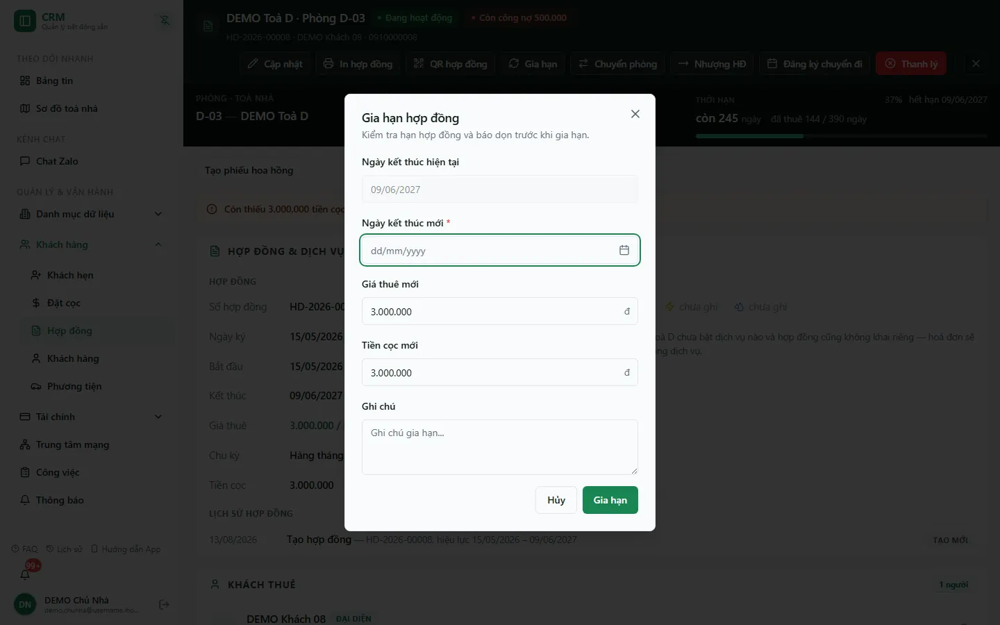
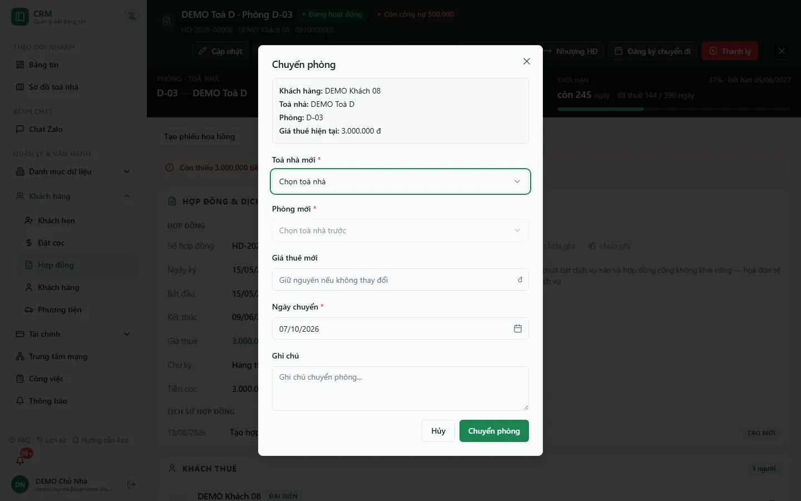

# Gia hạn, chuyển phòng & sang nhượng phòng

Trang này hướng dẫn ba thao tác biến động hợp đồng thường gặp: **gia hạn** khi khách muốn ở tiếp, **chuyển phòng** khi khách đổi sang phòng khác, và **sang nhượng phòng** khi khách cũ trả phòng trước hạn để người khác nhận lại phòng. Gia hạn và chuyển phòng thay đổi trực tiếp hợp đồng hiện tại; sang nhượng thì **giữ nguyên hợp đồng cũ** (thanh lý bằng loại **Trả phòng trước hạn**) và **ký hợp đồng mới** cho khách nhận. Hệ thống tự nối hai hợp đồng để đối soát, không còn thao tác nối tay.

::: info Nút Nhượng HĐ và Liên kết nhượng đã bỏ
Giao diện không còn nút **Nhượng HĐ** hay **Liên kết nhượng**. Sang nhượng phòng giờ ghi ngay trong hộp **Thanh lý** khi khách trả phòng trước hạn, qua ba trường hợp mô tả ở mục **Sang nhượng phòng (trả phòng trước hạn)** bên dưới.
:::

::: info Điều kiện tiên quyết
- **Gia hạn** cần `contracts.renew`; **Chuyển phòng** cần `contracts.transfer`; **Sang nhượng phòng** làm trong hộp **Thanh lý** nên cần `contracts.terminate`. Mọi thao tác đều cần phạm vi toà của hợp đồng.
- Hợp đồng phải **đang hiệu lực** — các nút chỉ hiện ở thanh đầu [trang chi tiết hợp đồng](/03-quan-ly-van-hanh/hop-dong-chi-tiet/) (và ở lưới **Thao tác** của danh sách) khi hợp đồng còn hiệu lực.
- Muốn chuyển phòng: phải có sẵn **phòng trống** ở toà đích (phòng đang có khách hoặc đang giữ cọc không hiện trong danh sách chọn).
- Muốn sang nhượng: phải biết khách cũ trả phòng ngày nào và nhờ ai tìm khách (nếu có). Phiếu hoa hồng môi giới cần thêm quyền tạo phiếu thu chi.
:::

::: warning Gia hạn KHÔNG đổi trạng thái hợp đồng
Khi gia hạn, hợp đồng **giữ nguyên trạng thái đang hiệu lực** — hệ thống chỉ đẩy **ngày kết thúc** ra xa hơn và ghi một dòng **GIA HẠN** vào **Lịch sử hợp đồng**. Đừng tìm một trạng thái riêng cho hợp đồng đã gia hạn.
:::

## Hướng dẫn từng bước

**Bước 1**: Mở **trang chi tiết** hợp đồng cần xử lý (xem [Trang chi tiết hợp đồng](/03-quan-ly-van-hanh/hop-dong-chi-tiet/)). Trên thanh đầu trang có các nút **Gia hạn**, **Chuyển phòng**, **Đăng ký chuyển đi**, **Thanh lý**.

### Gia hạn hợp đồng

**Bước 2**: Ấn **Gia hạn**. Hộp thoại **Gia hạn hợp đồng** ("Kiểm tra hạn hợp đồng và báo dọn trước khi gia hạn") hiển thị **Ngày kết thúc hiện tại** (chỉ đọc).

**Bước 3**: Điền **Ngày kết thúc mới \*** — phải muộn hơn ngày kết thúc hiện tại. Ô **Giá thuê mới** và **Tiền cọc mới** được điền sẵn theo hợp đồng hiện tại; xem và xác nhận chúng thay vì giả định giữ nguyên. Không hạ nghĩa vụ cọc xuống dưới số khách đã thực nộp nếu chưa có quyết định rõ ràng về phần chênh. Thêm **Ghi chú** nếu cần.

**Bước 4**: Nếu khách **đã báo trả phòng** trước đó, hộp thoại hiện thêm dòng "Đã báo dọn ngày …" và ô **Khi gia hạn, bạn muốn giữ hay hủy báo dọn?** — bắt buộc chọn **Giữ ngày báo dọn hiện tại** hoặc **Hủy báo dọn · Khách tiếp tục ở** thì nút **Gia hạn** mới bấm được. Ấn **Gia hạn**.

**Bước 5**: Hệ thống cập nhật ngày kết thúc, giá thuê và nghĩa vụ cọc trên cùng hợp đồng, ghi dòng **GIA HẠN** vào lịch sử. Tải lại trang và đối chiếu giá/cọc/ngày cuối cùng.

::: tip Số tháng gia hạn được tính tự động
Bạn chỉ cần chọn **ngày kết thúc mới**; hệ thống tự suy ra số tháng gia hạn so với ngày kết thúc cũ và lưu vào lịch sử.
:::

### Chuyển phòng

**Bước 6**: Ấn **Chuyển phòng**. Hộp thoại **Chuyển phòng** hiện khung tóm tắt **Khách hàng**, **Toà nhà**, **Phòng**, **Giá thuê hiện tại**.

**Bước 7**: Chọn **Toà nhà mới \*** rồi **Phòng mới \*** (chỉ liệt kê phòng đang **Trống**; toà không còn phòng trống thì ô ghi "Không có phòng trống"). Nếu giá khác, điền **Giá thuê mới** (để trống thì giữ giá cũ). Chọn **Ngày chuyển \*** (mặc định hôm nay), thêm **Ghi chú** rồi ấn **Chuyển phòng**. Nếu phòng cũ đang có báo trả phòng, hộp thoại báo ngày báo dọn đó sẽ **được hủy** khi chuyển thành công; phòng mới chưa có báo dọn, bạn ghi nhận riêng sau nếu cần.

**Bước 8**: Hệ thống chuyển hợp đồng sang phòng mới, cập nhật giá (nếu nhập), ghi dòng **CHUYỂN PHÒNG** vào lịch sử. Hợp đồng vẫn đang hiệu lực; **phòng cũ về Trống**, **phòng mới thành Đang thuê**.

::: warning Chuyển phòng có hiệu lực ngay và không có nút hoàn tác
Nếu chuyển nhầm, phải mở lại **Chuyển phòng** và chuyển ngược về phòng cũ (khi phòng cũ vẫn còn trống). Kiểm tra kỹ toà và phòng đích trước khi xác nhận. Trường hợp cần chuyển sang **toà khác**, hãy xác nhận với quản trị trước — hệ thống có thể từ chối tuỳ phạm vi quyền.
:::

### Sang nhượng phòng (trả phòng trước hạn)

Sang nhượng phòng là khi khách cũ trả phòng trước hạn vì **đã có người nhận phòng**. Khách cũ thanh lý như bình thường, khách nhận ký hợp đồng mới, hai bên được nối tự động. Có **ba trường hợp**, chọn ngay khi ghi trả phòng.

**Bước 9**: Ấn **Thanh lý** trên trang chi tiết hợp đồng cũ. Nhập **Ngày khách thực tế trả phòng**, chọn **Loại thanh lý** là **Trả phòng trước hạn**. Ngay dưới hiện ô **Trường hợp trả phòng trước hạn** — bắt buộc chọn một trong ba:

| Trường hợp | Khi nào chọn | Phòng | Quyết toán | Phí môi giới |
| --- | --- | --- | --- | --- |
| **Nhờ sale tìm khách sang phòng** | Đã có khách nhận phòng qua sale. Bắt buộc ghi **Tên sale / môi giới** (người nhận phiếu hoa hồng). | Giữ **3 ngày** cho khách nhận, **không rao bán**. | Chỉ ghi **Trả phòng, quyết toán sau**; quyết toán khi đã có hợp đồng khách nhận. | Mặc định **50% cọc cũ**, trừ vào cọc; phiếu hoa hồng cho sale lập sau quyết toán. |
| **Tự tìm khách sang phòng** | Khách cũ tự tìm được người nhận phòng. | Giữ **3 ngày**, không rao bán. | Giống trường hợp trên. | Không có. Hợp đồng khách nhận **không có hoa hồng môi giới hay thưởng sale**. |
| **Chủ nhà hỗ trợ thanh lý sớm** | Chủ nhà đồng ý cho thanh lý sớm, không có khách nhận phòng. Cũng là lựa chọn khi khách nhận đã huỷ (Bước 14). | **Rao bán lại ngay**. | Như bình thường; có thể **Tiếp tục quyết toán ngay**. | Không có. |

Hộp thoại hiện một dòng ghi chú ngắn cho trường hợp đang chọn để bạn đối chiếu.

**Bước 10**: Với hai trường hợp đầu, hộp chỉ còn nút **Trả phòng, quyết toán sau** (không còn **Tiếp tục quyết toán ngay**). Ấn nút này: hợp đồng cũ chuyển **Đã thanh lý**, hồ sơ vào tab **Chờ quyết toán** của màn [Hợp đồng](/03-quan-ly-van-hanh/hop-dong/), phòng hiện nhãn **Chờ khách Sang/Nhượng phòng** ở [Sale Phòng](/03-quan-ly-van-hanh/sale-phong/) và được giữ 3 ngày. Trường hợp thứ ba đi theo luồng thanh lý thường (xem [Khách rời phòng](/03-quan-ly-van-hanh/thanh-ly-move-out/)).

**Bước 11**: Tạo hợp đồng cho khách nhận ở **chính phòng đó** (nhận cọc giữ phòng rồi ký, hoặc tạo hợp đồng mới). Ở hộp tạo cọc và form **Tạo hợp đồng mới**, một băng báo màu vàng ghi phòng đang chờ khách sang nhượng. **Hợp đồng mới đầu tiên của phòng** (bắt đầu từ ngày khách cũ trả phòng trở đi) được hệ thống **tự nối** với hồ sơ trả phòng cũ — bạn không phải chọn hay nối tay.

**Bước 12**: Quyết toán hồ sơ cũ. Mở từ tab **Chờ quyết toán** (nút **Quyết toán**) hoặc khối **Hồ sơ trả phòng** (**Quyết toán hồ sơ này**). Chưa có hợp đồng khách nhận thì hộp báo "Chưa có hợp đồng của khách nhận phòng" và chặn quyết toán. Khi đã có, ở bước quyết toán:

- **Tiền cọc hoàn trả** bị khoá bằng **cọc đã thu** của hợp đồng cũ.
- Trường hợp nhờ sale: dòng **Phí môi giới** tự thêm vào khu **THU THÊM** và bị khoá, cấn từ cọc như các khoản thu khác. Muốn đổi số, ấn **Sửa phí**, nhập phí mới (kể cả 0 đồng, không vượt cọc đã thu) và **Lý do sửa phí** (bắt buộc).

**Bước 13**: Phiếu hoa hồng (trường hợp nhờ sale có phí). Ngay sau khi quyết toán, hộp mở tiếp **Phiếu hoa hồng môi giới** điền sẵn người nhận (tên sale) và số tiền (đúng phí môi giới đã quyết toán). Chỉ lập được khi **khách nhận đã nộp đủ cọc**; chưa đủ thì ấn **Để sau (hồ sơ sẽ nhắc)** rồi lập sau bằng nút **Lập phiếu hoa hồng** ở khối **Hồ sơ trả phòng**. Phí bằng 0 đồng thì không có phiếu.

**Bước 14**: Khi khách nhận huỷ, không ký nữa. Ở Sale Phòng ấn **Mở bán lại** để rao phòng ngay; hợp đồng mới tạo sau đó **không tự nối** với hồ sơ cũ. Sau đó mở hồ sơ trả phòng cũ, ấn **Đổi trường hợp** (hoặc **Đổi sang trường hợp 3**), chọn **Chủ nhà hỗ trợ thanh lý sớm** kèm **lý do**, thì mới quyết toán được.

::: warning Sang nhượng không tự chuyển tiền giữa hai hợp đồng
Hợp đồng cũ quyết toán cọc, nợ, hoàn tiền theo đúng luồng thanh lý; phí môi giới (nếu có) trừ vào cọc cũ khi quyết toán. Hợp đồng khách nhận thu cọc riêng. Không tự cấn cọc cũ sang hợp đồng mới bằng phiếu tay.
:::

## Các tính năng khác trên màn hình

| Nút / Ô nhập | Công dụng |
| --- | --- |
| **Gia hạn** | Mở hộp **Gia hạn hợp đồng**; chỉ hiện khi hợp đồng đang hiệu lực. |
| Ô **Ngày kết thúc hiện tại** / **Ngày kết thúc mới** | Mốc đang áp (chỉ đọc) và mốc mới (bắt buộc, phải muộn hơn). |
| Ô **Giá thuê mới** / **Tiền cọc mới** | Điền sẵn khi gia hạn; giá trị lưu thay trực tiếp giá/cọc hiện hành. |
| Ô **Khi gia hạn, bạn muốn giữ hay hủy báo dọn?** | Chỉ hiện khi đã có báo trả phòng; bắt buộc chọn trước khi gia hạn. |
| **Chuyển phòng** | Mở hộp **Chuyển phòng**: Toà nhà mới, Phòng mới (chỉ phòng Trống), Giá thuê mới, Ngày chuyển, Ghi chú. |
| **Thanh lý** → **Trả phòng trước hạn** | Hiện ô chọn một trong ba trường hợp sang nhượng phòng; hai trường hợp đầu bắt buộc **Trả phòng, quyết toán sau**. |
| **Đổi trường hợp** / **Đổi sang trường hợp 3** | Đổi trường hợp của hồ sơ chờ quyết toán, bắt buộc ghi lý do. |
| **Sửa phí** | Sửa phí môi giới của ca nhờ sale trước khi quyết toán, bắt buộc ghi lý do. |
| **Lập phiếu hoa hồng** | Lập phiếu hoa hồng môi giới cho sale sau quyết toán, khi khách nhận đã nộp đủ cọc. |
| **Mở bán lại** / **Giữ tiếp** (Sale Phòng) | Rao phòng ngay khi khách nhận huỷ / giữ phòng thêm khi khách nhận chưa kịp ký. |
| **Lịch sử hợp đồng** (trang chi tiết) | Dòng **GIA HẠN** / **CHUYỂN PHÒNG** theo thời gian; hợp đồng có nhượng ghi theo cách cũ vẫn hiện dòng **NHƯỢNG HĐ**. |

## Tình huống & lỗi thường gặp

| Tình huống | Cách xử lý |
| --- | --- |
| Không thấy nút **Gia hạn** / **Chuyển phòng** | Nút chỉ hiện khi hợp đồng còn hiệu lực và bạn có quyền `renew` / `transfer`. Hợp đồng đã **Thanh lý** không còn các nút này. |
| Tìm nút **Nhượng HĐ** hoặc **Liên kết nhượng** không thấy | Hai nút đã bỏ. Dùng **Thanh lý** → **Trả phòng trước hạn** → chọn **Nhờ sale tìm khách sang phòng** hoặc **Tự tìm khách sang phòng**. |
| Nút **Gia hạn** trong hộp bị mờ | Hợp đồng đang có báo trả phòng; chọn **Giữ ngày báo dọn hiện tại** hoặc **Hủy báo dọn · Khách tiếp tục ở** trước. |
| Gia hạn báo lỗi ngày kết thúc | **Ngày kết thúc mới** phải muộn hơn ngày kết thúc hiện tại. |
| Ô **Phòng mới** ghi "Không có phòng trống" | Toà đã chọn chưa có phòng **Trống**. Chọn toà khác hoặc giải phóng một phòng trước (phòng đang có khách/đang giữ cọc không hiện). |
| Chuyển nhầm phòng | Mở lại **Chuyển phòng** và chuyển ngược về phòng cũ (nếu còn trống). |
| Sau chuyển phòng, phòng cũ vẫn báo **Đang thuê** | Kiểm tra phòng cũ còn hợp đồng hiệu lực nào khác không. Với thao tác chuyển chuẩn, phòng cũ tự về **Trống**. |
| Chọn **Nhờ sale** mà không bấm được nút | Chưa nhập **Tên sale / môi giới**, chưa nhập **Nội dung thanh lý**, hoặc chưa chọn đủ trường hợp. |
| Không thấy nút **Tiếp tục quyết toán ngay** | Đúng thiết kế với hai trường hợp có khách nhận phòng: chọn **Trả phòng, quyết toán sau**, quyết toán khi đã có hợp đồng khách nhận. |
| Quyết toán báo "Chưa có hợp đồng của khách nhận phòng" | Tạo hợp đồng cho khách nhận ở đúng phòng, bắt đầu từ ngày khách cũ trả phòng trở đi để hệ thống tự nối. Khách nhận đã huỷ thì làm theo Bước 14. |
| Đã có hợp đồng khách nhận mà hồ sơ cũ vẫn báo chưa có | Hợp đồng chỉ tự nối khi là hợp đồng mới **đầu tiên** của phòng và bắt đầu từ ngày khách cũ trả phòng trở đi. Phòng đã **Mở bán lại** thì hợp đồng mới không tự nối. |
| Hết 3 ngày giữ phòng mà chưa có hợp đồng | Phòng tự rao lại như phòng trống, hồ sơ vẫn chờ hợp đồng khách nhận. Cần giữ thêm thì ấn **Giữ tiếp** ở Sale Phòng. |
| Không lập được phiếu hoa hồng | Khách nhận chưa nộp đủ cọc: thu đủ rồi lập lại từ khối **Hồ sơ trả phòng**. Hoặc phí môi giới đã sửa về 0 đồng nên không có phiếu. |

## Thử trực tiếp trên sandbox

<SandboxTry account="demo.chunha" app-path="/contracts" app-label="Mở danh sách Hợp đồng" fixtures="Snapshot 07/10/2026: 20 hợp đồng, 3 quá hạn, không có hồ sơ sang nhượng nào." view-only>

Quan sát luồng mà không lưu thay đổi:

1. Ấn thẻ **Quá hạn**, mở một hợp đồng bằng **Xem chi tiết**. Ghi nhớ mã hợp đồng, phòng và ngày kết thúc.
2. Ấn **Gia hạn** để xem các ô; không nhập, bấm **Hủy**.
3. Ấn **Chuyển phòng**, chọn thử một toà để xem danh sách phòng trống; bấm **Hủy**.
4. Ấn **Thanh lý**, chọn **Trả phòng trước hạn** để xem ba trường hợp và ghi chú của từng trường hợp; bấm **Hủy** — không bấm **Trả phòng, quyết toán sau**.

Kết quả mong đợi: bạn phân biệt được gia hạn (đổi ngày trên hợp đồng hiện tại), chuyển phòng (đổi phòng, giữ hợp đồng) và sang nhượng phòng (thanh lý hợp đồng cũ bằng trả phòng trước hạn + ký hợp đồng mới tự nối).

</SandboxTry>

## Quy trình liên quan

- [Hợp đồng](/03-quan-ly-van-hanh/hop-dong/) — danh sách hợp đồng, tab **Chờ quyết toán** và tab **Hợp đồng nháp** nơi soạn nháp khách nhận.
- [Trang chi tiết hợp đồng](/03-quan-ly-van-hanh/hop-dong-chi-tiet/) — gốc mở các thao tác và xem **Lịch sử hợp đồng**.
- [Thanh lý — Khách rời phòng](/03-quan-ly-van-hanh/thanh-ly-move-out/) — ghi nhận khách cũ trả phòng, ba trường hợp trả phòng trước hạn và quyết toán.
- [Sale Phòng](/03-quan-ly-van-hanh/sale-phong/) — nhãn **Chờ khách Sang/Nhượng phòng**, **Mở bán lại**, **Giữ tiếp**.
- [Hoàn / bỏ cọc](/03-quan-ly-van-hanh/hoan-bo-coc/) — xử lý tiền cọc khi kết thúc hợp đồng.
- [Căn hộ / Phòng](/03-quan-ly-van-hanh/can-ho-phong/) — trạng thái phòng tự đổi theo hợp đồng.
- [Quy trình khách thuê](/01-bat-dau/quy-trinh-khach-thue/) — vòng đời khách thuê từ đặt cọc, ký hợp đồng đến gia hạn và thanh lý.
