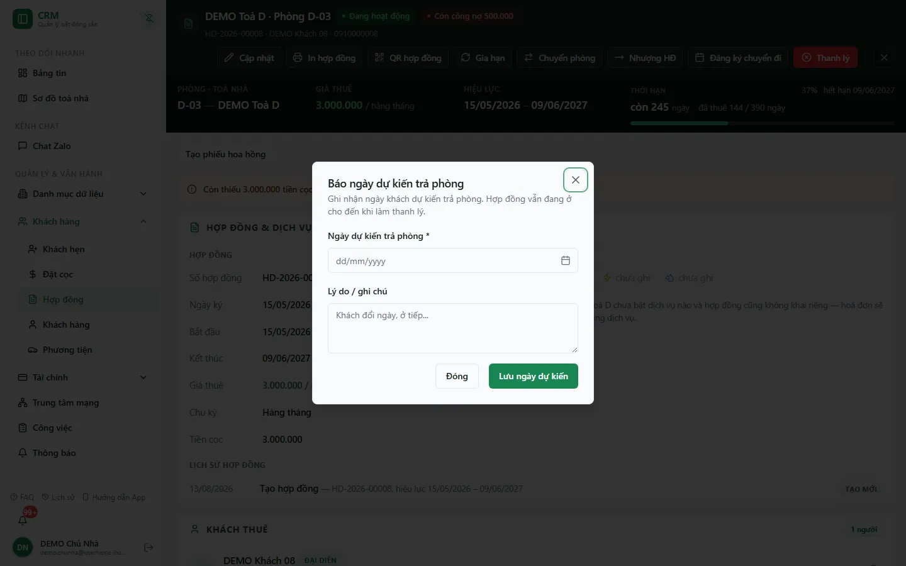
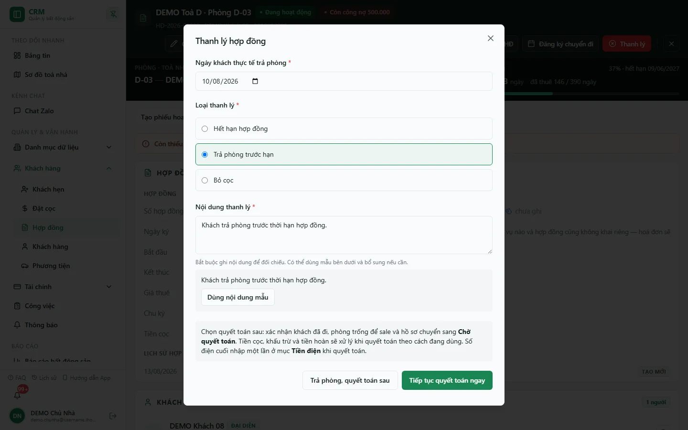
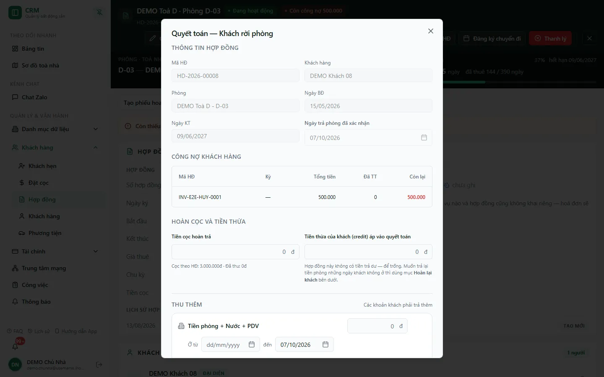

# Thanh lý hợp đồng — Khách rời phòng

Khi một khách **trả phòng đúng quy trình** (hết hạn hoặc trả trước hạn, bàn giao lại phòng), bạn đi qua ba chặng: **báo ngày dự kiến trả phòng** (khi khách thông báo), **ghi nhận trả phòng thực tế** (khi bàn giao), và **quyết toán** cọc/công nợ — ngay lúc trả hoặc để sau. Tách hai chặng cuối giúp phòng được **trả trống để sale ngay** trong khi kế toán quyết toán sau, không ai phải đoán.

::: danger Quyết toán là thao tác GHI TIỀN và KHÔNG THỂ HOÀN TÁC
Bấm **Lập hoá đơn & Thanh lý** rồi **Xác nhận thanh lý** sẽ **ghi phiếu thu/chi thật**, **quyết toán các hoá đơn còn nợ** và **đóng hợp đồng**. Kiểm tra kỹ **ngày trả phòng**, **công nợ**, **tiền cọc hoàn trả**, **thu thêm** và **hoàn lại khách** trước khi xác nhận. Bài kiểm tra trong tài liệu chỉ **mở form rồi đóng**.
:::

::: info Điều kiện tiên quyết
- Quyền **Hợp đồng => Thanh lý** (module `contracts`, action `terminate`) — nút **Đăng ký chuyển đi** và **Thanh lý** chỉ hiện khi bạn có quyền này.
- Hợp đồng đang hiệu lực và còn gắn phòng/toà nhà.
- Nên biết **số điện cuối** của đồng hồ; số này nhập ở mục **Tiền điện (chốt số)** khi quyết toán (ngay hoặc sau).
- Tiền cọc đã thu nằm trên các phiếu cọc của hợp đồng — xem [Đặt cọc](/03-quan-ly-van-hanh/dat-coc/) và [Hoàn / bỏ cọc](/03-quan-ly-van-hanh/hoan-bo-coc/).
:::

## Hướng dẫn từng bước

**Bước 1 — Báo ngày dự kiến trả phòng**: Khi khách báo sẽ trả, mở [trang chi tiết hợp đồng](/03-quan-ly-van-hanh/hop-dong-chi-tiet/) và ấn **Đăng ký chuyển đi** (ở danh sách là nút **ĐK chuyển đi**). Hộp **Báo ngày dự kiến trả phòng** ("Hợp đồng vẫn đang ở cho đến khi làm thanh lý") có **Ngày dự kiến trả phòng \*** và **Lý do / ghi chú**; ấn **Lưu ngày dự kiến**.

Sau khi lưu: trang chi tiết hiện dải **Khách dự kiến trả phòng: dd/mm/yyyy** kèm **Sửa / hủy báo trả phòng**; trang công khai [Phòng trống](/03-quan-ly-van-hanh/trang-phong-trong/) hiện phòng là **Sắp trống**. Đến ngày hẹn, hợp đồng vào khối **Cần xác nhận ngày trả phòng** đầu màn [Hợp đồng](/03-quan-ly-van-hanh/hop-dong/) — bấm **Cập nhật ngày trả** để đổi ngày, hoặc **Hủy báo trả phòng** nếu khách ở tiếp. Báo trả **không** đóng hợp đồng và không ghi tiền.

**Bước 2 — Ghi nhận khách trả phòng**: Khi khách bàn giao thực tế, ấn nút đỏ **Thanh lý**. Hộp **Thanh lý hợp đồng** mở ra:

- **Ngày khách thực tế trả phòng \*** (mặc định hôm nay).
- **Loại thanh lý \***: **Hết hạn hợp đồng**, **Trả phòng trước hạn** hoặc **Bỏ cọc** (bỏ cọc xem trang [Khách bỏ cọc](/03-quan-ly-van-hanh/thanh-ly-forfeit/)). Chọn **Trả phòng trước hạn** thì hiện thêm ô **Trường hợp trả phòng trước hạn** — bắt buộc chọn một trong ba (xem mục **Trả phòng trước hạn: ba trường hợp** bên dưới).
- **Nội dung thanh lý \*** — bắt buộc, dùng để đối chiếu và **in trên phiếu hoàn cọc**. Có thể bấm **Dùng nội dung mẫu** rồi bổ sung.
- Bước này **không hỏi chỉ số**: số điện cuối nhập một lần ở mục **Tiền điện** khi quyết toán, và mốc trả phòng tự lấy số đó.

**Bước 3 — Chọn quyết toán ngay hay để sau**:

- **Trả phòng, quyết toán sau**: xác nhận khách đã đi; hợp đồng chuyển **Đã thanh lý** với ngày trả thực tế, phòng trống để sale, và hồ sơ vào tab **Chờ quyết toán** của màn Hợp đồng. Tiền cọc, khấu trừ và tiền hoàn xử lý khi quyết toán. Thao tác này **không ghi tiền**.
- **Tiếp tục quyết toán ngay**: chuyển sang form quyết toán (Bước 4). Nút này **không có** khi bạn chọn trường hợp nhờ sale hoặc tự tìm khách sang phòng — hai trường hợp đó chỉ ghi **Trả phòng, quyết toán sau**.

Với hồ sơ đã trả phòng, mở lại từ tab **Chờ quyết toán** (nút **Quyết toán**) hoặc khối **Hồ sơ trả phòng** trên trang chi tiết (**Quyết toán hồ sơ này**). Hộp mở với tiêu đề **Quyết toán hồ sơ đã trả phòng**, giữ ngày và nội dung đã ghi; nếu đổi loại thanh lý phải nhập **Lý do đổi loại thanh lý**. Ấn **Tiếp tục quyết toán**.

**Bước 4 — Form Quyết toán — Khách rời phòng**, từ trên xuống:

- **THÔNG TIN HỢP ĐỒNG**: Mã HĐ, Khách hàng, Phòng, Ngày BĐ, Ngày KT, **Ngày trả phòng đã xác nhận** (chỉ đọc).
- **CÔNG NỢ KHÁCH HÀNG**: hoá đơn chưa thanh toán (Mã HĐ, Kỳ, Tổng tiền, Đã TT, Còn lại) hoặc *Không có hoá đơn chưa thanh toán*.
- **HOÀN CỌC VÀ TIỀN THỪA**: **Tiền cọc hoàn trả** là số cọc hoàn cho khách theo thoả thuận, trước khấu trừ (mặc định bằng số nhỏ hơn giữa cọc **đã thu** và cọc theo HĐ, dòng dưới ghi "Cọc theo HĐ … · Đã thu …"; nhập quá số đã thu thì hệ thống chỉ hoàn tối đa số đã thu; nhập thấp hơn thì phần không hoàn thành dòng **Cọc giữ lại theo thoả thuận**, xem mục bên dưới) và **Tiền thừa của khách (credit) áp vào quyết toán** (mặc định 0; nếu khách có credit, ô ghi rõ số credit hiện có — phần không nhập vẫn treo trên hợp đồng).
- **THU THÊM** (các khoản khách phải trả thêm): **Tiền phòng + Nước + PDV** theo khoảng **Ở từ → đến**, **Tiền điện** (số đầu → **Số cuối**), **Tiền vệ sinh** (mặc định 200.000 đ), và khoản tuỳ ý. Các khoản này vào **hoá đơn thanh lý riêng** (kỳ tháng trả phòng) và được khấu trừ vào cọc — không sửa hoá đơn tiền phòng hằng tháng.
- **HOÀN LẠI KHÁCH**: **Tiền phòng ngày không ở** theo khoảng **Không ở từ → đến** và khoản hoàn tuỳ ý. Phần này **giảm lợi nhuận** (khác hoàn cọc là tiền giữ hộ); nếu khách còn nợ, nó được cấn thẳng vào công nợ trước.
- **TỔNG HỢP**: Tổng công nợ, **Cọc đem ra quyết toán**, Tiền phòng thừa, Hoàn lại khách, Tổng thu thêm, **Tổng khấu trừ (công nợ + thu thêm)** và ô kết quả **Chủ nhà trả lại khách** hoặc **Khách còn phải trả**.
- **Ghi chú**.

> **Số quyết toán = (Cọc đem ra quyết toán + Tiền thừa áp vào + Hoàn lại khách) − (Công nợ + Tổng thu thêm)**, trong đó Tổng thu thêm gồm cả dòng **Cọc giữ lại theo thoả thuận** (nếu có).

**Bước 5**: Nếu kết quả là **Khách còn phải trả**, chọn một trong hai:

- **Khách đã trả đủ … khi rời phòng — ghi nhận thu ngay**: chọn **Sổ nhận tiền** (mặc định **Tự chọn (sổ Thu của bạn)**).
- **Ghi nợ** — hoá đơn giữ công nợ chờ thu sau; không ghi doanh thu khi chưa thu được tiền.

**Bước 6**: Ấn **Lập hoá đơn & Thanh lý**. Hộp **Xác nhận thanh lý — khách rời phòng** tóm tắt **Cọc hoàn/cấn (kẹp theo đã thu)**, **Cọc giữ lại theo thoả thuận (doanh thu)** (nếu có), **Công nợ được quyết toán**, **Thu thêm**, **Tiền thừa (credit) áp vào quyết toán**, **Hoàn lại khách** (tách phần cấn vào công nợ / chi trả khách), cảnh báo credit còn treo (nếu có) và dòng cuối **Trả lại khách** / **Khách trả thêm (ghi thu ngay)** / **Khách còn nợ (ghi nợ chờ thu)**. Ấn **Xem lại** để quay lại, hoặc **Xác nhận thanh lý** để chốt.

::: danger Xác nhận = ghi tiền và đóng hợp đồng ngay
Khi xác nhận, hệ thống: tạo **hoá đơn thanh lý** kèm các khoản thu thêm; quyết toán các hoá đơn còn nợ; chuyển phần cọc đã cấn thành **doanh thu thanh lý** (vào KQKD; phần cọc giữ lại theo thoả thuận đứng hạng mục riêng **Cọc giữ lại theo thoả thuận**); tạo **phiếu chi hoàn cọc / trả khách** cho phần dư (hoàn cọc nằm ngoài KQKD, hoàn tiền phòng ngày không ở thì giảm lợi nhuận); đổi hợp đồng sang **Đã thanh lý** và giải phóng phòng. Phiếu chi **"Trả khách thanh lý"** có thể còn **chờ duyệt** — trang chi tiết sẽ nhắc vào phiếu, **chọn sổ quỹ chi tiền** rồi **Duyệt**; chỉ phiếu đã ghi sổ (**POSTED**) mới là tiền thật đã ra quỹ.
:::

**Bước 7 — Checklist sau thanh lý** (trước khi cho thuê lại hoặc chi tiền ngoài hệ thống):

1. Hợp đồng ở **Đã thanh lý**, đúng ngày trả thực tế; khối **Hồ sơ trả phòng** ghi **Đã chốt quyết toán**; phòng thực sự trống.
2. Hoá đơn còn nợ và hoá đơn thanh lý có trạng thái và số dư đúng.
3. Phiếu hoàn cọc / trả khách tồn tại đúng một lần, đúng số, có **nội dung thanh lý**; đã chọn sổ quỹ, đã duyệt và đã ghi sổ.
4. Chỉ số bàn giao: số điện cuối nhập ở ô **Tiền điện (chốt số)** lúc quyết toán, mốc trả phòng tự lấy số đó. Hồ sơ đã quyết toán mà chưa có số chốt nằm trong khối **Chờ bổ sung chỉ số bàn giao** (tab Chờ quyết toán) — bấm **Mở mốc bàn giao** rồi **Bổ sung / sửa chỉ số**. Bỏ cọc không cần số chốt.
5. Credit còn treo (nếu cảnh báo có nhắc) được xử lý riêng.
6. Sau khi phiếu hoàn đã duyệt, **cọc còn ghi trên hợp đồng về 0** (trừ phần sổ cọc ghi dôi trên cọc HĐ, xem mục dưới). Còn số dư thì không phải "cọc giữ lại" — đối chiếu phiếu cọc.

## Cọc giữ lại theo thoả thuận

Từ 25/11/2026 thanh lý rời phòng (hết hạn hoặc trả trước hạn) **không để cọc treo** trên hợp đồng (trừ phần sổ cọc ghi dôi trên cọc HĐ, xem dưới). Phần cọc không hoàn cho khách theo thoả thuận (ví dụ chủ nhà đồng ý thanh lý sớm nhưng giữ lại một phần cọc) phải thành một dòng thu có chứng từ.

- **Sàn** = số nhỏ hơn giữa **cọc đã thu** và **cọc theo HĐ**. Ô **Tiền cọc hoàn trả** mặc định bằng sàn.
- Nhập **thấp hơn sàn**: ngay dưới ô hiện dòng **Cọc giữ lại theo thoả thuận: … đ** (bằng sàn trừ số nhập). Hệ thống tự đem **đủ sàn** ra quyết toán và tự thêm dòng khoá **Cọc giữ lại theo thoả thuận** vào khu **THU THÊM**; dòng này vào **hoá đơn thanh lý**, được cấn từ cọc và ghi **doanh thu** với hạng mục riêng **Cọc giữ lại theo thoả thuận**. Khách vẫn nhận đúng số đã nhập trừ các khoản khấu trừ. Hộp xác nhận nói rõ dòng này trước khi bấm.
- Ví dụ: cọc 4.500.000 đ, thoả thuận hoàn 2.500.000 đ, tiền vệ sinh 200.000 đ ⇒ dòng giữ lại 2.000.000 đ, khách nhận 2.300.000 đ; duyệt phiếu hoàn xong cọc trên hợp đồng về 0.
- **Sổ cọc ghi cao hơn mức thỏa thuận** (cọc đã thu lớn hơn cọc theo HĐ): màn hình nhắc **đối chiếu phiếu thu**. Nhập từ cọc HĐ trở lên (số cọc thực giữ) thì không có dòng giữ lại; phần sổ ghi dôi **không** thành doanh thu, vẫn còn trên hợp đồng để kiểm phiếu cọc (thường là phiếu đếm trùng). Nhập dưới cọc HĐ thì chỉ phần dưới cọc HĐ thành dòng giữ lại.
- **Không áp dụng** cho **Bỏ cọc** (toàn bộ cọc đã thành doanh thu bỏ cọc) và cho hai trường hợp **sang nhượng phòng** (nhờ sale / tự tìm khách): ô hoàn cọc khoá ở cọc đã thu, máy chủ từ chối dòng giữ lại.
- Bản nháp quyết toán lưu trước đây có số hoàn thấp hơn sàn: mở lại sẽ tự hiện dòng giữ lại theo cùng luật.
- Chọn **Ghi nợ** khi khách còn nợ nhiều hơn số hoàn: số khách còn nợ không đổi so với trước, nhưng phần còn nợ hiện trên **hoá đơn thanh lý** (nơi có dòng giữ lại), vì công nợ cũ được gạch trước.

## Trả phòng trước hạn: ba trường hợp

Khi chọn loại **Trả phòng trước hạn** ở Bước 2, bạn phải chọn **một trong ba trường hợp**. Trường hợp quyết định phòng được giữ hay rao bán, có phí môi giới hay không và quyết toán lúc nào. Luồng đầy đủ của hai trường hợp sang nhượng xem ở [Gia hạn, chuyển phòng & sang nhượng phòng](/03-quan-ly-van-hanh/gia-han-chuyen-phong/).

| Trường hợp | Phòng | Quyết toán | Phí môi giới |
| --- | --- | --- | --- |
| **Nhờ sale tìm khách sang phòng** (bắt buộc ghi **Tên sale / môi giới**) | Giữ 3 ngày cho khách nhận, không rao bán. | Chỉ **Trả phòng, quyết toán sau**; quyết toán khi đã có hợp đồng khách nhận. | Mặc định 50% cọc cũ, trừ vào cọc. Phiếu hoa hồng cho sale lập sau quyết toán. |
| **Tự tìm khách sang phòng** | Giữ 3 ngày, không rao bán. | Giống trường hợp trên. | Không có; hợp đồng khách nhận không có hoa hồng môi giới hay thưởng sale. |
| **Chủ nhà hỗ trợ thanh lý sớm** | Rao bán lại ngay. | Như bình thường; có thể **Tiếp tục quyết toán ngay**. | Không có. |

**Ở bước quyết toán của hồ sơ có trường hợp**, bạn gặp thêm các điểm sau:

- **Trường hợp của hồ sơ** hiện ở đầu hộp quyết toán cùng tình trạng giữ phòng. Hồ sơ còn chờ quyết toán có nút **Đổi trường hợp** (bắt buộc ghi lý do). Hồ sơ trả phòng trước hạn chưa có trường hợp (ghi từ Hermes hoặc từ trước khi có tính năng này) phải chọn trường hợp trước khi quyết toán.
- **Chặn khi chưa có hợp đồng khách nhận**: với hai trường hợp đầu, hộp báo "Chưa có hợp đồng của khách nhận phòng" và không cho tiếp tục. Tạo hợp đồng cho khách nhận ở đúng phòng (hệ thống tự nối với hồ sơ này). Khách nhận đã huỷ thì ấn **Đổi sang trường hợp 3**.
- **Tiền cọc hoàn trả** bị khoá bằng **cọc đã thu** của hợp đồng cũ (hai trường hợp đầu), không nhập tay, không có dòng **Cọc giữ lại theo thoả thuận**.
- **Khách cũ hỗ trợ khách mới** (hai trường hợp đầu): số đã ghi ở form hợp đồng khách nhận được cấn sẵn sang cọc hợp đồng mới. Dưới ô hoàn cọc hiện dòng **Đã cấn sang … (khách cũ hỗ trợ khách nhận phòng, phiếu …)**; **cọc đã thu** ở đây là phần còn lại sau khi cấn, và dòng này được ghi vào ghi chú quyết toán.
- **Phí môi giới** (chỉ trường hợp nhờ sale): dòng **Phí môi giới** tự thêm vào khu **THU THÊM** và bị khoá, cấn từ cọc như các khoản thu khác. Ấn **Sửa phí** để đổi (kể cả về 0 đồng, không vượt cọc đã thu) — bắt buộc ghi **Lý do sửa phí**; chỉ sửa được trước khi quyết toán. Phí về 0 đồng thì không có dòng phí và không có phiếu hoa hồng.
- **Sau khi quyết toán** ca nhờ sale có phí, hộp mở tiếp **Phiếu hoa hồng môi giới** điền sẵn người nhận (tên sale) và số tiền (đúng phí). Chỉ lập được khi khách nhận đã nộp đủ cọc; chưa đủ thì ấn **Để sau (hồ sơ sẽ nhắc)**, về sau lập bằng nút **Lập phiếu hoa hồng** ở khối **Hồ sơ trả phòng** (cần quyền tạo phiếu thu chi).

## Các tính năng khác trên màn hình

| Thành phần | Công dụng |
| --- | --- |
| **Đăng ký chuyển đi** / **ĐK chuyển đi** | Mở hộp **Báo ngày dự kiến trả phòng** (sửa/hủy được khi đã báo). |
| Khối **Cần xác nhận ngày trả phòng** (màn Hợp đồng) | Hợp đồng đã đến ngày hẹn trả; **Cập nhật ngày trả**. |
| Nút **Thanh lý** (đỏ) | Mở hộp **Thanh lý hợp đồng** (ngày trả, loại thanh lý, nội dung, chỉ số bàn giao). |
| **Dùng nội dung mẫu** | Điền nhanh nội dung thanh lý theo loại đã chọn. |
| **Trả phòng, quyết toán sau** | Ghi nhận trả phòng, phòng trống, hồ sơ vào tab **Chờ quyết toán**; không ghi tiền. |
| **Tiếp tục quyết toán ngay** / **Tiếp tục quyết toán** | Sang form quyết toán. |
| Ô **Trường hợp trả phòng trước hạn** | Ba lựa chọn khi chọn **Trả phòng trước hạn**: nhờ sale / tự tìm khách / chủ nhà hỗ trợ. |
| **Đổi trường hợp** / **Đổi sang trường hợp 3** | Đổi trường hợp của hồ sơ chờ quyết toán, bắt buộc ghi lý do. |
| **Sửa phí** | Sửa phí môi giới (ca nhờ sale) trước khi quyết toán, bắt buộc ghi lý do. |
| **Lập phiếu hoa hồng** | Lập phiếu hoa hồng môi giới cho sale sau quyết toán. |
| Tab **Chờ quyết toán** → **Quyết toán** | Mở đúng hồ sơ đã trả phòng để quyết toán sau. |
| Khu **THU THÊM** / **HOÀN LẠI KHÁCH** | Khoản khách trả thêm (vào hoá đơn thanh lý) / khoản mình trả lại khách (giảm lợi nhuận). |
| **Lập hoá đơn & Thanh lý** → **Xác nhận thanh lý** | Chốt quyết toán (không hoàn tác). **Quay lại** về bước trước, **Hủy** đóng hộp. |

## Tình huống & lỗi thường gặp

| Tình huống | Cách hiểu / xử lý |
| --- | --- |
| Không thấy nút **Thanh lý** / **Đăng ký chuyển đi** | Thiếu quyền `contracts.terminate`, hoặc hợp đồng đã **Thanh lý**. |
| Nút **Trả phòng, quyết toán sau** / **Tiếp tục quyết toán ngay** bị mờ | Chưa chọn loại thanh lý hoặc chưa nhập **Nội dung thanh lý**. |
| Form báo "Không tải được công nợ và số dư khách hàng" | Không quyết toán khi số nợ chưa tải được — tổng có thể sai. Đóng hộp, tải lại trang rồi làm lại. |
| **Tiền cọc hoàn trả = 0** dù hợp đồng ghi cọc | Khách chưa thực nộp cọc (đã thu 0 đ). Hệ thống không hoàn một nghĩa vụ cọc khách chưa nộp. |
| **Tiền hoàn trả nhỏ hơn** tổng cọc | Đúng thiết kế: cọc cấn vào công nợ + thu thêm trước, chỉ phần dư mới hoàn khách. |
| Xuất hiện dòng **Cọc giữ lại theo thoả thuận** | Bạn nhập số hoàn thấp hơn sàn (min cọc đã thu, cọc HĐ). Phần chênh thành doanh thu thanh lý. Không giữ lại thì nhập lại đủ số hoàn. |
| Báo lỗi "Cọc đem ra quyết toán … thấp hơn cọc phải xử lý" | Trình duyệt đang chạy bản cũ (chưa tự thêm dòng giữ lại). Tải lại trang (Ctrl+F5) rồi quyết toán lại. |
| Báo lỗi "Hồ sơ sang nhượng phòng hoàn đủ cọc cho khách cũ" | Hai trường hợp sang nhượng không có cọc giữ lại. Phần khách cũ hỗ trợ khách mới ghi ở form hợp đồng khách nhận; nếu không còn sang nhượng thì **Đổi sang trường hợp 3**. |
| Ghi "Sổ cọc ghi nhận cao hơn mức thỏa thuận" | Đối chiếu phiếu cọc của hợp đồng; nhập số cọc thực giữ. Phần sổ ghi dôi không thành doanh thu và cần xử lý phiếu cọc riêng. |
| Khách có credit nhưng không được tính | Ô credit mặc định 0. Nhập số muốn cấn (tối đa bằng credit); phần không nhập vẫn treo trên hợp đồng và hộp xác nhận sẽ nhắc. |
| Chưa biết chỉ số điện cuối | Chọn **Trả phòng, quyết toán sau**. Khi quyết toán, nhập số cuối ở ô **Tiền điện (chốt số)** (khu Thu thêm); mốc trả phòng tự lấy số đó. |
| Đổi loại thanh lý khi quyết toán sau | Phải nhập **Lý do đổi loại thanh lý**; loại ban đầu vẫn được giữ để đối soát. |
| Không có nút **Tiếp tục quyết toán ngay** | Bạn đã chọn trường hợp nhờ sale hoặc tự tìm khách sang phòng. Chọn **Trả phòng, quyết toán sau**; quyết toán khi đã có hợp đồng khách nhận. |
| Hộp quyết toán báo "Chưa có hợp đồng của khách nhận phòng" | Tạo hợp đồng cho khách nhận ở đúng phòng, hoặc nếu khách nhận đã huỷ thì ấn **Đổi sang trường hợp 3** kèm lý do (phòng đã **Mở bán lại** ở Sale Phòng thì hợp đồng mới không tự nối). |
| Muốn đổi phí môi giới | Ấn **Sửa phí** trước khi quyết toán, nhập phí mới và lý do. Sau quyết toán không sửa được. |
| Không lập được phiếu hoa hồng | Khách nhận chưa nộp đủ cọc, hoặc phí môi giới bằng 0 đồng. Thu đủ cọc rồi lập từ khối **Hồ sơ trả phòng**. |
| Lỡ thanh lý nhầm | Không thể hoàn tác vì phiếu đã tạo và phòng đã giải phóng. Liên hệ chủ nhà / kế toán; đừng tự sửa lẻ tẻ. |

## Thử trực tiếp trên sandbox

<SandboxTry account="demo.chunha" app-path="/deposits" app-label="Mở màn Đặt cọc để vào hợp đồng" fixtures="Snapshot 07/10/2026: HD-2026-00008 · DEMO Toà D · D-03 · cọc 3.000.000 đ, đã thu 0 đ · 1 hoá đơn nợ 500.000 đ." view-only>

Bài tập **an toàn** — chỉ mở form và **không hoàn tất**:

1. Ở **Đặt cọc** → **Sổ cọc đầy đủ** → tab **Đủ / Thiếu cọc**, bấm tên **DEMO Khách 08** để mở hợp đồng D-03.
2. Ấn **Đăng ký chuyển đi** để xem hộp báo trả phòng, rồi **Đóng**.
3. Ấn **Thanh lý**, chọn **Trả phòng trước hạn**, bấm **Dùng nội dung mẫu**, rồi **Tiếp tục quyết toán ngay**.
4. Đọc khối **CÔNG NỢ KHÁCH HÀNG** (hoá đơn 500.000 đ) và **Tiền cọc hoàn trả = 0 đ** vì cọc chưa thu; kéo xuống xem **TỔNG HỢP** báo **Khách còn phải trả**.
5. Ấn **Hủy** để đóng — **không** bấm **Lập hoá đơn & Thanh lý** hay **Trả phòng, quyết toán sau**.

Kết quả mong đợi: bạn hiểu ba chặng báo trả → trả phòng → quyết toán, và dòng tiền **cọc bù nợ + thu thêm ⇒ doanh thu thanh lý**, **phần dư ⇒ hoàn khách**.

</SandboxTry>

## Quy trình liên quan

- [Thanh lý — Khách bỏ cọc](/03-quan-ly-van-hanh/thanh-ly-forfeit/) — loại thanh lý còn lại: khách bỏ ngang, giữ cọc làm phí phạt.
- [Hợp đồng](/03-quan-ly-van-hanh/hop-dong/) — khối **Cần xác nhận ngày trả phòng** và tab **Chờ quyết toán**.
- [Gia hạn, chuyển phòng & sang nhượng phòng](/03-quan-ly-van-hanh/gia-han-chuyen-phong/) — luồng đầy đủ của hai trường hợp sang nhượng phòng.
- [Sale Phòng](/03-quan-ly-van-hanh/sale-phong/) — phòng giữ cho khách nhận, **Mở bán lại**, **Giữ tiếp**.
- [Hoàn / bỏ cọc](/03-quan-ly-van-hanh/hoan-bo-coc/) — theo dõi tiền cọc, hoàn cọc và bỏ cọc.
- [Trang chi tiết hợp đồng](/03-quan-ly-van-hanh/hop-dong-chi-tiet/) — nơi có nút Thanh lý và khối Hồ sơ trả phòng.
- [Ghi chỉ số](/03-quan-ly-van-hanh/ghi-chi-so/) — chỉ số điện nước của phòng.
- [Thu chi](/03-quan-ly-van-hanh/thu-chi/) và [Sổ quỹ](/03-quan-ly-van-hanh/so-quy/) — nơi duyệt phiếu "Trả khách thanh lý" và xem doanh thu thanh lý.
- [Quy trình thanh lý](/01-bat-dau/quy-trinh-thanh-ly/) — bức tranh tổng quát về thanh lý hợp đồng.
