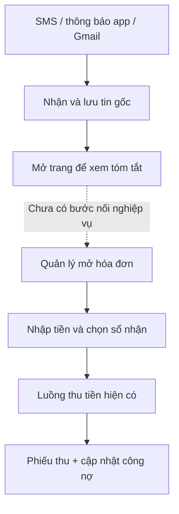
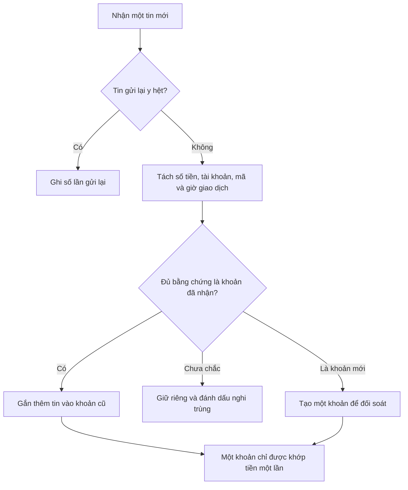
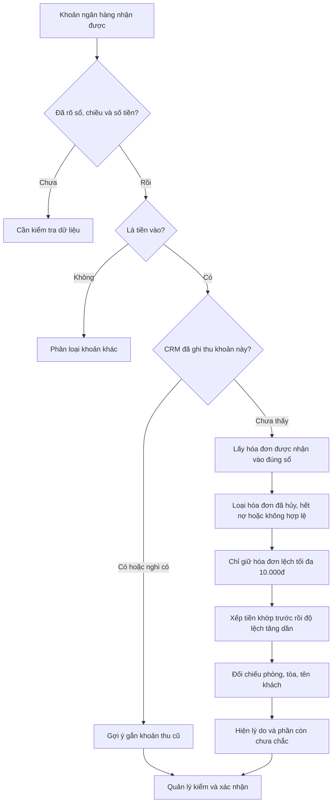
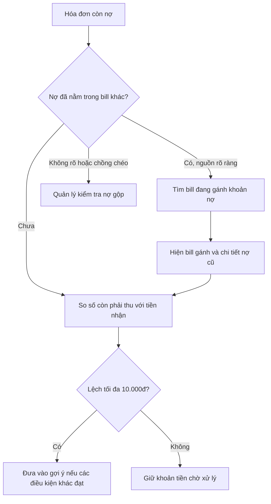
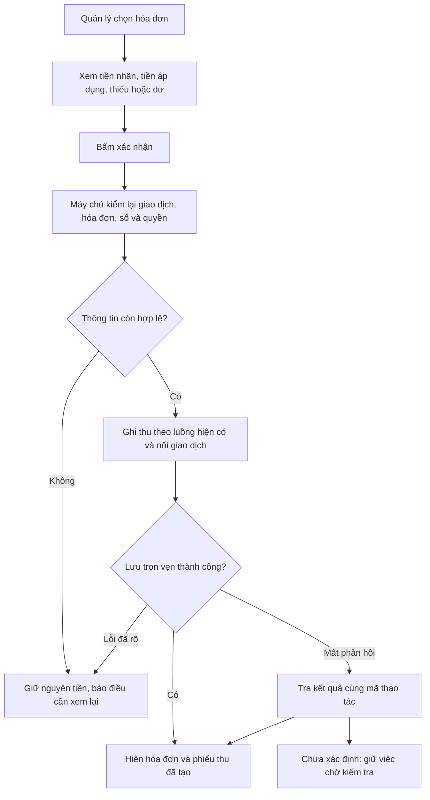
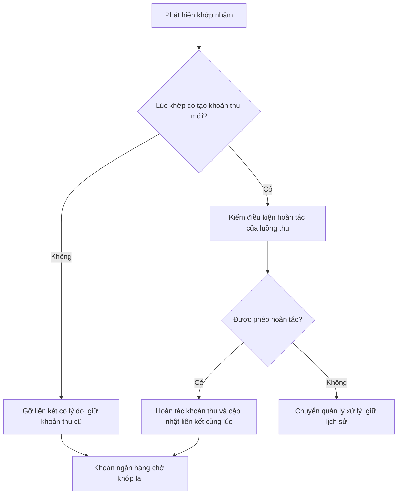
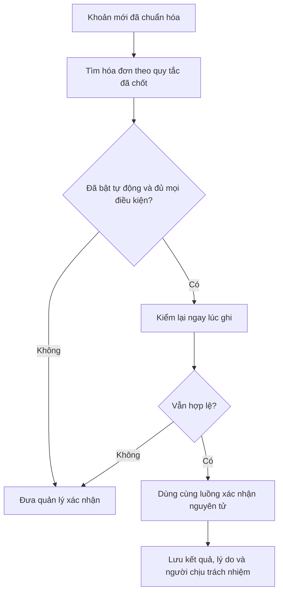

# Plan trang tổng biến động ngân hàng và gợi ý khớp hóa đơn

Ngày lập: 16/10/2026. Trạng thái: bản thiết kế để trao đổi nghiệp vụ, chưa triển khai.

Căn cứ mã nguồn: `bf36b0d1272c1a64dccb319569fd77ec5e4ce582`. Khi kiểm tra, `origin/main` và `origin/production` cùng trỏ tới commit này. Đây là căn cứ Git, chưa phải xác nhận phiên bản app/SQL đang chạy thực tế.

## 1. Phạm vi đã trao đổi với chủ hệ thống

- Gom **tất cả biến động ngân hàng của các sổ quỹ ngân hàng**, cả tiền vào và tiền ra.
- Bản đầu **gợi ý để quản lý xác nhận**. Chưa tự thanh toán hóa đơn.
- Chỉ khớp **hóa đơn khách thuê** trước; cọc riêng, thu khác, phí ngân hàng, khoản chi và khoản chưa rõ được phân loại chờ xử lý.
- Không đưa tiền mặt, ví nhân viên hoặc bút toán chuyển sổ nội bộ vào danh sách này.
- Luồng thường gặp: khách chuyển cho chính mình, ghi phòng, tòa hoặc tên khách. Không ưu tiên xây chuyển hộ hay phân bổ gộp nhiều khách ở bản đầu.
- Dùng **sổ nhận tiền được cấu hình cho tòa/hóa đơn để loại trừ trước**; sau đó ưu tiên số tiền khớp hoặc gần khớp nhất.

Đã chốt thêm: chỉ gợi ý hóa đơn khi **|tiền nhận − còn phải thu| ≤ 10.000đ**, áp dụng cả thiếu và dư, bao gồm đúng 10.000đ. Khớp đúng đứng trước, rồi tăng dần theo độ lệch. Tối đa 5 dòng đầu chỉ là cách hiển thị; không lấy hóa đơn ngoài ngưỡng để bù đủ 5 dòng. Chưa có quyết định về hạn mức tự động, người vận hành tự động hay ngày bật tự động.

**Ba khái niệm cần nhìn riêng:** “ngân hàng báo tiền về”, “CRM đã có phiếu thu”, “hóa đơn đã thanh toán”. Có thể đã có một trong ba mà chưa có hai phần còn lại.

## 2. Những gì đã tìm thấy trong code

| Phần hiện có | Code đang làm gì | Ý nghĩa với thiết kế mới |
|---|---|---|
| Trang `/bien-dong-so-du` | Hộp tin nhận từ Android/Gmail; chỉ super admin, toàn hệ thống; trang đầu cập nhật mỗi 15 giây | Giữ phần tiếp nhận và vận hành; bổ sung trang nghiệp vụ cho giao dịch ngân hàng đã chuẩn hóa |
| Bộ lọc hiện tại | Tên nguồn/mã sự kiện, nguồn, loại tin, ngày máy chủ nhận | Chưa lọc được toàn bộ dữ liệu theo số tiền, sổ, tòa, hóa đơn, trạng thái khớp |
| Nội dung tin | Lưu bản mã; Edge giải mã và tóm tắt lúc đọc danh sách | Phải thêm dữ liệu chuẩn hóa lưu bền để tìm kiếm, thống kê và xử lý nền |
| Bộ tách tin | Tiền vào/ra, số tiền, số dư, ngân hàng, mô tả, thời điểm giao dịch; tài khoản hiển thị chỉ 4 số cuối | Tóm tắt hiển thị chưa đủ để xác định tài khoản, mã giao dịch và khách một cách chắc chắn |
| Chống gửi lặp | Khóa `(source_id, external_id)`; cùng ID khác nội dung bị chặn | Đã chống gửi lại cùng tin; còn phải nhận ra một giao dịch được báo từ nhiều kênh |
| Cấu hình “Gạch nợ tự động” | Có bảng và trang nhập tài khoản/bật tắt; có trường `matching_rules` | Trong các caller đã tra chưa thấy bộ máy nối cấu hình này với tin ngân hàng và writer thu tiền; không coi công tắc cũ là cơ chế đã hoạt động |
| Sổ nhận tiền | Sổ mặc định TK/TT của tòa + sổ phụ; giao với quyền người giữ/biết sổ | Đây là cửa loại trừ quan trọng nhất trước khi so tiền |
| Hóa đơn | Có hóa đơn tháng/thanh lý, nợ cũ, trả một phần, cọc trong hóa đơn, điều chỉnh, credit | Không thể dò bằng mỗi `total_amount` hoặc tên phòng hiện tại |
| Tìm hóa đơn bằng tiền hiện tại | `roomCodeSearch.ts` đặt sai lệch ±5.000đ; `useInvoices.ts` lọc trên **tổng hóa đơn** | Bộ đối soát cần truy vấn riêng theo **còn phải thu ±10.000đ**; không đổi toàn bộ ô tìm kiếm hiện hữu để dùng chung một hằng số |
| Khách của hợp đồng | Quan hệ chính là `contract_customers`; hợp đồng mới có thể không có `tenant_id` | Dò tất cả khách thuộc hợp đồng của hóa đơn, không chỉ khách đại diện hoặc người đang ở phòng hiện nay |
| Nợ gộp | `previous_debt_sources` chỉ ra hóa đơn nguồn; helper đã loại nguồn khi tính nợ kỳ tiếp theo | Cần nhìn cả chuỗi nợ trước khi gợi ý; một nghĩa vụ không xuất hiện thành hai lựa chọn thu độc lập |
| Hỗ trợ, giảm giá và credit | Tổng hóa đơn đã bao gồm các phần đã áp dụng; writer lấy `max(total_amount - paid_amount, 0)` | Không cộng nợ cũ hoặc trừ giảm giá/credit/hỗ trợ thêm lần nữa; không tự dùng credit chưa áp để ép khớp tiền |
| Làm tròn và trạng thái | Có thể `PAID` do phần thu + làm tròn đủ tiền, trong khi `total_amount - paid_amount` vẫn còn số lẻ | Phải lọc cả trạng thái được thu và còn nợ dương; không kéo hóa đơn đã tất toán vào gợi ý |
| Thu tiền | Đi qua `record_invoice_collection_v5`: kiểm quyền, khóa hóa đơn, kiểm số đã thu, idempotency, tạo khoản thu/phiếu/phân bổ | Tái dùng nghiệp vụ này trong bước xác nhận; không cập nhật `PAID` trực tiếp |
| Dữ liệu khoản đã thu | `active_payment_receipts` có dòng V5 theo từng tender và nhánh legacy; `collected_amount` của V5 lấy từ `retained_amount` | Dò đúng tiền ngân hàng thực nhận, gồm cả phần giữ credit; khi gắn còn phải kiểm phiếu đã ghi sổ và chưa bị hoàn tác |
| Cảnh báo thu lặp hiện tại | `duplicateCollection.ts` so tổng lần thu cùng hóa đơn trong 30 phút | Hữu ích khi nhập tay; chưa phải khóa chống dùng lại giao dịch ngân hàng hoặc đối soát tin đến muộn |
| Sửa hình thức/sổ của khoản thu | Có `change_collection_tender_method_v1`, kiểm người sửa, người thu gốc, sổ nhận và phiếu đã ghi sổ | Nếu chứng minh đã nhập sai hình thức/sổ, sửa qua nghiệp vụ được phép rồi gắn ngân hàng; không tạo thu lần thứ hai |
| QR hợp đồng hiện tại | Dẫn tới `/c/<public_code>` để xem thông tin/hóa đơn | Có thể bổ sung mã thanh toán theo từng hóa đơn; QR xem hợp đồng hiện tại chưa phải mã đối soát duy nhất |
| Tiện ích VietQR hiện có | `buildVietQRImageUrl` điền tài khoản, tiền, nội dung; caller đã thấy ở chuyển tiền phiếu và thanh lý | Có thể tái dùng phần tạo QR; vẫn cần bổ sung định danh thanh toán và nối vào luồng thu hóa đơn |
| Thu hàng loạt | Client gọi riêng từng hóa đơn; có thể thành công một phần | Không dùng luồng này để chia một giao dịch ngân hàng thành nhiều hóa đơn một cách nguyên tử |
| Đối soát sổ hiện có | Chụp số dư hệ thống, số đếm thực và chênh lệch | Là đối soát số dư sổ, khác việc nối từng giao dịch với hóa đơn |

Các kết luận trên đến từ source và migration trong repo. Chưa đọc dữ liệu khách, cấu hình thật hoặc catalog DB đang chạy.

### Sơ đồ hiện tại

## 3. Trang tổng sẽ dùng như thế nào

Tên đề xuất: **Biến động ngân hàng**. Giữ địa chỉ `/bien-dong-so-du` để không làm mất đường dẫn đang dùng.

### 3.1. Bố cục

1. Thanh đầu: công ty/phạm vi được xem, khoảng thời gian và mốc cập nhật dữ liệu.
2. Số liệu theo đúng bộ lọc: tổng tiền vào, tiền ra, tiền vào chưa phân bổ, số khoản cần kiểm tra. Tổng tiền tính theo giao dịch duy nhất, không tính theo số tin báo.
3. Các nhóm nhanh: **Tất cả · Cần khớp · Có gợi ý · Đã khớp · Cần kiểm tra · Khoản khác**.
4. Danh sách giao dịch; bấm một dòng mở phần chi tiết để xem bằng chứng và chọn hóa đơn.
5. Khu riêng **Nguồn kết nối** và **Vận hành** dành cho người có quyền cấu hình; tiếp tục dùng chức năng hiện có.

Mỗi dòng cần thể hiện:

| Thông tin | Cách trình bày |
|---|---|
| Thời gian | Giờ giao dịch là chính; giờ nhận tin ở dòng phụ. Thiếu giờ giao dịch ghi “Chưa rõ”, có thể dùng giờ nhận để sắp xếp nhưng gắn nhãn rõ |
| Tiền | `+` tiền vào, `−` tiền ra; đơn vị VND; số dư sau giao dịch hiển thị riêng nếu có |
| Nguồn | Loại kênh + tên nguồn. Một khoản có nhiều tin: “SMS + Gmail · 2 tin” |
| Ngân hàng/tài khoản | Tên ngân hàng + tài khoản che bớt số; liên kết cấu hình đã xác nhận |
| Sổ quỹ | Sổ thực nhận và công ty; thiếu ánh xạ ghi “Chưa xác định sổ” |
| Nội dung | Nội dung chuyển khoản, có thể mở xem đầy đủ theo quyền |
| Gợi ý | Hóa đơn, tòa, phòng, khách, kỳ, còn phải thu, chênh lệch |
| Xử lý | Chưa khớp / có gợi ý / đang xác nhận / đã khớp / cần kiểm tra / khoản khác |

Một sổ phục vụ nhiều tòa thì khi chưa khớp, không tự điền một tòa giả định vào cột tòa. Sau khi khớp mới hiện tòa của hóa đơn đã chọn.

Trên điện thoại, một thẻ giao dịch hiện tiền, sổ, nội dung và trạng thái; phần gợi ý nằm trong màn chi tiết. Không ép toàn bộ cột vào một bảng hẹp.

### 3.2. Bộ lọc

| Nhóm | Bộ lọc cần có |
|---|---|
| Thời gian | Hôm nay, hôm qua, 7 ngày, tháng này, khoảng tùy chọn; chọn lọc theo giờ giao dịch hoặc giờ nhận; cận cuối loại trừ theo múi giờ Việt Nam |
| Ngân hàng | Ngân hàng, tài khoản nhận, sổ quỹ; lựa chọn “Chưa xác định sổ”, “Ánh xạ mâu thuẫn” |
| Nguồn | Android/Gmail; SMS/thông báo app/email; tên thiết bị/hộp thư; có một hoặc nhiều kênh chứng thực |
| Tiền | Vào/ra/chưa rõ; số tiền chính xác; từ–đến; mức chênh khi so hóa đơn trong ngưỡng gợi ý ±10.000đ |
| Phạm vi | Công ty; tòa/phòng/khách trong phạm vi được xem |
| Hóa đơn | Mã hóa đơn, hợp đồng, kỳ, hóa đơn tháng/thanh lý; khớp đủ hoặc thu một phần |
| Tiến độ | Chưa khớp, có gợi ý, nhiều ứng viên bằng nhau, đang xử lý, đã khớp, đã gỡ liên kết, cần kiểm tra |
| Chất lượng tin | Chưa tách được, chưa rõ chiều tiền, nghi trùng, thông tin giữa các kênh mâu thuẫn, tin đến muộn |
| Nghiệp vụ | Hóa đơn khách thuê, nghi cọc riêng, thu khác, tiền ra/phí, chưa rõ |
| Người xử lý | Người xác nhận, thời điểm xác nhận, đã gắn khoản thu cũ hay đã tạo khoản thu mới |
| Tìm nhanh | Nội dung, mã giao dịch ngân hàng, mã sự kiện, mã hóa đơn, tên khách, tên/mã tòa, phòng |

Phân biệt bộ lọc **“Đã khớp với tòa/phòng/khách”** và **“Có gợi ý liên quan đến…”**. Tìm thấy tên phòng trong tin chưa có nghĩa khoản đó đã thuộc phòng ấy. Lưu bộ lọc trên URL; tổng hợp và xuất dữ liệu phải dùng cùng điều kiện với danh sách, không chỉ 25 dòng đang xem.

### 3.3. Chi tiết một khoản tiền

- Bên trên: tiền vào/ra, sổ thực nhận, nội dung, thời gian, các tin gốc.
- Phần **“CRM đã ghi khoản này chưa?”**: liệt kê khoản thu/phiếu liên quan đã tồn tại và bằng chứng so khớp.
- Phần **“Hóa đơn gợi ý”**: tối đa 5 dòng đầu trong ngưỡng ±10.000đ, có “Xem thêm” cũng trong ngưỡng này; mỗi dòng ghi vì sao được đưa vào, số phải thu hiện tại và chênh thiếu/dư.
- Phần **“Các hóa đơn đã loại”**: chỉ hiện dữ liệu được quyền xem, kèm lý do như sai sổ, đã trả đủ, sai tòa trong nội dung, đang có điều chỉnh cần kiểm tra.
- Chọn hóa đơn rồi xem trước kết quả: nhận bao nhiêu, trả vào hóa đơn bao nhiêu, còn nợ bao nhiêu, dư bao nhiêu, sổ nào được ghi.
- Hai hành động khác nhau: **“Gắn với khoản thu đã có”** và **“Xác nhận thu cho hóa đơn”**.
- Có **“Không phải tiền hóa đơn”**, **“Chưa rõ, xử lý sau”**, **“Bỏ gợi ý này”**; yêu cầu lý do ngắn khi bác bỏ/đổi phân loại/gỡ liên kết.

## 4. Cơ chế nhận diện và loại trừ

### 4.1. Xác định sổ trước khi tìm hóa đơn

Đường đi chuẩn:

**Nguồn gửi + ngân hàng + tài khoản thực → sổ quỹ ngân hàng → công ty → các tòa được nhận vào sổ đó → hóa đơn của các tòa này.**

Một điện thoại/Gmail có thể nhận tin của nhiều tài khoản. Vì vậy không mặc định “một nguồn = một sổ”. Ngược lại, một tài khoản có thể được nhiều nguồn cùng báo về.

**Bổ sung theo trao đổi ngày 17/10/2026:** quản lý được chủ động cấu hình nguồn → sổ, ví dụ nguồn MBDemo nhận vào sổ MBDemo. Quy tắc dùng mã nguồn ổn định + loại tin + sender SMS / packageName thông báo / địa chỉ From Gmail đầy đủ; có thêm điều kiện nội dung và dấu tài khoản nếu cùng nguồn báo nhiều tài khoản. Đây là ánh xạ do quản lý xác nhận, không suy từ tên nguồn. Các điều kiện cùng quy tắc kết hợp bằng AND. Nếu tất cả quy tắc khớp chỉ về một sổ thì chọn sổ đó; nếu nhiều sổ thì chặn, không tự ưu tiên quy tắc đầu tiên. Các tin cùng khoản chỉ về khác sổ cũng phải chờ kiểm tra. Sửa quy tắc không đổi sổ khoản đã ghi thu; cần lưu phiên bản quy tắc/bằng chứng lúc xác nhận ở backend. Demo local đã có màn thêm/sửa/tạm dừng, thử tin và tính lại khoản chưa khớp; lưu bền/phân quyền/backend còn triển khai riêng.

Thêm cấu hình xác nhận tài khoản ngân hàng ↔ sổ quỹ, gồm tài khoản đầy đủ hoặc định danh đã xác minh, ngân hàng, công ty, nguồn được phép báo và thời gian hiệu lực. Hiển thị tài khoản đã che trên danh sách; định danh đầy đủ chỉ dùng ở lớp được cấp quyền.

Chỉ 4 số cuối không đủ làm khóa duy nhất. Nếu nguồn có nhiều tài khoản trùng đuôi, hoặc một tài khoản đang ánh xạ sang nhiều sổ/công ty, chuyển “Cần xác định sổ”; không chọn theo tên sổ hay công ty đang mở trên màn hình.

Code hiện suy ra sổ hợp lệ của hóa đơn từ cấu hình tòa và hình thức TK/TT. Chưa thấy danh sách sổ độc lập lưu riêng trên từng hóa đơn trong các phần đã tra. Bản đầu dùng chính quy tắc server này; nếu cần sổ riêng theo từng hóa đơn thì đó là bổ sung nghiệp vụ riêng.

Với biến động ngân hàng, mặc định dùng hình thức **TK** khi sổ nằm trong danh sách TK hợp lệ. Nếu sổ chỉ được cấu hình ở TT, hoặc chính sách tòa chưa rõ, phải hiện để quản lý xác nhận/cấu hình; không đổi sang sổ khác để làm cho lệnh thu chạy được. Mỗi lần xác nhận phải kiểm lại cấu hình và quyền hiện tại.

### 4.2. Một giao dịch, nhiều tin báo

- Gửi lại cùng tin: dùng cơ chế chống lặp hiện có.
- Trùng chắc giữa nhiều kênh: cùng tài khoản đã xác minh, cùng mã tham chiếu ngân hàng trong phạm vi mã đó có hiệu lực, cùng chiều/số tiền/tiền tệ; kiểm quy tắc riêng của ngân hàng.
- Không có mã tham chiếu: số tiền + giờ + số dư + mô tả chỉ tạo nhóm nghi trùng; không tự gộp chỉ vì giống số tiền trong một khoảng thời gian.
- Hai khách trả cùng số tiền trong cùng phút phải giữ được thành hai giao dịch.
- Tin đến sau khi đã khớp: bổ sung bằng chứng; không tạo lần thu mới. Nếu dữ liệu mới mâu thuẫn, mở việc cần kiểm tra và giữ nguyên lịch sử đã ghi.
- Sửa parser hoặc gộp/tách nhóm phải có phiên bản, người/thời điểm và lý do. Giao dịch đã xác nhận không được âm thầm đổi tiền, đổi sổ hoặc chuyển sang hóa đơn khác.

### 4.3. Thứ tự tìm hóa đơn

**Bước 1 — Điều kiện dữ liệu:** xác định tiền vào, số tiền dương VND, tài khoản/sổ, công ty; không phải tin thử, quảng cáo hoặc chỉ thông báo số dư. Chưa đọc được tin khác với chắc chắn không phải giao dịch.

**Bước 2 — Tìm khoản đã ghi:** tra khoản thu còn hiệu lực, từng dòng thanh toán TK/TT phù hợp, sổ nhận, số tiền thực giữ lại, mã giao dịch/biên nhận nếu có, ngày và nội dung. Không lấy tổng cả lần thu nếu lần đó có nhiều hình thức. Trùng số tiền/ngày nhưng thiếu chứng cứ chỉ là “Có thể đã ghi”, cần người kiểm.

**Bước 3 — Lọc cứng:** cùng công ty, hóa đơn được nhận vào chính sổ này theo cấu hình tòa, người thao tác có quyền xem. Trạng thái có thể thu là `APPROVED`, `PARTIAL_PAID`, `OVERDUE`; chưa xóa, còn phải thu dương. Không giới hạn vào hóa đơn mới nhất hoặc chỉ hợp đồng đang ở: khách đã dọn đi vẫn có thể trả nợ/thanh lý dương.

**Bước 4 — Lấy số đúng để so:** dùng **còn phải thu hiện tại**, bám cách tính của writer đang dùng, thay vì tổng tiền gốc. Cọc trong hóa đơn, giảm giá/credit, điều chỉnh và nợ chuyển phải theo nguồn số liệu chính thức của hệ thống. Số dư sau giao dịch ngân hàng không dùng làm số tiền thanh toán.

Cụ thể, writer đang lấy `max(total_amount - paid_amount, 0)`. `total_amount` đã phản ánh nợ cũ, giảm trừ và credit đã áp; hỗ trợ tiền thuê cũng nằm trong giảm trừ. Không trừ `prepaid_amount` hoặc credit chưa áp thêm một lần vì thấy các trường đó tồn tại. Đồng thời kiểm trạng thái: hóa đơn `PAID` do làm tròn vẫn bị loại dù phép trừ trên còn dương. Kiểm chuỗi nợ gộp ở mục 4.6 trước khi coi đây là khoản có thể thu độc lập.

**Bước 5 — Lọc ngưỡng rồi xếp theo tiền:** chỉ giữ hóa đơn có trị tuyệt đối của chênh lệch không vượt 10.000đ. Khớp đúng đứng trước; sau đó tăng dần theo độ lệch. Ví dụ giả lập: nhận 3.000.000đ; hóa đơn còn phải thu 3.000.000đ là “khớp”; 3.010.000đ là “thiếu 10.000đ”; 2.990.000đ là “dư 10.000đ”; cả ba có thể được gợi ý nếu qua các chốt khác. Hóa đơn còn 2.980.000đ bị loại với lý do “Lệch 20.000đ, vượt ngưỡng gợi ý”. Chênh lệch là tiền nhận trừ còn phải thu; tên/phòng trùng cũng không mở rộng ngưỡng.

**Bước 6 — Dùng nội dung để phân biệt:** nhận diện mã/tên tòa, phòng, tên các khách gắn với hợp đồng; chuẩn hóa dấu/khoảng trắng nhưng giữ nội dung gốc. Phòng `101` không trùng `1101`; phòng cùng tên ở hai tòa không coi là một. Tên giống nhau chỉ là bằng chứng phụ. Số điện thoại/tài khoản/mã ngân hàng không được tự hiểu là số phòng.

**Bước 7 — Xử lý mâu thuẫn:** nếu nhận diện chắc nội dung chỉ tòa/phòng/hóa đơn khác, loại khỏi nhóm “phù hợp” và hiện lý do dù số tiền bằng nhau. Nếu nội dung mơ hồ, giữ ứng viên nhưng ghi “Chưa xác nhận được phòng/khách”. Không để một kết quả OCR/regex yếu quyết định loại trừ cứng.

**Bước 8 — Trả về giải thích:** mỗi gợi ý gồm số tiền nhận, còn phải thu, chênh lệch, sổ hợp lệ, thông tin nội dung trùng, cảnh báo và thời điểm tính. Không đưa một điểm phần trăm “chắc chắn” chưa được kiểm chứng.

Các hóa đơn bằng tiền nhau đều phải được giữ trong danh sách; không tự chọn dòng đầu. Nếu nhiều hơn giới hạn hiển thị, báo “Còn các hóa đơn cùng mức phù hợp” và cho xem thêm. Thứ tự phụ: mức khớp nội dung → kỳ được nhắc trong tin → hạn thu/ngày → ID ổn định. Không tự ưu tiên tháng hiện tại nếu khách đang trả nợ tháng cũ.

Không có ứng viên trong ±10.000đ thì hiện “Chưa có hóa đơn trong ngưỡng gợi ý”; quản lý có thể tra cứu nghiệp vụ riêng, nhưng kết quả ngoài ngưỡng không được gắn nhãn gợi ý hay lặng lẽ đưa trở lại danh sách. Ngưỡng này áp dụng tìm hóa đơn để thu mới. Việc dò khoản **đã thu** phải so với tiền thực tế của khoản thu đó, không so với công nợ hiện tại đã giảm hoặc về 0.

Ngưỡng gợi ý **≤10.000đ** khác ngưỡng làm tròn thiếu **<10.000đ** trong writer hiện có. Thiếu đúng 10.000đ vẫn được gợi ý nhưng không đủ điều kiện làm tròn theo luật hiện tại; mọi trường hợp gợi ý đều không tự xóa nợ.

### 4.4. Nhãn kết quả dễ hiểu

| Nhãn | Khi nào dùng | Quản lý làm gì |
|---|---|---|
| Khớp tiền và thông tin | Đúng sổ, đúng số còn phải thu, nội dung phù hợp, không có cảnh báo tranh chấp | Kiểm nhanh rồi xác nhận |
| Khớp tiền, cần xác nhận khách | Đúng sổ và tiền, thiếu nội dung hoặc có nhiều hóa đơn cùng tiền | Chọn đúng phòng/khách |
| Gần khớp | Đúng sổ, 0 < độ lệch ≤10.000đ; hiện rõ số thiếu/dư | Quyết định thu một phần hoặc giữ tiền dư theo luồng hỗ trợ |
| Có thể đã ghi thu | Tìm được khoản thu cũ có dấu hiệu trùng | Gắn bằng chứng với khoản cũ sau khi kiểm |
| Cần kiểm tra | Thiếu sổ, nghi trùng, mâu thuẫn, điều chỉnh hoặc dữ liệu lỗi | Giải quyết nguyên nhân trước |
| Chưa tìm được | Đã truy vấn thành công nhưng không có hóa đơn đủ điều kiện | Tìm thêm trong phạm vi được quyền xem hoặc phân loại khoản khác |

Lỗi tải dữ liệu, thiếu quyền hoặc quá giới hạn tìm kiếm phải có trạng thái riêng; không biến thành “Không có hóa đơn”.

### 4.5. Các phương án tìm bổ sung, theo mức ưu tiên

Các cách dưới đây cùng đi qua cửa loại trừ **đúng công ty → đúng sổ nhận → hóa đơn hợp lệ → không trùng nghĩa vụ → lệch tối đa 10.000đ**. Một cái tên hoặc mã khớp không được vượt qua cửa này. Nhánh “đã thu trước” có quy tắc riêng ở mục 6.2.

| Phương án | Cách dùng bình dân | Giới hạn để tránh khớp nhầm | Ưu tiên |
|---|---|---|---|
| Dò theo số còn phải thu | Hóa đơn 5 triệu đã thu 2 triệu thì tìm khoản 3 triệu | Không dùng tổng 5 triệu; không lấy tiền đã tất toán do gộp nợ làm bằng chứng ngân hàng | Bắt buộc bản đầu |
| Dò mã hóa đơn trong nội dung | Nội dung có mã hóa đơn đầy đủ thì tra thẳng hóa đơn ấy, rồi kiểm sổ và tiền | Mã phải khớp ranh giới và duy nhất trong công ty; mã đúng nhưng sai sổ/lệch quá 10.000đ là cần kiểm, không gợi ý thu | Bản đầu nếu tin có mã |
| Dò tòa + phòng + kỳ | Cùng sổ có nhiều bill 3 triệu; nội dung “tòa A phòng 201 tháng 9” giúp phân biệt | Dùng phòng thật của tòa và phòng lưu trên hóa đơn; không chọn tháng hiện tại theo mặc định | Bản đầu |
| Dò tên khách trong hợp đồng | Tên không dấu vẫn tìm được; khách cùng hợp đồng cũng được đối chiếu | Tên phổ biến/viết tắt chỉ là hỗ trợ; không thay bằng khách mới đang ở phòng | Bản đầu |
| Dò ngược từ hóa đơn | Trong chi tiết hóa đơn, bấm “Tìm tiền ngân hàng” để thấy khoản còn chưa khớp | Dùng cùng bộ dò, cùng ±10.000đ, cùng khóa khi xác nhận; không có hai bộ quy tắc khác nhau | Bản đầu, cùng đợt xác nhận |
| Xem các khoản đang tranh cùng một bill | Hai khoản cùng được gợi ý vào bill 201 thì quản lý nhìn thấy cả hai trước khi chọn | Không chia/gộp tự động; xác nhận một khoản phải tính lại khoản còn lại | Bản đầu |
| Dò dấu hiệu người gửi đã được xác nhận | Nếu mẫu ngân hàng có tên/tài khoản người chuyển, dùng lịch sử đối soát được quản lý xác nhận để hỗ trợ nhận diện | Cần tài khoản đầy đủ/định danh đủ mạnh và thời gian hiệu lực; không dùng 4 số cuối hoặc tên tự học từ một lần bấm | Bổ sung sau khi có mẫu tin thật |
| Mã thanh toán riêng cho hóa đơn | Khách quét mã có sẵn tài khoản, số tiền và nội dung định danh hóa đơn | Tách với QR xem hợp đồng; hết hạn/đổi bill phải kiểm lại; không tự bỏ qua ngưỡng hay quyền sổ | Cải tiến tiếp theo |

**Nhận diện nội dung cần bám dữ liệu của web:** tạo danh mục tên/mã tòa và phòng thật, cùng bí danh do quản lý xác nhận. Chuẩn hóa chữ hoa/thường, dấu tiếng Việt và khoảng trắng; giữ ranh giới để `101` không trùng `1101`. Không mặc định `MB` là phòng mặt bằng khi nó có thể nằm trong tên ngân hàng. Bộ `roomCodeSearch` hiện phục vụ một chuỗi người dùng nhập để tìm kiếm, không đủ làm bộ tách cả nội dung chuyển khoản. Bí danh phải gắn với tòa/phòng/hợp đồng và thời gian hiệu lực; sửa bí danh phải tính lại gợi ý.

**Ba loại mã khác nhau:** mã giao dịch ngân hàng dùng nhận ra một khoản tiền; mã hóa đơn/mã thanh toán dùng tìm nghĩa vụ; số biên nhận do người dùng nhập (`receipt_number`) chỉ là thông tin để đối chiếu. Code hiện không bảo đảm số biên nhận là mã ngân hàng hoặc duy nhất, nên không dùng nó làm khóa tự khớp.

**Dò theo lịch sử người gửi:** `customers` có thông tin ngân hàng nhưng việc lưu tại đó chưa chứng minh đây là tài khoản đã chuyển tiền cho hóa đơn. Phải có bằng chứng từ giao dịch đã xác nhận. Trường `sender` của SMS hay `from` của email thường là phía ngân hàng, không phải tên khách. Nếu tin không có thông tin người chuyển thì ghi “Nguồn không cung cấp”, không suy từ tên hộp thư nhận tin. Sau khi khách chuyển phòng/kết thúc hợp đồng, lịch sử chỉ giúp giải thích; vẫn kiểm đúng hóa đơn và sổ hiện hành.

**Xem đồng thời các gợi ý đang cạnh tranh:** ví dụ giả lập có hai giao dịch A và B cùng 3 triệu, cùng sổ, đều có thể vào một hóa đơn 3 triệu. Hiển thị “Hóa đơn này còn được gợi ý cho 1 khoản khác”, không tự coi hai giao dịch là trùng và không lặng lẽ gán giao dịch tới trước. Khi một khoản được xác nhận, gợi ý của khoản kia phải hết hiệu lực hoặc chuyển sang dò khoản đã ghi. Ngược lại, nếu A có nội dung phòng 201 và B có phòng 202, hai hóa đơn đúng phòng là các cặp nên kiểm trước. Không tự ghép chỉ để tối đa hóa số dòng đã xử lý.

Đề xuất dùng các quy tắc giải thích được ở bản đầu. Có thể bổ sung nhận diện văn bản linh hoạt về sau, nhưng kết quả đó chỉ là tín hiệu; quyết định đúng sổ, đúng tiền và ghi thu vẫn do quy tắc máy chủ kiểm.

**Có thể tận dụng phần tạo VietQR đang có:** tiện ích hiện hỗ trợ tài khoản, số tiền và nội dung; chưa thấy caller dùng nó làm định danh đối soát cho tiền thuê. Khi bổ sung, đặt mã thanh toán ngắn ở đầu nội dung và lưu phiên bản gắn với hóa đơn/sổ/số tiền. Hàm hiện chuẩn hóa chữ và cắt nội dung còn 70 ký tự, nên mã phải còn nguyên sau xử lý; phía nhận phải tra đúng dạng chuẩn hóa ấy. QR chỉ giúp khách điền đúng, không phải bằng chứng tiền đã về.

### 4.6. Xử lý nợ gộp, bill cũ và chuyển phòng

Ví dụ giả lập: tháng 9 còn nợ 500.000đ; hóa đơn tháng 10 đã gồm 500.000đ này và có tổng còn thu 3.500.000đ. Khách chuyển 3.500.000đ thì gợi ý hóa đơn tháng 10, bên dưới giải thích “Đã gồm nợ tháng 9: 500.000đ”. Không cộng thêm bill tháng 9 thành nghĩa vụ 4.000.000đ.

Quy tắc triển khai:

- Theo quan hệ `previous_debt_sources`, cùng công ty/hợp đồng; kiểm cả chuỗi nguồn → hóa đơn đang gánh, không chỉ lấy bill mới nhất theo ngày. Hóa đơn nguồn đã được bill mở khác gánh không là lựa chọn thu độc lập trong luồng gợi ý này.
- Thiếu nguồn nợ, nhiều bill cùng gánh một nguồn, chuỗi vòng hoặc số nợ nguồn đã đổi sau phát hành: chuyển **“Cần kiểm tra nợ gộp”**. Helper hiện có suy luận theo tháng khi dữ liệu legacy thiếu nguồn; không nâng suy luận ấy thành bằng chứng để khớp tiền.
- Nếu muốn thu trực tiếp bill nguồn đang bị gộp, phải kiểm và xử lý lại nghĩa vụ ở bill gánh qua nghiệp vụ được phép trước khi xác nhận. Không thêm thu vào nguồn rồi để nguyên nợ snapshot ở bill gánh.
- So danh tính theo hợp đồng, tòa và phòng lưu trên hóa đơn. Lịch sử chuyển phòng chỉ bổ sung giải thích; không tự đổi hóa đơn cũ sang phòng hiện tại hoặc sang sổ khác. Nếu lịch sử thiếu ngày hiệu lực, hiện chưa rõ.
- Giữ hóa đơn tháng và thanh lý dương thành các loại rõ ràng. Nếu cả hai khớp tiền, kiểm nguồn nợ/cọc và kỳ, không mặc định chọn hóa đơn tháng hoặc thanh lý mới nhất.
- Tiền đến trước khi bill phát hành có thể được tìm lại sau khi bill xuất hiện, nhưng phải ghi rõ trình tự thời gian và để quản lý kiểm. Không tự coi tiền nhận sớm là tiền kỳ kế tiếp.

### 4.7. Ví dụ để kiểm ngay trước khi triển khai

Toàn bộ số liệu dưới đây là giả lập, không phải dữ liệu khách thật.

| Dữ liệu nhìn thấy | Kết quả mong muốn |
|---|---|
| Hóa đơn tổng hiện tại 5.000.000đ, đã áp tiền 2.000.000đ; ngân hàng vào 3.000.000đ | Gợi ý khớp đúng phần còn phải thu; ô tìm theo tổng hóa đơn hiện tại có thể không tìm ra trường hợp này |
| Bill đã ghi nhận 3.000.000đ trả nợ + 10.000đ giữ credit; tin ngân hàng 3.010.000đ đến sau | Gợi ý gắn dòng thu cũ có tiền thực nhận 3.010.000đ; không tạo thu mới và không coi 10.000đ là tiền chưa khớp |
| Bill còn 3.000.000đ; tiền nhận 2.990.000đ | Được gợi ý “Thiếu 10.000đ”; nếu xác nhận vẫn còn nợ 10.000đ, không tự tất toán |
| Bill còn 3.000.000đ; tiền nhận 2.989.999đ | Lệch 10.001đ, không nằm trong gợi ý kể cả nội dung ghi đúng mã bill |
| Bill trạng thái `PAID` sau làm tròn, phép trừ tổng − đã thu còn 5.000đ | Loại khỏi ứng viên thu mới |
| Cùng sổ, cùng tiền, hai phòng 101 của hai tòa | Chỉ tên phòng chưa đủ; cần tòa/khách/kỳ hoặc quản lý đối chiếu thêm |
| Bill 3.000.000đ, khách chuyển hai khoản 1.500.000đ | Không tự cộng hai khoản để vượt quy tắc ±10.000đ; đưa xử lý riêng, chưa tự phân bổ trong bản đầu |
| Cùng khách có bill cũ ở phòng 201 và bill mới ở phòng 301 | Dò theo nội dung, thời gian và phòng của từng bill; không gán toàn bộ cho phòng hiện tại |

## 5. Bảng xử lý các trường hợp thực tế

| Tình huống | Cách gợi ý và xử lý bản đầu |
|---|---|
| Đúng sổ, đúng tiền, nội dung rõ phòng/tòa | Gợi ý đầu, quản lý xác nhận |
| Đúng tiền nhưng thuộc sổ tòa khác | Loại khỏi ứng viên; không cho chọn để thu vào sổ thay thế |
| Sổ dùng chung cho nhiều tòa, nhiều hóa đơn cùng tiền | Giữ tất cả ứng viên; dùng phòng/tòa/tên khách để phân biệt; chưa rõ thì chờ |
| Chỉ có số tiền, không có nội dung | Xếp theo tiền trong đúng sổ; nhãn cần xác nhận khách |
| Tên khách không dấu/viết tắt | Dùng để gợi ý, không tự kết luận danh tính |
| Phòng đã thay khách | Xét hợp đồng và kỳ của hóa đơn, không lấy người đang ở làm chủ mọi khoản nợ |
| Trả thiếu | Thiếu tối đa 10.000đ mới vào gợi ý; xác nhận thu đúng số đã nhận, hóa đơn còn nợ phần thiếu. Thiếu nhiều hơn đưa xử lý riêng |
| Trả thiếu dưới ngưỡng làm tròn hiện có | Mặc định vẫn còn nợ. Nếu người có quyền chọn làm tròn, phải xem trước phần bỏ qua; writer không cho làm tròn phần cọc hoặc khoản ngoài doanh thu (`NON_PNL`) còn thiếu |
| Trả dư | Dư tối đa 10.000đ mới vào gợi ý; nếu quản lý xác nhận đúng khách/hợp đồng, dùng cơ chế credit hiện có. Dư nhiều hơn đưa xử lý riêng; không biến phần dư thành doanh thu hóa đơn |
| Muốn chuyển khoản hoàn phần dư | Phân loại xử lý hoàn tiền riêng; không dùng nhánh thối tiền mặt để giả một lần hoàn qua ngân hàng |
| Hóa đơn đã thu một phần | So với còn phải thu; giữ lịch sử lần thu trước |
| Một khách trả thêm ở nhiều giao dịch | Mỗi giao dịch có liên kết riêng; lần xác nhận sau lấy công nợ mới nhất |
| Nhân viên đã nhập thu, tin ngân hàng tới sau | Ưu tiên gắn khoản thu cũ, không ghi thêm tiền |
| Phiếu cũ đang chờ duyệt/chưa rõ đã ghi sổ | Cảnh báo cần kiểm; không coi mọi phiếu tồn tại là đã thu hoàn tất |
| Khoản thu cũ đã hoàn tác | Không gắn như khoản thu đang hiệu lực; hiện lịch sử và yêu cầu xử lý rõ |
| Tiền cọc đã nằm trong hóa đơn | Dùng phân bổ có sẵn của writer; không tạo phiếu cọc thứ hai |
| Cọc giữ chỗ hoặc cọc riêng ngoài hóa đơn | Phân loại khoản khác/chờ xử lý; không ép thành tiền hóa đơn |
| Nợ tháng cũ đã được đưa vào hóa đơn mới | Hiện quan hệ “nợ được gộp”; không cộng cả nợ nguồn và nợ gộp thành hai khoản phải thu độc lập |
| Hóa đơn nguồn và hóa đơn gộp cùng chưa trả | Nguồn rõ và số còn đúng: ưu tiên bill đang gánh nợ, nguồn chỉ là chi tiết. Thiếu nguồn/chồng chéo: chặn xác nhận từ gợi ý cho tới khi xử lý được nghĩa vụ trùng |
| Hóa đơn đang/đã điều chỉnh trong lúc quản lý xem | Tính lại; nếu tiền/phiên bản thay đổi thì yêu cầu xem lại bản mới |
| Hóa đơn thanh lý có số phải thu dương | Có thể gợi ý sau kiểm công nợ/cọc; bản đầu luôn do quản lý xác nhận |
| Hóa đơn thanh lý âm/hoàn khách | Không đưa vào danh sách thu tiền vào |
| Tiền ra, phí, lãi, thu khác | Vẫn thấy trên trang ngân hàng; phân loại khoản khác, chưa thực hiện thanh toán bill chi phí |
| Tin thiếu năm/ngày hoặc giờ không hợp lệ | Hiện thời điểm chưa rõ; không tự ghi ngày thu theo thời điểm tin đến |
| Tin lịch sử tới sau khi sổ đã khóa kỳ | Giữ ngày giao dịch gốc; báo kỳ khóa, dùng nghiệp vụ điều chỉnh được phép sau khi quản lý xử lý; không tự mở khóa |
| Người xác nhận không có quyền ghi sổ | Có thể xem gợi ý theo quyền xem; hành động thu bị chặn và nêu lý do |
| Hai quản lý cùng xác nhận một khoản | Máy chủ chỉ cho một kết quả có hiệu lực; người còn lại nhận kết quả đã xử lý hoặc yêu cầu tải lại |
| Mất mạng sau khi bấm xác nhận | Giữ trạng thái “Đang đối chiếu kết quả”; tra lại cùng mã thao tác, không sinh mã thu mới |
| Không tìm được hóa đơn | Giữ nguyên khoản chưa khớp, có ghi chú/người phụ trách; dò lại khi hóa đơn phát hành hoặc dữ liệu được bổ sung |
| Phát sinh chuyển hộ/gộp nhiều hóa đơn ngoài thông lệ đã chốt | Đưa cần kiểm tra; chưa tự phân bổ nhiều hóa đơn trong bản đầu |

## 6. Xác nhận phải làm liền mạch và không ghi hai lần

### 6.1. Xác nhận khoản thu mới

Một lệnh máy chủ phải cùng lưu: quyết định xác nhận, lần thu V5, liên kết với giao dịch ngân hàng, audit và biên nhận. Nếu một phần thất bại, toàn bộ phần ghi mới phải quay lại trước lệnh. Không gọi thu tiền ở client rồi gọi một API thứ hai để đánh dấu khớp.

Kiểm lại khi lưu: tiền/sổ/công ty, trạng thái giao dịch chưa dùng, phiên bản parser/ánh xạ, tập hóa đơn được chọn, tổng tiền hóa đơn và số đã thu, phiên bản điều chỉnh, quan hệ nợ gộp, quyền người dùng, kỳ sổ. Chỉ kiểm `expected_paid_amount` như writer hiện có chưa bao phủ trường hợp tổng hóa đơn thay đổi mà số đã thu không đổi.

Luồng mới cần chống lặp theo **giao dịch ngân hàng và lần quyết định**, độc lập với tài khoản người bấm. Idempotency hiện có của V5 còn chứa actor/hóa đơn nên không đủ tự bảo vệ cùng một khoản ngân hàng bị hai người gắn vào hai hóa đơn.

Luồng thu thủ công hiện có phải cùng nhìn thấy liên kết ngân hàng: nếu người thu đã chọn một khoản ngân hàng, cả màn thu cũ và màn đối soát dùng chung cơ chế giữ/khóa khoản đó. Nếu người dùng ghi thu thủ công không khai nguồn ngân hàng thì không thể chứng minh tuyệt đối hai khoản là một; hệ thống phải dò khoản đã ghi và cảnh báo trước khi xác nhận, không hứa chống trùng tuyệt đối chỉ bằng số tiền.

### 6.2. Gắn với khoản đã thu

Hành động này chỉ thêm liên kết/bằng chứng đối soát, không tạo `payment`, không cộng sổ và không sửa công nợ. Gắn vào đúng dòng tender/phiếu đang hiệu lực và phần tiền ngân hàng tương ứng. Lưu giới hạn số tiền còn có thể đối soát của tender, tránh một phiếu được dùng để giải thích nhiều khoản tiền vượt số đã ghi.

Nguồn tra cứu phù hợp trong code là view `active_payment_receipts`. Nhánh V5 trả theo từng dòng `invoice_payment_tenders`, với `collected_amount = retained_amount`; phân biệt số áp vào bill, số giữ credit và số thối. `payments.amount` hay `invoice.paid_amount` không thay thế cho số tiền thực nhận này. Trong bản đầu, đối chiếu một giao dịch với một dòng thu cần **đúng số tiền thực nhận**, không áp sai lệch ±10.000đ cho bằng chứng đã ghi.

Ví dụ: đã thu 3.010.000đ, áp bill 3.000.000đ và giữ credit 10.000đ. Khoản ngân hàng 3.010.000đ nối vào dòng thu ấy; không chỉ nối 3.000.000đ rồi để 10.000đ chờ thu thêm.

View còn hiệu lực là điểm bắt đầu tìm, chưa đủ để xác nhận. Máy chủ phải kiểm lại cùng công ty, đúng tài khoản/sổ nhận thực tế, khoản thu chưa hoàn tác, phiếu thu chưa xóa, đã duyệt/ghi sổ và có posting đang hiệu lực; số tiền chưa được đối soát còn đủ. Nếu là legacy có khoản thối/phiếu chưa xác định được, yêu cầu kiểm thêm. Không chỉ thấy `ACTIVE` là coi đã ghi sổ hoàn chỉnh.

Nhánh này có thể tìm hóa đơn đã trả đủ hoặc hợp đồng đã kết thúc; không dùng điều kiện “hóa đơn còn được thu” của nhánh tạo thu mới để loại mất khoản cũ. Cấu hình sổ nhận hiện tại đã đổi cũng không được xóa bằng chứng khoản thu hợp lệ trong quá khứ. Quyền xem/gắn của người thao tác vẫn kiểm theo hiện tại, và sổ thực trên khoản ngân hàng phải trùng với dòng đã ghi.

Tìm theo mã tham chiếu khi có bằng chứng; nếu chỉ có tiền/ngày thì mở danh sách nghi đã ghi để quản lý so nội dung, khách và phiếu. Khoảng thời gian tìm có phân trang/mở rộng, không lấy cửa sổ cảnh báo nhập trùng 30 phút làm giới hạn đối soát. “Không thấy trong khoảng đã tìm” phải hiện rõ, không khẳng định chưa từng có khoản thu này.

Các bản ghi legacy thiếu thông tin phải hiện “Thiếu chứng cứ”; không tự chuyển thành khoản thu V5 để hợp thức hóa. Mọi luồng tương lai nhiều giao dịch–một tender cần bảng phân bổ và giới hạn tổng; bản đầu có thể yêu cầu quản lý xử lý trường hợp phức tạp.

**Nếu có dấu hiệu phiếu cũ đã chọn nhầm hình thức hoặc sổ:** chỉ đưa vào khu kiểm tra phiếu liên quan, không nhập thêm biến động tiền mặt/ví/chuyển sổ vào trang ngân hàng. Sau khi đủ chứng cứ và đúng quyền, có thể dùng API công khai hiện có `change_collection_tender_method_v1` để sửa trước, rồi kiểm lại để gắn ngân hàng. API này có các chốt riêng: lần thu V5 đang hiệu lực, phiếu đã duyệt/ghi sổ, không có tiền thối/làm tròn ở dòng sửa; người sửa phải là người thu gốc hoặc vai trò chủ công ty/super admin được phép. Sổ đích còn được kiểm theo quyền của **người thu ban đầu**, không chỉ quyền quản lý đang sửa. Nếu không đạt thì chuyển xử lý nghiệp vụ, không sửa bảng trực tiếp hoặc tạo thu bù.

### 6.3. Gỡ liên kết, sửa nhầm và hoàn tác

Không xóa sự thật ngân hàng đã phát sinh. Hoàn tác ghi thu cũng không có nghĩa ngân hàng đã chuyển tiền trả khách. Phải giữ hai việc này khác nhau trong trạng thái và lịch sử. Nếu khoản thu bị hoàn tác từ màn hình cũ, liên kết ngân hàng phải được chuyển sang cần kiểm tra tương ứng trong cùng luồng server; không để trang vẫn báo đã khớp thành công.

Tương tự, đổi hình thức/sổ của khoản thu đã gắn ngân hàng phải kiểm và cập nhật trạng thái liên kết trong cùng lệnh. Không cho liên kết vẫn “Đã khớp” với sổ A trong khi phiếu đã chuyển sang sổ B; tài khoản thực của giao dịch ngân hàng không được sửa theo phiếu.

## 7. Các báo cáo quản lý cần xem

| Báo cáo | Trả lời câu hỏi gì? | Cách tính/giới hạn |
|---|---|---|
| Tổng tiền ngân hàng vào–ra | Trong kỳ, từng tài khoản/sổ được báo tăng giảm bao nhiêu? | Mỗi giao dịch duy nhất tính một lần, không cộng các tin trùng; khoản chưa rõ tiền tách riêng |
| Tiền vào chưa khớp | Còn bao nhiêu khoản chưa xác định là của ai? | Tách chưa biết sổ, chưa có hóa đơn, có gợi ý, nghi đã ghi thu, nghi trùng; trạng thái giao nhau không cộng bừa thành tổng |
| Khớp hóa đơn | Tiền nào đã vào hóa đơn nào, ai xác nhận? | Hiện giao dịch → tender/phiếu → hóa đơn; tách gắn khoản cũ với tạo khoản mới |
| Thiếu/dư | Khách còn thiếu hoặc đang có tiền dư bao nhiêu sau xác nhận? | Dùng công nợ/credit hiện hành; chênh lệch lúc gợi ý là một cột riêng, không coi là công nợ đã ghi |
| Cần xử lý | Khoản nào đang mắc và ai đang xử lý? | Nhóm lý do, thời gian chờ, ghi chú, lần tìm lại gần nhất |
| Tình trạng nguồn | Nguồn nào ngừng gửi, tin tới chậm, tách lỗi hoặc nghi trùng? | Tách sức khỏe nguồn với số tiền nhận. Nguồn đang sống không chứng minh đã nhận đủ tất cả giao dịch |
| Đối chiếu ngân hàng và sổ CRM | Vì sao số dư báo từ ngân hàng khác số dư sổ? | So cùng tài khoản, loại số dư và thời điểm; chỉ kết luận khi đủ mốc đầu/cuối và độ phủ giao dịch. Thiếu sao kê/tin thì ghi “Chưa đủ dữ liệu” |

Số dư sau mỗi tin chỉ là một mốc quan sát; không cộng số dư của các tin thành tổng. Số dư khả dụng và số dư hạch toán có thể khác loại; phải ghi rõ trước khi đối chiếu. Trang không tự sửa số dư sổ theo số dư trong SMS/email.

Xuất CSV/XLSX theo đúng quyền và bộ lọc, có mốc chụp dữ liệu, người xuất và audit; không xuất payload/khóa nguồn. Giá trị không được quyền xem trả “Không có quyền xem”, không thay bằng 0. Bảo vệ ô xuất có nội dung bắt đầu bằng ký tự công thức.

## 8. Tự động thanh toán ở giai đoạn sau

### 8.1. Điều kiện xem xét bật

Trước tiên chạy “gợi ý rồi so với quyết định của quản lý” để đo sai đúng. Không tự học quy tắc mới từ một lần bấm; ghi nhận các lựa chọn bị bác bỏ và xem lại bằng dữ liệu được phép sử dụng.

Chỉ xem xét tự động cho khoản thỏa **đồng thời**:

- Nguồn và danh tính tài khoản đã được xác minh theo chính sách; parser có trường cần thiết và không có cảnh báo. Khóa kết nối nguồn chỉ chứng minh thiết bị/script được phép gửi, không tự chứng minh nội dung thực sự do ngân hàng phát hành.
- Giao dịch là tiền vào VND, có định danh đủ mạnh để chống lặp; không nghi trùng hoặc mâu thuẫn giữa các kênh.
- Sổ và công ty xác định duy nhất, thuộc cấu hình nhận tiền của hóa đơn.
- Chỉ một hóa đơn đủ điều kiện; tiền **khớp đúng còn phải thu** và có thêm bằng chứng nhận diện đủ mạnh như mã thanh toán riêng hoặc thông tin tòa/phòng/khách đã được kiểm chứng.
- Không có khoản thu cũ chưa phân biệt được, nợ gộp chồng nhau, điều chỉnh đang chờ, hoàn tác hay kỳ khóa.
- Còn quyền hợp lệ ở thời điểm chạy; trong hạn mức và phạm vi chủ hệ thống đã bật.

Khớp tiền đơn thuần, tiền gần khớp, nhiều hóa đơn ngang nhau, thiếu ngày/tài khoản, dư/thiếu hoặc cọc riêng tiếp tục chuyển quản lý. Mã thanh toán riêng/QR cho từng hóa đơn là cải tiến có thể bổ sung để tăng độ chắc; QR hợp đồng hiện dùng mở hóa đơn mới nhất không đồng nghĩa đã có mã chuyển khoản duy nhất.

### 8.2. Cách vận hành

Cần công tắc dừng toàn bộ và theo nguồn/sổ/công ty; bật lại không tự thu toàn bộ tin lịch sử. Khoản cũ có cờ lịch sử và phải được chọn xử lý riêng. Mỗi lần chạy ghi phiên bản chính sách và bằng chứng quyết định.

Writer hiện đòi `auth.uid()`, membership và quyền sổ; worker chạy nền không được giả danh một quản lý. Trước đợt tự động phải thiết kế chủ thể hệ thống được ủy quyền có phạm vi, thời hạn và kiểm lại quyền, đồng thời tái dùng lõi thu tiền hiện có. Không mở rộng `service_role` để bỏ các chốt này. Không phát sinh GPS/check-in/thưởng thu tiền cho quản lý chỉ vì bot đã khớp một khoản ngân hàng.

## 9. Phân chia triển khai thành các đợt có thể nghiệm thu

| Đợt | Làm gì | Kết quả để chủ hệ thống duyệt |
|---|---|---|
| 0. Chốt dữ liệu và mẫu | Xác nhận danh sách tài khoản↔sổ↔tòa, quy tắc TK/TT, quyền xác nhận, mẫu tin đã ẩn thông tin nhạy cảm; áp dụng ngưỡng ±10.000đ đã chốt | Bảng ánh xạ và bảng tình huống; chưa ghi tiền |
| 1. Trang tổng ngân hàng | Chuẩn hóa lưu bền, gắn nguồn, gộp chắc/đánh dấu nghi trùng, bộ lọc, tổng hợp, chi tiết và trạng thái lỗi | Một khoản nhiều kênh vẫn chỉ tính một lần; tìm được mọi giao dịch phù hợp, chưa thanh toán |
| 2. Gợi ý hóa đơn | Lọc theo sổ/tòa/công ty, tìm khoản đã thu, loại trùng nợ gộp, so công nợ ±10.000đ, đối chiếu nội dung, phát hiện các khoản đang tranh cùng bill | Quản lý thấy đúng tập hóa đơn, lý do khớp/loại và chênh lệch; chưa tự ghi tiền |
| 3. Quản lý xác nhận | Xem trước, dò ngược từ hóa đơn, gắn khoản cũ hoặc thu mới qua giao dịch nguyên tử; xử lý thiếu/dư, retry, xung đột, gỡ/hoàn tác | Hai chiều cùng một quy tắc; một khoản không bị dùng hai lần; công nợ/phiếu/sổ/liên kết nhất quán |
| 4. Báo cáo và theo dõi chất lượng | Các báo cáo ở mục 7, xuất dữ liệu, lịch sử, tìm lại khoản chưa khớp, thống kê quản lý bác gợi ý | Dò ngược được một khoản từ nguồn tới hóa đơn và ngược lại |
| 5. Tự động có điều kiện | Chạy đánh giá trước; chốt chủ thể hệ thống, quyền, hạn mức, nguồn đủ tin cậy, bật từng phạm vi nhỏ | Chỉ trường hợp chắc mới tự thu; có thể tắt ngay mà giữ nguyên dữ liệu đã ghi |

Đợt 1–4 là phạm vi sản phẩm trước mắt đã chốt. Đợt 5 là thiết kế dự phòng, chỉ triển khai/bật sau quyết định riêng. Nhiều khách gộp tiền, tự chia một giao dịch cho nhiều hóa đơn, thanh toán bill chi phí và thu cọc riêng không nằm trong đợt đầu.

Lịch sử định danh người gửi và mã thanh toán riêng là hai cải tiến đề xuất thêm; không phải điều kiện bắt đầu xây trang tổng. Trước khi làm lịch sử người gửi cần xác minh mẫu kênh thực sự có trường đó. Trước khi làm mã thanh toán cần chọn quy tắc sinh mã, cập nhật khi sửa bill và theo dõi khoản chuyển dùng mã cũ; không tái dùng `public_code` là mã truy cập công khai của hợp đồng.

## 10. Thiết kế kỹ thuật để đội triển khai bám đúng nghiệp vụ

Các bảng bổ sung dưới đây là đề xuất; lớp tin gốc đã tồn tại và được giữ lại.

### 10.1. Các lớp dữ liệu

| Lớp | Nội dung chính | Ràng buộc |
|---|---|---|
| Tin gốc hiện có | `bank_inbound_events`, payload bản mã | Giữ nguyên bằng chứng và cơ chế khóa nguồn |
| Kết quả tách tin | `bank_event_observations`: raw ID, parser version, số tiền/chiều/tiền tệ, các loại thời gian, tài khoản, tham chiếu, chất lượng | Bản ghi có phiên bản; mã ngân hàng và định danh tài khoản được bảo vệ; không lưu OTP vào mô tả tìm kiếm |
| Ánh xạ tài khoản | `bank_account_bindings`: tài khoản thực, nguồn hợp lệ, org, cashbook, thời gian hiệu lực, người xác nhận | Không dùng 4 số cuối làm khóa duy nhất; ánh xạ mâu thuẫn chặn ghi; lưu lịch sử |
| Giao dịch ngân hàng | `bank_transactions` + bảng nối observation | Một đơn vị đối soát tiền; trạng thái phát hiện trùng và xử lý tách biệt; tổng tiền chỉ lấy lớp này |
| Lần tìm/gợi ý | `bank_match_runs`, `bank_match_candidates`: tập điều kiện, ngưỡng 10.000đ, tổng/đã thu/còn phải thu, phiên bản điều chỉnh/ánh xạ, dấu nhận diện nhóm nợ, lý do khớp/loại và quan hệ cạnh tranh | Gợi ý cũ phải hết hiệu lực khi dữ liệu quan trọng thay đổi; đếm toàn bộ ứng viên trước khi cắt trang |
| Quyết định và phân bổ | `bank_match_decisions`, `bank_payment_links`: người/hệ thống, loại thao tác, transaction, invoice, collection/tender/voucher, số tiền, request key, trạng thái | Không vượt tiền giao dịch và sức chứa đối soát của khoản thu; bản đầu một giao dịch áp dụng tối đa một hóa đơn |
| Việc xử lý nền/audit | Hàng đợi parse, dò lại, kết quả lỗi, lần thử, lịch sử thao tác | Lặp lại an toàn, có giới hạn thử, lỗi chưa xong vẫn hiện trên UI |

Tách trạng thái tối thiểu thành: chất lượng tách tin, tình trạng nhận diện trùng, phân loại nghiệp vụ, trạng thái đối soát. UI suy ra nhãn dễ đọc; không nhét tất cả vào một `status` khiến “đã khớp nhưng có tin mới mâu thuẫn” không biểu diễn được.

### 10.2. Dữ liệu và quyền

- Giữ inbox thô toàn hệ thống thuộc super admin; cung cấp API dữ liệu chuẩn hóa có scope org/sổ/tòa cho quản lý. Không mở rộng quyền xem payload thô chỉ để cho quản lý xác nhận hóa đơn.
- Tách quyền xem giao dịch, đọc tin gốc, xác nhận, gỡ/hoàn tác, cấu hình nguồn/tài khoản và bật tự động. Quyền xác nhận đồng thời phải qua quyền thu tiền và quyền sổ hiện hữu.
- “Duy nhất một ứng viên” phải tính theo phạm vi nghiệp vụ đầy đủ ở server, không theo một trang kết quả hoặc phần quản lý tình cờ nhìn thấy. Người không được xem ứng viên khác chỉ nhận cảnh báo còn mâu thuẫn, không nhận dữ liệu vượt quyền.
- Cache/API/search/export/tổng tiền đều theo actor và scope. Đổi tài khoản/công ty hoặc mất quyền phải xóa dữ liệu cũ khỏi màn hình.
- Dữ liệu chưa xác định công ty vẫn ở khu chờ phân loại của super admin. Việc nguồn đang không có `organization_id` không được khiến dữ liệu đi vào org đang chọn trên trình duyệt.

### 10.3. API và ghi tiền

Đề xuất các API riêng cho danh sách+tổng hợp, chi tiết, xem trước gợi ý, tìm lại, xác nhận thu mới, gắn khoản thu cũ, phân loại, gỡ/hoàn tác và đọc kết quả theo request key. Component chỉ gọi service/hook typed.

API xác nhận lấy actor từ phiên đăng nhập. Input gồm transaction ID, invoice ID, lựa chọn thiếu/dư, phiên bản xem trước và request key; org/sổ/số tiền lấy từ dữ liệu ngân hàng đã xác minh và được server kiểm lại, không tin client tự khai.

Với hành động xác nhận từ gợi ý thu mới, server kiểm lại ngưỡng ±10.000đ theo công nợ vừa khóa. Nếu công nợ đổi khiến khoản vượt ngưỡng, báo gợi ý hết hiệu lực và chuyển quản lý kiểm tra; client không được tự nới ngưỡng. Gắn khoản thu cũ dùng điều kiện đối chiếu tiền thực tế riêng.

Khóa theo thứ tự được xác định sau khi rà writer/triggers hiện có: giao dịch, quyết định và các nghĩa vụ liên quan; thống nhất với đường thu/hoàn tác/điều chỉnh. Cần kiểm concurrency và deadlock thật, không cho rằng `FOR UPDATE` một dòng là đã đủ. Ràng buộc unique/sum ở database phải bảo vệ cả hai người dùng khác nhau.

Bảo toàn tiền: **tiền ngân hàng nhận = phần trả nợ hóa đơn + phần giữ credit + phần chưa phân bổ**. Liên kết với dòng thu phải theo tiền thực nhận/giữ lại (`retained_amount`), có tách phần áp dụng vào hóa đơn và credit; không coi phần dư đã giữ credit là tiền chưa khớp để ghi thu lần nữa. Làm tròn là điều chỉnh công nợ, không cộng vào tiền ngân hàng nhận. Một lần chuyển hoàn thực sự là giao dịch ngân hàng khác, có liên kết riêng.

Đọc lại trạng thái bằng request key sau timeout. Kết quả gồm transaction, collection, tender, voucher, invoice, số áp dụng, dư/thiếu, trạng thái công nợ và phiên bản. Chỉ báo thành công khi biên nhận phù hợp; lỗi quyền/validation/xung đột/chưa rõ kết quả có thông điệp riêng.

### 10.4. Số tiền và hiệu năng

- Tính bằng số nguyên VND ở miền giao dịch ngân hàng; SQL dùng numeric phù hợp. Không dùng sai số cho so sánh “khớp đúng”; không coi float gần bằng là đã khớp.
- Parser hiện là bộ tóm tắt hiển thị. Bổ sung bộ tách có phiên bản cho tham chiếu, định danh tài khoản, trường nào bị thiếu và bằng chứng nhận diện; cần mẫu của các ngân hàng đang dùng.
- Tách riêng tài khoản nhận với tài khoản người chuyển, mã giao dịch với mã bill, giờ giao dịch với giờ nhận tin. Parser hiện chọn ứng viên tiền theo điểm dấu hiệu và thời gian xuất hiện trước; chưa trả danh sách mâu thuẫn. Lớp chuẩn hóa mới phải đánh dấu nhiều số tiền/ngày/tài khoản không phân biệt được, hoặc nội dung bị cắt, để người quản lý kiểm; không coi “đã tóm tắt được” là đã đủ bằng chứng ghi tiền.
- Phân biệt không phải tin giao dịch, chưa hỗ trợ mẫu và lỗi tách tin. Hiện hàm tóm tắt có thể cùng trả `null`; luồng nghiệp vụ mới cần lý do rõ để không bỏ sót khoản tiền.
- Bộ dò truy vấn riêng phía server theo số còn phải thu và sổ hợp lệ; không lấy 25 hóa đơn đang xem hoặc giới hạn 200 khách của ô tìm kiếm UI để suy ra toàn hệ thống chỉ có một ứng viên. Khi chưa tìm hết, hiện kết quả chưa đầy đủ và không gắn nhãn duy nhất.
- Chuẩn hóa một lần qua worker rồi lưu; không giải mã toàn bộ lịch sử mỗi lần người dùng đổi bộ lọc tiền.
- Ingest chỉ xác nhận đã lưu bền; xử lý parse/match dùng hàng đợi và có trạng thái chờ để lỗi parser không làm mất tin.
- Chỉ mục theo org/sổ/thời gian/trạng thái, tham chiếu, số tiền và trường tìm kiếm đã chuẩn hóa. Phân trang cursor ổn định với mốc chụp dữ liệu.
- Sau thay đổi hóa đơn, khoản thu, hoàn tác, sổ hoặc ánh xạ, đánh dấu gợi ý liên quan cần tính lại. Worker theo sự kiện và có lượt quét bù hữu hạn; không phụ thuộc người quản lý mở trang.
- Nhập/tách lại lịch sử có checkpoint, tổng số thành công/lỗi và chế độ chỉ gợi ý. Không tự backfill thanh toán từ lịch sử.

## 11. Tiêu chí nghiệm thu

| Nhóm | Những ca phải chứng minh |
|---|---|
| Nhận tin | SMS/app/Gmail cùng khoản; cùng nguồn gửi lại; cùng ID khác nội dung; nguồn tạm dừng; lỗi giải mã; OTP/quảng cáo; tin thử; thiếu chiều tiền; ngoại tệ không được hiểu thành VND |
| Nhận diện trùng | Hai khoản khác nhau cùng tiền/cùng phút; tin thứ hai tới sau khi đã thu; thiếu mã tham chiếu; mâu thuẫn số tiền; gộp/tách giữ audit |
| Tài khoản/sổ | Một nguồn nhiều tài khoản; nhiều nguồn một tài khoản; trùng 4 số cuối; thiếu ánh xạ; một tài khoản ánh xạ mâu thuẫn; đổi sổ nhận sau khi gợi ý |
| Gợi ý | Sổ dùng chung; nhiều hóa đơn bằng tiền; độ lệch 0, ±9.999, ±10.000 được xét và ±10.001 bị loại; không bù đủ 5 bằng ứng viên ngoài ngưỡng; công nợ đổi làm gợi ý vượt ngưỡng; đúng tiền sai sổ; phòng 101/1101; tên không dấu/trùng tên; nhiều khách cùng hợp đồng; khách đã trả phòng vẫn trả nợ |
| Công nợ | Trả một phần; nguồn nợ/bill gánh cùng mở; thiếu nguồn hoặc nhiều bill gánh một nguồn; không trừ hỗ trợ/credit hai lần; không tự dùng credit chưa áp; `PAID` còn số lẻ do làm tròn; không làm tròn cọc/`NON_PNL` còn thiếu; cọc trong/ngoài hóa đơn; chỉnh tổng khi số đã thu không đổi; thanh lý dương/âm |
| Nội dung và lịch sử | Mã bill đúng nhưng sai sổ/ngoài ngưỡng; `MB` trong tên ngân hàng; phòng trùng tên; khách cùng hợp đồng; chuyển phòng; bill cũ của khách đã rời; người gửi email không phải người thanh toán; mất ngày hiệu lực lịch sử |
| Hai chiều và cạnh tranh | Mở từ ngân hàng hay hóa đơn ra cùng tập ứng viên; hai khoản cùng tranh một bill; xác nhận khoản thứ nhất làm mất hiệu lực gợi ý khoản thứ hai; không tự cộng hai khoản ngoài ngưỡng |
| Chống ghi hai lần | Hai người, hai tab, retry, hai gợi ý chọn hai hóa đơn; tin đến sau nhập tay ngoài 30 phút; khoản thu cũ đa hình thức; thu dư giữ credit; khoản đã hoàn tác; liên kết vượt tiền; phiếu chưa ghi sổ; sửa sổ sau khi đã gắn; người sửa có quyền nhưng người thu gốc không có quyền sổ đích |
| Nguyên tử | Cố ý lỗi giữa lúc ghi thu và lưu liên kết; phải không có ghi nửa chừng; mất phản hồi sau commit phải tra đúng kết quả cũ |
| Quyền | Role thật qua JWT/RLS, cross-org, thiếu quyền sổ, mất quyền sau preview, truy cập ID trực tiếp, tổng hợp/export không rò dữ liệu |
| Ngày/kỳ | Qua nửa đêm giờ Việt Nam, tin chậm, ngày giao dịch thiếu/sai, ngày tương lai, kỳ khóa |
| UI | Đúng bộ lọc và tổng trên toàn tập; phân biệt đã khớp/có gợi ý; trạng thái trống/lỗi/đang chạy; mobile và desktop bị ảnh hưởng; console và ảnh chụp |
| Báo cáo | Không nhân tiền theo số kênh; gắn khoản cũ không tăng tiền; thiếu dữ liệu đối chiếu không báo khớp; số dư bị ẩn không hiện 0 |
| Tự động sau này | Chạy thử không ghi, tắt công tắc, thu hồi quyền, giới hạn sổ/hạn mức, khoản lịch sử, hai worker, không phát sinh thưởng/check-in giả |

Khi triển khai, chọn runner/gate theo [Project Contract](../engineering/PROJECT_CONTRACT.md), [risk-map](../../tooling/risk-map.json) và [test-matrix](../../tooling/test-matrix.json). Hiện đã có bộ test Edge, SQL inbox/Gmail, UI bank-events và E2E bank-events; cần bổ sung hành vi mới vào runner phù hợp. Test hiện hữu không chứng minh chức năng khớp hóa đơn chưa được viết.

Phần tiền/quyền/migration cần kiểm đột biến, draft PR và cross-review theo Contract trên diff cuối; dùng lại receipts của đầu vào không đổi. Đọc runbook dữ liệu trước đụng DB và migration trước sửa SQL. Chỉ ghi fixture DEMO/TEST; không dùng tiền/tài khoản thật trong ví dụ, test hoặc log. Phát hành theo lane của Contract, không sửa trực tiếp migration đã triển khai.

## 12. Bản đồ source và phần chưa xác minh

| Căn cứ | File đã tra |
|---|---|
| Trang, bộ lọc và quyền route | [BankEventsPage](../../src/pages/bank-events/BankEventsPage.tsx), [hook](../../src/hooks/bank-events/useBankEvents.ts), [service](../../src/lib/bank-events/service.ts), [route](../../src/app/routes/financeWorkRoutes.tsx), [capability](../../src/app/capabilities/registry.ts) |
| Nhận, đọc và tách tin | [ingest](../../supabase/functions/bank-event-ingest/index.ts), [admin](../../supabase/functions/bank-event-admin/index.ts), [parser](../../supabase/functions/_shared/bank-events-parse.ts), [Gmail script](../../src/lib/bank-events/gmailScript.ts) |
| Lưu inbox và chống lặp | [raw inbox](../../supabase/migrations/20261009042140_bank_event_raw_inbox.sql), [Gmail/summary](../../supabase/migrations/20261009103855_bank_event_gmail_nguon_va_tom_tat.sql) |
| Cấu hình gạch nợ | [AutoDebtPage](../../src/pages/settings/categories/AutoDebtPage.tsx), [useAutoDebtConfig](../../src/hooks/useAutoDebtConfig.ts) |
| Sổ nhận | [hook](../../src/hooks/useReceivingCashbooks.ts), [cấu hình/helper SQL](../../supabase/migrations/20260925082815_so_nhan_tien.sql), [chốt writer](../../supabase/migrations/20260925083655_dong_duong_cu_sua_phieu.sql) |
| Thu tiền và phục hồi kết quả | [useInvoicePayments](../../src/hooks/useInvoicePayments.ts), [paymentRecordRpc](../../src/lib/paymentRecordRpc.ts), [pendingCollection](../../src/lib/pendingCollection.ts), [collectionRecovery](../../src/lib/collectionRecovery.ts), [thu hàng loạt](../../src/hooks/useBulkRecordPayment.ts) |
| Tìm kiếm, số tiền và danh tính | [tìm mã phòng/tiền](../../src/lib/roomCodeSearch.ts), [query hóa đơn và tính tổng](../../src/hooks/useInvoices.ts), [khách hợp đồng](../../src/lib/contractCustomerHelpers.ts), [thông tin khách](../../src/types/customer.ts) |
| Khoản đã thu và cảnh báo lặp | [active_payment_receipts](../../supabase/migrations/20260721102000_active_payments_reporting.sql), [cảnh báo thu trùng](../../src/lib/duplicateCollection.ts), [màn thu](../../src/components/thu-tien/CollectDrawer.tsx), [hiển thị khoản thu](../../src/components/invoices/PaymentsSummaryDialog.tsx) |
| Nợ gộp, trạng thái và hoàn tác | [SQL nghiệp vụ hóa đơn](../../supabase/migrations/20260915074716_hoa_don_guard_huy_no_keo_subtotal_ngay.sql), [helper tính nợ](../../src/lib/invoiceHelpers.ts), [kiểu hóa đơn](../../src/types/invoice.ts), [settlement tiền](../../src/lib/collectionSettlement.ts) |
| Credit, hỗ trợ và điều chỉnh | [credit áp dụng](../../src/lib/customerCreditRpc.ts), [hỗ trợ tiền thuê](../../supabase/migrations/20260930065906_invoice_rent_support_claims.sql), [điều chỉnh hóa đơn](../../src/lib/invoiceAdjustmentRpc.ts) |
| Lịch sử phòng và QR | [lịch sử cư trú](../../supabase/migrations/20261007160000_customer_residence_evidence.sql), [QR hợp đồng](../../src/components/contracts/ContractQRDialog.tsx), [URL QR](../../src/lib/contractQrImage.ts), [tiện ích VietQR](../../src/lib/vietqrDeeplink.ts), [caller chuyển tiền phiếu](../../src/components/income-expenses/PayViaBankAppSheet.tsx) |
| Các phần cần phân biệt | [đối soát số dư](../../src/hooks/useReconciliations.ts), [sổ quỹ](../../src/hooks/useAccounts.ts), [cọc](../../src/hooks/useDeposits.ts), [GPS thu tiền](../../src/lib/v5PaymentGps.ts) |
| Kiểm thử đã xem nội dung | [parser tests](../../supabase/functions/bank-event-admin/parse.test.ts), [ingest tests](../../supabase/functions/bank-event-ingest/index.test.ts), [SQL inbox tests](../../scripts/__tests__/bank-event-inbox-sql.test.mjs), [E2E inbox](../../.e2e-fleet/specs/bank-events.spec.ts) |

Chưa xác minh: danh sách tài khoản/sổ/tòa đang cấu hình thật; dữ liệu mẫu kênh thực tế; catalog SQL, feature route và trạng thái deploy đang chạy; tốc độ trên lượng tin thật; UI/E2E/runtime hiện tại; chất lượng matching trên dữ liệu đã được quản lý gắn nhãn. Không có tỷ lệ chính xác hay cam kết tự động nào được suy ra chỉ từ việc đọc code.

Kết quả của lượt này là plan và bản đồ luồng nguồn. Không thay code nghiệp vụ, không ghi dữ liệu và không bật thanh toán tự động.
