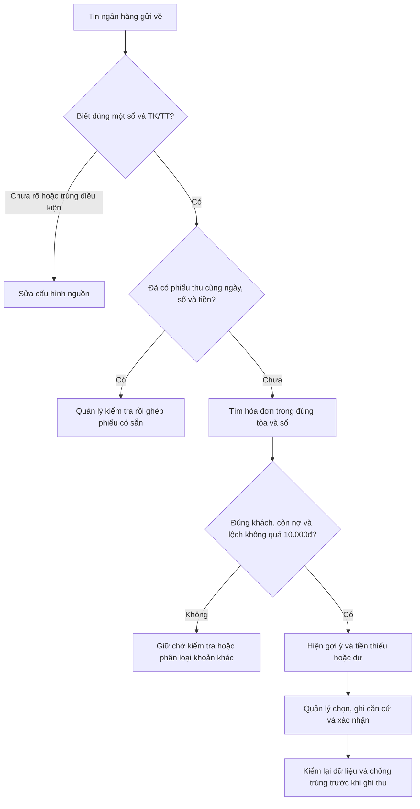
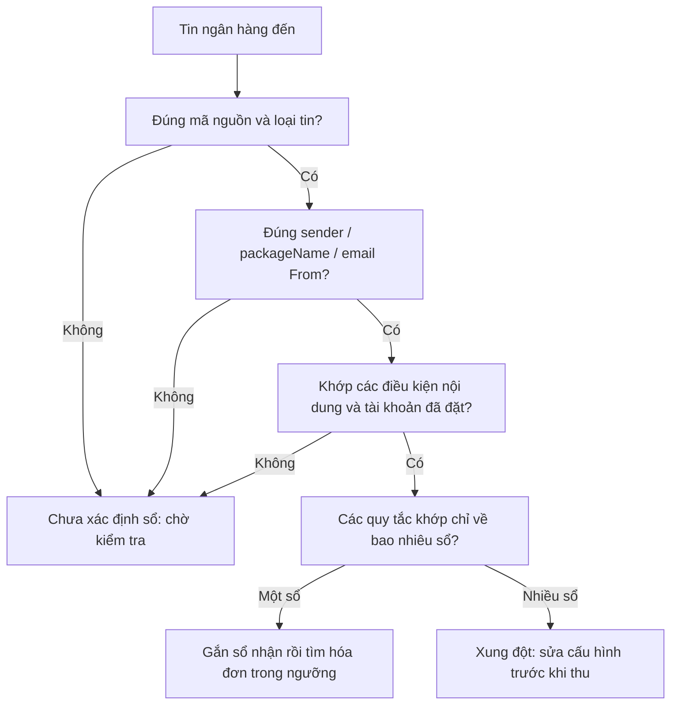

# Hướng dẫn sử dụng demo Biến động ngân hàng

Ngày: 17/10/2026. Phiên bản: demo tương tác trên local, dữ liệu giả lập.

## Bổ sung 18/10: trang đối chiếu nối dữ liệu thật

Trang mới nằm tại **Biến động số dư → Đối chiếu ngân hàng** trong ứng dụng, dùng tổ chức đang chọn. Phần mã nối dữ liệu thật đã được bổ sung; chỉ dùng sau khi hoàn tất kiểm TEST và phát hành. Hướng dẫn demo bên dưới vẫn dành riêng cho trang mẫu trên local.

1. **Chọn công ty.** Đợt đầu, tab này dùng quyền super admin hiện có của trang Biến động số dư, đồng thời yêu cầu người dùng là thành viên đang hoạt động của công ty đó.
2. **Gắn nguồn vào sổ.** Bấm **Cấu hình nguồn → sổ quỹ → Thêm điều kiện**. Chọn nguồn điện thoại/Gmail; điền chính xác sender SMS, mã ứng dụng gửi thông báo hoặc địa chỉ email gửi. Chọn sổ ngân hàng, TK/TT và ngày bắt đầu. Một dòng phải khớp tất cả điều kiện. Nếu cùng khớp nhiều sổ hoặc phương thức, hệ thống giữ giao dịch ở trạng thái **Trùng điều kiện nguồn**.
3. **Kiểm tra tòa được nhận.** Danh sách dưới sổ lấy từ cấu hình sổ nhận tiền đang có của hệ thống. Ví dụ sổ chỉ nhận cho tòa A bằng TK thì hóa đơn của tòa B hoặc phương thức TT sẽ không được gợi ý. Nếu một điện thoại nhận nhiều tài khoản ngân hàng, thêm điều kiện tài khoản đã che đúng như tóm tắt hoặc nội dung để tách các sổ.
4. **Đọc tin cũ.** Bấm nút này sau khi cấu hình lần đầu. Hệ thống đọc từng nguồn thuộc công ty, bỏ qua tin đã có. Tin mới được tiếp nhận theo kênh đã kết nối. Tin không tách được chiều tiền hoặc số tiền vẫn nằm ở **Tin nhận được**, chưa được coi là khoản thu.
5. **Lọc khoản cần xử lý.** Có nguồn, sổ ngân hàng, tòa, TK/TT, kênh, trạng thái, chiều tiền, nội dung, khoảng ngày và khoảng tiền. Khoảng ngày dùng ngày giao dịch ngân hàng theo giờ Việt Nam. Danh sách phân trang 50 khoản, tự tải lại mỗi 15 giây khi không đang lưu.
6. **Mở Đối chiếu.** Hệ thống tìm hóa đơn còn nợ trong đúng sổ/tòa/phương thức, lệch tối đa **10.000đ**, và có đúng một khách đại diện của hợp đồng gắn với hóa đơn. Hóa đơn chưa tồn tại tại thời điểm chuyển tiền, đã chuyển nợ sang hóa đơn khác, hoặc có nội dung rõ ràng thuộc khách/phòng/tòa/hóa đơn khác sẽ bị loại. Số tiền khớp chỉ là căn cứ gợi ý; vẫn kiểm tra tên, phòng và kỳ thu.
7. **Chọn cách xử lý.** Nếu khoản tiền đã được thu trước đó, chọn **Ghép phiếu thu có sẵn** sau khi kiểm tra đúng hóa đơn; thao tác này không ghi tiền lần hai. Nếu chưa có phiếu phù hợp, chọn hóa đơn rồi nhập căn cứ ít nhất 8 ký tự, tick xác nhận và bấm **Xác nhận ghi thu hóa đơn**. Trả thiếu giữ nợ còn lại; trả dư cần đồng ý giữ tiền dư cho khách theo cơ chế hiện hành. Dữ kiện hóa đơn đổi trong lúc mở màn hình sẽ yêu cầu tick lại.
8. **Khoản chưa rõ.** Không chọn đại một hóa đơn chỉ vì trùng số tiền. Tiền cọc, khoản thu khác hoặc giao dịch chưa có hóa đơn phù hợp được giữ để kiểm tra hoặc đánh dấu **Khoản khác**. Tin nghi trùng cần đối chiếu nguồn/thời điểm/nội dung; khoản nghi trùng đã được ghi thu sẽ bị chặn ghi thêm.
9. **Hoàn tác.** Với khoản vừa ghi thu từ trang này, hoàn tác dùng cơ chế đảo khoản thu hiện có, có thể bị chặn nếu đã có nghiệp vụ phụ thuộc. Với phiếu thu có sẵn, hoàn tác chỉ bỏ liên kết ngân hàng và giữ nguyên phiếu thu. Mỗi thao tác lưu căn cứ và lịch sử trên máy chủ.



Chưa có chế độ tự thanh toán. Hiện chưa đọc file Excel sao kê trực tiếp vào trang; các file sao kê trước đây phục vụ phân tích riêng. Trang không bao gồm tiền mặt, ví nhân viên hay bút toán chuyển sổ nội bộ.

## 1. Mở trang

Khi máy chủ local đang chạy, mở:

[Biến động ngân hàng trên local](http://127.0.0.1:5179/src/pages/bank-reconciliation/local.html)

Nếu máy chủ đã tắt, mở PowerShell và chạy:

```powershell
Set-Location "C:\Users\Nguyen Tam\codex-worktrees\plan-bien-dong-so-du-tong"
npx vite --host 127.0.0.1 --port 5179 --strictPort
```

Giữ cửa sổ lệnh này khi dùng demo. Nếu cổng đang được dùng, kiểm tra phiên local đang chạy trước; không tắt tiến trình khác để chiếm cổng.

Đây là trang React chạy trong dự án, dùng bộ dữ liệu mẫu riêng gồm **16 giao dịch, 13 hóa đơn, 4 sổ ngân hàng và 1 khoản thu cũ**. Không cần đăng nhập. Trang không gọi Supabase, không dùng tài khoản thật và không ghi tiền thật.

Các thay đổi chỉ tồn tại trong bộ nhớ của tab hiện tại. **Tải lại trang hoặc bấm Đặt lại demo sẽ khôi phục bộ mẫu.** Tab khác có phiên mẫu độc lập. Đường dẫn ứng dụng thật `/bien-dong-so-du` giữ nguyên.

## 2. Làm quen màn hình

| Khu vực | Dùng để làm gì? |
|---|---|
| Biến động ngân hàng | Xem tiền vào/ra, tìm khoản cần khớp, mở chi tiết để đối chiếu |
| Hóa đơn đối chiếu | Xem tổng hóa đơn, tiền đã áp, phần còn nợ; tìm ngược tiền ngân hàng |
| Nguồn kết nối | Thêm/sửa/tạm dừng quy tắc nguồn + người gửi → sổ; thử tin và xem lịch sử cấu hình mẫu |
| Lịch sử xử lý | Xem thao tác xác nhận, gắn khoản cũ, phân loại và hoàn tác trong phiên |
| Hướng dẫn | Có hướng dẫn ngay trên trang và danh sách mã tình huống để thử |

Bốn ô tổng quan thay đổi theo nhóm và bộ lọc đang chọn: tiền vào, tiền ra, tiền vào cần khớp và số khoản cần kiểm tra. Chúng tính trên **toàn bộ kết quả**, không chỉ 8 dòng đang xem.

Tiền vào cần khớp không gồm khoản đã khớp và khoản đã phân loại khác. Khoản nghi trùng vẫn được giữ riêng tới khi có bằng chứng giải quyết; vì vậy tổng đang xem chưa phải số dư ngân hàng đã kiểm chứng. Hai tin đã xác định cùng một khoản được gộp trong một dòng, ví dụ DEMO-GD-09.

## 3. Lọc giao dịch

1. Chọn nhóm: **Tất cả**, **Cần khớp**, **Có gợi ý**, **Đã khớp**, **Cần kiểm tra**, **Khoản khác**.
2. Nhập nội dung, mã giao dịch, mã bill, phòng hoặc tên khách vào ô tìm kiếm. Có thể nhập không dấu.
3. Chọn sổ ngân hàng và chiều tiền.
4. Bấm **Bộ lọc** để mở các điều kiện bổ sung.

| Bộ lọc | Lưu ý |
|---|---|
| Từ ngày / Đến ngày | Bao gồm cả ngày đầu và cuối, dùng ngày giờ Việt Nam |
| Mốc thời gian | Chọn giờ giao dịch hoặc giờ nhận tin; tin có thể đến muộn |
| Ngân hàng / nguồn báo | Có thể tách Gmail, SMS hoặc thông báo app theo tên nguồn |
| Trạng thái xử lý | Lọc riêng khoản nghi đã thu, chờ xử lý, chưa tìm được… |
| Tòa đã khớp / có gợi ý | Chưa khớp thì chỉ nói có ứng viên liên quan; không kết luận tiền đã thuộc tòa |
| Số tiền chính xác | Nhập số nguyên, ví dụ `3000000` |
| Số tiền từ / đến | Lọc khoảng tiền thực nhận; khác với ngưỡng chênh lệch so bill |

Các điều kiện kết hợp với nhau. Nếu không thấy khoản mong đợi, chọn **Tất cả**, xóa từ khóa và bấm **Xóa bộ lọc** trong phần mở rộng. Khi dò ngược từ hóa đơn, còn có điều kiện hóa đơn riêng; bấm **Bỏ điều kiện** để bỏ nó.

Ngưỡng gợi ý luôn là **±10.000đ**, không có công tắc tăng ngưỡng. Bộ mẫu dùng ngày 17/10/2026; nếu lọc ngày khác sẽ không có giao dịch.

## 4. Xác nhận tiền cho một hóa đơn

Ví dụ dễ nhất: nhập **DEMO-GD-09**.

1. Bấm nội dung giao dịch hoặc mũi tên cuối dòng.
2. Kiểm tiền nhận 3.250.000đ, Sổ An Nhiên, mã ngân hàng và nội dung phòng 101.
3. Mở **2 tin báo · xem bằng chứng mẫu**. SMS và Gmail cùng thuộc một khoản, không được tính thành hai lần chuyển.
4. Kiểm phần **CRM có thể đã ghi khoản này** nếu có. Ưu tiên đối chiếu khoản cũ trước khi tạo thu mới.
5. Ở **Hóa đơn gợi ý**, xem bill, khách, tòa, phòng, kỳ, số còn phải thu và lý do phù hợp.
6. Bấm **Chọn hóa đơn này**.
7. Đọc màn xem trước: tiền ngân hàng đã nhận, tiền áp vào bill, nợ sau xác nhận và credit.
8. Bấm **Xác nhận trên demo**.

Kết quả: giao dịch chuyển **Đã khớp**, bill được cập nhật, có khoản thu mẫu và một dòng lịch sử. Không có lời gọi ghi thu vào hệ thống thật.

### Hiểu số thiếu và dư

| Tiền nhận so với phần còn nợ | Demo xử lý |
|---|---|
| Bằng nhau | Thu đủ; bill tất toán |
| Thiếu từ 1đ đến 10.000đ | Vẫn được gợi ý; thu đúng tiền nhận và giữ nợ phần thiếu |
| Dư từ 1đ đến 10.000đ | Áp đủ phần còn nợ; phần dư ghi credit trong khoản thu mẫu |
| Lệch từ 10.001đ trở lên | Không gợi ý bill đó, kể cả nội dung đúng phòng |

Demo không có nút tự làm tròn. Trong hệ thống thật, ngưỡng làm tròn thiếu hiện là **nhỏ hơn 10.000đ**, còn phụ thuộc cọc/`NON_PNL` và lựa chọn người có quyền; khác với ngưỡng gợi ý **không vượt 10.000đ**.

## 5. Gắn khoản thu đã có

Thử **DEMO-GD-15**:

1. Mở chi tiết, thấy ngân hàng nhận 3.010.000đ.
2. Phần khoản đã thu hiển thị **DEMO-PT-CU-01**: 3.000.000đ áp bill + 10.000đ credit.
3. Kiểm đúng sổ, đúng tiền và mã tham chiếu trong bằng chứng mẫu.
4. Chọn **Gắn khoản thu đã có**, đọc xem trước rồi xác nhận.

Kết quả chỉ thêm liên kết. Tổng tiền đã ghi và công nợ không thay đổi. Dò khoản thu cũ dùng **đúng tiền thực nhận**, không dùng ±10.000đ để làm cho một phiếu khác tiền trở nên khớp.

Nếu có khoản cũ nghi phù hợp, demo chặn nút tạo thu mới để ưu tiên kiểm. Bản demo chưa có quy trình bác bỏ một nghi vấn khoản cũ phức tạp.

## 6. Nhiều ứng viên, cạnh tranh và nợ gộp

- **DEMO-GD-13:** chỉ ghi “Thanh toán tiền phòng”, nhận 3 triệu vào sổ dùng chung. Có nhiều bill phù hợp; không tự chọn dòng đầu.
- **DEMO-GD-20:** cũng 3 triệu nhưng chỉ rõ Bình Minh, phòng 201. Gợi ý này cạnh tranh với khoản 13. Xác nhận khoản 20 cho bill 201, quay lại khoản 13 sẽ thấy bill đó không còn là lựa chọn thu mới.
- **DEMO-GD-14:** bill tháng 10 đã gồm 500.000đ nợ tháng 9. Xem ghi chú gộp nợ; bill nguồn không được gợi ý thu độc lập lần nữa.

Bấm **Vì sao các hóa đơn khác bị loại?** để xem lý do: sai sổ, hết nợ, trạng thái không được thu, nợ đã gộp, chênh quá ngưỡng hoặc nội dung chỉ phòng/tòa khác.

## 7. Không xác định được tiền của ai

1. Mở chi tiết khoản cần xử lý.
2. Đọc cảnh báo thiếu sổ, nghi trùng hoặc nợ gộp chưa rõ.
3. Nhập lý do ở **Lý do / ghi chú**.
4. Chọn **Để chờ xử lý** nếu cần kiểm thêm; chọn **Không phải tiền hóa đơn** nếu đã rõ là cọc riêng hoặc khoản khác.
5. Xác nhận phân loại.

Các thao tác này không thu bill. Với khoản bị chặn dữ liệu, thêm ghi chú không mở khóa điều kiện thu. Muốn gỡ phân loại: mở lại khoản → nhập lý do → **Gỡ phân loại**.

Trang chỉ có giao dịch ngân hàng. Tiền mặt, ví nhân viên và bút toán chuyển sổ nội bộ không được bổ sung vào danh sách.

## 8. Dò ngược từ hóa đơn

1. Mở **Hóa đơn đối chiếu** ở thanh bên.
2. Tìm thẻ bill cần kiểm.
3. Bấm **Tìm tiền ngân hàng**.
4. Trang giao dịch mở với điều kiện bill đã chọn, hiển thị khoản có gợi ý, khoản đã gắn hoặc khoản thu cũ liên quan.

Thử bill **DEMO-HD-104**: tổng 5 triệu, đã áp 2 triệu, nên tìm khoản 3 triệu. Thử **DEMO-HD-107** đã tất toán để tìm khoản thu cũ và tin ngân hàng đến muộn. Hóa đơn đã tất toán do làm tròn không trở lại nhóm thu mới chỉ vì phép trừ còn vài nghìn.

## 9. Sửa quyết định và hoàn tác

1. Mở giao dịch đã xử lý.
2. Nhập lý do.
3. Bấm **Gỡ / hoàn tác**, đọc giải thích rồi xác nhận.

- Nếu đã gắn khoản thu có sẵn: gỡ liên kết, giữ nguyên khoản thu và công nợ.
- Nếu vừa tạo khoản thu mẫu: khôi phục công nợ và bỏ khoản thu mẫu nếu bill chưa có thay đổi tiếp theo.
- Nếu bill có thay đổi tiếp theo: demo chặn hoàn tác nhanh.
- Lịch sử thao tác vẫn còn. Hoàn tác trong CRM **không có nghĩa đã chuyển tiền trả khách**.

Luồng thật còn phải kiểm kỳ khóa, credit đã sử dụng và các ràng buộc V5. Bản local chưa mô phỏng toàn bộ những chốt server đó.

## 10. Xuất dữ liệu và xem lịch sử

**Xuất CSV:** đặt nhóm/bộ lọc mong muốn rồi bấm nút ở đầu trang. File gồm mã, giờ, sổ, chiều, tiền, nội dung, nguồn, trạng thái và bill đã khớp. File lấy mọi dòng phù hợp trên các trang, có UTF-8 BOM để đọc tiếng Việt và bảo vệ ô có dấu hiệu công thức.

**Lịch sử xử lý:** mỗi thao tác có thời gian, người thực hiện mẫu, mã giao dịch và kết quả. Bấm mã giao dịch để mở lại chi tiết. Lịch sử mất khi đặt lại demo hoặc tải lại trang.

## 11. Bộ bài thử nhanh

| Mã giao dịch | Việc nên thử | Kết quả |
|---|---|---|
| DEMO-GD-09 | Thu đúng bill | Hai tin, một khoản; phòng 101 tất toán |
| DEMO-GD-10 | Thu thiếu đúng 10.000đ | Còn nợ 10.000đ, không tự tất toán |
| DEMO-GD-11 | Thu dư 10.000đ | Giữ credit 10.000đ |
| DEMO-GD-12 | Bill đã thu một phần | So 3 triệu còn nợ, không so tổng 5 triệu |
| DEMO-GD-13 và 20 | Cạnh tranh cùng bill | Xác nhận một khoản làm mới gợi ý khoản còn lại |
| DEMO-GD-14 | Nợ gộp | Không thu trùng bill nguồn |
| DEMO-GD-15 | Gắn phiếu cũ | Không tăng tiền/công nợ lần hai |
| DEMO-GD-16 | Lệch 10.001đ | Không có ứng viên thu mới |
| DEMO-GD-17 | Tiền ra | Phân loại; không gợi ý thu hóa đơn |
| DEMO-GD-18 | Chưa rõ sổ | Chờ kiểm tra, không cho thu |
| DEMO-GD-19 | Nợ gộp thiếu nguồn | Chờ kiểm tra |
| DEMO-GD-21 | Nghi trùng | Không được thu từ gợi ý |
| DEMO-GD-22 | Thanh lý dương | Có thể chọn bill thanh lý mẫu |
| DEMO-GD-MB01 | Nguồn MBDemo → sổ MBDemo | 650.000đ; giả định bill D06 – DEMO-A còn nợ đúng 650.000đ |

## 12. Cấu hình nguồn báo để xác định sổ ngân hàng

Vào **Nguồn kết nối**. Trang mặc định mở quy tắc của **MBDemo**. Nguồn kết nối được gắn bằng mã nguồn ổn định; tên nguồn chỉ dùng để hiển thị.

### 12.1. Ba cách nhận diện

| Loại tin | Trường phải so chính xác | Ví dụ mẫu |
|---|---|---|
| SMS | Người gửi SMS (`sender`) trong đúng nguồn điện thoại | `MB-DEMO` |
| Thông báo app | Mã ứng dụng (`packageName`) trong đúng nguồn điện thoại | `com.mbbmobile` |
| Gmail | Địa chỉ email gửi đầy đủ trong đúng nguồn Gmail | `bank-alerts@example.test` |

Các sender và địa chỉ Gmail trên là dữ liệu minh họa. Khi triển khai thật phải chọn từ tin ngân hàng đã nhận, không coi chúng là địa chỉ ngân hàng thật. Tên hiển thị “MB Bank” hoặc “Ngân hàng” không thay thế mã ứng dụng/địa chỉ email. Người gửi SMS/email thường là ngân hàng, không phải người chuyển tiền; tên khách vẫn được dò riêng từ nội dung chuyển khoản.

### 12.2. Thêm hoặc sửa quy tắc

1. Bấm **Thêm quy tắc**, hoặc **Sửa** trên quy tắc đã có.
2. Đặt tên để dễ nhận ra, ví dụ “MBDemo nhận thông báo MB”.
3. Chọn **Nguồn kết nối** và **Loại tin**.
4. Nhập đúng sender, packageName hoặc địa chỉ email From.
5. Chọn **Sổ quỹ ngân hàng đích**.
6. Nếu cần tách nhiều tài khoản, nhập **Dấu tài khoản trong nội dung**, sao chép đúng như tin báo, ví dụ `00xxx123`. Demo so nguyên một dấu nhận diện; nhập riêng `123` không khớp `00xxx123`.
7. Có thể thêm **Tiêu đề / nội dung chứa**, ví dụ “Thông báo biến động số dư”. Cụm từ này so không phân biệt hoa/thường, nhưng vẫn giữ dấu và khoảng trắng.
8. Đọc **Xem trước khi lưu**: tin thử vào sổ nào và bao nhiêu giao dịch chưa khớp sẽ thay đổi. Bấm **Lưu cấu hình mẫu**.

Tất cả điều kiện đã nhập phải cùng khớp. Hai điều kiện bổ sung được phép để trống: khi đó quản lý xác nhận mọi tin của nguồn + sender/app/email này đều thuộc sổ đích. Nếu nguồn ấy báo nhiều tài khoản thì nên cấu hình dấu tài khoản riêng cho từng sổ.



### 12.3. Thử tin và kiểm xung đột

- Bấm **Mẫu app MBDemo**, **Mẫu SMS** hoặc **Mẫu Gmail**. Chỉnh nguồn, người gửi, tiêu đề và nội dung; kết quả nhận diện cập nhật ngay. Thử tin không tạo giao dịch.
- Mẫu app MBDemo dùng `com.mbbmobile` và `00xxx123`, nên nhận vào sổ MBDemo. Đổi packageName sang `MB Bank` sẽ không khớp.
- Có thể bấm **Tạo quy tắc từ tin này** để điền sẵn phần nhận diện; anh vẫn chọn sổ và kiểm lại điều kiện.
- Nếu hai quy tắc chỉ về cùng một sổ, hệ thống vẫn xác định được sổ đó. Nếu chỉ về hai sổ khác nhau, kể cả quy tắc rộng và hẹp, demo báo **Xung đột sổ nhận** và chặn gợi ý thu. Không chọn theo thứ tự hoặc độ chi tiết.
- Các tin đã gộp thành một giao dịch cũng được kiểm cùng nhau: SMS chỉ về sổ A nhưng Gmail chỉ về sổ B thì giao dịch chờ kiểm tra.
- Bấm **Tạm dừng** trên quy tắc để thử bỏ ánh xạ. Bấm **Bật lại** để khôi phục. Những lỗi khác như nghi trùng hoặc nợ chưa rõ vẫn giữ nguyên.

### 12.4. Ảnh hưởng đến giao dịch

Lưu hoặc bật/tạm dừng quy tắc sẽ tính lại sổ của **giao dịch chưa khớp** trong bộ mẫu. Khoản đã ghi thu giữ sổ và bằng chứng cấu hình tại lúc xác nhận; gỡ liên kết mới xét lại cấu hình hiện tại. Việc sửa quy tắc không sửa phiếu thu cũ.

Trong chi tiết giao dịch có **Vì sao nhận vào sổ này?** và nút **Mở cấu hình nguồn**. Các trường sender/packageName/nội dung nằm trong **xem bằng chứng mẫu**.

Để thử hết luồng: mở **Xem giao dịch MBDemo** → thấy gợi ý D06 – DEMO-A. Đây là tình huống giả lập hoàn toàn: bill còn nợ 650.000đ, tên khách, sổ và dấu tài khoản đều là dữ liệu mẫu. Xác định sổ không đồng nghĩa tự thanh toán.

Quy tắc, lịch sử cấu hình và thao tác thu chỉ nằm trong phiên; **Đặt lại demo** hoặc tải lại trang sẽ xóa thay đổi thử.

## 13. Phần đã làm và giới hạn

Đã có: giao diện desktop/điện thoại, bộ lọc, tổng hợp, phân trang, chi tiết bằng chứng mẫu, quy tắc nhận diện nguồn → sổ, thử tin trước khi lưu, xử lý xung đột, bộ dò công nợ, lý do loại, cảnh báo cạnh tranh, xác nhận/gắn/hoàn tác trong bộ nhớ, dò ngược, xuất CSV, lịch sử và hướng dẫn trong trang.

Chưa kết nối thật: chuẩn hóa tin, chống trùng giữa kênh, API/DB cấu hình nguồn và đối soát, xác thực/phân quyền, lưu bền, thu V5, hoàn tác V5, đồng thời nhiều người, báo cáo đủ dữ liệu thật, tự thanh toán. Bộ mẫu đã khai báo sẵn metadata nguồn, trạng thái dữ liệu và quan hệ nợ; sổ được xác định từ quy tắc. Parser demo chỉ nhận một số dạng nội dung rõ, chưa phải bộ tách tin ngân hàng sản xuất. Khớp From/sender là điều kiện định tuyến, không thay thế xác thực nguồn hoặc kiểm chứng khoản tiền thực tế.

Định hướng vận hành đầy đủ nằm trong [plan đã chốt](2026-10-16-plan-bien-dong-so-du-ngan-hang.md). Bản demo giúp duyệt giao diện và thao tác trước khi triển khai backend.
