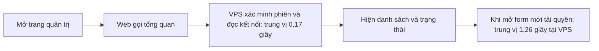
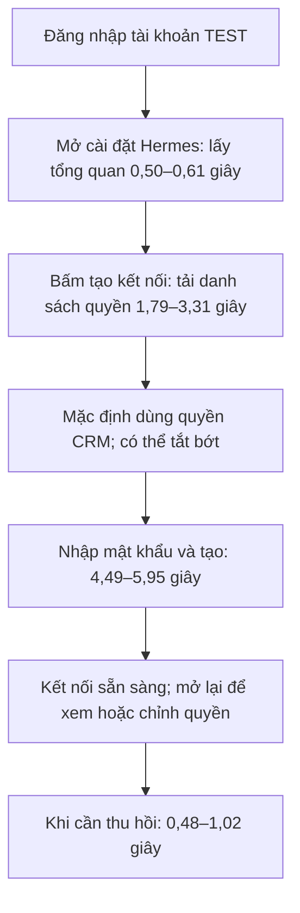
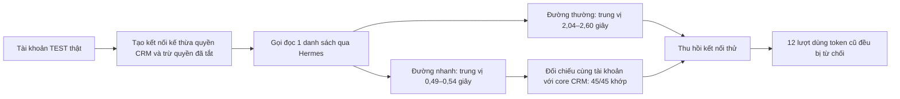
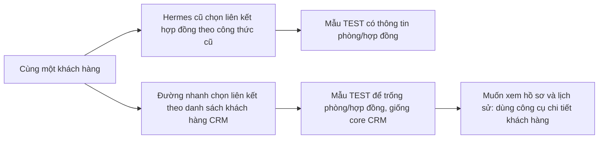

# Đánh giá và kế hoạch tối ưu tốc độ CRM và Hermes

Ngày đánh giá: 19/10/2026. Source khảo sát ban đầu `81c49363`, tài liệu đối chiếu tới `b4050f6b`. **Checkpoint triển khai 19/10, 18:16 UTC+7:** source `0fbc263f48d896baf633eba84dbf3cd4a222387a` đã lên main và VPS qua [PR #222](https://github.com/zxGreenxz/whiteboard-ihomecrm/pull/222); đủ bảy migration trên TEST/production, Gate7 delta 65/65 và năm lượt CI main đạt. Chrome đã đọc được Vercel sau khi chủ đăng nhập. Web production vẫn ở `81c49363`; Vercel commit-status cho candidate báo **vượt giới hạn số lần deployment, thử lại sau 24 giờ** (status `07:03:47Z`), giải thích rõ hơn lỗi `402 payment_required` trước đó. Chưa đổi gói hoặc gọi lại POST; chưa biết chính xác lúc mở lại hạn mức. Đã kiểm broker thật với ba tài khoản hiện có trên project riêng `ihomecrm-test`: 45 cặp mẫu có dữ liệu khớp core CRM; lượt bổ sung 15 cặp khoanh khác biệt khách hàng vào bốn trường phòng/hợp đồng, giữ công thức CRM. Nay đã hoàn tất thêm thao tác Chrome cho cả ba tài khoản trên bản build TEST tĩnh: loading, tạo kết nối, đọc lại quyền, thu hồi và đăng xuất đạt; tài khoản chủ kiểm thêm tắt/bật lại quyền. Chưa kiểm HTTPS proxy Vercel, phiên owner production hay Zalo gửi nhận. Chưa hoàn tất toàn bộ plan. [STATUS](hermes-crm/STATUS.md) giữ checkpoint vận hành mới nhất.

**Đích quyền: quyền Hermes = quyền CRM user − những quyền bị tắt trong cài đặt Hermes.** [Báo cáo tinh giản, ba lỗi, sơ đồ và audit §10](hermes-crm/TINH-GON-KIEM-QUYEN.md) giữ plan Hermes hiện hành và tiến độ candidate. Chủ đã làm rõ §9 chỉ là đề xuất agent khác: không áp đặt 100 ms, cấm cache hoặc epoch mọi RPC. Giữ quyền/RLS CRM vốn có; bỏ hai kiểm cuối và công việc lặp. Xác nhận chữ công khai là lựa chọn riêng, chưa chốt mới. Báo cáo dưới giữ bằng chứng và phạm vi CRM/Jev rộng hơn.

## Checkpoint triển khai 19/10 — VPS đã đổi, web chờ Vercel

VPS đã chuyển sang `0fbc263f…` sau backup mã hóa ngoài máy và kiểm đọc lại/giải mã đúng bytes. Xác minh tiến trình thật lúc 14:05 UTC+7: active/running, đường chạy và thư mục làm việc cùng release mới. `POST /mcp` không credential trả 401 đúng source. Đây chưa phải bằng chứng khôi phục phiên owner hoặc gửi nhận Zalo. Sau lần thử đọc nhanh, cấu hình gốc được hoàn nguyên và đọc lại độc lập lúc 14:37:26 UTC+7: hash khớp, dịch vụ hoạt động, `readFastPath` vắng mặt/mặc định false. `zaloProvisioning` được bỏ khỏi connector config trên layout ba UID.

Migration tương thích thứ bảy `20261019061954` đã qua lane TEST/production và kiểm sau áp dụng 7/7 mỗi đích: legacy giữ8 trường cơ sở, inherit11 trường; không sửa expiry. Đã xác nhận schema TG2 làm adapter cũ từ chối ba trường bổ sung và maintenance bỏ qua lỗi đọc. Phiên owner hiện hết hạn; chưa xác định thời điểm lần gia hạn đầu tiên bị bỏ qua hoặc token đang giữ trong bộ nhớ. Bản sửa format không tự phục hồi phiên. Sau khi web phát hành được, chủ cần tạo/chọn kết nối mới qua luồng chính thức; không dùng tài khoản kiểm thay owner hoặc xin mật khẩu qua chat.

Gate7 delta65/65 dùng Node24.18.0,529 giây; Gate5/6 67/67 giữ làm bằng chứng phần không đổi. Năm lượt CI của đúng SHA main đều PASS; official promote dry-run nhận18 job/178 bước, gồm biên nhận E2E fleet **local** bảy spec đã có, không gọi đó là CI chạy E2E thật. Web chưa đổi vì lỗi Vercel nêu trên; chưa bỏ kiểm hoặc đổi project để vượt lỗi phát hành.

### Số đo quản trị trước và sau trên VPS

Giữ cùng cách đo: loopback HTTP trực tiếp broker → Supabase production; JWT đăng nhập thật, công ty DEMO, danh sách kết nối rỗng, năm mẫu mỗi endpoint và giữ cả mẫu đầu. Trước ở `b023563a`, sau ở `0fbc263f…`; 15/15 và20/20 HTTP200. Cột sau đo lúc14:04 UTC+7.

| Thao tác | Trung vị trước | Trung vị sau |
|---|---:|---:|
| Danh sách kết nối `list` | 2.732,44 ms | 205,93 ms |
| Danh sách quyền `options` | 5.060,10 ms | 1.260,06 ms |
| Trạng thái `status` | 2.667,77 ms | 177,53 ms |
| Tổng quan mới `overview` | Chưa có endpoint | 173,27 ms |

Sơ đồ là **luồng web mới trong source, đang chờ Vercel phát hành**. Số đo không gồm browser/WAN/Vercel, công ty có nhiều kết nối, tải đồng thời hoặc model/Zalo; năm mẫu không đủ kết luận p95. Không lấy0,17 giây làm lời hứa thời gian mở trang của người dùng. Raw trace được giữ ngoài repo trong các file `hermes-readonly-baseline-before-20261019.json` và `hermes-readonly-baseline-after-20261019.jsonl`.

### Nghiệm thu giao diện bằng ba tài khoản TEST thật

Hoàn tất lúc **18:08:57 UTC+7** trên Chrome: frontend bản build TEST tĩnh của candidate → proxy loopback → SSH → broker riêng → Supabase TEST thật. Ba tài khoản chủ/quản lý/hệ thống đăng nhập đúng công ty bản sao, mở cài đặt Hermes, tạo mỗi người một kết nối theo quyền CRM, đọc lại cấu hình, thu hồi đúng kết nối vừa tạo và đăng xuất. Loading hiển thị đúng trong cả ba lần mở form; không thấy thông báo lỗi giả “Chưa đọc được…” trong các lần kiểm đó. Tài khoản chủ tắt “Xem khách hẹn” khi tạo, mở lại xác nhận đã tắt, bật lại và xác nhận đã lưu. Hai tài khoản còn lại kiểm kế thừa mặc định. Mật khẩu trong ô xác nhận được xóa sau gửi; lần thu thập console cuối không có lỗi.

Thời gian dưới đây đo **từ proxy gửi request đến khi nhận response headers**, có mạng SSH tới broker và xử lý DB TEST, chưa gồm tải/render toàn bộ giao diện. Có 23 request, tất cả HTTP200; mẫu ít, không tính p95 và không suy rộng thành thời gian mọi thao tác.

| Thao tác | Số mẫu | Nhanh nhất – chậm nhất |
|---|---:|---:|
| Lấy danh sách và trạng thái khi mở trang | 3 | 0,50–0,61 giây |
| Lấy danh sách quyền khi mở form | 3 | 1,79–3,31 giây |
| Xác nhận và tạo kết nối mới | 3 | 4,49–5,95 giây |
| Đọc lại cấu hình quyền của kết nối | 4 | 1,83–2,99 giây |
| Lưu quyền đã bật/tắt | 1 | 1,04 giây |
| Thu hồi kết nối | 3 | 0,48–1,02 giây |
| Lấy danh sách tài khoản Zalo | 3 | 0,28–0,51 giây |
| Lấy danh sách bot Zalo | 3 | 0,29–0,61 giây |

Các bước trong sơ đồ là **những thao tác người dùng khác nhau**, không phải mỗi câu hỏi Hermes phải làm lại toàn bộ. Tạo kết nối vẫn mất khoảng 4,5–6 giây trong ba mẫu; chưa xác định phần nào chiếm bao nhiêu trong request nên không hứa giảm tiếp số giây. Số đo này cũng không so trực tiếp với mẫu DEMO/danh sách rỗng ở VPS phía trên. Zalo mới kiểm danh sách hiển thị, chưa liên kết hay gửi nhận. HTTPS Vercel, phiên chủ production và nghiệm thu đọc nhanh production vẫn chờ.

Runner kết thúc PASS lúc 18:09:03: ba kết nối đã thu hồi, sáu lần dùng token cũ khởi tạo/gọi công cụ bị từ chối 401, kết nối có sẵn không đổi; role tạm/lease đã dọn và ba phiên harness logout. Giao diện đã logout từng tài khoản, đóng tab TEST, dừng frontend/tunnel. Cleanup hạ tầng PASS lúc **18:15:53**: đúng container, volume và thư mục thử đã xóa; production giữ nguyên PID/release/hash và fast OFF. Chi tiết lần dọn đầu chưa xác minh được và recovery từ trạng thái đã dừng ở [STATUS](hermes-crm/STATUS.md#checkpoint-hiện-hành). Không ghi nghiệp vụ; giữ audit/bản ghi thu hồi/phiên provider theo thiết kế. Các receipt ngoài repo: `hermes-test-ui-browser-report-20261019.json`, `hermes-test-ui-frontend-report-20261019.json`, `hermes-test-ui-execution-report-20261019.json`, `hermes-test-ui-cleanup-recovery-report-20261019.json`; không phải receipt CI E2E hoặc fleet chuẩn. Full backup TEST mới có trước khi chạy và mọi thao tác nằm trong thời hạn của backup.

### Đọc nghiệp vụ: phần đã kiểm và điểm còn thiếu

Lượt DEMO thứ tư kết thúc 14:36:46 UTC+7: khởi tạo, quyền, phạm vi và đối chiếu ba công thức dùng chung đều đạt, tổng 12 ca kiểm. Tuy nhiên đường thông thường trả một dòng cho mỗi miền khách hàng/hợp đồng/hóa đơn, còn đường nhanh và public shared core cùng trả **không dòng** ở cả ba miền. So sánh với đường cũ không đạt; khác biệt quan sát được nằm ở số dòng và con trỏ trang, chưa chứng minh do các trường vị trí khách hàng.

Đây chỉ là bằng chứng đường nhanh khớp core trên kết quả rỗng. Cờ `fastVerified` trong báo cáo đo có phạm vi hẹp đó; **chưa đủ nghiệm thu nghiệp vụ có dữ liệu**, chưa đủ so sánh tốc độ khi trả cùng kết quả. Cờ nhanh đã được trả về tắt như trạng thái phía trên. Không thay RLS hoặc mở quyền để làm phép đo đạt. Ba lượt kiểm trước và kết quả thất bại được giữ riêng ngoài repo; lượt ba vướng giả định sai của harness về phạm vi sổ quỹ, đã sửa theo contract trước lượt bốn.

Cả bốn kết nối thử được thu hồi qua API chính thức; token của chính kết nối bị từ chối khi khởi tạo/gọi công cụ, không còn kết nối thử đang hoạt động. Phiên đăng nhập nhà cung cấp, bàn giao mã hóa và audit giữ theo thời hạn thiết kế; không kết luận không còn session. Không ghi dữ liệu nghiệp vụ, thay profile owner hoặc gửi Zalo. Production vẫn cần xử lý phát hành web → chủ kết nối lại → nghiệm thu đúng phiên/phạm vi → quyết định bật đọc nhanh → kiểm luồng Hermes/Zalo.

**Nghiệm thu TEST theo yêu cầu chủ, 15:05:35–15:05:45 UTC+7:** dùng tài khoản chủ, quản lý và hệ thống hiện có trên Supabase `ihomecrm-test` riêng; không dùng tổ chức TEST cũ nằm trong production. Đã kiểm ref khác production, đúng tên/trạng thái project, marker có sẵn, ba core `INVOKER` và phần thân helper tương thích. Đăng nhập thật, lấy công ty/phạm vi qua RPC ngữ cảnh của chính user; cả ba thuộc cùng công ty bản sao.

| Tài khoản TEST | Vai trò từ phiên thật | Mẫu core khách hàng / hợp đồng / hóa đơn |
|---|---|---|
| Chủ | OWNER, không phải platform admin | 3/3, mỗi danh sách 1 dòng đúng phạm vi |
| Quản lý | STAFF, không phải platform admin | 3/3, mỗi danh sách 1 dòng đúng phạm vi |
| Hệ thống | OWNER, platform admin | 3/3, mỗi danh sách 1 dòng đúng phạm vi |

Tổng **9/9 mẫu nonempty**, đăng xuất local 3/3; không tạo kết nối Hermes, ghi nghiệp vụ, đổi schema, profile hay mật khẩu. Đây chỉ là preflight bằng JWT/RLS cho phép đo tiếp theo qua broker thật, chưa chứng minh MCP, fast, UI hoặc Zalo. Receipt giữ ngoài repo: `test-accounts-readonly-report.json`. Quyền/phạm vi quan sát từ JWT và RPC, không suy ra chỉ từ nhãn tài khoản.

Web TEST kiểm lại lúc16:02:15 UTC+7 vẫn trả **HTTP410**; trong 100 deployment gần nhất không thấy nhánh `test-env` hoặc deployment production của candidate. Có hai preview READY cùng SHA candidate, nhưng chưa xác minh chúng dùng TEST nên không lấy làm môi trường nghiệm thu. Metadata có ba biến preview riêng cho nhánh TEST (`VITE_APP_ENV`, `VITE_SUPABASE_URL`, `VITE_SUPABASE_PUBLISHABLE_KEY`), nhưng chưa kiểm giá trị hay bản build hiện hành. Lần kiểm này chỉ đọc, không tạo deployment. Tại mốc kiểm này quyền truy cập browser của agent vẫn bị công cụ chặn khi chủ gắn `@Browser`; đăng nhập extension/Vercel chưa phải bằng chứng agent đã điều khiển được. Kết quả broker độc lập ở bên dưới; kết quả UI mới cập nhật ở đầu tài liệu, Zalo vẫn chờ. Cờ fast trên VPS production giữ OFF.

Môi trường chạy riêng chuẩn bị đạt lúc15:28:10 UTC+7: Node24.18.0, PostgreSQL client17, thao tác ghi bền trên thư mục Linux, module broker và 916 hash source khớp candidate. Docker cục bộ bị lỗi khởi động nên dùng Docker có sẵn trên VPS, không thay dịch vụ production. Backup full TEST mới15:22:30 UTC+7 đã xác minh dung lượng, hash và 654 bảng có dữ liệu; dump giữ tại máy cục bộ. Lượt đầu dừng trước tạo kết nối/đọc MCP vì bộ đo dùng Node24 `fetch`, làm Host nhận thêm cổng và bị allowlist HTTP từ chối 403. Phép thử riêng xác nhận cùng yêu cầu: `fetch` bị 403, `node:http` giữ Host đúng và được 200. Chỉ sửa bộ đo TEMP; giữ nguyên ứng dụng, quyền và RLS. Receipt thất bại được giữ riêng; cleanup DB đạt và container/thư mục/volume lượt đầu đã dọn lúc15:42:52.

**Bổ sung web TEST lúc16:13:28 UTC+7:** ba giá trị cấu hình frontend riêng nhánh TEST đã đối chiếu trong bộ nhớ và khớp đích TEST chuẩn; không còn chỉ là kiểm tên biến. Nhưng danh sách env preview của project chưa có hai biến nối web với Hermes (`HERMES_UPSTREAM_ORIGIN`, `HERMES_CRM_ORIGIN`), kể cả scope chung và scope nhánh. Source proxy sẽ trả `503 backend_unavailable` nếu thiếu origin; chưa có bản web TEST mới để kiểm hành vi thực tế. Cần nối web với broker TEST riêng bằng đúng hai origin rồi nghiệm thu đường HTTPS; không dùng broker production cho tài khoản TEST. Nhánh `test-env` còn cũ, chưa push hoặc thay env trong lần chỉ đọc này. Chi tiết và receipt ở [STATUS](hermes-crm/STATUS.md#checkpoint-hiện-hành).

### Kết quả broker TEST với ba tài khoản thật

Lượt hai chạy **15:38:46–15:42:36 UTC+7**, hai broker dùng cùng source candidate, cùng TEST, cùng tài khoản và giới hạn; chỉ khác cờ đọc nhanh. Ba tài khoản × ba nhóm dữ liệu × năm lượt = **45 cặp mẫu**, tức 90 lời gọi đọc MCP. Mỗi đường thường/nhanh/core đều trả một dòng; cả 45 kết quả đường nhanh khớp core CRM. Hợp đồng và hóa đơn cũng khớp đường thường ở 30/30 cặp. Khách hàng không khớp hoàn toàn đường thường ở 15/15 cặp. Receipt lượt hai chưa ghi tên trường khác; lượt ba bổ sung bên dưới đã đo riêng phần này, không sửa hoặc thay thế receipt cũ.

| Tài khoản TEST | Danh sách | Trung vị đường thường | Trung vị đường nhanh | Số cặp |
|---|---|---:|---:|---:|
| Chủ | Khách hàng | 2.081,22 ms | 524,30 ms | 5 |
| Chủ | Hợp đồng | 2.059,21 ms | 489,91 ms | 5 |
| Chủ | Hóa đơn | 2.183,51 ms | 488,03 ms | 5 |
| Quản lý | Khách hàng | 2.041,45 ms | 500,93 ms | 5 |
| Quản lý | Hợp đồng | 2.086,94 ms | 509,67 ms | 5 |
| Quản lý | Hóa đơn | 2.096,14 ms | 488,05 ms | 5 |
| Hệ thống | Khách hàng | 2.526,41 ms | 537,69 ms | 5 |
| Hệ thống | Hợp đồng | 2.598,52 ms | 497,12 ms | 5 |
| Hệ thống | Hóa đơn | 2.473,05 ms | 517,69 ms | 5 |

Đã kiểm một quyền tắt đại diện (`leads.view`, đọc khách hẹn) ở cả hai broker cho ba tài khoản: **6/6 lượt bị chặn đúng**. Ba kết nối thử được thu hồi qua API; cả 12 lượt khởi tạo/gọi tool bằng token cũ trả401. Đã đăng xuất local ba phiên thử, xóa role DB tạm và xác nhận cleanup. Audit, bản ghi kết nối đã thu hồi và các phiên trợ lý thuộc cơ chế lưu giữ hiện có; không kết luận còn 0 session. Cả 138 HTTP request nằm trong report ngoài repo `hermes-test-vps-execution-run2-report-20261019.json`. Kiểm trước/sau xác nhận production active, PID không đổi, đúng release/hash cấu hình gốc và fast OFF; không đổi profile owner hoặc gửi Zalo.

Hạ tầng thử của cả hai lượt đã dọn xong: container riêng, volume đi kèm và thư mục trạng thái riêng; lượt hai hoàn tất lúc15:46:13 UTC+7. Biên nhận được giữ ngoài repo. Không còn benchmark đang chạy; production vẫn đúng PID/release/hash cấu hình và fast OFF sau cleanup.

**Giới hạn số đo:** đây là HTTP loopback trong container giới hạn 0,5 CPU/256 MiB → Supabase TEST. Giữ cả mẫu đầu, đổi thứ tự thường/nhanh giữa các lượt; kiểm lease của bộ đo nằm trước đồng hồ, còn các truy vấn scope/core giữa lượt có thể làm ấm cache. Năm mẫu mỗi ô không đủ tính p95. Các con số không bao gồm browser, mạng từ máy người dùng, Vercel, model hoặc Zalo; không phải số đo tốc độ production hay lời hứa thời gian trả lời đầu cuối. Tạo kết nối mới đo riêng một lần mỗi tài khoản mất 3,41–5,08 giây, không lấy thời gian này làm độ trễ của mỗi câu hỏi.

### Đã khoanh khác biệt khách hàng — lượt bổ sung 16:01–16:03 UTC+7

Lượt ba giữ nguyên source, ba tài khoản TEST và cấu hình quyền của lượt hai; chỉ đọc danh sách khách hàng, năm cặp mỗi tài khoản, mỗi kết quả một dòng. **15/15 cặp cùng khách hàng, đường nhanh khớp core CRM; chỉ bốn trường dưới khác đường cũ.** Đây là các lần đọc lặp, không phải 15 khách hàng riêng biệt. Không ghi ID, tên, số điện thoại hay giá trị phòng vào biên nhận công khai.

| Trường | Đường cũ trong 15 cặp | Đường nhanh/core CRM trong 15 cặp |
|---|---|---|
| `contractId` | Có giá trị | `null` |
| `buildingId` | Có giá trị | `null` |
| `roomId` | Có giá trị | `null` |
| `roomName` | Có giá trị | `null` |

Source giải thích vì sao hai cách có thể khác nhau: nhánh khách hàng trong `hermes_domain_read_v3` ưu tiên hợp đồng ACTIVE/EXTENDED nhưng có thể chọn hợp đồng lịch sử; `customer_list_core_v1` chỉ chọn hợp đồng ACTIVE còn được thấy qua RLS, theo ngày bắt đầu mới nhất. Web gọi `customer_list_v1`, dùng chính core này. **Mẫu thật đã chứng minh khác trường nào; chưa kiểm trạng thái hợp đồng/RLS của chính bản ghi đó để khẳng định nguyên nhân cụ thể.** `null` không có nghĩa khách chưa từng thuê.

Chốt theo yêu cầu chủ: giữ cách đọc của CRM, không ép đường nhanh quay về công thức lịch sử hoặc mở rộng RLS chỉ để đạt so sánh với đường cũ. Mô tả công cụ “phòng gần nhất” hơi mơ hồ nhưng schema không khẳng định “đang ở”; đổi thành “thông tin phòng” là cải thiện câu chữ tùy chọn, không phải điều kiện mới cản bật fast. Không sửa source sản phẩm ở lượt này.

| Tài khoản TEST | Trung vị thường (n=5) | Trung vị nhanh (n=5) |
|---|---:|---:|
| Chủ | 2.613,92 ms | 612,10 ms |
| Quản lý | 2.114,41 ms | 548,53 ms |
| Hệ thống | 2.455,25 ms | 524,54 ms |

Số đo bổ sung giữ cả mẫu đầu: mẫu nhanh đầu của ba tài khoản mất 1,10–1,79 giây; không mô tả mọi lượt đều dưới một giây. Điều kiện và giới hạn giống lượt hai, không suy ra p95 hoặc tốc độ Zalo/UI. Receipt `hermes-test-vps-execution-run3-report-20261019.json` có SHA256 `8351e87e7d8f730f3a56e27d9ba0e3ed50d5aa09e74579d7f27c0126d55f2773`, giữ ngoài repo. Quyền tắt đại diện đạt 6/6; ba kết nối được thu hồi, 12 lượt token cũ bị từ chối, ba phiên đăng nhập local đã đăng xuất và role tạm đã xóa.

Cleanup hạ tầng lượt ba hoàn tất **16:05:01 UTC+7**: container, volume và thư mục riêng đã dọn, receipt local/remote khớp; production vẫn active, cùng PID/release/hash cấu hình, fast OFF. Cả ba môi trường thử đã dọn; không còn benchmark đang chạy. Audit và bản ghi đã thu hồi giữ theo thiết kế. Tại thời điểm kết thúc lượt ba chưa kiểm UI; kết quả UI mới ở đầu tài liệu. Phiên owner production và Zalo vẫn chờ. CI tài liệu trước đó của `7f4ea700b` [đã đạt](https://github.com/zxGreenxz/whiteboard-ihomecrm/actions/runs/39225686978); không dùng CI đó để tuyên bố phiên bản tài liệu tiếp theo đã kiểm.

### Bằng chứng trước rollout — giữ làm lịch sử

Sáu migration đã qua official forward lane trên production với backup/receipt; hoàn tất lúc `2026-10-19T05:51:09.263Z`. Các kiểm TEST signed-JWT/read-only 64/64, fixture nhanh 15/15, binding 19/19 và Gate5 core 67/67 Node 24.18.0 đều PASS. Production post-apply verifier 23/23 PASS; catalog 53 hàm (51 digest + 2 SQL standard), ACL 17, metadata 11. Read-only org có ACTIVE membership chứng minh ba cặp wrapper/core deepEqual, mỗi cặp 5 hàng; DEMO ban đầu rỗng. Chưa deploy connector VPS/promote app; fast production, UI, broker/provider và p95 chưa kiểm. [STATUS](hermes-crm/STATUS.md) giữ checkpoint vận hành và receipt chi tiết.

- TG1 overview: một xác minh Auth + một RPC lấy kết nối của chính user, ghép trạng thái runtime trong bộ nhớ; danh sách quyền chỉ tải khi mở form. Browser candidate desktop/điện thoại với JWT TEST và broker mock đã kiểm loading, mặc định kế thừa, tắt/bật và giữ exclusions ẩn, Zalo auto-poll/một xác nhận; không có lỗi console/HTTP, không tràn ngang. Đây không thay kiểm broker/SQL thật.
- TG3a/m: bỏ hai kiểm cuối chỉ ở đọc phòng trực tiếp, maintenance theo hạn. Mô phỏng 1.396→1.047 ms, không phải số VPS. TG-L đã có migration bỏ org lock cho 11 RPC metadata, kiểm PG17.10 26/26; writer vẫn giữ khóa.
- TG3b/TG5: ba reader khách/hợp đồng/hóa đơn dùng shared SQL INVOKER core dưới cờ `readFastPath` mặc định tắt trước áp schema. Chuỗi ba tool lạnh/ấm trong harness giảm Auth/capability request 93→7 (92,5%); mỗi lượt một RPC nghiệp vụ. Chưa đo p95 authenticated trên VPS.
- TG4: helper vận hành hẹp đã qua Astra review và 30 focused cases; chưa kiểm Linux hoặc chạy live, chưa gửi tin Zalo thật. Ba service owner tách biệt; helper chọn token `hc_` qua stdin có giới hạn, chạy dưới profile owner, chỉ chiếu native channel khi cần. Trên VPS ba UID, bỏ hẳn trường `zaloProvisioning` khỏi connector config; loader không nhận `false` cho trường này. Hermes 0.22.2 chỉ đồng bộ thêm/bớt tên MCP mỗi 60 giây, không nhận biết đổi authorization; khi cần, dùng cơ chế restart gateway có kiểm soát hiện có. Không có auto runtime reload/ack; cấu hình ghi xong hoặc restart riêng không chứng minh Zalo E2E. Không cần thêm restart API/receipt framework cho TG4; deployment và nghiệm thu live còn chờ.
- Review cuối đã sửa deadlock writer bằng thứ tự organization → audit advisory → session; metadata đọc vẫn không org lock. Proxy chọn credential đã nối; restart_pending lưu trước ghi native để chịu mất ACK/crash; thêm được nhiều profile mà không lặp bootstrap. PostgreSQL17 12/12 dùng audit thật, negative control tái hiện deadlock; native reconciler8/8 và provisioning5/5. Hai reviewer độc lập không còn finding trong scope, chưa thay gate/PostgREST/VPS.
- TG5 PII chỉ thay copied text tên phiếu/người nộp cọc và tên chủ xe theo quyền nguồn/RLS và exclusions. Giữ rào ghi chú tài chính, ghi chú thanh lý, Network Center khi chưa đủ chứng cứ parity. Khách nhúng vẫn theo customer RLS. Fast customer location theo web ACTIVE/latest start; khác legacy ACTIVE/EXTENDED có chủ đích. PG17 shared core/PII parity và 4 mutation đạt.
- TG7 web: bốn nguồn cảnh báo và ba nguồn hoạt động độc lập chạy song song; lookup hóa đơn vẫn phụ thuộc receipt. Mobile dùng summary đã tải để lấy tổng khách hẹn/cọc, tránh kéo hai bảng đầy đủ và lỗi tổng cọc bị cap một trang. Giữ reader hợp đồng riêng vì nhãn sắp hết hạn hiện dùng `contract_stats_v2`, khác công thức cũ của dashboard summary. Tháng khách hẹn/cọc theo giờ công ty Việt Nam như desktop. Hook regression/money views11/11, mobile feedback11/11; browser điện thoại TEST thật ghi nhận summary1 request, không đọc bảng leads/deposits, tổng khớp response.

**Baseline broker VPS thật trước triển khai**, release `b023563a`, 12:01–12:02 ngày19/10 (UTC+7): JWT đăng nhập thật, công ty DEMO, POST body chỉ `organizationId`; lần lượt list/options/status, lặp năm vòng, giữ cả mẫu đầu. Gọi loopback trực tiếp broker, upstream Supabase production; 15/15 HTTP200, chỉ đọc, không có connection trong list/status.

| `/api/hermes/connections/…` | Năm mẫu (ms) | Trung vị (ms) |
|---|---|---:|
| `list` | 3201,70; 2700,83; 2696,81; 2732,44; 2740,40 | 2732,44 |
| `options` | 5397,40; 4993,69; 5342,80; 5060,10; 5036,96 | 5060,10 |
| `status` | 2667,77; 2762,42; 2620,94; 2627,69; 3165,11 | 2667,77 |

Chưa gồm Vercel/WAN/browser, công ty có connection hoặc tải đồng thời; năm mẫu không đủ kết luận p95. Số này là mốc so sánh trước/sau, không thay báo cáo 7–9 giây của trang thật. Runtime service đã xác minh dùng Node24.18.0; SSH hoạt động qua credential vault, không đổi cấu hình hay restart. Không ghi token, ID thật hoặc nội dung trả về vào repo.

Baseline SQL qua PostgREST **JWT người dùng TEST trước áp candidate**, schema `public`, mỗi RPC sáu mẫu liên tiếp ngày19/10. Chỉ ghi độ trễ/shape; không lưu dữ liệu, số tiền hay ID thật vào repo:

| RPC | Mẫu đầu (ms) | Năm mẫu kế tiếp (ms) |
|---|---:|---|
| `get_dashboard_summary` | 2.274 | 278, 218, 201, 193, 253 |
| `revenue_by_month` (12 tháng) | 364 | 440, 312, 201, 190, 184 |
| `invoice_statistics_v3` | 723 | 189, 203, 177, 193, 212 |

Đây là baseline schema TEST trước lúc áp migration candidate. Không chủ động xóa cache nên “mẫu đầu” không đồng nghĩa cold database; năm mẫu sau không đủ suy p95. Lượt thử trước thiếu `Content-Profile: public` trả PGRST202 đã loại khỏi số đo thành công. Chưa có bằng chứng để thêm index/rollup hoặc sửa SQL tiền chỉ từ mẫu này; tiếp tục giữ công thức chuẩn.

Jev: kiểm tên `TYPESAFE_API_KEY`/`JEV_API_KEY` trong env/vault không có credential. Chưa gọi API trả phí, chưa đo phân loại tiếng Việt/native Tool Search đối chứng, chưa bật thêm provider. Pilot và mở rộng vẫn có điều kiện ở phần dưới; không gọi bước chưa đo là tối ưu đã đạt.

## Yêu cầu cập nhật của chủ hệ thống

Trạng thái: **đã đánh giá/audit và đang hiện thực theo yêu cầu tiếp theo của chủ**. Đã có số đo quản trị trước/sau trên VPS ở checkpoint phía trên; web, khôi phục owner và nghiệm thu Zalo chưa hoàn tất. TG7 chỉ mở rộng Jev khi đo được lợi ích, không thay SQL tiền hoặc quyền.

1. Công ty cá nhân, ít người, công việc chủ yếu đơn nhiệm; không cần thiết kế thu hồi quyền chính xác từng giây hoặc chặn một lượt đọc chỉ vì quyền/phạm vi vừa thay đổi trong vài phút.
2. Chủ hệ thống yêu cầu bỏ hai kiểm cuối đã chỉ trên sơ đồ luồng đọc phòng: **kiểm lại toàn bộ quyền sau khi lấy dữ liệu/ghi nhật ký** và **đọc lại phạm vi phòng lần cuối trước trả kết quả**. Mục tiêu là một lượt đọc đã được chấp nhận theo quyền/phạm vi ban đầu được phép hoàn tất.
3. Superadmin có thể ngắt Hermes của user ngay trong cấu hình VPS khi cần. Không dùng yêu cầu thu hồi tức thời trong CRM để thêm nhiều vòng kiểm vào mọi thao tác.
4. Ưu tiên tốc độ, ít vòng gọi và vận hành đơn giản; dùng lại cơ chế sẵn có. TTL 5 phút, kiểu cache, một RPC hay adapter Jev là lựa chọn thiết kế cần đánh giá, không phải con số hoặc công nghệ chủ hệ thống đã bắt buộc.
5. Trước plan phải rà toàn bộ đường dùng chung: phòng, khách/báo cáo/Wave2, memory, các thao tác tạo/sửa, gửi Zalo, lịch/nhắc việc, refresh/gia hạn và audit. Xác định chỗ nào chỉ bắt thay đổi quyền giữa lượt, chỗ nào bảo đảm đúng dữ liệu/giao dịch hoặc được caller khác sử dụng.
6. Việc bỏ kiểm thu hồi giữa lượt không đồng nghĩa bỏ kiểm ban đầu, lọc đúng công ty/phạm vi, kiểm dữ liệu nhập, chống ghi/gửi trùng hoặc xử lý kết quả chưa rõ. Không dùng giả định ít người để tự mở rộng thay đổi ra các cơ chế này.
7. Đánh giá phải tách số đo production, mô phỏng và phần chưa xác minh. Kết quả đầu vào không đổi được dùng lại; chưa được hứa mức tăng tốc production từ số mô phỏng.
8. **Công thức chủ làm rõ: quyền Hermes = quyền CRM hiện tại của user − những quyền bị tắt trong cài đặt Hermes.** Giữ giới hạn có chủ đích, bỏ việc cấp lại cùng danh mục và các vòng kiểm lặp. Quyền/phạm vi nền và nghiệp vụ do CRM quyết; tính phần tắt cùng điểm quyết định. Bật lại không cấp vượt CRM; refresh/reconnect không làm mất lựa chọn tắt. Chức năng chưa có công cụ là chưa hỗ trợ, không tự thành quyền user đã tắt.
9. Rà đủ tám lớp chủ nêu: quyền CRM/RLS; policy Hermes công ty; quyền và scope từng kết nối; registry; cổng báo cáo Wave2/rào đầu ra; broker/PII/chữ công khai; policyEpoch/contextVersion; liên kết Zalo theo tài khoản. Phân biệt cấu hình khi tạo kết nối, kiểm trong mỗi tool và kiểm khi chạy job nền.
10. Khảo sát ba triệu chứng ở `/settings/hermes`: khoảng 60 ô chọn, API `/api/hermes/connections/*` 7–9 giây, báo lỗi danh sách quyền ngay khi đang tải; đồng thời đơn giản hóa mã và xác nhận liên kết Zalo. Mốc 7–9 giây do chủ và bàn giao báo, chưa phải trace mới của phiên khảo sát này.
11. Đọc bộ bàn giao được chủ chỉ định: `PROJECT_CONTRACT`, `BAN-GIAO`, `STATUS` mục Cập nhật 19/10, `PLAN`, `CAPABILITY-MAP`, `CODEBASE_STRUCTURE` mục Công thức dùng chung; đối chiếu source thay vì coi mô tả lịch sử là trạng thái đang chạy.
12. Khi hoàn tất đánh giá và plan, cập nhật các Markdown bàn giao để agent khác nắm yêu cầu, bằng chứng, phần chưa xác minh và tiến độ. Repo public: không ghi token, mật khẩu hay ID người dùng thật vào tài liệu/commit.

Đầu ra bước đánh giá: ma trận luồng/kiểm hiện tại, quan hệ dùng chung và tác động, bằng chứng độ trễ, phần nên bỏ/gộp/giữ và khoảng trống cần đo. Plan triển khai chỉ chốt sau phần đánh giá đó; không thay cấu hình VPS, schema hay code trong bước này.

**Đề xuất: đơn giản hóa đường kiểm quyền Hermes theo mô hình VPS do superadmin quản lý, tối ưu SQL báo cáo và lượng request của web, sau đó thử Jev để giảm vòng model. Không cài Jev đại trà trước khi xử lý các phần này.**

Theo cách vận hành chủ hệ thống đã xác nhận, đây là công ty cá nhân; quyền không cần cập nhật chính xác từng giây. Superadmin có thể dừng/xóa Hermes của từng user ngay tại VPS. Chấp nhận một lượt đọc đã được nhận trước khi quyền thay đổi có thể hoàn tất; không duy trì nhiều vòng kiểm thu hồi trong cùng lượt chỉ để ngăn tình huống đó. Cache identity/catalog tối đa 5 phút là đề xuất khởi điểm, chưa phải yêu cầu bắt buộc. Credential phải theo đúng expiry và revision của phiên, không giữ token cũ qua refresh chỉ vì cache chưa hết hạn. Giữ kiểm đúng tổ chức, phạm vi dữ liệu và tính đúng của giao dịch tại nơi thực thi.

## Kết luận theo thứ tự ưu tiên

| Ưu tiên | Việc làm | Vì sao đáng làm | Jev có vai trò gì |
|---|---|---|---|
| 1 | Sửa ba lỗi trang/link; kế thừa quyền web; bỏ full-authority poll dư và kiểm lặp cuối lượt; giảm khóa chung org | Source xác nhận loading/API dư; đã quan sát trực tiếp các capability RPC chờ khóa lẫn nhau trong cửa sổ 40 giây | Không cần Jev |
| 2 | Đo lại và tối ưu `revenue_by_month`, `get_dashboard_summary`, thống kê hóa đơn | Có tín hiệu chậm thực tế trong thống kê production | Không cần Jev để tính tiền hoặc tổng hợp SQL |
| 3 | Giảm request không cần thiết của dashboard, thu chi và realtime | Một số đường đã gom RPC tốt, nhưng còn tải độc lập tuần tự, count/join nặng và subscription rộng | Dùng code và cache thông thường |
| 4 | Thử Jev cho nhánh chọn hạng mục Báo chi nhanh; thử có điều kiện cho phân luồng Hermes | Nhánh hạng mục có sẵn một lượt LLM thuần phân loại để thay; Hermes còn phải so với Tool Search tích hợp | Jev chỉ bật ở nơi thắng baseline |
| 5 | Lọc bộ nhớ/ngữ cảnh dài bằng Jev | Chỉ hữu ích khi trace chứng minh nén ngữ cảnh hoặc token đầu vào chiếm đáng kể thời gian | Thử riêng, sau định tuyến |

Không có căn cứ để hứa CRM nhanh hơn một tỷ lệ cố định. Kết quả đã đo và chỉ tiêu mong muốn được tách riêng bên dưới.

## Bằng chứng và giới hạn của số liệu

Đã đọc source broker, authority, adapters, contract công cụ, Zalo native, worker, SQL migration liên quan và các hook web chính. Đã đọc trực tiếp catalog, index, thân một số hàm và thống kê production qua công cụ chỉ đọc. Đã quan sát `pg_stat_activity`/`pg_blocking_pids` và delta `pg_stat_statements` trên kết nối chỉ đọc. Báo cáo không chứa nội dung hội thoại, credential hoặc bản ghi tiền của khách.

Checkout chính còn ở `fc3d0f5d` ngày 14/10 và có WIP, nên đánh giá dùng worktree riêng từ `origin/main`. Ref `origin/production` quan sát là `d001edac`; hai ref không đồng nghĩa với SHA connector/VPS hoặc deployment web đang phục vụ thực tế.

Bộ bàn giao mới tới `b4050f6b` báo web đã promote `81c49363`, connector VPS `b023563a`, connection mới đã ghép Zalo sáng 19/10 và thấy 69 báo cáo. Đây là cập nhật theo báo cáo vận hành, chưa kiểm VPS lại trong khảo sát này; không dùng ref cũ ở đoạn trên làm kết luận deployment hiện hành.

Catalog quan sát có 30 bảng mang tiền tố `hermes_` trong `app_private` và 256 hàm/overload mang tiền tố đó trong `public` và `app_private`. Đây là số object database, không phải số tính năng hay số công cụ người dùng được cấp.

`pg_stat_statements` ghi lần reset toàn cục từ 30/08/2026 16:10:32 UTC. Các số sau là **thống kê tích lũy của những dạng câu lệnh**, có thể gồm nhiều phiên bản và lượt kiểm thử. Không phải p95, không đại diện riêng giờ cao điểm, không phải phép đo từ lúc gửi Zalo đến lúc nhận câu trả lời. Thời gian thực thi có thể gồm chờ khóa; không được cộng tất cả thời gian của các câu chạy song song rồi gọi đó là thời gian người dùng chờ hoặc CPU.

### Quan sát trực tiếp chờ khóa trên production

Cửa sổ **07:44:34–07:45:14 ngày 19/10/2026, UTC+7** (00:44:34.457–00:45:14.733 UTC). Lấy 74 mẫu hoạt động cách nhau khoảng 0,5 giây, dùng một kết nối observer chỉ đọc; không gọi capability thử, không tạo tải hay giữ khóa để ép xảy ra contention trong cửa sổ này.

- 25/74 mẫu có câu Hermes đang hoạt động; **21/74 mẫu có câu bị chặn bởi giao dịch khác**.
- Quan sát trực tiếp `Lock / tuple` và `Lock / transactionid`; blocker và bên chờ đều gồm các capability RPC của Hermes. Đây là bằng chứng contention thực tế, không còn chỉ là suy luận từ source.
- Delta của 11 nhóm capability là **126 lần gọi**; đọc metadata connection 22 lần, trung bình 1,65 ms/lần.
- Số mẫu bị chặn không phải tỷ lệ thời gian người dùng chờ. Cửa sổ ngắn không đủ tính p95 hay kết luận toàn bộ tải là maintenance. Cần correlation theo operation ở connector nếu muốn tách user tool/maintenance/tools-list.

| Hàm trong cửa sổ đo | Delta lượt gọi | Trung bình SQL trong cửa sổ |
|---|---:|---:|
| `hermes_domain_capabilities_v2` | 12 | 909,49 ms |
| `hermes_domain_capabilities_v1` | 11 | 828,07 ms |
| `hermes_work_memory_capabilities_v1` | 12 | 809,36 ms |
| `hermes_room_pass_capabilities_v1` | 12 | 774,17 ms |
| `hermes_group_action_context_v1` | 12 | 671,48 ms |
| `hermes_room_schedule_capabilities_v1` | 11 | 644,64 ms |
| `hermes_expense_capabilities_v1` | 12 | 622,34 ms |
| `hermes_domain_capabilities_v3` | 11 | 622,23 ms |
| `hermes_task_follow_capabilities_v1` | 11 | 554,85 ms |
| `hermes_customer_create_capabilities_v1` | 11 | 549,36 ms |
| `hermes_task_create_capabilities_v1` | 11 | 450,06 ms |

Tổng elapsed SQL của các statement là 85.583,44 ms, bao gồm các câu chạy/chờ đồng thời; không phải 85 giây CPU hoặc 85 giây một user phải chờ. Metadata ở lần đọc tiếp theo có 2 connection `ACTIVE` thuộc 1 user/1 org. Không từ số connection suy ra số runtime hay số người đang chat.

Đã thử xác định phiên benchmark JWT bằng tài khoản kiểm thử có sẵn, nhưng tài khoản này không khớp user có connection Hermes `ACTIVE`; không chạy bộ gọi capability dưới một danh tính khác rồi coi là benchmark profile thật. Phiên đăng nhập của phép dò đã được đăng xuất riêng. Chưa đo end-to-end authenticated MCP trên VPS.

### Thống kê tích lũy dùng để định hướng ban đầu

| RPC được gọi trong câu PostgREST | Số lượt của dạng câu quan sát | Trung bình SQL |
|---|---:|---:|
| `hermes_group_action_context_v1` | 18.326 | 995,12 ms |
| `hermes_domain_capabilities_v2` | 16.496 | 925,40 ms |
| `hermes_room_schedule_capabilities_v1` | 18.328 | 847,01 ms |
| `hermes_domain_capabilities_v1` | 18.328 | 842,27 ms |
| `hermes_work_memory_capabilities_v1` | 18.329 | 839,84 ms |
| `hermes_customer_create_capabilities_v1` | 16.495 | 724,93 ms |
| `hermes_room_pass_capabilities_v1` | 18.329 | 667,38 ms |
| `hermes_expense_capabilities_v1` | 16.497 | 585,22 ms |
| `hermes_task_follow_capabilities_v1` | 16.495 | 584,92 ms |
| `hermes_task_create_capabilities_v1` | 18.327 | 433,36 ms |

Catalog sống xác nhận các hàm capabilities, gồm v3 mới, gọi `lock_org_for_decision_v1`. Thân helper sống lấy `FOR NO KEY UPDATE` trên dòng tổ chức. Những giao dịch cùng khóa này phải xếp hàng dù JavaScript đã phát HTTP song song; quan sát khoảng ngắn bên trên đã xác nhận hiện tượng. Chưa quy được toàn bộ độ trễ từng câu cho chờ khóa hay tính quyền.

Một số lời gọi đọc nghiệp vụ Hermes trong tập thống kê nhỏ lại nhanh: `hermes_sale_listing_rooms_v1` khoảng 1,27 ms/92 lượt; `hermes_domain_read_v3` khoảng 3,79 ms/10 lượt. `hermes_store_read_connection_v1` khoảng 1,86 ms/63.065 lượt. Không thể từ đây kết luận toàn bộ DB nhanh; riêng việc lấy quyền có tín hiệu chi phí cao hơn nhiều.

### Những phần web cần đo lại trước khi sửa

| Dạng câu lệnh | Số lượt quan sát | Trung bình SQL | Ý nghĩa |
|---|---:|---:|---|
| `revenue_by_month` | 704 | 2.759,38 ms | Ưu tiên trace biểu đồ doanh thu |
| `get_dashboard_summary` | 2.160 | 1.142,44 ms | Gom về một RPC chưa có nghĩa thân SQL đã nhanh |
| Một dạng gọi `get_invoice_statistics_v2` | 3.026 | 441,56 ms | Đo theo bộ lọc thực tế; các dạng khác có trung bình khác |
| `contract_list_v1` | 5 | 219,15 ms | Mẫu quá nhỏ để kết luận rộng |
| `customer_list_v1` | 8 | 6,75 ms | Chưa thấy lý do ưu tiên viết lại đường mới này |

Một dạng câu thuộc Realtime có hơn 5 triệu lượt, trung bình khoảng 16 ms trong cửa sổ tích lũy. Đây là tín hiệu tải nền cần phân loại, không phải bằng chứng subscription frontend đang sai hay phải tắt Realtime. Chi phí này có thể thuộc cơ chế xử lý WAL/subscription của nền tảng và cần đo delta theo khoảng thời gian.

### Phép đo mô phỏng connector đã chạy

Đã chạy lại `node --test infra/hermes-broker/mcp-latency.test.mjs` trên `81c49363` vì Wave2 thêm capability RPC: **4/4 test đạt, không skip**. Mô phỏng dùng connector thật nhưng SQL/Auth/HTTP giả lập độ trễ; không phải benchmark VPS và không mô phỏng chờ khóa SQL đã quan sát.

| Lượt gọi | Thời gian mô phỏng | SQL statements | Auth HTTP | REST HTTP |
|---|---:|---:|---:|---:|
| Đọc khách, kết nối lạnh | 1.216 ms | 6 | 3 | 29 |
| Đọc khách, kết nối ấm | 874 ms | 5 | 3 | 29 |
| Đọc auth context, ấm | 592 ms | 4 | 2 | 28 |
| Phòng đang đăng, ấm | 1.391 ms | 5 | 3 | 31 |
| Danh sách tools, ấm | 595 ms | 4 | 2 | 28 |

Các request HTTP này có chạy song song, nên không được nhân số lượng với một RTT rồi coi là tổng độ trễ. Test cũng xác nhận thiết kế hiện tại chặn thu hồi quyền ở request tiếp theo và sau audit. Khi đổi sang mô hình đơn giản được chủ hệ thống chọn, cần thay những kỳ vọng kiểm thu hồi giữa lượt cho đúng hợp đồng mới, thay vì giữ rồi thêm workaround.

### Tách riêng hai bước kiểm cuối của luồng phòng

Đo thêm 3 lượt phòng với kết nối ấm bằng fixture hiện có, chỉ bổ sung mốc thời gian trong bộ nhớ, không sửa source thực thi và không gọi CRM thật. Giữ giả định độ trễ của harness: SQL 60 ms, Auth 150 ms, REST 60 ms, đọc snapshot phòng thêm 400 ms.

| Lượt | Toàn connector | Kiểm authority sau audit | Scope-map cuối | Tổng hai kiểm cuối |
|---|---:|---:|---:|---:|
| 1 | 1.403 ms | 280 ms | 63 ms | 344 ms |
| 2 | 1.401 ms | 279 ms | 62 ms | 340 ms |
| 3 | 1.415 ms | 283 ms | 60 ms | 343 ms |

Authority sau audit thực hiện 2 SQL + 1 Auth + 14 REST; scope-map cuối thêm 1 REST. Một số request chạy song song. `room-read-service.checkUnchanged` tái sử dụng receipt post-audit của broker nên không cộng thêm một vòng full Auth nữa. Chênh 1 ms giữa tổng các cột có thể do làm tròn và xử lý cục bộ.

Mục đích bước đầu là bắt phiên/quyền/policy thay đổi trong khi xử lý; bước cuối so lại mapping scope → khu → tòa và lifecycle ngay trước xuất dữ liệu. Nó trả danh sách đã đọc, không lấy lại trạng thái phòng mới. Thống kê production của dạng PostgREST `hermes_room_scope_map_v1` ghi 90 lượt, SQL trung bình 165,28 ms, tối đa 315,72 ms; gộp cả các vị trí gọi hàm, chưa gồm HTTP/network và không phải thời gian riêng nhánh finalize. Không cộng số SQL thật này với số mô phỏng để dự báo thời gian tiết kiệm production. Chưa có trace tách hai bước trên VPS.

## Kiến trúc và logic database hiện tại

Luồng chính là: Zalo native/bridge nhận tin → Hermes upstream gọi model → MCP CRM connector → PostgREST bằng JWT gắn với người dùng → SQL nghiệp vụ → kết quả tool → model tạo câu trả lời → Zalo. Connector không phải nơi sở hữu vòng suy nghĩ của model.

Các lớp dữ liệu có vai trò khác nhau:

| Lớp | Object tiêu biểu | Vai trò |
|---|---|---|
| Danh tính kết nối | `hermes_assistants`, `hermes_connections`, `hermes_connection_tokens`, `hermes_sessions` | Ánh xạ kết nối với user/org, token digest, phiên mã hóa, epoch/revision |
| Quyền | `hermes_capabilities`, `hermes_org_policies`, membership và `authorization_scopes` | Giới hạn chức năng và tòa/khu; giao với quyền CRM của user |
| Dữ liệu nghiệp vụ | `customers`, `contract_customers`, `contracts`, `rooms`, `invoices`, `income_expenses`, `jobs` | Dữ liệu dùng chung với web, không có một bản CRM riêng cho Jev |
| Chống ghi trùng | Các bảng `*_receipts` | Gắn requestId với kết quả; mất phản hồi thì tra trạng thái |
| Gửi và tự động hóa | `hermes_group_dispatches/jobs`, `hermes_room_schedules`, grants/runs/incidents, `hermes_task_follows` | Queue, standing grant, lịch, bằng chứng gửi và nhắc việc |
| Bộ nhớ công việc | `hermes_work_memories`, `hermes_work_memory_settings` | Theo org/user/key, version và TTL; khác bộ nhớ cá nhân/lịch sử của Hermes |

Đường đọc v3 đối chiếu binding với connection, phiên JWT, membership, phiên bản quyền, policy và scope. Riêng khách hàng còn lọc người sở hữu hồ sơ và quyền xem hợp đồng/khách của dữ liệu lồng nhau. Tiền giữ dạng chuỗi thập phân trong DTO. Kết quả riêng tư và bản tin nhóm đi hai projection khác nhau.

Catalog sống có PK/index cho token digest, connection id, session id/provider session; bộ nhớ có unique `(organization_id,user_id,key)` và index hết hạn; task follow có index active theo org/checked_at/id. Không có lý do thêm index tràn lan vào các bảng metadata nhỏ chỉ vì thấy `seq_scan` cao.

Tìm khách Hermes dùng `position(lower(...))` và chuẩn hóa số điện thoại trong biểu thức. Web đã có index full-text và index `(organization_id, phone_digits(phone))`; hai loại index này không tự động giúp phép tìm chuỗi con hiện tại. Nếu tải tìm khách tăng, đối chiếu ngữ nghĩa với hàm danh sách chung rồi đo plan; không mặc định đổi sang full-text vì kết quả tìm kiếm có thể khác.

Đọc phòng hiện dựng payload Sale phòng rồi lọc scope, có trần danh sách; phía broker mới chiếu/filter/phân trang. Khi quy mô tăng, cần đo bytes và chi phí dựng payload trước khi cân nhắc đẩy bộ lọc xuống SQL. Phải giữ đúng tập phòng đang đăng, phòng sắp trống, khách pass và trạng thái không có trang chia sẻ.

Nguồn: [broker](../../infra/hermes-broker/broker.mjs), [authority](../../infra/hermes-broker/durable-authority.mjs), [v3 đọc dữ liệu](../../supabase/migrations/20261017033630_hermes_full_read_owner_scope_v1.sql), [contract đọc đầy đủ](../../infra/hermes-broker/full-read-contract.mjs), [đọc phòng](../../infra/hermes-broker/room-read-service.mjs).

## Những tối ưu đã có cần giữ lại

| Phần đã làm | Source hiện tại | Đánh giá |
|---|---|---|
| Pool DB giữ kết nối ấm, max 4, min 1, idle 120 giây, lifetime 900 giây | `store-pool.mjs` | Đã có; không đề xuất lại như cải tiến mới |
| Auth và đọc quyền phát song song; capability families phát song song | `durable-authority.mjs`, `authorization-extension.mjs`, `domain-adapter.mjs` | Giảm RTT, nhưng chưa xử lý việc lặp và khóa chung trong SQL |
| Tái sử dụng authority trong một checkpoint/request | `authority-request-scope.mjs` | Đã cắt lặp cục bộ; vẫn còn nhiều checkpoint theo thiết kế cũ |
| Poll Zalo idle 0,25 giây, có tin thì lấy tiếp ngay | `infra/hermes-zalo-native/adapter.py` | Không còn cơ sở đề xuất giảm từ vài giây xuống 0,25 giây |
| Chuẩn hóa null/UUID và ngày có múi giờ, tool cấp requestId, guard chặn sinh arguments vô tận | `tool-argument-shape.mjs`, `domain-contract.mjs`, `request-id-contract.mjs`, `llm-stream-guard.mjs` | Giữ vì trực tiếp giảm lỗi/vòng gọi lại; Jev không thay các kiểm tra xác định này |
| Cache query mặc định 60 giây, không refetch khi focus | `QueryProvider.tsx` | Web đã có nền tảng cache hợp lý |
| Dashboard summary dùng một RPC, cache 5 phút | `useDashboard.ts` | Tối ưu tiếp bên trong SQL, không chỉ tăng TTL |
| Danh sách khách, hợp đồng, hóa đơn đã có RPC chung | `useCustomers.ts`, `useContracts.ts`, `useInvoices.ts` | Không quay lại cộng số ở client hoặc dựng bản riêng bằng AI |
| Route lazy, tách vendor, bảng ảo ở một số màn | `lazyPages.ts`, `vite.config.ts`, `virtual-table.tsx` | Chỉ tối ưu bundle/render thêm khi profiler chỉ ra chỗ chậm |
| Realtime debounce, lọc tiếng vọng mutation, throttle prefetch 10 giây, tránh prefetch trang đang mở | `useRealtimeDataSync.ts`, `prefetchGate.ts` | Đã chống một phần tải dư; còn cần đo invalidation theo query/domain |

## Các lựa chọn đơn giản hóa kiểm quyền

### Phương án A giữ hợp đồng hiện tại và gom RPC

Giữ kiểm đầu/cuối, nhưng gom các hàm capabilities về một endpoint trả cấu trúc quyền chung, tránh nhiều HTTP và nhiều transaction cùng khóa org. Phù hợp nếu vẫn muốn phát hiện mọi thay đổi quyền trong lúc tool đang chạy. Đổi ít ngữ nghĩa hơn, nhưng còn chi phí kiểm lặp và không phù hợp nhất với ưu tiên tốc độ chủ hệ thống vừa xác nhận.

### Phương án B kiểm tại điểm thực thi và quản lý runtime bằng VPS

**Đây là phương án đề xuất.**

1. Connection dùng quyền CRM hiện tại trừ danh sách quyền bị tắt (`inherit_crm` kèm exclusions); giữ giới hạn có chủ đích của cài đặt công ty/kết nối, tính một kết quả hiệu lực và giữ registry readiness. Không ghi cứng tất cả khóa hôm nay hoặc tự mở lại khóa đã tắt. Khi tạo/refresh, xác minh user/session và lập ánh xạ. Cache identity/catalog tối đa **5 phút** là đề xuất khởi điểm; credential theo expiry/revision thật, thay khi refresh publish; exclusions vẫn bền vững. Các request đồng thời dùng chung một lần refresh, không gọi `/auth/v1/user` nhiều lần cho mỗi tool.
2. `tools/list` dùng catalog đã tính theo kết nối và phiên bản catalog. Tool cấp UUID `crm_new_request_id` cũng dùng admission phiên đã cache, không dựng toàn bộ capabilities chỉ để sinh một ID. Giữ ID ổn định qua retry/đối soát, không đổi sang sinh ID mới mỗi lần model thử lại. Danh sách có thể chậm cập nhật tối đa TTL; SQL vẫn quyết định quyền cho thao tác thực tế. Gặp lỗi quyền rõ ràng thì bỏ cache, không tạo chuỗi retry.
3. Một tool nghiệp vụ đi qua **một RPC được bind với người dùng/kết nối**. SQL kiểm actor/org/session/connection bằng join nhẹ, tính đúng quyền/phạm vi CRM rồi trừ quyền hoặc tài nguyên đã tắt có chủ đích trong cùng quyết định; không gọi lại toàn bộ `get_authorization_context_v1` hoặc helper đang khóa org. Khách/hợp đồng lồng nhau vẫn cần tập quyền liên quan và owner visibility.
4. Bỏ chuỗi broker resolve → service resolve → kiểm lại sau audit → finalize kiểm lại authority cho cùng một lượt đọc. Không chỉ xóa lời gọi tùy tiện: gom trách nhiệm về RPC trước, rồi gỡ các lớp đã trở nên dư.
5. Với phòng, thay đổi hẹp có thể bỏ hai kiểm cuối tại nhánh đọc trực tiếp ở Node, giữ scope-map ban đầu/projection và receipt/expiry; chưa cần migration cho riêng bước này. Đích gọn hơn là RPC bound trả projection phù hợp, không bỏ cả scope-map trong khi endpoint vẫn đọc rộng. Không đổi global finalizer vì group preview/send còn dùng chung. Với ghi, kiểm quyền và thực thi trong cùng transaction; vẫn giữ version, requestId, chống ghi trùng và xử lý kết quả chưa rõ.
6. Superadmin dừng runtime/profile tại VPS khi offboarding như cách vận hành đã xác nhận. Tắt auto-restart nếu có. Thu hồi connection và dừng standing grants/lịch theo nhu cầu trong thao tác quản trị, không đặt thêm vòng kiểm trên mọi lượt hỏi.

Lượt đã bắt đầu có thể hoàn tất khi quyền vừa đổi: đây là đánh đổi có chủ đích. Lịch gửi của worker và nhắc việc `pg_cron` độc lập với process Hermes, nên dừng process không tự xóa chúng. Nếu muốn dừng cả lịch, xử lý grant/lịch ở bước offboarding; không cần dùng điều này để giữ kiểm đầu/cuối trên mọi request.

**Không thêm bảng lease, Redis hay service quyền mới ở giai đoạn đầu.** Cache 5 phút không có nghĩa SQL phải cố dùng quyền cũ đủ 5 phút: quyền thực thi phản ánh sớm hơn vẫn phù hợp nhu cầu. Cách này đơn giản hơn lưu một snapshot quyền mới trong DB rồi phải quản lý vòng đời của nó.

Đích toàn diện cần thay contract và migration, không chỉ bật cache. Binding hiện so `expectedAuthorizationVersion`, `expectedPolicyVersion`, session revision; v3 và Wave2 còn chạy guard ở đầu/cuối, guard lại khóa org và dựng full context. Giữ nguyên chúng thì cache dễ gặp `context_changed` và SQL vẫn làm công việc cũ. RPC mới dùng quyền domain hiện hành, broker xác thực kiểu/actor/org/domain và fence do chính RPC trả, không so với scope cũ trong cache. Giữ các reader `SECURITY INVOKER`/RLS, semantics `rls_buildings`, owner/cashbook và canonical writer tiền. Rà lại PII/global/null-building để bỏ hạn chế riêng làm ít hơn web; không bỏ quyền CRM mà web cũng áp dụng. Không đổi helper khóa dùng chung toàn CRM; tách guard đọc Hermes khỏi protocol ghi.

Nguồn mới cần phủ: `wave2-registry.mjs` kiểm fence ở kết quả; `20261018185339_hermes_w2_rls_buildings_scope_v1.sql` chứa guard W2 hiện hành; `20261018000700_hermes_w2_org_fence_v1.sql` có finish kiểm lại connection/session.

Mục tiêu kiến trúc cho đọc thông thường khi cache phiên ấm: một RPC nghiệp vụ thay cho nhiều RPC capabilities và kiểm trước/sau; cold path có thêm đọc metadata/xác minh phiên. **Đây là đích thiết kế, chưa phải kết quả benchmark.** Số request cụ thể phải được kiểm lại trên từng họ tool.

### Phương án C cache cả kết quả và trả lời theo mẫu

Xây trên B, cache ngắn kết quả đọc có độ biến động thấp: danh mục tòa/dịch vụ, một số snapshot phòng, thống kê dashboard. Khóa cache bao gồm user/org/scope, tham số, phiên bản schema và mốc dữ liệu; không dùng cache chung chỉ theo câu hỏi. Có timestamp và vô hiệu hóa sau mutation liên quan. Không cache thành công thao tác ghi, trạng thái đang đối soát hoặc coi số tiền cũ là chứng từ mới.

Đây là phần bổ sung có chọn lọc, không phải thay toàn CRM bằng cache. Nếu caller hỏi dữ liệu hiện tại hoặc vừa ghi thay đổi, lấy lại nguồn chuẩn.

## Gia hạn, giới hạn và những rào cản khác

| Hiện trạng từ source | Lựa chọn đề xuất |
|---|---|
| Maintenance cứ 30 giây gọi `resolveConnection` toàn authority rồi mới xét còn hơn 5 phút hạn hay không | Lưu `nextDue` từ ACK; chỉ tải mới khi khởi động/kết nối lại hoặc tới hạn. Giữ TTL token 15 phút trước, không cần kéo dài mọi credential |
| Maintenance chặn nhận tool mới, đợi tool cũ xong; lớp maintenance và renewal đều có kiểm đầu/cuối | Hợp nhất refresh/gia hạn thành một luồng single-flight; giữ revision/ACK và đối soát kết quả chưa rõ. Không lặp full capabilities ở hai lớp |
| Host: 60 request/phút, 30 tool/phút, 2 tool đồng thời; vượt concurrent nhận `busy` | Chỉ khi trace thấy chạm: 120 request/phút, 60 tool/phút; cân nhắc hàng đợi đọc ngắn và concurrent 4 sau khi bỏ org-lock. Không tăng ghi song song tùy tiện |
| Host timeout 20 giây, chờ maintenance tối đa 5 giây; pool max4/min1 giữ ấm | Giữ trước. Tăng timeout/pool không sửa việc chờ chung khóa |
| Backend trả kết quả tối đa 64 KiB, catalog 192 KiB; broker base 16 KiB đã bị backend override | Dùng report/stats sẵn cho câu hỏi tổng hợp, giảm số trang model phải đọc; không bỏ trần kết quả |
| Zalo idle poll 250 ms, lỗi transport mới đợi 5 giây | Giữ; giảm poll không xử lý được các giây chậm ở Auth/SQL/model |
| Guard yêu cầu preview + gọi lại khi pass phòng có tên/SĐT/chính sách sale không rỗng | Khuyến nghị giữ tạm riêng luồng này; chủ chưa chốt giữ/bỏ. Bỏ giúp bớt lượt xác nhận nhưng có thể biến soạn thành đăng hoặc lộ thông tin riêng. Token gắn connection/tool/room và ba trường chữ, không chứng minh tin đồng ý thật hay bind requestId/giá. TG6 cần nguồn ý định từ worker nếu muốn tự phân biệt lệnh đăng rõ; không thêm Jev duyệt |

Nguồn: [maintenance loop](../../infra/hermes-broker/connector-maintenance.mjs), [server và giới hạn kết quả](../../infra/hermes-broker/server.mjs), [cấu hình host](../../infra/hermes-runtime/host-config.mjs), [guard nội dung công khai](../../infra/hermes-broker/public-text-guard.mjs). Chưa đo tỷ lệ `busy`, quota hoặc thời gian chờ maintenance trên VPS.

## Jev nên đặt ở đâu

Jev trả lựa chọn/xác suất hoặc điểm trên tập đáp án được định nghĩa trước; nó không tự viết câu trả lời dài, sinh SQL hoặc thay database. Tài liệu TypeSafe cũng lưu ý xác suất hiệu chỉnh không bảo đảm từng câu đúng và cần kiểm riêng dữ liệu ngoài tiếng Anh. [System One](https://docs.typesafe.ai/concepts/system-one), [Models](https://docs.typesafe.ai/models).

| Ứng dụng | Đánh giá trong CRM này | Điều kiện |
|---|---|---|
| Báo chi nhanh: chỉ chọn hạng mục thu/chi | Ứng viên Jev rõ nhất ngoài Hermes | Thay đúng lượt LLM phân loại đang có; giữ tiền/ngày/tòa và ô người dùng đã sửa |
| Chọn nghiệp vụ: phòng, khách, hợp đồng, công việc, báo cáo, trò chuyện | Ưu tiên thử | Một lần Jev có thể thay vòng model phân loại; mơ hồ thì về luồng đầy đủ |
| Chọn nhóm tool liên quan | Đáng thử | Giữ tool nền, status/đối soát và phụ thuộc; không coi nhóm được chọn là quyền được cấp |
| Đọc đơn giản và trả lời theo mẫu | Có thể tăng tốc rõ nhất | Resolver lấy ID từ dữ liệu hợp lệ; SQL trả số liệu; mẫu hiển thị không cần model viết lại |
| Phân loại yêu cầu bảo trì/lead, xếp ưu tiên nội dung Zalo | Có ích nếu hiện đang tốn lượt model hoặc cần hỗ trợ người dùng | Không bỏ tin chỉ vì điểm thấp; không dùng điểm để xác nhận người nhận/ủy quyền gửi |
| Chọn bộ nhớ công việc liên quan | Ưu tiên sau | Chỉ xếp hạng tập dữ liệu đã được phép đọc; ngữ cảnh ít thì không cần gọi Jev |
| Nén lịch sử tool | Thử nghiệm riêng | Chứng minh chi phí compaction trên profile thực sự cao và giữ được biên nhận giao dịch |
| Tính công nợ, doanh thu, số cọc, quyết toán | Không dùng để thay SQL | Số liệu do hàm nghiệp vụ chung quyết định |
| Kiểm quyền, quyết định retry ghi/gửi, sinh requestId | Không dùng | Code/SQL nhanh và chính xác hơn cho quy tắc xác định |
| Tối ưu React, index, pool, cache hoặc Realtime | Không cần | Jev thêm một chuyến mạng mà không giải quyết cơ chế gây chậm |

Catalog tại `81c49363` gồm 64 định nghĩa tool trong các họ và 3 tool nền; có 2 thao tác lịch đã bị ẩn. Tổng JSON các họ trước chuẩn hóa 67.457 byte. Wave2 có 70 báo cáo nhưng chỉ thêm **2 meta-tool** `crm_read_report_list`/`crm_read_report`, với 4 nhóm có sẵn `thu_tien/tai_chinh/van_hanh/danh_muc`. Đây là tối ưu catalog đã làm, không phải 70 schema mới.

Hermes tại pin harness đã có native Tool Search/progressive disclosure: chế độ `auto/on` có thể thay schemas MCP bằng `tool_search`, `tool_describe`, `tool_call`. **67 định nghĩa ở broker không chứng minh model nhận 67 schema mỗi lượt.** Phải kiểm config/payload thực tế và so với native discovery trước khi dùng Jev; đổi nhóm tool có thể ảnh hưởng prompt cache. [Tool Search tại pin](https://github.com/NousResearch/hermes-agent/blob/818c13be1dc4fd28987e1e881a9408224afd4535/tools/tool_search.py), [lắp catalog vào model](https://github.com/NousResearch/hermes-agent/blob/818c13be1dc4fd28987e1e881a9408224afd4535/model_tools.py).

Ví dụ nên đưa vào thử nghiệm: phân biệt “phòng đang đăng bán” với báo cáo lấp đầy; “phiếu tôi cần duyệt” với “mọi phiếu chưa duyệt”; “hóa đơn chưa thu đồng nào” với “còn nợ kể cả đã thu một phần”; “tạo việc” với “cho xem việc”. Đây là khác biệt nghiệp vụ đang có trong contract, không phải bộ nhãn generic calendar/mail của plugin cộng đồng.

### Phần cần nối thêm theo từng ứng dụng

**Báo chi nhanh.** Route `/chi-tieu` đang dùng `onlyCategoriesMissing` để tách nhánh thẻ công ty đã có tòa, tiền từng dòng >0, tối đa 20 dòng, chỉ còn chọn hạng mục. Nhánh `askCategories → readCategoriesWithAi → quick-entry` hiện gọi model với đầu ra `cN|null`, tối đa 150 lựa chọn. Đây khớp bài toán Choice: một request Jev có thể hỏi hạng mục cho nhiều dòng, thêm lựa chọn không xác định và đổi về cấu trúc cũ. Cần một adapter phía máy chủ cho API quyết định, khóa provider ở server, map hạng mục và fallback; không cần migration DB. `applyAiCategories` đã giữ ô touched/locked, tiền/ngày/tòa và loại thu/chi. Chưa đo Jev thực tế; chỉ thay provider nếu thắng chất lượng và độ trễ hiện tại. [Luồng đang gọi](../../src/hooks/quick-entry/useQuickEntryFeed.ts), [prompt phân loại](../../src/lib/quickEntry/prompt.ts), [áp kết quả](../../src/lib/quickEntry/compose.ts), [Choice API](https://docs.typesafe.ai/primitives/choice).

**Hermes phân luồng.** Cần plugin CRM nhỏ: câu hỏi + ngữ cảnh ngắn → chọn nhãn/nghiệp vụ → bộ tool phụ thuộc tương ứng hoặc topic/report phù hợp. Câu lệnh rõ dùng quy tắc trước; Jev dùng khi cần hiểu ngữ nghĩa. Một lần phân loại cho một lượt, không gọi trước mỗi MCP tool. Giữ list+detail, input options+create+status+requestId theo nhóm; kết quả chưa rõ phải đi luồng đối soát bằng code. Chỉ thêm nhãn `work_reference` nếu cần phân biệt ghi chú công việc với số liệu CRM hiện tại; chưa cần xây semantic retrieval mới.

**Ba luồng đọc trả mẫu đủ hẹp để thử:**

| Câu hỏi đủ rõ | Tool hiện có | Phần phải nối thêm |
|---|---|---|
| Danh sách phòng đang sale; tên tòa nguyên văn nếu có | `crm_available_rooms({})` hoặc `buildingName` | Renderer giữ `no_sale_page`, giới hạn snapshot và trang tiếp; tên viết tắt/không dấu chưa chắc khớp nên fallback |
| Việc đang chờ chính tôi duyệt | `crm_read_pending_approvals({})` | Mẫu hộp duyệt, giữ nghĩa trang đầu 20 mục và trường unavailable; không coi số mục trang đầu là tổng |
| Thống kê hóa đơn tháng xác định | `crm_read_invoice_report({report:'stats',month:'YYYY-MM'})` | Đổi tháng theo timezone, resolver tòa nếu cần; chỉ format 8 số tiền và totalCount do SQL trả |

Jev không tự sinh ngày, số tiền, UUID hay câu trả lời. Thiếu tham số/đa ý thì chuyển Hermes đầy đủ; không thêm một model trích tham số vào mọi fast-path rồi vẫn gọi model chính. Nhánh trả nhanh phải giữ ngữ cảnh để câu tiếp “phòng thứ hai”, “tháng trước” hoạt động đúng. [Tool phòng](../../infra/hermes-broker/broker.mjs), [schema báo cáo](../../infra/hermes-broker/full-read-contract.mjs).

**Không nối thêm để tăng tốc:** ảnh bill, OCR CCCD, chép giọng nói; Jev hiện nhận text và không làm trích xuất đa phương thức. Zalo auto-reply hiện khớp từ khóa, lấy phòng và trả mẫu, chưa có LLM để Jev thay. Copilot UI còn mã nhưng không thấy caller production của `createUiControlAgent`; không tính một luồng chưa gắn vào app là lợi ích tối ưu hiện tại. Memory search đang tìm chuỗi; Jev xếp lại một trang kết quả không tăng khả năng tìm những ghi chú đã bị loại ở bước tìm chuỗi.

## Chọn cách tích hợp Jev

Không khuyến nghị cài nguyên plugin cộng đồng rồi mặc định mọi câu hỏi CRM sẽ nhanh hơn. Repo `de-niji/jev-hermes` có tool quyết định và context engine, nhưng định tuyến mỗi lượt trong README vẫn phụ thuộc model làm theo skill. Dùng theo cách model gọi thêm Jev có thể làm tăng số vòng thay vì giảm. [README và phần routing](https://github.com/de-niji/jev-hermes).

Source context engine này thay output cũ bằng stub và mặc định loại trừ `skill_view`; nó chưa có quy tắc bảo vệ receipt nghiệp vụ CRM. Stub còn gợi ý chạy lại tool. Trước khi thử, phải bảo vệ requestId, kết quả ghi/gửi, trạng thái chưa rõ, expectedVersion và nguồn số liệu đang được tham chiếu; không cho lịch sử mất receipt dẫn tới gửi/ghi lần hai. [Source context engine](https://raw.githubusercontent.com/de-niji/jev-hermes/main/hermes_context.py).

Benchmark của Hermes upstream về một phương án Jev compaction cho thấy tiết kiệm thời gian nén không đồng nghĩa giữ thông tin tốt hơn ở cùng ngân sách; phương án xếp theo độ mới đạt cùng điểm trung bình với Jev ở một phép so ngân sách khớp. Đây là bằng chứng để thử đối chứng, không phải kết luận mọi plugin Jev đều kém. [Scorecard upstream](https://github.com/NousResearch/hermes-agent/blob/main/evals/compaction/results/SCORECARD-2026-09-19-jev.md).

Hướng phù hợp là plugin nhỏ ở runtime Hermes; connector tiếp tục thi hành CRM. Kiểm source upstream tại pin `818c13b` xác nhận hai điểm nối chính thức:

- `ctx.register_middleware('llm_request', callback)` có thể sửa provider request/tool schemas, có session/turn metadata. Đây là điểm chọn nhóm tools; `pre_llm_call` chỉ thêm context, không đủ để cắt tool hoặc bỏ model. Nếu native Tool Search đang che schemas bằng bridge thì phải thiết kế theo discovery đó hoặc thử eager subset riêng, không lọc nhầm 3 bridge rồi tưởng đã chọn CRM tools. [Middleware](https://github.com/NousResearch/hermes-agent/blob/818c13be1dc4fd28987e1e881a9408224afd4535/website/docs/developer-guide/middleware.md).
- `post_gateway_admission` hỗ trợ `handled/reply` để bỏ main agent turn, reply vẫn qua native delivery. Nhưng nhánh này bỏ agent/post-turn hooks và không tự bảo đảm lưu transcript/memory; fast-read phải giải quyết lịch sử, tham chiếu lượt sau và ledger Zalo trước khi coi hoàn thiện. [Gateway consumer](https://github.com/NousResearch/hermes-agent/blob/818c13be1dc4fd28987e1e881a9408224afd4535/gateway/run_inbound_consumer.py).

Không cần fork core chỉ để thử middleware; không cắm classifier vào `llm-stream-guard` hay connector HTTP rồi mong catalog model tự thay đổi. Pin `v0.21.6` trong repo là cấu hình harness, chưa chứng minh version/config profile VPS. Cấu hình mới tối thiểu gồm API key phía server, endpoint quyết định, model pin, deadline, tắt foreground retry, cờ shadow/enabled. TypeSafe dùng `/v1/systemone`; không đổi tên model trong `/v1/chat/completions` để giả làm cùng giao thức.

Bắt đầu với model phiên bản cố định và một provider. Tài liệu TypeSafe tại thời điểm đọc liệt kê `jev-1.13.0`, `jev-1.14.0`, giá $0,042/triệu token đầu vào; alias stable và preview có thể khác nhau. Ví dụ giả định 3.000 token/lượt, 10.000 lượt là khoảng $1,26 tiền Jev, chưa gồm retry, chi phí provider khác và model chính. Chất lượng tiếng Việt và độ trễ từ VPS phải đo trực tiếp. [Model và giá](https://docs.typesafe.ai/models).

Không gửi toàn bộ hồ sơ khách/CCCD/lịch sử tài chính sang provider mới chỉ để phân loại câu hỏi. State ban đầu chỉ cần câu hỏi, ngữ cảnh ngắn cần thiết và tên/mô tả nhóm nghiệp vụ. Nếu cần đánh giá bản ghi, chỉ dùng trường phù hợp với mục đích đã xác định.

## Tối ưu web và database ngoài Hermes

**Dashboard và doanh thu.** Thân `get_dashboard_summary` sống vẫn thực hiện nhiều aggregate và đọc `invoice_pnl_cash_entries`. `revenue_by_month` cũng tổng hợp view đó. View nối phiếu thu chi với phiếu đảo, collection và invoice, lấy khoản đã duyệt và `kqkd_amount`, có dấu âm cho khoản đảo. Tối ưu phải giữ nguồn này hoặc hàm chuẩn tương đương, không thay bằng cộng payments đơn giản. Đo plan trên TEST với JWT/phạm vi đại diện, đẩy lọc ngày/org/tòa xuống sớm, gộp các count chung scan khi cùng ngữ nghĩa và chỉ thêm index sau khi thấy node tốn chi phí.

Nếu truy vấn vẫn nặng, dùng bảng tổng hợp theo org/tòa/ngày/tháng với cập nhật khi duyệt/đảo/điều chỉnh và phép đối chiếu với ledger gốc. Cache chỉ số tổng quan có thể cũ 1–5 phút nếu màn hình thể hiện mốc cập nhật; đường ghi thu tiền/quyết toán vẫn dùng dữ liệu hiện hành. Không làm rollup trước khi đo vì nó thêm chi phí bảo trì.

**Request của dashboard.** `useAlerts` hiện lấy các nhóm cảnh báo độc lập tuần tự; ứng viên nhỏ là chạy song song có giới hạn hoặc gom RPC. `DashboardMobilePage` gọi thêm `useContractDashboardCounts`, trong khi summary đã có một số đếm hợp đồng. Chỉ dùng chung nếu cùng bộ lọc và định nghĩa trạng thái; các nhãn hết hạn/lifecycle hiện khác nhau nên không thay bằng số có tên gần giống.

**Danh sách và thu chi.** Giữ các RPC danh sách mới. Đường thu chi còn `select *`, count exact và các bước chuẩn bị bộ lọc item/kỳ; thống kê có RPC riêng. Đo cả query chính và query phụ, sau đó chọn projection đủ cho bảng, tải chi tiết khi mở, đưa filter id-list sang SQL khi chúng là waterfall lớn. Tổng/thẻ đếm phải theo đúng quy tắc bộ lọc hiện có; không dùng count ước lượng thay số nghiệp vụ mà UI đang khẳng định chính xác.

**Realtime và cache.** Hub đăng ký `postgres_changes` theo bảng, không có filter org trong đoạn subscribe đang đọc. Đề xuất đo số event → invalidation → refetch trước; gộp invalidation theo domain/query, chỉ tải màn đang dùng, giảm prefetch nền nếu không được sử dụng. Filter org chỉ thêm khi vòng đời chọn org và semantics UPDATE/DELETE đã được xử lý đúng. Không tắt RLS hoặc toàn bộ Realtime để giảm tải. Tạm dừng polling không cần thiết khi tab ẩn; giữ đường thông báo/tạm trú có yêu cầu chạy nền riêng.

**Render và tài nguyên.** Dùng profiler để chọn bảng thực sự có long task, tránh thêm virtual list ở mọi nơi. Tải export Excel/PDF, biểu đồ và OCR khi cần; giữ lazy route đang có. Đo thời gian tải, bytes, render và request riêng để không nhầm backend chậm với JavaScript chậm.

Nguồn: [dashboard](../../src/hooks/useDashboard.ts), [dashboard mobile](../../src/pages/DashboardMobilePage.tsx), [thu chi](../../src/hooks/income-expenses/queries.ts), [Realtime](../../src/hooks/useRealtimeDataSync.ts), [QueryProvider](../../src/app/providers/QueryProvider.tsx), [bundle](../../vite.config.ts).

## Kế hoạch thực hiện

Phần Hermes dùng thứ tự và tiêu chí chi tiết của [TG0–TG6](hermes-crm/TINH-GON-KIEM-QUYEN.md#7-plan-triển-khai-sau-đánh-giá), gồm đủ ba lỗi trang/link. Các giai đoạn dưới là khung tối ưu CRM/Jev rộng hơn, không bắt hoàn tất baseline toàn web mới được sửa loading hoặc API đã xác định dư.

### Giai đoạn 0 lấy baseline hiện hành

Đã có quan sát chờ khóa production 40 giây và harness mới nhất; dùng lại bằng chứng này. Phần còn thiếu là attribution trên VPS và độ trễ đầu-cuối, không cần làm lại mọi phép kiểm trước khi sửa phần lặp đã xác định.

Đo 8 luồng: mở dashboard, biểu đồ doanh thu, hóa đơn, thu chi có bộ lọc, tìm khách, hỏi phòng qua Hermes, hỏi báo cáo qua Hermes, tạo việc rồi tra trạng thái. Dùng cùng bộ dữ liệu TEST, cùng role, cùng bộ lọc; tách cache lạnh/ấm và một user/nhiều user. Với ghi, chỉ dùng fixture TEST.

Ghi các span: Zalo nhận → Hermes nhận → model chọn tool → broker admission → SQL → model trả lời → Zalo gửi; trên web ghi navigation → request → dữ liệu hiển thị → tương tác được. Lấy delta thống kê SQL trong cùng khoảng, không reset thống kê production. Bổ sung số lần lấy capabilities, thời gian chờ khóa, bytes và token/cache hit khi provider cung cấp.

Baseline phải ghi SHA web/connector, version Hermes, model/provider thực tế. Hoàn tất phép đo nhỏ này trước khi chốt KPI tuyệt đối; không kéo dài thành một dự án quan sát riêng.

### Giai đoạn 1 giảm tầng kiểm quyền Hermes

Ưu tiên TG1 loading/API quản trị/link nhẹ; TG-L metadata không khóa cùng TG3a/m bỏ hai kiểm cuối phòng/maintenance theo hạn. TG-L rà toàn chuỗi helper, không xóa khóa writer dùng chung; Sidebar/báo cáo tài chính nghiệm thu riêng. TG2 chuyển allowlist sang CRM trừ exclusions, giữ connection và audit bật/tắt; không tự mở quyền khi ý định cũ chưa rõ. TG3b/TG5 gom RPC theo từng họ khi có lợi, dùng quyền/RLS nền, không thêm epoch mọi RPC hoặc đặt 100 ms. Cache có hạn vẫn được xem xét; giữ expiry/revision. Không bọc chuỗi capability cũ thành một RPC hoặc thêm Redis khi chưa cần. Rollback chỉ về bản hiểu mode mới.

TG4 đơn giản hóa ghép Zalo và tách binding theo assistant; TG5 chuyển reader sang nguồn chung, rà scope/PII từng field và cả tìm kiếm theo §10.3 báo cáo tinh giản. Riêng Network Center, web RPC DEFINER JOIN khách không chứng minh RLS tương đương; giữ rào khách tới khi chuẩn hóa nguồn chung. Không gỡ cả validator PII. TG6 công khai chọn riêng, không cản ba lỗi.

Sau khi đọc đạt, áp dụng cùng nguyên tắc cho ghi: một guard quyền trong transaction nghiệp vụ, giữ receipt/version/concurrency. Offboarding dùng khả năng dừng runtime VPS mà superadmin đã có; bổ sung danh sách grants/lịch cần dừng khi muốn chấm dứt tự động hóa.

Đích kiểm chứng: giảm ít nhất 70% request Auth/capabilities trên tập tool đại diện; không còn post-audit revalidation trong đường đọc mới; p95 đọc tool giảm rõ so với baseline cùng điều kiện. Con số 70% là tiêu chí thiết kế, chưa đo được trên bản sửa.

### Giai đoạn 2 tối ưu web và SQL có chi phí cao

Ưu tiên `revenue_by_month`, `get_dashboard_summary`, rồi thống kê hóa đơn. Thử gộp scan/đẩy filter/index phù hợp trên TEST; giữ cùng số liệu, quyền và vòng đời phiếu. Cùng đợt xử lý waterfall `useAlerts` và tránh dashboard mobile tải lại các đếm có thể dùng chung sau khi đối chiếu semantics.

Tiếp theo xử lý thu chi và realtime dựa trên trace. Chỉ làm rollup nếu truy vấn trực tiếp đã tối ưu mà còn vượt ngân sách. Mục tiêu ban đầu cho truy vấn tương tác đã ấm: SQL p95 dưới 300–500 ms ở bộ dữ liệu đại diện; nếu kích thước thực tế không phù hợp, tách báo cáo nặng thành tải riêng có trạng thái rõ ràng.

### Giai đoạn 3 thử Jev cho định tuyến

Chạy hai thử nghiệm độc lập: nhánh phân hạng mục Báo chi nhanh có sẵn, và router Hermes sau khi xác minh native Tool Search/payload. Lợi ích nhánh này không được gộp vào kết quả nhánh kia.

Tạo bộ tối thiểu khoảng 200 câu tiếng Việt, chia tập điều chỉnh và tập đánh giá độc lập: có/không dấu, viết tắt, đổi ý, tham chiếu lượt trước, hai việc trong một câu, hỏi và yêu cầu ghi, câu chứa nội dung đánh lừa từ dữ liệu. Dùng câu tổng hợp hoặc đã loại dữ liệu riêng tư.

So sánh ba nhánh Hermes: luồng hiện tại sau giai đoạn 1 với native discovery thực tế; router bằng quy tắc đơn giản; router Jev. Không so Jev với đường cũ chưa tối ưu rồi gán toàn bộ lợi ích cho Jev. Báo chi nhanh so riêng Jev với model phân hạng mục đang cấu hình, cùng dữ liệu và cùng quy tắc giữ ô người dùng đã sửa.

Ban đầu Jev chỉ ghi đề xuất trên replay TEST, không ảnh hưởng hành vi. Sau đó bật với các luồng đọc đơn giản. Confidence thấp, mơ hồ hoặc đa ý → Hermes đầy đủ. Timeout khởi điểm 500–800 ms cho định tuyến, không retry nối tiếp trên đường người dùng chờ; khi provider lỗi về luồng cũ. Ngưỡng confidence phải lấy từ tập tiếng Việt, không chốt 0,8/0,9 chỉ vì ví dụ trên mạng.

Đích: nhóm bật Jev giảm p95 end-to-end ít nhất 15–20%, tỷ lệ hoàn thành không giảm so với baseline và không tăng việc gọi nhầm tool ghi. Đây là tiêu chí mở rộng, không phải dự báo. Nếu rule router rẻ hơn và tương đương chất lượng, dùng rule router.

### Giai đoạn 4 luồng đọc nhanh và ngữ cảnh

Cho các câu đã có đủ tham số, dùng resolver xác định + SQL + mẫu trả lời để bỏ vòng model viết lại. So sánh riêng phần này với chỉ định tuyến bằng Jev.

Chỉ thử Jev nén/xếp hạng bộ nhớ nếu trace cho thấy lợi ích còn lại. So với lọc theo độ mới/kích thước và compressor có sẵn ở cùng ngân sách token. Giữ lịch sử nguồn có thể phục hồi; kiểm recall các số liệu, ID và receipt, đo thêm cache miss và số lần phải gọi lại tool sau khi cắt ngữ cảnh.

## Tiêu chí kiểm và phát hành

Phép kiểm theo Project Contract và test/risk/runtime matrix của diff cuối. Sửa tiền, quyền, migration cần draft PR và cross-review theo Contract; không mở rộng thành kiểm toàn app cho mỗi bước. Migration dùng forward lane, không sửa lịch sử đã deploy. Đây là yêu cầu phát hành code, không phải đề xuất tăng kiểm quyền runtime.

Các ca bắt buộc cho thay đổi cụ thể: đúng user/org/tòa; cache không lẫn user; expiry/refresh; đọc đang chạy được hoàn tất theo hợp đồng mới; runtime đã tắt không tự bật lại theo cấu hình quản trị; ghi lặp cùng requestId không tạo lần hai; mất ACK phải đối soát; tổng tiền/phiếu đảo không thay đổi; dữ liệu private không đi sang projection nhóm.

So sánh trước/sau trên cùng dữ liệu và đầu vào; ghi p50/p95, lỗi, số request, bytes và chi phí model. Giữ receipt của phần đầu vào không đổi. Triển khai theo feature flag từng profile/nhóm rồi mở rộng; rollback cấu hình/code, không rollback schema phá hủy.

## Phần còn chưa xác minh

- Chưa benchmark Jev bằng API trả phí, chưa đo độ chính xác tiếng Việt trên câu hỏi CRM thực tế.
- Chưa kiểm profile/model/version, trace hoặc cấu hình offboarding trên VPS; khả năng superadmin dừng runtime là thông tin chủ hệ thống cung cấp.
- Chưa đo browser, LCP/INP, network waterfall hoặc UI/E2E của web. Phân tích frontend là source, không phải kết quả trải nghiệm người dùng đã đo.
- Đã có delta 40 giây và bằng chứng contention trực tiếp; chưa có p95 hiện hành, mẫu giờ cao điểm hoặc `EXPLAIN ANALYZE` theo JWT/role TEST.
- Truy vấn catalog/statistics dùng role quản trị chỉ chứng minh cấu trúc/thống kê, không chứng minh RLS người dùng. Đã chạy duy nhất harness latency/authz mô phỏng liên quan; chưa chạy lại gate toàn dự án vì chưa sửa code thực thi.

**Lựa chọn tổng thể: maintenance theo hạn + phương án B tối giản + tối ưu dashboard/SQL. Jev nên thử ở phân hạng mục Báo chi nhanh và phân luồng Hermes có đo đối chứng; fast-read chỉ mở rộng khi giữ được lịch sử và nghĩa nghiệp vụ. Nén ngữ cảnh bằng Jev, bảng lease quyền và rollup báo cáo chưa cần mặc định triển khai.**
