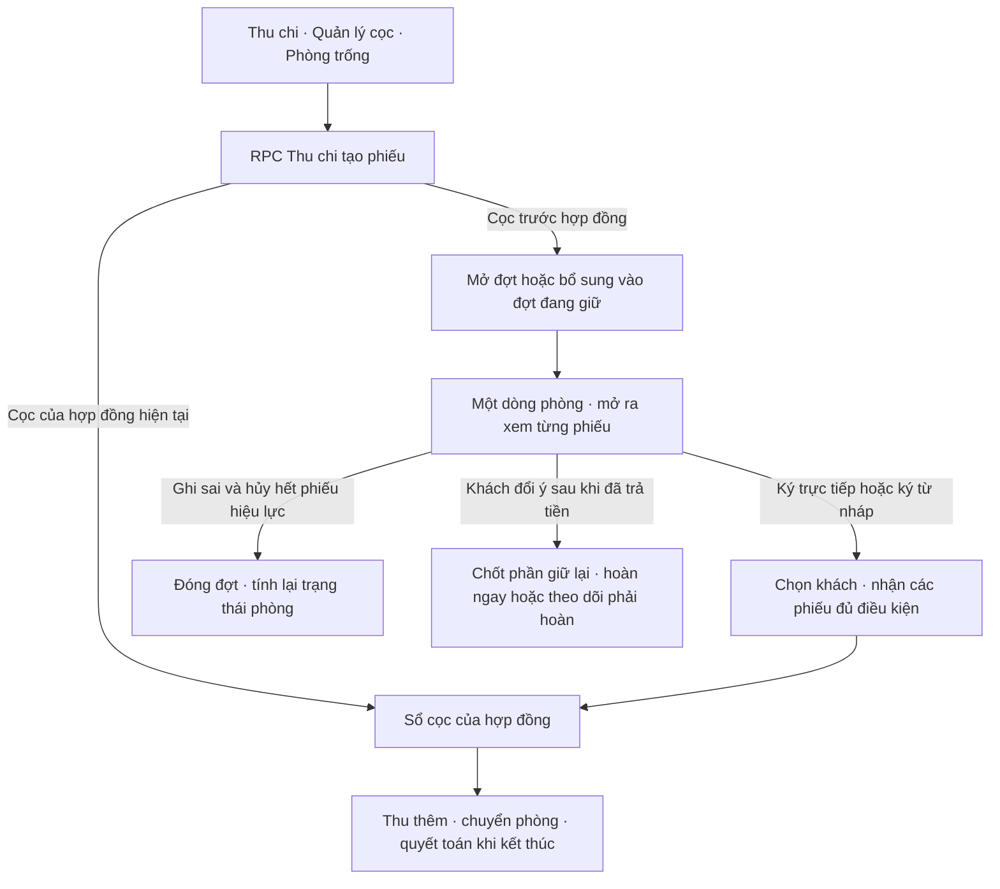

# Kế hoạch thống nhất nhận cọc qua Thu chi

## Quy tắc vận hành

Thu chi là nơi duy nhất tạo phiếu thu cọc. Quản lý cọc và Phòng trống là hai cách mở cùng nghiệp vụ với phòng đã chọn sẵn. Phiếu thu ghi người gửi và số tiền. Hồ sơ giữ chỗ gom những lần thu cho cùng lượt thuê kế tiếp. Form hợp đồng là nơi chọn khách đứng tên.

Câu đặt ở đầu màn Quản lý cọc và cụm nhận cọc là **“Mỗi đợt giữ chỗ có thể có nhiều phiếu thu. Tên người gửi giúp nhận biết phiếu. Khi ký hợp đồng, chọn khách và hệ thống tự nhận cọc đã thu.”**

| Sự kiện | Hồ sơ, tiền và trạng thái phòng |
|---|---|
| Phiếu đầu của lượt thuê mới | Kiểm tra đúng tổ chức, tòa, phòng và quyền nhận tiền. Mở một đợt giữ chỗ và nối phiếu đầu vào đợt đó trong cùng giao dịch. Phiếu chờ duyệt có thể giữ lượt thuê, số đã nhận vẫn bằng 0. |
| Bổ sung lần hai trở đi | Mỗi lần thực sự giao tiền có một phiếu. Dùng cùng đợt, kể cả khi đổi màn nhập, đổi người gửi hoặc đổi sổ quỹ. Trên Thu chi tra riêng từng mã. Trên Quản lý cọc xem tổng và danh sách các mã. |
| Duyệt, hủy duyệt, sửa hoặc hủy phiếu | Tính lại từ chứng từ và bút toán còn hiệu lực. Phiếu trộn cọc với tiền thuê chỉ đóng góp phần cọc. Mục chờ duyệt, chờ ghi sổ hoặc cần đối chiếu hiển thị riêng. Hủy một phiếu vẫn giữ đợt nếu còn phiếu hiệu lực, kể cả phiếu đang chờ duyệt. Hủy hết phiếu hiệu lực thì đóng đợt giữ bằng tiền. |
| Phòng đang có khách | Cọc bổ sung của khách đang ở đi vào hợp đồng đã chọn. Khi phòng có cả hợp đồng hiện tại và khả năng nhận khách kế tiếp, hiển thị hai đích đến để quản lý xác nhận. Máy chủ kiểm tra phòng đủ điều kiện nhận lượt kế tiếp. Người gửi, số tiền hoặc mức cọc đã đủ của hợp đồng cũ không quyết định đích đến. |
| Ký hợp đồng | Nháp chưa sử dụng tiền. Tại lần ký, máy chủ đối chiếu đợt, kỳ của hợp đồng, số thực nhận và toàn bộ mã phiếu. Nguồn đã hủy, đã xử lý hay đã dùng ở hợp đồng khác không cộng lại. Có nguồn chờ duyệt, ngoài kỳ hoặc thay đổi khi form đang mở thì báo cụ thể để tải lại hoặc đối chiếu. Cọc thiếu vào hóa đơn đầu hoặc theo phương án nợ cọc trên hợp đồng. |
| Khách bỏ giữ chỗ hoặc kết thúc thuê | Xử lý phần thực nhận theo chứng từ. Tách rõ số giữ lại, phải hoàn, đã hoàn. Hoàn sau còn việc phải theo dõi đến khi thực chi. Gia hạn tiếp tục với cọc của hợp đồng hiện tại. Chuyển phòng hoặc chuyển cọc hỗ trợ khách nhận phải phân biệt số chuyển nội bộ với tiền khách mới nộp. |
| Hết hạn | Nhắc quản lý liên hệ. Chỉ đổi trạng thái khi có thao tác hoặc sự kiện nghiệp vụ xác nhận. Khi đóng đợt, kiểm tra hợp đồng đang thuê, lượt giữ mới, khóa tạm và tình trạng phòng trước khi cho thuê lại. |

## Những chỗ phải thay trong hệ thống hiện tại

| Điểm đã kiểm tra | Thay đổi cần thiết |
|---|---|
| Phiếu thường ở Thu chi có RPC chính và đường tương thích. Phiếu hàng loạt đang gọi đường tương thích cho từng phiếu con. | Quy về một RPC của Thu chi cho mọi phiếu thu có hạng mục cọc trong phạm vi này. Bảo toàn quyền sổ quỹ, cơ chế duyệt, phiếu nhiều hạng mục, nhập bù và khả năng thử lại của từng phiếu con. [Tạo phiếu thường](../../src/hooks/income-expenses/mutations.ts) · [Phiếu hàng loạt](../../src/hooks/income-expenses/batch.ts) |
| Phòng trống và Quản lý cọc tạo hồ sơ trước rồi gọi Thu chi bên trong. Nút bổ sung tạo phiếu qua RPC sửa hồ sơ, người gửi lấy lại từ hồ sơ. | Ba màn và nút bổ sung cùng gọi RPC Thu chi. Một ô Người gửi cho mỗi phiếu. Phần ghi thông tin Sale đọc mã phiếu đã tạo. [Phòng trống](../../src/pages/phong-trong/QuickDepositModal.tsx) · [Quản lý cọc](../../src/components/deposits/CreateDepositDialog.tsx) · [Bổ sung cọc](../../src/components/deposits/RoomReservationPanel.tsx) |
| Trang cọc có danh sách hồ sơ và danh sách từng phiếu. Ô chờ ký đếm phiếu đã duyệt. Lịch của hồ sơ đã nối được sao sang các phiếu, phiếu rời có thể có lịch riêng. | Lấy đợt giữ chỗ làm đơn vị hiển thị, đếm và sửa lịch. Số tiền dùng bằng chứng thực nhận. [Cách dựng hàng công việc](../../src/lib/depositWorkQueue.ts) · [Lịch và liên kết phiếu](../../supabase/migrations/20261020183008_sale_reservation_deadline_received_scope_v1.sql) |
| Khách hẹn còn ghi bảng cọc cũ. Báo cáo danh sách tiền cọc còn đọc bảng đó. Hermes Sale có thao tác tạo, bổ sung, gắn khách qua đường giữ chỗ. | Khách hẹn mở Thu chi với phòng và người gửi điền sẵn. Hermes tạo hoặc bổ sung qua cùng nghiệp vụ Thu chi với quyền hiện hành. Loại bước gắn khách khỏi quy trình nhận cọc. Chuyển cả danh sách lẫn tổng báo cáo sang cùng nguồn. [Chuyển khách hẹn](../../src/components/leads/ConvertLeadDialog.tsx) · [Báo cáo](../../src/hooks/reports/financeReports.ts) · [Hermes Sale](../../supabase/migrations/20261030050424_hermes_sale_deposit_receipt_key_v1.sql) |
| Ký trực tiếp và ký từ nháp hiện đọc được phiếu hợp lệ theo phòng, kể cả phiếu chưa nối hồ sơ. | Tận dụng cùng hàm đối chiếu khi ký. Chỉ chuyển sang lấy theo đợt sau khi đã xử lý phiếu rời hoặc đánh dấu cần đối chiếu. [Nguồn cọc khi ký](../../supabase/migrations/20261125102224_contract_room_deposit_sources.sql) |

## Cách nhập người gửi và lịch

- **Người gửi** là trường `payer_name` của Thu chi. Hiển thị tên trên phiếu đầu để quản lý nhớ đợt. Lần thu sau điền sẵn tên, cho sửa nếu người khác gửi. Lịch sử từng phiếu giữ đúng tên của lần đó. Phiếu cũ thiếu tên vẫn đọc được. Chọn khách ký tại hợp đồng.
- **Giữ chỗ đến** tự điền **Ngày dự kiến vào**. Đề xuất tiếp tục đồng bộ khi người dùng đổi hạn và chưa sửa ngày vào. Sau khi sửa tay ngày vào, ưu tiên giá trị đã sửa, kể cả mở lại hồ sơ. Xóa hạn chỉ xóa ngày vào đang theo tự động. Ba ngày đều tùy chọn.
- **Ngày bổ sung cọc** dùng ô ngày gọn cạnh năm nút **3N, 4N, 5N, 6N, 7N**. Đề xuất tính theo ngày lịch từ ngày phiếu trong múi giờ tổ chức. Phiếu 25/11 bấm 3N ra 28/11, bấm 7N ra 02/12. Trong cùng lần nhập, sửa ngày phiếu thì tính lại giá trị đã chọn bằng nút. Giá trị nhập tay được giữ. Phiếu bổ sung tải lịch của đợt và chỉ cập nhật lịch khi quản lý chủ động sửa.
- **Hạn bổ sung sau hạn giữ chỗ** đang bị từ chối ở đường sửa kỳ hạn. Đề xuất cho lưu kèm lời nhắc “Hạn bổ sung sau ngày giữ chỗ”. Đây là thay đổi quy tắc nghiệp vụ hiện hành, áp dụng cùng lúc ở form, RPC tạo và RPC sửa hạn.
- Trên Thu chi, chọn **Phiếu thu → hạng mục tiền cọc** thì xuất hiện cụm lịch. Với đích đến là hợp đồng hiện hữu, hiển thị rõ “Bổ sung cọc cho hợp đồng” và áp dụng lịch hợp đồng nếu có. Ba mốc giữ chỗ chỉ lưu cho lượt thuê kế tiếp. Đổi sang hạng mục thường hoặc sang hợp đồng phải loại dữ liệu giữ chỗ khỏi yêu cầu gửi đi. Trên điện thoại, các nút ngày được xuống hàng khi cần và vẫn bấm được cùng ô lịch.

## Thứ tự triển khai

### 1. Chốt điểm ghi Thu chi và quyền trên từng đường vào

Lập danh sách các nơi có thể tạo phiếu thu cọc, kể cả tạo bản sao, phiếu con trong lô, phiếu lặp nếu đang được hỗ trợ, các lệnh Hermes, nút bổ sung và tiền mới nộp lúc ký. Phân biệt phiếu thu tiền mới với chuyển cọc nội bộ, phiếu chi hoàn và việc nối phiếu đã có. Đối chiếu quyền theo tổ chức, tòa, phòng, sổ nhận tiền và hạng mục hạn chế. Giữ riêng quyền lập phiếu, duyệt phiếu và xử lý hoàn.

Lấy RPC tạo Thu chi hiện tại làm điểm xuất phát. Bổ sung đủ các trường hợp hiện phải dùng `ie_compat_insert_v2`, đặc biệt là quyền chỉ được nhận tiền vào sổ, chứng từ thiếu kỳ dịch vụ và lô đang chờ hoàn tất. Khi cần thay chữ ký RPC, bàn giao một phiên bản kế tiếp của RPC Thu chi. Tiêu chí là một nơi thực sự ghi phiếu cọc và một điểm gọi từ các màn mới. Khách hàng dùng bản cũ phải chuyển tiếp về đúng điểm ghi trong thời gian tương thích.

**Đầu ra** là bảng điểm gọi, quyền cho từng vai trò và danh sách dữ liệu đầu vào hiện được chấp nhận. Chỉ chuyển giao diện sau khi đã chứng minh các trường hợp hợp lệ này qua cùng điểm ghi.

### 2. Tạo phiếu và nối hồ sơ trong cùng giao dịch

Yêu cầu ghi gồm mã yêu cầu ổn định, phòng, hạng mục, người gửi, ngày phiếu, sổ quỹ, các dòng tiền, đích đến và lịch nếu là giữ chỗ. Máy chủ xác định tổ chức, kiểm tra quyền, khóa phòng theo thứ tự hiện có, đối chiếu đợt/phiên bản mà form vừa hiển thị, rồi tạo phiếu và liên kết. Tận dụng bảng hồ sơ, liên kết dòng cọc và ràng buộc một lượt giữ đang mở cho mỗi phòng. Một phiếu có thể có nhiều dòng cọc nhưng chỉ thuộc một đợt hoặc một hợp đồng.

Hai lần nộp tiền thật có hai mã yêu cầu khác nhau. Gửi lại cùng yêu cầu trả mã phiếu đã tạo. Cùng mã mà nội dung đã đổi phải báo xung đột. Nếu hai quản lý đồng thời thao tác trên phòng, kiểm tra lại đợt dưới khóa. Nếu hai người cùng bổ sung đúng đợt, nhận cả hai phiếu. Nếu một người định mở lượt mới nhưng người kia vừa mở đợt khác, hiển thị đợt vừa xuất hiện để xác nhận đích trước khi ghi. Không tự nhập hai khách cạnh tranh thành một đợt.

RPC trả mã phiếu, mã đợt hoặc hợp đồng, trạng thái duyệt và số cọc thực nhận. Nếu không thể liên kết, toàn bộ giao dịch lập phiếu thất bại. Thưởng Sale và dữ liệu riêng của từng kênh dùng mã đã trả để lưu bổ sung. Trường hợp lưu phần phụ lỗi, giao diện giữ mã phiếu và cho thử lại đúng phần phụ.

Lịch thu định kỳ chưa đến lượt chỉ là lịch dự kiến. Khi xử lý một phiếu con đến kỳ, phải kiểm tra lại đích đến hiện hành, tình trạng hợp đồng và đợt giữ chỗ. Với phiếu đã ký, thao tác thu hóa đơn hoặc chuyển tiền nội bộ vẫn đối chiếu được theo chứng từ gốc và không cộng lại số cọc đã chuyển vào hợp đồng.

### 3. Đồng bộ giao diện và các sự kiện thay đổi phiếu

Dùng chung cụm Người gửi và lịch cho cả ba màn, gồm cả khi bổ sung. Phòng trống điền sẵn phòng, Quản lý cọc điền sẵn đợt, Thu chi tự hiện cụm khi chọn hạng mục. Giữ thao tác duyệt và sổ quỹ theo phân quyền hiện có. Không tạo khách danh bạ trong lúc nhận cọc.

Đi qua cả tạo, sửa phòng, đổi hạng mục, thay hợp đồng, duyệt, hủy duyệt, hủy phiếu và hủy lô. Phiếu sai phòng đã ghi sổ hoặc đã dùng khi ký phải đi theo quy trình điều chỉnh được phép và có lịch sử. Cập nhật lại cả phòng nguồn và phòng đích với những thay đổi hợp lệ. Phân biệt hủy phiếu ghi sai với khách đã giao tiền và yêu cầu hoàn. Lỗi phải cho biết mã phiếu hoặc mã lần lưu, bước thất bại và thao tác tiếp theo. Nhật ký ghi kênh vào, đợt/hợp đồng, kết quả và mã lý do để tra cứu theo quyền.

### 4. Chuyển dữ liệu cũ trước khi đổi nguồn đọc

Chạy đối chiếu chỉ đọc và chia hồ sơ thành bốn nhóm. Nhóm đã nối đúng giữ nguyên liên kết. Nhóm đợt bằng tiền chỉ còn phiếu đã hủy hoặc xử lý hết được xem xét đóng. Nhóm phiếu rời có đủ chứng cứ cùng tổ chức, cùng phòng, cùng lượt thuê và chưa dùng được nối vào đợt phù hợp. Nhóm có hai lượt thuê khả dĩ, xung đột với hợp đồng, sai phòng hoặc thiếu bằng chứng được đưa vào danh sách đối chiếu kèm lý do. Giữ nguyên ý nghĩa của hồ sơ 0 đ hợp lệ thời kỳ cũ, khóa Sale tạm và phiếu chỉ được ẩn khỏi màn quản lý.

Với **phòng 05 tòa 481NVK**, kiểm tra lại đúng ba chứng từ tại thời điểm chạy. Nếu vẫn đúng hiện trạng đã xác nhận, đóng đợt cũ, ghi lý do theo phiếu đã hủy, nối hai phiếu thay thế vào cùng một đợt mới và đối chiếu tổng với form ký. Nếu người dùng đã ký trong thời gian triển khai, chuyển sang đối chiếu lịch sử hợp đồng và bỏ qua thao tác mở đợt. Mọi bước chỉ sửa quan hệ nghiệp vụ, có nhật ký trước/sau và chạy lần hai không thêm liên kết.

Đo trước/sau theo tổ chức và sổ quỹ. Số phiếu nguồn, các bút toán, tiền quỹ, kết quả kinh doanh và nghĩa vụ hoàn phải đối chiếu được từng chênh lệch. Chênh lệch dự kiến của phòng mẫu nằm ở trạng thái đợt, liên kết và bộ đếm hồ sơ. Mô phỏng trên TEST rồi thực hiện dữ liệu thật qua lane migration/backfill đã review.

### 5. Hợp nhất trang quản lý, báo cáo và bàn giao sang hợp đồng

Trên desktop và mobile, một đợt là một dòng có tòa/phòng, người gửi gợi nhớ, lịch, tổng đã nhận, khoản chờ, phần thiếu nếu có mục tiêu và một nút tạo hợp đồng. Mở dòng để thấy mã, người gửi, số cọc và trạng thái của từng phiếu. Bộ đếm chờ ký đếm đợt đủ điều kiện, bộ đếm chờ duyệt ghi rõ đơn vị phiếu hoặc đợt. Thu chi giữ danh sách chứng từ. Số tiền từ phiếu trộn chỉ lấy dòng cọc đã ghi nhận hợp lệ. Đồng bộ màn phòng, danh sách công việc, báo cáo tài chính về cọc và giao diện Hermes cùng bộ quy tắc.

Ký trực tiếp và ký từ nháp đọc cùng danh sách theo đợt. Trong giao dịch ký, kiểm tra lại phiếu, số đã thu, kỳ và việc đợt vừa được sửa/hủy. Chuyển các nguồn hợp lệ sang hợp đồng đúng một lần. Chỉ có khoản thực nộp thêm lúc ký mới cần lập phiếu thu qua nghiệp vụ Thu chi. Hủy nháp để nguyên đợt. Trả phòng, chuyển phòng, xóa nhầm hợp đồng hay đảo khoản hỗ trợ phải xử lý được chứng từ đã phát sinh bằng quy trình hiện hành.

### 6. Nghiệm thu và phát hành

Đưa máy chủ tương thích lên trước, sau đó chuyển các màn ghi, đối chiếu dữ liệu cũ, cuối cùng mới đổi màn đọc. Nếu còn phiếu rời chưa xác định, truy cập được chúng ở mục cần đối chiếu và báo đúng lý do tại phòng liên quan. Bản ứng dụng đang mở, yêu cầu đang gửi hoặc ký nháp đang dở phải có cách đọc lại trạng thái mà không tạo phiếu trùng. Chỉ ngừng đường tương thích cũ sau khi các điểm gọi đã chuyển và yêu cầu đang dở đã được xử lý.

Sau phát hành, kiểm số phiếu cọc trước hợp đồng mới thiếu liên kết, số đợt giữ bằng tiền vẫn mở dù mọi phiếu đã hủy và số lần thông báo đã lưu mà không tra lại được kết quả. Mục tiêu của cả ba là 0 trong phạm vi giao dịch mới. Nếu lỗi lưu hoặc ký xuất hiện, tra mã yêu cầu để phân biệt từ chối nghiệp vụ, chưa xác nhận do mất kết nối và lỗi máy chủ. Đối chiếu yêu cầu trước khi thử lại.

Kiểm trên TEST với dữ liệu DEMO, sau đó kiểm giao diện thật ở Preview. Phát hành theo Project Contract cho thay đổi liên quan tiền/quyền, gồm review độc lập, dry-run và biên nhận migration có backup, CI cho SHA phát hành và kiểm lại sau promote. Nếu phải lùi giao diện, dùng phiên bản đã xác minh còn tương thích với dữ liệu mới. Với sai lệch dữ liệu, dừng bước chuyển tiếp, giữ chứng từ và sửa quan hệ bằng migration tiếp theo có đối chiếu. [Project Contract](../engineering/PROJECT_CONTRACT.md) · [Runbook migration](../engineering/MIGRATION_STRATEGY.md)

## Ca nghiệm thu bắt buộc

| Tình huống | Kết quả phải quan sát được |
|---|---|
| Lần đầu ở từng kênh, lần hai ở một kênh khác | Chạy đủ 9 cặp của 3 kênh. Mỗi cặp có một đợt, hai phiếu. Cùng số đã nhận ở trang cọc, phòng và form ký. |
| Hai người gửi khác nhau trong cùng đợt | Mỗi phiếu có đúng người gửi. Khách đứng tên hợp đồng được chọn độc lập. |
| Bấm ngày nhanh, nhập bù, qua cuối tháng, xóa hạn, sửa ngày vào bằng tay | Đủ năm nút, đúng ngày lịch, ngày đã sửa tay giữ nguyên. Thu lần hai không đè lịch đã hẹn. Cùng hành vi trên desktop và mobile. |
| Phiếu chờ duyệt, chưa ghi sổ, đã duyệt, bị hủy duyệt | Phân biệt giữ lượt và đã nhận. Không ký nhầm tiền chưa đủ điều kiện. Tra được phiếu đang vướng. |
| Phiếu trộn cọc và thuê, lô nhiều phòng hoặc lô lỗi giữa chừng | Chỉ cộng phần cọc. Các phiếu con đúng phòng. Thử lại hoặc hủy lô xử lý đúng từng liên kết và đối chiếu được tiền. |
| Hủy một phiếu, hủy hết phiếu, rồi lập phiếu mới | Đợt còn nguồn thì tiếp tục. Hết nguồn thì đợt cũ vào lịch sử. Phiếu mới thuộc đợt mới. Trạng thái phòng còn xét người đang ở và khóa khác. |
| Phòng 05 có một phiếu hủy và hai phiếu mới | Trước ký có một dòng đang giữ, chi tiết chỉ gồm hai phiếu mới đủ điều kiện. Phiếu hủy nằm trong lịch sử. Nếu cọc thỏa thuận bằng tổng thực nhận thì còn phải thu 0 đ. |
| Hai người cùng lưu, lỗi mạng, gửi lại, lỗi phần thưởng Sale | Đúng số phiếu theo số lần nộp thật, phiếu đã lưu tra lại được. Hai đợt cạnh tranh không bị gộp nhầm. Thử lại thưởng không sinh thêm phiếu cọc. |
| Phòng đang thuê nhưng có khách kế tiếp, phòng trùng số ở hai tòa, tài khoản ngoài phạm vi | Đúng đích tiền, đúng phòng, đúng tổ chức. Từ chối ngoài quyền trước khi ghi. Thử cả người có quyền nhận tiền vào sổ nhưng không có quyền chi hoặc duyệt. |
| Ký trực tiếp, ký nháp, hủy nháp, phiếu thay đổi khi ký | Nhận đúng một lần cả cọc cũ lẫn khoản nộp mới. Báo mã phiếu còn chờ, ngoài kỳ hoặc đã thay đổi. Kiểm riêng cọc thiếu theo hóa đơn đầu và nợ cọc. |
| Bỏ cọc, hoàn ngay, hoàn sau, lĩnh hoàn, gia hạn và chuyển phòng | Khớp tiền quỹ, doanh thu giữ lại, nghĩa vụ còn phải hoàn và lịch sử cọc. Phiếu chuyển nội bộ không làm tăng tiền khách đã nộp vào quỹ. |
| Khách hẹn, Hermes, báo cáo, trình duyệt bản cũ, dữ liệu thiếu tên hoặc chỉ có đợt 0 đ cũ | Các điểm vào được hỗ trợ dùng chung quy tắc. Báo cáo chi tiết và tổng khớp cùng phạm vi. Chạy lại chuyển dữ liệu không làm đổi số tiền hoặc nhân hồ sơ. |

**Điều kiện hoàn thành** là quản lý có thể nhận cọc ở một màn, bổ sung ở màn khác, sửa hoặc hủy đúng phiếu, ký từ màn hợp đồng và lần lại được từng khoản tiền bằng mã phiếu. Bộ đếm đợt, tổng thực nhận và trạng thái phòng phải giải thích được từ cùng bộ chứng từ.
