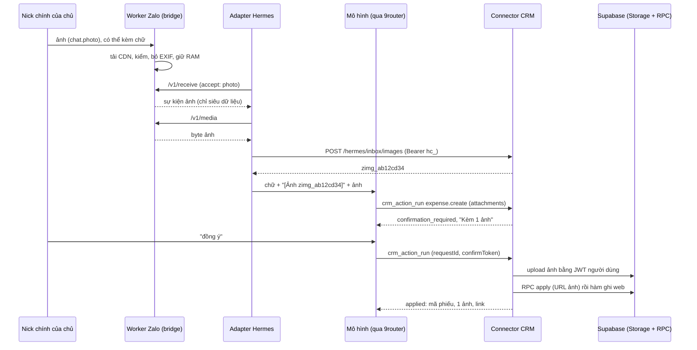

# Đường nhận ảnh từ Zalo cho Hermes — THIẾT KẾ (chưa hiện thực)

Ngày 22/10/2026 (giờ Việt Nam). Chủ dự án chốt câu 11 = b: **ưu tiên làm đường nhận ảnh từ Zalo**. Trước hết là ảnh bill cho phiếu chi ở trang Thu chi; dùng chung cho Công việc (ảnh hoàn thành việc).

Tài liệu này chỉ là thiết kế: chưa sửa mã, chưa chạm VPS, Hermes, Zalo hay database. Nguồn đã đọc:
- Mã trên `origin/main` `ae3e8b43f`: worker Zalo, kênh Zalo native, connector, web Thu chi và Công việc, migration.
- Nền chung thao tác ghi (Đợt 1) ở nhánh `claude/hermes-nen-chung-ghi-20261021`, tài liệu `docs/plans/hermes-crm/NEN-CHUNG-THAO-TAC-GHI.md` của nhánh đó (chưa gộp vào main). Thiết kế này cắm vào nền đó: ba tool `crm_action_*`, rào xác nhận hai lượt, kiểu tham số dự phòng `attachments`.
- Khảo sát chỉ đọc của phiên chính trên VPS (22/10, 00:40) và plan Thu chi ngày 21/10. Hai tài liệu này nằm ở máy làm việc, không nằm trong repo.
- Tài liệu trong repo: [kênh Zalo native](../../../infra/hermes-zalo-native/README.md), [connector](../../../infra/hermes-broker/CONNECTOR.md), [mạng cùng host](../../../infra/hermes-runtime/host-network/README.md), [đề xuất đợt 3 thao tác ghi](DOT-3-THAO-TAC-GHI.md).

Ký hiệu đường dẫn: `W` = `worker/lib`, `N` = `infra/hermes-zalo-native`, `B` = `infra/hermes-broker`, `R` = `infra/hermes-runtime`, `M/<ts>` = `supabase/migrations/<ts>_*.sql`.

## 0. Kết luận

1. **Hôm nay chủ gửi ảnh bill thì bot không thấy gì.** Có bốn chỗ chặn:
   - worker nuốt im mọi tin riêng không phải chữ (`W/hermes-native-bridge.js` dòng 68–71: `msgType !== 'webchat'` ⇒ `return true`);
   - adapter chỉ dựng tin chữ (`N/adapter.py` dòng 139–160);
   - connector không có chỗ giữ ảnh và chưa từng gọi Storage; nền chung khoá kiểu `attachments` (`ATTACHMENTS_READY = false`);
   - Công việc chưa có thao tác hoàn thành việc qua Hermes.

   Hermes upstream đã có sẵn đường ảnh (sự kiện `PHOTO`, `media_urls`, chế độ `image_input_mode`), nên không phải sửa Hermes.
2. **Luồng đề xuất.**
   - Worker tải ảnh từ CDN Zalo ngay khi nhận, kiểm, giữ trong RAM.
   - Adapter lấy byte qua cửa loopback của kênh. Ảnh đi hai ngả: vào cache Hermes để mô hình nhìn (vision), và vào **kho ảnh tạm của connector** bằng chính token kết nối `hc_` của profile.
   - Kho trả mã `zimg_xxxxxxxx`; adapter ghi mã vào chữ của tin.
   - Mô hình đưa mã vào `params.attachments` của `crm_action_run`.
   - Ở lượt xác nhận, connector tải ảnh lên đúng bucket của web bằng JWT người dùng; RPC của trang gắn URL qua đúng đường ghi web.
3. **Không thêm tool.** Không có tool mới trong `tools/list`; chỉ thêm khoảng 70 B vào mô tả `crm_action_run`. Danh sách ảnh gần đây nằm trong *kết quả* của `crm_action_list`.
4. **Riêng tư.**
   - Tin riêng vẫn không vào hộp thư CRM (giữ nguyên rào ở `W/inbound.js`).
   - Worker không ghi ảnh xuống đĩa. Journal kênh giữ nguyên định dạng, nên lùi worker vẫn an toàn.
   - Kho connector tách theo kết nối, mã hoá, sống 24 giờ, không có đường HTTP đọc lại ảnh.
   - Ảnh chỉ vào Storage sau khi người dùng đồng ý bản xem trước.
5. **Mô hình nhìn ảnh.** Gói 9router 0.5.99 trên máy làm việc khai `gpt-6-luna` có `vision` và chuyển `image_url` sang `input_image` cho Codex. Hermes không biết model tự khai `cx/gpt-6-luna` nhìn được ảnh, nên theo chú thích cấu hình của Hermes, chế độ `auto` sẽ rơi về công cụ `vision_analyze` qua model phụ. Phải khai `supports_vision: true` trong `model_overrides` và đo trên TEST trước (mốc M0).
6. **Công việc khác Thu chi.** Web hoàn thành việc bằng `UPDATE jobs` trực tiếp. Ảnh phải chụp bằng camera trong app, có watermark và GPS. Hai RPC thưởng và chấm công chỉ chạy cho người được giao việc. Ảnh Zalo không có GPS hay watermark, nên chủ phải quyết có cho hoàn thành việc bằng ảnh Zalo không, và có tính thưởng/chấm công không (mục 15).
7. **Phát hành.** Chỉ một cửa sổ bot im 2–5 phút, khi thay worker (phải tạo lại sidecar). Các bước khác chỉ restart connector hoặc sidecar. Thứ tự: connector và SQL trước, rồi worker (bật bằng bắt tay với adapter), adapter sau cùng.
8. **Ước công: 10,5–12,5 ngày kỹ sư**, lịch 6–8 ngày nếu chạy song song (mục 13). Phụ thuộc: nền chung Đợt 1 đã gộp và áp; thao tác `expense.create` của plan Thu chi (đợt P2); thao tác hoàn thành việc của plan Công việc.

## 1. Phạm vi

| Trong thiết kế | Ngoài thiết kế |
| --- | --- |
| Ảnh gửi dạng "Hình ảnh" (`chat.photo`) trong chat riêng đã ghép; JPG, PNG, WebP | Ảnh trong nhóm Zalo; ảnh khách gửi vào hộp thư CRM |
| Album (nhiều ảnh một lần), ảnh kèm chú thích, ảnh gửi trước rồi mới gõ lệnh | Tệp/PDF (`share.file`), video, voice, GIF, hình vẽ: chỉ báo "kênh chưa nhận loại này" |
| Mô hình đọc ảnh (vision) để hiểu bill | OCR phía máy chủ; tự ghi theo số đọc từ ảnh mà không xác nhận |
| Gắn ảnh khi ghi phiếu chi, bổ sung ảnh vào phiếu có sẵn, gắn ảnh khi hoàn thành việc | Ảnh CCCD/giấy tờ khách (bucket và miền riêng tư khác) |
| Kho ảnh tạm ở connector; upload Storage bằng JWT người dùng | Bot gửi ảnh ra Zalo (đã có đường gửi ảnh phòng trống riêng) |

## 2. Hiện trạng đã tra

| Thành phần | Ở đâu | Hiện nay | Khoảng trống |
| --- | --- | --- | --- |
| Bắt tin riêng ở worker | `W/hermes-native-bridge.js` 55–82 | Chỉ nhận `webchat`, `content` là chuỗi ≤ 8 KiB, đúng người ghép, không trích dẫn hay chuyển tiếp | Ảnh, tệp, voice, sticker bị nuốt im. `N/bridge.test.mjs` chưa có ca nào gửi ảnh vào `capture()` |
| Journal kênh | `W/hermes-native-journal.js` 13–37 | Bản ghi inbound có tập khoá cố định | Thêm khoá mới thì worker cũ đọc journal sẽ lỗi `native_journal_invalid` và không khởi động được |
| HTTP của bridge | `W/hermes-native-bridge.js` 102–206 | `/v1/channel`, `/v1/receive`, `/v1/ack`, `/v1/send`; thân JSON ≤ 200 KB; chỉ trả JSON | Chưa có đường trả byte |
| Adapter Hermes | `N/adapter.py` 119–160 | Poll mỗi 0,25 s; `text` bắt buộc 1–8 192 B; đọc phản hồi ≤ 64 KiB; tạo `MessageEvent` chữ | Không có media |
| Ảnh Zalo ở đường hộp thư CRM | `W/inbound.js` 59–63; `W/forward-media.js` 5–60 và 94–123 | Đọc `content.href`. Bộ tải CDN có danh sách máy chủ (`zdn.vn`, `zadn.vn`, `dlmd.me`, `mdchat.me`, `dlfl.vn`), ≤ 3 lần chuyển hướng, giới hạn byte, hết giờ 30 s. `imageDetails` nhận JPEG/PNG/WebP bằng magic bytes | Dùng lại được nguyên cho đường mới |
| Payload ảnh của zca-js 2.2.0 | `worker/package.json` ghim 2.2.0; kiểu `TAttachmentContent` | `content = {title, description, href, thumb, childnumber, action, params, type}`; `params` là chuỗi JSON (`rawUrl`, `hd`, `hdSize`, `width`, `height`) | Album: mỗi ảnh là một sự kiện riêng; khoá nhóm `data.extraData` → `groupMediaMsg.groupLayoutId` theo issue zca-js, chưa đo trên tin thật. Link Zalo hết hạn (link một tháng tuổi trả 404) ⇒ phải tải sớm |
| Connector | `B/server.mjs` 259–306 | Một server: `/mcp` (thân ≤ 16 KiB), `/api/hermes/connections/*`, `/api/hermes/zalo/*` | Không có route nhận byte; không có mã gọi `/storage/v1`; `B/session-crypto.mjs` chỉ niêm phong phiên, không mã hoá được blob |
| Nền chung (nhánh chưa gộp) | `B/action-catalog.mjs`, `B/action-runtime.mjs`, `B/confirm-guard.mjs` | Đã có kiểu `param.attachments({max})`; `ATTACHMENTS_READY = false` nên khai thao tác có ảnh là lỗi nạp | Chưa có kho ảnh, chưa có upload |
| Cấp profile Hermes | `N/profile-provisioning.mjs` 138–182 | Ghi `config.yaml`: `mcp_servers.<crm\|ihomecrm>` kèm header `Authorization: Bearer hc_…`; ghi 5 khoá `HERMES_ZALO_*` vào `.env` | Adapter chưa đọc token CRM; `MCP_IHOMECRM_API_KEY` chỉ có ở profile cài tay |
| Hermes upstream (theo khảo sát của phiên chính) | `gateway/platforms/event.py`, `base.py`, `run_inbound_media.py`, `tools/vision_tools.py`, `config_defaults.py` | `MessageType.PHOTO`, `media_urls`, `media_types`, `cache_image_from_bytes`; `agent.image_input_mode` (`auto`/`native`/`text`); `vision.embed_target_bytes` 256 KiB; `gateway.max_inbound_media_bytes` 128 MiB | Profile owner chưa khai model nhìn được ảnh; chưa biết có tắt toolset vision không |
| 9router | gói `9router` 0.5.99 cài trên máy làm việc | Bảng năng lực: `gpt-6-luna` có `vision: true`. Đổi `image_url` (data URL) sang `input_image` cho Codex. Chỉ gỡ ảnh khi model khai `vision: false` | Bản trên VPS chưa đối chiếu |
| Ảnh phiếu thu chi (web) | `src/components/income-expenses/AttachmentUpload.tsx` 116–193; `src/lib/storage.ts` 134–225; `src/lib/imageCompress.ts`; `src/lib/evidenceUpload.ts` | Bucket **riêng tư** `income-expense-attachments` (`M/20260601000200`). Đường `<uid>/<ms>-<6 ký tự>-<tên>`; ảnh nén 1600 px q0.82 (WebP nếu được), sau nén ≤ 5 MiB. Lưu chuỗi URL dạng `…/object/public/income-expense-attachments/…` vào `income_expenses.attachments` (jsonb); web ký URL khi hiển thị. Ghi qua `create_income_expense_v1(p_attachments)`; dán thêm qua `annotate_income_expense_v1`; bổ sung có vết qua `append_income_expense_supplement_v1`. Duyệt-chi đòi chứng từ FINALIZED, lấy từ `attachments` qua `adopt_voucher_attachments_as_evidence_v2` | `create` và `annotate` chỉ kiểm "https, ≤ 20 ảnh", nhận mọi host; không kiểm bucket, chủ object hay object có thật. Không có dọn ảnh mồ côi phía máy chủ. `supplement` kiểm chặt nhưng ghim cứng host của project production |
| Ảnh hoàn thành việc (web) | `src/components/tasks/TaskCompleteDialog.tsx` 96–133; `src/hooks/useJobs.ts` 245–298 | Bucket riêng tư `job-attachments`, đường `<uid>/<ms>-<rand>.jpg`, lưu chuỗi URL dạng `…/object/public/job-attachments/…`. `UPDATE jobs` trực tiếp (trạng thái, `attachments`, `completion_attachments`, GPS, geofence), sau đó gọi `award_job_bonus` và `v5_tick_from_job` (chỉ người được giao) | Hermes chưa có thao tác hoàn thành; DB không kiểm danh sách ảnh (`M/20260720181000` chỉ đòi mảng khác rỗng) |

## 3. Luồng đầu–cuối



1. **Worker bắt ảnh.**
   - `capture()` nhận `chat.photo` của đúng người ghép, giữ mọi rào hiện có: chỉ DM, không echo, không trích dẫn, không lịch sử.
   - URL lấy theo thứ tự `params.hd` → `params.rawUrl` → `href`, mỗi URL phải qua `allowedUrl` của `W/forward-media.js`. Chú thích lấy từ `title`.
   - Tải nền ngay (≤ 10 MiB, 30 s), kiểm magic bytes và kích thước, bỏ khối siêu dữ liệu (EXIF, GPS), tính sha256. Byte chỉ nằm trong RAM.
2. **Gom tin.**
   - Ảnh cùng album (cùng `groupLayoutId`, hoặc cách nhau ≤ 3 s) gom thành một sự kiện, tối đa 10 ảnh.
   - Ảnh không chú thích chờ tối đa 30 s. Có tin chữ tới trong lúc chờ thì gộp chữ đó vào sự kiện ảnh.
   - Tin chữ không bao giờ bị giữ lại, để không làm chậm câu hỏi thường.
3. **Bắt tay.** Adapter mới gửi `accept: ["photo", "notice"]` mỗi lần poll. Worker chỉ giao sự kiện ảnh cho adapter đã khai, nên adapter cũ vẫn chỉ thấy chữ như hôm nay.
4. **Adapter lấy byte** qua `/v1/media` (token `hzn_` của kênh), kiểm lại sha256 và magic bytes, rồi lưu vào cache ảnh của profile (`cache_image_from_bytes`).
5. **Adapter gửi ảnh vào kho connector** (`POST /hermes/inbox/images`, token `hc_`) và nhận `zimg_…`. Kho lỗi thì mô hình vẫn xem được ảnh, nhưng tin ghi rõ "chưa lưu được để gắn vào CRM".
6. **Adapter dựng tin cho Hermes.** Gồm chữ (chú thích hoặc tin gộp) và dòng mã ảnh; `MessageEvent` loại `PHOTO`, `media_urls` là đường cache. Ack như hiện nay.
7. **Mô hình nhìn ảnh** (trực tiếp hoặc qua `vision_analyze`, mục 4) rồi trả lời hoặc gọi thao tác.
8. **Lượt 1 `crm_action_run`** kèm `params.attachments: ["zimg_…"]`.
   - Connector kiểm mã thuộc đúng kết nối và còn hạn, rồi giữ chỗ 15 phút.
   - SQL xem trước như mọi thao tác; connector thêm danh sách ảnh vào bản xem trước.
   - Token xác nhận gắn cả danh sách mã; bản ghi chờ giữ sha256 từng ảnh.
9. **Lượt 2 (người dùng đồng ý).**
   - Connector đổi token, tải từng ảnh lên đúng bucket bằng JWT người dùng, đường dẫn tất định theo `requestId`.
   - Sau đó gọi RPC apply với danh sách URL. SQL kiểm URL và `storage.objects`, rồi gọi đúng đường ghi của web.
10. **Kết quả** có số ảnh đã gắn và link tới trang phiếu hoặc việc. SQL từ chối thì connector xoá ảnh vừa tải (best-effort).

### 3.1 Các tình huống

| Người dùng làm | Worker giao | Bot làm |
| --- | --- | --- |
| Ảnh kèm chú thích "chi 350k sửa vòi 201 toà X" | Một sự kiện: chữ + 1 mã | Xem trước có "Kèm 1 ảnh" → đồng ý → ghi |
| Gửi ảnh, ≤ 30 s sau gõ lệnh | Một sự kiện gộp: lệnh + mã | Như trên, không có lượt trả lời thừa |
| Gửi ảnh, vài phút sau gõ "ghi phiếu chi … kèm ảnh vừa gửi" | Hai sự kiện | Lượt 1: một dòng xác nhận đã nhận ảnh, hỏi muốn làm gì. Lượt 2: dùng mã trong lịch sử hoặc trong `crm_action_list.images` |
| Album 3 ảnh + lệnh | Một sự kiện: 3 mã cùng thứ tự | Phiếu có 3 ảnh |
| Gõ lệnh trước, gửi ảnh sau | Lệnh đi ngay; ảnh là sự kiện sau | SOUL: lệnh nhắc "ảnh/bill" mà chưa có mã thì hỏi gửi ảnh trước khi xem trước; ảnh tới thì xem trước lại có ảnh |
| Chỉ gửi ảnh, không nói gì | Một sự kiện sau 30 s | Một dòng: đã nhận ảnh (nêu số tiền đọc được nếu là bill), hỏi ghi phiếu hay báo xong việc. Không ghi gì |
| Ảnh không phải bill, bảo ghi phiếu kèm ảnh | Như thường | Xem trước có cảnh báo "ảnh không giống hoá đơn"; người dùng vẫn đồng ý thì gắn |
| Ảnh 5–10 MB | Sự kiện ảnh bình thường; kho từ chối | Bot xem được ảnh, nói ảnh quá 5 MB nên không gắn được |
| Ảnh quá 10 MB hoặc không phải JPG/PNG/WebP | Sự kiện ảnh có `error` | Báo đúng lý do, không có mã |
| Ảnh chuyển tiếp từ chat khác | Như ảnh thường, bỏ chú thích gốc (mục 15, câu 5) | Như thường |
| Ảnh trong nhóm, tin trích dẫn ảnh, ảnh lịch sử | Không tới Hermes | — |
| Tệp, voice, video | Sự kiện `notice` | "Kênh Zalo của bot chưa nhận tệp/voice/video; gửi ảnh chụp hoặc làm trên web" |
| Sticker | Bỏ qua | — |

## 4. Mô hình nhìn ảnh

**Hermes chọn cách đưa ảnh theo `agent.image_input_mode`** (theo chú thích trong bản `config_defaults.py` phiên chính lưu khi khảo sát; chưa đối chiếu đúng bản v0.21.6 đang chạy):
- `auto` (mặc định): gửi ảnh thẳng cho model khi model báo `supports_vision = True` và `auxiliary.vision.provider` không bị đặt tay; ngược lại dùng chế độ chữ.
- `native`: luôn gửi ảnh thẳng; model không nhìn được ảnh thì lỗi ở provider.
- `text`: chạy `vision_analyze` (model phụ `auxiliary.vision`) rồi chèn mô tả vào đầu tin.

**`cx/gpt-6-luna` đi qua provider tự khai `ninerouter`**, không có trong catalog model của Hermes. Khi đó `supports_vision` là "chưa biết", nên `auto` sẽ rơi về chế độ chữ và gọi model phụ. Model phụ để `auto` thì chưa rõ Hermes chọn model nào cho provider tự khai.

**Đề xuất: gửi ảnh thẳng (native).**
- Mô hình chính tự đọc số trên bill, và ảnh nằm đúng trong tin của người dùng.
- Không thêm một lời gọi model phụ cho mỗi ảnh.
- Cấu hình profile, chỉ áp khi M0 đạt:

  ```yaml
  model_overrides:
    ninerouter:
      cx/gpt-6-luna:
        supports_vision: true
  agent:
    image_input_mode: auto
  ```
- M0 không đạt: dùng `text` với `auxiliary.vision` trỏ một model có vision qua 9router (chủ chọn, mục 15).

**Cách kiểm M0** (phiên chính, trên TEST; không đụng profile production):

| Bước | Làm gì | Đạt khi |
| --- | --- | --- |
| 1 | Đọc bảng năng lực `gpt-6-luna` của 9router bản đang chạy trên VPS, đối chiếu với bản 0.5.99 ở máy làm việc | `vision` không phải `false` (9router chỉ gỡ ảnh khi năng lực ghi `false`) |
| 2 | Gọi thẳng `POST /v1/chat/completions` của 9router (cửa `172.17.0.1:20128` qua `llm-stream-guard`) với ảnh bill tổng hợp dạng data URL có số "350.000" và tên cửa hàng giả. Hỏi tổng tiền. Đối chứng: cùng câu hỏi không kèm ảnh, và một ảnh trắng | Đọc đúng 350.000 cả 3/3 lần. Câu không ảnh và ảnh trắng không bịa số. Phải có đối chứng vì 9router từng trả 200 với nội dung rỗng ở đường giọng nói |
| 3 | Profile thử `tkt`: chạy `hermes chat`, đính ảnh bằng `/attach`, hỏi số tiền. Chạy một lượt **không** override trước (xem Hermes tự nhận gì), rồi thêm `model_overrides` như trên | Có override: đúng 3/3; ghi thời gian lượt và token vào/ra |
| 4 | Như bước 3, thêm 5 lượt hỏi chữ sau ảnh | Đo token và độ trễ các lượt sau. Ảnh native nằm trong lịch sử và bị gửi lại mỗi lượt (`vision.embed_target_bytes` 256 KiB/ảnh). Tăng quá 30 % thì cân nhắc chế độ `text` |

Bước 1–2 đạt mà bước 3 sai thì lỗi nằm ở Hermes (cấu hình hoặc nhận dạng model), không phải 9router. Bước 2 sai thì chuyển sang phương án `text`.

**Quy tắc cho mô hình (đưa vào SOUL bản 5, phiên chính viết):**
- Số đọc từ ảnh chỉ là đề xuất. Luôn đưa số đó vào bản xem trước để người dùng xác nhận; không bao giờ ghi theo ảnh khi chưa có lời đồng ý.
- Người dùng nói số khác với số trên bill: dùng số người dùng nói, nêu chênh lệch trong bản xem trước.

## 5. Mã ảnh `zimg_…`

- **Dạng:** `zimg_` + 8 ký tự base32 chữ thường (`[a-z2-7]`, 40 bit). Connector cấp, duy nhất trong kho của một kết nối. Mã không phải bí mật: kho tra theo cặp (kết nối, mã), nên mã của kết nối khác vô dụng.
- **Gắn vào tin:** adapter thêm một dòng cuối, đúng thứ tự ảnh trong tin:
  - `[Ảnh zimg_ab12cd34 · 10:02]`;
  - `[3 ảnh: zimg_ab12cd34, zimg_cd34ef56, zimg_ef56gh78 · 10:02]`.
- **Khi không có mã**, dòng cuối nói rõ lý do để bot báo lại người dùng:
  - `[Ảnh không nhận được: quá 10 MB]`, `[… : không phải ảnh JPG/PNG/WebP]`, `[… : link Zalo đã hết hạn]`;
  - `[Ảnh lớn hơn 5 MB: bot xem được nhưng không gắn vào CRM được]`;
  - `[Ảnh: chưa lưu được để gắn vào CRM; gửi lại ảnh nếu cần gắn]`;
  - `[Ảnh: kết nối CRM chưa bật thao tác có ảnh]`.
- **Ảnh gửi trước vài phút:** mã nằm trong lịch sử phiên. Nếu lịch sử đã bị nén hoặc phiên mới, `crm_action_list` trả thêm `images`: tối đa 10 ảnh mới nhất còn hạn của kết nối, gồm `ref`, `receivedAt` (giờ VN), `kb`, `size` ("1280×960"), `usedBy` (mã phiếu/việc đã gắn, nếu có).
- **Mô hình dùng mã:** `params.attachments: ["zimg_…"]`, tối đa 5 mã. Connector chuẩn hoá các dạng hay gặp: một chuỗi, chuỗi ngăn bằng dấu phẩy, chữ hoa.
- **Gắn nhầm thì người dùng thấy trước.** Bản xem trước luôn liệt kê "Kèm 2 ảnh: zimg_ab12 (10:02), zimg_cd34 (10:02)". Người dùng chỉ nói "ảnh vừa gửi" mà có nhiều ảnh chưa dùng ở các thời điểm khác nhau thì bot hỏi lại (SOUL).
- **Mã lạ hoặc hết hạn:** kết quả thường `needs_input` với lý do mới `attachment_unresolved`, `candidates` là các mã còn hạn. Không phải lỗi MCP, nên không dính rào "3 lời gọi bị từ chối" của Hermes.

## 6. Byte ảnh: ai giữ, sống bao lâu, giới hạn

| Chặng | Ai giữ byte | Ở đâu | Sống bao lâu |
| --- | --- | --- | --- |
| Zalo | Zalo | CDN Zalo | Theo Zalo; link cũ trả 404 |
| Worker (bridge) | Tiến trình worker | Chỉ RAM, không xuống đĩa. Journal chỉ giữ dấu (không URL, không byte) | Tới khi adapter ack, tối đa 2 phút sau khi giao; restart worker thì mất (người dùng gửi lại) |
| Hermes sidecar | Profile Hermes | Cache ảnh trong home của profile; lịch sử phiên (native thì có ảnh đã thu nhỏ) | Theo Hermes (chưa xác minh); đề xuất dọn sau 7 ngày (mục 15) |
| Provider model | 9router → Codex | Lời gọi model | Theo chính sách provider, như tin chữ hiện nay |
| Kho tạm connector | Dịch vụ connector | `<stateRoot>/inbox/`, mã hoá AES-256-GCM | 24 giờ kể từ lúc nhận (mặc định, mục 15); thu hồi hoặc hết hạn kết nối thì xoá ngay |
| Storage | Supabase | Bucket của trang (mục 9) | Vĩnh viễn, như ảnh web tải lên |

| Giới hạn | Giá trị đề xuất | Kiểm ở đâu |
| --- | --- | --- |
| Byte mỗi ảnh | ≤ 10 MiB để mô hình xem (worker, adapter); ≤ 5 MiB để vào kho và gắn, bằng trần của web sau nén (`MAX_ATTACHMENT_BYTES`). Ảnh 5–10 MiB: bot vẫn xem được, dòng mã ghi "lớn hơn 5 MB, không gắn được". Ảnh mẫu trong issue của zca-js chỉ khoảng 67 KB | Worker, adapter, connector |
| Định dạng | JPEG, PNG, WebP theo magic bytes (`imageDetails`); không nhận GIF, HEIC, AVIF, PDF | Worker, adapter, connector |
| Kích thước điểm ảnh | 32–12 000 px mỗi cạnh | Worker, connector |
| Ảnh mỗi sự kiện | ≤ 10 | Worker |
| Ảnh chờ trong RAM worker | ≤ 20 mỗi kênh, ≤ 64 MiB cả worker; quá thì sự kiện mang `error: "busy"` | Worker |
| Kho mỗi kết nối | ≤ 30 ảnh còn hạn, ≤ 150 MiB; đầy thì bỏ ảnh cũ nhất chưa dùng và không đang giữ chỗ | Connector |
| Kho toàn connector | ≤ 2 GiB; đầy thì trả 507 | Connector |
| Nhịp gửi vào kho | ≤ 20 ảnh/phút, ≤ 300 ảnh/ngày mỗi kết nối; vẫn tính vào trần 60 request/phút hiện có | Connector |
| Ảnh mỗi thao tác | ≤ 5 (phiếu chi lập tay hiện có nhiều nhất 4 ảnh) | Danh mục thao tác + SQL |

## 7. Chống rò và xác thực

**Tin riêng không vào hộp thư CRM.** `handleInbound` trả về sớm cho luồng riêng (`W/inbound.js` dòng 197), còn `old_messages` chỉ giữ tin ghép CRM. Đường ảnh mới đi bridge → adapter → connector, không ghi `zalo_messages`, không đẩy thông báo hay trả lời tự động.

**Từng chặng:**
- **Bridge.** `/v1/media` chỉ trả byte của sự kiện đã giao cho đúng kênh: token `hzn_` + `generation` + `eventId` + `index`. Bridge vẫn chỉ nghe `127.0.0.1` trong network namespace của worker.
- **Adapter ↔ connector: dùng lại token kết nối `hc_` của profile** (đề xuất), không cấp khoá riêng:

  | | Dùng lại `hc_` (đề xuất) | Khoá riêng cho kho ảnh |
  | --- | --- | --- |
  | Chủ thể | Đúng người và kết nối đang gọi MCP | Phải ràng buộc thêm khoá ↔ kết nối |
  | Thu hồi | Thu hồi kết nối là kho đóng ngay | Phải thu hồi thêm một khoá |
  | Cấp phát, xoay vòng | Không thêm gì: provisioning đã ghi token vào `config.yaml` | Thêm màn cấp, lưu, xoay, test |
  | Đặc quyền | Token này vốn đã ghi được CRM qua MCP; thêm quyền "gửi ảnh vào kho của chính mình" | Hẹp hơn, nhưng chạy cùng tiến trình Hermes đang giữ `hc_` nên lợi ích thực tế nhỏ |

  Adapter đọc URL và token từ mục `mcp_servers.<crm|ihomecrm>` trong `config.yaml` của chính profile; URL kho = cùng origin với URL MCP, đường `/hermes/inbox/images`. Profile cài tay có thể đặt hai biến ghi đè `HERMES_ZALO_CRM_INBOX_URL`, `HERMES_ZALO_CRM_TOKEN`.
- **Kho connector.**
  - Mỗi lần gửi ảnh đi qua đúng cổng như MCP: xác minh token, admission (trần nhịp), đọc quyền hiện tại, audit, hàng rào bảo trì.
  - Chỉ nhận khi kết nối giữ khoá của ít nhất một thao tác có ảnh. Không có thì trả 403 và **không lưu ảnh**.
  - Ảnh lưu theo `connectionId`, mã hoá AES-256-GCM. Khoá dẫn xuất HKDF từ khoá hiện có của connector, với domain riêng `ihomecrm/hermes/inbox-image:v1`. AAD gắn kết nối, người dùng, công ty, mã ảnh và sha256, nên không tráo file giữa các kết nối được.
  - **Không có route đọc lại byte.** Byte chỉ được giải mã bên trong lời gọi thao tác của chính kết nối đó.
- **Storage.** Upload bằng JWT người dùng (phiên riêng của kết nối), qua đúng chính sách RLS như web; không dùng service-role. Hai bucket đích đều riêng tư; người xem phải có quyền đọc object (`app_private.can_read_storage_object_v1`) và web ký URL khi hiển thị.
- **Nhật ký.** Không ghi byte, URL CDN, chú thích hay mã ảnh. Audit chỉ ghi thao tác, kết nối, kết quả và mã lỗi.
- **EXIF.** Worker bỏ khối siêu dữ liệu (EXIF/GPS của JPEG, `eXIf`/text của PNG, `EXIF`/`XMP` của WebP) trước khi giao. Web nén lại ảnh bằng canvas nên ảnh web vốn không mang EXIF; bỏ EXIF giữ ảnh Hermes giống ảnh web, và toạ độ nơi chụp không đi theo ảnh tới mọi người xem được phiếu.
- **Ai gọi được kho.** Chỉ người có token `hc_`, tức chính Hermes của người dùng. Mô hình có công cụ terminal trong profile cũng gọi được, nhưng không tăng quyền: token đó vốn đã ghi được CRM qua MCP, và mọi thao tác có ảnh đều qua bản xem trước.

## 8. Thay đổi từng thành phần

### 8.1 Worker: bridge (`W/hermes-native-bridge.js`)

- **`capture()` rẽ theo `msgType`**, sau đúng các rào hiện có (phiên đang gắn, lease, `isSelf === false`, `uidFrom`/`idTo`/`threadId` của người ghép, cửa sổ thời gian, tin ghép CRM đi trước). Mọi lần đọc vẫn qua `own()` (chỉ đọc descriptor, không chạy getter).
  - `webchat`: như hiện nay.
  - `chat.photo`: đường ảnh, **chỉ khi** adapter của kênh đã khai `photo` trong tiến trình worker này; chưa khai thì nuốt như hôm nay.
  - `share.file`, `chat.voice`, `chat.video.msg`, `chat.gif`, `chat.doodle`, `chat.location.new`, `chat.recommended`, `chat.link`: sự kiện `notice` (chỉ khi adapter đã khai `notice`).
  - `chat.sticker` và loại lạ: nuốt như hôm nay.
  - Trích dẫn (`quote`, `reference`, `decorLog`): nuốt như hôm nay, kể cả ảnh. Chuyển tiếp (`forward`, `isForward`, `fw`): với ảnh, nhận ảnh và bỏ chú thích gốc (theo câu 5 mục 15); với chữ, giữ nguyên rào.
- **Lấy URL và chú thích.** Đọc `params` bằng `JSON.parse` trong `try` (chuỗi ≤ 4 KiB). Thứ tự `params.hd` → `params.rawUrl` → `href`; URL đầu tiên qua `allowedUrl` được dùng. Chú thích = `title` (≤ 8 KiB, bỏ ký tự điều khiển). Khoá album = `data.extraData` → `groupMediaMsg.groupLayoutId` nếu có.
- **Hàng đợi ảnh chỉ trong RAM**, mỗi kênh một hàng: `{id, messageId, sentAt, caption, groupKey, state, bytes, mime, width, height, sha256, error}`. `id` tính như tin chữ (`nativeDigest([accountId, generation, pairedUid, msgId])`). Chống trùng theo journal và hàng RAM.
- **Tải nền** (tối đa 2 ảnh cùng lúc mỗi worker): `downloadForwardUrl(url, {maxBytes: 10 MiB, timeoutMs: 30 000})` → `imageDetails` → kiểm kích thước → `stripImageMetadata` (hàm mới: chép lại các khối JPEG/PNG/WebP, bỏ khối siêu dữ liệu, không giải mã ảnh) → sha256. Lỗi đổi thành mã: `too_large`, `not_image`, `expired`, `download_failed`, `busy`.
- **`/v1/receive`** nhận thêm `accept` (tập con của `["photo", "notice"]`). Bridge nhớ `accept` của kênh trong RAM 60 s; adapter khai lại mỗi lần poll, nên lùi adapter thì sau 60 s bridge thôi giao ảnh.
  - Sự kiện kế tiếp là mục cũ nhất trong (tin chữ `queued` của journal) ∪ (nhóm ảnh/notice đã chín).
  - Nhóm ảnh chín khi: mọi ảnh đã tải xong hoặc lỗi; ảnh cuối đã qua 3 s; và (có chú thích, hoặc có tin chữ tới sau ảnh, hoặc đã chờ đủ 30 s).
  - Tin chữ tới trong lúc nhóm chờ thì gộp vào nhóm (một sự kiện).
  - Nhận sự kiện (claim) như tin chữ: ghi trạng thái trước khi giao, không bao giờ giao lại.
  - Phong bì giữ khuôn cũ, thêm hai trường tuỳ chọn:

    ```text
    event: { id, messageId, sentAt, senderUid, text?, parts: <số tin gộp>,
             media?: [ {index, mime, bytes, width, height, sha256} | {index, error} ],
             notice?: "file" | "voice" | "video" | "gif" | "drawing" | "location" | "contact" | "link" }
    ```
- **`/v1/media`** (mới): thân JSON `{generation, eventId, index}`; trả `200 application/octet-stream` kèm `X-Media-Sha256`, `X-Media-Type`. Chỉ cho sự kiện đã giao của đúng kênh, chưa ack, trong 2 phút sau khi giao; còn lại trả 404 JSON.
- **`/v1/ack`**: ack theo `eventId` của nhóm, cập nhật mọi tin trong nhóm, rồi xoá byte khỏi RAM.
- **Trần:** ≤ 20 ảnh chờ mỗi kênh, ≤ 64 MiB RAM cả worker, ≤ 10 ảnh mỗi sự kiện. Lỗi chỉ báo qua `onFault` bằng mã, không kèm URL hay nội dung.

### 8.2 Worker: journal (không đổi định dạng)

- Tin chữ giữ nguyên như hiện nay.
- Ảnh và notice **không bao giờ** nằm trong journal ở trạng thái `queued`. Lúc claim, bridge ghi một bản ghi đúng khuôn cũ: `{id, digest, status: 'dispatch_unknown', messageId, sentAt, senderUid, dispatchedAt}`. `digest` = sha256 của `[messageId, sentAt, "photo" hoặc "notice", sha256 các ảnh]`. Ack đổi trạng thái như tin chữ.
- Hệ quả tốt: worker cũ đọc được journal mới (validator hiện tại chấp nhận khuôn này), CLI operator `inspect`/`reconcile` không đổi, lùi worker không cần dọn journal.
- Hệ quả phải chấp nhận: worker khởi động lại thì mất ảnh chưa claim (thường dưới 1 giây; tối đa 30 s khi ảnh đang chờ gộp lệnh). Người dùng gửi lại ảnh.

### 8.3 Adapter (`N/adapter.py`, `N/plugin.yaml`, `N/README.md`)

- **Poll** gửi `{"generation": …, "accept": ["photo", "notice"]}`. Worker cũ trả 400 thì adapter quay về thân cũ và thử khai lại sau 10 phút.
- **`_accept`** nhận `text` tuỳ chọn khi có `media` hoặc `notice`; kiểm khuôn từng mục `media` (mime trong danh sách, `bytes` ≤ 10 MiB, sha256 64 hex) hoặc `error` trong danh sách mã.
- **Lấy byte:** `_request_media` đọc tối đa 10 MiB + 1, kiểm `Content-Length`, sha256, magic bytes; rồi `cache_image_from_bytes` để có đường file cho `media_urls`.
- **Gửi vào kho** (chỉ ảnh ≤ 5 MiB): `POST <origin MCP>/hermes/inbox/images`, `Authorization: Bearer hc_…`, `Content-Type` ảnh, `Idempotency-Key: <eventId>:<index>`, `X-Hermes-Image-Sha256`, `X-Hermes-Image-Received-At`. Dùng opener không proxy, không chuyển hướng như hiện nay; hết giờ 20 s; thử lại 2 lần khi 429/503/hết giờ, cùng `Idempotency-Key`; cả sự kiện tối đa 30 s.
- **Token và URL kho** đọc từ `config.yaml` của chính profile (mục `mcp_servers.<crm|ihomecrm>`: `url`, header `Authorization`), có giải `${VAR}` cho profile cài tay; hai biến ghi đè `HERMES_ZALO_CRM_INBOX_URL`, `HERMES_ZALO_CRM_TOKEN` (khai `optional` trong `plugin.yaml`). URL kho chỉ nhận `http://127.0.0.1:<p>`, `http://172.17.0.1:<p>` hoặc `https://…`, đúng đường `/hermes/inbox/images`.
- **Dựng tin:** chữ + dòng mã ảnh (mục 5); `MessageEvent(message_type=PHOTO, media_urls=[…], media_types=[…])` khi có ít nhất một ảnh; notice dựng câu tĩnh. Ack giữ nguyên thứ tự hiện nay (sau `handle_message`).
- Phần mã HTTP của kho tách thành module `N/inbox_client.py` để runner thử trên TEST dùng chung (mục 8.9).
- README: sửa mục "Hành vi" (ảnh đã nối; tệp/voice/video mới chỉ báo).

### 8.4 Connector: kho ảnh tạm và route

- **Module mới:**
  - `B/inbox-store.mjs`: `put`, `resolve`, `pin`, `markUsed`, `list`, `sweep`, `purge`.
  - `B/inbox-crypto.mjs`: HKDF-SHA256 + AES-256-GCM theo mẫu `B/connection-handoff.mjs` (domain riêng `ihomecrm/hermes/inbox-image:v1`). Phải dựng bên trong `createHermesBackend`, vì khoá bị xoá khỏi RAM ngay sau khi backend được tạo (`R/host-service.mjs`).
  - `B/inbox-http.mjs`: route `POST /hermes/inbox/images`.
- **File:** `<stateRoot>/inbox/<sha256(connectionId)>/<ref>.bin` (byte đã mã hoá) và `<ref>.meta` (siêu dữ liệu đã mã hoá, nhỏ, đọc lúc khởi động để dựng chỉ mục mà không giải mã ảnh). Thư mục 0700, file 0600, ghi nguyên tử (O_EXCL, fsync, link, fsync thư mục) như `B/connection-handoff.mjs`. Đây là chỗ ghi được duy nhất của service (`ReadWritePaths` chỉ có state root; `/tmp` không ghi được).
- **Route:**
  - Gắn vào `dispatch()` của `B/server.mjs` (dòng 292–293). Phải nới `externalKey` (dòng 272–273, đang cứng `/mcp`) để hàng rào bảo trì phủ cả route này.
  - Đọc thân nhị phân có trần luồng (≤ 5 MiB); chỉ nhận `image/jpeg`, `image/png`, `image/webp`; trần đồng thời riêng (4) dưới trần chung 16 slot, để ảnh không chặn MCP.
  - Trả `{ref, expiresAt, duplicate}`; lỗi: 401, 403 `attachments_not_available`, 409 (cùng `Idempotency-Key`, khác byte), 413, 415, 429, 503 `connection_maintenance`, 507 `inbox_full`.
- **Đi qua broker** như `groupDirectory` (`B/broker.mjs` 748–762): `identifyConnection` → `enter` (trần nhịp) → `resolve` (quyền hiện tại) → kiểm khoá → audit `prepared` → `put` → audit kết quả.
- **Audit:** thêm operation `inbox/image-put` vào `R/host-ownership.mjs` và các mã mới vào `CODES` cùng `ERROR_STATUS` của `B/broker.mjs` trong cùng commit (`R/audit-codes.test.mjs` khoá hai tập bằng nhau).
- **Cấu hình:** khoá tuỳ chọn `inbox: {enabled, maxBytes, ttlHours}`. Phải khai ở cả `R/host-config.mjs`, `R/host-service.mjs` và `B/server.mjs`; khoá lạ làm connector từ chối khởi động. Mặc định `enabled: false`.
- **Dọn:** quét hạn mỗi 10 phút và lúc khởi động (mẫu `B/work-memory-retention.mjs`, timer `unref`, đóng trong `close()`). Xoá ngay thư mục của kết nối khi: thu hồi qua `management.revoke`, vòng bảo trì dừng kết nối (`expired`, `blocked`). Kết nối bị thu hồi ở nơi khác thì không có móc: TTL 24 giờ là giới hạn, và mọi lần dùng đều kiểm lại kết nối.
- **Bộ nhớ:** connector TEST có `MemoryMax` 320 MB. Route ghi thẳng xuống đĩa theo luồng, mỗi request giữ tối đa một ảnh.

### 8.5 Connector: thao tác có ảnh (nền chung)

- **`B/action-catalog.mjs`:**
  - `param.attachments({max, target})`, `target` ∈ `expense_voucher`, `job_completion` (connector ánh xạ sang bucket và quy tắc đường dẫn, mục 9).
  - `checkValue` cho `attachments`: chuẩn hoá chuỗi đơn hoặc chuỗi phẩy thành mảng; mỗi mục khớp `^zimg_[a-z2-7]{8}$` sau khi đổi chữ thường; không trùng; 1..`max`.
  - Hint: "mã ảnh zimg_… người dùng gửi qua Zalo (tối đa N)".
  - `ATTACHMENTS_READY` đổi từ hằng số sang điều kiện chạy: kho bật (`inbox.enabled`) **và** SQL của thao tác khai nhận ảnh (capabilities). Thiếu một trong hai thì `crm_action_list` ẩn tham số `attachments` và từ chối nếu mô hình vẫn gửi.
- **`B/action-runtime.mjs`:**
  - Lượt 1: tra từng mã ảnh trong kho của `identity.row.id`. Thiếu hoặc hết hạn ⇒ `needs_input` `attachment_unresolved` kèm `candidates`. Đủ thì giữ chỗ 15 phút, thêm `preview.attachments` (mã, giờ nhận, KB) do connector dựng, và đưa `[{ref, sha256, mime, bytes}]` vào payload chờ của `confirm-guard`. Khoá binding vốn đã gồm `params` chuẩn hoá, nên đổi mã ảnh giữa hai lượt là `confirmation_invalid`.
  - Lượt 2: sau khi đổi token, upload (mục 8.6) rồi mới gọi RPC apply với `resolved.attachments` là danh sách URL. `onDispatch` (bất định) chỉ bật ngay trước RPC, vì upload chưa tạo tác dụng nghiệp vụ.
    - Upload lỗi ⇒ `action_rejected` lý do `attachment_upload_failed`; chưa ghi gì, xem trước lại.
    - SQL từ chối ⇒ xoá các object vừa tải, tối đa 2 s, không chặn câu trả lời.
    - Ghi xong ⇒ `markUsed` (để `images.usedBy` hiện mã phiếu/việc).
  - `crm_action_list` thêm `images` (mục 5), chỉ khi kết nối có thao tác nhận ảnh.
- **`B/action-reasons.mjs`:** thêm `attachment_unresolved` (dạng `needs_input`, `fix`) và `attachment_upload_failed` (dạng `rejected`, `later`). Mã dạng `rejected` vào `REASONS` của `R/host-ownership.mjs` trong cùng commit.
- **`B/action-contract.mjs`:** thêm một câu vào mô tả `crm_action_run`: "Ảnh: params.attachments = mã zimg_… trong tin người dùng." Khoảng +70 B; trần còn khoảng 1 450 B theo số đo Mốc 4 của nền chung. Cập nhật `action-tools-budget.test.mjs`.

### 8.6 Connector: upload Storage bằng JWT người dùng

- **Module mới `B/bound-user-storage.mjs`**, cùng khuôn `B/bound-user-rpc.mjs`:
  - `upload(accessToken, bucket, path, bytes, mime, {signal})`: `POST {supabase.url}/storage/v1/object/{bucket}/{path}`, header `apikey` (publishable key), `authorization: Bearer <JWT>`, `content-type`, `x-upsert: false`, `cache-control: 31536000` như web (`src/lib/storage.ts`). `redirect: 'error'`, hết giờ 15 s, kiểm JWT như `bound-user-rpc.mjs`, chỉ các bucket trong danh sách.
  - `remove(accessToken, bucket, paths, {signal})`: xoá best-effort.
- **JWT:** lấy trong `bound-user-operation` (phiên mật khẩu thứ hai của kết nối, giữ trong `WeakMap` 30 s). Upload và RPC phải xong trong cửa sổ đó, nên tổng byte mỗi thao tác ≤ 25 MiB.
- **Đường dẫn tất định:** `<userId>/hermes-<requestId>-<n>-<sha8>.<ext>`.
  - Thư mục đầu là uid: khớp `ie_attachments_insert` của bucket thu chi (`M/20260426000002` 66–71) và rào chung `app_private.can_write_storage_object_v1` của cả hai bucket (`M/20260725060000` 133–170).
  - Thử lại cùng `requestId` ra cùng đường; 409 "đã có" coi là đã tải, SQL kiểm lại object.
- **Giá trị lưu vào bản ghi:** `{supabase.url}/storage/v1/object/public/{bucket}/{path}`, đúng dạng `getPublicUrl` của web, kể cả bucket riêng tư (web ký URL khi hiển thị bằng regex `object/(public|sign|authenticated)`).

### 8.7 SQL

Kiểm ảnh dùng cho cả Thu chi lẫn Công việc và dính tiền (chứng từ phiếu chi), nên đặt trong một hàm SQL dùng chung. Writer của web (`create`, `annotate`) chỉ kiểm "https, ≤ 20", nên lớp kiểm chặt nằm ở bước ghi của Hermes.

1. **`app_private.hermes_attachments_check_v1(p_target text, p_request_id uuid, p_urls jsonb) RETURNS jsonb`**
   - DEFINER, `SET search_path = ''`. Không cấp EXECUTE cho `authenticated`; chỉ bước ghi của trang gọi (đúng mẫu hai tầng của nền chung Mốc 6).
   - `p_target`: `expense_voucher` → bucket `income-expense-attachments`; `job_completion` → bucket `job-attachments`.
   - Mảng 1–5 chuỗi. Mỗi URL khớp `^https://[a-z0-9]{20}\.supabase\.co/storage/v1/object/public/<bucket>/<auth.uid()>/hermes-<p_request_id>-[1-5]-[0-9a-f]{8}\.(jpg|png|webp)$`. Không ghim cứng mã project, để TEST chạy được (khác `append_income_expense_supplement_v1`).
   - Object phải có trong `storage.objects` đúng bucket và tên, chủ là người gọi (`COALESCE(owner_id, owner::text) = auth.uid()::text`), chưa lưu trữ, không phải dấu xoá (cùng điều kiện với `append_income_expense_supplement_v1`, `M/20260910042229` 273–277), `metadata.size` ≤ 5 MiB, `metadata.mimetype` là ảnh JPEG/PNG/WebP.
   - Sai thì `RAISE '[ATTACHMENT] …'` mã `22023`. `app_private.hermes_action_reason_v1` thêm luật: tiền tố `[ATTACHMENT]` ⇒ `attachment_upload_failed`.
   - Trả mảng URL đã chuẩn hoá.
2. **Gắn object vào công ty của phiếu/việc.** Sau khi ghi xong, upsert `app_private.storage_object_links` của các object về công ty của phiếu/việc, như `append_income_expense_supplement_v1` đang làm (278–284). Lý do: trigger `a00_storage_object_link` để công ty NULL khi người tải không có đúng một membership ACTIVE, lúc đó chỉ người tải đọc được ảnh. Web `create`/`annotate` chưa làm bước này; điểm khác web này cần review.
3. **Ghi phiếu chi (`expense.create`, plan Thu chi P2).** Pha apply: `v_urls := hermes_attachments_check_v1('expense_voucher', p_request_id, p_resolved->'attachments')`, rồi `create_income_expense_v1(…, p_attachments => v_urls, …)`. Mảng ảnh nằm trong hash idempotency của writer (`M/20260926160000` 2341), nên đường dẫn tất định giữ lần gọi lại y hệt lần đầu. Pha xem trước chỉ cần số ảnh.
4. **Thêm ảnh vào phiếu có sẵn (`expense.add_photos`, thao tác mới của Thu chi).** Pha apply gọi `annotate_income_expense_v1(p_voucher, p_add_attachments => v_urls, p_idempotency_key => 'hermes-annotate:' || p_request_id)`.
   - Quyền theo đúng hàm web: thành viên ACTIVE và (có quyền sửa ở toà, hoặc là người lập, hoặc giữ/biết sổ của phiếu). Dán thêm được ở mọi trạng thái, mọi kỳ (`M/20260801000000` 395–434); gộp không trùng; tối đa 20 ảnh/phiếu.
   - Chọn `annotate` chứ không `append_income_expense_supplement_v1`: ảnh vào `attachments` nên phiếu được tính "có ảnh", và `adopt_voucher_attachments_as_evidence_v2` nhận làm chứng từ khi duyệt-chi. Ảnh của supplement không được nhận làm chứng từ, và regex của nó ghim cứng host production nên không thử được trên TEST.
5. **Hoàn thành việc (`task.complete`, plan Công việc).** Web đang `UPDATE jobs` thẳng từ trình duyệt, quyền do RLS `jobs_update_rbac` (`tasks.edit` theo toà) quyết.
   - Bước ghi của nền chung là hàm DEFINER, nên một lệnh `UPDATE` (hay hàm INVOKER) gọi từ đó sẽ **bỏ qua RLS**. Vì vậy cần một hàm ghi thật: `public.complete_job_v1(p_job uuid, p_attachments jsonb, p_capture jsonb)`, DEFINER, kiểm quyền bằng đúng hàm mà policy `jobs_update_rbac` gọi (không chép điều kiện), chỉ nhận việc `IN_PROGRESS`, ghi đúng các cột của `useCompleteJob`, để trigger tự đóng dấu `completion_time`.
   - Web chuyển sang cùng hàm này sau (quy tắc công thức dùng chung: một nơi ghi cho web và Hermes).
   - Hermes gọi với `p_capture = {source: "hermes_zalo", capturedAt: <giờ gửi ảnh>}` ⇒ `completion_geofence_status = 'remote_photo'` (cột chữ, không có CHECK), toạ độ để NULL.
   - Thưởng và chấm công (`award_job_bonus`, `v5_tick_from_job`) theo quyết định của chủ (câu 9 mục 15).
6. **Capabilities.** RPC capabilities của từng thao tác báo thêm `attachments: true` khi bước ghi đã nhận ảnh. Connector bản mới gặp SQL cũ thì ẩn tham số (mục 8.5).
7. **Migration:** một file cho hàm kiểm + luật lý do; phần nối vào từng thao tác đi cùng migration của trang. Đi `migrate:forward` có backup, TEST trước rồi production; `gen:types` nếu thêm hàm public (`complete_job_v1`).

### 8.8 Profile Hermes và SOUL (phiên chính)

- Sau M0: `model_overrides` như mục 4; nếu dùng chế độ chữ thì không được tắt toolset `vision_tools`.
- SOUL bản 5, phần ảnh:
  - Dòng `[Ảnh zimg_…]` là ảnh người dùng gửi. Khi ghi phiếu hoặc báo xong việc mà người dùng nhắc ảnh/bill, đưa mã vào `params.attachments`.
  - Số đọc từ ảnh chỉ là đề xuất, luôn nằm trong bản xem trước.
  - Lệnh nhắc ảnh mà chưa có mã: hỏi gửi ảnh trước khi xem trước.
  - Ảnh không kèm lệnh: trả một dòng, không ghi gì.
  - Nhiều ảnh chưa dùng mà người dùng nói "ảnh vừa gửi": hỏi lại.
- Dọn cache ảnh của profile sau 7 ngày (chủ quyết, mục 15). Cách làm tuỳ Hermes có sẵn hạn giữ cache hay không (chưa xác minh); không có thì một timer trên host xoá file cũ trong thư mục cache của profile.

### 8.9 Công cụ thử

- Runner nhiều lượt trên TEST (`hermes_conv.py` ở máy phiên chính) thêm `--image <file>`. Runner gọi `N/inbox_client.py` gửi ảnh vào kho của connector TEST cổng 8741 bằng token kết nối TEST, chèn đúng dòng mã như adapter, rồi đính ảnh bằng `/attach`. Như vậy phần connector, mô hình và SQL chạy thật; riêng chặng worker ↔ adapter chỉ kiểm bằng test offline và canary Zalo thật.
- Ca lỗi upload (Z16) cần cờ giả lỗi `faultInjection.storageUpload` chỉ có trên connector TEST, cùng kiểu cờ host `actionProbe` của nền chung; cấu hình production từ chối cờ này.
- Ảnh thử là ảnh tổng hợp (bill giả, ảnh phong cảnh, ảnh trắng, ảnh 12 MB, PNG có `eXIf`), không dùng ảnh thật của khách hay chủ.

## 9. Đích gắn ảnh

| Thao tác | Khoá Hermes | Bucket | Đường object | Ghi qua | Phiếu/việc "có ảnh" | Chứng từ khi duyệt-chi |
| --- | --- | --- | --- | --- | --- | --- |
| `expense.create` (plan Thu chi P2) | `income_expenses.create` | `income-expense-attachments` | `<uid>/hermes-<requestId>-<n>-<sha8>.<ext>` | `create_income_expense_v1(p_attachments)` | Có (`attachments`) | Có (adopt nhận) |
| `expense.add_photos` (mới) | `income_expenses.create`; quyền thật do `annotate` kiểm | như trên | như trên | `annotate_income_expense_v1(p_add_attachments)` | Có | Có |
| `task.complete` (plan Công việc) | `tasks.edit` | `job-attachments` | như trên | `complete_job_v1` (mới, dùng chung với web) | Có (`attachments`, `completion_attachments`) | — |

- Giá trị lưu là URL dạng `…/storage/v1/object/public/<bucket>/<path>`, giống hệt web.
- Tên file khác web (`hermes-…` thay `<ms>-<6 ký tự>-<tên>`) để đường dẫn tất định theo `requestId` và nhận ra ảnh do Hermes tải. Cả hai dạng đều qua regex của `append_income_expense_supplement_v1`.
- `add_photos` thuộc lớp `irreversible` (ảnh đã dán chỉ chủ tổ chức gỡ được), nên luôn xem trước theo sàn D2 của nền chung.
- **"Có chứng từ" theo đúng nghĩa của web:** mảng `attachments` khác rỗng. Danh sách phiếu đếm theo mảng này, và cảnh báo `MISSING_ATTACHMENTS` lúc kết sổ cũng đọc nó. Bản ghi `finance_evidence_objects` (FINALIZED) chỉ sinh khi duyệt-chi: web gọi `adopt_voucher_attachments_as_evidence_v2` ngay trước `approve_and_post_income_expense_v2`. Hermes không gọi adopt lúc ghi phiếu; thao tác duyệt-chi của Hermes (plan Thu chi P4) sẽ gọi đúng cặp hàm đó như web.

## 10. Phát hành, cửa sổ gián đoạn, cách lùi

| # | Bước | Gián đoạn | Lùi |
| --- | --- | --- | --- |
| 0 | M0: đo vision trên TEST (mục 4) | Không | — |
| 1 | Connector bản mới: kho (cờ `inbox.enabled = false`), `attachments` trong runtime (ẩn khi SQL chưa khai), upload Storage, lý do và mã audit mới. Đổi symlink, restart service | Vài giây; mất token xác nhận đang chờ (người dùng xem trước lại) | Symlink về release trước |
| 2 | Migration SQL (mục 8.7) qua lane: TEST rồi production; `gen:types` | Không | Hàm thêm mới, không cần DROP; tắt bằng capabilities |
| 3 | Bật `inbox.enabled` trong `connector.json`, restart connector | Vài giây | Tắt cờ: route trả 404, tham số ảnh ẩn; xoá thư mục `inbox/` (dữ liệu đã mã hoá) |
| 4 | Worker bản mới (ảnh chỉ bật khi adapter khai `accept`) | **2–5 phút bot im**: dừng worker (chờ provider xong), khởi động, đăng nhập lại Zalo, **tạo lại** mọi sidecar Hermes theo ID worker mới (đủ cờ `--entrypoint hermes`, `--user 10003:10003`, RAM, `--read-only`, tmpfs, `HERMES_HOME`) theo `N/README.md`. Tin gửi trong lúc này cũ hơn 30 s so với phiên mới sẽ bị bỏ (rào "không lịch sử") | `zalo-worker.sh run <image cũ> --native` + tạo lại sidecar. Journal không đổi định dạng nên image cũ đọc được |
| 5 | Adapter mới + cấu hình profile (`model_overrides`); restart sidecar (không cần tạo lại) | Khoảng 1 phút | Chép lại `adapter.py` cũ (giữ bản `.bak`), restart sidecar; sau 60 s worker thôi giao ảnh |
| 6 | SOUL bản 5 phần ảnh | Không | Bản SOUL trước |
| 7 | Bật thao tác có ảnh của trang (registry/khoá theo plan trang) | Không | Migration tắt khoá |
| 8 | Ca thử TEST (mục 12) rồi canary production có chủ duyệt | — | — |

- Bước 4 là cửa sổ duy nhất làm bot im. Làm ngoài giờ cao điểm ghi phiếu (theo plan Thu chi, phần lớn phiếu chi lập tay được ghi trong 12–18 h), báo chủ trước, không chạy lô thử cùng lúc, không restart `hermes-owner` khi đang có lô.
- Thứ tự an toàn: worker mới chạy với adapter cũ thì hành vi y như hôm nay; adapter mới chạy với worker cũ thì tự quay về thân poll cũ; connector chưa bật kho thì adapter ghi dòng "chưa lưu được"; SQL chưa khai nhận ảnh thì connector ẩn tham số.
- Lùi dữ liệu: phiếu/việc đã có ảnh là bản ghi bình thường, không cần gỡ. Object mồ côi (nếu có) nằm trong thư mục của chính người dùng, chỉ người đó đọc được.

## 11. Kiểm thử

**Offline (`node:test`; phần Python chạy qua `N/upstream.test.mjs` với Hermes thật):**
- Worker (`N/bridge.test.mjs` mở rộng + test mới cho tải/bỏ EXIF):
  - ảnh của đúng người ghép thành sự kiện khi adapter đã khai; chưa khai thì nuốt như cũ;
  - nhóm, echo, lịch sử, trích dẫn, người lạ không thành sự kiện (giữ test cũ);
  - gom album theo `groupLayoutId` và theo khoảng 3 s; gộp tin chữ trong 30 s; chú thích;
  - ảnh chuyển tiếp bỏ chú thích; tin ghép CRM vẫn đi đường riêng;
  - lỗi: link 404, quá cỡ, HTML, không phải ảnh, chuyển hướng ra ngoài danh sách CDN;
  - `stripImageMetadata`: JPEG có APP1 GPS, PNG có `eXIf`, WebP có `EXIF` ⇒ mất khối, ảnh vẫn giải được, kích thước giữ nguyên;
  - journal sau mọi luồng ảnh vẫn qua validator cũ (chạy `createNativeJournal` của bản cũ trên file mới);
  - `/v1/media`: sai token, sai kênh, sai `eventId`, sau ack, sau 2 phút ⇒ từ chối;
  - trần RAM/hàng; restart mất ảnh chưa claim, không giao lại.
- Adapter (`N/upstream.test.mjs` với Hermes thật qua `HERMES_TEST_UPSTREAM`): sự kiện ảnh thành `MessageEvent` `PHOTO` có `media_urls`; worker cũ (400) ⇒ quay về thân cũ; kho lỗi/thiếu cấu hình ⇒ đúng dòng chữ; ack đúng trạng thái.
- Connector:
  - route: không token/sai token/thu hồi ⇒ 401; kết nối không có thao tác nhận ảnh ⇒ 403 và không có file nào; sai `Content-Type`, magic bytes, sha256, quá 5 MiB; cùng `Idempotency-Key` cùng byte ⇒ cùng mã, khác byte ⇒ 409; trần mỗi kết nối và toàn kho; hàng rào bảo trì; operation và mã audit;
  - lưu trữ: file trên đĩa không chứa magic bytes JPEG/PNG; chép file sang thư mục kết nối khác ⇒ giải mã hỏng (AAD); quét hạn; xoá khi thu hồi;
  - runtime: mã lạ ⇒ `needs_input` có ứng viên; đổi mã giữa hai lượt ⇒ `confirmation_invalid`; giữ chỗ 15 phút; upload giả: đường tất định, 409 ⇒ coi như có, 500 ⇒ `attachment_upload_failed` và **không** gọi RPC; SQL từ chối ⇒ gọi xoá object; ghi xong ⇒ `usedBy`;
  - `images` chỉ có trong `crm_action_list` khi được cấp; đo byte `tools/list` (`B/tool-argument-shape.test.mjs`, `B/action-tools-budget.test.mjs`); `B/action-reasons.test.mjs`, `R/audit-codes.test.mjs`.

**PGlite/PG17 dùng một lần (SQL):** fixture tối giản `storage.objects` + `app_private.storage_object_links`. Hàm kiểm từ chối: sai bucket, sai chủ, sai `requestId` trong tên, object không có, quá cỡ, sai mime, quá 5 ảnh, URL có `..` hoặc query; nhận đúng ca chuẩn; link được gắn về công ty của phiếu.

**Kiểm đột biến (Contract §8, quyền và tiền):** gỡ từng rào phải có test đỏ:
- kiểm kết nối khi tra mã ảnh;
- sha256 trong payload chờ;
- rào `accept` ở worker;
- bỏ EXIF;
- kiểm chủ object trong SQL;
- "không lưu khi kết nối không có thao tác nhận ảnh";
- xoá object khi SQL từ chối.

Ghi băm file trước/sau mỗi lần thử và khôi phục theo hướng dẫn ở CODEBASE_STRUCTURE.

**Bot thật trên TEST** (phiên chính, connector cổng 8741): bật kho trên connector TEST, profile thử có `model_overrides`, runner `--image` (mục 8.9), các ca mục 12, mỗi ca 3 lần. Chấm theo DB, không theo lời bot:
- `income_expenses.attachments`, `jobs.attachments`;
- `storage.objects` (bucket, tên `<uid>/hermes-<requestId>-…`, chủ);
- `app_private.storage_object_links`;
- `app_private.hermes_action_receipts` và audit;
- `finance_evidence_objects` sau khi duyệt-chi trên web.

Các ca ảnh nằm trong ma trận ≥ 60 câu của trang Thu chi và trang Công việc, không tách thành ma trận riêng.

**Zalo thật:** chặng worker ↔ adapter chỉ chạy được trên worker production. Canary có chủ duyệt: chủ gửi một ảnh bill tổng hợp, bot ghi phiếu chi 1 000 đ ở toà ảo dùng cho canary, kiểm DB, rồi huỷ phiếu trên web. Thêm một ca ảnh không lệnh và một ca album 2 ảnh.

## 12. Ca thử thật

| Mã | Tình huống | Đạt khi (chấm DB) |
| --- | --- | --- |
| Z1 | Ảnh bill kèm chú thích "chi 350k sửa vòi nước phòng 201 toà X" | Xem trước có "Kèm 1 ảnh", số tiền 350 000; đồng ý ⇒ 1 phiếu, `attachments` có 1 URL đúng bucket và tên `hermes-<requestId>-1-…`; object của đúng người; 1 biên nhận |
| Z2 | Ảnh, 10 s sau gõ lệnh | Một lượt bot (gộp); như Z1 |
| Z3 | Ảnh, 5 phút sau "ghi phiếu chi … kèm ảnh vừa gửi" | Lượt đầu chỉ xác nhận, không ghi; lượt sau dùng đúng mã; như Z1 |
| Z4 | Chỉ gửi ảnh, không nói gì | Sau ~30 s một dòng xác nhận; 0 phiếu, 0 object Storage; ảnh hết hạn sau TTL |
| Z5 | Album 3 ảnh + "ghi phiếu chi 1tr2 … kèm 3 ảnh" | Một sự kiện; phiếu có 3 URL đúng thứ tự |
| Z6 | Ảnh phong cảnh + "ghi phiếu chi 350k kèm ảnh này" | Xem trước có cảnh báo không giống hoá đơn; đồng ý thì gắn; không đọc ra số tiền giả |
| Z7 | Ảnh trên 5 MiB (runner) | Bot xem được, nói không gắn được; kho không có file; 0 object |
| Z8 | Gửi PDF/ảnh dạng tệp | Bot báo chưa nhận tệp; không có gì ở kho |
| Z9 | "Ghi phiếu chi theo bill này, toà X" (không nói số) | Xem trước dùng số đọc từ ảnh, ghi rõ "đọc từ ảnh"; phiếu chỉ ghi sau khi đồng ý; số khớp bill |
| Z10 | Mã ảnh sai hoặc hết hạn | `needs_input` `attachment_unresolved`; bot hỏi gửi lại; 0 ghi |
| Z11 | "Thêm ảnh này vào phiếu PC…" | `annotate`: `attachments` của phiếu thêm 1 URL; duyệt-chi trên web nhận được chứng từ |
| Z12 | "Xong việc sửa vòi 201 toà X, ảnh đây" | Theo quyết định câu 9: việc COMPLETED, `attachments` có URL `job-attachments`, `completion_geofence_status = 'remote_photo'`, không có dòng thưởng/chấm công |
| Z13 | Dùng mã ảnh của kết nối khác | `attachment_unresolved`; không lộ ảnh |
| Z14 | Thu hồi kết nối rồi dùng mã cũ | Kho đã xoá; route 401 |
| Z15 | Ảnh + lệnh, xem trước xong nói "thôi" | 0 object Storage, 0 phiếu |
| Z16 | Lỗi upload (connector TEST bật cờ giả lỗi) | `attachment_upload_failed`; 0 phiếu; thử lại cùng `requestId` thì thành công, không trùng object |
| Z17 | Ảnh trong nhóm Zalo (canary) | Không tới Hermes |
| Z18 | Worker mới + adapter cũ (trước bước 5) | Ảnh bị nuốt như hôm nay; chữ chạy bình thường |

Tiêu chí: 0 ghi sai (sai ảnh, thiếu ảnh, ảnh của người khác, phiếu thừa); ≥ 95 % ca đạt cả 3 lần; mọi ca từ chối nêu đúng lý do.

## 13. Mốc và ước công

Công tính bằng ngày kỹ sư, là ước lượng, chưa dựng thử.

| Mốc | Nội dung | Công |
| --- | --- | --- |
| M0 | Đo vision trên TEST (mục 4); phiên chính | 0,5 |
| M1 | Worker: bắt ảnh và notice, hàng RAM, gom album và chờ 30 s, `/v1/media`, bắt tay `accept`, `stripImageMetadata`; test offline + đột biến | 2–2,5 |
| M2 | Adapter: bắt tay, lấy byte, cache, `inbox_client.py`, dựng tin, đọc token từ `config.yaml`; test upstream thật | 1,5 |
| M3 | Connector: kho mã hoá, chỉ mục, TTL, xoá khi thu hồi; route, phương thức broker, audit, cấu hình; test | 2 |
| M4 | Connector: `attachments` trong danh mục và runtime, upload Storage, dọn khi từ chối, lý do mới, `images`, đo byte | 2 |
| M5 | SQL: hàm kiểm + gắn link; nối vào `expense.create`, `expense.add_photos`, phần ảnh của `task.complete`; PGlite | 1–1,5 |
| M6 | Phát hành TEST, runner `--image`, ca mục 12 × 3, SOUL ảnh, canary production; phiên chính | 1,5–2 |
| **Cộng** | | **10,5–12,5** |

- Song song được: M1+M2 ∥ M3+M4; M5 sau M4 và cùng nhịp với plan trang. Lịch khoảng 6–8 ngày.
- Giá trị đến sớm: sau M0–M2 (kho chưa bật), bot đã đọc được bill gửi qua Zalo và nói số tiền, chỉ chưa gắn được ảnh.
- Phụ thuộc ngoài: nền chung Đợt 1 gộp và áp; `expense.create` (Thu chi P2); `task.complete` (Công việc). Ảnh chỉ gắn được khi thao tác của trang khai `attachments`.

## 14. Rủi ro

| Rủi ro | Mức | Giảm |
| --- | --- | --- |
| 9router/Codex không nhận ảnh hoặc đọc sai số | Vừa | M0 đo có đối chứng; chế độ chữ làm phương án B; số đọc từ ảnh luôn qua xác nhận |
| Mô hình gắn nhầm ảnh hoặc dùng ảnh cũ | Vừa | Bản xem trước liệt kê mã + giờ; token gắn danh sách mã; SOUL hỏi khi mơ hồ |
| Cùng một bill ghi hai lần | Vừa | Về sau: SQL xem trước cảnh báo khi `sha8` của ảnh đã có trong tên file một phiếu Hermes khác trong 90 ngày (chỉ phủ ảnh do Hermes tải) |
| Token và độ trễ tăng vì ảnh native nằm trong lịch sử phiên | Vừa | M0 bước 4; phiên ngắn hoặc chế độ chữ |
| Payload zca-js khác dự kiến (khoá `hd`, album, cờ chuyển tiếp) | Vừa | Ghi khuôn đã che của vài tin thật trên nick TEST làm fixture; luôn có đường lùi `href` |
| Link CDN hết hạn | Thấp | Tải ngay lúc nhận |
| Cửa sổ im khi thay worker (đã gặp 16/10) | Vừa | Một lần duy nhất; ngoài giờ cao điểm; theo đúng quy trình tạo lại sidecar |
| Kho connector lộ khi host bị chiếm | Thấp | Mã hoá theo kết nối, TTL 24 giờ, xoá khi thu hồi, không có route đọc |
| Object mồ côi khi lỗi giữa upload và RPC | Thấp | Xoá khi SQL từ chối; khi bất định thì giữ để đối chiếu bằng `crm_action_status`; web hiện cũng không dọn |
| Ảnh lớn làm chậm connector | Thấp | ≤ 5 MiB, trần đồng thời riêng 4, ghi theo luồng |
| Hoàn thành việc bằng ảnh cũ, không GPS | Vừa (chỉ khi chủ cho tính thưởng/chấm công) | Mặc định không gọi thưởng/chấm công; đánh dấu `remote_photo` |
| Bật khoá ⇒ mọi kết nối `inherit_crm` nhận ngay | Vừa, tăng khi cấp cho Quản Lý Tòa | Như D5 của nền chung: loại trừ khoá hoặc làm O2 trước khi cấp |

## 15. Điểm chủ cần quyết

| # | Câu hỏi | Mặc định đề xuất |
| --- | --- | --- |
| 1 | Ảnh giữ tạm ở connector bao lâu? | 24 giờ |
| 2 | Nhận loại gì? | Chỉ ảnh gửi dạng "Hình ảnh" (JPG/PNG/WebP). Tệp/PDF để đợt sau; bot nói rõ khi nhận tệp |
| 3 | Gửi ảnh không kèm chữ thì sao? | Chờ 30 s để gộp lệnh gõ sau; quá 30 s thì bot trả một dòng xác nhận và hỏi việc |
| 4 | Bot đọc số tiền trên bill? | Có, chỉ để đề xuất; số luôn nằm trong bản xem trước, chỉ ghi khi đồng ý |
| 5 | Ảnh chuyển tiếp từ chat khác (bill thợ gửi) | Nhận ảnh, bỏ chú thích gốc của người khác |
| 6 | M0 không đạt thì sao? | Chế độ chữ với một model có vision qua 9router; chủ chọn model theo chi phí |
| 7 | Tối đa bao nhiêu ảnh mỗi phiếu qua bot? | 5 |
| 8 | Bot thêm ảnh vào phiếu đã có? | Có, qua `annotate`, luôn xem trước |
| 9 | Hoàn thành việc bằng ảnh Zalo (không GPS, không watermark)? | Cho; đánh dấu `remote_photo`; **không** tự gọi thưởng và chấm công. Quyền như web (`tasks.edit` ở toà) |
| 10 | Ảnh không phải bill mà người dùng vẫn bảo gắn? | Cảnh báo trong bản xem trước, gắn khi người dùng đồng ý |
| 11 | Dọn cache ảnh trong profile Hermes? | Sau 7 ngày |
| 12 | Ảnh gửi tới provider model (Codex qua 9router)? | Chấp nhận như tin chữ hiện nay |
| 13 | Báo "chưa nhận" cho tệp/voice/video; sticker? | Báo một câu cho tệp/voice/video; sticker bỏ qua |

## 16. Chưa xác minh

1. 9router trên VPS có cùng bảng năng lực với bản 0.5.99; Codex nhận `input_image` cho `gpt-6-luna`; chất lượng đọc bill tiếng Việt. Chỉ M0 trả lời được.
2. Hermes đang chạy (v0.21.6) có đúng khoá `agent.image_input_mode`, `model_overrides.<provider>.<model>.supports_vision` như bản `config_defaults.py` phiên chính đã lưu không; chữ ký `cache_image_from_bytes`; cách gateway xử lý `MessageEvent` loại `PHOTO` có nhiều ảnh; Hermes có hạn giữ cache ảnh không; profile owner có tắt toolset vision không; Hermes làm gì khi tin ảnh tới giữa lúc đang chạy một lượt.
3. zca-js trên tin nhận thật: `data.extraData.groupMediaMsg.groupLayoutId` của album; chú thích album đến trước hay sau các ảnh; `params.hd` khác `href` với ảnh lớn; cờ nào đánh dấu ảnh chuyển tiếp; Zalo đã bỏ EXIF chưa và ảnh có xoay đúng sau khi bỏ EXIF không.
4. `file_size_limit`, `allowed_mime_types` thật của hai bucket (repo không có; script dựng bucket khai 5 MiB và không có WebP). Nếu bucket thật chặn WebP thì ảnh WebP từ Zalo phải bị từ chối ở kho.
5. Upload Storage bằng JWT phiên Hermes (phiên mật khẩu thứ hai của kết nối) qua được `ie_attachments_insert` và `can_write_storage_object_v1`. Suy từ chính sách, chưa thử.
6. `adopt_voucher_attachments_as_evidence_v2` nhận URL Hermes tải lên khi duyệt-chi trên web. Suy từ thân hàm (đúng tiền tố, đúng bucket, object có thật), chưa thử.
7. Tốc độ upload từ VPS lên Supabase; cửa sổ 30 s giữ JWT của `bound-user-operation` có đủ cho 5 ảnh không.
8. Kết nối bị thu hồi ở một tiến trình connector khác không có móc xoá kho; chỉ TTL dọn.
9. Màn web hiển thị `completion_geofence_status = 'remote_photo'` thế nào (cột chữ tự do; nhãn ở `src/lib/captureWatermark.ts`).
10. Mọi ước công và giới hạn (30 s chờ, 3 s album, 24 giờ, 5 ảnh) là đề xuất, chưa đo trên hội thoại thật.
