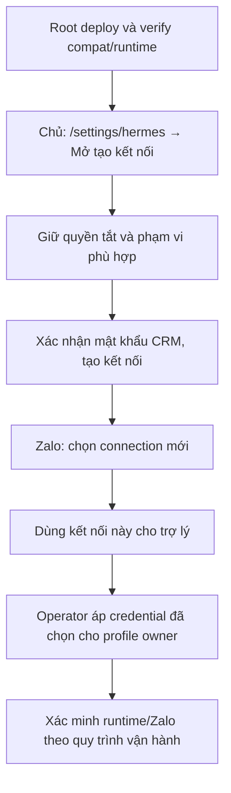

# Bàn giao Hermes × iHomeCRM

## Trạng thái hiện hành

**Trạng thái vận hành duy nhất cần đọc trước là [STATUS — checkpoint hiện hành](STATUS.md#checkpoint-hiện-hành).** Các checkpoint có giờ sớm hơn bên dưới là lịch sử, không ghi đè trạng thái này. Bản tài liệu kiểm UI `be910be0b` đã lên main, [CI đúng commit đạt](https://github.com/zxGreenxz/whiteboard-ihomecrm/actions/runs/39243588199).

- Code candidate `0fbc263f` và bảy migration đã triển khai ở VPS/DB. **Web Vercel đã phục vụ đúng candidate:** API production READY và `release:verify` PASS lúc 19:05 UTC+7. Blocker hạn mức trước đó đã gỡ; không chạy lại migration/promote để tạo thêm biên nhận.
- **Browser đã dùng được.** Ba tài khoản thật chủ/quản lý/hệ thống trên Supabase TEST riêng đã kiểm loading, tạo kết nối kế thừa CRM, đọc lại quyền, thu hồi và logout; tài khoản chủ kiểm thêm tắt/bật lại một quyền. Có 23 request HTTP 200, đã dọn toàn bộ hạ tầng UI thử; production không đổi, fast OFF. Đây là bản build TEST tĩnh qua proxy/SSH riêng, chưa phải HTTPS Vercel hoặc Zalo gửi nhận. [Số đo và sơ đồ](../2026-10-19-crm-hermes-jev-performance.md#nghiệm-thu-giao-diện-bằng-ba-tài-khoản-test-thật).
- **Giao diện production, checkpoint 19:16 UTC+7:** tổng quan/quyền/bot đã tải qua HTTPS; chủ tự tạo kết nối mới thành công. Đã chọn một kết nối và phát hành mã Zalo, đang chờ chủ gửi mã từ nick chính và xác nhận trên web. Chưa coi lựa chọn trong form là binding/selectCredential đã lưu. Tiếp theo: xác minh liên kết đã xác nhận → áp đúng profile đã chọn → nghiệm thu MCP có dữ liệu/cùng quyền và Zalo thật → quyết định bật đọc nhanh production theo bằng chứng. Không dùng kết quả TEST để tuyên bố phiên chủ đã chạy.
- Jev là pilot tùy chọn, chưa có key/nhà cung cấp đo; TG6 chữ công khai vẫn giữ hành vi hiện có và chọn riêng. Không chặn phát hành ba lỗi bằng hai nhánh tùy chọn này, cũng không tự đánh dấu P0–P11 hoàn tất. Không chạy lại migration, benchmark hoặc bộ kiểm không đổi chỉ để chờ Vercel.

## Snapshot triển khai 19/10 tới 16:05:01 UTC+7

**Snapshot lịch sử 19/10/2026 tới 16:05:01 UTC+7; trạng thái mới ở đầu file.**

Candidate `0fbc263f48d896baf633eba84dbf3cd4a222387a` (tree `519a726286fe951826004f9589554124f177c76c`), PR #222. Gate7 delta **65/65 PASS** trong 529 giây; Gate5/6 **67/67** được dùng lại do đầu vào không đổi. Main CI **5/5 PASS**: CI `39211903664`, synthetic `39211903814`, Android `39211903731`, migrationvalidation `39211903783`, restoredrill `39211903671`. Chạy thử promote chính thức **18 jobs/178 bước PASS**. Receipt E2E fleet bảy spec là LOCAL (`docs/generated/e2e-fleet-evidence/2026-10-19-d4818a9a682c-fa428022.json`), không phải CI E2E thật.

Lệnh `--apply` trước đó chưa tạo được bản phát hành do API trả `402 payment_required`; chưa gọi lại. Lần kiểm web trước ghi nhận `81c49363`, chưa kiểm lại. Artifact backup mã hóa được xác minh lúc `07:03:56Z`; VPS được chuyển `0fbc263f`, lần đọc đầy đủ PID/MCP gần nhất `07:37:26Z` (PID `192430`). Kiểm tra production sau đó chỉ đọc config/trạng thái; không đổi owner profile, restart Hermes hay gửi Zalo.

Cả 7 migration đã áp TEST và production; migration thứ bảy `20261019061954` hậu kiểm **7/7 mỗi đích**. Legacy 8 trường, inherit 11, joinedlegacy 11; credential hết hạn không được hồi sinh. `readFastPath` false/absent; `zaloProvisioning` được bỏ khỏi connector config ở layout ba UID. Credential owner đã hết hạn và chính chủ cần kết nối lại theo luồng chính thức sau khi web sẵn sàng. Tài khoản vault test không phải owner; không xin mật khẩu qua chat. TEMP fence/drain bug đã sửa, 4 ca kiểm đạt và review PASS, nhưng profile live chưa được áp.

**Cập nhật 16:05 UTC+7:** run3 có 15 cặp customer TEST; cùng customerId, bốn trường contract/building/room khác nhau (normal có giá trị, fast rỗng), fast khớp shared core CRM 15/15. Đây là run riêng, không cộng với 45 cặp run2; trạng thái/RLS từng record chưa xác minh. Cả ba run đã cleanup; không còn benchmark. Fast production OFF; browser, phiên MCP owner production và Zalo chưa nghiệm thu. Chi tiết ở [STATUS](STATUS.md#checkpoint-hiện-hành); số đo ở [tài liệu hiệu năng](../2026-10-19-crm-hermes-jev-performance.md).

Benchmark quản trị được đo trên VPS localhost với dữ liệu rỗng; chi tiết và giới hạn ở [STATUS](STATUS.md#checkpoint-hiện-hành). Trong DEMO lượt bốn (`07:35:11–07:36:46Z`), report đạt **12 PASS/0 FAIL** và canonical Web parity **3/3**, nhưng cả ba fast query rỗng, normal mỗi query có một dòng. Strict legacy parity false do `items/nextCursor`; chưa chứng minh sai lệch location hay parity trên dữ liệu có dòng. Fast đã rollback OFF; readback `07:37:26Z` khớp hash gốc, PID `192430` chạy `0fbc`, không còn cấu hình tạm. Bốn lượt đã cleanup; không còn benchmark chạy. Tiếp theo: Billing → web phát hành → owner reconnect → nghiệm thu MCP nonempty cùng scope và Zalo.

## Lịch sử checkpoint và hướng dẫn trước rollout hiện hành

## Cập nhật yêu cầu và khảo sát tinh giản — 19/10/2026

**Snapshot lịch sử 13:34 UTC+7:** Gate6 **67/67 PASS**, candidate `c3709badb`; VPS còn `b023563a`. Sáu migration nền và phần tương thích `20261019061954` đã qua TEST/production ở thời điểm snapshot. Không dùng đoạn này làm trạng thái hiện hành; xem [STATUS](STATUS.md#checkpoint-hiện-hành).

**Snapshot kỹ thuật lịch sử 12:51 UTC+7:** kết quả sáu migration nền/Gate5/verifier production và baseline broker tại mốc đó được giữ trong lịch sử. Không dùng lại làm trạng thái rollout mới; xem [STATUS](STATUS.md#checkpoint-hiện-hành) cho compat migration, candidate và receipts hiện hành.

**Làm rõ sau audit:** §9 của báo cáo là đề xuất agent khác, không phải quyết định của chủ. Không áp đặt thu hồi 100 ms, cấm cache hoặc thêm epoch vào mọi RPC. Giữ quyền/RLS vốn có của CRM; kiểm phần tắt Hermes một lần. Xác nhận chữ công khai: đang đề nghị giữ tạm đúng luồng hiện có, chưa được chủ chốt giữ/bỏ. PII xét từng trường; Network Center cần giữ rào RLS khách tới khi chuẩn hóa nguồn chung. [Kết luận audit §10](TINH-GON-KIEM-QUYEN.md#10-kết-quả-audit-lại-và-đề-nghị-thực-hiện).

[Báo cáo, sơ đồ thao tác và plan TG0–TG7](TINH-GON-KIEM-QUYEN.md) ghi đủ tám lớp, phần bỏ/gộp/giữ và bằng chứng. **Cả ba lỗi đã biết thuộc phạm vi này:** báo “Chưa đọc được…” lúc tải, API connections mất 7–9 giây theo báo cáo vận hành, link Zalo khó dùng. Source xác nhận loading/error bị gộp, tải hai đợt, quản trị và link dựng full quyền trước/sau. Candidate đã sửa các đường này; chưa đo lại tốc độ và nghiệm thu link trên VPS.

**Bước tiếp theo tại snapshot cũ:** xử lý lỗi phát hành; nguyên nhân mới đã xác định là giới hạn deployment, xem đầu file; sau đó owner reconnect và nghiệm thu MCP nonempty cùng scope/Zalo. Fast vẫn OFF, chưa xác minh; không có benchmark đang chạy. Chưa thay profile owner, restart Hermes hoặc gửi Zalo. Quyền Hermes = quyền CRM hiện tại của user − những quyền bị tắt trong cài đặt Hermes; không áp mốc 100 ms. Đợt này thực hiện TG0–TG7, không tự đóng P0–P11. [Checkpoint vận hành](STATUS.md#checkpoint-hiện-hành).


### Khôi phục sau khi runtime tương thích sẵn sàng

Credential đã hết hạn không thể được gia hạn qua session gate; tài khoản vault dùng để đọc/tra cứu không phải đúng chủ profile. Chỉ hướng dẫn chủ profile tạo kết nối mới sau khi root hoàn tất phát hành và kiểm tra. Không xin mật khẩu trong chat, không sửa expiry bằng SQL và không tuyên bố phiên đã khôi phục trước thao tác thật.



Native Zalo trên VPS ba UID cần bỏ hẳn `zaloProvisioning` khỏi connector config (không đặt `false`); operator chạy theo UID owner hiện hữu. `prepare_v2` tái sử dụng assistant cùng user/org; `selectCredentialCAS` giữ nick, bot và binding, không cần ghép mã Zalo lại. Đây là luồng đã đối chiếu source, chưa phải bằng chứng runtime phục hồi.

Dành cho chủ công ty, quản trị CRM và người vận hành VPS. Cập nhật theo checkpoint 19/10/2026. Trạng thái chi tiết, bằng chứng và lịch sử nằm ở [STATUS.md](STATUS.md); quyết định đã chốt ở [PLAN.md](PLAN.md); đề xuất đợt 3 (thao tác ghi), chưa chốt, ở [DOT-3-THAO-TAC-GHI.md](DOT-3-THAO-TAC-GHI.md).

## 1. Hermes đang chạy thế nào

```text
Nick Zalo chính của bạn ──nhắn riêng──► Bot Zalo của công ty (nick phụ "Ihome")
        ▲                                        │ worker Zalo trên VPS Minh
        │ trả lời                                 ▼
        └──────────────── Hermes (Docker "hermes-owner", model qua 9router)
                                                 │ MCP, token kết nối riêng
                                                 ▼
                         Connector CRM (systemd "hermes-connector") ──► Supabase CRM
```

- Hermes là trợ lý cá nhân của từng người (bản upstream `nousresearch/hermes-agent`), không phải Copilot cũ. Nó vẫn trò chuyện bình thường khi CRM tắt; phần CRM chỉ mở khi có kết nối hợp lệ.
- Từ 17/10 Hermes không gọi hàm `copilot_*` nào lúc chạy và mã `infra/hermes-*` không còn tham chiếu Copilot ngoài chú thích (#189, #193); gate `copilot-independence` chặn tham chiếu mới.
- Mọi việc Hermes làm trong CRM đi qua quyền CRM hiện tại của bạn **giao** với quyền Đọc/Thao tác bạn chọn cho kết nối. Hermes không có quyền riêng, không tự cấp thêm quyền.
- Nick bot phải dành riêng cho Hermes: bật bot làm mọi tin nhắn riêng tới nick đó thành riêng tư, không vào hộp chat chung.

## 2. Dùng hằng ngày

Nhắn riêng cho bot từ nick Zalo chính đã liên kết. Ví dụ:

| Muốn | Nhắn |
| --- | --- |
| Hỏi phòng trống / phòng đang sale | "Còn phòng trống nào ở 417LVT?" — danh sách đúng trang Sale Phòng/link chia sẻ |
| Gửi bản tin phòng vào nhóm | "Gửi bản tin phòng trống theo mẫu CRM vào nhóm Web nội bộ" — chỉ soạn thì nói "chỉ soạn, chưa gửi" |
| Gửi ảnh phòng trống cho nhóm sale | "Gửi ảnh phòng trống cho các nhóm sale ngay", "Hẹn gửi ảnh phòng trống 9h sáng mai", "Đổi giờ gửi ảnh phòng trống hằng ngày sang 8h" — kết nối phải có phạm vi Toàn tổ chức |
| Cập nhật tin khách nhờ pass | Dán nguyên tin "KHÁCH PASS PHÒNG…" và nhờ cập nhật lên Sale phòng |
| Giao việc / theo dõi / huỷ việc | "Tạo việc kiểm tra máy lạnh 405PVB giao cho &lt;tên nhân viên&gt;, hạn 17h mai, nhắc trước 1 tiếng"; "Huỷ việc vừa giao" |
| Ghi phiếu chi | "Ghi phiếu chi 350k sửa ống nước 158PVC hôm nay" |
| Thêm khách (Cư dân) / lead (Khách hẹn) | "Thêm cư dân Nguyễn Văn A 09xxxxxxxx" hoặc "Thêm khách hẹn Trần Thị B 09xxxxxxxx" — kết nối phải có phạm vi Toàn tổ chức |
| Tra khách, hợp đồng | "SĐT và CCCD của khách phòng 103 417LVT?", "Hợp đồng phòng 405PVB hết hạn khi nào?" |
| Tra thu chi, công nợ, chỉ số, cọc giữ, lãi lỗ, công suất, hộp duyệt | Hỏi bằng lời thường, nêu toà/tháng |

- Mới 16/10: tạo khách (Cư dân) / lead (Khách hẹn); giao việc → theo dõi/nhắc hạn → huỷ việc, và lập → chạy → thu hồi lịch bản tin nhóm — hai chuỗi này đã thử thật qua Zalo ngày 16/10 ([STATUS](STATUS.md#nghiệm-thu-cuối-1610)).
- Mới 16–17/10 (đã lên production, chưa có bằng chứng thử qua Zalo trong repo):
  - Hermes điều khiển tự động hoá "Gửi ảnh phòng trống" của CRM: gửi ngay, hẹn một lần, sửa lịch hằng ngày, huỷ lượt chưa chạy (5 tool `crm_zalo_broadcast_*`, #187). CRM là bộ lập lịch duy nhất; lịch bản tin chữ cũ chỉ còn xem/thu hồi, không tạo/sửa mới.
  - Đọc đầy đủ cho người hỏi (#190): SĐT/CCCD đầy đủ, hồ sơ khách, chi tiết hợp đồng, báo cáo khớp màn web — theo đúng quyền web của bạn và **chỉ trong tin nhắn riêng**. Bản tin nhóm, lịch và tự động hoá vẫn chỉ dùng dữ liệu công khai.
  - Báo cáo lấy cùng nguồn màn web: công suất `occupancy_snapshot_v2` / `occupancy_upcoming_vacancy_v2`, lãi lỗ `fa_monthly_pnl_accrual` (mặc định) / `fa_monthly_pnl`, hộp duyệt `list_my_pending_approvals_v1`; hoá đơn, hợp đồng, hội thoại Zalo dùng SQL riêng theo đúng bộ lọc web.
  - Công ty không còn link chia sẻ Sale phòng thì Hermes báo `no_sale_page` — không phải hết phòng (#185).
- Hermes tự gọi CRM khi cần; dữ liệu phòng, giá, chính sách luôn lấy mới từ CRM, không lấy từ trí nhớ.
- Khi mất phản hồi sau lúc gửi/ghi, Hermes báo "chưa rõ kết quả" và **không tự làm lại**; xem mục Đối soát ở phần 3.
- `/stop` cắt lượt đang treo; `/new` mở phiên mới (Hermes hỏi xác nhận, trả lời `/approve`). Phiên rất dài dễ chậm — mở phiên mới khi đổi chủ đề lớn.
- Tin "💾 Self-improvement review" là tính năng nền của Hermes (tự tạo kỹ năng), không phải lỗi.

Chưa ghi được qua Hermes (chủ hoãn 16/10): hợp đồng, cọc, hoá đơn, lương/cổ đông, tài sản/dịch vụ và các miền ghi khác ngoài danh sách trên. Hermes sẽ nói không có công cụ; làm trực tiếp trên CRM. Hiện Hermes có 11 quyền thao tác (việc, khách/lead, phiếu thu chi, tin pass phòng, gửi và tự động hoá Zalo, ghi nhớ). Đề xuất mở thêm các nhóm thao tác ghi (đợt 3) đang chờ chủ chọn nhóm: [DOT-3-THAO-TAC-GHI.md](DOT-3-THAO-TAC-GHI.md).

Đọc đầy đủ đợt 2 (lương, cổ đông, ví cá nhân, biến động số dư, sổ quỹ, tài sản/dịch vụ/vật tư, Network Center, thu tiền/công nợ/cọc…) **đã lên production 19/10** (#215): khoảng 70 báo cáo qua hai tool `crm_read_report_list` (mục lục) và `crm_read_report` (chạy báo cáo), mọi báo cáo private (chỉ trong tin nhắn riêng). Kết nối cũ chỉ thấy 20 báo cáo vì kết nối chỉ thu hẹp, không tự có quyền mới; kết nối mới (48 quyền Đọc + 11 quyền Thao tác, Toàn tổ chức) đã thay vào profile owner 19/10 và Hermes thấy 69 báo cáo. Liên kết Zalo với kết nối mới **đã xong sáng 19/10**; chưa nhắn thử đợt 2 qua Zalo (phần 3). Ba khoá còn tắt vì chưa có báo cáo: `reports_finance.deposits_report`, `handover_report`, `collection_cycle` ([STATUS](STATUS.md#cập-nhật-1910)).

## 3. Quản trị trên CRM (`/settings/hermes`)

**Tạo kết nối:** chọn quyền Đọc, quyền Thao tác và phạm vi (toàn tổ chức, khu vực hoặc toà), xác nhận mật khẩu CRM. Token `hc_…` chỉ hiện một lần — đưa ngay vào Hermes (biến `MCP_IHOMECRM_API_KEY` của profile), không gửi qua chat.

**Đổi quyền = tạo kết nối mới:** kết nối chỉ thu hẹp được, không mở rộng. Muốn thêm quyền: tạo kết nối mới → ngắt liên kết Zalo cũ → liên kết Zalo với kết nối mới → thay token trong Hermes → thu hồi kết nối cũ. Một nick chính + một bot chỉ có một liên kết đang hoạt động. Đã làm 3 lần trên production (kết nối ghi 16/10 là `…624ef30e`, 17 quyền Đọc + 11 quyền Thao tác, toàn tổ chức) và lần thứ tư sáng 19/10 (xem dưới).

**Mỗi kết nối và mỗi liên kết Zalo thuộc đúng MỘT tài khoản CRM.** Trang `/settings/hermes` chỉ hiện kết nối của tài khoản đang đăng nhập; đăng nhập nhầm tài khoản thì không thấy kết nối đang dùng cho Hermes. Tạo kết nối, tạo mã liên kết và bấm kiểm tra phải làm bằng đúng tài khoản CRM mà Hermes đang dùng.

**Đợt 2 đọc đầy đủ — việc của chủ (19/10):** registry đã bật 32 khoá đọc mới (Gói Z, migration `20261018090000`); 3 khoá giữ tắt. Trang `/settings/hermes` chỉ đọc được danh sách quyền đợt 2 từ khi web production lên `81c49363` (promote 19/10 sáng).
- Đã làm 19/10: tạo kết nối mới (48 quyền Đọc + 11 quyền Thao tác, Toàn tổ chức) và thay token trong profile owner (`MCP_IHOMECRM_API_KEY`). Hermes thấy 69 báo cáo (kết nối cũ 20). Hai kết nối tạo hỏng đã thu hồi. Liên kết Zalo cũ đã ngắt.
- Đã xong sáng 19/10: liên kết Zalo với kết nối mới. Bot Ihome ghi nhận đúng nick chính và web báo "Đã liên kết nick Zalo của bạn với kết nối Hermes".
- Còn lại của chủ: thử vài câu qua Zalo trên kết nối mới, rồi thu hồi kết nối cũ `…624ef30e` (**chưa thu hồi**).

**Liên kết Zalo:** mục "Điều khiển Hermes qua Zalo" → chọn kết nối và bot → tạo mã → từ nick chính nhắn mã cho bot → bấm xác nhận. UID Zalo là theo góc nhìn bot (cùng một người có UID khác nhau ở mỗi nick). Mã chỉ sống 5 phút và theo tài khoản; sau khi nhắn phải bấm kiểm tra trên web. Bài học 19/10:
- Phải **ngắt liên kết cũ trước** (một nick chính + một bot chỉ có một liên kết đang hoạt động).
- Mã `/hermes-link` hạn 5 phút: gửi ngay sau khi tạo.
- Kiểm bot đã nhận mã qua log worker (container `ihome-zalo-worker`): dòng `hermes link <status>`.

**Lỗi đã biết trên `/settings/hermes`, CHƯA sửa (19/10):**
- Trang báo nhầm "Chưa đọc được danh sách quyền…" trong lúc đang tải; chờ tải xong rồi xem lại.
- Mỗi lời gọi `/api/hermes/connections/*` mất 7–9 s.
- Quy trình liên kết Zalo khó dùng (mã 5 phút, theo tài khoản, phải bấm kiểm tra trên web).

**Bot của công ty:** chỉ người có quyền quản trị phù hợp bật/tắt; tắt bot thu hồi mọi liên kết qua bot đó.

**Đối soát tin chưa rõ kết quả:** xem trực tiếp trên Zalo tin đã tới chưa rồi ghi nhận; ghi nhận không gửi lại.

**Trợ lý của tôi:** xem/sửa/quên ghi nhớ công việc CRM, danh sách việc Hermes đang theo dõi và nhắc hạn.

**Thu hồi khẩn:** bấm Thu hồi trên kết nối — Hermes mất quyền CRM ngay, phần trò chuyện cá nhân vẫn chạy.

## 4. Vận hành VPS Minh

Runbook chi tiết: [HOST_SERVICE.md](../../../infra/hermes-runtime/HOST_SERVICE.md) (release, giới hạn, backup/restore, xoay khoá, sự cố, đồng bộ giờ), [CONNECTOR.md](../../../infra/hermes-broker/CONNECTOR.md) (cài vào Hermes upstream), [kênh Zalo native](../../../infra/hermes-zalo-native/README.md) (token kênh, plugin, đối soát, lệnh tạo sidecar).

| Thành phần | Vị trí / cách xem |
| --- | --- |
| Connector | `systemctl status hermes-connector`; release ở `/opt/ihome-hermes/releases/<sha8>`, đang dùng = symlink `/opt/ihome-hermes/current`; cấu hình `/etc/ihome-hermes/connector.json` |
| Hermes | `docker logs hermes-owner`; log lượt chat `/var/lib/ihome-hermes-profiles/owner/.hermes/profiles/owner/logs/agent.log`; cấu hình `config.yaml` + `.env` cùng thư mục |
| Worker Zalo | container `ihome-zalo-worker` (chạy `--native`) |
| Đường vào | Hermes gọi connector `http://172.17.0.1:8740/mcp` và 9router `http://172.17.0.1:20128/v1` qua unit `ihome-docker-connector` (systemd-socket-proxyd) và `ihome-docker-9router` (`llm-stream-guard`, cắt tool arguments chạy loạn; [host-network](../../../infra/hermes-runtime/host-network/README.md)); web CRM gọi connector qua tunnel `crm-hermes.chillhome.io.vn` |

**Release connector (sáng 19/10):** đang chạy main `b023563a` (head #217: đọc đầy đủ đợt 2 + phiếu cọc giữ chỗ khớp web). Kết nối đủ quyền thấy 65 tool; `tools/list` số đo gần nhất 63.872 B (trần test 64.000 B, còn ~130 B; trần riêng của `tools/list` là 192 KiB, mọi phản hồi khác vẫn 64 KiB). Bản lùi duy nhất trên VPS: release `14c6588a` (merge #215, 65 tool). Lùi về `14c6588a` thì broker cũ từ chối kiểu phạm vi `rls_buildings`, nên riêng báo cáo `reservation_vouchers` lỗi (chưa thử lùi thật); migration đã áp không lùi được. Release cũ hơn (kể cả `77a4327a`, 63 tool) đã xoá khi dọn đĩa 19/10; muốn dùng bản cũ hơn phải dựng lại gói từ commit, và không cũ hơn `f762ff52` (#187) — bản trước #185/#187 đọc nguồn phòng cũ nên gửi nhóm trả `context_changed` và tạo lịch chữ bị SQL từ chối (đều dừng an toàn, không gửi sai). Việc đổi symlink sang `b023563a` theo báo cáo vận hành 19/10; phiên cập nhật tài liệu không kiểm lại VPS.

Giữ nguyên khi thao tác (tối ưu tốc độ 16/10): `connector.json` phải còn `172.17.0.1:8740` trong `http.allowedHosts` (thiếu là 403); MCP `connect_timeout: 30`; container Hermes RAM `900m`/swap `1800m` — chỉ `docker restart`, nếu tạo lại phải truyền lại; unit `ihome-net-tuning` (MSS 1452, `tcp_mtu_probing=1`); NTP qua IPv4 (`/etc/systemd/timesyncd.conf.d/ihome-ipv4.conf`) — đồng hồ lệch làm mọi RPC lịch trả 42501. Connector đã có dung sai 5 s cho mốc giờ do DB sinh (#191), không thay được NTP.

**Cập nhật connector (quy trình chốt 18/10):**

1. Chọn commit đã merge vào main, CI main xanh.
2. **Migration trước, connector sau.** Bản gọi RPC mới thì áp migration production qua forward lane trước, rồi kiểm từng hàm mới trên production bằng `select to_regprocedure('<hàm>(<kiểu tham số>)') is not null` — phải trả `true`. Ví dụ từ #189 (commit `1a6fdc59`) connector gọi `hermes_scope_buildings_v1` ở mọi lượt xác thực (migration `20261017023242`): `select to_regprocedure('public.hermes_scope_buildings_v1(text,uuid)') is not null`. Thiếu hàm thì mọi lượt ra `backend_unavailable`.
3. Dựng gói release từ đúng commit đó (thư mục `infra/hermes-broker`, `infra/hermes-runtime`, `infra/hermes-zalo-router`, `src/lib/roomSaleFacts.ts`, `worker/lib/hermes-link.js`, `worker/package.json`, `vendor/xlsx-0.20.3.tgz`, `package.json`, `package-lock.json`, bỏ test) → giải nén vào `releases/<sha8>` → `npm ci --omit=dev --ignore-scripts` bằng Node 24 của `/opt/ihome-hermes/node` → thử import `host-service.mjs` bằng user 10004.
4. Đổi symlink `/opt/ihome-hermes/current` sang release mới → `systemctl restart hermes-connector` → kiểm `GET /` 404, `/mcp` không token 401 qua tunnel. **Giữ nguyên** `/etc/ihome-hermes/connector.json` (không chép đè từ file mẫu).
5. `docker restart hermes-owner` (chờ hết lượt đang trả lời) để Hermes đọc lại danh sách tool. **Không tạo lại sidecar.** Buộc phải tạo lại thì dùng đúng lệnh `docker run` ở [kênh Zalo native](../../../infra/hermes-zalo-native/README.md): phải có `--entrypoint hermes` và `--memory 900m --memory-swap 1800m`.

**Đọc đầy đủ đợt 1 (crm_read_customers / `_detail` / `_report`, crm_read_occupancy họ v3):** đã áp production 17/10, đủ bốn migration trong MỘT lượt lane, đúng thứ tự `20261016162104_hermes_full_read_v1` → `20261016172206_hermes_full_read_review_fixes_v1` → `20261017021554_hermes_full_read_web_parity_v1` → `20261017033630_hermes_full_read_owner_scope_v1`. Dựng môi trường khác thì làm y vậy (`npm run migrate:forward -- <file> --env <đích> --apply` từng file, không xen việc khác) và chỉ đổi symlink connector khi câu dưới (`npm run db:query -- --file <câu>`) trả `1 | t | t | t | crm.fa_monthly_pnl`; connector lên trước thì `crm_read_occupancy` và các báo cáo trả `backend_unavailable` hoặc `invalid_request`.

```sql
SELECT count(*) FILTER (WHERE p.proname='hermes_pnl_pending_v1') AS pnl_pending,
  bool_or(p.proname='hermes_domain_read_v3' AND p.prosrc LIKE '%current_visible_owner_ids%') AS v3_owner_scope,
  bool_or(p.proname='hermes_report_read_v2' AND p.prosrc LIKE '%v_pnl_buildings%') AS reports_fixed,
  bool_or(p.proname='hermes_room_pass_upsert_v2' AND p.prosrc LIKE '%v_owners%') AS room_lookup_owner,
  app_private.hermes_report_catalog_v1('monthly_pnl','by_month')->>'source' AS pnl_source
FROM pg_proc p JOIN pg_namespace n ON n.oid=p.pronamespace
WHERE n.nspname IN ('public','app_private')
  AND p.proname IN ('hermes_pnl_pending_v1','hermes_domain_read_v3','hermes_report_read_v2','hermes_room_pass_upsert_v2');
```

**Đọc đầy đủ đợt 2 (đã phát hành 19/10, #215):** gộp Gói 0 (#195), A (#207), B (#208), C (#204), D (#203) và Gói Z. 25 migration `20261018000000…20261018090000` áp production qua lane `migrate:forward` (mỗi file backup + hai lượt ROLLBACK trước khi áp, 25/25 đạt, không thử lại), cuối cùng là công tắc `20261018090000_hermes_w2_enable_v1` bật 32 khoá. Thứ tự đã dùng: migration lên trước, kiểm `select to_regprocedure('public.hermes_w2_read_v1(jsonb,text,jsonb)') is not null`, rồi mới đổi connector sang `14c6588a`. Dựng môi trường khác thì làm y vậy. Biên nhận: commit "Bằng chứng apply production" `e68f9420`.

**Phiếu cọc giữ chỗ khớp web (#217, merge `ef2a0cf9`, 19/10):** báo cáo `reservation_vouchers` dùng kiểu phạm vi `rls_buildings`: RLS `income_expenses` quyết tập phiếu (kể cả phiếu vào sổ quỹ người dùng giữ), vẫn thu hẹp theo phạm vi kết nối, rào PII giữ. Ba migration `20261018182656` → `20261018185339` → `20261018185413` áp production qua lane (biên nhận `92e028b6`). Thứ tự: connector `b023563a` deploy TRƯỚC khi áp `185413` (broker cũ từ chối kiểu mới); đây là ngoại lệ của quy tắc "migration trước, connector sau" ở phần 4. TEST: chủ 13 = 13; quản lý kết nối Toàn tổ chức 9 = 9 (trước 5 so 9).

**Rào chữ công khai (đợt 2):** `crm_room_pass_upsert` có tên, SĐT hoặc chính sách bán (chữ sẽ hiện công khai) luôn đi qua xác nhận hai bước, không phụ thuộc Hermes đã đọc dữ liệu riêng hay chưa: lần gọi đầu trả `confirmation_required` kèm `confirmToken` dùng một lần, hết hạn sau 10 phút và gắn đúng nội dung; Hermes chỉ ghi khi người dùng xác nhận và gọi lại kèm token.

**Lùi bản:** trỏ symlink `current` về release trước (giữ ít nhất một bản cũ) rồi restart connector. Migration CRM đã apply không lùi; muốn tắt năng lực thì tắt dòng registry `app_private.hermes_capabilities` bằng migration mới hoặc thu hồi kết nối.

**Đĩa:** VPS 19 GB. Đo 16/10 còn khoảng 2,4 GB. Sáng 19/10 đã xoá release connector cũ và image hermes-agent cũ (bản rollback runtime v0.22.2 trước đó, chủ đồng ý): đĩa ~71% đã dùng, 5,2 GB trống. Hệ quả: **không còn bản lùi runtime Hermes cũ**; bản lùi connector duy nhất là `14c6588a`. Lần dọn sau: không xoá bản đang `current` và bản lùi gần nhất.

## 5. Phiên bản đang chạy (19/10/2026)

| Thành phần | Phiên bản |
| --- | --- |
| Hermes | `nousresearch/hermes-agent` v0.21.6, image `sha256:ffa4fbb4…`, plugin `ihome-zalo-native` từ PR #175 (ghi 16/10, không đổi trong các PR 17–18/10) |
| Connector | release main `b023563a` (sáng 19/10), 65 tool khi kết nối đủ quyền; bản lùi `14c6588a` |
| Model | 9router `cx/gpt-6-luna` (từ 16/10 05:57) |
| CRM | production `ptcrm.vercel.app` phục vụ `81c49363` (promote 19/10 sáng); trước đó `d001edac` (18/10, dựng qua API vì Vercel chặn hạn mức dựng do push git). Khách hàng (#196), Hợp đồng (#197), Hoá đơn (#201) và sửa trang tài chính (#209) đã ở production |
| Schema production 16–19/10 | #185 (2 migration), #187 (5), #190 (4), #189 `20261017023242`, #196 `20261017115708`, #206 `20261018044046_toi_uu_ham_quyen_rls_v1` (18/10), đợt 2 25 migration `20261018000000…20261018090000` (19/10), #217 ba migration `20261018182656`, `20261018185339`, `20261018185413` (19/10); mỗi lượt có commit biên nhận lane. Registry năng lực: 32 khoá đọc mới bật 19/10, 3 khoá tắt |

Phiên cập nhật tài liệu 19/10 không có quyền VPS/DB: release VPS và app ghi theo báo cáo vận hành; migration lấy từ các commit biên nhận trên main. Dòng Hermes ở bảng trên là ghi từ 16/10, chưa kiểm lại sau lần dọn đĩa 19/10 (đã xoá image hermes-agent cũ).

## 6. Lưu ý về model

- Đang dùng `cx/gpt-6-luna`, đổi 16/10 05:57 theo yêu cầu chủ. Cấu hình chỉ đổi `model.default` và `model.context_length: 272000`; bản cũ giữ ở file `.bak` cạnh `config.yaml`.
- Thử thật trong Hermes với cùng câu lập lịch (16/10):

| Model | Kết quả |
| --- | --- |
| `gpt-6-sol` (medium), `gpt-6.1-sol`, `gpt-6-astra` (medium) | Treo ngay lần gọi model đầu: 9router không trả DONE, phải `/stop` |
| `cx/gpt-6-luna` | Hỏi phòng 21 s, lập lịch 78 s, thu hồi lịch 50 s |
| `gpt-6-sol(low)` | Hỏi phòng 28 s, lập lịch 113 s, thu hồi lịch 35 s |

- Ngoài Hermes (bộ thử 52 tool CRM, prompt gọn) cả 4 cấu hình đều gọi tool đúng, không có ID giả hay lặp. Treo chỉ xuất hiện khi chạy đủ bộ tool + prompt của Hermes với sol/astra mức medium.
- Connector đã chịu lỗi tham số: #176 (null/UUID toàn 0), #179 (`kind=buildings`, mô tả tool), #180 (bỏ trường vô nghĩa theo chế độ), #181 (chuẩn hoá mốc giờ có múi giờ ở `expiresAt`/`deadline`).
- **Đổi model:** sửa `model.default` và `model.context_length` trong `config.yaml` của profile owner, rồi `docker restart hermes-owner` (chờ hết lượt đang trả lời). Mức suy nghĩ đặt bằng hậu tố `(low)` sau tên model, ví dụ `gpt-6-sol(low)`; kiểm dòng `THINK:` trong `journalctl -u 9router`.
- Chặn SSE hay siết guardrail thêm: chủ quyết theo khảo sát [TOI-UU-TOC-DO-DOT1.md](TOI-UU-TOC-DO-DOT1.md).
- Khi bot im quá 60 s: nhắn `/stop`, rồi `/new` + `/approve`.

## 7. Phần còn hoãn hoặc chờ chủ

Chi tiết ở [STATUS.md](STATUS.md#cập-nhật-1910). Tóm tắt:

- Đọc đầy đủ đợt 2 đã lên production 19/10 (kèm #217). Kết nối mới đã thay vào profile owner (Hermes thấy 69 báo cáo). Liên kết Zalo với kết nối mới đã xong sáng 19/10. Còn lại của chủ: thử vài câu qua Zalo rồi thu hồi kết nối cũ `…624ef30e` (chưa thu hồi).
- Nghiệm thu đợt 2 qua Zalo thật: chưa làm (chưa nhắn thử câu nào trên kết nối mới). Phiếu cọc giữ chỗ đã khớp web (#217).
- Ba lỗi đã biết ở `/settings/hermes` chưa sửa (báo nhầm "Chưa đọc được danh sách quyền…" lúc đang tải; gọi `/api/hermes/connections/*` mất 7–9 s; quy trình liên kết Zalo khó dùng).
- Hàm dùng chung web + Hermes: Hermes chưa chuyển sang gọi `customer_list_v1` / `contract_list_v1` / `invoice_list_v1` (PR sau).
- Thử thật qua Zalo trên connector mới (`b023563a`): gửi ảnh phòng trống, đọc đầy đủ đợt 1 và 2, `crm_group_directory` sau #191.
- #219 (gate nhận biên nhận E2E fleet chạy local) là draft; sau khi merge phải chạy fleet thật để có biên nhận cho #205. Chưa làm.
- Các miền ghi CRM còn lại: đề xuất đợt 3 (nhóm 3A–3E, nền 3-0 bắt buộc) chờ chủ chọn nhóm, xem [DOT-3-THAO-TAC-GHI.md](DOT-3-THAO-TAC-GHI.md); user thứ hai/canary nhiều người; trần ngân sách/độ trễ chính thức; các bước tối ưu tốc độ còn lại theo [TOI-UU-TOC-DO-DOT1.md](TOI-UU-TOC-DO-DOT1.md).

## 8. Chuông báo Hermes ↔ web và hàm dùng chung

Chủ chốt 17/10/2026: sửa bộ lọc/công thức web mà Hermes đang chép thì CI đỏ cho tới khi Hermes theo trong cùng thay đổi. Bản đồ: [web-parity.json](../../../infra/hermes-broker/web-parity.json); gate `npm run gate:hermes-web-parity` (CI: `check-hermes-web-parity`, job quality-gates).

Khi gate đỏ:

1. Đọc dòng lỗi: mục `[id]`, vùng web hoặc nguồn SQL CRM đã đổi, và hàm/file Hermes đang chép (kèm migration chứa bản định nghĩa cuối).
2. Sửa Hermes cho khớp web bằng migration `hermes_*` mới (migration đã apply không sửa) và/hoặc `infra/hermes-broker/*-contract.mjs`.
3. Web chuyển RPC (vd. `_v3`): đổi lời gọi trong hàm Hermes, sửa `rpc`/`webCalls`/`calls` trong bản đồ.
4. Chạy `node scripts/check-hermes-web-parity.mjs --write` để ghi hash mới, nêu lý do trong commit. Đổi chỉ là trình bày, không ảnh hưởng Hermes: vẫn `--write`, ghi rõ "không ảnh hưởng Hermes".
5. Thêm chỗ chép mới (đợt 2): bọc mã web bằng `// hermes-parity:begin <vùng>` … `// hermes-parity:end <vùng>` (chỉ chú thích), thêm một mục (`web` + `hermes`, `sql` nếu chép thân hàm/RLS CRM), rồi `--write`.

**Hàm dùng chung (chủ chốt 17/10, mô hình INVOKER + RLS 18/10):** công thức dùng từ hai nơi trở lên hoặc dính tiền/quyền đặt trong một hàm SQL mà web và Hermes cùng gọi ([quy tắc](../../CODEBASE_STRUCTURE.md#công-thức-dùng-chung)). Hàm là `SECURITY INVOKER`, đọc bằng RLS của chính người gọi; `p_building_ids` chỉ thu hẹp; helper DEFINER chỉ dùng cho phần kiểm quyền. Không gọi hàm INVOKER từ thân hàm DEFINER của Hermes (bỏ qua RLS, bị chặn 42501): đợt 2 có lối vào INVOKER `public.hermes_w2_read_v1`. Web chuyển sang hàm chung thì mục bản đồ giữ `mirrored` (hash trỏ hàm mới) tới khi Hermes gọi cùng hàm, lúc đó đổi thành `rpc`.

| Màn | Hàm | Trạng thái 19/10 |
| --- | --- | --- |
| Khách hàng | `customer_list_v1` (#196) | Merged, đã ở production; Hermes chưa chuyển |
| Hợp đồng | `contract_list_v1` + `contract_stats_v2` (#197) | Merged, đã ở production; Hermes chưa chuyển |
| Hoá đơn | `invoice_list_v1` + `invoice_statistics_v3` (#201, `SECURITY INVOKER` + RLS) | Merged 18/10 cùng sửa trang tài chính #209; production phục vụ `81c49363`; sửa thống kê chủ công ty ra 0; Hermes chưa chuyển |

Tối ưu 18/10 (#206): 22 hàm quyền RLS đổi từ `sql` sang `plpgsql` (InitPlan), đã áp production; `/invoices` gọi `invoice_list_v1` từ ~1,9 s xuống ~0,4–0,5 s.

## 9. Bài học 17–19/10

- **So Hermes với web trước khi bật đọc đợt 2 (TEST, phiên thật, 19/10).** Chủ: 19/21 khớp, 2 khác có chủ ý. Quản lý toà hẹp: 8 khớp, 10 cả hai cùng từ chối, 2 khác có chủ ý, 1 lệch — phiếu cọc giữ chỗ: Hermes chặt hơn web; đã sửa theo web ở #217 (TEST: 9 = 9 với kết nối Toàn tổ chức). Các khác biệt có chủ ý ghi ở `notes` của [web-parity.json](../../../infra/hermes-broker/web-parity.json).
- **Áp DB đợt có khoá mới thì phải promote web cùng lúc.** Web kiểm khoá bằng danh sách đóng gói sẵn trong bản dựng: web `d001edac` không biết 32 khoá đợt 2 nên `/settings/hermes` không đọc được danh sách quyền. Promote còn bị chặn bởi cửa `check-forward-migration-idempotent` đỏ (migration `030100` ngã `42P13` khi chạy lại vì `030300` đổi kiểu trả về); #218 ghim ngoại lệ có bằng chứng, không sửa migration đã áp.
- **Dọn đĩa VPS đổi lấy bản lùi.** Xoá image hermes-agent cũ giải phóng đĩa (~71%, 5,2 GB trống) nhưng không còn bản lùi runtime Hermes cũ; cân nhắc trước khi xoá lần sau.
- **`test-env:sync` từng hỏng 15→18/10:** vai dịch vụ `hermes_store_host` (LOGIN) bị dựng lại NOLOGIN trên TEST; #216 sửa.

- **Mốc giờ DB so với giờ VPS phải có dung sai.** Đồng hồ DB chạy trước VPS vài chục ms làm `crm_group_directory` trả `backend_unavailable` khoảng một nửa số lần dù NTP của VPS tốt. Connector dùng `DB_CLOCK_SKEW_MS = 5000` ([clock-skew.mjs](../../../infra/hermes-broker/clock-skew.mjs)) cho cận trên mốc giờ do DB sinh, không nới chiều "đã hết hạn" (#191). Phép so mới với mốc giờ DB dùng lại hằng này.
- **PGlite: một instance mỗi file test.** Mỗi ca chạy trong `BEGIN … ROLLBACK`, đột biến chỉ `CREATE OR REPLACE` bên trong ca. Dựng nhiều instance mỗi file làm runner CI cạn RAM (job quality-gates bị tắt; full-read-report đo 13,6 GB → 0,68 GB sau khi sửa ở `9f5ec9b2`).
- **Migration trước, connector sau**, kiểm `to_regprocedure(...)` trên production trước khi đổi symlink (phần 4).
- **Sidecar Hermes chỉ `docker restart`**; tạo lại mà quên `--entrypoint hermes` hoặc RAM 900m là sai cấu hình.
