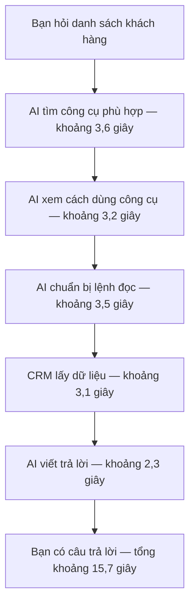
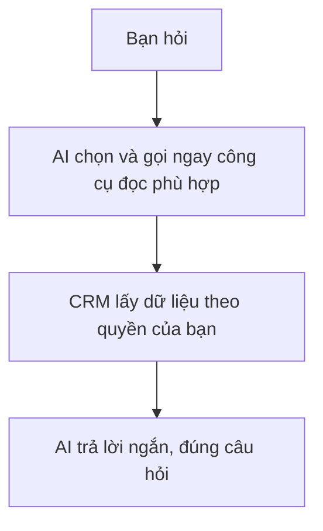
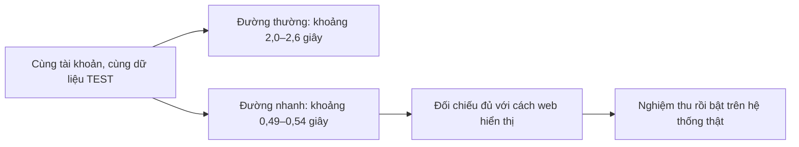
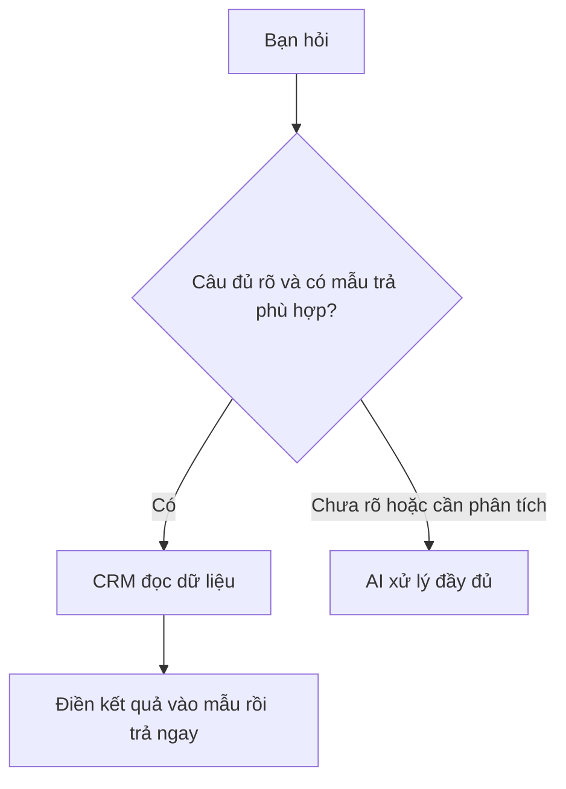
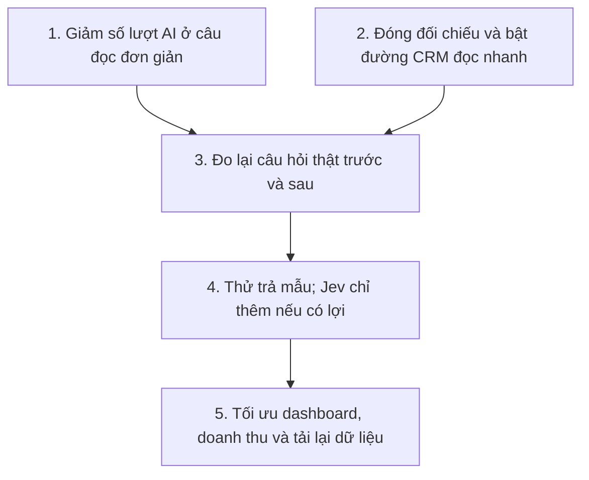

# Báo cáo dễ hiểu: làm sao để Hermes và CRM nhanh hơn?

Cập nhật 20/10/2026: **đã xác minh bản mới lên Vercel production lúc 07:43 (UTC+7)**; số đo tốc độ vẫn là các phép kiểm ngày 19/10. [Bản phân tích kỹ thuật và bàn giao cho agent](TOI-UU-TOC-DO-HIEN-HANH.md) giữ số đo, nguồn và giới hạn đầy đủ.

## 1. Chậm nhất hiện nay là gì?

**AI đang đi qua nhiều lượt trung gian trước khi lấy dữ liệu.** Trong lần hỏi khách hàng đã đo, cả câu mất **15,7 giây**, nhưng bước lấy dữ liệu CRM chỉ mất **3,1 giây**. Khoảng **12,6 giây còn lại** nằm ngoài công cụ CRM, chủ yếu quanh các lượt AI tìm cách dùng công cụ và viết trả lời; có cả phần truyền tải và điều phối.

Sơ đồ đã gộp thời gian chạy chức năng tìm/mô tả rất nhỏ vào hai bước đầu. Đây là **một lần đo**, không phải câu nào cũng mất đúng như vậy. Lượt đọc phòng sau sửa mất 15,35 giây, trong đó công cụ CRM mất 4,62 giây; đọc hợp đồng mất 18,02 giây, công cụ mất 5,12 giây. Cả ba đều cho thấy cần xử lý phần ngoài CRM.

## 2. Tôi đề xuất bỏ bớt những bước nào?

### Việc làm trước: cho AI biết sẵn một nhóm nhỏ công cụ hay dùng

Ví dụ nhóm đọc phòng, khách hàng, hợp đồng và hóa đơn. Khi gặp câu rõ, AI có thể gọi ngay công cụ phù hợp.

**Từ bốn lượt AI xuống mục tiêu hai lượt cho câu đọc đơn giản.** Vẫn lấy dữ liệu thật, vẫn đúng quyền; bớt vòng tìm rồi xin hướng dẫn. Các công việc độc lập vẫn chạy song song như trước. Không phải chuyển toàn bộ hệ thống sang tuần tự.

Không đưa tất cả công cụ vào một lần: cách đó từng làm AI sinh tham số bất thường và bị treo. Chỉ thử nhóm nhỏ; câu phức tạp dùng luồng đầy đủ. Chưa có số đo sau thay đổi nên chưa hứa tổng còn bao nhiêu giây.

### Việc làm cùng đợt: sử dụng đường đọc CRM nhanh đã xây

Đường nhanh **đã có nhưng đang tắt trên production**. Điểm cần làm rõ còn lại là bốn thông tin phòng/hợp đồng trong danh sách khách hàng: đường nhanh giống công thức web, đường cũ có thể lấy thông tin hợp đồng lịch sử. Cần kiểm đúng những trường hợp đó rồi chốt theo web, không làm lại cả dự án.

Các số ở sơ đồ là trung vị trên môi trường TEST, chưa gồm AI/Zalo. Không lấy chúng cộng trừ với lần chat 15,7 giây để cam kết tốc độ mới.

### Sau đó: câu thật đơn giản có thể trả bằng mẫu

Ví dụ kiểm tra kết nối hoặc đọc một danh sách ngắn đã xác định rõ. Cần giữ ngữ cảnh để câu tiếp như “phòng thứ hai” vẫn hiểu đúng. **Jev có thể giúp chọn luồng**, nhưng chỉ nên thêm nếu nó thay được một lượt AI đang có. Nếu gọi Jev xong vẫn đi đủ các bước cũ thì có thể chậm hơn.

## 3. Những phần khác của CRM còn cần xử lý

| Phần | Hiện tại | Nên làm gì? |
|---|---|---|
| Trang cài đặt Hermes | Tổng quan TEST khoảng 0,5–0,6 giây; lỗi loading giả đã sửa | Giữ cách tải gọn hiện có |
| Mở quyền và tạo kết nối | Tải quyền khoảng 1,8–3,3 giây; tạo mới 4,5–6 giây | Đo từng bước bên trong, bỏ phần lấy lại thông tin trùng; đây là thao tác thỉnh thoảng mới làm |
| Liên kết Zalo | Đã ghép và chat được; nhãn đồng bộ vẫn chưa phản ánh đúng | Làm trạng thái rõ ràng, không bắt ghép lại |
| Dashboard và doanh thu | Thống kê cũ cho thấy có truy vấn tốn khoảng 1–3 giây | Đo lại bản đang chạy; tối ưu truy vấn và dùng dữ liệu tổng quan lưu tạm vài phút nếu phù hợp |
| Tải lại dữ liệu nền | Đã có cơ chế gom sự kiện; chưa biết còn bao nhiêu request thừa | Đo thực tế rồi giảm tải lại không cần thiết |
| Gửi nhóm/phiên chat dài | Chưa có phép đo mới đủ để kết luận | Đo riêng sau; không dùng thời gian lịch sử làm cam kết hiện tại |

**Không cần bỏ hết kiểm quyền.** Phần kiểm lặp đã được tinh giản; quyền vẫn là quyền user trên web trừ phần đã tắt. Các lượt AI trung gian mới là nơi nên ưu tiên ở những câu đã đo. Tính tiền vẫn dùng công thức CRM.

## 4. Bản mới đã lên Vercel production

Hệ thống có ba phần, cập nhật riêng:

| Phần | Bản đã xác minh | Phép đo nào phụ thuộc? |
|---|---|---|
| Web Vercel | Đã phục vụ `b5a0686d`, READY; xác minh 07:43 ngày 20/10 | Giao diện, tải trang, thông báo liên kết |
| Hermes trên VPS | `8ee1fd0`; phần xử lý broker không có thay đổi chạy được trong chênh lệch mới, chỉ chú thích/test | AI chọn công cụ và trả lời |
| Database | Bản sửa phạm vi phòng đã áp 23:41 ngày 19/10 | Đọc dữ liệu và quyền/phạm vi |

**Trang CRM đã chạy bản mới, gồm thông báo rõ hơn khi nick Zalo đã liên kết với tài khoản khác.** Đã kiểm cả trạng thái bản phát hành và mã phiên bản trên trang thật. Các số đo chat trước đó vẫn có giá trị cho luồng Hermes/VPS/DB đã nêu; chưa đo lại giao diện mới hoặc tốc độ sau mốc 07:43. PR #229 đã merge lúc 07:46. Nhánh Git đánh dấu phát hành còn ở bản cũ; mốc Vercel nêu trên đã được xác minh riêng.

Lỗi phòng `backend_unavailable` đã sửa và kiểm thật: bot đọc được một bản ghi. CI đỏ trong ảnh là phép thử một migration Zalo cũ gặp chờ khóa database quá hạn; không phải phát hiện rò dữ liệu. Tình trạng CI mới nhất được ghi tại [STATUS](STATUS.md#checkpoint-hiện-hành), tách khỏi kết quả đọc phòng.

## 5. Thứ tự tôi chốt đề xuất

Bước 1 và 2 có thể chuẩn bị song song. Làm từng gói nhỏ, đo cùng câu hỏi và cùng dữ liệu, giữ lại phương án thực sự nhanh và đúng. Chưa bật Jev, đổi model hay bật đọc nhanh trong lượt lập báo cáo này.
