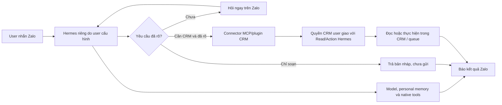
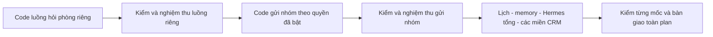

# Phân công thực thi Hermes × iHomeCRM

Phiên bản 1.4 · Chốt kiến trúc ngày 14/10/2026 · Asia/Bangkok. [PLAN.md](PLAN.md) giữ toàn bộ P0–P11; [STATUS.md](STATUS.md) giữ kết quả thực tế. Tài liệu này giao gói code/kiểm, không thay tiêu chí hoàn tất chương trình.

**Điểm làm việc hiện hành:** `C:/Users/Nguyen Tam/codex-worktrees/hermes-crm-integration-20261014`, nhánh `codex/hermes-crm-integration-20261014`, đã tích hợp `origin/main` `993fcfed`. Candidate `c038c71f` đã push trong draft PR #166. Connector, native operator, lịch, work memory, tám miền đọc và room-pass đã ghép; 23 migration Hermes đã apply TEST. C/D/E mới 10/10, cleanup sạch; giữ lượt cũ FAIL và canonical 63/64 cùng focused sửa fixture 125/125. Native-upstream Linux đã SUCCESS; đang sửa mount fixture synthetic-isolation và prerequisite Zalo trong diễn tập restore. Task create/assign core và wiring v5/MCP/input-options đã review độc lập đạt trong cache, còn tích hợp/verifier/TEST. Worktree foundation giữ bằng chứng lịch sử. Tiếp tục theo [STATUS.md](STATUS.md), không chạy lại các gói kiểm có đầu vào không đổi.

**Kiến trúc hiện hành:** Hermes upstream độc lập, đầy đủ, do user tự cấu hình/cập nhật model, native tools và memory cá nhân → connector MCP/plugin CRM → gate backend **quyền CRM user hiện tại ∩ Read/Action Hermes** → RPC/queue/worker dùng chung. Không custom kernel; không ép room-only prompt, đóng native tools hoặc giới hạn memory ba cặp lượt. Managed wrapper/image pin/model relay hiện có chỉ là prototype hoặc adapter CRM tùy chọn; không là mặc định trợ lý cá nhân.

ACL trên chỉ quản CRM. Revoke CRM chặn đọc/thao tác/job CRM mới và vô hiệu hóa token/scope/cache connector; personal chat/model/native tools/memory theo cấu hình user vẫn hoạt động. Không hứa xóa nội dung đã hợp lệ đi vào native memory/history. User không cần bật Copilot hoặc dùng model trả phí qua CRM. Relay model CRM nếu dùng phải có admission riêng và quota thật; công việc relay đó không chặn core connector.

**Luồng sản phẩm:** yêu cầu rõ thì tự làm đủ các bước CRM trong quyền, chỉ soạn thì không gửi, thiếu dữ kiện hỏi ngay Zalo và tiếp tục qua nhiều lượt. Không bắt CRM/PIN/approve Copilot. Điều kiện kế toán/hợp đồng/thẩm quyền nghiệp vụ mà user trực tiếp cũng phải đáp ứng vẫn giữ. Chỉ một overlay Read/Action; khóa/trần Hermes công ty nếu cần hợp nhất vào đó, không cấp lại cùng quyền hai lần.

**Copilot đã ngừng sử dụng:** ưu tiên Hermes trực tiếp. Không xây chạy song song hoặc lớp tương thích engine cũ. Gỡ entrypoint/UI chat/approval/scheduler/cấu hình riêng sau khi tra callers; giữ backend/dữ liệu dùng chung. Có thể triển khai phần này trước P8–P10, không chờ toàn bộ tool cũ có bản sao trong Hermes.

## Thứ tự thực hiện

Code trong từng mốc có thể chia agent song song sau khi chốt hợp đồng đầu vào/đầu ra. Mỗi file chỉ có một người sửa trong cùng đợt. Agent tích hợp chịu trách nhiệm các file dùng chung, thứ tự migration và trạng thái bàn giao.

Không coi việc sửa plan là hoàn tất code. Tái dùng broker credential/ACL, queue, idempotency và worker đã có; thay phần phụ thuộc managed runtime khi nối Hermes bên ngoài. Không bỏ hoặc sửa migration đã apply, không tạo harness/telemetry nặng để thay bước ghép luồng.

## Cấu hình agent đã chốt

| Việc | Agent mới |
| --- | --- |
| Code cốt lõi, quyền/org, tích hợp runtime/queue; sửa lỗi phức tạp | GPT-6 Astra · Extra High (`gpt-6-astra`, `xhigh`) |
| Review quan trọng; thiết kế/đánh giá test quyền, concurrency và tác động gửi | GPT-6 Astra · Extra High; độc lập với tác giả |
| Đọc file, chạy bộ test sẵn, tổng hợp lỗi đơn giản | GPT-6.1 Sol · High (`gpt-6.1-sol`, `high`) |
| Chỉ chạy lệnh và thu output | Terminal trực tiếp nếu không cần agent |

Người điều phối tự chọn theo loại việc, không hỏi lại từng lần. Tạo agent mới đúng cấu hình; agent cần override nhận gói việc và context riêng (`fork_turns: none`) theo công cụ hiện hành. Khi việc đọc/test phát hiện lỗi phức tạp, chuyển phần phân tích/sửa cho agent Astra mới. Nếu công cụ không nhận cấu hình đã chọn, ghi lỗi thực tế; không âm thầm thay model. Không thay cấu hình app chung hoặc ép provider từ log cũ.

## Mốc A — nhắn riêng hỏi phòng trống

Đầu ra sản phẩm: user có Hermes riêng, gắn connector CRM và liên kết nick chính với bot nick phụ; hỏi chuyện cá nhân bình thường, hỏi phòng thì connector trả đúng công ty/tòa. Tắt quyền CRM không ngắt personal chat. Đường hỏi phòng là mốc đầu của toàn P0–P11, không giới hạn toàn bộ Hermes vào phòng.

| Gói | Việc và đầu ra code | File phụ trách | Điểm bắt đầu hiện tại |
| --- | --- | --- | --- |
| K1 · Một cấu hình CRM | UI/API kết nối MCP, một overlay Read/Action theo quyền CRM; hợp nhất lý do khóa/trần công ty nếu cần. Tách identity kênh/assistant khỏi grant CRM; revoke CRM không xóa personal assistant | `api/hermes/**`, `infra/hermes-broker/frontend-proxy.*`, `src/hermes/**`, settings Hermes; lifecycle chung do người tích hợp giữ | UI/API/proxy đã có WIP; còn chỉnh trải nghiệm/quyền theo v1.4, cấu hình endpoint/TLS và mapping identity độc lập |
| K2 · Connector Hermes độc lập | External Hermes → MCP/plugin → broker ACL → RPC/query có schema. Opaque binding/credential hạn chế; model/native tools/memory user quản lý. Capability mapping dùng chung, mở room trước rồi các miền, không hardcode kiến trúc một tool | `infra/hermes-broker/**` trừ proxy; transport/adapters cần thiết trong `infra/hermes-runtime/**`; factory chung do người tích hợp giữ | Đã mount sáu tool context/phòng/directory/preview/send/status; host mode connector và gia hạn token riêng có code. Policy công ty thiếu mặc định neutral, explicit deny giữ nguyên. SQL forward chưa apply; thiếu nghiệm thu external Hermes/model/JWT thực |
| K3 · Kênh Zalo về Hermes riêng | Nick chính UID → assistant cá nhân → trả DM qua một worker nick phụ. Giữ hội thoại native nhiều lượt; chỉ call/outbound có CRM data chịu CRM authority; dedup và UNKNOWN_EFFECT vẫn giữ | `worker/lib/hermes-*`, caller inbound/login/lifecycle, `infra/hermes-zalo-native/**`, `infra/hermes-zalo-router/**` | Plugin/bridge/operator đã ghép, CI Linux với upstream thật và provider tổng hợp đạt tại checkpoint 4edb126c. Launcher opt-in + preflight trong image và runbook sidecar đã có code mới, review source đạt và canonical local 47/47; CI delta còn chờ. Còn Docker deployment/canary, grant tự phục vụ và lease khi database down. Không thêm phiên Zalo |

K1–K3 có thể giao ba agent riêng sau khi chốt identity/connector contract và file. `server.mjs`, factories, routing manifests và migration chỉ một người tích hợp thay đổi. Mapping backend chung là nguồn cho tool list/call/options/UI; không clone role hoặc registry thứ ba. Phần có sẵn đúng contract thì giữ và đi tiếp, không viết engine/harness mới chỉ để có đầu ra.

Đầu ra bắt buộc của K1/K2: cấu hình/CLI external connector, hướng dẫn token hạn chế và vòng đời rotate/expiry/revoke; readiness CRM riêng. Chưa cài connector, MCP lỗi hoặc token hết hạn không được làm personal Hermes mất READY. Provider/model cá nhân khởi động theo cấu hình user. Tham chiếu map source ở [CONNECTOR.md](../../../infra/hermes-broker/CONNECTOR.md), không chuyển strict wrapper cũ thành điều kiện toàn engine.

Điều kiện kết thúc **code mốc A**: caller thật xuyên ba gói, không placeholder/stub; hướng dẫn cấu hình connector vào Hermes độc lập và kênh Zalo rõ. Personal chat không phụ thuộc CRM; CRM tools dùng ACL động từng resource. Chưa có bằng chứng thì chưa gọi là dùng được với Hermes/Zalo thật.

## Mốc B — soạn và gửi nhóm theo quyền đã bật

Bắt đầu sau code mốc A và hợp đồng quyền/turn đã ổn định. Chuẩn bị code offline có thể tiếp tục khi Q của A vướng môi trường; bật gửi thật cần nghiệm thu A và B. Tập trung bản tin phòng trống/chính sách tới nhóm được phép và kết quả từng nhóm. Lệnh chỉ soạn thì trả đề xuất; lệnh gửi rõ ràng thì thực hiện trực tiếp.

| Gói | Việc và đầu ra code | File phụ trách | Điểm bắt đầu hiện tại |
| --- | --- | --- | --- |
| K4 · Tool CRM ngoài wrapper | Đưa directory/draft/send/status/reconcile đã phù hợp lên external connector qua cùng ACL. Read không đòi send; action enqueue nguyên tử theo quyền user và overlay, provenance/idempotency thật | Module group broker/router, external MCP contract, RPC forward khi cần; factory chung do người tích hợp giữ | External directory/preview/send/status đã qua HTTP MCP → broker → SQL/queue PGlite. Stable requestId và provenance external riêng, không giả DM claim. Chưa apply/live JWT/MVCC hoặc review độc lập cohort mới |
| K5 · Ý định nhiều lượt | Hermes native hiểu “soạn”, bổ sung, “gửi bản này”; connector schema/output đủ để tự đọc/làm và trả kết quả. Chỉ làm rõ dữ kiện thiếu, không ép PIN/CRM; không thay native memory bằng ba cặp lượt | Schema/mô tả/output CRM tools và adapter Zalo; Hermes dùng cấu hình user, không viết custom conversation kernel | Web-consent cũ ngoài sản phẩm; prompt phòng và bounded context prototype không được coi là default. Cần chứng minh intent/user/conversation đúng qua external route |
| K6 · Worker gửi và đối soát | Dùng queue/session worker hiện có; kiểm quyền sát provider call, lưu trạng thái từng đích, giữ UNKNOWN_EFFECT khi mất ACK, không gửi lại mù | `worker/lib/queue*`, delivery/scope guards và adapter group | Nền queue hiện có; phần Hermes group chưa hoàn tất. Tái dùng bản nháp phù hợp sau đọc source/callers |

K4 sở hữu contract/tool authority/enqueue trên external connector; K5 nối ngữ nghĩa theo hội thoại native; K6 dùng job/dispatch. Kiểm quyền server ở call và sát side effect, không tin prompt hoặc tools/list. Không cần engine duyệt/custom kernel thứ hai. Tích hợp cuối cập nhật manifests/provenance chung.

External action lấy actor/org từ token connection đã xác minh, không yêu cầu mọi lệnh CRM khởi đầu bằng private DM claim Zalo. Nguồn external và nguồn trusted DM có provenance riêng nhưng cùng ACL/resource/queue contract; không giả claim hoặc truyền service-role vào Hermes.

Điều kiện kết thúc **code mốc B**: user nhắn Zalo → công cụ gửi theo quyền → enqueue → worker → ghi/trả kết quả đều có caller thực. Chỉ yêu cầu soạn không gửi; chức năng mới vẫn đóng mặc định tới khi Q nghiệm thu đạt.

## Kiểm tập trung sau từng mốc

| Gói | Phạm vi | Agent/đầu ra |
| --- | --- | --- |
| Q1 · Chạy kiểm sẵn và tổng hợp | Chọn đúng tests của các file trong mốc; build/type/lint theo Contract; dùng lại kết quả đầu vào không đổi | Sol High hoặc terminal; danh sách đạt/lỗi/chưa chạy và source tương ứng. Không tự sửa logic quyền hoặc hạ kiểm |
| Q2 · Quyền và tích hợp thực | External MCP/Auth/JWT/RLS, user/org/resource/Read-Action/revoke; CRM off vẫn personal chat. Mốc B thêm intent/action/dispatch/concurrency/UNKNOWN_EFFECT. Relay CRM chỉ kiểm nếu dùng. Review diff cuối và mutation đúng invariant | Astra Extra High; dùng runner/lane sẵn, chỉ thêm ca cần chứng minh. Lỗi thực tế về gói K; không thêm harness nặng hoặc chạy lại đầu vào không đổi |
| Q3 · Luồng user và triển khai | A: Hermes upstream user cấu hình → connector → hỏi phòng → Zalo; thử personal chat khi CRM off. B: nhiều lượt soạn/gửi/đổi đích → nhóm thử → kết quả, không CRM/PIN. Viewport/role bị ảnh hưởng, TLS/connector compatibility/rollback | Sol chạy bước đã định; Astra xử lý failure phức tạp. Nghiệm thu theo Contract; thiếu Hermes/browser/Zalo/môi trường thì ghi rõ chưa kiểm |

Gom **theo mốc chức năng**, không chờ viết xong mọi P0–P11 rồi mới kiểm. Trong lúc code vẫn chạy kiểm nhanh trực tiếp phần sửa và regression cho lỗi quyền/org/gửi trùng đã phát hiện. Không làm lại đầy đủ test/review/gate sau mỗi module nhỏ; cửa bắt buộc trước push/apply/phát hành vẫn theo Contract. Chưa có bằng chứng thì ghi chưa kiểm và giữ chức năng chưa mở.

Q2/Q3 cần ca startup không CRM, MCP lỗi, rotate/expiry/revoke rồi phục hồi và external action không giả DM claim (T51–T52). Thiếu provider Hermes cá nhân thật chỉ ghi chưa kiểm phần đó; không dựng model relay CRM thành dependency thay thế quyết định kiến trúc.

## Phần còn lại của toàn plan

| Thứ tự sau core | Kết quả cần có | Yêu cầu gốc |
| --- | --- | --- |
| C · Lịch và bản tin CRM | Lệnh lịch rõ → standing grant hạn/scope/nhóm/nhịp, dữ liệu mới và quyền mỗi lần chạy, thu hồi; không approve mỗi job. Một owner mỗi lịch CRM; lịch cá nhân Hermes ngoài CRM giữ theo user | P6 + phần lịch của P9–P10 |
| D · Work memory và Hermes tổng | Native personal memory đầy đủ theo user; work memory chia sẻ rõ qua CRM API. Superadmin đọc/giao việc theo ACL thực tế, không personal filesystem/chat hoặc giả danh; revoke đúng phạm vi connector quản lý | P7 + memory/điều phối P1–P3, P9–P10 |
| E · Các miền CRM còn lại | Mapping từng capability tới schema/RPC/resource ACL thật; tools generic dùng registry chung; tiền/hợp đồng giữ lifecycle/accounting/approval nghiệp vụ thật/đối soát | P8, kiểm phủ P0/P3/P11 |
| F · Vận hành và bàn giao | Connector/tool quota/health/backup/restore, protocol tương thích để user update Hermes, canary nhiều user; gỡ engine Copilot đã ngừng dùng theo callers, không chờ chạy song song/coverage cũ. Model relay/managed runtime chỉ nếu thực sự chọn dùng | P9–P11 |

Mỗi mốc C–F cũng có phần code trước và Q tập trung sau. Không tự mở nhiều công ty cho user thường; superadmin vẫn chọn công ty rõ ràng. Mốc A/B hoàn tất không được dùng để đánh dấu toàn chương trình hoàn tất.

## Cách giao và bàn giao một gói

Prompt giao agent:

> Thực hiện gói K…/Q… trong EXECUTION.md. Đọc AGENTS/Project Contract một lần, chỉ dẫn hiện hành trong STATUS, rồi tra source đúng phạm vi. Dùng cấu hình agent đã chốt. Tái dùng code hiện có; chỉ sửa các file được giao, báo file dùng chung trước khi chỉnh. Hoàn thiện đầu ra của gói, không mở nghiệp vụ/gate ngoài mốc. Ghi ngắn: code đã ghép, file đổi, lỗi còn biết, kiểm nhanh đã chạy và phần Q còn chờ. Giữ WIP và mọi migration đã apply. Không deploy/gửi thật khi chưa có cửa nghiệm thu.

Contract giao gói phải ghi rõ: Hermes upstream cá nhân độc lập; chỉ connector CRM chịu quyền user ∩ Read/Action; không đóng native tools/personal memory hoặc ép relay model CRM. Giữ interface actor/org/resource phía server; tham số model không là danh tính hoặc quyền. Không hỏi lại các quyết định sản phẩm đã chốt ở PLAN v1.4.

Bàn giao mỗi gói dùng ba cột độc lập: **Code / Kiểm / Nghiệm thu**. Ghi cập nhật khi kết thúc gói hoặc gặp blocker thật; không báo phần trăm định kỳ, không cần chép tất cả output test vào plan. Không viết test mới cho sửa nhỏ có thể kiểm trực tiếp; kiểm bảo mật và nghiệp vụ chỉ khi cần chứng minh hành vi.

## Điểm tiếp tục cho session khác

- C/D/E đã tích hợp source và review độc lập: lịch phòng, work memory và tám miền đọc, cùng UI/catalog/options v3. Receipt `.cache/hermes-schedule-next/shared-source-manifest.json` và `.cache/hermes-shared-cde-independent-review.json`; 209 Node, 124 UI/client đạt. Browser `.cache/hermes-cde-browser/receipt.json` dùng Auth/HTTP tổng hợp; chưa thay live JWT/RLS/MVCC.
- Chín forward A/B/C/D/E đã apply TEST sau backup; prerequisite Zalo thiếu đã được bổ sung trước group queue. Bốn SQL C/D/E đã theo đúng thứ tự memory `20261014081343` → schedule `20261014081344` → domain `20261014081902` → options v3 `20261014082532`. Tổng 21 migration Hermes đã apply TEST bất biến; xem evidence TEST và STATUS trước khi chạy tiếp.
- Tiếp theo: schema/ACL registration đã review đạt; hoàn tất JWT/MVCC, checkpoint/main integration và CI Linux. Canonical mới còn hai nhóm lỗi fixture đã có bản sửa focused đạt, chờ review delta; native operator đã tích hợp, room-pass đang nối connector/catalog. Không đánh dấu C–F hoàn tất chỉ vì cohort đọc/lịch/memory đã có code.

- Worktree: `C:/Users/Nguyen Tam/codex-worktrees/hermes-crm-foundation-20261012`; branch `codex/hermes-crm-foundation-20261012`; checkpoint push `04f0d5e27e0ccde4d7e52b4e0c892743e9489c3e`.
- K1 proxy và routing đang là WIP ngoài checkpoint. Review `.cache/hermes-frontend-proxy-final-review.md` không có P1/P2 trong source; cloud Vercel/TLS/host config chưa kiểm. Không tính bản sao tests trong cache thành coverage sản phẩm.
- K2 đã có host connector độc lập và sáu tool context/phòng/directory/preview/send/status; review connector không còn P1/P2 đã xác minh ở snapshot hiện tại. K3 đã nối plugin upstream với phiên nick phụ sẵn có; hai finding gửi trùng đã đóng sau re-review, CI Linux/upstream có source và review nhưng chưa chạy candidate thật. Chưa nghiệm thu model/Zalo thật; giữ lifecycle CRM riêng với personal assistant.
- Full TEST tại checkpoint còn bị worker singleton có sẵn chặn; không xóa/takeover để vượt kiểm. Đây là blocker môi trường Q2/Q3, không là lý do thu hẹp kiến trúc về wrapper nội bộ.
- `VERCEL_TOKEN` chưa có trong helper/vault ở lần đọc gần nhất; chưa đối chiếu cấu hình Vercel thật. K1 vẫn có thể hoàn thiện code/config contract trước.
- Bản nháp P5 ở `.cache/hermes-group-*` và `.cache/hermes-reconcile-unknown-next`; chỉ đọc bản nháp cần cho gói. Cache chỉ tồn tại ở worktree hiện tại: khi chuyển agent/worktree phải bàn giao patch/source/hash đúng bản, không import cache vào sản phẩm.
- Coupling model relay với Copilot chat flag/quyền đã được nhận diện. Theo v1.4, tạm để phần sửa relay tùy chọn ngoài critical path; không bật Copilot/cấp role để user dùng model riêng của Hermes.
- Giữ WIP legacy `supabase/migrations/20260528000007_drop_beds_fix_rpcs.sql`; không stage hoặc sửa. Hai mươi mốt migration Hermes đã apply TEST bất biến.
