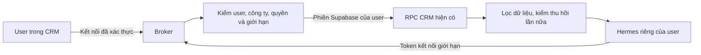

# P1 — Ranh giới xác thực và runtime Hermes

Ngày 12/10/2026. Đây là quyết định để hiện thực spike; chưa xác nhận P1 nghiệm thu. Trạng thái chạy thật ở [STATUS.md](STATUS.md), điều kiện đóng ở [PLAN.md](PLAN.md).

## Danh tính và quyền

Broker là dịch vụ server giữ phiên Supabase của chính user. Hermes nhận token kết nối opaque, không nhận mật khẩu, JWT, refresh token, service-role hay session Zalo. Database tiếp tục xét `auth.uid()` của user thật qua các RPC hiện có. Broker không tự mint JWT để giả actor.

Quyền dùng được = quyền CRM hiện tại ∩ trần tổ chức ∩ giới hạn connection ∩ phạm vi tài nguyên. Nhóm Đọc và Thao tác có allowlist riêng; năng lực mới không tự bật. Không sao chép role/override và không sửa quyền CRM khi tắt Hermes.

P1 giữ access token ngắn hạn ở bộ nhớ broker để kiểm chứng đường đi; không gọi đây là session lưu bền hoặc scheduler đã chạy. P2 phải tạo phiên độc lập của cùng user, giữ refresh token mã hóa, refresh một writer/CAS và có thu hồi. Không dùng chung refresh token của tab web: hai nơi làm mới cùng phiên có thể phá vòng đời đăng nhập. Luồng kết nối sản phẩm còn cần chốt sau spike transport; source hiện có đăng nhập mật khẩu nhưng chưa xác minh delegated OAuth phù hợp.

Token opaque chỉ dùng với broker, được lưu dạng hash, gắn connection/user/org/assistant/expiry. Thiết kế đích giữ `assistant_id` bền vững theo user–org; P1 in-memory mới giữ cùng ID khi reconnect trong cùng process. P2 phải kiểm lưu bền qua restart; rotation token không tạo hoặc nối memory tùy ý. Model không chọn user/org bằng arguments. Không expose “gọi RPC bất kỳ”. P1 bắt đầu với công cụ trả ngữ cảnh xác thực tối thiểu; đọc phòng thật qua gateway phải thêm projection và hạn mức ở P3.

## Công ty và thu hồi

- User thường phải có đúng một membership còn hiệu lực. Dữ liệu mâu thuẫn thì từ chối để xử lý, không chọn dòng đầu.
- Superadmin vẫn chọn công ty đích rõ ràng. Directory hiện có cho thấy công ty không đồng nghĩa được đọc tài nguyên: scope RPC còn yêu cầu membership hợp lệ. Broker giữ semantics CRM này.
- Mỗi lần gọi công cụ kiểm user, membership, trạng thái superadmin hiện tại và connection. Sau read kiểm lại trước khi trả dữ liệu cho model. Quyền bị giảm không chờ token hết hạn.
- Thu hồi phải chặn truy hồi và hủy context còn giữ dữ liệu cũ. Chặn tool mới nhưng tiếp tục phiên đã nạp memory cũ chưa đủ.
- Gửi/ghi về sau phải thêm kiểm ngay trước side effect; request đang in-flight lưu kết quả thực tế và đối soát. P1 không chứng nhận worker dispatch.

## Runtime ghim và cách ly

Nguồn kiểm: [Hermes v0.21.6](https://github.com/NousResearch/hermes-agent/releases/tag/v0.21.6), commit `818c13be1dc4fd28987e1e881a9408224afd4535`, giấy phép MIT. Image Linux amd64 `nousresearch/hermes-agent@sha256:32d095e84190ae7266afbb361579e6921f2c633e899f5eacfb88111b9c851a22` đã pull/run trong CI tại `005e0d26`. Digest khớp nhưng image thiếu revision label; chưa chứng minh image đúng source commit. AIAgent đạt 12 checks tổng hợp, chưa nghiệm thu toàn bộ ranh giới P1.

Mỗi assistant có runtime/home/credential riêng trên image dùng chung. Không mount home người vận hành, vault, Docker socket hoặc thư mục assistant khác. Dùng network riêng; chỉ broker và model gateway được duyệt có thể nhận lưu lượng. Một runtime owner giữ profile tại một thời điểm. Profile multiplexer/chia thư mục cùng process chưa được chấp nhận làm bằng chứng cách ly tenant.

Upstream có Streamable HTTP MCP, `tools.include` và bearer header. Những cơ chế này hỗ trợ transport/discovery; cổng quyền server vẫn phải chặn lời gọi trực tiếp. Native shell hook mặc định có thể fail-open; không dùng hook làm lớp quyền duy nhất. Tắt các builtins ngoài allowlist CRM; shell/browser/file/cron/messaging không tự được mở cho user.

Native memory được nạp đầu phiên; revoke/reset phải bỏ context đang giữ dữ liệu. Memory công việc dùng chung qua CRM ở P7, không mount profile user khác vào Hermes tổng. Kiểm A/B phải bao gồm file, memory, session, credentials, network và restart.

## Quota, test và rollout

Fixture P1 dùng model giả, dữ liệu giả, không tính đó là bằng chứng model provider/quota sản phẩm. Lát đầu cần giới hạn request bytes, timeout, tool calls/concurrency, audit không chứa secret và kill switch. Integration model phải dùng chung ngân sách CRM (proxy hiện có hoặc adapter reservation/finalization đã kiểm), chưa chọn hai ngân sách riêng.

Relay nội bộ P2 đã được viết để dùng lại `llm-proxy`, chưa nối HTTP route hoặc broker. Nó mặc định đóng model, giới hạn request/response, lọc phản hồi và không tự retry. Proxy hiện tại có reserve/finalize nhưng chưa chứng minh hard budget đồng thời hoặc exactly-once settlement; phải kiểm và hoàn thiện tại lớp dùng chung trước khi mở dữ liệu/model thật. Crypto/refresh cũng mới là primitive; chưa thay store RAM của P1.

Ba lớp bằng chứng tách riêng:

1. Unit/HTTP contract: token sai, expiry, org giả, quyền tắt/giảm, revoke khi read đang chạy, malformed input và lỗi không lộ secret.
2. Hermes thật trong runtime cách ly: MCP list/call, A/B data boundary, restart, revoke/context; model fixture không có dữ liệu thật.
3. TEST thật: JWT user A/B và superadmin, `auth.uid()`/RLS/RPC không cho service-role, hạ quyền/revoke/expiry; fixture có guard/lease/cleanup. Không dùng postgres superuser để kết luận quyền user.

Chỉ sau cả ba lớp và các điều kiện P1 mới mở dữ liệu thực theo canary. Rollback spike là tắt route/connection, dừng runtime mới, giữ audit và profile đúng retention; không đổi schema/business queue hiện có. Rollback sản phẩm, refresh session, model quota và context invalidation đa worker còn phải được kiểm riêng trước P1/P2 hoàn tất.
