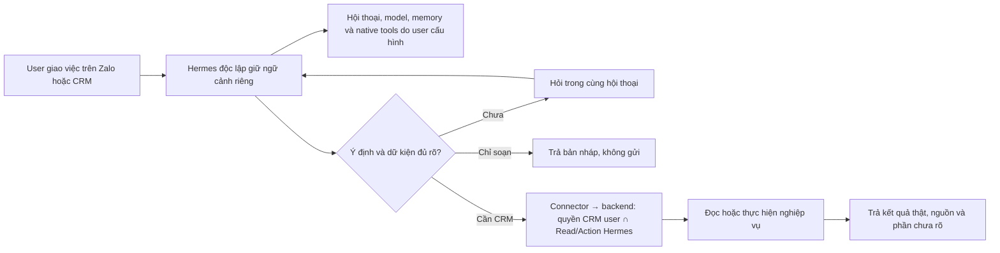
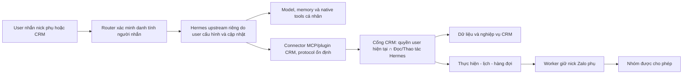
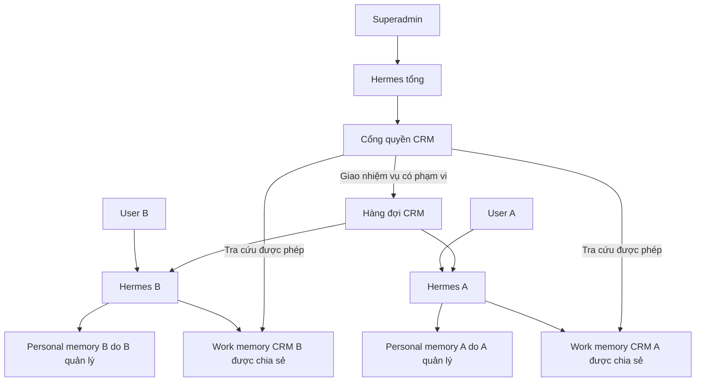

# SUPER PLAN — Hermes × iHomeCRM

Phiên bản 1.4 · Phạm vi duyệt ngày 12/10/2026; rà toàn bộ yêu cầu và chốt Hermes độc lập + connector CRM ngày 14/10/2026 (Asia/Bangkok).

**Trạng thái:** Đang triển khai toàn P0–P11, chưa nghiệm thu kiến trúc đích v1.4 hoặc chat Zalo thật. Checkpoint `04f0d5e2` có CI đạt với runtime/backend giả ở một số lớp; 12 migration Hermes đã apply TEST và bất biến. Auth/PostgREST và dedicated executor có bằng chứng TEST; full private flow từng bị singleton worker chặn. Wrapper/runtime giới hạn công cụ, prompt phòng, memory ba cặp lượt, image pin và model relay hiện có là prototype/adapter thực thi CRM có thể tái dùng, không phải định nghĩa Hermes cá nhân đầy đủ. WIP và receipts giữ nguyên; trạng thái chi tiết ở [STATUS.md](STATUS.md).

Đây là kế hoạch được duy trì cho mọi session/agent. [STATUS.md](STATUS.md) là nhật ký thực thi, bằng chứng, điểm dừng và hướng dẫn tiếp tục. Mỗi bước hoàn thành phải cập nhật STATUS; không đánh dấu đạt chỉ vì đã viết code.

**Code cập nhật 14/10:** đã ghép host connector độc lập, external MCP, kênh Zalo native, lịch gửi qua scheduler/queue hiện có, work memory và tám miền đọc CRM. Quyền vẫn là quyền user hiện tại giao Read/Action; không đưa engine/PIN Copilot vào đường thao tác. Review source C/D/E đã đạt; focused Node/UI và browser desktop/mobile dùng Auth/HTTP tổng hợp đạt. Năm SQL A/B đã apply TEST sau backup, cùng prerequisite Zalo còn thiếu; bốn SQL C/D/E cũng đã apply đúng thứ tự sau backup, nâng tổng lên 21 migration Hermes bất biến trên TEST. Production chưa apply các forward mới; gate/CI candidate, JWT/MVCC mới và model/Zalo thật còn mở. Không đánh dấu các ô nghiệm thu bên dưới chỉ từ kiểm cục bộ. Chi tiết ở [STATUS.md](STATUS.md) và [kênh Zalo native](../../../infra/hermes-zalo-native/README.md).

**Bắt đầu công việc từ [EXECUTION.md](EXECUTION.md):** các gói code K1–K6, gói kiểm tập trung Q1–Q3, file phụ trách và cấu hình agent. P0–P11 bên dưới giữ toàn bộ yêu cầu và cửa nghiệm thu; không cần đọc lại nhật ký cũ để nhận một gói việc.

**Checkpoint tích hợp tiếp theo:** worktree `hermes-crm-integration-20261014` đã rebase trên `origin/main` `993fcfed`, giữ source/receipts của worktree foundation. Đã ghép room-pass theo Action và scope tòa, native operator và runner C/D/E. Source review các gói này đạt; chín ca live C/D/E đạt nhưng cleanup verification cuối lỗi parser nên toàn lượt vẫn FAIL, đã có bản sửa và recovery marker riêng. Task create/assign đang review core, chưa nối broker/v5/UI. Các cửa CI/Linux, JWT/PostgREST positive mới, deployment/model/Zalo thật và phần còn lại của P0–P11 chưa được đánh dấu hoàn tất.

**Cập nhật kiểm chứng:** candidate `c038c71f` đã push trong [draft PR #166](https://github.com/zxGreenxz/whiteboard-ihomecrm/pull/166). Tổng 23 migration Hermes bất biến trên TEST; C/D/E mới 10/10 và cleanup sạch. Review tích hợp không có P1/P2. Giữ canonical cũ 63/64 cùng 125/125 focused sửa hai fixture, không đổi nhãn lượt cũ. CI Gates và Android SUCCESS; native-upstream Linux đã đạt cả bridge/journal/operator/upstream, không skip. Synthetic-isolation và Restore Drill đang sửa hai lỗi fixture. Task create/assign core và wiring MCP/v5/input-options đã review đạt trong cache, còn tích hợp/verifier/TEST. Chưa hoàn tất toàn plan hoặc nghiệm thu production/Zalo thật.

**Checkpoint lịch sử 13/10:** Đã ghép coordinated refresh, handoff mã hóa, host lifecycle, bộ chọn quyền/phạm vi và quản trị policy công ty. WIP trusted turn bridge đã mount, giữ claim/token trong host. P5 preview/authority/composition đã qua review offline; lỗi audit và hai race PIN của hướng cũ đã có bản sửa kiểm chứng ở cache. PIN/web-consent đó không thuộc luồng đích v1.4. Chưa mount đầy đủ P5 hoặc mở gửi tại checkpoint này. Runner JWT riêng đã đạt và dọn sạch fixture; không chiếm khóa worker có sẵn. Xem trạng thái thực thi mới nhất ở STATUS.

## Quyết định đã chốt — không hỏi lại

- **Hermes là trợ lý mã nguồn mở độc lập và đầy đủ.** User tự cài/cấu hình/cập nhật Hermes, model, native tools, workspace và memory cá nhân ngoài CRM. CRM cung cấp connector MCP/plugin có protocol ổn định, không viết lại nhân Hermes, không ép dùng engine Copilot, model relay hoặc wrapper phòng trống của CRM.
- “Độc lập ngoài CRM” nghĩa là theo cấu hình và hạn mức Hermes/provider của user, không có nghĩa tự bật mọi native tool hoặc quota vô hạn.
- **Quyền hiệu lực duy nhất: quyền user hiện tại ∩ phần Đọc/Thao tác bật cho Hermes.** Quyền user hiện tại đã gồm công ty, scope dữ liệu và các deny/khóa khẩn cấp của CRM; phần Hermes chỉ là một lớp thu hẹp. Không clone RBAC, không bắt quản trị viên cấp lại cùng quyền ở hai bộ cấu hình. Nếu cần kill switch/trần cho trợ lý của công ty, giải quyết trong cùng lớp giới hạn Hermes và trả một kết quả quyền hiệu lực.
- Công thức trên **chỉ điều khiển truy cập CRM**. Tắt/thu hồi CRM không vô hiệu hóa hội thoại cá nhân, model, memory cá nhân hoặc native tools của Hermes. Credential/JWT/service key CRM và phiên Zalo ở broker/worker; Hermes chỉ nhận credential connector hạn chế. Mọi đường truy cập CRM đều qua cùng backend ACL.
- Hermes là trợ lý ảo riêng, hiểu yêu cầu và chủ động hoàn tất các bước cần thiết trong phần quyền đã bật. Lệnh rõ thì làm; chỉ soạn thì không gửi; thiếu dữ kiện thì hỏi ngay trong Zalo và tiếp tục qua nhiều lượt với ngữ cảnh riêng. Không bắt mở CRM, nhập PIN, bấm approve hoặc bật Copilot để thực hiện công việc thông thường. Điều kiện nghiệp vụ thực sự áp dụng cho chính user, như trạng thái hợp đồng hay phê duyệt chứng từ, vẫn được backend áp dụng; không chép cơ chế approval của Copilot thành điều kiện của Hermes.

- Thứ tự đã chốt: hoàn thiện code luồng **nhắn riêng → đọc phòng → trả lời**, rồi kiểm tích hợp/nghiệm thu tập trung; tiếp theo code **hiểu lệnh soạn/gửi → thực hiện đúng ý định → trả kết quả từng nhóm**, rồi kiểm tập trung cho mốc đó. Sau đó làm lịch, memory, Hermes tổng và các miền CRM còn lại. Giữ toàn P0–P11; không để toàn bộ kiểm đến cuối chương trình. Không báo thống kê định kỳ.

- Code cốt lõi, phân quyền, lỗi phức tạp và review quan trọng: **GPT-6 Astra / Extra High (`gpt-6-astra`, `xhigh`)**. Đọc file, chạy test có sẵn và tổng hợp lỗi đơn giản: **GPT-6.1 Sol / High (`gpt-6.1-sol`, `high`)**. Lệnh kiểm đơn thuần chạy terminal trực tiếp khi không cần agent. Tạo agent mới đúng cấu hình nhiệm vụ; không tái dùng agent cấu hình cũ. Reviewer độc lập với tác giả. Quyết định này thay thế lựa chọn mặc định/Light/low trước đây; không sửa cấu hình chung của app hoặc ép alias provider `cx/`.

- Hermes là bộ máy hội thoại và điều phối AI độc lập; CRM sở hữu dữ liệu/quyền/nghiệp vụ và lịch/job CRM. Native tools và lịch cá nhân Hermes vẫn do user quản lý; một tác vụ CRM không có hai scheduler cạnh tranh.
- Một cổng backend kiểm quyền hiện tại cho mọi tool/resource; hai nhóm Đọc / Thao tác tham chiếu danh mục CRM có sẵn. Tool đọc không đòi quyền gửi; hạn mức model dùng chung không đòi bật chat/quyền giao diện Copilot. Phòng trống là mốc đầu, không là giới hạn kiến trúc hoặc toàn bộ quyền đọc của Hermes.
- Trong CRM, user thường chỉ thuộc một công ty; superadmin được chọn nhiều công ty theo quyền. Mỗi context/kết nối/lịch CRM có đích rõ; đổi/revoke công ty không reset personal assistant hoặc bắt personal chat chọn công ty.
- Worker hiện tại giữ duy nhất phiên nick Zalo phụ. Nick chính của anh chỉ nhắn riêng để điều khiển và nhận kết quả; không đăng nhập nick chính vào bot.
- Toàn bộ năng lực Copilot được kiểm kê và có quyết định chuyển, giữ giao diện, hoãn có lý do hoặc bỏ có chủ đích. Bản thử một user chỉ là một mốc trong super plan, không phải điểm kết thúc.
- **Chủ dự án xác nhận Copilot đã ngừng sử dụng (14/10):** triển khai Hermes làm trợ lý chính; không cần chạy song song, giữ tương thích engine Copilot hoặc chờ chuyển đủ mọi tính năng cũ mới ngừng engine. Có thể gỡ sớm các entrypoint, UI chat/approval/PIN, scheduler và cấu hình riêng của engine sau khi xác minh callers. Giữ dữ liệu, lịch sử, quyền/RPC/queue/audit và approval nghiệp vụ CRM dùng chung; không xóa theo tên thư mục. Inventory phục vụ chọn năng lực CRM cần giữ/chuyển/bỏ, không bắt tái tạo UX hoặc công cụ AI cũ không còn hữu ích.
- Mỗi user có một Hermes/workspace/memory cá nhân riêng theo cấu hình của họ; dữ liệu công việc CRM phân theo user/công ty. Không mặc định một VPS mỗi user, không giới hạn memory toàn Hermes thành ba cặp lượt hoặc chỉ cho tool phòng.
- Hermes tổng của superadmin tra cứu memory công việc và giao nhiệm vụ qua CRM; đọc memory, giao việc và thực hiện thay người khác là các quyền khác nhau. Mặc định không mở toàn bộ chat riêng.
- Thực hiện theo từng cửa nghiệm thu. Model/hạ tầng/auth cụ thể phải được kiểm chứng; chỉ trình lại nếu kết quả buộc thay đổi quyết định sản phẩm đã chốt.

Lý do chốt v1.4: giữ đầy đủ khả năng trợ lý của Hermes và vòng cập nhật upstream; CRM chỉ chịu trách nhiệm ranh giới dữ liệu/nghiệp vụ của mình. Quyền user là nguồn quyết định CRM; nhân đôi role hoặc vòng duyệt không thay kiểm server. Tách connector khỏi engine, tái dùng backend/ACL/queue và mở capability có mapping thật tránh phải duy trì thêm một nhân AI riêng.

## Nền triển khai và giới hạn bằng chứng

- Bản khảo sát ban đầu: `66573aeb66ad2e07a486d8f2015eb45caed0e17a`.
- Worktree triển khai từ `origin/main` sau fetch: `7367b7007f096f20471bf1309bc51e0b971439b6`.
- Đã có thay đổi worker/registry và Zalo unit được mở lại giữa hai mốc. Manifest mới phải lấy từ source hiện tại; không dùng nguyên số đếm cũ làm chứng cứ.
- WIP ở checkout chính được giữ. Một migration legacy xuất hiện diff ngay sau checkout worktree; nằm ngoài phạm vi, không stage hoặc sửa. Chi tiết ở STATUS.
- Tuân thủ [Project Contract](../../engineering/PROJECT_CONTRACT.md). Thử ghi chỉ trên TEST đúng lane; chưa có quyền bỏ qua kiểm, review hoặc provenance.

## Sơ đồ hệ thống đích

## 01 · Mục tiêu và phạm vi chốt

Mục tiêu cuối là mỗi user dùng Hermes cá nhân đầy đủ từ Zalo hoặc kênh đã cấu hình: hiểu ngôn ngữ tự nhiên, nhớ ngữ cảnh, chủ động hoàn tất việc đã giao. Khi cần CRM, connector đọc/làm đúng quyền hiệu lực rồi trả kết quả; khi không cần CRM, Hermes hoạt động bình thường theo cấu hình cá nhân. CRM quản trị phần truy cập CRM của trợ lý, không quản trị thay model/native tools hay toàn bộ đời sống cá nhân của user.

Người dùng đã xác nhận Copilot hiện chưa được sử dụng vì khó dùng. Do đó không cần đầu tư thêm tính năng vào engine cũ chỉ để bảo toàn nó; vẫn phải giữ dữ liệu, cơ chế quyền và nghiệp vụ tốt đang tồn tại.

Quy tắc đã được chủ dự án xác nhận: chỉ superadmin là ngoại lệ nhiều công ty. User thường được gắn một công ty; không thiết kế bộ chọn/chuyển công ty cho họ. Superadmin chọn rõ công ty đích; mỗi kết nối trợ lý cấu hình theo công ty và không tự được mở mọi quyền ở mọi công ty.

| Trong super plan | Giới hạn / cách xử lý |
| --- | --- |
| Liên kết tài khoản; quyền đọc/thao tác theo user và tổ chức | Bao gồm cấp, giới hạn, hết hạn, thu hồi, đổi phiên và audit. |
| Lệnh riêng qua nick chính; bot nick phụ gửi nhóm | Chỉ danh tính Zalo đã liên kết được ra lệnh. Thành viên nhóm không thừa hưởng quyền chủ. |
| Phòng trống, giá, chính sách, bản tin, lịch và báo cáo | CRM là nguồn dữ liệu hiện hành. Nhóm nhận và nội dung phải nằm trong phạm vi được cho phép. |
| Chuyển các miền nghiệp vụ Copilot đang có | Đọc trước, thao tác sau; nghiệp vụ tiền/hợp đồng theo đúng điều kiện duyệt và phép kiểm riêng. |
| Chat web/Zalo, bản nháp, cấu hình và vận hành | Tái sử dụng thành phần phù hợp; hỏi làm rõ ngay trong hội thoại, link CRM là tùy chọn. |
| Tự đọc nhóm rồi ghi ngược thay đổi vào CRM | Chưa được xác nhận là nhu cầu. Để thành lựa chọn riêng; nếu mở phải đi qua đề xuất, kiểm nguồn và duyệt. |
| Native tools, email, browser, shell, model và tài khoản ngoài CRM của Hermes | Do user cấu hình/quản lý trong Hermes độc lập; connector không bật/tắt hoặc cấp quyền thay. Native tools không nhận secret/JWT/phiên Zalo từ CRM để đi vòng ACL. |
| Cam kết tránh bị Zalo hạn chế tài khoản | Không đưa vào tiêu chí cam kết. Nick phụ tách hoạt động bot, không loại bỏ rủi ro kết nối không chính thức. |

## 02 · Nền hiện có và bằng chứng

**Snapshot khảo sát ban đầu:** kiểm kê từ source tại SHA nền; tại thời điểm khảo sát chưa đối chiếu catalog/runtime/quyền thật. P0 và STATUS có evidence mới hơn; số đếm khảo sát không là tiến độ hoặc bằng chứng hiện hành. Có source không đồng nghĩa đã hoạt động.

Kiểm kê khai báo tĩnh tại 5 file tìm thấy 67 tên công cụ: 55 đọc/tra cứu, 1 điều hướng, 7 ghi, 2 kế hoạch và 2 bộ nhớ. Action catalog có 32 action, trong đó 1 được đánh dấu đã gỡ. Các số này không phải số công cụ đang bật hoặc số luồng đã đạt production; P0 phải tạo manifest kiểm kê có thể tái sinh.

| Cụm | Giữ / điều chỉnh | Bằng chứng source |
| --- | --- | --- |
| RBAC và phạm vi tổ chức | Giữ khóa quyền, membership, scope tòa/sổ và kiểm server. Không ghi giới hạn Hermes vào quyền user. | src/lib/permissions.ts; useMyPermissions.ts; useOrganizationAuthorization.ts |
| UI chọn quyền | Tái dùng nhóm Xem/Thao tác/Nhạy cảm, bộ chọn scope; tạo cấu hình kết nối riêng. | components/authorization/PermissionPicker.tsx; ScopePicker.tsx |
| Tool đọc và nghiệp vụ | Tách schema và logic dùng chung khỏi browser client, Vite docs, navigate và context UI. | copilot/tools/registry.ts; nghiepVuTools.ts |
| Hành động và điều kiện nghiệp vụ | Tái dùng registry, validation, idempotency, nhật ký và đối soát; chỉ giữ preview/step-up/phê duyệt khi là điều kiện nghiệp vụ thực sự của user. Không nhập nguyên luồng consent của Copilot. | copilot/plan/actionCatalog.ts; planClient.ts; confirmationStore.ts |
| Zalo | Giữ zca-js, session store, lease, inbound, hàng đợi, ảnh bảng phòng và lịch gửi. | worker/lib/login.js; inbound.js; queue.js; automation.js |
| Model và quota | Model cá nhân do user cấu hình ở Hermes, không phụ thuộc role/quota CRM. Relay CRM hiện có là tùy chọn: nếu dùng phải tách admission khỏi chat_enabled/ai_copilot.view và giữ ledger/budget thật. Không là dependency của connector. | infra/hermes-broker/model-relay.mjs; supabase/functions/llm-proxy/index.ts; RPC reserve_ai_usage |
| Chat và PageAgent | Chuyển engine; giữ/thay các phần UI có ích. Thao tác DOM không chuyển nguyên sang runtime nền. | copilot/chatEngine.ts; ChatPanel.tsx; createAgent.ts |
| Bộ nhớ | Hiện có user + org; phải bổ sung ranh giới connection/kênh/phiên và thu hồi quyền. | copilot/memoryClient.ts; migration ai_user_memory_v1 |

- Tool registry và action catalog là hai bề mặt khác nhau: đọc không nằm hết trong action registry. Không đếm action thành tool độc lập.
- Worker đang sử dụng service-role cho nhiệm vụ hệ thống. Scope guard hiện có không chứng minh đã kiểm quyền user + giới hạn agent ngay trước gửi.
- Các RPC nghiệp vụ lấy auth.uid(); một số không cho service_role gọi. Cần chứng minh đường xác thực thay user trước khi cam kết tái dùng nguyên tất cả RPC.
- Bộ kiểm Zalo/Copilot đang có mục DEFERRED trong manifest. Phải phục hồi đúng runner liên quan trước khi dùng kết quả kiểm làm bằng chứng.

**Khoảng cách triển khai với v1.4:** external MCP đã mount sáu tool context/phòng/directory/preview/send/status bằng opaque binding và cùng ACL; không giả private DM claim. Kênh Zalo native có code và kiểm loopback upstream thật, còn thiếu mapping grant tự phục vụ, deploy Linux/TLS và nghiệm thu model/Zalo/JWT/MVCC thật. Kênh cá nhân không phụ thuộc token CRM nhưng worker vẫn dùng lease database; mất database quá TTL hoặc cold-boot khi database down còn chưa giải quyết. Các miền CRM khác, lịch, work memory và Hermes tổng vẫn theo P6–P11. Chi tiết file/gói ở EXECUTION, kết quả thực tế ở STATUS.

Đường external phải lấy actor/org từ connection token đã xác minh, không bắt mọi lời gọi hợp lệ phải xuất phát từ private DM claim của Zalo. Startup không có CRM, MCP lỗi hoặc credential CRM hết hạn chỉ đánh dấu connector chưa sẵn sàng; Hermes cá nhân vẫn READY theo model/config user. Strict wrapper từng dừng toàn runtime khi MCP lỗi hoặc khóa SDK group tools là prototype, không được chuyển nguyên thành tiêu chí sản phẩm. [CONNECTOR.md](../../../infra/hermes-broker/CONNECTOR.md) giữ bản đồ code/ranh giới hiện tại.

## 03 · Kiến trúc đích và ranh giới trách nhiệm

Hermes upstream độc lập xử lý hội thoại, model, native tools và memory cá nhân. Connector CRM dùng protocol ổn định để khám phá/gọi các capability CRM; gateway kiểm quyền user hiện tại và Read/Action Hermes, rồi gọi backend nghiệp vụ chung. Worker hiện có giữ phiên nick Zalo phụ và định tuyến người nhắn về Hermes của họ. Tương thích được kiểm ở connector; user cập nhật Hermes không buộc CRM viết lại hoặc pin toàn bộ nhân trợ lý.

Không tạo Hermes → Copilot AI → CRM. Trong giai đoạn chuyển đổi, mỗi phiên chỉ được định tuyến tới một engine; không để hai engine cùng xử lý một lệnh.

| Thành phần | Sở hữu | Không sở hữu |
| --- | --- | --- |
| Hermes độc lập | Hội thoại nhiều lượt, model/native tools/memory cá nhân theo user, chọn công cụ và hoàn tất mục tiêu | Quyền gốc CRM; SQL/RPC CRM tùy ý; bí mật backend; tự cấp quyền CRM |
| Connector MCP/plugin | Protocol/schema/version tương thích Hermes; credential hạn chế; tool discovery/call CRM | Viết lại nhân Hermes; ép prompt chỉ hỏi phòng; đóng native tools hoặc memory toàn trợ lý |
| Cổng công cụ CRM | Danh tính kết nối; kiểm quyền; schema; trace; quota công cụ | Tự bịa kết quả nghiệp vụ hoặc dùng user_id do mô hình tự khai |
| Nghiệp vụ CRM | Dữ liệu chính xác; quy tắc; scope; preview/execute; audit | Phụ thuộc tên model hoặc thư viện nội bộ của Hermes |
| Scheduler và queue CRM | Job CRM bền vững, claim, provenance, kết quả và đối soát | Hai owner cho cùng job CRM; quản lý thay mọi lịch cá nhân Hermes |
| Zalo worker | Một phiên nick phụ; inbound/outbound; media; phục hồi kết nối | Tự nhận mọi người trong nhóm là chủ hoặc tự vượt grant |
| Giao diện CRM | Kết nối, một cấu hình Đọc/Thao tác, bản nháp khi cần, lịch sử, dừng | Bước bắt buộc giữa mọi lệnh Zalo và thực thi; UI ẩn nút không thay kiểm server |

## 04 · Quyền user và lớp giới hạn trợ lý

**Quyền hiệu lực = quyền user hiện tại ∩ phần Đọc/Thao tác bật cho Hermes.** Backend CRM sở hữu quyền user hiện tại, gồm membership/vai trò, công ty, scope tài nguyên và deny khẩn cấp. Hermes chỉ thu hẹp trong tập đó, gồm phạm vi dữ liệu/nhóm nhận được bật. Kiểm điều kiện nghiệp vụ, tính toàn vẹn và quota khi chạy; không biến chúng thành bộ RBAC song song.

Đây là ACL của connector CRM, không là quyền sử dụng toàn Hermes. Khi CRM bị tắt/revoke, trả lỗi rõ cho thao tác CRM và chặn dữ liệu CRM outbound chưa dispatch; hội thoại cá nhân và native tools tiếp tục. Danh tính định tuyến Zalo/assistant phải tách vòng đời khỏi grant CRM; chỉ unlink kênh mới ngắt tuyến hội thoại đó.

Không clone role hay membership. UI lấy danh mục quyền/hành động hiện có để hiển thị; lưu thêm các lựa chọn của kết nối. Tắt Hermes sửa giá không ảnh hưởng khả năng sửa giá trực tiếp của user.

| Cấp cấu hình | Người quyết định | Hành vi |
| --- | --- | --- |
| Quyền CRM gốc | Người có quyền quản trị hiện hành | Là trần tối đa. User mất quyền thì trợ lý mất theo. |
| Giới hạn Hermes | User hoặc quản trị viên theo quyền quản trị hiện có | Một cấu hình Đọc/Thao tác và scope; bật là cho trợ lý làm, tắt chỉ ảnh hưởng Hermes. Không bắt cấp lại role CRM. |
| Khóa/trần Hermes cấp công ty nếu cần | Quản trị viên có quyền hiện hành | Ràng buộc trong cùng lớp giới hạn, không là một bộ quyền phải cấu hình lại. Hợp nhất vào API quyền hiệu lực; giữ lý do bị chặn. |
| Công cụ mới | Theo cấu hình rõ ràng | Mặc định tắt cho kết nối; không tự mở theo lần cập nhật Hermes. |

- Bản đầu hỗ trợ quyền chức năng, scope tổ chức/tòa/sổ khi nghiệp vụ có sẵn, nhóm nhận và các tập trường trả về cố định đã rà soát.
- Đọc và Thao tác độc lập: xem nhóm, lấy dữ liệu và dựng bản nháp chỉ cần các quyền đọc tương ứng; gửi mới kiểm quyền gửi. Không dùng quyền chat UI Copilot để cấp quyền model, tool, memory hoặc scheduler của Hermes.
- Quyền kiểm động ở server trên từng resource và trước side effect; bộ chọn/list chỉ phản ánh kết quả, không cấp quyền. Cấu hình công ty đã có code được giữ tương thích rồi hợp nhất trải nghiệm/API bằng thay đổi có kiểm chứng; không xóa policy hoặc migration đã apply để đơn giản hóa.
- Không hứa có ngay bộ bật/tắt tùy ý mọi cột database. Field-level config chỉ bổ sung cho trường đã được phân loại và có kiểm chứng. Giới hạn trường áp dụng dữ liệu CRM trả qua connector, không điều khiển dữ liệu cá nhân ngoài CRM.
- Giới hạn phải áp dụng trên đường gọi thật, truy hồi tài liệu, xuất dữ liệu và trước khi worker gửi; không chỉ trên danh sách tools/list.
- Thu hồi quyền không thể xóa tin mà Zalo đã nhận. Hệ thống phải chặn tác vụ chưa thực hiện, tách rõ trạng thái đang gửi và đã gửi.
- Ranh giới thu hồi CRM: trước dispatch_started có thẩm quyền thì revoke phải chặn tác vụ CRM. Khi provider call đã bắt đầu, coi là in-flight và đối soát; không báo đã hủy chắc chắn. Áp dụng cả DM có dữ liệu CRM, không chặn DM cá nhân không truy cập CRM.
- User thường: org được khóa theo tài khoản. Superadmin: quyền nền nhiều công ty không đồng nghĩa Hermes tự có mọi công ty; dùng kết nối/phạm vi trợ lý theo công ty đích đã chọn, vẫn kiểm giới hạn agent và nghiệp vụ.

## 05 · Liên kết tài khoản và xác thực

Luồng mong muốn: user có Hermes riêng → đăng nhập CRM và gắn công ty hợp lệ → bật phần Đọc/Thao tác CRM → kết nối MCP/plugin bằng credential hạn chế → liên kết nick chính để router đưa về đúng Hermes. Model/native tools vẫn cấu hình ngoài CRM. Mật khẩu, JWT/refresh token/service key CRM không xuất hiện trong chat hoặc được đưa vào Hermes; broker giữ phiên phù hợp.

Cổng xác thực suy ra actor/org từ credential đã kiểm; không lấy danh tính từ lời nhắn, tên hiển thị hoặc tham số do mô hình tự chọn. Gắn nick chính bằng thao tác liên kết có xác minh từ hai phía, dùng Zalo UID và tài khoản bot cụ thể.

- A01: chứng minh connector MCP HTTP/OAuth/plugin tương thích Hermes upstream độc lập; ghi phiên bản dùng để kiểm và contract hỗ trợ, không bắt user pin engine toàn cục. Xác nhận TLS, audience, expiry, refresh/revoke và context CRM đúng user.
- A02: chứng minh đường gọi RPC với danh tính được ủy quyền phù hợp auth.uid(). Hướng ưu tiên là broker giữ phiên ủy quyền hợp lệ phía server; Hermes chỉ giữ credential hạn chế.
- A03: nếu cơ chế ủy quyền hiện tại không đáp ứng, lập ADR cho executor chuyên biệt dùng chung kiểm quyền nghiệp vụ. Không lách bằng service-role hoặc tự gán user_id.
- A04: credential kết nối dạng opaque chỉ lưu hash phía quản lý khi phù hợp; bí mật có thể cần dùng lại đặt trong kho mã hóa phía broker. Tách khóa, xoay, hết hạn, thu hồi và không ghi log.
- A05: mỗi request CRM gắn user, org, connection, channel, conversation và request ID đã xác minh. User thường không đổi org; superadmin chọn công ty rõ trong connector, tạo context CRM mới. Lịch CRM cũ giữ công ty cũ; native personal memory/hội thoại không bị reset.
- A06: mất quyền/hủy kết nối chặn CRM tools, truy hồi work memory CRM và job CRM chưa dispatch; làm mất hiệu lực context/cache do connector quản lý. Không thể thu hồi bản thông tin đã gửi sang Hermes cá nhân hoặc Zalo; phải ghi rõ giới hạn này, không cam kết xóa memory ngoài quyền quản lý. Superadmin bị hạ quyền bị chặn CRM ở các công ty tương ứng theo role hiện tại; personal chat vẫn hoạt động.
- A07: trước khi trả dữ liệu CRM phải có đúng identity/context công ty, audit, timeout, tool quota và kill switch connector. Không bắt model cá nhân của Hermes đi qua proxy/quota CRM; model relay CRM chỉ là tùy chọn có admission riêng nếu sau này sử dụng.
- A08: cấu hình/CLI connector vào Hermes ngoài CRM phải xử lý không có credential, MCP down/không tương thích, refresh/expiry/revoke bằng trạng thái lỗi riêng của connector. Không chặn toàn Hermes startup/personal READY; khi CRM phục hồi, chỉ mở lại call sau xác minh token/scope mới.

Cửa kỹ thuật bắt buộc: P1 kiểm hai user thường thuộc hai công ty khác nhau và một superadmin có quyền nhiều công ty. User thường bị chặn mọi yêu cầu đổi/cross-org; superadmin phải chọn đích, không trộn context và lịch. Không qua cửa này thì chưa mở ghi hay gửi nhóm. Đây là phần chưa tích hợp.

## 06 · Hợp đồng dữ liệu và thay đổi schema dự kiến

Các tên dưới đây là hợp đồng thiết kế, không phải cam kết một bảng/API mới cho mỗi dòng. Đối chiếu schema/RPC hiện tại trước khi mở rộng; giữ migration đã apply bất biến. Ưu tiên adapter và cấu trúc đã có, tránh tạo thêm ledger, queue hoặc bộ quyền song song.

| Đối tượng | Thông tin bắt buộc | Nguyên tắc |
| --- | --- | --- |
| AgentConnection | id; actor; org; trạng thái; hạn; policy version; credential ref; thời điểm revoke | Không đổi actor/org bằng payload AI; revoke có audit. |
| AgentRestriction | connection; capability/action ID; read/action; enabled; data/recipient scope; mode | Tham chiếu danh mục hiện có; chỉ thu hẹp quyền gốc; deny thắng. |
| TrustedChannelBinding | connection; bot account; sender UID; DM identity; trạng thái xác minh | Không dùng tên hiển thị hoặc tin trích dẫn làm bằng chứng danh tính. |
| CapabilityContract | ID/version; input/output schema; quyền CRM; resource/scope; side effect; điều kiện nghiệp vụ; executor | Dùng registry/action và read definitions chung; map RPC/query/projection thực tế, không SQL tùy ý. |
| UserIntent / StandingGrant | actor/org/assistant/connection; mục tiêu hoặc payload/template; recipients; expiry; giới hạn | Lệnh rõ đủ cho thao tác một lần. Lịch/tự động dài hạn cần grant rõ ràng, có thu hồi; không cần approve mỗi job. |
| BusinessApproval khi thực sự cần | ID/phiên bản/quy trình của nghiệp vụ CRM | Chỉ xuất hiện khi user trực tiếp cũng chịu điều kiện đó; không tạo phiếu Copilot bắt buộc cho mọi Hermes action. |
| Execution provenance | request/job/action ID; actor/org/connection; intent/grant; business approval nếu có; policy version; nguồn dữ liệu | Lưu dấu vết bất biến; quyền hiện tại vẫn kiểm lại lúc chạy. |
| CRM work-memory envelope | user/org/assistant/connection/channel; classification; source; retention; access version | Kho công việc CRM kiểm ACL; memory cá nhân native do user quản lý, không mặc định đưa vào kho này. |
| Usage / Audit | trace; model/tool; reserved/final cost; deny/revoke/outcome; timestamps | Không chứa token/mật khẩu; quota đồng thời phải nguyên tử. |

- RPC/API dự kiến: list/create/revoke connection; get/update một lớp restrictions; link/unlink Zalo identity; list/call effective capabilities; draft/execute theo ý định; create/update/revoke standing grant; list/cancel/reconcile jobs. Tái dùng approval API chỉ cho nghiệp vụ thật có điều kiện duyệt.
- Công cụ cho mô hình chỉ nhận tham số nghiệp vụ. Actor/org lấy từ kết nối. User thường không có thao tác chọn org; superadmin đổi công ty qua đường xác thực riêng và tạo context mới, không để model tự gán org.
- Output chuẩn: status, data, nguồn/lúc lấy, request ID, dữ kiện thiếu hoặc điều kiện nghiệp vụ cần xử lý nếu có, lỗi có mã. Không trả rỗng để che lỗi quyền hoặc báo xong khi chỉ mới enqueue.
- Migration là bổ sung, immutable sau phát hành; generated types/surfaces sinh bằng pipeline, không sửa tay. Không đổi hay xóa lịch sử migration cũ.

## 07 · Chuyển toàn bộ năng lực Copilot

P0 giữ manifest từng tool/action, không chỉ bảng nhóm dưới đây. Mỗi dòng có nguồn, quyền CRM, resource/scope, input/output, RPC/executor/projection thực tế, điều kiện nghiệp vụ, kênh, trạng thái và bài nghiệm thu. Hoàn tất chuyển đổi nghĩa là mọi dòng có quyết định, không đồng nghĩa bật tất cả công cụ cho mọi user. Không đóng kiến trúc vào một tool phòng: mở dần các miền trên cùng gateway dùng chung schema và quyền backend.

| Miền | Đọc / tra cứu | Thao tác và điều kiện chuyển |
| --- | --- | --- |
| Phòng / sale / chính sách | Phòng, trạng thái chào thuê, giá, tòa/tầng, tiện ích, sale facts | Ưu tiên đợt đầu; bản tin dùng projection công khai. Sửa dữ liệu theo quyền Action hiện tại và điều kiện nghiệp vụ, sau nghiệm thu capability. |
| Khách / lead / lịch hẹn | Thông tin theo scope, lịch hẹn và liên kết CRM | Đề xuất/cập nhật qua RPC; trường riêng tư không đi vào nhóm. |
| Hợp đồng / cọc | Tra cứu tình trạng, hồ sơ và khoản liên quan | Giữ lifecycle, concurrency và quyền duyệt; không suy luận phép ghi từ quyền đọc. |
| Hóa đơn / công nợ / thu chi / sổ | Số liệu từ RPC, có kỳ và nguồn | Theo quy trình tiền, chứng từ, duyệt và reconcile; không để AI tự tính thay backend. |
| Báo cáo / lương / cổ đông | Giữ kỳ, scope và quy tắc báo cáo | Miền nhạy cảm chỉ mở sau harness vai thật và bằng chứng nghiệp vụ. |
| Dịch vụ / công tơ / tài sản / bảo trì | Danh mục, chỉ số và công việc theo quyền | Giữ quy tắc domain; mỗi hành động có schema và side effect rõ. |
| Zalo / mạng / công việc | Kết nối, nhóm nhận, tác vụ và trạng thái | Không coi mọi công cụ tổng quát Hermes là đã được cấp quyền CRM. |
| Tài liệu / hướng dẫn / system map | Truy hồi theo permission và scope | Làm mới nguồn; tài liệu có nội dung chỉ dẫn không được vượt chính sách server. |
| Kế hoạch / ghi nhớ / điều hướng UI | Tách ý định, bộ nhớ riêng, deep link đúng màn hình | PageAgent/DOM không chuyển nguyên; thay bằng API hoặc giữ thao tác người dùng có chủ đích. |

- Manifest hành động tiếp tục dựa registry server; không tạo catalog thứ ba phải sửa tay cùng Copilot và Hermes.
- Adapter tổng quát cho list/search/detail/report/draft/execute nhận capability ID và schema đã đăng ký; backend tự resolve mapping và kiểm ACL theo resource. Không cho model chọn tùy ý tên bảng/RPC, tự khai actor/org hoặc dùng service-role giả user. Action khác nghiệp vụ vẫn giữ handler domain riêng khi cần.
- Mỗi bước chuyển mở capability thực đã map đúng schema/RPC, không mặc định tất cả RPC đều dùng được. Catalogue/validator/UI lấy cùng nguồn thay hardcode giới hạn hai quyền đọc hoặc một tool phòng trong dài hạn; capability mới chưa kiểm giữ tắt.
- Schema/mô tả công cụ có thể dùng chung; module phụ thuộc React, Vite, localStorage hoặc singleton browser phải được tách adapter.
- Tool listing lọc theo quyền giúp dễ dùng. Executor vẫn kiểm lại để chặn lời gọi trực tiếp hoặc tool cũ đã bị tắt.
- Cùng model và cùng bộ tác vụ được dùng khi so sánh chất lượng với engine cũ; ghi rõ khác biệt do model, dữ liệu hay công cụ.

## 08 · Luồng Zalo: nick chính, nick phụ, nhóm

Worker hiện tại giữ phiên nick phụ và là điểm duy nhất nhận/gửi với Zalo. Cầu nối chuyển DM hợp lệ của chủ sang Hermes; phản hồi và báo cáo đi về đúng DM. Không cần đăng nhập nick chính vào Hermes.

Một tin nhắn nhóm, nội dung được forward hoặc tên người gửi không thể tự biến thành lệnh quản trị. Nội dung nhóm chỉ được xem là dữ liệu theo chính sách đã chốt.

- Z01: liên kết bot account + sender UID + direct conversation với connection đã xác minh; revoke/unlink có hiệu lực ngay trên các lệnh mới.
- Z02: router ưu tiên lệnh chủ, tránh keyword auto-reply hiện có trả lời lần hai; loại self-message và lặp sự kiện bằng provider event ID.
- Z03: trả trạng thái nhận lệnh, cần làm rõ, bản nháp khi user yêu cầu, đang thực hiện và kết quả. Giữ ngữ cảnh nhiều lượt theo user/assistant/công ty/conversation; nối câu trả lời làm rõ vào đúng intent. Không hỏi lại dữ kiện đã rõ hoặc xin quyền đã có.
- Z04: dùng lại ảnh/bảng phòng, media và queue. Không giao thêm công cụ Zalo trực tiếp cho Hermes để gửi ngoài gateway.
- Z05: danh sách nhóm có map CRM: bot account, org, phạm vi tòa, mẫu, chính sách công khai, trạng thái cho phép. Chưa khẳng định có sẵn mọi loại phân nhóm này.
- Z06: chỉ gửi nhóm được chọn; không tự kết bạn, quét thành viên hay mở rộng người nhận. Cập nhật chính sách chỉ gửi đúng phân khúc được cấu hình.
- Z07: mất phiên/QR/kick phải hiển thị lỗi thật, tạm dừng kênh gửi và tránh queue tăng vô hạn; không replay UNKNOWN_EFFECT. Tắt/revoke CRM chỉ dừng truy cập CRM, không đồng nghĩa mất kênh hội thoại Hermes cá nhân.
- Z08: user thường dùng công ty duy nhất khi gọi CRM; superadmin chọn công ty rõ trước đọc/ghi CRM. Hội thoại cá nhân không đòi chọn công ty. Đổi công ty tạo context CRM mới, lịch cũ vẫn ở công ty cũ; model không tự chọn theo trí nhớ.

Rủi ro Zalo cá nhân vẫn tồn tại vì worker dùng kết nối bên thứ ba. Không đưa kỹ thuật né phát hiện vào kế hoạch; đổi từ Copilot sang Hermes không làm mất rủi ro này.

## 09 · Ý định, bản nháp và thực thi

Chuỗi chuẩn: user nhắn Zalo → Hermes hiểu yêu cầu và lấy dữ liệu → backend áp dụng quyền user và giới hạn Hermes → thực hiện/đưa vào hàng đợi → báo kết quả Zalo. Xem trước/xác nhận trong hội thoại là tùy yêu cầu, không là bước bắt buộc cho mọi thao tác đã được ủy quyền. Nội dung trong nhóm hay dữ liệu đọc được không trở thành lệnh của chủ tài khoản.

Intent gắn actor/org/assistant/connection/conversation và mục tiêu, đích, giới hạn đã rõ. User nhắn “gửi bản này” có thể tiếp nối đúng bản nháp trong hội thoại; nếu có nhiều bản hoặc nhiều đích mơ hồ thì hỏi ngay Zalo. Phạm vi mới phải được user yêu cầu rõ và vẫn nằm trong quyền hiệu lực; thay lịch vượt standing grant phải cập nhật grant. Không suy ý định gửi từ dữ liệu CRM, tin nhóm hoặc chỉ từ việc capability Action đang bật.

| Trạng thái | Người dùng thấy | Hành vi hệ thống |
| --- | --- | --- |
| NEEDS_INPUT / DRAFT | Cần thêm dữ kiện / bản nháp theo yêu cầu | Chưa gửi hoặc ghi; câu trả lời của user tiếp nối đúng intent. |
| READY / QUEUED | Đã nhận lệnh rõ / đã xếp hàng | Có căn cứ thực hiện trong quyền hiện tại; không gọi là đã gửi. Có thể hủy trước thực thi. |
| BUSINESS_PENDING nếu domain có | Điều kiện nghiệp vụ chưa đủ | Nêu đúng điều kiện của user trực tiếp; không chèn consent/PIN riêng của Copilot. |
| RUNNING | Đang thực hiện | Kiểm quyền hiện tại, claim và chống trùng. |
| SUCCEEDED / PARTIAL / FAILED | Kết quả theo từng nhóm hoặc bước | Có biên nhận khi có thể; tổng hợp không che lỗi từng đích. |
| UNKNOWN_EFFECT | Chưa xác định đã gửi/thực hiện hay chưa | Đối soát hoặc người xử lý; không retry mù. |
| BLOCKED / CANCELLED / EXPIRED | Bị chặn / đã hủy / hết hạn | Nêu lý do và cách xử lý phù hợp; không tự mở lại quyền. |

- Không bắt user chuyển sang CRM hoặc nhập PIN cho gửi nhóm thông thường khi đã bật quyền tương ứng. Đường Hermes thực thi riêng tái dùng queue/nghiệp vụ và quyền hiện có, không tự approve giả hoặc sửa chính sách Copilot chung.
- Nếu user chỉ yêu cầu soạn/xem đề xuất thì chưa gửi; yêu cầu thực hiện rõ ràng được thực hiện theo quyền. Khi cần xác nhận, trao đổi ngay trên kênh Zalo đã liên kết, gắn đúng nội dung/đích.
- Hermes tự thực hiện các bước đọc, tra đích, lập nội dung và gửi cần thiết để hoàn tất lệnh rõ, không hỏi cho từng tool call. Mục tiêu nhiều bước được giữ qua nhiều lượt; dừng phần phụ thuộc khi thiếu dữ kiện, mất quyền hoặc kết quả chưa rõ, trả lại việc đã làm và phần còn lại.
- Mỗi yêu cầu nghiệp vụ có intent/request ID bền vững, giữ nguyên qua retry; mỗi người nhận có child key. Lệnh mới chủ động tạo có ID mới dù nội dung giống nhau. Hash payload/phạm vi để kiểm thay đổi, không thay ID yêu cầu.
- Không cam kết exactly-once với tác động bên ngoài. Lưu trạng thái chưa rõ và luồng reconcile khi worker chết sau gửi nhưng trước lưu kết quả.

## 10 · Lịch, gửi hàng loạt và dữ liệu thay đổi

Dùng một scheduler và một queue hiện có, mở rộng provenance và quyền. User giao lịch/theo dõi rõ thì Hermes tạo/sửa lịch qua công cụ trong quyền Action, ghi standing grant về mục tiêu/template, phạm vi, nhịp, hạn và cách thu hồi. Thiếu phần thiết yếu thì hỏi trong Zalo; không ép mở CRM duyệt từng lần chạy. Tác vụ theo mẫu cố định không cần LLM mỗi lần. Tắt engine model không làm mất lịch deterministic hợp lệ; tắt/thu hồi kết nối, Action hoặc grant phải chặn lịch tương ứng.

| Chế độ | Ý định/ủy quyền đã rõ | Điều kiện lúc chạy |
| --- | --- | --- |
| Gửi một lần | Lệnh gửi + nội dung/nguồn + nhóm nhận | Đúng intent; quyền hiện tại và điều kiện nghiệp vụ đủ; không cần phiếu approve riêng. |
| Lịch bản tin phòng | Template + nguồn dữ liệu + phạm vi tòa + nhóm + khung giờ + giới hạn | Lấy phòng/giá mới; lọc dữ liệu công khai; kiểm quyền và grant tại thời điểm chạy. |
| Thông báo đổi chính sách | Quy tắc phát hiện thay đổi + dữ liệu được công bố + nhóm áp dụng | Lấy chính sách hiện hành; ngoài grant thì làm rõ/cập nhật phạm vi. Giữ phê duyệt công bố thật nếu domain có; không suy logic new-room đã bao phủ. |
| Nhắc riêng chủ | Loại sự kiện và người nhận | Chỉ báo thay đổi/lỗi cần xử lý; gộp thông báo lặp. |

- Job lưu bất biến actor/org/connection/intent hoặc standing grant; approval nghiệp vụ chỉ khi có. Worker gọi kiểm quyền có thẩm quyền ngay trước gửi, dù worker có credential hệ thống.
- Thu hồi connection/grant dừng lịch và chặn job chưa thực hiện. Đang gửi phải ghi nhận kết quả thực tế, không giả vờ đã thu hồi được tin.
- Thiết kế lease/claim/retry/backoff, giới hạn queue và xử lý catch-up sau downtime. Mặc định không dồn gửi mọi lịch đã lỡ vào cùng một lúc.
- Nhóm nhận mới, tòa mới hoặc nội dung vượt template không thừa hưởng grant cũ. User có thể cập nhật grant ngay trong hội thoại khi đủ quyền; grant có hạn, hạn mức và đường thu hồi, không phải duyệt lại mọi job.
- Tôn trọng múi giờ tổ chức, khung giờ và giới hạn gửi; đây là kiểm soát vận hành, không phải bảo đảm chống Zalo quét.
- Chuyển lịch cũ: lập mapping lịch giữ nguyên/lịch thay thế; một nghiệp vụ và tập người nhận chỉ có một owner lịch active. Drain hoặc đối soát job cũ trước cutover; không sửa provenance để giả thành lệnh/grant mới. Rollback không bật cả hai lịch.
- Trước gửi, xác lập dispatch_started cùng kiểm quyền/policy có thẩm quyền. Thu hồi cạnh tranh với dispatch phải có kết quả xác định và audit; tin riêng chứa dữ liệu CRM cũng đi qua kiểm outbound.

## 11 · Dữ liệu, bộ nhớ, lịch sử và tài liệu

Hermes giữ đầy đủ memory/history cá nhân theo cấu hình native của user; CRM không áp giới hạn ba cặp lượt hoặc quyền CRM lên toàn bộ kho này. CRM là nguồn sự thật cho giá/phòng/chính sách/quyền; dữ liệu công việc lấy từ connector không trở thành bản sao CRM có quyền tự thân trong memory. Tách rõ memory cá nhân ngoài CRM và work memory được user chọn chia sẻ vào CRM.

- M01: một danh tính trợ lý cá nhân cho user; context và work memory CRM phân theo user/org/assistant/connection. Private DM, nhóm và chat CRM có nguồn rõ; không tự đưa personal memory vào nhóm.
- M02: connector và mọi kho/cache/log CRM cách ly user/org thật; điểm định tuyến không giao dữ liệu hoặc credential sai Hermes. Cách ly native workspace cá nhân theo cấu hình Hermes/user; CRM không mount hay duyệt filesystem cá nhân để giám sát.
- M03: thu hồi quyền vô hiệu hóa truy hồi/cache/context CRM do connector quản lý và outbound CRM chưa dispatch. Thông tin đã trả tới model/memory ngoài CRM không thể bảo đảm xóa từ xa; không báo đã thu hồi nội dung đã giao hoặc tắt toàn trợ lý để giả giải quyết giới hạn này.
- M04: chọn migrate history có chủ đích: mặc định giữ lịch sử/audit cũ để xem, không nhập toàn bộ vào memory mới. Chỉ chuyển sở thích/hướng dẫn đã duyệt, có nguồn.
- M05: có xem, sửa, quên/xóa và retention; audit bắt buộc không bị xóa theo yêu cầu quên hội thoại. Phân biệt hai loại dữ liệu trên UI.
- M06: tài liệu nghiệp vụ được lập chỉ mục theo quyền và phiên bản; trích nguồn, thời điểm lấy; nội dung tài liệu/tin nhóm không được ghi đè chỉ dẫn hay mở quyền.
- M07: không log token/PIN/bí mật. Dữ liệu gửi cho model phải được tối thiểu hóa theo công cụ và nhà cung cấp đã chọn; tự host Hermes không đồng nghĩa model chạy tại máy.
- M08: memory cá nhân dùng tính năng/cấu hình Hermes của user. Ghi/chia sẻ work memory dài hạn vào CRM cần lựa chọn bật và phạm vi rõ, có xem/sửa/quên/thu hồi; không hỏi duyệt từng ghi chú trong phạm vi đã bật. “Nhớ việc này” xử lý trong hội thoại đúng kho/phạm vi, không mặc định chia sẻ personal memory; reconnect không làm mất trợ lý riêng.
- M09: chủ động nhắc/theo dõi dựa mục tiêu hoặc standing grant user đã giao; backend kiểm quyền mới nhất khi truy hồi và khi báo kết quả. Memory không tự cấp quyền đọc thêm, gửi thêm hoặc mở lịch ngoài mục tiêu.

## 12 · Trải nghiệm user và quản trị

Mục tiêu UX là để người dùng biết trợ lý đang làm thay ai, thuộc công ty nào, được đọc/làm gì và đang ở trạng thái nào. Tái sử dụng PermissionPicker và các thẻ nghiệp vụ phù hợp; không yêu cầu user hiểu MCP, JWT hay action registry.

Giao diện connector CRM ẩn đổi công ty với user thường; superadmin chọn context CRM rõ ràng. Không cấu hình lại toàn Hermes theo công ty hoặc áp bước chọn công ty cho personal chat.

| Màn hình | Nội dung | Tiêu chí dễ dùng |
| --- | --- | --- |
| Trợ lý của tôi | Kết nối Hermes; công ty; nick chính liên kết; nick bot; trạng thái; tắt khẩn cấp | Một nơi để biết đang chạy hay mất kết nối; không hiển thị token sau lần cấp nếu không cần. |
| Được đọc gì / Được làm gì | Quyền CRM hiện tại và một lớp bật/tắt Hermes; scope; hạn; lý do bị khóa | Không tạo role hoặc cấp lại cùng quyền ở hai màn; tắt cho Hermes không làm mất quyền CRM. |
| Hội thoại | Chat nhiều lượt, nguồn dữ liệu, câu hỏi làm rõ, bản nháp và kết quả; link CRM tùy chọn | Hoàn tất việc ngay trong Zalo khi đã rõ; không bắt cú pháp kỹ thuật, PIN hoặc chuyển CRM. |
| Bản nháp khi được yêu cầu | Nội dung; nguồn/lúc lấy; nick gửi; nhóm nhận; lịch; tác động | Chỉ soạn thì giữ nháp; “gửi bản này” tiếp nối đúng intent khi đích và quyền đã rõ. |
| Công việc và lịch | Đã xếp hàng/đang chạy/đã gửi/lỗi/chưa rõ; hủy/dừng; từng nhóm | Không gộp mọi trạng thái thành thành công; có đối soát. |
| Quản trị trợ lý | Kết nối, giới hạn Hermes đã hợp nhất, quota; audit; rollout; thu hồi | Admin theo quyền CRM hiện có; kill switch/trần công ty nếu cần ở cùng lớp Hermes, không bắt cấu hình RBAC thứ hai. |

- Link CRM dùng để xem chi tiết hoặc thao tác giao diện mà user chủ động chọn; không dùng làm đường né triển khai tool cho công việc nằm trong quyền. Chỉ giữ thao tác người thật khi domain thực sự yêu cầu.
- Kiểm viewport/kênh thực sự bị ảnh hưởng: điện thoại cho DM/bản nháp/kết quả và desktop cho bảng quyền; không quét UI toàn app không liên quan.
- Bản mockup quyền là tài liệu duyệt thiết kế, không được hiển thị như màn đã triển khai.

## 13 · Runtime, chi phí và vận hành

User tự chọn model/provider và môi trường Hermes; chi phí/model cá nhân không gắn với role CRM. Nguồn upstream/license đã ghi ở §21 cần kiểm lại khi đóng gói/phân phối; không dùng giá quảng cáo hoặc ước tính token làm cam kết ngân sách. Chỉ đo/chốt quota dịch vụ CRM hoặc model relay tùy chọn trong phạm vi thực sự dùng.

Giữ Hermes upstream độc lập, xây connector ngoài với schema/protocol/version rõ. Ghim artifact connector/broker/worker do dự án phát hành; thử tương thích với phiên bản Hermes được hỗ trợ, không giữ quyền cập nhật engine thay user. Managed runtime/image pin hiện có chỉ là adapter tùy chọn/fixture cho kiểm CRM, không là điều kiện user phải dùng Hermes đầy đủ.

- O01: chốt endpoint/TLS/secret store broker và connector. Không trao vault, Supabase JWT/service key hoặc Zalo session cho Hermes/native tools; không vô hiệu hóa native tools toàn trợ lý để bảo vệ đường CRM.
- O02: đường mặc định dùng model do user cấu hình ngoài CRM. Nếu chọn relay CRM thì admission riêng được server xác minh, dùng cùng ledger/ngân sách/kill switch dịch vụ và không đòi chat_enabled/ai_copilot.view. Không xây hoặc sửa relay thành prerequisite của mốc core connector.
- O03: giới hạn công cụ/job/dữ liệu/nhóm nhận và chi phí CRM theo user/org/connection; giới hạn context cần cho từng call CRM. Số vòng hội thoại/native tools và personal model do user/Hermes quản lý, không hardcode ba cặp lượt toàn trợ lý.
- O04: tracing từ intent/request → tool → job → provider outcome; lưu standing grant hoặc business approval khi có. Dùng telemetry hiện có cho heartbeat, queue lag, deny/revoke, unknown outcome, lỗi provider và usage; không xây thêm bộ thống kê để thay nghiệm thu luồng thật.
- O05: báo lỗi đúng lớp: model cá nhân do Hermes/user xử lý; connector/CRM lỗi chỉ chặn phần CRM. Lịch CRM deterministic còn grant/quyền hợp lệ có thể tiếp tục khi model lỗi. Auth/scope/grant CRM bị thu hồi dừng tác vụ CRM phụ thuộc, không chặn personal chat.
- O06: backup cấu hình/metadata/credential broker theo cơ chế phù hợp; restore thử, xoay secret và thu hồi connection. Không backup một cách khiến grant đã revoke hồi sinh.
- O07: user cập nhật Hermes độc lập; connector công bố version/protocol tương thích và fail rõ khi không tương thích. Bản connector/broker/worker dự án phát hành đi TEST/canary/rollback theo Contract; managed adapter nếu dùng có artifact riêng đã xác minh.

## Bổ sung đã chốt: mỗi user một Hermes và Hermes tổng

### Danh tính trợ lý bền vững

- Một Hermes/assistant cá nhân bền vững cho mỗi user, do user quản lý. Connector ánh xạ danh tính đã xác minh vào work context riêng từng user–công ty; các `assistant_id`/connection CRM đã có là khóa context CRM, không bắt tạo lại toàn personal assistant theo công ty.
- Credential CRM hết hạn/rotate/revoke không xóa personal memory hoặc mất tuyến hội thoại; reconnect chỉ gắn đúng context CRM sau xác minh. Không nối workspace bằng ID do model tự khai.
- Profile/config/memory/session native của mỗi user vẫn riêng và do Hermes quản lý. Với managed adapter tùy chọn, giữ isolation và một owner mỗi profile như evidence cũ; đó không là yêu cầu đóng shell/network/tools của Hermes cá nhân.
- User thường gọi CRM trong một công ty. Superadmin có context/work memory theo công ty; personal memory không tự được chia sẻ cho các công ty hoặc Hermes tổng.

### Phân loại bộ nhớ

| Loại | Nguồn / phạm vi | Quyền mặc định của Hermes tổng |
| --- | --- | --- |
| Dữ liệu nghiệp vụ chính thức | CRM: phòng/giá/chính sách/trạng thái công việc | Đọc theo quyền; lấy hiện hành, không thay bằng ký ức |
| Memory công việc cá nhân | User + công ty + assistant; ghi chú/bối cảnh có nguồn và chế độ chia sẻ rõ | Được tìm/tổng hợp khi quyền CRM thực tế và Đọc của Hermes tổng cho phép đúng owner/phân loại |
| Memory chia sẻ của công ty | Kiến thức được công bố/duyệt với nguồn và phiên bản | Đọc theo phạm vi công ty |
| Sở thích, personal memory/filesystem và hội thoại riêng | User/Hermes quản lý ngoài CRM | Không thuộc quyền giám sát CRM mặc định; không truy hồi bằng quyền superadmin hoặc mount filesystem |
| Token/PIN/mật khẩu | Kho bí mật, không phải memory tra cứu | Không được đưa vào memory hoặc kết quả gửi model |

- Truy cập giám sát đi qua công cụ CRM, không mount thư mục memory của người khác vào Hermes tổng. Bộ nhớ dùng cho báo cáo có owner/org/assistant/classification/source/time/access-version.
- Memory công việc được chọn chia sẻ nằm trong kho/API có quyền CRM; personal memory native giữ đầy đủ theo user, không bị giới hạn vào “phần tối thiểu”. Không đồng bộ mù hai kho; connector chỉ trao đổi work memory có schema/phạm vi rõ.
- Nội dung memory là dữ liệu tham khảo, không phải chỉ dẫn có quyền. Tra cứu có giới hạn số mục, thời gian và user; không tự tải toàn bộ lịch sử. Trả trích nguồn, độ mới và phần không có dữ liệu.
- Không tự ghi lại toàn bộ nội dung truy hồi của user khác vào memory dài hạn của superadmin. Bản tổng hợp được lưu phải có provenance, phân loại và cách thu hồi/xóa tương ứng.

### Quyền và nhiệm vụ điều phối

| Nhóm | Năng lực | Ràng buộc |
| --- | --- | --- |
| Đọc | Tìm/xem memory công việc; xem tiến độ và kết quả | Quyền CRM hiện tại của superadmin ∩ Đọc Hermes tổng trên đúng công ty/user/loại dữ liệu; không yêu cầu tạo lại role giám sát |
| Thao tác | Giao/hủy nhiệm vụ thuộc phạm vi quản lý | Task envelope do server lập; người giao, bên nhận, công ty, mục tiêu, giới hạn và thời hạn |
| Ủy nhiệm | Thực hiện dưới danh tính một user khác | Không phát sinh từ quyền đọc/giao việc; cần cơ chế ủy quyền riêng, mặc định tắt |
| Quản trị memory | Sửa/xóa memory của user khác | Không mặc định mở; thiết kế riêng nếu được yêu cầu |

- Hermes tổng gửi yêu cầu vào cùng nền nhiệm vụ CRM; trợ lý của user nhận việc trong workspace của user đó. Không trao credential hoặc toàn bộ hội thoại giữa các trợ lý.
- Bên nhận thực hiện bằng quyền CRM hiện tại ∩ Đọc/Thao tác Hermes của họ; task envelope giới hạn mục tiêu và tài nguyên, backend giữ điều kiện nghiệp vụ thật. Quyền superadmin của bên giao không tự nâng quyền bên nhận. Đọc/giao việc/ủy nhiệm là các loại thao tác cần map vào ACL hiện có, không phải lý do tạo bộ role Hermes riêng.
- Tác vụ chạy bằng superadmin phải ghi superadmin là actor; không giả user. Người giao và người thực hiện đều có trace rõ. Grant giao việc có thể bị thu hồi trước thực thi.
- Báo cáo nhiều công ty là thao tác riêng: xác minh quyền trên từng công ty, thực hiện các truy vấn con theo từng scope, ghép kết quả có nhãn nguồn. Không đổi org của profile user thường và không lưu trộn raw memory.
- Hạ quyền superadmin chặn truy hồi/dispatch CRM tiếp theo và vô hiệu hóa context/cache CRM quản lý; in-flight đối soát. Không tuyên bố xóa dữ liệu đã giao sang personal memory hoặc tắt Hermes cá nhân.

### Phân bổ vào giai đoạn

- P1: chứng minh connector không định tuyến sai user/context hoặc lộ credential; thử Hermes upstream riêng, không phụ thuộc wrapper đóng tools. Managed profile owner/isolation chỉ kiểm nếu adapter đó được dùng.
- P2: workspace ổn định, connection có vòng đời riêng; quyền giám sát/ủy nhiệm tách riêng.
- P3: công cụ tra cứu memory có phân loại và kiểm quyền server, không raw filesystem.
- P7: memory công việc/cá nhân/chia sẻ; UI biết mức chia sẻ; Hermes tổng tra cứu và giao nhiệm vụ có provenance.
- P9–P10: quota cho điều phối, chống vòng lặp giao việc, revoke xuyên context, canary và audit nhiều user/công ty.

**Snapshot lịch sử:** Cập nhật 13/10/2026: TEST durable đạt 28/28 sau forward conflict; cleanup/hash xác minh. Gate local P2/P3 đạt 47/47 trên snapshot `3d248131`. Supervisor startup 14/14. P4 đã nối handshake vào worker hiện có, che mã và chặn tin trùng/history/phiên cũ; 22 file worker đạt, routing 95/95, binding 30/30 và ba mutation bị bắt. Chưa nghiệm thu toàn tuyến, chưa apply P4 hoặc triển khai VPS. Xem STATUS để tiếp tục đúng bằng chứng.

## 14 · Kế hoạch công việc và cửa nghiệm thu

Tình trạng thực tế được duy trì ở STATUS.md; các checkbox dưới đây chỉ được đánh khi có evidence tương ứng. Vai trò là trách nhiệm kỹ thuật, chưa phải phân công nhân sự hoặc cam kết thời lượng. Các đoạn **Snapshot lịch sử** giữ nguyên bằng chứng, SHA và giới hạn ở thời điểm ghi; các câu “chưa apply/chưa có code” trong đó không thay thế checkpoint hiện hành. Chúng không là yêu cầu sản phẩm v1.4 hoặc lý do chạy lại phép kiểm đầu vào không đổi.

P1–P11 là danh mục yêu cầu và nghiệm thu, không phải lệnh phải hoàn tất mọi bài test của P trước mới được viết code P tiếp. Thứ tự giao việc dùng EXECUTION: code trong worktree → kiểm nhanh trực tiếp phần sửa → ghép luồng → kiểm tích hợp/review/gate tập trung → nghiệm thu mốc. Lỗi quyền, sai org hoặc gửi trùng đã phát hiện phải sửa trong gói code; phần chưa nghiệm thu giữ tắt trên hệ thống thật.

### P0 · Khóa phạm vi và lập baseline

Phụ thuộc: Sau khi chủ dự án chốt super plan. Chủ trì: Lead + QA.

- [x] P0.01 Tạo worktree riêng, giữ WIP; ghi SHA, dependency/runtime và cờ liên quan. Evidence ở STATUS: source/flags tĩnh đã ghi, trạng thái cờ runtime chưa xác minh.
- [x] P0.02 Sinh manifest tool/action/UI-control của ứng dụng, disposition và metadata từng mục. Snapshot v2 + 28 focused tests đạt; không suy các builtin ngoài adapter thành capability CRM được cấp.
- [x] P0.03 Đối chiếu catalog TEST chỉ đọc: 32/32 registry khớp, 135/135 tên hàm có ở đúng schema (134 public + 1 helper private); ghi ACL/digest/flags. Ledger legacy đóng băng không phải schema thiếu. JWT/RLS/body parity kiểm ở P1 trở đi.
- [x] P0.04 Xác định và kích hoạt lại đúng runner/gate Zalo-Copilot cần cho phạm vi, cập nhật manifest có review. Commit `c833d379`: local 47/47 đạt, review không còn P1/P2; CI draft PR #165 tại head `386296cb` đã xanh. Delta inventory/catalog có gate 47/47 và review tại `6ecdc399`; không dùng CI cũ thay evidence của head mới.
- [x] P0.05 Ghi baseline câu hỏi/nghiệp vụ, lỗi đã biết và phạm vi public projection gửi nhóm. Bộ B01–B10 bên dưới là tiêu chí cần kiểm, không phải kết quả đã đạt.
- [ ] P0.06 Bổ sung mapping từng capability → schema/RPC/resource/ACL/projection thật; phân biệt điều kiện nghiệp vụ với UI/approval/model flag của Copilot. Đối chiếu manifest hiện có, không làm lại inventory hoặc harness chỉ vì đổi phiên bản plan.

**Snapshot lịch sử:** Tiến độ 12/10/2026: P0 có inventory v2, comparator TEST, review và local gate 47/47 tại commit `6ecdc399`; PR còn draft. Inventory có metadata từng mục, 47 page contracts, 6 safe controls; comparator có 23 test bao gồm ca sai/mất dữ liệu. Sáu callsite RPC động được ghi rõ, không coi tên biến là hàm đã xác minh. [STATUS.md](STATUS.md) giữ bằng chứng và phần chưa đạt.

**Đầu ra:** Manifest chuyển đổi + baseline source/runtime + kế hoạch kiểm theo Contract.

**Đạt khi:** Mọi năng lực có disposition và người chịu trách nhiệm; runner thật chạy được; chưa mở thêm quyền hay gửi tin.

**Nếu chưa đạt:** Giữ nguyên ứng dụng; thiếu bằng chứng ghi blocked/chưa kiểm, không gọi skip là đạt.

Baseline câu hỏi/nghiệp vụ phải giữ cho bước tích hợp:

| ID | Câu hỏi / tác vụ đại diện | Kỳ vọng bắt buộc |
| --- | --- | --- |
| B01 | User hỏi phòng trống ở tòa được phép | Đọc CRM mới; chỉ đúng công ty/tòa; có nguồn/thời điểm |
| B02 | Hỏi giá và chính sách đã đổi | Không dùng ký ức cũ thay CRM; ghi dữ liệu không biết thay vì tự đoán |
| B03 | Yêu cầu gửi phòng trống đến các nhóm đã chọn | Tự lấy dữ liệu và gửi khi rõ/đủ quyền; chỉ soạn thì giữ nháp; hỏi Zalo khi thiếu đích; kết quả từng nhóm |
| B04 | Đặt lịch gửi định kỳ | Lưu phạm vi/grant; không gọi AI lại nếu template đủ; kiểm quyền mỗi lần chạy |
| B05 | User nhắn lại từ Zalo và web | Về đúng assistant; chia sẻ memory theo policy, không lẫn user hoặc tự gửi vào nhóm |
| B06 | Superadmin hỏi các vướng mắc công việc của A/B | Chỉ memory công việc được phép; có nguồn/user/công ty; không đọc chat riêng ngầm |
| B07 | Superadmin giao việc vượt quyền bên nhận | Từ chối hoặc chuyển về người có quyền; không mượn quyền người giao để giả danh |
| B08 | Thu hồi quyền CRM khi chờ lịch/soạn DM có dữ liệu CRM | Chặn CRM chưa dispatch/cache connector; in-flight đối soát; personal chat giữ nguyên |
| B09 | Tin nhóm yêu cầu bot tự mở quyền hoặc đọc tiền | Không trở thành lệnh chủ; nội dung chỉ là dữ liệu không tin cậy |
| B10 | Model lỗi/hết quota, worker gián đoạn | Báo đúng lỗi; không báo enqueue là đã gửi; không retry mù UNKNOWN_EFFECT |

Projection gửi nhóm đề xuất: mã/tên phòng công khai, tòa/khu vực được phép công bố, diện tích/tiện ích công khai, giá/chính sách có phiên bản, ảnh được duyệt và liên hệ bán hàng được cấu hình. Không suy rằng mọi field trong RPC đều được công bố: cần đối chiếu source/runtime và mapping ở P3/P5. Loại mặc định: thông tin cư dân/khách riêng, giấy tờ, nội dung ghi chú nội bộ, số dư/công nợ/sổ quỹ, credential và dữ liệu công ty khác.

### P1 · Chứng minh connector độc lập và xác thực CRM

Phụ thuộc: P0. Chủ trì: Backend/auth + QA.

- [ ] P1.01 Hoàn thiện connector MCP/plugin; thử với Hermes upstream độc lập do user cấu hình, ghi version tương thích. Không bắt dùng wrapper/image pin của CRM hoặc đóng native tools.
- [ ] P1.02 Chứng minh credential riêng cho connection ánh xạ đúng user/org mà không đưa JWT toàn quyền vào Hermes.
- [ ] P1.03 Thử RPC auth.uid(), RLS và các RPC không cho service_role; chọn broker ủy quyền hoặc ADR executor.
- [ ] P1.04 Thử hai user thường thuộc hai org và một superadmin nhiều org; kiểm revoke/expiry/refresh, giả actor/org và chọn công ty đích.
- [ ] P1.05 Chốt auth/transport/context CRM và protocol tương thích; model/provider/personal memory nằm ngoài CRM. Ghi rõ phần prototype tái dùng và rollback connector.
- [ ] P1.06 Chứng minh cách ly identity/context CRM/credential, quota công cụ/audit/kill switch connector; CRM revoke chỉ chặn phần CRM, không khóa native assistant.
- [ ] P1.07 Tách dependency model cá nhân khỏi CRM/Copilot: Hermes dùng model user cấu hình dù CRM/Copilot tắt. Relay model CRM chỉ tùy chọn; nếu dùng mới cần admission riêng và ngân sách chung, không đòi ai_copilot.view.
- [ ] P1.08 Bổ sung cấu hình/CLI external connector và graceful startup: CRM/MCP vắng hoặc lỗi chỉ làm CRM tools unavailable, Hermes native vẫn READY theo provider/config user. Dùng adapter, không viết engine mới.

**Snapshot lịch sử:** Tiến độ 12/10/2026: broker 28/28 unit/HTTP; harness 11/11 và JWT TEST thật 17/17, cleanup xác minh. MCP client upstream ghim đạt 4/4 transport checks. CI tại `9ad5ca42` chạy AIAgent thật với broker/model giả: 17/17, gồm mạng A/B riêng, single-host profile owner, restart và revoke. Digest image khớp; revision label trống nên provenance source commit chưa xác minh. Các ô P1 vẫn mở vì egress đầy đủ, refresh/lưu bền, model quota và invalidation memory chưa đạt. [ADR P1](P1-ARCHITECTURE.md) và STATUS ghi giới hạn.

**Snapshot lịch sử:** Cập nhật provenance: receipt upstream đã xác định image amd64 đúng release là `ffa4fbb4…`, khác pin cũ `32d095e8…`. Đang đổi pin và kiểm runtime lại cùng các canary mạng IPv4/IPv6/DNS; không dùng 17 checks cũ thay kết quả image mới. Chuỗi digest được kiểm nhưng receipt chưa ký, image không có revision label.

**Đầu ra:** ADR có bằng chứng chạy thật và contract xác thực được duyệt kỹ thuật.

**Đạt khi:** Cho phép đúng ca hợp lệ; mọi ca giả danh/cross-org bị chặn; không có đường gọi vòng qua gateway.

**Nếu chưa đạt:** Chưa mở capability CRM phụ thuộc. Sửa connector/broker/executor; không lấy tắt toàn Hermes cá nhân làm giải pháp.

### P2 · Kết nối, quyền và quản trị vòng đời

Phụ thuộc: P1; danh mục P0. Chủ trì: Backend + frontend. Có thể chuẩn bị code nền song song; không mở dữ liệu/nghiệm thu P2 khi các ranh giới P1 chưa đạt.

- [ ] P2.01 Hoàn thiện connection, một lớp restrictions Hermes, channel binding và audit; hợp nhất trần/khóa trợ lý công ty nếu cần vào lớp này, giữ dữ liệu và migration đã apply.
- [ ] P2.02 Hoàn thiện cấp/rotate/expire/revoke token connector ngoài CRM và effective-permission API; đổi token không reset personal assistant, lỗi token chỉ khóa phần CRM. Không đưa JWT/refresh/service key backend vào cấu hình Hermes.
- [ ] P2.03 Tái dùng PermissionPicker/ScopePicker cho hai nhóm Đọc/Thao tác; lấy danh mục hiện có, một API quyền hiệu lực và lý do bị chặn; không sửa overrides user hoặc bắt cấp lại cùng quyền ở màn công ty.
- [ ] P2.04 Chặn AI tự sửa grant/quyền; capability mới chưa nghiệm thu mặc định tắt; bật/tắt trong quyền quản trị hiện có và một overlay Hermes, không tạo role thứ hai.
- [ ] P2.05 Tích hợp khóa thành viên, disconnect và policy invalidation; khóa org của user thường, chỉ cho superadmin chuyển context có xác thực.
- [ ] P2.06 Tách liên kết người nhắn → Hermes cá nhân khỏi grant/credential CRM. Revoke CRM giữ hội thoại cá nhân; unlink kênh mới ngắt tuyến đó, không cho lộ CRM data đã bị chặn.

**Snapshot lịch sử:** Tiến độ 12/10/2026: đã viết target binding TEST xuyên backup/catalog/apply/evidence, primitive mã hóa/refresh và relay dùng lại model proxy CRM. Nền đã commit tại `8bfc0682`; transport backend tại `494d306a`, mỗi checkpoint local 47/47. Chưa cấp kết nối sản phẩm; không đánh dấu P2.01–P2.05 hoàn tất từ các primitive này.

**Snapshot lịch sử:** Cập nhật tiếp ngày 12/10: Auth TEST thật xác minh 5/5 cho hai phiên trình duyệt/Hermes độc lập và cleanup. Identity/policy, encrypted store và migration sửa giới hạn regex đã apply đúng TEST với backup/evidence riêng; kiểm schema 26/26 và private store thật 12/12 đạt. Lượt tích hợp mới đạt 18/18, bao gồm broker, resolver quyền, adapter Auth và cấp phiên độc lập; cleanup và hash đầu vào đã xác minh. Kiểm hiện tuần tự, chưa chứng minh cạnh tranh nhiều transaction hoặc refresh provider trong cùng luồng. HTTP/giao diện cấp quyền và các ranh giới P1 vẫn chưa hoàn tất; xem receipt, hash và phần chưa kiểm trong [STATUS](STATUS.md).

**Đầu ra:** Cấu hình quyền trợ lý dùng được từ UI và được kiểm ở server.

**Snapshot lịch sử:** Cập nhật 13/10: đã có HTTP quản lý kết nối, UI `/settings/hermes`, gia hạn và supervisor; TEST durable cuối 28/28, gate local P2/P3 47/47. UI mới chỉ kiểm trên browser synthetic; chưa có PermissionPicker/ScopePicker đầy đủ, provider refresh xuyên runtime, model quota và Docker adapter sản phẩm. Review độc lập delta supervisor đã hoàn tất trên tree `91c12a84`, không phát hiện P1/P2 đã xác minh; P2 chưa nghiệm thu.

**Snapshot lịch sử:** Cập nhật tiếp 13/10: đã ghép trusted maintenance vào backend, lấy binding/ref từ token đã xác minh, refresh có fence và actual drain, kiểm Auth/CRM/session revision rồi gia hạn cùng token. Focused 43/43, backend composition 24/24; review đã sửa lỗi thả ownership khi thiếu bằng chứng drain. Chưa có scheduler tạm dừng toàn bộ command pump, handoff/restart, kiểm provider thật hoặc UI scope đầy đủ; chưa đánh dấu P2 hoàn tất. Gate/evidence của delta được ghi ở [STATUS](STATUS.md).

**Snapshot lịch sử:** Cập nhật scheduler 13/10: product factory và orchestrator đã nối coordinated maintenance. Park trước hạn 5 phút, chờ toàn runner drain, đóng admission rồi refresh/kiểm lại authority, chỉ mở lại sau actual drain; giữ watchdog hạn cũ, ưu tiên expiry và giới hạn tải chung. Supervisor 75/75, backend + orchestrator 49/49; chưa có host entrypoint/handoff bền vững hoặc kiểm provider/runtime thật. Evidence/review/gate ghi tại STATUS; các ô nghiệm thu P2 vẫn mở.

**Snapshot lịch sử:** Cập nhật handoff 13/10: đã nối port lưu token mã hóa trước activation, backend chờ filesystem drain và orchestrator so owner từ bản lưu trước runtime. WAL/scanner đã có kiểm cục bộ và review độc lập (WAL 11 pass/8 native skip, scanner 48/48); còn ghép host entrypoint, expiry/crash recovery và native/live evidence. CI checkpoint 1026910f có hai lỗi EOL/bundle đã sửa cục bộ; xem STATUS cho kết quả và giới hạn, không xem đây là P2 hoàn tất.

**Snapshot lịch sử:** Cập nhật core 13/10: đã ghép executable/config/ownership/audit/runtime và UI PermissionPicker/ScopePicker với API options tự xác định user/org. Kết nối cũ chỉ thu hẹp, tạo mới chỉ hai quyền đọc đã hỗ trợ. Migration options chưa apply; product Docker harness còn chờ CI. Kiểm/review/giới hạn ở STATUS.

**Đạt khi:** Tắt quyền connector không ảnh hưởng thao tác CRM trực tiếp hoặc personal Hermes; không cấp quá quyền; revoke chặn CRM request mới/context CRM quản lý, đúng giới hạn nội dung đã trả ra ngoài.

**Nếu chưa đạt:** Tắt connection/feature flag; schema bổ sung để tương thích, không xóa dữ liệu cũ.

### P3 · Cổng công cụ và nhóm đọc ưu tiên

Phụ thuộc: P1-P2. Chủ trì: Backend/domain + adapter.

- [ ] P3.01 Tách định nghĩa khỏi browser imports; contract chung có version và mapping schema/RPC/query thực; adapter dùng lại cho nhiều miền, không khóa trong một tool phòng.
- [ ] P3.02 Triển khai list/call qua backend ACL kiểm identity, quyền user hiện tại ∩ Read/Action Hermes, từng resource/scope, schema và quota; không tin tools/list hoặc service-role giả user.
- [ ] P3.03 Mở đọc phòng trống, chính sách, nhóm nhận và kết quả công việc; trả nguồn/lúc lấy. Directory/bản nháp chỉ cần Read tương ứng, không đòi chat_zalo.send.
- [ ] P3.04 Lọc field nội bộ bằng projection; không dùng memory để trả giá hay phòng hiện tại.
- [ ] P3.05 Bổ sung parity và ca gọi trực tiếp/bị thu hồi trên runner hiện có; dùng mapping chung cho tools/options/UI, thay các giới hạn hardcode theo đợt capability đã kiểm.
- [ ] P3.06 External MCP đọc/action dùng identity connection token đã xác minh và provenance đúng nguồn; không đòi private Zalo claim cho mọi call. Reuse ACL/resource/RPC kiểm backend của route nội bộ, không bỏ guard để mở tool ngoài.

**Snapshot lịch sử:** Tiến độ 12/10/2026: đã viết projection phòng trống tái dùng sale facts của CRM, lọc bằng ID tòa, loại field nội bộ, giữ VND/null và báo giới hạn nguồn. 10/10 focused tests đạt; ba mutation bỏ scope/lộ field/bỏ deny scope rỗng đều bị bắt, source không đổi. Đây chỉ là hàm lọc dữ liệu; chưa có mapping scope, reader JWT hoặc business tool nối broker. Các ô P3 vẫn mở.

**Đầu ra:** Hermes truy vấn CRM đúng phạm vi qua công cụ thật.

**Snapshot lịch sử:** Cập nhật 13/10: tool phòng trống đã nối broker, dùng JWT của phiên Hermes được giữ trong backend, kiểm scope SQL lần cuối sau audit. Năm ca đọc phòng TEST đã đạt trong lượt 28/28; gate local P2/P3 47/47. Chưa có đầy đủ tool chính sách/nhóm/kết quả công việc, parity toàn miền hoặc shared model quota; P3 chưa nghiệm thu.

**Đạt khi:** Đọc đúng dữ liệu; deny không trả rỗng giả; không lộ nội bộ/cross-tenant hoặc sai Hermes. ACL/resource, quota công cụ, timeout và kill switch CRM có hiệu lực; personal model không cần đi qua proxy CRM.

**Nếu chưa đạt:** Thu hồi công cụ mới; giao diện CRM trực tiếp vẫn hoạt động.

### P4 · Cầu nối Zalo riêng của chủ

Phụ thuộc: P2-P3. Chủ trì: Worker + adapter.

- [ ] P4.01 Giữ duy nhất worker sở hữu nick phụ; định tuyến UID nick chính về Hermes riêng của từng user qua adapter kênh, không mặc định mọi DM là tác vụ CRM.
- [ ] P4.02 Liên kết UID chủ bằng xác minh trong CRM/DM; tách binding theo bot account và org.
- [ ] P4.03 Router lệnh riêng, chống replay/self-message; xử lý ưu tiên với auto-reply hiện có.
- [ ] P4.04 Trả lời riêng nhiều lượt, tiếp nối intent/bản nháp đúng assistant và conversation; hỏi ngay Zalo khi thiếu dữ kiện, lỗi model/connection và nguồn theo request ID.
- [ ] P4.05 Thử mất mạng, kick, relogin và sự kiện trùng trên tài khoản/nhóm thử được chỉ định.
- [ ] P4.06 Khi gọi CRM: user thường có org cố định, superadmin chọn active-org; kiểm outbound có dữ liệu CRM khi quyền đổi. DM cá nhân tiếp tục khi CRM tắt, không hỏi công ty nếu chưa cần CRM.

**Snapshot lịch sử:** Cập nhật 13/10: candidate danh tính có challenge CRM → DM sống → CRM xác nhận đúng UID; đã nối bước quan sát DM vào worker duy nhất. Mã được che trước lưu/log/preview; bỏ push/auto-reply cho handshake. Chỉ tin mới được quan sát, giữ generation theo phiên, khóa capacity tới khi RPC thực sự kết thúc, dừng khi thay phiên/mất lease, không retry ghi chưa rõ kết quả. 22 file worker đạt; routing 95/95; ba mutation worker bị bắt và khôi phục đúng hash.

**Snapshot lịch sử:** Cập nhật tiếp 13/10: đã mount sáu API `bots/begin/status/confirm/unlink/list` trong backend dùng Auth hiện có và JWT user; có giới hạn body, thời gian, số yêu cầu và chờ dependency kết thúc khi đóng. UI `/settings/hermes` chọn bot công ty, tạo/copy mã tạm, kiểm UID, yêu cầu xác nhận rõ ràng rồi liên kết/ngắt; mất ACK thì chặn ghi đến khi đọc lại, không retry tự động. SQL candidate thêm danh sách bot được quản trị bật, phân trang tối đa 100 dòng. Sửa lỗi tải lần đầu dưới StrictMode và trùng liên kết khi phân trang; regression tái hiện FAIL trước sửa. API 67/67, UI 37/37; ba mutation API bị bắt/khôi phục. Browser 1440×1000 và 390×844 đạt trên Auth/HTTP giả lập, đã xem ảnh, không tràn ngang hoặc lỗi console; giữ cả log các lượt timeout trước đó, không coi đây là kiểm live.

| Snapshot P4 tại lượt quản trị 13/10 | Đã có code / bằng chứng ở thời điểm đó | Còn ở thời điểm đó, không thay STATUS |
| --- | --- | --- |
| Xác minh nick chính | Worker handshake, API và UI xác nhận UID; kiểm offline/synthetic | SQL TEST đúng lane, cạnh tranh phiên, lệch đồng hồ worker/DB, Zalo thật |
| Chọn nick phụ của công ty | API/UI `manageBots/setBot`, xác nhận nick phụ, kiểm quyền và phiên bản; tắt bot thu hồi liên kết | SQL TEST và Auth/quyền quản trị thật chưa kiểm |
| Hội thoại riêng với Hermes | Có chốt riêng tư ở worker và SQL candidate; kiểm worker/PGlite | Hàng đợi riêng, dispatch runtime và trả lời DM; TEST/JWT/MVCC/Zalo thật |
| Review/phát hành | WIP giữ trong worktree; PR nháp hiện có | Cross-review đúng cấu hình agent, gate/CI candidate cuối; chưa deploy |

**Snapshot lịch sử:** Lượt gate tổng P2/P3/P4 đạt 44/47; các lỗi đã được sửa và kiểm lại đúng phạm vi (baseline, strict, ACL 33/33 và provenance). Giữ nguyên receipt của lượt lỗi, không coi là gate 47/47 cho snapshot cuối. Chi tiết source/hash, ảnh và các lượt kiểm ở STATUS.

**Snapshot lịch sử:** Cập nhật quản trị bot 13/10: đã nối `manageBots/setBot` qua JWT caller và UI đóng mặc định; chỉ tải khi mở cấu hình. SQL dùng quyền CRM `users.edit` cùng `chat_zalo.manage_automation`, kiểm org/expectedVersion, bật chỉ khi account connected; tắt được khi disconnected. Đổi cấu hình thu hồi challenge và binding trong cùng transaction, giữ lịch sử. UI yêu cầu xác nhận nick phụ, chặn ghi sau mất ACK đến khi đọc lại và xóa mã liên kết cũ khi cấu hình thay đổi. API 105/105 và backend composition cuối 15/15; UI 46/46, sau bổ sung hai regression thì component/page 24/24. Browser mới desktop/mobile đã kiểm bật bot → liên kết → ngắt → tắt bot; ảnh đã xem, hash không đổi, không lỗi console/tràn ngang. Đây vẫn là dữ liệu/Auth/HTTP giả; SQL chưa compile/apply, không thay cross-review hoặc nghiệm thu live.

**Snapshot lịch sử:** Gate local candidate quản trị đã đạt **47/47**, tree `05871d8a1b4d844d2b2be6dec66c289a173dfd1c`, run `local-f082cfa1-6c98-49c6-ba4d-902c37c14e99`; 18 file Vitest liên quan đạt. Đây là lượt mới riêng, không đổi nhãn receipt 44/47 trước đó. Tài liệu cập nhật kết quả sau gate; code không đổi. CI/cross-review và SQL TEST vẫn còn mở. P4.03 tiếp theo phải bảo vệ cả live DM/history/self echo trước inbox chung, giữ riêng tư sau thu hồi và chặn race bật/tắt bot ngay tại DB; chưa có code router trong mốc quản trị này.

**Snapshot lịch sử:** Cập nhật P4.03 ngày 13/10: đã thêm RPC `privacy` của worker, chỉ ACK đúng account/org/login/lease mới cho DM thường vào inbox chung. Mọi DM của nick từng cấu hình bot giữ riêng tư sau disable; live/history/self echo/media không đẩy nội dung vào storage/log/preview/push/auto-reply chung. Tin nhóm giữ luồng hiện có; handshake chỉ lưu bản che mã. SQL candidate có trigger chặn ghi, che preview và làm sạch metadata handshake; account lock kết hợp `setBot` đóng cửa ghi sau quyết định phân loại cũ. UI cảnh báo nick phải dành riêng cho Hermes. Worker 57/57, bốn mutation thực bị bắt; PGlite 11/11 trên database bỏ đi kiểm SQL thực với bảng/Auth/quyền giả, gồm đối chứng bỏ trigger; chưa chứng minh Supabase/JWT hoặc hai transaction cạnh tranh. Tin riêng **chưa có hàng đợi/runtime để nhận và trả lời**, vì vậy không deploy worker candidate này. Ô P4.03 vẫn mở; chi tiết ở STATUS.

**Snapshot lịch sử:** Cập nhật tiếp 13/10: candidate private đã đạt gate local **47/47**, tree `91c12a84`. Review độc lập qua CLI phát hiện bốn lỗi P2 ở lifecycle linking, burst privacy và khóa conversation; đã có code sửa với worker **94/94**, SQL **33/33** và mutation bị bắt; re-review delta chưa hoàn tất, không coi gate xanh là nghiệm thu. Parser lệnh riêng đã có code và **85/85** test, routing **96/96**, ba mutation bị bắt; chưa gắn inbox/SQL/runtime. Hai agent đã hoàn tất phần code/kiểm worker và SQL; parser review sạch. Re-review chưa có tại checkpoint này; xem kết quả mới nhất trong STATUS.

**Snapshot lịch sử:** Cập nhật tiếp phần nhận lệnh riêng 13/10: đã nối live listener với RPC và ledger private, lấy danh tính từ binding CRM, chống trùng theo account/provider ID, kiểm thời gian/phiên/quyền và giới hạn 64 lệnh chờ. Worker **196/196**, SQL **43/43**, routing **96/96**; năm mutation thật bị bắt. Gate delta mới **46/47**, lỗi khai báo RPC ở verifier ACL đã sửa và kiểm lại **33/33**; chưa có tổng gate/CI sau sửa verifier. Gate **47/47** tree `3df945e7` chỉ thuộc bản sửa trước delta nhận lệnh này. Chưa có consumer/runtime, retention và trả lời DM; chưa apply SQL hoặc nghiệm thu P4.03. Xem STATUS cho source/hash/receipts và sơ đồ hiện tại.

**Snapshot lịch sử:** Cập nhật dispatcher 13/10: đã có ledger claim/dispatch/finish/fail/prune, runner backend và supervisor cho đúng user; SQL 251/251, supervisor 47/47, store 53/53, runner/backend 49/49. Hai P2 mới về cancel gate và lệnh cũ chặn queue đã sửa và re-review; gate local mới 47/47, tree `0435648b`, CI/live còn thiếu. Xem STATUS/receipts/review delta. READY chỉ là câu trả lời lưu riêng, chưa gửi. Chưa có runtime adapter sản phẩm, outbound Zalo và lịch dọn TTL; chưa apply hoặc nghiệm thu P4 toàn tuyến.

**Snapshot lịch sử:** Các ô P4 tiếp tục mở. SQL P4 đã chạy trên PGlite với fixture tối thiểu, chưa apply hoặc kiểm Supabase/JWT/concurrency thật; không bật luồng chat trước khi kiểm quyền và riêng tư toàn tuyến đạt.

**Đầu ra:** Nick chính điều khiển trợ lý qua DM mà không đưa nick chính vào runtime bot.

**Đạt khi:** Người khác/nhóm/forward không giả danh chủ; không trả lời lặp; một account chỉ có một chủ session.

**Nếu chưa đạt:** Tắt router Hermes, giữ đường nhận tin/worker cũ; không tự cài plugin đăng nhập thứ hai.

### P5 · Soạn và gửi một lần theo quyền đã cấp

Phụ thuộc: P3-P4. Chủ trì: Domain + UI + worker.

- [ ] P5.01 Nối directory/draft/send dùng chung dữ liệu và context; đọc/soạn dùng Read, gửi dùng Action; nội dung/nhóm nhận kiểm quyền backend trên từng resource.
- [ ] P5.02 Hermes thực hiện trực tiếp khi đủ quyền user và quyền thao tác Hermes; đề xuất/xác nhận Zalo khi được yêu cầu, không bắt CRM/PIN.
- [ ] P5.03 Enqueue từ intent user rõ, actor/org/connection và provenance bất biến; không tạo approve/PIN giả. “Gửi bản này” nối đúng nháp, thay đích mơ hồ phải hỏi ngay Zalo.
- [ ] P5.04 Worker kiểm lại quyền/gate trước provider call; lưu kết quả theo từng nhóm.
- [ ] P5.05 Kiểm idempotency, xử lý crash trước/sau gửi và UNKNOWN_EFFECT/reconcile.
- [ ] P5.06 Canary gửi một lần ngay sau gate trên cohort/nhóm đã chỉ định; không chờ chuyển hết mọi miền.

**Đầu ra:** Nhắn lệnh Zalo → soạn/gửi nhóm theo quyền → nhận kết quả từng nhóm trên Zalo.

**Đạt khi:** Không vượt quyền user/giới hạn Hermes; lệnh chỉ soạn không bị gửi; không bắt duyệt CRM/PIN cho thao tác thông thường; không báo đã gửi khi chỉ enqueue; không retry mù.

**Nếu chưa đạt:** Dừng job chưa gửi; đối soát in-flight; không replay toàn queue.

### P6 · Lịch, bản tin và ủy quyền có giới hạn

Phụ thuộc: P5. Chủ trì: Worker + domain/auth.

- [ ] P6.01 Mở rộng scheduler hiện có cho job agent với connection provenance.
- [ ] P6.02 Ghi standing grant từ lệnh lịch/theo dõi rõ của user: mục tiêu/template, hạn/scope/nhóm/nhịp/hạn mức và cách thu hồi; tạo/sửa ngay Zalo trong Action, không duyệt từng job.
- [ ] P6.03 Map nhóm sale/nhà với tòa và chính sách; thêm phát hiện thay đổi chính sách khi cần.
- [ ] P6.04 Kiểm quyền ngay lúc chạy; thu hồi dừng lịch và chặn job chưa gửi.
- [ ] P6.05 Thử restart, catch-up, chạy đồng thời, queue quá tải và gửi lỗi một phần.
- [ ] P6.06 Lập mapping và cutover lịch cũ/mới; canary lịch theo capability, không chạy hai owner cùng nghiệp vụ.

**Đầu ra:** Tự động gửi phòng/chính sách trong phạm vi được ủy quyền và có thể dừng/thu hồi.

**Đạt khi:** Một scheduler; không chạy đôi; dữ liệu mới; không mở rộng nhóm bằng grant cũ.

**Nếu chưa đạt:** Tạm dừng lịch agent; lịch cũ hợp lệ không cần AI tiếp tục theo cấu hình, không phát lại job chưa rõ.

### P7 · Hoàn thiện bộ nhớ, lịch sử và chat CRM

Phụ thuộc: P2-P3; tích hợp P5. Chủ trì: Frontend + backend + adapter.

- [ ] P7.01 Tích hợp work memory CRM user–công ty với lựa chọn chia sẻ rõ, xem/sửa/quên/retention; giữ memory/history native đầy đủ theo user, không giới hạn ba cặp lượt hay áp CRM ACL lên personal filesystem.
- [ ] P7.02 Tạo UI Trợ lý của tôi, một cấu hình quyền, hội thoại nhiều lượt, bản nháp khi yêu cầu và công việc/kết quả; không màn approve/PIN bắt buộc cho luồng thông thường.
- [ ] P7.03 Nối kênh chat CRM nếu giữ vào Hermes độc lập qua adapter; tái dùng component phù hợp. Không xây kernel hội thoại riêng cạnh tranh Hermes hoặc ép đổi model cá nhân.
- [ ] P7.04 Giữ lịch sử cũ để xem; chỉ chuyển dữ liệu được chọn sang memory mới, có nguồn và audit.
- [ ] P7.05 Thử revoke khi context CRM mở; quản lý cache/history CRM trong quyền hệ thống, không xóa audit; nêu rõ không thể thu hồi bản thông tin đã tới Hermes ngoài CRM.
- [ ] P7.06 Hermes tổng tra cứu memory công việc và giao/hủy nhiệm vụ qua ACL CRM thực tế, có actor/executor/provenance; không tự đọc private history, nhập raw memory hoặc giả danh người nhận.
- [ ] P7.07 Chủ động theo dõi/nhắc/báo cáo mục tiêu đã giao trong standing grant; kiểm lại quyền khi truy hồi và dispatch, chặn vòng lặp giao việc và tiếp tục đúng assistant sau reconnect.

**Đầu ra:** Hermes cá nhân đầy đủ qua kênh được chọn; connector/work memory CRM có scope rõ và Hermes tổng chỉ đọc phần công việc có quyền.

**Đạt khi:** Không lẫn user/org/private-group; thông tin hiện hành lấy CRM; UX xem rõ quyền và trạng thái.

**Nếu chưa đạt:** Chuyển chat routing về chế độ đã xác minh; giữ dữ liệu và audit, không trộn memory cũ mới.

### P8 · Chuyển hết các miền đọc và hành động CRM

Phụ thuộc: P3-P7; từng miền theo P0. Chủ trì: Domain owners + QA.

- [ ] P8.01 Chuyển các miền khách/lead, hợp đồng/cọc, hóa đơn/công nợ, báo cáo, tài sản/dịch vụ/công việc, lương/cổ đông và các miền có trong inventory.
- [ ] P8.02 Với mỗi miền: mapping schema/RPC/ACL → đọc hoặc thực hiện theo ý định → đối soát → parity. Preview phục vụ yêu cầu soạn hoặc validation backend; không buộc user duyệt từng tool, không bật theo số lượng tool.
- [ ] P8.03 Nghiệp vụ tiền giữ reconcile v1/v2, lifecycle, concurrency và quyền duyệt.
- [ ] P8.04 Phân loại PageAgent: đổi sang công cụ backend khi user có thể giao việc; giữ UI/deep link tùy chọn hoặc bước người thật mà nghiệp vụ yêu cầu; bỏ công cụ cũ bằng quyết định rõ.
- [ ] P8.05 Cập nhật manifest trạng thái, hướng dẫn dùng, projection và tests cho từng năng lực.
- [ ] P8.06 Nghiệm thu và canary từng miền sau gate; dùng phản hồi thật để điều chỉnh trước khi mở miền tiếp.

**Đầu ra:** Báo cáo coverage toàn bộ năng lực hiện có; mỗi dòng có kết quả và quyết định.

**Đạt khi:** Không mất ngầm năng lực; không mở lại action đã gỡ/tắt; các miền nhạy cảm qua kiểm riêng.

**Nếu chưa đạt:** Tắt từng capability/miền, không rollback toàn CRM; giữ thao tác trực tiếp của user.

### P9 · Quota, vận hành và cứng hóa toàn hệ thống

Phụ thuộc: Nền tối thiểu bắt buộc từ P1-P3; hoàn thiện cùng P4-P8 trước mở rộng nhiều user. Chủ trì: Platform + QA.

- [ ] P9.01 Hoàn thiện quota tool/action/job CRM và timeout. Personal model do user quản lý; chỉ làm shared model quota/admission nếu relay CRM được dùng, không chặn core vì relay tùy chọn.
- [ ] P9.02 Tái dùng tracing/health/queue/errors/usage và audit hiện có; chỉ bổ sung tín hiệu vận hành còn thiếu, gộp thông báo, không xây thống kê nặng trước core.
- [ ] P9.03 Ghim connector/broker/worker/dependency do dự án phát hành, secret/TLS/TEST; công bố protocol tương thích để user tự cập nhật Hermes. Managed runtime pin chỉ khi dùng adapter đó.
- [ ] P9.04 Diễn tập lỗi provider, hết quota, token hết hạn, broker down, worker crash và disk/network issue.
- [ ] P9.05 Backup/restore connector/config/work memory CRM, rotate/revoke, log không secret; native tools không có JWT/service credential CRM để vượt ACL. Backup personal Hermes theo cơ chế user chọn, không tự thu thập toàn workspace.

**Đầu ra:** Runbook vận hành, chỉ số baseline, cảnh báo, artifact rollback đã diễn tập.

**Đạt khi:** Giải thích được tác vụ/chi phí CRM; auth CRM lỗi thì chặn đúng phần CRM; personal chat/model/native tools độc lập; không phá lịch CRM còn grant hợp lệ khi model dừng.

**Nếu chưa đạt:** Tắt ingress/capability/job CRM bị ảnh hưởng, giữ quan sát/đối soát và quay connector/config đã xác minh; không vô hiệu personal Hermes.

### P10 · Mở nhiều user và canary nghiệp vụ

Phụ thuộc: P7-P9; các miền đủ nghiệm thu. Chủ trì: Lead + QA + chủ dự án.

- [ ] P10.01 Canary một user/org/nhóm được chọn, sau đó thêm user và miền theo cờ riêng.
- [ ] P10.02 Đo dữ liệu đúng, completion, thời gian, chi phí, lỗi/unknown outcome và hành vi thu hồi.
- [ ] P10.03 Kiểm user thường đồng thời trong cùng/khác công ty, mỗi user chỉ một công ty; kiểm riêng superadmin chuyển công ty và grant tách theo công ty.
- [ ] P10.04 Chốt trần ngân sách/latency theo số đo và nhu cầu; không dùng ước tính trước đo làm SLA.
- [ ] P10.05 Nghiệm thu Hermes độc lập → connector → API/worker: user hoàn tất nhiều lượt/soạn/gửi/lịch CRM, một overlay quyền; Copilot tắt vẫn dùng CRM được và CRM tắt vẫn personal chat được. Kiểm tương thích một nâng cấp Hermes qua contract; production theo rollout/evidence.
- [ ] P10.06 Thử startup không CRM, MCP lỗi, token expiry/rotate/revoke và phục hồi: personal Hermes vẫn READY, connector chỉ mở lại đúng identity/quyền mới. Kiểm external action không cần giả private DM claim.

**Đầu ra:** Báo cáo canary + quyết định mở rộng từng cohort/capability.

**Đạt khi:** Các invariant bắt buộc đạt; không có lỗi quyền/side effect chưa xử lý; người dùng hoàn thành luồng không cần kỹ thuật.

**Nếu chưa đạt:** Thu hẹp cohort hoặc capability; không ảnh hưởng user chưa tham gia.

### P11 · Ngừng engine Copilot và bàn giao

Gỡ engine và dependency chết có thể làm sớm song song core sau khi xác minh callers; không phụ thuộc chạy song song Copilot. Bàn giao toàn chương trình vẫn phụ thuộc P8-P10 và quyết định coverage rõ ràng. Chủ trì: Lead + platform + QA.

- [ ] P11.01 Chốt mỗi năng lực trong inventory là đã chuyển, giữ UI, hoãn được chấp thuận hoặc bỏ có chủ đích.
- [ ] P11.02 Gỡ entrypoint và lịch riêng của engine Copilot đã ngừng sử dụng; chat CRM chỉ giữ khi có ích và nối Hermes độc lập qua adapter. Không viết hoặc duy trì custom kernel/room-only prompt thay full Hermes, không yêu cầu song song hai engine.
- [ ] P11.03 Giữ registry/RPC/ACL/quota/audit/lịch sử/component dùng chung và approval nghiệp vụ thật; bỏ coupling engine/UI approval cũ trên đường Hermes, không xóa theo tên thư mục Copilot.
- [ ] P11.04 Gỡ dependency/cấu hình chết sau khi xác minh callers và build; cập nhật docs/runbooks/manifest.
- [ ] P11.05 Bàn giao hướng dẫn user/admin, vận hành, backup/rollback, phiên bản và phần còn hoãn.

**Đầu ra:** Một engine đích cho các luồng đã chốt + báo cáo nghiệm thu toàn chương trình.

**Đạt khi:** Không còn luồng mồ côi, job trùng, quota tách đôi hay hai nơi sửa nghiệp vụ; rollback đã diễn tập.

**Nếu chưa đạt:** Giữ snapshot Git và dữ liệu cần thiết để phục hồi thay đổi connector; không tự khởi động lại engine Copilot, hồi sinh grant hoặc replay job.

## 15 · Ma trận nghiệm thu

Đây là tiêu chí nghiệm thu, không phải báo cáo pass. Dùng receipts đúng source/môi trường trong STATUS; ca mới hoặc đầu vào thay đổi vẫn cần kiểm, skip/DEFERRED không phải đạt.

| ID | Miền | Tình huống | Kỳ vọng |
| --- | --- | --- | --- |
| T01 | Danh tính | Giả actor/org trong prompt và payload | Bị bỏ qua/từ chối; server lấy từ connection đã xác minh |
| T02 | Danh tính | Credential CRM hết hạn/thu hồi/refresh lỗi | Không đọc/ghi CRM; personal chat vẫn hoạt động; liên kết lại CRM đúng người |
| T03 | Quyền | User không có quyền dù Hermes bật | Từ chối server, không trả dữ liệu |
| T04 | Quyền | User có quyền nhưng Hermes tắt | Hermes bị chặn; user dùng CRM trực tiếp vẫn được |
| T05 | Quyền | Gọi thẳng tool bị ẩn / công cụ cũ | Cổng kiểm lại và chặn; không dựa tools/list |
| T06 | Phạm vi | Khác org/tòa/sổ/nhóm nhận | Chỉ tập được phép; JWT/role thật, không chứng minh bằng superuser |
| T07 | Đọc | Giá/phòng thay đổi sau lượt chat trước | Đọc CRM mới; ghi nguồn và thời điểm |
| T08 | Công khai | Sale facts có trường nội bộ | Bản gửi nhóm loại dữ liệu không được phép |
| T09 | Zalo | Tên giống chủ/forward/trích dẫn/tin nhóm | Không có quyền ra lệnh quản trị |
| T10 | Zalo | Self-message/sự kiện nhận lại | Không vòng lặp; một yêu cầu xử lý một lần theo ID |
| T11 | Ủy quyền | Lệnh chỉ soạn hoặc dữ liệu nhóm nói hãy gửi | Không gửi; lệnh thực hiện của user liên kết được làm khi quyền user và Hermes cho phép |
| T12 | Ủy quyền | Đổi payload/nhóm nhận/action vượt phần được cấp | Bị chặn theo quyền/phạm vi; nếu đang chờ user xác nhận thì phải xác nhận lại đúng nội dung |
| T13 | Ủy quyền | Intent/grant hết hạn hoặc thuộc user/connection khác | Không dùng lại; nghiệp vụ thật có approval vẫn kiểm đúng approval của domain |
| T14 | Queue | Retry trùng và một yêu cầu mới cùng nội dung | Retry dùng cùng ID không gửi thêm; yêu cầu mới hợp lệ có ID mới vẫn thực hiện |
| T15 | Queue | Worker chết trước provider call | Khôi phục có lease/retry theo trạng thái an toàn |
| T16 | Queue | Worker chết sau gửi trước ghi kết quả | UNKNOWN_EFFECT và reconcile; không gửi lại mù |
| T17 | Lịch | Thu hồi quyền sau enqueue trước gửi | Job chưa thực hiện bị chặn theo quyền mới |
| T18 | Lịch | Restart/catch-up/chạy đồng thời | Không chạy đôi, không dồn bản tin quá hạn trái policy |
| T19 | Lịch | Template lấy dữ liệu mới/nhóm mới | Tự chạy trong grant, không hỏi mỗi job; ngoài grant cần lệnh cập nhật rõ trên Zalo và đủ quyền |
| T20 | Kết quả | Một số nhóm lỗi hoặc mất phiên Zalo | Báo từng đích; enqueue không bị gọi là đã gửi |
| T21 | Bộ nhớ | User A tìm work memory CRM của B hoặc connector trả sai assistant | Không lộ dữ liệu/ID; không mount personal history/filesystem của B |
| T22 | Bộ nhớ | Superadmin đổi công ty; mất quyền khi context CRM mở | Context/cache CRM quản lý vô hiệu hóa; báo đúng giới hạn bản đã trả sang personal Hermes |
| T23 | Injection | Tài liệu/nhóm chứa lệnh mở quyền hoặc gửi dữ liệu | Chỉ xử lý như dữ liệu; không thay policy |
| T24 | Quota | Tác vụ CRM đồng thời vượt hạn; relay model CRM nếu dùng | Limit/reservation CRM nguyên tử; không side effect vượt hạn; không lấy role CRM chặn personal model |
| T25 | Vận hành | Model/broker down; hết quota | Báo lỗi thật; fail closed ở auth; lịch độc lập giữ đúng policy |
| T26 | Tiền | Miền tài chính/hợp đồng có retry/concurrency | Reconcile v1/v2 và lifecycle đạt; không sửa số bằng suy luận AI |
| T27 | UI | User/admin, mobile/desktop bị ảnh hưởng | Đúng quyền; đọc rõ nội dung/đích; trạng thái và lỗi không mơ hồ |
| T28 | Chuyển đổi | Đối chiếu toàn manifest Copilot | Mọi năng lực có disposition và bài kiểm; không mất ngầm |
| T29 | Rollback | Tắt Hermes, restore cấu hình, quay phiên bản | Không hồi sinh revoke, không replay tin đã gửi, không mất audit |
| T30 | Chất lượng kiểm | Đột biến invariant quyền/org/tiền/migration | Bộ kiểm liên quan phải đỏ; skip/DEFERRED không được tính pass |
| T31 | Chuyển lịch | Cutover/rollback khi có lịch cũ và job chờ | Một owner lịch active; không replay, mất audit hay giả provenance |
| T32 | Thu hồi | Quyền mất khi model đang soạn DM | Outbound kiểm lại; không gửi dữ liệu CRM đã bị thu hồi |
| T33 | Thu hồi | Revoke cạnh tranh với dispatch_started | Trước dispatch bị chặn; in-flight đối soát, không gắn sai đã hủy |
| T34 | Ngoại lệ superadmin | User thường cố đổi org; superadmin nhiều công ty rồi hạ quyền | Kiểm role hiện tại; context/work memory/grant/lịch CRM theo công ty, phần mất quyền bị chặn; personal assistant không reset |
| T35 | Cách ly | Hai user cùng công ty dùng Hermes riêng và gọi connector đồng thời | Không lẫn tuyến/credential/context/work memory CRM; managed adapter nếu dùng có một owner/profile |
| T36 | Reconnect | Credential cũ bị revoke, credential mới được xác minh | Cũ không truy cập; mới gắn đúng assistant bền vững và memory theo policy |
| T37 | Giám sát | Superadmin bật quyền đọc memory công việc A, không bật B | Chỉ A được trả; thường user và giả role đều bị chặn |
| T38 | Riêng tư | Superadmin truy hồi work memory và yêu cầu personal chat/filesystem | Chỉ work memory CRM được phép; personal memory không tự thuộc quyền CRM; không mount raw memory |
| T39 | Giao việc | Superadmin giao việc vượt quyền user nhận | Bị chặn; không thừa hưởng quyền người giao, không tự impersonate |
| T40 | Thu hồi | Revoke task/grant/hạ role khi chờ hoặc soạn báo cáo CRM | Chặn tác vụ/DM có CRM data chưa dispatch và cache connector; in-flight đối soát; không xóa native personal history ngoài hệ thống |
| T41 | Đa công ty | Tổng hợp có quyền ở X, không quyền ở Y | Chỉ kết quả được phép có nhãn nguồn; không trộn raw memory hoặc làm user thường cross-org |
| T42 | Lưu và audit | Truy hồi/giao việc/retry/xóa nguồn memory | Có requester/executor/source/version; dedup; không tự lưu lâu dài memory người khác, xử lý bản dẫn xuất |
| T43 | Độc lập model | User dùng model riêng; Copilot tắt hoặc thiếu ai_copilot.view | Hermes cá nhân bình thường; connector CRM kiểm riêng ACL. Relay CRM tùy chọn nếu dùng có admission/budget đúng, không là điều kiện mặc định |
| T44 | Read/Action | User chỉ được đọc nhóm/phòng và Hermes Read bật, Action gửi tắt | Directory/đọc/soạn được trong scope; gửi bị chặn; không yêu cầu quyền gửi để đọc |
| T45 | Hội thoại | “Soạn”, bổ sung tiêu chí, rồi “gửi bản này”; nhiều nháp/đích mơ hồ | Giữ đúng ngữ cảnh nhiều lượt; không gửi trước lệnh; rõ thì gửi, mơ hồ hỏi Zalo; không bắt CRM/PIN |
| T46 | Tool dùng chung | Capability nhiều miền, resource thay quyền sau tools/list | Một backend ACL map schema/RPC đúng; kiểm quyền hiện tại từng resource; không giới hạn kiến trúc ở rooms hoặc cho SQL/RPC tùy ý |
| T47 | Cấu hình | Quyền CRM đổi; bật/tắt Hermes; có khóa/trần công ty tùy chọn | Một overlay Đọc/Thao tác, không tạo role/cấp quyền lặp; API và UI trả một tập quyền hiệu lực và lý do |
| T48 | Memory và chủ động | Bật chia sẻ work memory/grant CRM, reconnect rồi revoke | Đúng assistant/context CRM; không duyệt mỗi ghi chú/job; chặn CRM mới; personal memory/native functions giữ nguyên |
| T49 | Độc lập Hermes | Tắt/revoke connector CRM trong khi user chat cá nhân/dùng native tools | Chỉ CRM tools/data/jobs bị chặn; personal chat/model/tools vẫn theo cấu hình user, không room-only prompt/ba cặp lượt bắt buộc |
| T50 | Tương thích | User cập nhật Hermes ngoài CRM | Connector protocol/schema tương thích hoạt động hoặc báo lỗi rõ tại adapter; không cần fork/rewrite/pin toàn engine |
| T51 | Khởi động/vòng đời | Chưa cấu hình CRM, MCP down, token expiry/rotate/revoke rồi phục hồi | Personal Hermes vẫn READY theo cấu hình user; chỉ connector CRM unavailable, phục hồi xác minh token/scope mới |
| T52 | External action | Hermes bên ngoài gọi action CRM hợp lệ qua token connector | Actor/org từ token đã xác minh, ACL/resource/provenance đúng; không đòi hoặc giả private Zalo claim, không service-role impersonation |

## 16 · Phát hành, review và rollback

Các P là gói công việc logic, không bắt buộc mỗi P chỉ có một PR. Mỗi PR cần diff đủ nhỏ để kiểm và review; phần quyền, schema, hạ tầng và bộ kiểm cần draft PR/cross-review theo Project Contract. Chủ dự án đã duyệt thực hiện; mở draft PR sau khi có diff và bằng chứng phù hợp, giữ gate phát hành theo Contract.

Dữ liệu thật chỉ đọc theo Contract. Kiểm ghi dùng project TEST hoặc fixture được phép; không tạo clone org trong production. TEST chứa dữ liệu nhạy cảm nên vẫn phải bảo vệ như dữ liệu thật.

- Trước sửa: worktree riêng dưới ../codex-worktrees/<hang-muc>, giữ WIP; fetch/rebase trước tích hợp; chỉ stage file rõ ràng.
- Trong gói code: kiểm nhanh phần sửa và regression cần thiết cho lỗi thực tế; gom integration/JWT/browser/native/review vào gói Q của mốc. Trước commit/push/apply/phát hành vẫn chọn và hoàn tất phép kiểm theo Contract: focused tests → gate:truoc-push -- --plan → gate theo scope → review một lần trên diff cuối và receipts. Dùng lại bằng chứng đầu vào không đổi; không tạo thêm vòng full gate sau từng module nhỏ.
- Khôi phục runner Zalo/Copilot đúng phạm vi; không sửa manifest để né kiểm. Schema/quyền cần JWT/RLS thật, cross-tenant và mutation. UI có ảnh/console theo luồng/viewport bị ảnh hưởng.
- Migration qua forward lane có review, backup/receipt, provenance/digest và catalog trước/sau; generated types sinh bằng công cụ. Không replay legacy hoặc ghi Management API để lách lane.
- main là Preview; app promote từ SHA đã kiểm theo promote:production và release:verify. Hermes/worker/Edge/schema có artifact và thứ tự rollout tương thích, không coi app promote là đã deploy hết.
- Rollback phần dự án quản lý: tắt ingress/capability CRM bị ảnh hưởng → dừng job CRM mới → đối soát in-flight → quay connector/broker/worker/config/app đã xác minh. Không can thiệp engine cá nhân của user; schema additive, không rollback phá hủy.
- Không hồi sinh grant revoked, không chạy lại toàn bộ queue, không xóa lịch sử/audit khi ngừng engine cũ.

## 17 · Rủi ro và xử lý

| ID | Rủi ro | Xử lý | Trạng thái thiết kế |
| --- | --- | --- | --- |
| R01 | Xác thực thay user không khớp RPC hiện tại | P1 chứng minh; broker/executor đúng ACL, không cấp raw JWT cho Hermes | External connector chưa nghiệm thu |
| R02 | Giới hạn CRM bị bỏ qua ở queue/direct tool | Một cổng; recheck side effect; provenance bất biến; không direct credentials | Có nền, cần ghép route ngoài |
| R03 | Lẫn work memory/tài liệu giữa user/org/kênh | Scope mọi kho CRM, invalidate cache connector; không hứa xóa native memory đã giao; T21-T23 | Cần chứng minh |
| R04 | Gửi trùng hoặc báo thành công sai | Idempotency, trạng thái theo đích, UNKNOWN_EFFECT và reconcile | Có nền, cần mở rộng |
| R05 | Zalo hạn chế nick phụ hoặc đổi giao thức | Một owner session, giới hạn vận hành, dừng/khôi phục; không hứa tránh khóa | Rủi ro bên ngoài |
| R06 | Chi phí AI tăng do vòng lặp/context/tool | Quota có thực thi; đo từng task; deterministic scheduler; timeout | Chưa có số đo Hermes |
| R07 | Gates xanh rỗng vì module deferred | P0 khôi phục runner đúng scope, mutation, receipt và review theo Contract | Đã thấy manifest deferred |
| R08 | Viết lại quá rộng, duy trì hai hệ nghiệp vụ | Catalog/RPC dùng chung; không fork sâu Hermes; migration theo capability | Kiểm bằng manifest parity |
| R09 | Schema/app/runtime lệch phiên bản khi rollout | Additive migration, version contract, staged release, backup/catalog/rollback | Kiểm trước release |
| R10 | Bật quyền Hermes bị hiểu thành toàn quyền CRM | Giao quyền user hiện tại với giới hạn Hermes; không bắt web approval/PIN cho gửi nhóm thông thường | Đang hiện thực đường thao tác trực tiếp |
| R11 | Backend kéo theo cờ chat, approval hoặc quyền gửi Copilot | Read/Action độc lập; personal model ngoài CRM; relay CRM tùy chọn có admission riêng; giữ ACL/quota thật; T43–T44 | Coupling source có thật; relay ngoài critical path |
| R12 | Plan chỉ còn thử phòng hoặc phát sinh bộ quyền/thống kê song song | Mapping capability chung, một overlay Hermes; P0.06/P3/P8 giữ toàn phạm vi; code core trước Q theo mốc | Yêu cầu v1.4, chưa là kết quả triển khai |
| R13 | Mất ý định qua nhiều lượt hoặc memory bị dùng làm quyền | Intent riêng và grant rõ, classification/provenance/revoke; T45/T48 | Cần nghiệm thu trong luồng thật |
| R14 | Prototype CRM thay thế nhầm Hermes đầy đủ hoặc áp CRM ACL lên personal chat | Tách native engine khỏi MCP connector; CRM revoke không ngắt danh tính kênh; T49/T50 | Thay đổi kiến trúc v1.4, WIP wrapper chỉ tái dùng phần phù hợp |
| R15 | MCP/token CRM lỗi kéo sập personal startup hoặc external action đòi private DM claim | Readiness riêng từng connector; token lifecycle và external authority đúng nguồn; T51/T52 | Khoảng cách code cần xử lý ở K1–K4 |

## 18 · Quyết định của chủ dự án

| ID | Quyết định | Nội dung | Trạng thái |
| --- | --- | --- | --- |
| D01 | Đích cuối | Hermes upstream đầy đủ, độc lập do user cấu hình/update; CRM là MCP/plugin + backend ACL, không fork/custom kernel | Chốt v1.4 theo quyết định mới nhất |
| D02 | Quyền | Quyền user hiện tại ∩ Đọc/Thao tác Hermes; công ty/scope/deny ở quyền CRM, khóa/trần trợ lý nếu cần gộp trong một overlay; không clone role hoặc cấu hình quyền hai lần. User thường một công ty; superadmin chọn đích rõ. | Chốt v1.4 ngày 14/10/2026 |
| D03 | Zalo | Một worker giữ nick phụ; nick chính chỉ DM; nhóm không có quyền chủ | Đã duyệt mặc định |
| D04 | Nguồn cập nhật | CRM là nguồn phòng/chính sách; tự lấy nội dung nhóm ghi ngược CRM là phần tùy chọn riêng | Đã duyệt mặc định |
| D05 | Thao tác trực tiếp | Hermes tự làm theo quyền user ∩ giới hạn Đọc/Thao tác; đề xuất/xác nhận Zalo khi cần; không bắt CRM/PIN cho thao tác thông thường | Chủ dự án thay thế quyết định cũ ngày 13/10/2026 |
| D06 | Lịch tự động | Grant mục tiêu/template rõ, có hạn/scope và thu hồi; dữ liệu mới và kiểm quyền mỗi lần chạy; không approve từng job | Làm rõ v1.4 theo phạm vi đã giao |
| D07 | Phạm vi toàn chương trình | Toàn inventory CRM qua connector, miền nhạy cảm theo gate; native tools ngoài CRM do user quản lý trong Hermes, không bị đóng bởi CRM | Làm rõ v1.4 |
| D08 | Lịch sử cũ | Giữ để xem; không nạp toàn bộ vào memory Hermes; chỉ migrate mục được chọn | Đã duyệt mặc định |
| D09 | Model/VPS/ngân sách | User cấu hình Hermes/model ngoài CRM; connector/tool quota riêng; model relay CRM tùy chọn, không buộc role Copilot hoặc mua model qua CRM | Chốt v1.4 |
| D10 | Auth/protocol | Connector MCP/plugin ổn định và broker ủy quyền; giữ secret CRM ngoài Hermes, user update engine độc lập; chi tiết tương thích qua TEST | Kiến trúc đã chốt, kỹ thuật cần kiểm |
| D11 | Field-level permission | Projection cố định đã rà soát trước; bật/tắt từng trường tùy ý chỉ khi có nhu cầu và thiết kế riêng | Đã duyệt mặc định |
| D12 | Triển khai | Chủ dự án chốt plan ngày 12/10/2026; bắt đầu P0 theo gate và Contract | Đã duyệt |
| D13 | Memory riêng và giám sát | Mỗi user một personal Hermes/workspace; context/work memory CRM tách công ty và chia sẻ rõ. Hermes tổng chỉ work memory/giao việc theo CRM ACL, không personal history/filesystem | Chốt v1.4 |
| D14 | Backend dùng chung | Reuse ACL/RPC/schema/queue và quota dịch vụ CRM; model relay CRM không bắt buộc. Stable MCP connector, không phụ thuộc engine/UI Copilot; capability theo mapping thật | Chốt v1.4 |
| D15 | Trợ lý hội thoại | Lệnh rõ thì chủ động làm đủ bước; chỉ soạn không gửi; thiếu dữ kiện hỏi trong Zalo; nhiều lượt giữ đúng user/công ty/intent | Chốt v1.4 |
| D16 | Phạm vi ACL | CRM user rights ∩ Hermes Read/Action chỉ chặn CRM; personal conversation/memory/native tools không chịu quyền CRM, user update Hermes độc lập | Chốt v1.4 |

## 19 · Điều kiện hoàn tất toàn chương trình

Đường phụ thuộc chính: P0 → P1 connector độc lập → P2 quyền/kết nối → P3 tool CRM → P4 định tuyến Zalo → P5 gửi theo ý định → P6 lịch CRM. Context/quota công cụ/audit/kill switch CRM đạt ở P1-P3; shared model relay/managed runtime không là dependency core. P7 memory và trải nghiệm, P8 toàn miền, P9 vận hành, P10 nhiều user; P11 sau coverage/canary.

Có thể làm song song UI cấu hình, tool schema và observability sau khi hợp đồng identity/policy được chốt. Không làm song song hai hướng xác thực cạnh tranh hoặc hai scheduler cho cùng tác vụ.

Chưa đưa lịch hoàn thành hoặc số ngày chắc chắn: chưa có bằng chứng tích hợp auth/runtime, số chức năng thực sự cần giữ và hạ tầng chạy. Sau P1 sẽ ước lượng theo manifest, khối lượng chuyển từng miền và kết quả benchmark; không rút gọn super plan thành một cam kết thời gian thiếu căn cứ.

- Mọi năng lực trong manifest có quyết định và bằng chứng; không còn hạng mục bỏ quên vì chỉ tập trung Zalo.
- Toàn bộ ca quyền/cách ly bắt buộc đạt trên môi trường TEST với actor phù hợp; không có lỗi side effect chưa rõ mà vẫn tuyên bố đạt.
- Từng yêu cầu có trace tới người giao, quyền, intent/grant, job và kết quả; approval chỉ khi nghiệp vụ thật cần; quota và kill switch có thực thi.
- User hoàn thành kết nối → một cấu hình Đọc/Thao tác → nhắn lệnh nhiều lượt → xem bản nháp hoặc kết quả đúng ý định; không cần mở Copilot/CRM/PIN cho công việc thông thường.
- Backend ACL áp dụng mọi CRM capability/resource đã mở, không chỉ phòng; Hermes/model/native tools/personal memory độc lập; lịch/work memory CRM có phạm vi rõ và thu hồi được trong giới hạn connector quản lý.
- Một Hermes upstream cho trợ lý cá nhân, không custom kernel; một backend quyền/nghiệp vụ CRM, một owner mỗi lịch CRM và một chủ phiên nick Zalo. Lịch/native tools cá nhân ngoài CRM do user quản lý.
- Có báo cáo runtime, runbook, artifact phiên bản, backup/restore và rollback đã kiểm. Phần chưa kiểm/hoãn được ghi rõ và chủ dự án chấp nhận.

| Yêu cầu | Kết quả | Gói việc | Kiểm chứng |
| --- | --- | --- | --- |
| REQ01 | User thật ∩ một overlay Hermes Đọc/Thao tác; không clone RBAC | P1-P3 | T01-T06, T17, T32-T34, T44, T47 |
| REQ02 | Nick chính điều khiển; nick phụ gửi nhóm | P4-P6 | T09-T10, T20, T34 |
| REQ03 | Phòng/chính sách từ CRM mới nhất | P3, P6 | T07-T08, T19 |
| REQ04 | Lệnh rõ tự làm; chỉ soạn không gửi; không approval/PIN Copilot | P4-P6 | T11-T13, T17, T45 |
| REQ05 | Không gửi trùng, không báo thành công giả | P5-P6 | T14-T20, T31, T33 |
| REQ06 | Toàn bộ capability CRM qua mapping schema/RPC/ACL chung, không chỉ tool phòng | P0, P3, P8, P11 | T26, T28, T46 |
| REQ07 | User thường một công ty; superadmin nhiều công ty, không lẫn dữ liệu | P1-P3, P7, P10 | T06, T21-T23, T34 |
| REQ08 | Hội thoại nhiều lượt trên Zalo/CRM; hỏi và hoàn tất ngay cùng kênh | P4-P7, P10 | T20, T27, T45, T47 |
| REQ09 | Quota dịch vụ CRM; model cá nhân độc lập; relay CRM tùy chọn; vận hành/rollback | P1-P3, P9-P11 | T24-T25, T29-T31, T43 |
| REQ10 | Plan được duyệt trước triển khai | Trước P0 | Xác nhận chủ dự án + trạng thái tài liệu |
| REQ11 | Hermes riêng, memory có phạm vi; Hermes tổng dùng quyền thực tế | P1–P3, P7, P9–P10 | T35–T42, T48 |
| REQ12 | Chủ động theo mục tiêu/lịch đã giao, có grant rõ và thu hồi; không duyệt mỗi job | P6-P7, P9-P10 | T17-T19, T33, T40, T48 |
| REQ13 | Hermes upstream đầy đủ do user update/config; stable connector/token lifecycle; CRM lỗi/off vẫn personal READY | P1-P4, P7, P9-P11 | T02, T38, T43, T49-T52 |

## 20 · Cách cập nhật và bàn giao

- Mỗi hạng mục ghi mức: chưa bắt đầu / đang làm / đã có code / đã kiểm local / đã review / đã phát hành / đang bị chặn. Không gộp thành một chữ “xong”.
- Chỉ đánh checkbox khi tiêu chí tương ứng đã đạt; gắn lệnh kiểm, kết quả, môi trường, source/digest và đường dẫn receipt. Ghi ngày Asia/Bangkok.
- Cập nhật STATUS ngắn khi kết thúc gói code hoặc mốc kiểm: file đã đổi, WIP, lỗi/bất định và bước tiếp. Không thống kê phần trăm hoặc chép lại từng ca test vào chat.
- Agent tiếp theo đọc AGENTS/Contract, chỉ dẫn hiện hành trong STATUS và đúng gói trong EXECUTION; mở phần P tương ứng khi cần yêu cầu chi tiết, rồi tra source. Không cần đọc nhật ký/audit lịch sử không liên quan.
- Giữ receipts hợp lệ của đầu vào không đổi. Bản PDF/HTML v1.0 và các đoạn snapshot là lịch sử; Markdown v1.4 này là yêu cầu hiện hành. STATUS giữ tình trạng thực tế, không lấy việc sửa plan làm bằng chứng hoàn tất code/kiểm/phát hành.

## 21 · Nguồn

| ID | Nguồn | Đường dẫn / URL | Ý nghĩa |
| --- | --- | --- | --- |
| S01 | Project Contract | docs/engineering/PROJECT_CONTRACT.md | Quy tắc source, tests, review, schema và phát hành |
| S02 | Migration / Data environments | docs/engineering/MIGRATION_STRATEGY.md; DATA_ENVIRONMENTS.md | Lane apply, môi trường thử, quyền dữ liệu và rollback |
| S03 | Risk / test / deferred manifests | tooling/risk-map.json; test-matrix.json; deferred-modules.json | Scope kiểm, cross-review và kiểm còn bị deferred |
| S04 | Permission UI và scope | src/components/authorization/PermissionPicker.tsx; ScopePicker.tsx; src/hooks/useMyPermissions.ts | Nền UI chọn quyền và scope hiện có |
| S05 | Tools và action catalog | src/copilot/tools/registry.ts; nghiepVuTools.ts; writeTools.ts; planTools.ts; memoryTools.ts; src/copilot/plan/actionCatalog.ts | Khai báo tĩnh và phần phải tách browser |
| S06 | Auth / approval / engine | src/hooks/useAuth.ts; src/copilot/confirmationStore.ts; plan/planClient.ts; chatEngine.ts; ChatPanel.tsx | Identity, nonce, state và điểm thay engine |
| S07 | Zalo worker | worker/index.js; worker/lib/inbound.js; queue.js; scope-guard.js; automation.js; automation-config.js | Một session owner, queue và lịch có thể tái sử dụng |
| S08 | Hermes MCP | https://hermes-agent.nousresearch.com/docs/user-guide/features/mcp | Giao thức công cụ và OAuth; cần kiểm phiên bản khi triển khai |
| S09 | Hermes memory | https://hermes-agent.nousresearch.com/docs/user-guide/features/memory | Memory theo profile; không tự tương đương cách ly CRM |
| S10 | Hermes MIT / FAQ | https://github.com/NousResearch/hermes-agent/blob/main/LICENSE ; https://hermes-agent.nousresearch.com/docs/reference/faq | Bản quyền phần mềm và mô hình chi phí |
| S11 | Zalo Help | https://help.zalo.me/huong-dan/chuyen-muc/quan-ly-tai-khoan-zalo/loi-thuong-gap/tai-khoan-zalo-bi-tam-thoi-vo-hieu-hoa/ | Rủi ro tài khoản cá nhân khi dùng phần mềm bên thứ ba |
| S12 | Hermes profiles | https://hermes-agent.nousresearch.com/docs/user-guide/profiles | Native profile cá nhân do user quản lý; connector giữ ranh giới CRM riêng |
