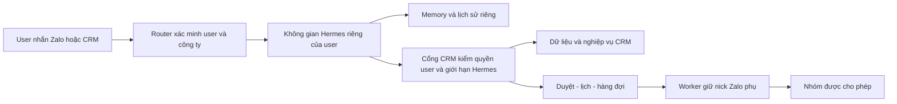
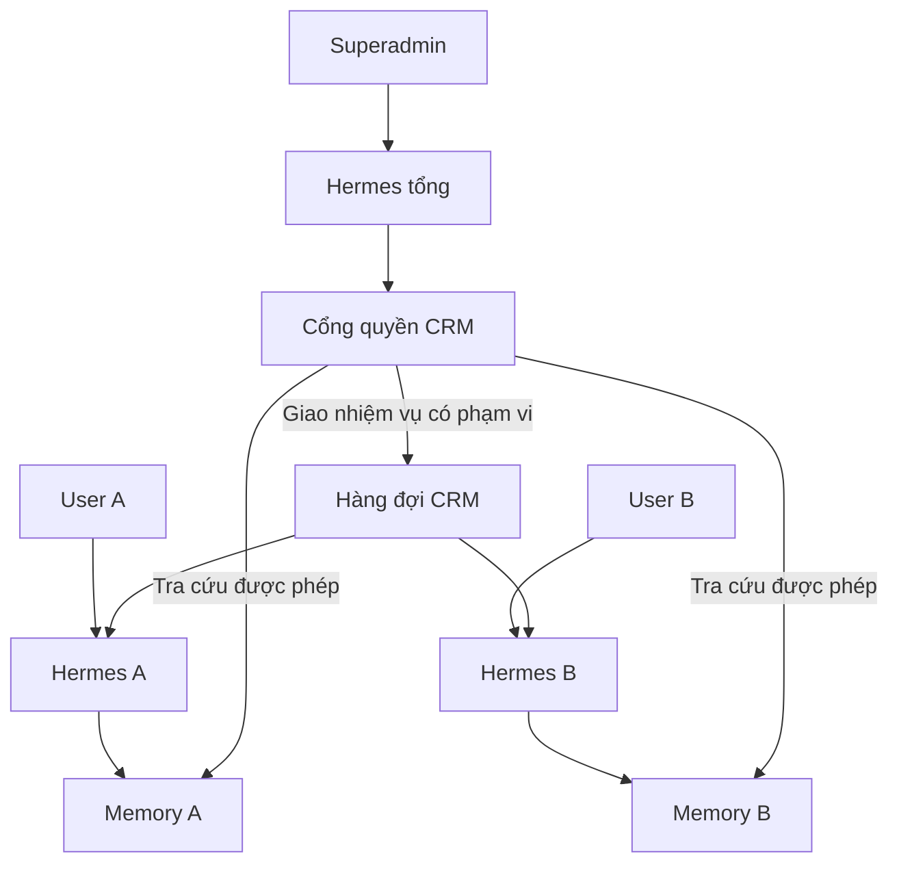

# SUPER PLAN — Hermes × iHomeCRM

Phiên bản 1.1 · Chủ dự án đã duyệt ngày 12/10/2026 (Asia/Bangkok).

**Trạng thái:** P0 có inventory/catalog và local gate; P1 có JWT TEST, MCP và AIAgent với dữ liệu giả; P2 đang xây nền credential/refresh và migration TEST. P3–P11 chưa bắt đầu. Chốt plan không có nghĩa đã tích hợp hoặc phát hành.

Đây là kế hoạch được duy trì cho mọi session/agent. [STATUS.md](STATUS.md) là nhật ký thực thi, bằng chứng, điểm dừng và hướng dẫn tiếp tục. Mỗi bước hoàn thành phải cập nhật STATUS; không đánh dấu đạt chỉ vì đã viết code.

## Quyết định đã chốt — không hỏi lại

- Hermes là bộ máy hội thoại và điều phối AI đích. CRM tiếp tục sở hữu dữ liệu, quyền user, nghiệp vụ, phê duyệt, lịch và kết quả thực thi.
- Không clone bộ quyền user. Thêm cấu hình giới hạn cho từng kết nối trợ lý, tham chiếu quyền và hành động có sẵn. Hai nhóm Đọc / Thao tác dùng chung cổng kiểm quyền.
- User thường chỉ hoạt động trong một công ty. Chỉ superadmin được làm việc với nhiều công ty; mỗi phiên, kết nối và lịch của trợ lý vẫn có công ty đích rõ ràng, không trộn dữ liệu.
- Worker hiện tại giữ duy nhất phiên nick Zalo phụ. Nick chính của anh chỉ nhắn riêng để điều khiển và nhận kết quả; không đăng nhập nick chính vào bot.
- Toàn bộ năng lực Copilot được kiểm kê và có quyết định chuyển, giữ giao diện, hoãn có lý do hoặc bỏ có chủ đích. Bản thử một user chỉ là một mốc trong super plan, không phải điểm kết thúc.
- Không tiếp tục xây hai bộ nghiệp vụ. Engine Copilot cũ chỉ làm đường đối chiếu/quay lại tạm thời; được ngừng sau khi có báo cáo chuyển đổi đầy đủ và luồng thay thế đã đạt.
- Mỗi user có một không gian trợ lý và memory riêng; dùng chung mã nguồn/hạ tầng khi có cách ly thực sự. Không mặc định một VPS mỗi user.
- Hermes tổng của superadmin tra cứu memory công việc và giao nhiệm vụ qua CRM; đọc memory, giao việc và thực hiện thay người khác là các quyền khác nhau. Mặc định không mở toàn bộ chat riêng.
- Thực hiện theo từng cửa nghiệm thu. Model/hạ tầng/auth cụ thể phải được kiểm chứng; chỉ trình lại nếu kết quả buộc thay đổi quyết định sản phẩm đã chốt.

## Nền triển khai và giới hạn bằng chứng

- Bản khảo sát ban đầu: `66573aeb66ad2e07a486d8f2015eb45caed0e17a`.
- Worktree triển khai từ `origin/main` sau fetch: `7367b7007f096f20471bf1309bc51e0b971439b6`.
- Đã có thay đổi worker/registry và Zalo unit được mở lại giữa hai mốc. Manifest mới phải lấy từ source hiện tại; không dùng nguyên số đếm cũ làm chứng cứ.
- WIP ở checkout chính được giữ. Một migration legacy xuất hiện diff ngay sau checkout worktree; nằm ngoài phạm vi, không stage hoặc sửa. Chi tiết ở STATUS.
- Tuân thủ [Project Contract](../../engineering/PROJECT_CONTRACT.md). Thử ghi chỉ trên TEST đúng lane; chưa có quyền bỏ qua kiểm, review hoặc provenance.

## Sơ đồ hệ thống đích

## 01 · Mục tiêu và phạm vi chốt

Mục tiêu cuối là để từng user dùng trợ lý từ Zalo hoặc giao diện CRM, truy cập đúng dữ liệu và thực hiện đúng phần việc họ được cho phép. Quản trị viên có thể giới hạn riêng trợ lý mà không làm thay đổi quyền user khi thao tác trực tiếp trên CRM.

Người dùng đã xác nhận Copilot hiện chưa được sử dụng vì khó dùng. Do đó không cần đầu tư thêm tính năng vào engine cũ chỉ để bảo toàn nó; vẫn phải giữ dữ liệu, cơ chế quyền và nghiệp vụ tốt đang tồn tại.

Quy tắc đã được chủ dự án xác nhận: chỉ superadmin là ngoại lệ nhiều công ty. User thường được gắn một công ty; không thiết kế bộ chọn/chuyển công ty cho họ. Superadmin chọn rõ công ty đích; mỗi kết nối trợ lý cấu hình theo công ty và không tự được mở mọi quyền ở mọi công ty.

| Trong super plan | Giới hạn / cách xử lý |
| --- | --- |
| Liên kết tài khoản; quyền đọc/thao tác theo user và tổ chức | Bao gồm cấp, giới hạn, hết hạn, thu hồi, đổi phiên và audit. |
| Lệnh riêng qua nick chính; bot nick phụ gửi nhóm | Chỉ danh tính Zalo đã liên kết được ra lệnh. Thành viên nhóm không thừa hưởng quyền chủ. |
| Phòng trống, giá, chính sách, bản tin, lịch và báo cáo | CRM là nguồn dữ liệu hiện hành. Nhóm nhận và nội dung phải nằm trong phạm vi được cho phép. |
| Chuyển các miền nghiệp vụ Copilot đang có | Đọc trước, thao tác sau; nghiệp vụ tiền/hợp đồng theo đúng điều kiện duyệt và phép kiểm riêng. |
| Chat web, thẻ duyệt, cấu hình và vận hành | Tái sử dụng thành phần phù hợp, thiết kế lại trải nghiệm khó dùng. |
| Tự đọc nhóm rồi ghi ngược thay đổi vào CRM | Chưa được xác nhận là nhu cầu. Để thành lựa chọn riêng; nếu mở phải đi qua đề xuất, kiểm nguồn và duyệt. |
| Email, trình duyệt tùy ý, shell, tài khoản ngoài CRM | Không tự mở chỉ vì Hermes có sẵn. Cần phạm vi và quyền bổ sung riêng. |
| Cam kết tránh bị Zalo hạn chế tài khoản | Không đưa vào tiêu chí cam kết. Nick phụ tách hoạt động bot, không loại bỏ rủi ro kết nối không chính thức. |

## 02 · Nền hiện có và bằng chứng

Kiểm kê dựa trên source tại SHA ghi ở đầu tài liệu. Chưa đối chiếu catalog database đang chạy, phiên bản VPS, cờ rollout hay quyền trên môi trường thật. Có source không đồng nghĩa chức năng đã hoạt động.

Kiểm kê khai báo tĩnh tại 5 file tìm thấy 67 tên công cụ: 55 đọc/tra cứu, 1 điều hướng, 7 ghi, 2 kế hoạch và 2 bộ nhớ. Action catalog có 32 action, trong đó 1 được đánh dấu đã gỡ. Các số này không phải số công cụ đang bật hoặc số luồng đã đạt production; P0 phải tạo manifest kiểm kê có thể tái sinh.

| Cụm | Giữ / điều chỉnh | Bằng chứng source |
| --- | --- | --- |
| RBAC và phạm vi tổ chức | Giữ khóa quyền, membership, scope tòa/sổ và kiểm server. Không ghi giới hạn Hermes vào quyền user. | src/lib/permissions.ts; useMyPermissions.ts; useOrganizationAuthorization.ts |
| UI chọn quyền | Tái dùng nhóm Xem/Thao tác/Nhạy cảm, bộ chọn scope; tạo cấu hình kết nối riêng. | components/authorization/PermissionPicker.tsx; ScopePicker.tsx |
| Tool đọc và nghiệp vụ | Tách schema và logic dùng chung khỏi browser client, Vite docs, navigate và context UI. | copilot/tools/registry.ts; nghiepVuTools.ts |
| Hành động và phê duyệt | Giữ registry server, preview/execute, nonce, step-up, nhật ký và đối soát; thêm connection context. | copilot/plan/actionCatalog.ts; planClient.ts; confirmationStore.ts |
| Zalo | Giữ zca-js, session store, lease, inbound, hàng đợi, ảnh bảng phòng và lịch gửi. | worker/lib/login.js; inbound.js; queue.js; automation.js |
| Model và quota | Đánh giá tái dùng proxy; không mặc định Hermes gọi provider sẽ được hạn mức cũ bảo vệ. | supabase/functions/llm-proxy/index.ts |
| Chat và PageAgent | Chuyển engine; giữ/thay các phần UI có ích. Thao tác DOM không chuyển nguyên sang runtime nền. | copilot/chatEngine.ts; ChatPanel.tsx; createAgent.ts |
| Bộ nhớ | Hiện có user + org; phải bổ sung ranh giới connection/kênh/phiên và thu hồi quyền. | copilot/memoryClient.ts; migration ai_user_memory_v1 |

- Tool registry và action catalog là hai bề mặt khác nhau: đọc không nằm hết trong action registry. Không đếm action thành tool độc lập.
- Worker đang sử dụng service-role cho nhiệm vụ hệ thống. Scope guard hiện có không chứng minh đã kiểm quyền user + giới hạn agent ngay trước gửi.
- Các RPC nghiệp vụ lấy auth.uid(); một số không cho service_role gọi. Cần chứng minh đường xác thực thay user trước khi cam kết tái dùng nguyên tất cả RPC.
- Bộ kiểm Zalo/Copilot đang có mục DEFERRED trong manifest. Phải phục hồi đúng runner liên quan trước khi dùng kết quả kiểm làm bằng chứng.

## 03 · Kiến trúc đích và ranh giới trách nhiệm

Hermes xử lý ngôn ngữ và chọn công cụ. CRM quyết định việc đó có được phép hay không và thực hiện nghiệp vụ. Worker thực hiện giao tiếp Zalo. Một bộ công cụ dùng chung phục vụ cả kênh Zalo và giao diện CRM.

Không tạo Hermes → Copilot AI → CRM. Trong giai đoạn chuyển đổi, mỗi phiên chỉ được định tuyến tới một engine; không để hai engine cùng xử lý một lệnh.

| Thành phần | Sở hữu | Không sở hữu |
| --- | --- | --- |
| Hermes runtime | Hội thoại, kế hoạch đề xuất, chọn công cụ, tổng hợp | Quyền gốc CRM; SQL tùy ý; bí mật toàn quyền; tự phê duyệt |
| Cổng công cụ CRM | Danh tính kết nối; kiểm quyền; schema; trace; quota công cụ | Tự bịa kết quả nghiệp vụ hoặc dùng user_id do mô hình tự khai |
| Nghiệp vụ CRM | Dữ liệu chính xác; quy tắc; scope; preview/execute; audit | Phụ thuộc tên model hoặc thư viện nội bộ của Hermes |
| Scheduler và queue | Lịch, job bền vững, claim, provenance, kết quả và đối soát | Lịch phát tin cạnh tranh trong cả Hermes và CRM |
| Zalo worker | Một phiên nick phụ; inbound/outbound; media; phục hồi kết nối | Tự nhận mọi người trong nhóm là chủ hoặc tự vượt grant |
| Giao diện CRM | Kết nối, cấu hình, xem trước, PIN/duyệt, lịch sử, dừng | Là nơi duy nhất kiểm quyền; UI ẩn nút không thay được kiểm server |

## 04 · Quyền user và lớp giới hạn trợ lý

Quyền hiệu lực = quyền user hiện tại ∩ trần do tổ chức quy định ∩ phần được bật cho kết nối Hermes ∩ phạm vi dữ liệu/nhóm nhận. Với thao tác còn phải thỏa điều kiện nghiệp vụ và phê duyệt.

Không clone role hay membership. UI lấy danh mục quyền/hành động hiện có để hiển thị; lưu thêm các lựa chọn của kết nối. Tắt Hermes sửa giá không ảnh hưởng khả năng sửa giá trực tiếp của user.

| Cấp cấu hình | Người quyết định | Hành vi |
| --- | --- | --- |
| Quyền CRM gốc | Người có quyền quản trị hiện hành | Là trần tối đa. User mất quyền thì trợ lý mất theo. |
| Trần trợ lý của tổ chức | Owner/admin có quyền phù hợp | Giới hạn miền dữ liệu, hành động nhạy cảm, thời hạn và chế độ tự động. |
| Giới hạn kết nối cá nhân | User được tự thu hẹp; bật lại trong trần nếu được phép | Tách Đọc và Thao tác; có tắt toàn bộ, scope và lý do bị khóa. |
| Duyệt / ủy quyền tự động | Người thật có đủ quyền nghiệp vụ | Phê duyệt có nội dung/phạm vi/thời hạn; AI không tự cấp hay gia hạn. |
| Công cụ mới | Theo cấu hình rõ ràng | Mặc định tắt cho kết nối; không tự mở theo lần cập nhật Hermes. |

- Bản đầu hỗ trợ quyền chức năng, scope tổ chức/tòa/sổ khi nghiệp vụ có sẵn, nhóm nhận và các tập trường trả về cố định đã rà soát.
- Không hứa có ngay bộ bật/tắt tùy ý mọi cột database. Field-level config chỉ bổ sung cho trường đã được phân loại và có kiểm chứng.
- Giới hạn phải áp dụng trên đường gọi thật, truy hồi tài liệu, xuất dữ liệu và trước khi worker gửi; không chỉ trên danh sách tools/list.
- Thu hồi quyền không thể xóa tin mà Zalo đã nhận. Hệ thống phải chặn tác vụ chưa thực hiện, tách rõ trạng thái đang gửi và đã gửi.
- Ranh giới thu hồi: trước dispatch_started có thẩm quyền thì revoke phải chặn. Khi provider call đã bắt đầu, coi là in-flight và đối soát kết quả; không báo đã hủy chắc chắn. Kiểm này áp dụng cả phản hồi DM chứa dữ liệu CRM.
- User thường: org được khóa theo tài khoản. Superadmin: quyền nền nhiều công ty không đồng nghĩa Hermes tự có mọi công ty; dùng kết nối/phạm vi trợ lý theo công ty đích đã chọn, vẫn kiểm giới hạn agent và nghiệp vụ.

## 05 · Liên kết tài khoản và xác thực

Luồng mong muốn: user đăng nhập CRM → hệ thống gắn công ty duy nhất của user; riêng superadmin chọn công ty đích → xem phạm vi trợ lý → tạo kết nối → Hermes nhận credential riêng. Mật khẩu CRM, JWT toàn quyền và refresh token không xuất hiện trong chat hay được trao trực tiếp cho runtime Hermes.

Cổng xác thực suy ra actor/org từ credential đã kiểm; không lấy danh tính từ lời nhắn, tên hiển thị hoặc tham số do mô hình tự chọn. Gắn nick chính bằng thao tác liên kết có xác minh từ hai phía, dùng Zalo UID và tài khoản bot cụ thể.

- A01: thử tích hợp MCP HTTP/OAuth của phiên bản Hermes được ghim; xác nhận TLS, audience, expiry, refresh, revoke và truyền ngữ cảnh đúng user.
- A02: chứng minh đường gọi RPC với danh tính được ủy quyền phù hợp auth.uid(). Hướng ưu tiên là broker giữ phiên ủy quyền hợp lệ phía server; Hermes chỉ giữ credential hạn chế.
- A03: nếu cơ chế ủy quyền hiện tại không đáp ứng, lập ADR cho executor chuyên biệt dùng chung kiểm quyền nghiệp vụ. Không lách bằng service-role hoặc tự gán user_id.
- A04: credential kết nối dạng opaque chỉ lưu hash phía quản lý khi phù hợp; bí mật có thể cần dùng lại đặt trong kho mã hóa phía broker. Tách khóa, xoay, hết hạn, thu hồi và không ghi log.
- A05: mỗi request gắn user, org, connection, channel, conversation và request ID đã xác minh. User thường không được đổi org. Chỉ superadmin được đổi công ty bằng thao tác xác nhận rõ, tạo context mới; lịch/phiên cũ vẫn gắn công ty cũ.
- A06: khóa thành viên, hủy kết nối hoặc mất quyền phải chặn cả tools mới, truy hồi bộ nhớ và job đang chờ. Phiên hội thoại có dữ liệu bị thu hồi cần hết hiệu lực hoặc tái tạo context. Riêng superadmin bị hạ quyền: kiểm vai trò hiện tại ở server, vô hiệu hóa kết nối/context/lịch ở các công ty không còn được phép; không dùng vai trò ghi nhận lúc tạo kết nối.
- A07: trước khi dữ liệu CRM vào model phải có runtime/context riêng theo user-org-connection, audit tối thiểu, timeout, quota và kill switch. P7/P9 hoàn thiện trải nghiệm và vận hành, không trì hoãn ranh giới này.

Cửa kỹ thuật bắt buộc: P1 kiểm hai user thường thuộc hai công ty khác nhau và một superadmin có quyền nhiều công ty. User thường bị chặn mọi yêu cầu đổi/cross-org; superadmin phải chọn đích, không trộn context và lịch. Không qua cửa này thì chưa mở ghi hay gửi nhóm. Đây là phần chưa tích hợp.

## 06 · Hợp đồng dữ liệu và thay đổi schema dự kiến

Các tên dưới đây là mô hình thiết kế, chưa phải tên bảng/API đã tồn tại hoặc migration đã viết. P1-P2 chốt tên theo quy ước repo. Ưu tiên mở rộng cấu trúc có sẵn khi bảo toàn được semantics, tránh tạo hai ledger hay hai queue.

| Đối tượng | Thông tin bắt buộc | Nguyên tắc |
| --- | --- | --- |
| AgentConnection | id; actor; org; trạng thái; hạn; policy version; credential ref; thời điểm revoke | Không đổi actor/org bằng payload AI; revoke có audit. |
| AgentRestriction | connection; capability/action ID; read/action; enabled; data/recipient scope; mode | Tham chiếu danh mục hiện có; chỉ thu hẹp quyền gốc; deny thắng. |
| TrustedChannelBinding | connection; bot account; sender UID; DM identity; trạng thái xác minh | Không dùng tên hiển thị hoặc tin trích dẫn làm bằng chứng danh tính. |
| CapabilityContract | ID/version; input/output schema; permission; scope; side effect; consent; executor | Server action registry giữ vai trò canonical cho hành động; read definitions được tách dùng chung. |
| Approval / StandingGrant | actor/org/connection; payload/template hash; recipients; expiry; giới hạn | Thay phạm vi làm mất hiệu lực; không tự cấp bởi AI. |
| Execution provenance | request/job/action ID; actor/org/connection; approval; policy version; nguồn dữ liệu | Lưu dấu vết bất biến; quyền hiện tại vẫn kiểm lại lúc chạy. |
| Memory envelope | user/org/connection/channel; classification; source; retention; access version | Truy hồi phải kiểm quyền; nội dung nhóm và riêng không trộn. |
| Usage / Audit | trace; model/tool; reserved/final cost; deny/revoke/outcome; timestamps | Không chứa token/mật khẩu; quota đồng thời phải nguyên tử. |

- RPC/API quản trị dự kiến: list/create/revoke connection; get/update restrictions; link/unlink Zalo identity; list effective capabilities; preview/approve/execute; list/cancel/reconcile jobs.
- Công cụ cho mô hình chỉ nhận tham số nghiệp vụ. Actor/org lấy từ kết nối. User thường không có thao tác chọn org; superadmin đổi công ty qua đường xác thực riêng và tạo context mới, không để model tự gán org.
- Output chuẩn: status, data, nguồn/lúc lấy, request ID, khả năng cần duyệt, lỗi có mã. Không trả rỗng để che lỗi quyền hoặc báo xong khi chỉ mới enqueue.
- Migration là bổ sung, immutable sau phát hành; generated types/surfaces sinh bằng pipeline, không sửa tay. Không đổi hay xóa lịch sử migration cũ.

## 07 · Chuyển toàn bộ năng lực Copilot

P0 tạo manifest từng tool/action, không chỉ bảng nhóm dưới đây. Mỗi dòng phải có nguồn, quyền, scope, input/output, điều kiện duyệt, kênh hỗ trợ, trạng thái và bài nghiệm thu. Hoàn tất chuyển đổi nghĩa là mọi dòng có quyết định, không đồng nghĩa tự bật tất cả công cụ cho mọi user.

| Miền | Đọc / tra cứu | Thao tác và điều kiện chuyển |
| --- | --- | --- |
| Phòng / sale / chính sách | Phòng, trạng thái chào thuê, giá, tòa/tầng, tiện ích, sale facts | Ưu tiên đợt đầu; bản tin dùng projection công khai. Sửa dữ liệu mở riêng sau duyệt. |
| Khách / lead / lịch hẹn | Thông tin theo scope, lịch hẹn và liên kết CRM | Đề xuất/cập nhật qua RPC; trường riêng tư không đi vào nhóm. |
| Hợp đồng / cọc | Tra cứu tình trạng, hồ sơ và khoản liên quan | Giữ lifecycle, concurrency và quyền duyệt; không suy luận phép ghi từ quyền đọc. |
| Hóa đơn / công nợ / thu chi / sổ | Số liệu từ RPC, có kỳ và nguồn | Theo quy trình tiền, chứng từ, duyệt và reconcile; không để AI tự tính thay backend. |
| Báo cáo / lương / cổ đông | Giữ kỳ, scope và quy tắc báo cáo | Miền nhạy cảm chỉ mở sau harness vai thật và bằng chứng nghiệp vụ. |
| Dịch vụ / công tơ / tài sản / bảo trì | Danh mục, chỉ số và công việc theo quyền | Giữ quy tắc domain; mỗi hành động có schema và side effect rõ. |
| Zalo / mạng / công việc | Kết nối, nhóm nhận, tác vụ và trạng thái | Không coi mọi công cụ tổng quát Hermes là đã được cấp quyền CRM. |
| Tài liệu / hướng dẫn / system map | Truy hồi theo permission và scope | Làm mới nguồn; tài liệu có nội dung chỉ dẫn không được vượt chính sách server. |
| Kế hoạch / ghi nhớ / điều hướng UI | Tách ý định, bộ nhớ riêng, deep link đúng màn hình | PageAgent/DOM không chuyển nguyên; thay bằng API hoặc giữ thao tác người dùng có chủ đích. |

- Manifest hành động tiếp tục dựa registry server; không tạo catalog thứ ba phải sửa tay cùng Copilot và Hermes.
- Schema/mô tả công cụ có thể dùng chung; module phụ thuộc React, Vite, localStorage hoặc singleton browser phải được tách adapter.
- Tool listing lọc theo quyền giúp dễ dùng. Executor vẫn kiểm lại để chặn lời gọi trực tiếp hoặc tool cũ đã bị tắt.
- Cùng model và cùng bộ tác vụ được dùng khi so sánh chất lượng với engine cũ; ghi rõ khác biệt do model, dữ liệu hay công cụ.

## 08 · Luồng Zalo: nick chính, nick phụ, nhóm

Worker hiện tại giữ phiên nick phụ và là điểm duy nhất nhận/gửi với Zalo. Cầu nối chuyển DM hợp lệ của chủ sang Hermes; phản hồi và báo cáo đi về đúng DM. Không cần đăng nhập nick chính vào Hermes.

Một tin nhắn nhóm, nội dung được forward hoặc tên người gửi không thể tự biến thành lệnh quản trị. Nội dung nhóm chỉ được xem là dữ liệu theo chính sách đã chốt.

- Z01: liên kết bot account + sender UID + direct conversation với connection đã xác minh; revoke/unlink có hiệu lực ngay trên các lệnh mới.
- Z02: router ưu tiên lệnh chủ, tránh keyword auto-reply hiện có trả lời lần hai; loại self-message và lặp sự kiện bằng provider event ID.
- Z03: trả trạng thái nhận lệnh, cần làm rõ, chờ duyệt, đang thực hiện và kết quả. Cùng request ID đi xuyên suốt; không hỏi lại khi thông tin đã rõ và quyền đã có.
- Z04: dùng lại ảnh/bảng phòng, media và queue. Không giao thêm công cụ Zalo trực tiếp cho Hermes để gửi ngoài gateway.
- Z05: danh sách nhóm có map CRM: bot account, org, phạm vi tòa, mẫu, chính sách công khai, trạng thái cho phép. Chưa khẳng định có sẵn mọi loại phân nhóm này.
- Z06: chỉ gửi nhóm được chọn; không tự kết bạn, quét thành viên hay mở rộng người nhận. Cập nhật chính sách chỉ gửi đúng phân khúc được cấu hình.
- Z07: mất phiên/QR/kick phải hiển thị lỗi thật, tạm dừng gửi, tránh hàng đợi tăng vô hạn. Phục hồi không tự replay các job có kết quả chưa xác định.
- Z08: user thường chỉ có công ty duy nhất, không hỏi chọn công ty. Riêng superadmin, DM phải có công ty đang hoạt động được xác nhận; chưa chọn thì hỏi trước đọc/ghi. Đổi công ty tạo context mới, lịch cũ vẫn ở công ty cũ; model không tự chọn theo trí nhớ.

Rủi ro Zalo cá nhân vẫn tồn tại vì worker dùng kết nối bên thứ ba. Không đưa kỹ thuật né phát hiện vào kế hoạch; đổi từ Copilot sang Hermes không làm mất rủi ro này.

## 09 · Lệnh, xem trước, duyệt và thực thi

Chuỗi chuẩn: tiếp nhận → xác thực → hiểu yêu cầu → đọc dữ liệu mới → lập đề xuất → kiểm quyền → xem trước/duyệt → enqueue → kiểm lại trước side effect → ghi nhận/đối soát → trả kết quả. Không gửi ngay chỉ vì mô hình nói người dùng đã đồng ý.

Bản duyệt gắn với actor, org, connection, action/version, nội dung hoặc template được ủy quyền, danh sách nhận và hạn. Đổi nội dung/nhóm/phạm vi vượt grant phải duyệt lại.

| Trạng thái | Người dùng thấy | Hành vi hệ thống |
| --- | --- | --- |
| DRAFT / WAITING_APPROVAL | Đề xuất / chờ anh duyệt | Chưa thực hiện side effect. |
| APPROVED / QUEUED | Đã duyệt / đã xếp hàng | Không gọi là đã gửi. Có thể hủy nếu chưa thực thi. |
| RUNNING | Đang thực hiện | Kiểm quyền hiện tại, claim và chống trùng. |
| SUCCEEDED / PARTIAL / FAILED | Kết quả theo từng nhóm hoặc bước | Có biên nhận khi có thể; tổng hợp không che lỗi từng đích. |
| UNKNOWN_EFFECT | Chưa xác định đã gửi/thực hiện hay chưa | Đối soát hoặc người xử lý; không retry mù. |
| BLOCKED / CANCELLED / EXPIRED | Bị chặn / đã hủy / hết hạn | Nêu lý do và cách xử lý phù hợp; không tự mở lại quyền. |

- Giai đoạn đầu dùng lại màn hình/thẻ duyệt CRM và PIN nếu nghiệp vụ yêu cầu. Link duyệt không được chứa bí mật có thể tự tiêu bởi mô hình.
- Duyệt hoàn toàn trong Zalo là mốc sau: cần trusted event, payload binding và đáp ứng đúng policy; tin nhắn 'đồng ý' thông thường không thay step-up.
- Mỗi yêu cầu nghiệp vụ có intent/request ID bền vững, giữ nguyên qua retry; mỗi người nhận có child key. Lệnh mới chủ động tạo có ID mới dù nội dung giống nhau. Hash payload/phạm vi để kiểm thay đổi, không thay ID yêu cầu.
- Không cam kết exactly-once với tác động bên ngoài. Lưu trạng thái chưa rõ và luồng reconcile khi worker chết sau gửi nhưng trước lưu kết quả.

## 10 · Lịch, gửi hàng loạt và dữ liệu thay đổi

Dùng một scheduler và một queue hiện có, mở rộng provenance và quyền. Hermes tạo/sửa đề xuất lịch qua công cụ. Tác vụ gửi theo mẫu cố định không cần gọi LLM mỗi lần; tắt Hermes không được làm mất lịch deterministic đã được cấp phép hợp lệ.

| Chế độ | Nội dung được duyệt | Điều kiện lúc chạy |
| --- | --- | --- |
| Gửi một lần | Snapshot nội dung + nhóm nhận | Duyệt còn hạn; nội dung không đổi; quyền còn hiệu lực. |
| Lịch bản tin phòng | Template + nguồn dữ liệu + phạm vi tòa + nhóm + khung giờ + giới hạn | Lấy phòng/giá mới; lọc dữ liệu công khai; kiểm quyền và grant tại thời điểm chạy. |
| Thông báo đổi chính sách | Quy tắc phát hiện thay đổi + phiên bản chính sách + nhóm áp dụng | Thay đổi nhạy cảm có thể yêu cầu duyệt bản tin mới; không suy rằng logic new-room hiện có đã bao phủ. |
| Nhắc riêng chủ | Loại sự kiện và người nhận | Chỉ báo thay đổi/lỗi cần xử lý; gộp thông báo lặp. |

- Job lưu bất biến nguồn actor/org/connection/approval; worker gọi kiểm quyền có thẩm quyền ngay trước gửi, dù worker có credential hệ thống.
- Thu hồi connection/grant dừng lịch và chặn job chưa thực hiện. Đang gửi phải ghi nhận kết quả thực tế, không giả vờ đã thu hồi được tin.
- Thiết kế lease/claim/retry/backoff, giới hạn queue và xử lý catch-up sau downtime. Mặc định không dồn gửi mọi lịch đã lỡ vào cùng một lúc.
- Nhóm nhận mới, tòa mới hoặc nội dung vượt template không thừa hưởng duyệt cũ. Standing grant có hạn, hạn mức và đường thu hồi.
- Tôn trọng múi giờ tổ chức, khung giờ và giới hạn gửi; đây là kiểm soát vận hành, không phải bảo đảm chống Zalo quét.
- Chuyển lịch cũ: lập mapping lịch giữ nguyên/lịch thay thế; một nghiệp vụ và tập người nhận chỉ có một owner lịch active. Drain hoặc đối soát job cũ trước cutover; không sửa provenance để giả thành đã được Hermes duyệt. Rollback không bật cả hai lịch.
- Trước gửi, xác lập dispatch_started cùng kiểm quyền/policy có thẩm quyền. Thu hồi cạnh tranh với dispatch phải có kết quả xác định và audit; tin riêng chứa dữ liệu CRM cũng đi qua kiểm outbound.

## 11 · Dữ liệu, bộ nhớ, lịch sử và tài liệu

CRM là nguồn sự thật cho giá/phòng/chính sách/quyền. Hermes memory chỉ là hỗ trợ ngữ cảnh và sở thích; không xây bản sao CRM trong thư mục trí nhớ. Context từ nhóm được đánh dấu nguồn và không có quyền điều khiển hệ thống.

- M01: phạm vi tối thiểu user + org + connection; private DM, nhóm và chat web có context rõ ràng. Có thể chia sẻ giữa web và DM của cùng user khi được thiết kế, không tự chia sẻ sang nhóm.
- M02: kiểm cả memory dài hạn, tìm phiên cũ, file, cache, trace và log. Profile Hermes phải cách ly thật; nhiều thread trong cùng profile không tự chứng minh cách ly dữ liệu.
- M03: sau thu hồi quyền phải vô hiệu hóa truy hồi, cache và context đang giữ dữ liệu thuộc phạm vi bị thu hồi; không chỉ chặn lần query DB tiếp theo.
- M04: chọn migrate history có chủ đích: mặc định giữ lịch sử/audit cũ để xem, không nhập toàn bộ vào memory mới. Chỉ chuyển sở thích/hướng dẫn đã duyệt, có nguồn.
- M05: có xem, sửa, quên/xóa và retention; audit bắt buộc không bị xóa theo yêu cầu quên hội thoại. Phân biệt hai loại dữ liệu trên UI.
- M06: tài liệu nghiệp vụ được lập chỉ mục theo quyền và phiên bản; trích nguồn, thời điểm lấy; nội dung tài liệu/tin nhóm không được ghi đè chỉ dẫn hay mở quyền.
- M07: không log token/PIN/bí mật. Dữ liệu gửi cho model phải được tối thiểu hóa theo công cụ và nhà cung cấp đã chọn; tự host Hermes không đồng nghĩa model chạy tại máy.

## 12 · Trải nghiệm user và quản trị

Mục tiêu UX là để người dùng biết trợ lý đang làm thay ai, thuộc công ty nào, được đọc/làm gì và đang ở trạng thái nào. Tái sử dụng PermissionPicker và các thẻ nghiệp vụ phù hợp; không yêu cầu user hiểu MCP, JWT hay action registry.

Giao diện user thường ẩn thao tác chuyển công ty, hiển thị tên công ty cố định. Giao diện superadmin có chọn công ty rõ ràng, cảnh báo chuyển context và cấu hình Hermes riêng theo công ty.

| Màn hình | Nội dung | Tiêu chí dễ dùng |
| --- | --- | --- |
| Trợ lý của tôi | Kết nối Hermes; công ty; nick chính liên kết; nick bot; trạng thái; tắt khẩn cấp | Một nơi để biết đang chạy hay mất kết nối; không hiển thị token sau lần cấp nếu không cần. |
| Được đọc gì / Được làm gì | Quyền user; bật/tắt Hermes; scope; cần duyệt; hạn; lý do bị khóa | User thấy rõ tắt cho Hermes không làm mất quyền CRM của mình. |
| Hội thoại | Chat, nguồn dữ liệu, câu hỏi làm rõ, đề xuất và kết quả có link CRM | Không trộn công ty; lỗi có cách xử lý; không phải nhớ cú pháp kỹ thuật. |
| Xem trước / duyệt | Nội dung; nguồn/lúc lấy; nick gửi; nhóm nhận; lịch; tác động; xác nhận | Nhìn được chính xác điều sẽ xảy ra trước khi duyệt. |
| Công việc và lịch | Đã xếp hàng/đang chạy/đã gửi/lỗi/chưa rõ; hủy/dừng; từng nhóm | Không gộp mọi trạng thái thành thành công; có đối soát. |
| Quản trị trợ lý | Trần tổ chức; kết nối từng user; quota; audit; rollout; thu hồi | Admin chỉ quản trong phạm vi quyền; không cho AI tự vào màn cấp quyền. |

- Deep link đến màn CRM cho nghiệp vụ cần người thao tác; không phải mọi chức năng DOM cũ đều cần chuyển thành agent action.
- Kiểm viewport/kênh thực sự bị ảnh hưởng: điện thoại cho DM/duyệt và desktop cho bảng quyền; không quét UI toàn app không liên quan.
- Bản mockup quyền là tài liệu duyệt thiết kế, không được hiển thị như màn đã triển khai.

## 13 · Runtime, chi phí và vận hành

Hermes Agent hiện có giấy phép MIT; model, VPS và dịch vụ ngoài có thể phát sinh chi phí. Không dùng giá quảng cáo hoặc số token ước đoán làm cam kết ngân sách. Đo bằng bộ công việc thực tế trước khi chốt hạn mức.

Ưu tiên giữ Hermes gần upstream và xây adapter ngoài. Ghim phiên bản runtime/model adapter; kiểm tương thích trước nâng cấp. Không cần mặc định một VPS cho mỗi user, nhưng phải cách ly credential và bộ nhớ theo thiết kế.

- O01: chốt runtime, nơi đặt broker, mạng và kho bí mật sau spike. Hermes không đọc được vault, raw Supabase token hay Zalo session; shell/network/tool phụ không được tạo đường đi vòng.
- O02: chọn một cơ chế quota có hiệu lực cho model usage: tái dùng proxy nếu tương thích, hoặc adapter reservation/finalization dùng cùng ngân sách. Không để Hermes và Copilot có hai hạn mức độc lập vô tình cộng dồn.
- O03: giới hạn số vòng tool, thời gian, số tác vụ đồng thời, kích thước context, lượng dữ liệu, nhóm nhận và chi phí theo user/org/connection.
- O04: tracing từ request → tool → approval → job → provider outcome. Dashboard có heartbeat, queue lag, deny/revoke, unknown outcome, thất bại provider và usage.
- O05: nếu model lỗi/hết quota, báo đúng tình trạng; lịch gửi đã duyệt và không cần AI tiếp tục theo policy. Nếu auth/scope không xác minh được thì dừng tác vụ phụ thuộc.
- O06: backup cấu hình/metadata/credential broker theo cơ chế phù hợp; restore thử, xoay secret và thu hồi connection. Không backup một cách khiến grant đã revoke hồi sinh.
- O07: upgrade upstream qua môi trường TEST, bộ contract test của adapter, canary một kết nối; rollback runtime/config bằng bản đã xác minh.

## Bổ sung đã chốt: mỗi user một Hermes và Hermes tổng

### Danh tính trợ lý bền vững

- Một `assistant_id` bền vững cho mỗi cặp user–công ty; credential/connection có thể hết hạn, thay hoặc thu hồi. Reconnect chỉ gắn lại workspace cũ sau xác minh, không tạo memory mới vô tình và không nối workspace bằng ID model tự khai.
- Các ràng buộc user–org–connection ở M01/A07 là ràng buộc kiểm truy cập và provenance. Kho memory thuộc assistant bền vững; không phụ thuộc vòng đời một access token. Web và DM của cùng user có thể dùng chung memory công việc đúng policy, vẫn tách lịch sử/ngữ cảnh theo kênh.
- Hermes có profile/config/memory/session riêng. Phân vùng thư mục chưa tự chứng minh bảo mật: cần cô lập runtime, file access, tools, cache, lịch sử tìm kiếm, credential và network. Một runtime owner giữ profile tại một thời điểm; không để hai process cùng ghi profile.
- User thường gắn đúng một công ty. Superadmin có workspace theo công ty và chế độ điều phối riêng; không dùng một memory chung vô điều kiện cho mọi công ty.

### Phân loại bộ nhớ

| Loại | Nguồn / phạm vi | Quyền mặc định của Hermes tổng |
| --- | --- | --- |
| Dữ liệu nghiệp vụ chính thức | CRM: phòng/giá/chính sách/trạng thái công việc | Đọc theo quyền; lấy hiện hành, không thay bằng ký ức |
| Memory công việc cá nhân | User + công ty + assistant; ghi chú/bối cảnh có nguồn | Được tìm/tổng hợp khi quyền giám sát được bật và còn hiệu lực |
| Memory chia sẻ của công ty | Kiến thức được công bố/duyệt với nguồn và phiên bản | Đọc theo phạm vi công ty |
| Sở thích và hội thoại riêng | User + assistant + kênh; có retention | Mặc định không truy hồi vào điều phối; quyền xem lịch sử riêng là lựa chọn tách biệt |
| Token/PIN/mật khẩu | Kho bí mật, không phải memory tra cứu | Không được đưa vào memory hoặc kết quả gửi model |

- Truy cập giám sát đi qua công cụ CRM, không mount thư mục memory của người khác vào Hermes tổng. Bộ nhớ dùng cho báo cáo có owner/org/assistant/classification/source/time/access-version.
- Nền ưu tiên: memory công việc cần chia sẻ được quản lý qua kho/API có quyền CRM; profile native giữ phần cá nhân tối thiểu. Không đồng bộ mù hai bản memory; P1 chốt provider/adapter sau contract test.
- Nội dung memory là dữ liệu tham khảo, không phải chỉ dẫn có quyền. Tra cứu có giới hạn số mục, thời gian và user; không tự tải toàn bộ lịch sử. Trả trích nguồn, độ mới và phần không có dữ liệu.
- Không tự ghi lại toàn bộ nội dung truy hồi của user khác vào memory dài hạn của superadmin. Bản tổng hợp được lưu phải có provenance, phân loại và cách thu hồi/xóa tương ứng.

### Quyền và nhiệm vụ điều phối

| Nhóm | Năng lực | Ràng buộc |
| --- | --- | --- |
| Đọc | Tìm/xem memory công việc; xem tiến độ và kết quả | Superadmin hiện tại + quyền giám sát CRM + giới hạn Hermes tổng + công ty/user/loại dữ liệu đích |
| Thao tác | Giao/hủy nhiệm vụ thuộc phạm vi quản lý | Task envelope do server lập; người giao, bên nhận, công ty, mục tiêu, giới hạn và thời hạn |
| Ủy nhiệm | Thực hiện dưới danh tính một user khác | Không phát sinh từ quyền đọc/giao việc; cần cơ chế ủy quyền riêng, mặc định tắt |
| Quản trị memory | Sửa/xóa memory của user khác | Không mặc định mở; thiết kế riêng nếu được yêu cầu |

- Hermes tổng gửi yêu cầu vào cùng nền nhiệm vụ CRM; trợ lý của user nhận việc trong workspace của user đó. Không trao credential hoặc toàn bộ hội thoại giữa các trợ lý.
- Quyền thực thi = quyền hiện tại của bên thực hiện ∩ giới hạn Hermes của họ ∩ phạm vi nhiệm vụ được giao ∩ điều kiện nghiệp vụ/duyệt. Quyền superadmin của bên giao không tự nâng quyền bên nhận.
- Tác vụ chạy bằng superadmin phải ghi superadmin là actor; không giả user. Người giao và người thực hiện đều có trace rõ. Grant giao việc có thể bị thu hồi trước thực thi.
- Báo cáo nhiều công ty là thao tác riêng: xác minh quyền trên từng công ty, thực hiện các truy vấn con theo từng scope, ghép kết quả có nhãn nguồn. Không đổi org của profile user thường và không lưu trộn raw memory.
- Hạ quyền superadmin phải chặn truy hồi/dispatch tiếp theo và vô hiệu hóa context/cache bị ảnh hưởng; side effect đang in-flight cần đối soát.

### Phân bổ vào giai đoạn

- P1: chứng minh hai profile không đọc chéo file/session/credential; kiểm adapter memory và một owner mỗi profile.
- P2: workspace ổn định, connection có vòng đời riêng; quyền giám sát/ủy nhiệm tách riêng.
- P3: công cụ tra cứu memory có phân loại và kiểm quyền server, không raw filesystem.
- P7: memory công việc/cá nhân/chia sẻ; UI biết mức chia sẻ; Hermes tổng tra cứu và giao nhiệm vụ có provenance.
- P9–P10: quota cho điều phối, chống vòng lặp giao việc, revoke xuyên context, canary và audit nhiều user/công ty.

## 14 · Kế hoạch công việc và cửa nghiệm thu

Tình trạng thực tế được duy trì ở STATUS.md; các checkbox dưới đây chỉ được đánh khi có evidence tương ứng. Vai trò là trách nhiệm kỹ thuật, chưa phải phân công nhân sự hoặc cam kết thời lượng.

### P0 · Khóa phạm vi và lập baseline

Phụ thuộc: Sau khi chủ dự án chốt super plan. Chủ trì: Lead + QA.

- [x] P0.01 Tạo worktree riêng, giữ WIP; ghi SHA, dependency/runtime và cờ liên quan. Evidence ở STATUS: source/flags tĩnh đã ghi, trạng thái cờ runtime chưa xác minh.
- [x] P0.02 Sinh manifest tool/action/UI-control của ứng dụng, disposition và metadata từng mục. Snapshot v2 + 28 focused tests đạt; không suy các builtin ngoài adapter thành capability CRM được cấp.
- [x] P0.03 Đối chiếu catalog TEST chỉ đọc: 32/32 registry khớp, 135/135 tên hàm có ở đúng schema (134 public + 1 helper private); ghi ACL/digest/flags. Ledger legacy đóng băng không phải schema thiếu. JWT/RLS/body parity kiểm ở P1 trở đi.
- [x] P0.04 Xác định và kích hoạt lại đúng runner/gate Zalo-Copilot cần cho phạm vi, cập nhật manifest có review. Commit `c833d379`: local 47/47 đạt, review không còn P1/P2; CI draft PR #165 tại head `386296cb` đã xanh. Delta inventory/catalog mới vẫn cần gate/review riêng.
- [x] P0.05 Ghi baseline câu hỏi/nghiệp vụ, lỗi đã biết và phạm vi public projection gửi nhóm. Bộ B01–B10 bên dưới là tiêu chí cần kiểm, không phải kết quả đã đạt.

Tiến độ 12/10/2026: P0 có inventory v2, comparator TEST, review và local gate 47/47 tại commit `6ecdc399`; PR còn draft. Inventory có metadata từng mục, 47 page contracts, 6 safe controls; comparator có 23 test bao gồm ca sai/mất dữ liệu. Sáu callsite RPC động được ghi rõ, không coi tên biến là hàm đã xác minh. [STATUS.md](STATUS.md) giữ bằng chứng và phần chưa đạt.

**Đầu ra:** Manifest chuyển đổi + baseline source/runtime + kế hoạch kiểm theo Contract.

**Đạt khi:** Mọi năng lực có disposition và người chịu trách nhiệm; runner thật chạy được; chưa mở thêm quyền hay gửi tin.

**Nếu chưa đạt:** Giữ nguyên ứng dụng; thiếu bằng chứng ghi blocked/chưa kiểm, không gọi skip là đạt.

Baseline câu hỏi/nghiệp vụ phải giữ cho bước tích hợp:

| ID | Câu hỏi / tác vụ đại diện | Kỳ vọng bắt buộc |
| --- | --- | --- |
| B01 | User hỏi phòng trống ở tòa được phép | Đọc CRM mới; chỉ đúng công ty/tòa; có nguồn/thời điểm |
| B02 | Hỏi giá và chính sách đã đổi | Không dùng ký ức cũ thay CRM; ghi dữ liệu không biết thay vì tự đoán |
| B03 | Yêu cầu gửi phòng trống đến các nhóm đã chọn | Preview đúng nội dung/nhóm/nick; duyệt theo policy; kết quả từng nhóm |
| B04 | Đặt lịch gửi định kỳ | Lưu phạm vi/grant; không gọi AI lại nếu template đủ; kiểm quyền mỗi lần chạy |
| B05 | User nhắn lại từ Zalo và web | Về đúng assistant; chia sẻ memory theo policy, không lẫn user hoặc tự gửi vào nhóm |
| B06 | Superadmin hỏi các vướng mắc công việc của A/B | Chỉ memory công việc được phép; có nguồn/user/công ty; không đọc chat riêng ngầm |
| B07 | Superadmin giao việc vượt quyền bên nhận | Từ chối hoặc chuyển về người có quyền; không mượn quyền người giao để giả danh |
| B08 | Thu hồi quyền trong lúc chờ lịch/soạn DM | Chặn phần chưa dispatch, vô hiệu hóa context cần thiết; in-flight được đối soát |
| B09 | Tin nhóm yêu cầu bot tự mở quyền hoặc đọc tiền | Không trở thành lệnh chủ; nội dung chỉ là dữ liệu không tin cậy |
| B10 | Model lỗi/hết quota, worker gián đoạn | Báo đúng lỗi; không báo enqueue là đã gửi; không retry mù UNKNOWN_EFFECT |

Projection gửi nhóm đề xuất: mã/tên phòng công khai, tòa/khu vực được phép công bố, diện tích/tiện ích công khai, giá/chính sách có phiên bản, ảnh được duyệt và liên hệ bán hàng được cấu hình. Không suy rằng mọi field trong RPC đều được công bố: cần đối chiếu source/runtime và mapping ở P3/P5. Loại mặc định: thông tin cư dân/khách riêng, giấy tờ, nội dung ghi chú nội bộ, số dư/công nợ/sổ quỹ, credential và dữ liệu công ty khác.

### P1 · Chứng minh xác thực và ranh giới runtime

Phụ thuộc: P0. Chủ trì: Backend/auth + QA.

- [ ] P1.01 Ghim Hermes version; thử kết nối MCP/adapter trong môi trường TEST.
- [ ] P1.02 Chứng minh credential riêng cho connection ánh xạ đúng user/org mà không đưa JWT toàn quyền vào Hermes.
- [ ] P1.03 Thử RPC auth.uid(), RLS và các RPC không cho service_role; chọn broker ủy quyền hoặc ADR executor.
- [ ] P1.04 Thử hai user thường thuộc hai org và một superadmin nhiều org; kiểm revoke/expiry/refresh, giả actor/org và chọn công ty đích.
- [ ] P1.05 Chốt ADR auth, tool transport, network boundary, model/quota integration và phương án rollback.
- [ ] P1.06 Chứng minh cách ly runtime/context/credential và bộ quota, audit, kill switch tối thiểu trước khi mở dữ liệu.

Tiến độ 12/10/2026: broker 28/28 unit/HTTP; harness 11/11 và JWT TEST thật 17/17, cleanup xác minh. MCP client upstream ghim đạt 4/4 transport checks. CI tại `005e0d26` đã chạy AIAgent thật trong container với broker/model giả: 12/12 checks đạt. Digest image khớp, nhưng image thiếu revision label nên chưa xác minh provenance source commit. Các ô P1 vẫn mở vì mạng từng user, một owner profile, refresh/lưu bền, model quota và invalidation memory đầy đủ chưa đạt. [ADR P1](P1-ARCHITECTURE.md) và STATUS ghi giới hạn.

**Đầu ra:** ADR có bằng chứng chạy thật và contract xác thực được duyệt kỹ thuật.

**Đạt khi:** Cho phép đúng ca hợp lệ; mọi ca giả danh/cross-org bị chặn; không có đường gọi vòng qua gateway.

**Nếu chưa đạt:** Không mở ghi. Nếu auth không đạt, sửa kiến trúc broker/executor trước các mốc phụ thuộc.

### P2 · Kết nối, quyền và quản trị vòng đời

Phụ thuộc: P1; danh mục P0. Chủ trì: Backend + frontend. Có thể chuẩn bị code nền song song; không mở dữ liệu/nghiệm thu P2 khi các ranh giới P1 chưa đạt.

- [ ] P2.01 Bổ sung connection, restrictions, trần org, channel binding và audit bằng forward migration.
- [ ] P2.02 Triển khai cấp/rotate/expire/revoke credential và effective-permission API.
- [ ] P2.03 Tái dùng PermissionPicker/ScopePicker cho hai nhóm Đọc và Thao tác; không sửa overrides của user.
- [ ] P2.04 Chặn AI tự sửa grant/quyền; capability mới mặc định tắt; giới hạn quyền bật lại của user theo trần org.
- [ ] P2.05 Tích hợp khóa thành viên, disconnect và policy invalidation; khóa org của user thường, chỉ cho superadmin chuyển context có xác thực.

Tiến độ 12/10/2026: đã viết target binding TEST xuyên backup/catalog/apply/evidence, primitive mã hóa/refresh (25/25 tests) và relay dùng lại model proxy CRM (15/15 tests). Review code nền không còn P1/P2; checkpoint gate đang hoàn thiện. Chưa sửa schema/apply DB, chưa nối durable store hoặc cấp kết nối sản phẩm. Không đánh dấu P2.01–P2.05 hoàn tất từ các primitive này.

**Đầu ra:** Cấu hình quyền trợ lý dùng được từ UI và được kiểm ở server.

**Đạt khi:** Tắt Hermes không ảnh hưởng user; không cấp quá quyền; revoke chặn request mới và invalidates context.

**Nếu chưa đạt:** Tắt connection/feature flag; schema bổ sung để tương thích, không xóa dữ liệu cũ.

### P3 · Cổng công cụ và nhóm đọc ưu tiên

Phụ thuộc: P1-P2. Chủ trì: Backend/domain + adapter.

- [ ] P3.01 Tách định nghĩa tool khỏi browser imports và tạo contract dùng chung có version.
- [ ] P3.02 Triển khai list/call với kiểm identity, quyền hiện tại, restrictions, scope, schema và quota.
- [ ] P3.03 Mở đọc phòng trống, chính sách, nhóm nhận và kết quả công việc; trả nguồn/lúc lấy.
- [ ] P3.04 Lọc field nội bộ bằng projection; không dùng memory để trả giá hay phòng hiện tại.
- [ ] P3.05 Lập bộ parity và ca gọi trực tiếp tool bị ẩn để kiểm server.

**Đầu ra:** Hermes truy vấn CRM đúng phạm vi qua công cụ thật.

**Đạt khi:** Đọc đúng dữ liệu; deny không trả rỗng giả; không lộ trường nội bộ/cross-tenant. Dữ liệu không vào context dùng chung; ngân sách, timeout và dừng khẩn cấp đã có hiệu lực.

**Nếu chưa đạt:** Thu hồi công cụ mới; giao diện CRM trực tiếp vẫn hoạt động.

### P4 · Cầu nối Zalo riêng của chủ

Phụ thuộc: P2-P3. Chủ trì: Worker + adapter.

- [ ] P4.01 Giữ duy nhất worker sở hữu nick phụ; thiết lập cầu nối inbound/outbound với Hermes.
- [ ] P4.02 Liên kết UID chủ bằng xác minh trong CRM/DM; tách binding theo bot account và org.
- [ ] P4.03 Router lệnh riêng, chống replay/self-message; xử lý ưu tiên với auto-reply hiện có.
- [ ] P4.04 Trả lời riêng, trạng thái cần làm rõ và lỗi model/connection theo request ID.
- [ ] P4.05 Thử mất mạng, kick, relogin và sự kiện trùng trên tài khoản/nhóm thử được chỉ định.
- [ ] P4.06 User thường có org cố định; chốt active-org cho DM superadmin nhiều công ty. Kiểm outbound DM khi quyền đổi giữa lượt.

**Đầu ra:** Nick chính điều khiển trợ lý qua DM mà không đưa nick chính vào runtime bot.

**Đạt khi:** Người khác/nhóm/forward không giả danh chủ; không trả lời lặp; một account chỉ có một chủ session.

**Nếu chưa đạt:** Tắt router Hermes, giữ đường nhận tin/worker cũ; không tự cài plugin đăng nhập thứ hai.

### P5 · Xem trước, duyệt và gửi một lần

Phụ thuộc: P3-P4. Chủ trì: Domain + UI + worker.

- [ ] P5.01 Nối preview/action catalog hiện có với connection context và bản duyệt gắn payload/recipients.
- [ ] P5.02 Tái dùng UI consent/PIN; giữ nonce ngoài ngữ cảnh model; chưa tự thay step-up bằng câu đồng ý trên Zalo.
- [ ] P5.03 Enqueue với actor/org/connection/approval provenance bất biến.
- [ ] P5.04 Worker kiểm lại quyền/gate trước provider call; lưu kết quả theo từng nhóm.
- [ ] P5.05 Kiểm idempotency, xử lý crash trước/sau gửi và UNKNOWN_EFFECT/reconcile.
- [ ] P5.06 Canary gửi một lần ngay sau gate trên cohort/nhóm đã chỉ định; không chờ chuyển hết mọi miền.

**Đầu ra:** Luồng đầu-cuối soạn → duyệt → gửi nhóm thử → xem kết quả.

**Đạt khi:** Không tự duyệt; nội dung/đích đổi phải duyệt lại; không báo đã gửi khi chỉ enqueue; không retry mù.

**Nếu chưa đạt:** Dừng job chưa gửi; đối soát in-flight; không replay toàn queue.

### P6 · Lịch, bản tin và ủy quyền có giới hạn

Phụ thuộc: P5. Chủ trì: Worker + domain/auth.

- [ ] P6.01 Mở rộng scheduler hiện có cho job agent với connection provenance.
- [ ] P6.02 Thiết kế grant riêng cho snapshot hoặc template dữ liệu mới, có hạn/scope/nhóm/hạn mức.
- [ ] P6.03 Map nhóm sale/nhà với tòa và chính sách; thêm phát hiện thay đổi chính sách khi cần.
- [ ] P6.04 Kiểm quyền ngay lúc chạy; thu hồi dừng lịch và chặn job chưa gửi.
- [ ] P6.05 Thử restart, catch-up, chạy đồng thời, queue quá tải và gửi lỗi một phần.
- [ ] P6.06 Lập mapping và cutover lịch cũ/mới; canary lịch theo capability, không chạy hai owner cùng nghiệp vụ.

**Đầu ra:** Tự động gửi phòng/chính sách trong phạm vi được ủy quyền và có thể dừng/thu hồi.

**Đạt khi:** Một scheduler; không chạy đôi; dữ liệu mới; không mở rộng nhóm bằng grant cũ.

**Nếu chưa đạt:** Tạm dừng lịch agent; lịch cũ hợp lệ không cần AI tiếp tục theo cấu hình, không phát lại job chưa rõ.

### P7 · Hoàn thiện bộ nhớ, lịch sử và chat CRM

Phụ thuộc: P2-P3; tích hợp P5. Chủ trì: Frontend + backend + adapter.

- [ ] P7.01 Hoàn thiện UI/quản lý memory/history/file/cache trên nền cách ly tối thiểu đã có từ P1-P3.
- [ ] P7.02 Tạo UI Trợ lý của tôi, quyền, hội thoại, thẻ duyệt và công việc/kết quả.
- [ ] P7.03 Nối chat CRM vào Hermes; tái dùng component nghiệp vụ và deep link phù hợp.
- [ ] P7.04 Giữ lịch sử cũ để xem; chỉ chuyển dữ liệu được chọn sang memory mới, có nguồn và audit.
- [ ] P7.05 Thử thu hồi quyền khi context đang mở; xem/sửa/quên/retention, không xóa audit bắt buộc.

**Đầu ra:** Trải nghiệm web + Zalo thống nhất, bộ nhớ có phạm vi rõ.

**Đạt khi:** Không lẫn user/org/private-group; thông tin hiện hành lấy CRM; UX xem rõ quyền và trạng thái.

**Nếu chưa đạt:** Chuyển chat routing về chế độ đã xác minh; giữ dữ liệu và audit, không trộn memory cũ mới.

### P8 · Chuyển hết các miền đọc và hành động CRM

Phụ thuộc: P3-P7; từng miền theo P0. Chủ trì: Domain owners + QA.

- [ ] P8.01 Chuyển các miền khách/lead, hợp đồng/cọc, hóa đơn/công nợ, báo cáo, tài sản/dịch vụ/công việc, lương/cổ đông và các miền có trong inventory.
- [ ] P8.02 Với mỗi miền: đọc → preview → execute → đối soát → parity; không bật theo số lượng tool.
- [ ] P8.03 Nghiệp vụ tiền giữ reconcile v1/v2, lifecycle, concurrency và quyền duyệt.
- [ ] P8.04 Phân loại PageAgent: đổi thành API khi hợp lý, giữ UI/deep link khi cần, bỏ công cụ cũ bằng quyết định rõ.
- [ ] P8.05 Cập nhật manifest trạng thái, hướng dẫn dùng, projection và tests cho từng năng lực.
- [ ] P8.06 Nghiệm thu và canary từng miền sau gate; dùng phản hồi thật để điều chỉnh trước khi mở miền tiếp.

**Đầu ra:** Báo cáo coverage toàn bộ năng lực hiện có; mỗi dòng có kết quả và quyết định.

**Đạt khi:** Không mất ngầm năng lực; không mở lại action đã gỡ/tắt; các miền nhạy cảm qua kiểm riêng.

**Nếu chưa đạt:** Tắt từng capability/miền, không rollback toàn CRM; giữ thao tác trực tiếp của user.

### P9 · Quota, vận hành và cứng hóa toàn hệ thống

Phụ thuộc: Nền tối thiểu bắt buộc từ P1-P3; hoàn thiện cùng P4-P8 trước mở rộng nhiều user. Chủ trì: Platform + QA.

- [ ] P9.01 Tích hợp reservation/finalization quota model dùng chung, tool/action/job limits và timeout.
- [ ] P9.02 Tạo tracing, dashboard health/queue/errors/usage, thông báo có gộp và audit.
- [ ] P9.03 Ghim runtime/dependency, cấu hình secrets, môi trường staging/TEST và update upstream.
- [ ] P9.04 Diễn tập lỗi provider, hết quota, token hết hạn, broker down, worker crash và disk/network issue.
- [ ] P9.05 Backup/restore, rotate/revoke và kiểm log/artifact không chứa secret; kiểm không có đường tool/shell bypass.

**Đầu ra:** Runbook vận hành, chỉ số baseline, cảnh báo, artifact rollback đã diễn tập.

**Đạt khi:** Giải thích được mọi tác vụ và chi phí; fail closed khi auth lỗi; tắt Hermes không phá queue/lịch độc lập.

**Nếu chưa đạt:** Tắt ingress/new jobs, giữ quan sát và đối soát; dùng phiên bản runtime/config đã xác minh.

### P10 · Mở nhiều user và canary nghiệp vụ

Phụ thuộc: P7-P9; các miền đủ nghiệm thu. Chủ trì: Lead + QA + chủ dự án.

- [ ] P10.01 Canary một user/org/nhóm được chọn, sau đó thêm user và miền theo cờ riêng.
- [ ] P10.02 Đo dữ liệu đúng, completion, thời gian, chi phí, lỗi/unknown outcome và hành vi thu hồi.
- [ ] P10.03 Kiểm user thường đồng thời trong cùng/khác công ty, mỗi user chỉ một công ty; kiểm riêng superadmin chuyển công ty và grant tách theo công ty.
- [ ] P10.04 Chốt trần ngân sách/latency theo số đo và nhu cầu; không dùng ước tính trước đo làm SLA.
- [ ] P10.05 Nghiệm thu UI/API/worker trên TEST; production chỉ mở trong phạm vi rollout đã chốt và có bằng chứng.

**Đầu ra:** Báo cáo canary + quyết định mở rộng từng cohort/capability.

**Đạt khi:** Các invariant bắt buộc đạt; không có lỗi quyền/side effect chưa xử lý; người dùng hoàn thành luồng không cần kỹ thuật.

**Nếu chưa đạt:** Thu hẹp cohort hoặc capability; không ảnh hưởng user chưa tham gia.

### P11 · Ngừng engine Copilot và bàn giao

Phụ thuộc: P8-P10; coverage hoàn chỉnh. Chủ trì: Lead + platform + QA.

- [ ] P11.01 Chốt mỗi năng lực trong inventory là đã chuyển, giữ UI, hoãn được chấp thuận hoặc bỏ có chủ đích.
- [ ] P11.02 Định tuyến chat cần giữ sang Hermes; ngừng scheduler/engine cũ bị thay thế để không vận hành song song thường xuyên.
- [ ] P11.03 Giữ registry, RPC, approval, audit, lịch sử và component cần thiết; không xóa thư mục Copilot chỉ vì tên cũ.
- [ ] P11.04 Gỡ dependency/cấu hình chết sau khi xác minh callers và build; cập nhật docs/runbooks/manifest.
- [ ] P11.05 Bàn giao hướng dẫn user/admin, vận hành, backup/rollback, phiên bản và phần còn hoãn.

**Đầu ra:** Một engine đích cho các luồng đã chốt + báo cáo nghiệm thu toàn chương trình.

**Đạt khi:** Không còn luồng mồ côi, job trùng, quota tách đôi hay hai nơi sửa nghiệp vụ; rollback đã diễn tập.

**Nếu chưa đạt:** Giữ artifact engine cũ để phục hồi có kiểm soát trong cửa sổ đã chốt; không hồi sinh grant/replay job.

## 15 · Ma trận nghiệm thu

Các ca bên dưới chưa chạy tích hợp. Skip/DEFERRED không phải đạt.

| ID | Miền | Tình huống | Kỳ vọng |
| --- | --- | --- | --- |
| T01 | Danh tính | Giả actor/org trong prompt và payload | Bị bỏ qua/từ chối; server lấy từ connection đã xác minh |
| T02 | Danh tính | Credential hết hạn/thu hồi/refresh lỗi | Không đọc/ghi; yêu cầu liên kết lại đúng người |
| T03 | Quyền | User không có quyền dù Hermes bật | Từ chối server, không trả dữ liệu |
| T04 | Quyền | User có quyền nhưng Hermes tắt | Hermes bị chặn; user dùng CRM trực tiếp vẫn được |
| T05 | Quyền | Gọi thẳng tool bị ẩn / công cụ cũ | Cổng kiểm lại và chặn; không dựa tools/list |
| T06 | Phạm vi | Khác org/tòa/sổ/nhóm nhận | Chỉ tập được phép; JWT/role thật, không chứng minh bằng superuser |
| T07 | Đọc | Giá/phòng thay đổi sau lượt chat trước | Đọc CRM mới; ghi nguồn và thời điểm |
| T08 | Công khai | Sale facts có trường nội bộ | Bản gửi nhóm loại dữ liệu không được phép |
| T09 | Zalo | Tên giống chủ/forward/trích dẫn/tin nhóm | Không có quyền ra lệnh quản trị |
| T10 | Zalo | Self-message/sự kiện nhận lại | Không vòng lặp; một yêu cầu xử lý một lần theo ID |
| T11 | Duyệt | Mô hình nói đã được duyệt hoặc tự gọi approve | Không thực thi; nonce/step-up ngoài AI |
| T12 | Duyệt | Đổi payload/nhóm nhận/action sau duyệt | Mất hiệu lực; cần preview/duyệt mới |
| T13 | Duyệt | Hết hạn/khác user/khác connection | Không dùng lại phiếu hoặc grant |
| T14 | Queue | Retry trùng và một yêu cầu mới cùng nội dung | Retry dùng cùng ID không gửi thêm; yêu cầu mới hợp lệ có ID mới vẫn thực hiện |
| T15 | Queue | Worker chết trước provider call | Khôi phục có lease/retry theo trạng thái an toàn |
| T16 | Queue | Worker chết sau gửi trước ghi kết quả | UNKNOWN_EFFECT và reconcile; không gửi lại mù |
| T17 | Lịch | Thu hồi quyền sau enqueue trước gửi | Job chưa thực hiện bị chặn theo quyền mới |
| T18 | Lịch | Restart/catch-up/chạy đồng thời | Không chạy đôi, không dồn bản tin quá hạn trái policy |
| T19 | Lịch | Template lấy dữ liệu mới/nhóm mới | Chỉ thay đổi trong grant; phạm vi mới cần duyệt |
| T20 | Kết quả | Một số nhóm lỗi hoặc mất phiên Zalo | Báo từng đích; enqueue không bị gọi là đã gửi |
| T21 | Bộ nhớ | User A tìm lịch sử/file/memory của B | Không lộ nội dung, ID hoặc kết quả tìm kiếm |
| T22 | Bộ nhớ | Superadmin đổi công ty; user bất kỳ mất quyền khi context mở | Context/cache bị vô hiệu hóa theo thiết kế |
| T23 | Injection | Tài liệu/nhóm chứa lệnh mở quyền hoặc gửi dữ liệu | Chỉ xử lý như dữ liệu; không thay policy |
| T24 | Quota | Nhiều tác vụ đồng thời vượt ngân sách | Reservation nguyên tử; từ chối đúng; không phát sinh side effect vượt hạn |
| T25 | Vận hành | Model/broker down; hết quota | Báo lỗi thật; fail closed ở auth; lịch độc lập giữ đúng policy |
| T26 | Tiền | Miền tài chính/hợp đồng có retry/concurrency | Reconcile v1/v2 và lifecycle đạt; không sửa số bằng suy luận AI |
| T27 | UI | User/admin, mobile/desktop bị ảnh hưởng | Đúng quyền; đọc rõ nội dung/đích; trạng thái và lỗi không mơ hồ |
| T28 | Chuyển đổi | Đối chiếu toàn manifest Copilot | Mọi năng lực có disposition và bài kiểm; không mất ngầm |
| T29 | Rollback | Tắt Hermes, restore cấu hình, quay phiên bản | Không hồi sinh revoke, không replay tin đã gửi, không mất audit |
| T30 | Chất lượng kiểm | Đột biến invariant quyền/org/tiền/migration | Bộ kiểm liên quan phải đỏ; skip/DEFERRED không được tính pass |
| T31 | Chuyển lịch | Cutover/rollback khi có lịch cũ và job chờ | Một owner lịch active; không replay, mất audit hay giả provenance |
| T32 | Thu hồi | Quyền mất khi model đang soạn DM | Outbound kiểm lại; không gửi dữ liệu CRM đã bị thu hồi |
| T33 | Thu hồi | Revoke cạnh tranh với dispatch_started | Trước dispatch bị chặn; in-flight đối soát, không gắn sai đã hủy |
| T34 | Ngoại lệ superadmin | User thường cố đổi org; superadmin có nhiều công ty; sau đó hạ quyền superadmin | User thường bị chặn; superadmin chọn context rõ; grant/memory/lịch riêng từng công ty; sau hạ quyền, các kết nối/context/lịch mất quyền bị chặn theo vai trò hiện tại |
| T35 | Cách ly | Hai user cùng công ty chat/ghi/tra cứu đồng thời | Không lẫn memory/session/file/cache; một owner mỗi profile |
| T36 | Reconnect | Credential cũ bị revoke, credential mới được xác minh | Cũ không truy cập; mới gắn đúng assistant bền vững và memory theo policy |
| T37 | Giám sát | Superadmin bật quyền đọc memory công việc A, không bật B | Chỉ A được trả; thường user và giả role đều bị chặn |
| T38 | Riêng tư | Truy hồi gồm công việc và hội thoại riêng | Mặc định chỉ công việc; secret luôn bị loại; không mount raw memory |
| T39 | Giao việc | Superadmin giao việc vượt quyền user nhận | Bị chặn; không thừa hưởng quyền người giao, không tự impersonate |
| T40 | Thu hồi | Revoke task/grant/hạ role khi đang chờ hoặc model soạn báo cáo | Chặn tác vụ/DM chưa dispatch; invalidates context/cache; in-flight đối soát |
| T41 | Đa công ty | Tổng hợp có quyền ở X, không quyền ở Y | Chỉ kết quả được phép có nhãn nguồn; không trộn raw memory hoặc làm user thường cross-org |
| T42 | Lưu và audit | Truy hồi/giao việc/retry/xóa nguồn memory | Có requester/executor/source/version; dedup; không tự lưu lâu dài memory người khác, xử lý bản dẫn xuất |

## 16 · Phát hành, review và rollback

Các P là gói công việc logic, không bắt buộc mỗi P chỉ có một PR. Mỗi PR cần diff đủ nhỏ để kiểm và review; phần quyền, schema, hạ tầng và bộ kiểm cần draft PR/cross-review theo Project Contract. Chủ dự án đã duyệt thực hiện; mở draft PR sau khi có diff và bằng chứng phù hợp, giữ gate phát hành theo Contract.

Dữ liệu thật chỉ đọc theo Contract. Kiểm ghi dùng project TEST hoặc fixture được phép; không tạo clone org trong production. TEST chứa dữ liệu nhạy cảm nên vẫn phải bảo vệ như dữ liệu thật.

- Trước sửa: worktree riêng dưới ../codex-worktrees/<hang-muc>, giữ WIP; fetch/rebase trước tích hợp; chỉ stage file rõ ràng.
- Focused tests → gate:truoc-push -- --plan → gate theo scope → review một lần trên diff cuối và receipts. Không lặp lại toàn bộ kiểm khi đầu vào không đổi.
- Khôi phục runner Zalo/Copilot đúng phạm vi; không sửa manifest để né kiểm. Schema/quyền cần JWT/RLS thật, cross-tenant và mutation. UI có ảnh/console theo luồng/viewport bị ảnh hưởng.
- Migration qua forward lane có review, backup/receipt, provenance/digest và catalog trước/sau; generated types sinh bằng công cụ. Không replay legacy hoặc ghi Management API để lách lane.
- main là Preview; app promote từ SHA đã kiểm theo promote:production và release:verify. Hermes/worker/Edge/schema có artifact và thứ tự rollout tương thích, không coi app promote là đã deploy hết.
- Rollback theo lớp: tắt ingress và connection → dừng job mới → đối soát in-flight → quay runtime/config/app đã xác minh. Schema ưu tiên additive; không tự rollback phá hủy dữ liệu.
- Không hồi sinh grant revoked, không chạy lại toàn bộ queue, không xóa lịch sử/audit khi ngừng engine cũ.

## 17 · Rủi ro và xử lý

| ID | Rủi ro | Xử lý | Trạng thái thiết kế |
| --- | --- | --- | --- |
| R01 | Xác thực thay user không khớp RPC hiện tại | P1 chứng minh trước; ADR broker/executor; không cấp raw JWT cho Hermes | Chưa xác minh runtime |
| R02 | Giới hạn agent bị bỏ qua ở queue/direct tool | Một cổng; recheck trước side effect; provenance bất biến; chặn direct credentials | Cần xây mới |
| R03 | Lẫn bộ nhớ/tài liệu giữa user/org/kênh | Scope thật trên mọi kho; invalidation khi revoke; kiểm T21-T23 | Cần chứng minh |
| R04 | Gửi trùng hoặc báo thành công sai | Idempotency, trạng thái theo đích, UNKNOWN_EFFECT và reconcile | Có nền, cần mở rộng |
| R05 | Zalo hạn chế nick phụ hoặc đổi giao thức | Một owner session, giới hạn vận hành, dừng/khôi phục; không hứa tránh khóa | Rủi ro bên ngoài |
| R06 | Chi phí AI tăng do vòng lặp/context/tool | Quota có thực thi; đo từng task; deterministic scheduler; timeout | Chưa có số đo Hermes |
| R07 | Gates xanh rỗng vì module deferred | P0 khôi phục runner đúng scope, mutation, receipt và review theo Contract | Đã thấy manifest deferred |
| R08 | Viết lại quá rộng, duy trì hai hệ nghiệp vụ | Catalog/RPC dùng chung; không fork sâu Hermes; migration theo capability | Kiểm bằng manifest parity |
| R09 | Schema/app/runtime lệch phiên bản khi rollout | Additive migration, version contract, staged release, backup/catalog/rollback | Kiểm trước release |
| R10 | Duyệt Zalo bị hiểu thành có thể bỏ PIN | Giữ policy; web approval trước; trusted approval adapter riêng sau | Chưa triển khai pure-Zalo approval |

## 18 · Quyết định của chủ dự án

| ID | Quyết định | Nội dung | Trạng thái |
| --- | --- | --- | --- |
| D01 | Đích cuối | Hermes là engine chính; nền CRM/Copilot được tái sử dụng; engine cũ nghỉ sau coverage | Đã duyệt mặc định |
| D02 | Quyền | Một bộ quyền user + trần org + giới hạn connection; Đọc/Thao tác riêng; capability mới mặc định tắt. User thường một công ty; chỉ superadmin nhiều công ty, mỗi kết nối vẫn gắn công ty đích. | Đã duyệt mặc định |
| D03 | Zalo | Một worker giữ nick phụ; nick chính chỉ DM; nhóm không có quyền chủ | Đã duyệt mặc định |
| D04 | Nguồn cập nhật | CRM là nguồn phòng/chính sách; tự lấy nội dung nhóm ghi ngược CRM là phần tùy chọn riêng | Đã duyệt mặc định |
| D05 | Duyệt thao tác | Giữ duyệt/PIN trên CRM trước; mở duyệt thuần Zalo sau khi có kiểm chứng tương đương | Đã duyệt mặc định |
| D06 | Lịch tự động | Cho ủy quyền template giới hạn, có hạn; dữ liệu mới khi chạy; không phải duyệt vĩnh viễn mọi tin | Đã duyệt mặc định |
| D07 | Phạm vi toàn chương trình | Bao phủ inventory Copilot, gồm miền nhạy cảm theo gate; công cụ ngoài CRM không tự mở | Đã duyệt mặc định |
| D08 | Lịch sử cũ | Giữ để xem; không nạp toàn bộ vào memory Hermes; chỉ migrate mục được chọn | Đã duyệt mặc định |
| D09 | Model/VPS/ngân sách | Chọn sau benchmark P1/P10 và thông tin hạ tầng; chưa cam kết mức phí hay thời gian phản hồi | Kiểm chứng/chốt kỹ thuật theo mốc |
| D10 | Auth/protocol/runtime | Ưu tiên MCP và broker ủy quyền; quyết định cuối qua spike và ADR | Kiểm chứng/chốt kỹ thuật theo mốc |
| D11 | Field-level permission | Projection cố định đã rà soát trước; bật/tắt từng trường tùy ý chỉ khi có nhu cầu và thiết kế riêng | Đã duyệt mặc định |
| D12 | Triển khai | Chủ dự án chốt plan ngày 12/10/2026; bắt đầu P0 theo gate và Contract | Đã duyệt |
| D13 | Memory riêng và giám sát | Mỗi user–công ty một assistant bền vững; Hermes tổng đọc memory công việc/giao việc qua CRM; private history/impersonation không tự mở | Đã duyệt |

## 19 · Điều kiện hoàn tất toàn chương trình

Đường phụ thuộc chính: P0 → P1 → P2 → P3 → P4 → P5 → P6. Nền context/quota/audit/dừng tối thiểu phải đạt ở P1-P3. Canary theo capability bắt đầu sau P5/P6; P7 hoàn thiện trải nghiệm, P8 mở từng miền, P9 hoàn thiện vận hành, P10 mở rộng nhiều user. P11 chỉ mở khi coverage và canary đạt.

Có thể làm song song UI cấu hình, tool schema và observability sau khi hợp đồng identity/policy được chốt. Không làm song song hai hướng xác thực cạnh tranh hoặc hai scheduler cho cùng tác vụ.

Chưa đưa lịch hoàn thành hoặc số ngày chắc chắn: chưa có bằng chứng tích hợp auth/runtime, số chức năng thực sự cần giữ và hạ tầng chạy. Sau P1 sẽ ước lượng theo manifest, khối lượng chuyển từng miền và kết quả benchmark; không rút gọn super plan thành một cam kết thời gian thiếu căn cứ.

- Mọi năng lực trong manifest có quyết định và bằng chứng; không còn hạng mục bỏ quên vì chỉ tập trung Zalo.
- Toàn bộ ca quyền/cách ly bắt buộc đạt trên môi trường TEST với actor phù hợp; không có lỗi side effect chưa rõ mà vẫn tuyên bố đạt.
- Từng yêu cầu thay đổi có trace tới người giao, quyền, phê duyệt, job và kết quả; quota và kill switch có thực thi.
- User hoàn thành luồng kết nối → cấu hình → nhắn lệnh → duyệt → xem kết quả trên kênh đã chốt.
- Chỉ một engine đích cho các luồng chuyển; một nơi quản lý dữ liệu/quyền/nghiệp vụ, một scheduler và một chủ phiên nick Zalo.
- Có báo cáo runtime, runbook, artifact phiên bản, backup/restore và rollback đã kiểm. Phần chưa kiểm/hoãn được ghi rõ và chủ dự án chấp nhận.

| Yêu cầu | Kết quả | Gói việc | Kiểm chứng |
| --- | --- | --- | --- |
| REQ01 | User thật và quyền giới hạn riêng | P1-P3 | T01-T06, T17, T32-T34 |
| REQ02 | Nick chính điều khiển; nick phụ gửi nhóm | P4-P6 | T09-T10, T20, T34 |
| REQ03 | Phòng/chính sách từ CRM mới nhất | P3, P6 | T07-T08, T19 |
| REQ04 | Duyệt đúng và không tự duyệt | P5-P6 | T11-T13, T17 |
| REQ05 | Không gửi trùng, không báo thành công giả | P5-P6 | T14-T20, T31, T33 |
| REQ06 | Tận dụng toàn bộ nền Copilot có ích | P0, P3, P8, P11 | T26, T28 |
| REQ07 | User thường một công ty; superadmin nhiều công ty, không lẫn dữ liệu | P1-P3, P7, P10 | T06, T21-T23, T34 |
| REQ08 | Dễ dùng trên Zalo và CRM | P4-P7, P10 | T20, T27 |
| REQ09 | Vận hành lâu dài, quota và rollback | P1-P3, P9-P11 | T24-T25, T29-T31 |
| REQ10 | Plan được duyệt trước triển khai | Trước P0 | Xác nhận chủ dự án + trạng thái tài liệu |
| REQ11 | Hermes riêng và điều phối tổng có quyền | P1–P3, P7, P9–P10 | T35–T42 |

## 20 · Cách cập nhật và bàn giao

- Mỗi hạng mục ghi mức: chưa bắt đầu / đang làm / đã có code / đã kiểm local / đã review / đã phát hành / đang bị chặn. Không gộp thành một chữ “xong”.
- Chỉ đánh checkbox khi tiêu chí tương ứng đã đạt; gắn lệnh kiểm, kết quả, môi trường, source/digest và đường dẫn receipt. Ghi ngày Asia/Bangkok.
- Cuối mỗi đợt cập nhật STATUS.md: file đã đổi, WIP cần giữ, lỗi/bất định, bước tiếp theo và điều kiện phải kiểm trước khi viết dữ liệu.
- Agent tiếp theo đọc AGENTS/Contract, STATUS, phần P đang làm trong PLAN; tra source hiện tại. Không cần đọc các audit/plan lịch sử không liên quan.
- Giữ receipts hợp lệ của đầu vào không đổi. Bản PDF/HTML v1.0 là tài liệu trình duyệt lịch sử; Markdown v1.1 này là nguồn cập nhật sau khi chốt.

## 21 · Nguồn

| ID | Nguồn | Đường dẫn / URL | Ý nghĩa |
| --- | --- | --- | --- |
| S01 | Project Contract | docs/engineering/PROJECT_CONTRACT.md | Quy tắc source, tests, review, schema và phát hành |
| S02 | Migration / Data environments | docs/engineering/MIGRATION_STRATEGY.md; DATA_ENVIRONMENTS.md | Lane apply, môi trường thử, quyền dữ liệu và rollback |
| S03 | Risk / test / deferred manifests | tooling/risk-map.json; test-matrix.json; deferred-modules.json | Scope kiểm, cross-review và kiểm còn bị deferred |
| S04 | Permission UI và scope | src/components/authorization/PermissionPicker.tsx; ScopePicker.tsx; src/hooks/useMyPermissions.ts | Nền UI chọn quyền và scope hiện có |
| S05 | Tools và action catalog | src/copilot/tools/registry.ts; nghiepVuTools.ts; writeTools.ts; planTools.ts; memoryTools.ts; src/copilot/plan/actionCatalog.ts | Khai báo tĩnh và phần phải tách browser |
| S06 | Auth / approval / engine | src/hooks/useAuth.ts; src/copilot/confirmationStore.ts; plan/planClient.ts; chatEngine.ts; ChatPanel.tsx | Identity, nonce, state và điểm thay engine |
| S07 | Zalo worker | worker/index.js; worker/lib/inbound.js; queue.js; scope-guard.js; automation.js; automation-config.js | Một session owner, queue và lịch có thể tái sử dụng |
| S08 | Hermes MCP | https://hermes-agent.nousresearch.com/docs/user-guide/features/mcp | Giao thức công cụ và OAuth; cần kiểm phiên bản khi triển khai |
| S09 | Hermes memory | https://hermes-agent.nousresearch.com/docs/user-guide/features/memory | Memory theo profile; không tự tương đương cách ly CRM |
| S10 | Hermes MIT / FAQ | https://github.com/NousResearch/hermes-agent/blob/main/LICENSE ; https://hermes-agent.nousresearch.com/docs/reference/faq | Bản quyền phần mềm và mô hình chi phí |
| S11 | Zalo Help | https://help.zalo.me/huong-dan/chuyen-muc/quan-ly-tai-khoan-zalo/loi-thuong-gap/tai-khoan-zalo-bi-tam-thoi-vo-hieu-hoa/ | Rủi ro tài khoản cá nhân khi dùng phần mềm bên thứ ba |
| S12 | Hermes profiles | https://hermes-agent.nousresearch.com/docs/user-guide/profiles | Profile riêng; cần thêm ranh giới runtime và quyền CRM |
