# Trạng thái triển khai Hermes × iHomeCRM

## Nghiệm thu cuối 16/10

Giờ Việt Nam (UTC+7). Hướng dẫn chủ/quản trị/vận hành: [BAN-GIAO.md](BAN-GIAO.md). Checkbox nghiệm thu: [PLAN.md](PLAN.md) mục 14.

**Production 16/10:**

| Thành phần | Trạng thái |
| --- | --- |
| App | `455920b1`, promote READY; #179–#181 chỉ đổi connector |
| Connector VPS | `9cffe300`, lùi `8b3304c8` |
| Hermes | v0.21.6, image `sha256:ffa4fbb4…`, sidecar `hermes-owner` (RAM 900m); MCP qua `http://172.17.0.1:8740/mcp`, 52 tool; model `cx/gpt-6-luna` từ 05:57 (trước đó `cx/gpt-6-sol`) |
| Kết nối | `…624ef30e` (17 đọc + 11 thao tác, toàn tổ chức); liên kết Zalo nick chính → bot Ihome; đã thu hồi `…5e028d4f`, `…21e16a97`, `…369ce079` |
| Migration production mới | `20261015172059` (registry 28/28); `20261015185559` (nhắc việc thử lại có trần theo loại + gộp thông báo sự cố lịch theo chủ); `20261015191139` (options v7 thêm `customers.create`/`leads.create`) |
| PR đã merge | #174, #176, #177, #178, #179, #180, #181 |

**Thử thật qua Zalo (nick chính → Ihome):**

| Giờ VN 16/10 | Việc | Kết quả |
| --- | --- | --- |
| 01:16 | Connector tắt, Hermes khởi động lại | READY; MCP parked; trả "17×23=391" và báo chưa đọc được CRM, không bịa (P1.08/P10.06) |
| 01:32 | Cập nhật tin "Khách nhờ sale" 417LVT·103 | ĐẠT 54 s: cùng listing `1941b942…`, không trùng; giá/ngày/liên hệ giữ, chính sách cập nhật |
| 03:44 | Giao việc qua Zalo | ĐẠT: `JOB-20261015-0001` đúng toà/người nhận/hạn |
| 04:24 | Đặt theo dõi + nhắc trước 1 giờ, liệt kê việc đã giao | ĐẠT 64 s |
| 04:25 | Huỷ việc thử | ĐẠT 40 s: job xoá, follow `CANCELLED job_cancelled` |
| 05:37 | Lập lịch bản tin nhóm Web nội bộ (luna) | ĐẠT 78 s: lịch `e6968b09…` chạy 05:48:46, tin vào hàng gửi và `sent` 05:48:49 (nhóm Web nội bộ); cảnh báo `grant_expiring` mở đúng thiết kế |
| 05:50 | Thu hồi lịch qua Zalo | ĐẠT 50 s (`REVOKED`) |
| 05:52–05:55 | Hỏi phòng / lập lịch / thu hồi với `gpt-6-sol(low)` | Phòng 28 s; lập lịch 113 s (CRM từ chối toà 0 phòng, Hermes tự bỏ và báo); thu hồi 35 s |

Lỗi tìm ra khi thử và đã sửa: tham số null/UUID toàn 0 (#176); `kind=buildings` + mô tả tool (#179); trường vô nghĩa theo chế độ (#180); thiếu quyền Khách hàng ở options (#178); 04:27 lập lịch trả `invalid_request` vì `expiresAt` không có mili giây, Hermes tự kiểm "chưa có lịch, chưa gửi tin" (#181 chuẩn hoá mốc giờ có múi giờ ở `expiresAt`/`deadline`). Hai nợ hoãn ngày 15/10 (thử lại nhắc việc; gộp thông báo sự cố lịch) **ĐÃ TRẢ** qua #177.

**Còn mở / chờ chủ:**

| Việc | Mục PLAN |
| --- | --- |
| Các miền ghi còn lại (hợp đồng, cọc, hoá đơn, lương/cổ đông, tài sản) + cách cho Hermes "làm như một user" — chủ hoãn 16/10 | P8 |
| User thứ hai / canary nhiều người | P10.03 |
| Trần ngân sách / độ trễ | P10.04 |
| Theo dõi model `cx/gpt-6-luna`; chặn SSE / guardrail theo [khảo sát tốc độ](TOI-UU-TOC-DO-DOT1.md) | — |
| Lịch: thử restart/catch-up/đồng thời/quá tải/lỗi một phần trên môi trường thật; cutover lịch cũ không chồng owner | P6.05/P6.06 |
| Diễn tập lỗi còn thiếu: hết quota, đĩa đầy, backup/restore connector thật | P9.04/P9.05 |
| Xác nhận lịch sử Copilot cũ còn xem được; thử revoke khi context CRM mở | P7.04/P7.05 |

## Bàn giao phiên Claude — 15/10/2026 (chiều, Asia/Bangkok)

**Đọc phần này trước.** Phiên Codex sáng 15/10 (mục cuối phần bàn giao) là snapshot trước đó. Toàn P0–P11 vẫn chưa hoàn tất; dưới đây là những gì đã ĐO/LÀM THẬT.

**Tối ưu tốc độ đợt 1 (16/10, 00:19–01:10):** chi tiết và số đo ở [TOI-UU-TOC-DO-DOT1](TOI-UU-TOC-DO-DOT1.md#0-kết-quả-thực-hiện-16102026).
- Hermes gọi 9router/connector qua cửa nội bộ `172.17.0.1` (không vòng Cloudflare — nguyên nhân câu hỏi 73,8 s tối 15/10); `context_length 272000`; giữ ấm 4 giờ; RAM sidecar 900m; MSS clamp 1452; PR #175 poll Zalo 0,25 s.
- `tools.tool_search.enabled` phải giữ `"auto"`: thử tắt (nạp sẵn 78 tool) làm 6/25 lượt gọi đầu sinh tool arguments thoái hoá so với 0/15 khi ~29 tool (đối chứng 16/10); đã bật lại 12:11.
- `connect_timeout` MCP phải ≥ 30 s (đặt 5 làm mất CRM lúc khởi động). Cấu hình cũ sao lưu ở VPS `/root/ihome-perf/backup-20261015-1719/`.
- Model sinh tham số tool-call vô tận (1,5 MB/4,5 phút; bộ phát hiện treo của Hermes không cắt vì chunk vẫn chảy, 9router bỏ qua giới hạn output với codex) giờ bị `llm-stream-guard` ([PR #183](https://github.com/zxGreenxz/whiteboard-ihomecrm/pull/183)) ở cửa `20128` cắt: arguments >8 KB (tool lớn 32 KB) hoặc >180 s, Hermes tự thử lại. Model hiện dùng `cx/gpt-6-luna` (chủ chọn 16/10). Khảo sát model: [MODEL-SURVEY](MODEL-SURVEY.md).

**Nghiệm thu thật tối 15/10 (22:40):**
- **Mốc A (nhắn riêng hỏi phòng) ĐẠT trên production:** nick chính → bot Ihome → Hermes → connector → CRM → trả Zalo. 20:52 hỏi "còn phòng trống nào" → trả 4 phòng sau 20 s, đúng danh sách canonical (`copilot_available_rooms_v1`/`room_sale_workflow_fact_v1`; phòng `158PVC/502` có `status=AVAILABLE` nhưng sale fact RENTED — lệch dữ liệu CRM, không phải lỗi Hermes, cần chủ kiểm phòng này).
- **Mốc B canary (gửi nhóm) ĐẠT:** 22:36 "gửi bản tin phòng trống theo mẫu CRM vào nhóm Web nội bộ" → đúng 1 tin từ bot Ihome (`zalo_send_queue` có `hermes_group_dispatch`, `sent`), Hermes báo lại trạng thái từ CRM. Trước đó "chỉ soạn" trả nháp không gửi; khi mẫu CRM khác bản nháp tự do Hermes hỏi lại chứ không tự gửi (đúng D15/Z04).
- [PR #170](https://github.com/zxGreenxz/whiteboard-ihomecrm/pull/170) P9: chuỗi kiểm quyền song song (72 → 11 bước tuần tự), deadline 20 s, chờ gia hạn ≤5 s, quota `tools/call`, thao tác `status` + UI; review độc lập PASS (4 P3 đã sửa). Đo thật trên VPS: `crm_available_rooms` 4,1–4,5 s (trước timeout 10 s), `tools/list` ~3 s.
- [PR #172](https://github.com/zxGreenxz/whiteboard-ihomecrm/pull/172): tool `crm_new_request_id` — Hermes v0.21.6 không có tool sinh UUID nên model tự chạy `terminal` và sinh đối số lặp vô hạn (treo 9 phút, 0 dispatch). Review PASS. Connector VPS `048a6ab4`.
- Sự cố còn mở: hai lần lượt gửi nhóm trong phiên DM dài (>100 tin) treo ở "iteration 3, receiving stream response" (luồng `cx/gpt-6-sol` qua 9router không kết thúc; bộ phát hiện treo của Hermes chỉ cắt khi im lặng 180 s). `/stop` cắt được ngay ("⚡ Stopped"); phiên mới chạy trọn trong 1 phút. Chủ chốt: GIỮ native `terminal`, GIỮ thông báo tiến độ/self-improvement, không đổi `max_turns`. Theo dõi: nếu lặp lại thì thử model khác của 9router hoặc giới hạn độ dài phiên.
- `/new` của Hermes đòi xác nhận (`/approve`); tin "💾 Self-improvement review" là tính năng nền của Hermes (đã tự tạo skill `crm-room-communications`).
- [PR #171](https://github.com/zxGreenxz/whiteboard-ihomecrm/pull/171) P11 merged (`bd08b308`): gỡ ~11k dòng UI/engine Copilot chết, giữ backend dùng chung; review PASS. Kết nối cũ `…5e028d4f` đã thu hồi; VPS giữ release connector `209a5423` làm đường lùi, đã xoá `0991db1a`, `35cdde32` (đĩa còn ~2,5 GB).

**Trạng thái lúc 19:40 15/10 (snapshot):**
- [PR #169](https://github.com/zxGreenxz/whiteboard-ihomecrm/pull/169) MERGED → main `35cdde32`; 10 migration đợt 15/10 đã apply production qua lane trước merge (evidence + provenance 715 `ledger-applied`, types từ prod); CI main 5/5 run xanh; **promote production `35cdde32`** READY.
- VPS: connector release `35cdde32` (bỏ drop-in, realpath OK; gói release phải kèm `vendor/xlsx-0.20.3.tgz` để `npm ci --omit=dev` chạy), worker native `ihome-zalo-worker:35cdde32c6db`, kênh native đã đối soát (`3540df8c…` = `sent`, `released_by_reconciliation`, journal/generation giữ nguyên), sidecar `hermes-owner` dùng kết nối **`…21e16a97`** (Read: phiên + `rooms.view` + `chat_zalo.view`; Action: `chat_zalo.send`; liên kết Zalo nick chính đang ACTIVE) + `ZALO_PERSONAL_HOME_CHANNEL`. Kết nối cũ `…5e028d4f` đã thu hồi; liên kết cũ đã ngắt (một nick chính + một bot chỉ có một liên kết ACTIVE — confirm trả 409 không giải thích, P3 UX).
- Ihome bị Zalo đá phiên 16:09 (thường do mở Zalo PC/Web cùng nick); chủ quét QR lại 19:30, ingress `registered`.
- **DM thật chạy:** 19:33 nick chính hỏi "em làm được gì" → Hermes trả lời sau 14 s qua bot Ihome. **Tool CRM chưa dùng được:** `crm_available_rooms` (cả công ty và một toà) đều `{"error":"timeout"}` sau ~10,2 s — deadline broker `timeoutMs: 10_000` (`infra/hermes-broker/broker.mjs:41`) bị chuỗi xác thực (nhiều RPC capability gọi tuần tự từ VPS) + đọc phòng vượt. Hermes báo đúng "CRM timeout", không bịa. Agent P9 (worktree `agent-a2e7aa5ab9ec3e9b7`) đang giảm round-trip/song song hoá/tái dùng kết nối, nâng deadline có lý do nếu cần. Canary gửi nhóm "Web nội bộ" chờ bản sửa này.
- P11 (gỡ 11k dòng engine Copilot chết, `docs/plans/hermes-crm/P11-COPILOT-RETIREMENT.md`) ở nhánh `worktree-agent-ad40982e2d824fc9b` (`008eab69`, `4ac869a0`), chưa PR: cần rebase lên main + draft PR riêng (đụng bộ kiểm).

**Production (đã làm thật, theo trình tự):**
- 26 migration Hermes `20261012061447`…`20261014104442` apply production qua lane `migrate:forward` (mỗi file dry-run + backup + biên nhận). Nguyên nhân phải làm ngay: PR #166 đưa chúng vào main khi prod chưa có, CI Gates main đỏ ở `check-forward-migration-idempotent`. Evidence `docs/generated/schema-change-evidence/*hermes*.json`, provenance 26/26 `ledger-applied`, gỡ 26 hồ sơ `chua-ap-dung-cho-y`, types sinh từ prod — commit `dd2ce3da` trên main; CI main 3/3 run xanh; `hermes-runtime` dispatch đúng SHA xanh; **promote production `dd2ce3da`** (`ptcrm.vercel.app` READY).
- VPS Minh (2 GB RAM, chủ chọn thử tại đây): connector `hermes-connector` (Node 24.18.0, `/opt/ihome-hermes`, systemd enabled, `Restart=no`, drop-in đường release thật vì lỗi symlink `host-cli`) sau tunnel Cloudflare **`crm-hermes.chillhome.io.vn`** (không đụng bản ghi/Access của `hermes.chillhome.io.vn`). Role DB `hermes_store_host` (LOGIN, NOBYPASSRLS, chỉ thuộc `hermes_store_executor`, timeout 8s/3s/10s), mật khẩu chỉ ở VPS `/etc/ihome-hermes/store-password`. Vercel production env `HERMES_UPSTREAM_ORIGIN=https://crm-hermes.chillhome.io.vn`, `HERMES_CRM_ORIGIN=https://ptcrm.vercel.app`.
- Worker `ihome-zalo-worker:0991db1ad3eb` chạy `--native`; sidecar `hermes-owner` (image `nousresearch/hermes-agent@sha256:ffa4fbb4…`, v0.21.6, user 10003, 700 MB, `--network container:ihome-zalo-worker`), model 9router `cx/gpt-6-sol` qua `https://ai.chillhome.io.vn/v1`. MCP tới connector thấy 2 tool (`crm_auth_context`, `crm_available_rooms`).
- UI production bằng tài khoản `nguyentam` (chủ công ty iHome): bật bot trên nick riêng **Ihome** (`6e30bba0…`; nick `15d717c4` Nguyễn Tâm KHÔNG là bot vì bật bot làm mọi DM của nick vào chế độ riêng — nick đó có 1.646 hội thoại khách); tạo kết nối `…5e028d4f` (Read: phiên + `rooms.view`, Toàn tổ chức); liên kết nick chính — UID theo góc nhìn bot `6219348450797901916` (Zalo cấp UID theo người xem; đã đối chiếu `thread_id`).
- VPS NTP: timesyncd không đồng bộ (máy chủ IPv6, VPS chỉ IPv4), đồng hồ nhanh ~0,48 s làm mọi RPC có cận trên `heartbeat_at<=clock_timestamp()` trả 42501 (`hermes_schedule_due_failed` mỗi phút; gửi nhóm cũng sẽ dính). Đã đặt `/etc/systemd/timesyncd.conf.d/ihome-ipv4.conf` (time.google.com…), lệch còn ~7 ms, lỗi hết.

**Thử thật DM (07:02:50Z):** nick chính → Ihome "Chào Hermes…": Hermes nhận, model trả lời sau 8,5 s, nhưng **kênh native quarantine**: biên nhận gửi Zalo thật bị `nativeTextReceipt` (`worker/lib/hermes-native-bridge.js:25-33`) loại vì shape quá chặt → tin `/sethome` mặc định đã tới máy nhưng ghi `outcome_unknown` (request `3540df8c640d49a08db740b8bf7fce1c`), reply thật bị chặn chưa từng gửi. Đang sửa code; sau đó: worker build từ commit có sửa + lệnh `operator reconcile` → `reconcile --request-id 3540df8c… --decision sent` (plan rồi `--apply --expect`) → `run --native` → tạo lại sidecar với `ZALO_PERSONAL_HOME_CHANNEL=<paired UID>` → nhắn thử lại. Không gửi lại thủ công, không đổi generation.

**Nhánh tích hợp `worktree-hermes-toan-plan` (đã merge qua PR #169):** gói C (lịch: sổ sự cố + báo chủ lịch + phát hiện đổi quyền + chế độ "đổi chính sách" mặc định tắt + đối soát UNKNOWN_EFFECT có người xác nhận + prune), gói D (theo dõi/huỷ việc, nhắc hạn pg_cron, Hermes tổng `assistant.memory.supervise`, UI Trợ lý công việc), gói E (5 miền đọc: thu chi, công nợ, chỉ số, cọc giữ, lãi lỗ; ghi phiếu chi qua `create_income_expense_v1`, đòi thêm Action `income_expenses.approve` khi người lập có quyền duyệt; [CAPABILITY-MAP.md](CAPABILITY-MAP.md) cho P0.06), tích hợp (nối customer/expense vào broker, client `*_v6`, mở kênh native sau đối soát, `pg` sang dependencies, realpath `host-cli`). 10 migration đợt này đã apply **TEST** qua lane: 8 file `20261015{100000…120200}`, `20261015130000_hermes_review_fixes_v1` (sửa 4 P2 + 3 P3 của review độc lập) và `20261015074824_hermes_group_canary_enable_v1` (bật registry `chat_zalo.view`/`chat_zalo.send`). Review độc lập lần 1: không P1, 4 P2 → đã sửa; re-review phần sửa: logic đạt, P2 doc-counts đã `--fix`. Sửa P1 production biên nhận Zalo native: `worker/lib/hermes-native-receipt.js` (msgId số hoặc chuỗi số, cho khoá thừa, khoá toàn chữ số bị che trong fault).
- Bằng chứng TEST live (JWT/RLS thật, fixture tự dọn): `test-hermes-private-flow --mode jwt-management` run `3aa6612a-a986-455b-b4d7-dae94e4669eb` 6/6; `--mode cde` run `e7ae0eef-65ad-4b3e-b964-a11d0b21d422` 11/11, `cleanupVerified=true`. Runner đã sửa: verifier đọc SECURITY/`search_path` từ câu CREATE cuối của từng hàm (bỏ danh sách ghim cứng, 8 ca đột biến); CDE cấp `assistant.memory.supervise` trong transaction ROLLBACK + ca âm khi thiếu supervise.
- Canary: registry `chat_zalo.*` bật ngay khi apply production (CI main đòi apply trước merge), áp cho mọi công ty, nhưng mỗi kết nối vẫn phải tự chọn Đọc nhóm + Gửi nhóm và qua quyền CRM user. Nhóm canary chủ chọn: **"Web nội bộ"** (bot Ihome là thành viên; hội thoại phía bot `c27c36e1…`).
- Nợ đã hoãn (có lý do) — **ĐÃ TRẢ 16/10 qua #177** (migration `20261015185559`): thông báo sự cố lịch chưa gộp theo người nhận (`notify_gate_v1` không có họ phù hợp — cần thiết kế riêng); lượt nhắc việc gặp lỗi gửi thì thông báo đó mất thay vì thử lại lượt sau (cần migration mới trả dấu `*_notified_at` về NULL).

**Thứ tự tiếp (cập nhật 22:40):** theo dõi sự cố stream treo trong phiên dài (đo lại vài ngày dùng thật) → bật dần các capability đọc/thao tác đã có (thu chi, công nợ, theo dõi việc, phiếu chi…) trên kết nối của chủ, mỗi lần thử thật qua Zalo → lịch bản tin phòng định kỳ cho nhóm (gói C, cần chủ chọn nhóm/khung giờ) → nợ hoãn (gộp thông báo sự cố lịch; thử lại nhắc việc khi lỗi gửi — **ĐÃ TRẢ 16/10, #177**) → P10 thêm user thứ hai/canary nghiệp vụ → hợp đồng/cọc/lương theo CAPABILITY-MAP → P11.01 chốt lớp tools/plan Copilot còn giữ.

## Bàn giao session Codex — 15/10/2026 (sáng)

**Đọc phần này trước; không cần đọc lại toàn bộ nhật ký. Toàn P0–P11 chưa hoàn tất.** [PLAN.md](PLAN.md) giữ phạm vi và tiêu chí nghiệm thu; [EXECUTION.md](EXECUTION.md) giữ gói việc, file phụ trách và phân công agent. Các ghi chép có ngày bên dưới là snapshot lịch sử, không phải lệnh làm lại.

- **Nơi tiếp tục:** `C:/Users/Nguyen Tam/codex-worktrees/hermes-crm-integration-20261014`, nhánh `codex/hermes-crm-integration-20261014`. Source đã commit/push tại `91462a11c31de06ad7ee4c98d2392101e15853ee`; không còn WIP code ở thời điểm bàn giao. Ba file STATUS/PLAN/EXECUTION được cập nhật cục bộ sau commit này, chưa commit/push; giữ ghi chú khi chuyển nhánh/worktree.
- **Đã tích hợp:** [PR #166](https://github.com/zxGreenxz/whiteboard-ihomecrm/pull/166) MERGED lúc 09:47:22 ngày 15/10/2026 (Asia/Bangkok), merge commit `0991db1ad3eba96e31558ef0cb482090b97d5d4b`. Nhánh cục bộ vẫn ở source head `91462a11`. Khi bắt đầu code tiếp, kiểm status/fetch rồi tạo nhánh/worktree từ main phù hợp, giữ bàn giao và cache; không coi PR cũ còn mở.
- **Đã có code:** connector MCP/token/lifecycle, quyền user hiện tại giao Read/Action và UI quyền, bridge/plugin/operator Zalo native, đọc phòng/nhóm và preview/send/status, room-pass, lịch CRM, work memory, tám miền đọc, task create/assign và customer/lead. Đã gỡ launcher/chat/admin Copilot và 47 consumer page-context; giữ backend CRM dùng chung.
- **Gói vừa hoàn thành:** launcher `run <image> --native`, ghim image ID, preflight bằng validator trong image trước khi dừng worker, config/token chỉ đọc và state ghi được, chờ drain khi stop. Runbook sidecar dùng chung network namespace của worker, không publish port. Source/runbook ở `worker/deploy/zalo-worker.sh`, `worker/deploy/native-preflight.mjs`, `infra/hermes-zalo-native/README.md`. Đây là code triển khai, chưa phải đã triển khai VPS thật.
- **TEST database:** 26 migration Hermes đã apply và bất biến. JWT-management 6/6; CDE run `13006bcf-16d7-406b-afb3-4ed6bef361c2` đạt 11/11, task path thực sự chạy, E4 chỉ queued trong transaction rồi rollback; cleanup sạch. Không suy thành task/customer positive PostgREST hoặc full worker/provider live.
- **Bằng chứng source head:** canonical Node24 47/47 local; review độc lập không còn P1/P2 trong delta. Các job được chọn của [CI Gates](https://github.com/zxGreenxz/whiteboard-ihomecrm/actions/runs/38669280134), [Hermes runtime](https://github.com/zxGreenxz/whiteboard-ihomecrm/actions/runs/38669280116), [restore drill](https://github.com/zxGreenxz/whiteboard-ihomecrm/actions/runs/38669280168) và [Android](https://github.com/zxGreenxz/whiteboard-ihomecrm/actions/runs/38669280097) đạt. Linux native 60 ca zero-skip (deployment 18, bridge 14, journal 4, operator 13, upstream 11), dùng Hermes upstream thật với provider tổng hợp. Job không được chọn/skip vẫn chưa kiểm; không gọi đây là model/Zalo thật.
- **Main và production:** tại lần đối chiếu bàn giao, [CI Gates của merge commit](https://github.com/zxGreenxz/whiteboard-ihomecrm/actions/runs/38672844240) và Android còn chạy; runtime, restore và migration validation đã đạt. Session sau kiểm đúng SHA nếu cần tích hợp/phát hành. Chưa xác minh phát hành app production sau merge, chưa apply forward Hermes production hoặc canary Zalo thật.
- **Bằng chứng cần giữ:** `.cache/hermes-native-deployment-independent-review.{json,md}`, `.cache/hermes-native-deployment-gate-summary.json`, `.cache/hermes-native-deployment-checkpoint.json`, `.cache/hermes-native-deployment-linux.log`; apply receipts ở `.cache/migration-targets/test/hzulujxgonszuleqticb/schema-change-evidence/`. Cache không nằm trong Git; chuyển máy phải giữ riêng nếu cần tái dùng. URL CI phía trên là bằng chứng remote. Worktree foundation giữ cache lịch sử; không dùng bản nháp `.cache/hermes-native-deploy-misplaced/` để triển khai.

### Phần còn lại và thứ tự tiếp tục

| Ưu tiên | Việc cần hoàn thiện | Điểm bắt đầu / giới hạn |
| --- | --- | --- |
| 1 | Đưa luồng trợ lý riêng lên môi trường thật: worker image, sidecar/profile, connector TLS, model và Zalo; kiểm personal chat khi CRM tắt, sau đó gửi nhóm thử | K1–K3 và Q3; dùng runbook native đã có. Chưa có đích VPS/profile/người nhận hoặc nhóm canary được xác minh trong bàn giao. Full TEST private flow còn vướng singleton hiện hữu; không chiếm/xóa lease |
| 2 | Thông báo lỗi lịch, báo thay đổi chính sách cho chủ lịch; recovery có đối soát | Gói C và K6; mất ACK giữ UNKNOWN_EFFECT, không reset journal hoặc gửi lại mù. Chưa có provider lookup đáng tin cậy; DB down quá TTL thì kênh dừng, không coldboot khi DB chưa lên |
| 3 | Điều phối work memory/Hermes tổng, theo dõi và hủy mục tiêu/công việc | Gói D/E; create/assign đã có, không xây lại hoặc thêm bộ quyền giao việc trùng lặp. Memory cá nhân tách biệt; superadmin chỉ truy cập phần công việc được chia sẻ trong quyền hiện tại |
| 4 | Các miền thao tác CRM còn thiếu, nhất là tiền/hợp đồng theo nghiệp vụ canonical | Gói F và P8–P10; cùng công thức quyền, không quay lại engine/PIN Copilot |
| 5 | UI/E2E Auth/backend thật, nhiều user, canary/rollback và phát hành production đúng lane | Q2/Q3 và P11; không dùng synthetic/PR CI thay main-SHA/release evidence |

Nếu gói 1 thiếu môi trường đích, tiếp tục code độc lập ở gói 2, không lặp lại kiểm có đầu vào không đổi. Native transport hiện hỗ trợ text, gateway chat/live cron; generic/standalone Zalo send chưa hỗ trợ. Lỗi credits của agent cũ đã được thay bằng cohort hoàn tất review/kiểm, không phải blocker hiện hành. Credential chỉ nạp qua `scripts/with-cred.mjs`, không chép khóa vào handoff. Runtime local đã dùng: `C:/Users/Nguyen Tam/AppData/Local/Temp/codex-node24-npm11-runtime/node_modules/node/bin/node.exe`; kiểm còn tồn tại ở session mới.

**Lệnh nhắn cho session mới:** “Tiếp tục Hermes tại worktree `C:/Users/Nguyen Tam/codex-worktrees/hermes-crm-integration-20261014`. Đọc Project Contract và phần Bàn giao session đầu `docs/plans/hermes-crm/STATUS.md`, tra PLAN/EXECUTION khi chọn gói. Giữ WIP/cache, không làm lại phần đã có; tiếp tục phần còn thiếu theo quyền user hiện tại ∩ Đọc/Thao tác Hermes, cập nhật MD sau mỗi mốc.”


### Chỉ dẫn hiện hành cho session/agent — 15/10/2026

- **Kiến trúc đích v1.4, thay thế managed-only:** Hermes upstream đầy đủ, user cấu hình/cập nhật độc lập; CRM chỉ là connector MCP/plugin. Bộ lọc **quyền CRM user hiện tại ∩ Read/Action Hermes** chỉ quản đọc/thao tác CRM. CRM mất quyền/token/offline không khóa personal chat, model, native tools hoặc personal memory. Không đưa JWT/refresh token/service credential vào Hermes. [CONNECTOR.md](../../../infra/hermes-broker/CONNECTOR.md) ghi bề mặt source và giới hạn hiện có.
- Không dùng wrapper đóng native tools, prompt chỉ phòng, history ba cặp hoặc relay model qua Copilot như định nghĩa mặc định Hermes cá nhân. Các phần đó là prototype/adapter CRM tùy chọn, giữ để tái dùng bằng chứng. Model-admission cohort bắt buộc đã dừng trước khi sửa source/SQL. Kiểm kê/loại bỏ phụ thuộc chỉ dựa trên source; giữ hàm dữ liệu/quyền/nghiệp vụ CRM cần thiết, bỏ engine/consent/PIN Copilot khỏi đường Hermes.
- **Quyết định mới nhất của chủ dự án:** Copilot đã ngừng sử dụng; Hermes làm trợ lý chính, không duy trì engine cũ. Entrypoint và production page-context đã gỡ; khi thu gọn legacy còn lại, tra callers và giữ backend quyền, dữ liệu, lịch sử, queue/audit và nghiệp vụ CRM. Không bắt chuyển mọi tool/UI cũ nếu không phục vụ sản phẩm đích.

- **Ưu tiên quyết định mới nhất:** thao tác Hermes trực tiếp theo quyền user hiện tại ∩ giới hạn Đọc/Thao tác của Hermes. Bỏ prerequisite mở CRM/PIN cho gửi nhóm thông thường. Chỉ soạn thì chưa gửi; lệnh thực hiện rõ ràng thì thực hiện và báo Zalo. Xác nhận ngay hội thoại khi user yêu cầu/cần làm rõ. K4/K6 đang chuyển sang RPC enqueue riêng; K5 web-consent đã dừng, không nghiệm thu luồng đã bỏ. Các đoạn web approval bắt buộc trong nhật ký cũ chỉ là lịch sử.

- Cấu hình chốt mới: code lõi/quyền/lỗi khó và review quan trọng dùng GPT-6 Astra Extra High (`gpt-6-astra`, `xhigh`); đọc file/chạy test sẵn/tổng hợp lỗi đơn giản dùng GPT-6.1 Sol High (`gpt-6.1-sol`, `high`). Tạo agent mới đúng cấu hình gói việc, không tái dùng agent effort cũ; reviewer độc lập. Lệnh kiểm đơn thuần có thể chạy terminal. Các cấu hình mặc định/Light/alias cx trong nhật ký cũ chỉ là lịch sử. Chủ dự án đã yêu cầu thực thi tiếp toàn plan theo phân công này, không hỏi lại từng lần.
- Core hiện tại: coordinated refresh, handoff mã hóa, host lifecycle và quyền/phạm vi đọc phòng đã có code. Kiểm/checkpoint mới nhất ở nhật ký bên dưới; tiếp tục toàn P0–P11.
- Review độc lập mới cho supervisor coordinated và orchestrator/backend không còn P1/P2 đã xác minh trong delta; reports và hash ở nhật ký mới nhất. Review private intake trước đó vẫn chỉ chứng minh snapshot/phạm vi đã ghi; không thay bằng chứng cho SQL/runtime mới.
- Checkpoint source mới nhất `91462a11` đã qua các kiểm được chọn và merge qua PR #166; trạng thái merge/main và giới hạn bằng chứng ở phần bàn giao đầu file. Native-upstream dùng Hermes upstream thật và provider tổng hợp; full private flow vẫn chặn bởi worker singleton có sẵn, chưa deploy hoặc kiểm Zalo thật.


Cập nhật: 15/10/2026 · Asia/Bangkok. Kế hoạch hiện hành v1.4 tại [PLAN.md](PLAN.md); nhật ký trước quyết định này là lịch sử.

### 15/10/2026 — tiếp tục K3 deployment

- Bản nháp launcher do agent trước báo hoàn thành được tìm thấy ở checkout `main`, chưa có trong nhánh tích hợp. Đã lưu đúng bốn file theo SHA báo cáo vào `.cache/hermes-native-deploy-misplaced/` rồi khôi phục riêng thay đổi của agent ở checkout đó; không đưa bản nháp này vào nghiệm thu. Agent cũ dừng do workspace hết credits.
- K3 đã có code ở worktree tích hợp: `run <image> --native` ghim image ID, preflight dùng chính validator trong image trước khi dừng worker; config/token RO và state RW giữ cùng đường dẫn canonical host/container. Không truyền worker.env/session/network vào preflight. Chế độ tắt ghi đè đường dẫn native thành rỗng; Hermes sidecar chia network namespace với worker, không publish port hoặc đổi loopback listener. Stop chờ drain, lỗi/ngắt thì không thay container; không đổi DB lease hoặc reset journal/generation. Runbook ghi cách cấp/đổi/thu hồi token, restart worker và tạo lại sidecar.
- Kiểm focused deployment + operator trên Windows: 29 đạt, 0 lỗi, 2 ca quyền Linux skip; bốn mutant bỏ validator đều bị bắt. Receipt/hashes ở `.cache/hermes-native-deploy-repair/focused-receipt.json`. Routing CI 2/2 đạt; matrix nhận test mới vào node-native, không mồ côi. Workflow Linux chạy deployment bắt buộc zero-skip cùng native-upstream. Review độc lập source không có P1/P2; báo cáo `.cache/hermes-native-deployment-independent-review.json` ghim 15 file và 2 inventory. Canonical Node24 đạt 47/47 local trên tree `ebfc3d30cc0afebdaa45c32d3ca75a08f790f1e9`, source không đổi trong lượt; receipt `.cache/hermes-native-deployment-gate-summary.json`. Đã push `91462a11`, CI Linux native 60/60 zero-skip và các kiểm được chọn đạt; PR #166 đã merge. Deployment tests dùng Docker transport giả; VPS worker image/network, model/Zalo/canary thật chưa kiểm.

### 15/10/2026 — nối CDE task live và làm sạch generated inventory

- Sửa dead code trong runner: `taskChecks` giờ được gọi trong official CDE lane qua `rollbackOnly`, rồi evidence bắt buộc `pathExecuted`, E4 queued trong transaction và rollback đã được xác nhận. Fixture `outsideBuilding` được chuyển sang tổ chức foreign vì fixture role/policy hiện tại đều có scope ORGANIZATION; không nới production ACL và vẫn giữ denial cross-org.
- TEST CDE run `13006bcf-16d7-406b-afb3-4ed6bef361c2`: 11/11 đạt, cleanup/uncertain sạch, `cdeEvidence.task.pathExecuted/e4QueuedInsideTransaction/rollbackVerified=true`, registry không đổi, positive SQL rollback đạt, cleanup counts của jobs/receipts/notifications/push về 0. Receipt SHA `988D733A66514FCA960C27A38E60326058783512EBC80A0ACCBBC5106BA205E8`.
- Focused Node24 sau delta: CDE 15/15, private flow 124/124, inventory test 28/28; gói chạy chung 167/167 đạt. Review độc lập delta CDE không thấy P1/P2; source hash helper `95670ff20fe850086c0cc5c0b2848a4ea5b3bee9a590c848d78fbff10ce4b598`, test `0e82131a39cd900601337d20f7bd5ef5362c35229c091218da41eeddb321d514`.
- Generator inventory đã chạy lại sau Copilot delta; `--check` đạt 67 tools, 32 actions, 29 UI capabilities, runtime authority none. Delta đã commit/push qua `c669cab3`, `1f6a0b63` và checkpoint tài liệu `4edb126c`; CI Gates run `38636696652` đã SUCCESS, gồm gate-aggregate. Native-upstream, synthetic-isolation, restore-drill và Android cũng đạt trên checkpoint. Các job không được chọn/đã skip không được tính là đã kiểm.

## Điểm tiếp tục

- **Ưu tiên hiện hành:** theo bảng phần còn lại đầu file và [EXECUTION.md](EXECUTION.md). Nối/triển khai và nghiệm thu luồng riêng cùng gửi nhóm đã có code; thiếu môi trường thì tiếp tục lịch/điều phối/miền thao tác độc lập. Không xây lại core, chạy full kiểm sau từng module hoặc thống kê định kỳ.

- **Code đã tích hợp:** host connector, external MCP, plugin Zalo native/operator/deployment, lịch CRM, work memory, tám miền đọc, room-pass, task create/assign và customer/lead. Missing org policy là neutral; explicit deny giữ nguyên. Tổng 26 migration Hermes đã apply TEST và bất biến. Chưa mở gửi ngoài môi trường kiểm hoặc apply production.
- **Tiếp tục ngay:** task create/assign, customer/lead đã được review độc lập và ghép vào source; CDE task live run `13006bcf-16d7-406b-afb3-4ed6bef361c2` đạt 11/11, cleanup sạch và evidence rollback/E4 đầy đủ. Delta Copilot đã bỏ page-context khỏi 47 page/component production consumers; review độc lập PASS P1/P2=0, giữ hook và metadata legacy. Phục hồi vận chuyển, deployment/canary, miền thao tác và điều phối còn việc. Tái dùng receipts đúng hash; không coi source review, management-only run hoặc CDE rollback transaction-local là nghiệm thu full worker/live.
- **P0 đã có bằng chứng cho inventory trước v1.4:** inventory v2/catalog TEST chỉ đọc, gate/CI theo nhật ký. P0.06 và đối chiếu kiến trúc connector mới chưa hoàn tất; không suy snapshot cũ thành nghiệm thu toàn v1.4.
- **Chưa hoàn thành:** triển khai/kiểm dịch vụ thật, recovery sau crash/hết hạn, refresh/quota toàn tuyến, intake/dispatch/reply qua JWT/Supabase thật, Zalo thật; memory, Hermes tổng và P5–P11. Checklist nghiệm thu giữ nguyên đến khi có bằng chứng đúng cửa.
- **Worktree hiện hành:** `C:/Users/Nguyen Tam/codex-worktrees/hermes-crm-integration-20261014`. Worktree `hermes-crm-foundation-20261012` giữ WIP cũ và cache/receipts; không tiếp tục sửa source ở đó.
- **Branch lưu checkpoint:** `codex/hermes-crm-integration-20261014`; source mới nhất `91462a11` đã merge qua PR #166. Chỉ còn bàn giao Markdown cục bộ; gói code tiếp theo cần nhánh tích hợp mới từ main sau khi kiểm status/fetch.
- **Tích hợp remote:** PR #166 merge thành `0991db1ad3eba96e31558ef0cb482090b97d5d4b`. Base `993fcfed` là snapshot lịch sử, không phải main hiện hành; không reset WIP hoặc force-push.
- **Checkpoint trước:** `04f0d5e27e0ccde4d7e52b4e0c892743e9489c3e`; các receipt cũ giữ nguyên và không đại diện head mới. CI head `1f6a0b63` đã xanh; đây vẫn không phải authority phát hành production.
- **PR đã merge:** [#166 — tích hợp Hermes độc lập với quyền CRM](https://github.com/zxGreenxz/whiteboard-ihomecrm/pull/166). PR #165 là checkpoint nền cũ. Đọc checks đúng SHA; kết quả pull_request không phải authority phát hành production.

### 15/10/2026 — áp dụng task/customer trên TEST và xác minh catalog live

Ba migration mới đã đi đúng official lane trên TEST `hzulujxgonszuleqticb`, mỗi file có dry-run rollback, backup đầy đủ, provenance và schema-change evidence:

- `20261014092945_hermes_task_create_action_v1.sql`: catalog `a3c5fc41b9ee… → 76da6b89242f…`; backup manifest `ihomecrm-full-2026-10-14T18-42-58-179Z.dump.json`.
- `20261014094913_hermes_assistant_capabilities_v5.sql`: catalog `76da6b89242f… → c3136e26b0af…`; backup manifest `ihomecrm-full-2026-10-14T18-45-44-010Z.dump.json`.
- `20261014104442_hermes_customer_lead_create_action_v1.sql`: catalog `c3136e26b0af… → 1f4c64d2a020…`; backup manifest `ihomecrm-full-2026-10-14T18-48-27-803Z.dump.json`, SHA backup `622dbcd9615b877f46d7a589edc7e4250f8eae965af6506eaeda3420f08d6212`.

Evidence apply nằm trong `./.cache/migration-targets/test/hzulujxgonszuleqticb/schema-change-evidence/`; customer receipt ghi `evidenceComplete:true`, `backupTablesWithData:645` và raw SQL SHA `a3229fce8e4384d072dc7b6784b96e50047dfd74d97894e16e4ca57655ae2065`. Provenance đã sinh lại sau apply. Không apply production.

Verifier live đã mở rộng từ task sang customer catalog, kiểm tra exact signature, owner, language, SECURITY DEFINER/INVOKER, search path, body/deparsed SQL, dependency OID, execute ACL và receipt RLS/owner-only ACL. `test-hermes-private-flow.mjs --run --env test --expected-project-ref hzulujxgonszuleqticb --mode jwt-management` đạt runId `947ca284-7a5d-4806-b8f4-ff2644c23db6`, 6/6 mốc, `cleanupVerified:true`. Focused Node24 đạt **206/206**, gồm 5 customer catalog checks, 13 task catalog checks và durable schema/private flow; ma trận hiện có **1409 test hoạt động, 16 suite, không file mồ côi**.

Review độc lập delta customer catalog đã PASS, P1/P2 = 0 trong `.cache/hermes-customer-live-catalog-review.json` (SHA `00A38C0893301E6FD5F3A95401D6AADB10AE18A7594AE8F1EEC17EF66178DA89`); markdown `.cache/hermes-customer-live-catalog-review.md`. Review chạy pinned Node24, 127/127 + 10/10 + 79/79 và kiểm matrix 1409 active/0 orphan/75 deferred. Gate điều phối với PATH Node24 đạt **47/47**; lần lỗi trước do subprocess Node22 thiếu `fs/promises.link`, không phải lỗi source. Giới hạn còn giữ nguyên: full worker private flow chưa chạy vì TEST đang có singleton lease; chưa có positive worker/provider/Zalo thật, UI/E2E/Auth đa phiên đầy đủ, Linux runtime mới trên candidate, hay production. Review allowlist độc lập `.cache/hermes-task-external-review.json` vẫn `approved_with_limitations`.

Head `0c4b6b71` sửa readiness của workflow restore-drill để kiểm đúng TCP `127.0.0.1:5432` trước khi chạy psql; run mới đã PASS. Sau đó head `3fd807be` ghi nhận docs và CI đầy đủ. CI PR #166 xác nhận native-upstream, synthetic-isolation, restore-drill, preflight, strict-islands, quality-gates, Vitest, timezone, Android và gate-aggregate đều PASS. Không có production apply hoặc gửi Zalo thật.

### 15/10/2026 — thu gọn Copilot runtime và đối chiếu giới hạn live task/customer

Theo quyết định dừng Copilot, đã xóa import/call `useCopilotPageContext` khỏi 47 page/component production consumers. Không đổi dữ liệu, RPC, ACL, queue, audit, lịch sử, schema hoặc Hermes/CRM connector. `useCopilotPageContext`, `activePageContext` và source Copilot legacy vẫn giữ để tương thích test/rollback; quick-entry và `OrganizationProvider` vẫn giữ vì còn consumer dùng chung. Receipt source/build: `.cache/hermes-copilot-runtime-retirement.json`. Typecheck baseline, 5 file/19 test, Vite build 5004 module và scan bundle symbol đều đạt. Review độc lập v2 PASS, P1/P2 = 0 trong `.cache/hermes-copilot-runtime-retirement-independent-review-v2.json` (SHA `9a6c144f560452bcd1f815059fe1a114db2e3d90296c45df75cae6c620eb8462`); browser/E2E, CI canonical cho delta và remote flag chưa chạy riêng.

Runner CDE TEST mới `95d980db-678e-40cb-8084-f030194d7f32` đạt 10/10, `cleanupVerified=true`, `registryUnchanged=true`, không gọi provider/worker thật và không takeover lease. Follow-through `.cache/hermes-task-customer-live-followthrough.json` đã đối chiếu ba migration apply và hashes hiện hành, nhưng phát hiện `taskChecks` chỉ được khai báo mà không được gọi, helper không có customer/lead path. Vì vậy task/customer **JWT/PostgREST positive live chưa xác minh**; management-only catalog/JWT run và CDE generic pass không được nâng nhãn nghiệm thu.

Head `3fd807be` đã có CI có thẩm quyền xanh: quality-gates, Vitest, timezone, native-upstream, synthetic-isolation, restore-drill, preflight, strict-islands, Android và gate-aggregate. Các job bị skip theo scope vẫn không tính là kiểm runtime tương ứng. Không apply production, không gửi Zalo thật.

## Nhật ký đã xác minh

### 14/10/2026 — checkpoint ngừng Copilot và sửa CI đã push

Commit `81bb6eb0` gồm 18 file, đã push PR #166, không có migration SQL mới. [Hermes runtime Linux](https://github.com/zxGreenxz/whiteboard-ihomecrm/actions/runs/38551267021) và [Migration Restore Drill](https://github.com/zxGreenxz/whiteboard-ihomecrm/actions/runs/38551266931) đều SUCCESS trên đúng head; CI Gates `38551267356` và Android `38551267075` còn chạy tại checkpoint. Artifact runtime ở `.cache/hermes-runtime-ci-81bb6eb0/`, log restore `.cache/hermes-restore-ci-81bb6eb0.txt`. Đây là runtime/provider tổng hợp và database diễn tập, không phải model/Zalo hoặc production thật.

Typecheck toàn worktree đạt và direct Vite production bundle đạt với assets hiện có; graph không còn chunk launcher/chat/admin Copilot, vẫn có Hermes và nhập liệu nhanh. Kiểm này có cả WIP task, không thay canonical npm lifecycle/CI của commit. Không có source QR/OCR metadata đổi; browser điều hướng thật chưa kiểm. Receipt `.cache/hermes-copilot-retirement-verification.json`.

### 15/10/2026 — ghép task create/assign và customer/lead sau review độc lập

Schema/runner task đã đóng hai finding metadata có tác động an toàn: guard transaction dùng splitter lexical nên không lọt `COMMIT` có comment, và verifier receipt kiểm toàn bộ quyền bảng, gồm `TRUNCATE`, `REFERENCES`, `TRIGGER`, `MAINTAIN`, owner/PUBLIC/inherited ACL. Delta cache đạt 22/22 kiểm tập trung và 5/5 mutant; review độc lập `.cache/hermes-task-schema-final-review.json` verdict `approved_with_limitations`. Source focused sau khi ghép đạt 214/214 với Node24/PGlite18.3, gồm SQL-standard rollback, catalog 13 hàm và ACL receipt. Chưa chạy delta mới trên TEST17.6.

Task create/assign đã ghép 5 file core, 22 file wiring, 8 file schema/runner và hai SQL `20261014092945_hermes_task_create_action_v1.sql`, `20261014094913_hermes_assistant_capabilities_v5.sql`. Customer/lead đã ghép 5 file và SQL `20261014104442_hermes_customer_lead_create_action_v1.sql`. Review customer/lead sau sửa handoff SHA đạt `approved_with_limitations` trong `.cache/hermes-customer-action-next/final-review-delta.json`; validator 10/10 và 3/3 mutant. CDE live fixture đạt review độc lập 14/14 trên overlay phụ thuộc đầy đủ, `.cache/hermes-task-live-next/review.json` PASS. Các kiểm này chỉ là source/fixture/rollback transaction-local; chưa apply TEST, chưa chứng minh JWT/PostgREST positive live, MVCC, worker, provider, notification thật hoặc ACK/network recovery.

Matrix đã tách `hermes-task-function-catalog.test.mjs` sang Node native và loại khỏi Vitest; provenance đã nhận ba SQL mới ở trạng thái `unknown` cho tới khi có apply receipt. Không mở registry hay gửi thông báo thật. Bước kế tiếp là dry-run/backup/apply đúng thứ tự trên TEST17.6, refresh catalog/types/surfaces, chạy CDE rollback có cleanup, rồi commit/push checkpoint và chờ CI.

### 14/10/2026 — gỡ điểm vào Copilot, hoàn tất sửa hai fixture CI

Theo xác nhận Copilot đã ngừng dùng, App không còn mount launcher hoặc tải lazy chat/admin engine. Sidebar và breadcrumb dẫn tới **Kết nối Hermes** `/settings/hermes`, dùng guard hiện có, không đòi quyền `ai_copilot`. Năm file thay đổi giữ nguyên dữ liệu/lịch sử, nhập liệu nhanh, RPC/ACL, queue và scheduler dùng chung. Source review độc lập không có P1/P2; `.cache/hermes-copilot-retirement-independent-review.json` SHA `bc25e97c650ecec48346e0988bef090316550b47864c4a23617fe5b3b8ff4e29`. Kiểm điều hướng hiện có 245/245 và ba gate route/capability đạt; typecheck toàn WIP đạt, 0 fingerprint. Browser/UI thật và bundle của checkpoint mới chưa được nghiệm thu tại thời điểm ghi.

Restore fixture chỉ tái tạo worker lease rỗng, cột queue.result và provider function từ source canonical đã ghim, sau khi quan sát đúng ba legacy stop; không sửa migration hoặc thêm expected failure. PostgreSQL 17.10 cục bộ: 361 migration gồm 317 sạch, 44 stop đúng kỳ vọng, 0 lệch; retirement compensation hai lượt và security-after-restore đạt. Bốn kiểm âm native bắt được body/ACL/constraint/default sai. Hai SQL task chạy riêng sau cohort đều exit 0, chưa thuộc số 361 và chưa apply TEST. Cluster tạm đã dừng. Receipt `.cache/hermes-ci-restore-repair.json`; review cuối `.cache/hermes-ci-restore-independent-review.json` SHA `d81708593a56ca8418e927ed4c819b45d9fc3721f4374ccc2309b88691259390` không còn P1/P2. Rule Vitest và yêu cầu workflow Linux đã tách đúng, hai missing-rule mutants bị bắt; CI Linux còn chờ bản commit mới.

Gói task schema/runner chưa ghép: review tái hiện P1 `COMMIT; -- comment` có thể thoát dry-run và P2 verifier bỏ sót ACL TRUNCATE của receipt. Hai bản sửa vẫn trong cache, chưa dùng trên TEST/production. Author đang sửa đúng hai finding và giữ rollback/ACL nghiêm; không dùng 209 tests trước đó để coi hai finding đã đóng. Core/wiring 27 file vẫn giữ hash đã review ở source WIP.

### 14/10/2026 — candidate đã push, native Linux đạt, sửa fixture CI

Candidate `c038c71f` đã commit/push và mở draft PR #166; review độc lập cuối không có P1/P2, gồm delta hai fixture và ba ghi chú trạng thái. Báo cáo `.cache/hermes-final-integration-independent-review.json` SHA `036dedf3f7da90294b489c4f9e29f2dff2d5b205956ec78b452d0d2010f05bdd`. Không đổi kết quả canonical cũ 63/64 thành PASS; giữ 63 receipts và focused 125/125 theo đúng phạm vi.

[Job native-upstream Linux](https://github.com/zxGreenxz/whiteboard-ihomecrm/actions/runs/38547979451/job/115798669163) SUCCESS trên đúng commit này: bridge 14, journal 4, operator 13 và upstream 11 ca đều đạt, không skip. Chạy trong image đã ghim với Hermes upstream thật và provider tổng hợp; log `.cache/hermes-native-linux-c038.txt`. Đây chưa phải gửi Zalo thật. Android Gateway và [CI Gates](https://github.com/zxGreenxz/whiteboard-ihomecrm/actions/runs/38547979217) đều SUCCESS; các job main-only bị skip không được tính là đã kiểm. Receipts của đúng run lưu `.cache/hermes-ci-gates-c038-receipts/`. Workflow Hermes tổng vẫn FAIL do synthetic-isolation; tái hiện source chỉ ra thiếu file `roomSaleFacts.ts` trong mount fixture. Restore Drill FAIL do prerequisite Zalo vắng sau các legacy stop đã biết. Hai lỗi đang sửa riêng, không thêm expected failure để bỏ qua migration mới, không sửa SQL đã apply.

Bản sửa synthetic-isolation giữ đúng bốn mount (chỉ thêm một file đọc), hardening và timeout; kiểm focused 34/34, không skip, regression thiếu dependency bị bắt. Review độc lập bốn file không có P1/P2, report `.cache/hermes-ci-isolation-independent-review.json` SHA `0c78954d207aa74d26027a7509c1c298504ddb09e615c42e94ea89b8cc1a6d40`. Chờ commit và CI Linux của bản sửa; chưa dùng kiểm local để báo container thật đạt.

Task create/assign wiring đã review độc lập source/cache đạt, không có P1/P2; 87 hash đầu vào và 13 statement SQL khớp. Report `.cache/hermes-task-wiring-independent-review.json` SHA `32321df8863886324ecef523bb34a749c06d5d54ff6c806b43b6214474254f76`. Tái dùng Node 78/78, UI 129/129 và 5 semantic mutants. Root đã ghép đúng 5 file core và 22 file wiring vào source WIP theo before/after hash, receipt `.cache/hermes-task-source-integration.json`; chưa stage, commit, đưa vào PR hoặc apply hai SQL task. Cần verifier chính xác 13 hàm (4 INVOKER, 3 SQL-standard body), TEST JWT/RLS và cleanup cả notification/push E4 trước nghiệm thu. Parser của migration runner cần nhận diện đúng SQL-standard BEGIN ATOMIC mà vẫn giữ guard rollback; bản sửa đang làm trong cache.

### 14/10/2026 — room-pass đã apply TEST, C/D/E sạch và kiểm candidate tích hợp

Hai forward room-pass `20261014083337` và options v4 `20261014090957` đã apply TEST theo thứ tự, qua rollback hai lượt, backup mới và lane chính thức; catalog `9fbbc3bcf880… → b9857e26b87c… → a3c5fc41b9ee…`. Tổng 23 migration Hermes bất biến trên TEST; không bật registry chung hoặc apply production. Biên nhận riêng nằm trong `.cache/migration-targets/test/hzulujxgonszuleqticb/schema-change-evidence/` của worktree hiện hành.

Runner source C/D/E mới `a0306a13-bab2-4db3-82a9-dc80dcc8b8e2` đạt 10/10, `cleanupVerified=true`, `uncertain=false`, `cleanupPhase=verified`, 67 hash source không đổi. Receipt `.cache/hermes-cde-live/receipt-a0306a13-bab2-4db3-82a9-dc80dcc8b8e2.json` SHA `c5bed757d2397f9ba0dded5732434edcc67f52019f21351d00e47807a4fa3a82`. Có Auth/JWT/PostgREST deny thật, SQL rollback positive và MVCC hai phiên; không positive PostgREST của capability mới hoặc full worker flow. Lượt cũ FAIL không bị đổi nhãn.

Review độc lập tích hợp cuối trên tree `cbdf049e412b8783c0abd4ebef6c492b76a64e07`, HEAD `356fb50338d3dcbbff8a4364f7737c270f875257`, không có P1/P2 trong delta/seams đã kiểm. Canonical `local-cd13e4ea-a53a-45e3-a444-a7f8f0004729` kết thúc 63/64, exit 1: 63 gate static/live đạt; riêng related Vitest đạt 19/21 file, 418/428 test. Hai lỗi thuộc fixture options v3 chưa theo client v4 và mutant routing chưa tính rule room-pass mới. Đã sửa đúng hai file test, giữ production/SQL và timeout: 125/125 focused đạt (113 routing, 12 policy UI), không skip; mutant mất mapping hoặc mất guard RPC đều bị bắt. Giữ 63 receipts cùng log nguyên trạng và re-review delta, không gọi toàn canonical cũ PASS. CI/Linux, deployment/model/Zalo thật và canary vẫn cần bằng chứng riêng.

Task create/assign core đã review độc lập đạt, 10 behavioral và 6 semantic mutation đạt trong fixture; đang ghép v5, MCP và bộ chọn đầu vào có giới hạn trong cache. Canonical tạo việc có thể tạo notification/push queue cho người được giao; không suy kiểm core thành không có side effect này. Gói task chưa thuộc candidate hiện hành.

### 14/10/2026 — chuyển worktree tích hợp, đóng lỗi cleanup TEST và ghép room-pass

Worktree hiện hành đã nhận source theo hash từ các gói review, giữ WIP/receipts cũ. Bằng chứng `.cache/hermes-main-integration-receipt.json` và `.cache/integration-byte-differences.json` ghi ancestry, nguồn patch và khác biệt EOL; không sửa 21 migration Hermes đã apply TEST. Migration schedule giữ đúng raw bytes đã apply bằng `.gitattributes`, validator chỉ chấp nhận đúng lịch sử blob đã đối chiếu.

Lượt TEST C/D/E `087affdd-806f-4504-aaaf-96dfaa27b48a` đạt chín ca, gồm JWT/PostgREST deny thật, SQL rollback positive và MVCC hai phiên với revoke memory. Bước đọc số dư fixture cuối thất bại vì dấu `;` nằm trong derived table; kết quả toàn lượt vẫn FAIL, không có positive PostgREST cho capability đang đóng. Bản sửa dùng import source thật, ghi exact cleanup IDs/phase và có regression truy vấn thực; 138/138 offline và parser 2/2 đạt, review độc lập không còn P1/P2. Receipt gốc `afd9b431…` giữ nguyên tại worktree cũ. Manual recovery chỉ xóa đúng marker của PID đã thoát sau hai advisory locks, xác nhận Auth/org/role/backend bằng 0 và hai FK hợp lệ; không xóa fixture hoặc worker lease. Child rows được suy ra có giới hạn từ parent vắng và FK, không có exact-ID counts của lượt cũ. Evidence `.cache/hermes-cde-cleanup-recovery.json`.

Room-pass đã ghép broker → RPC bằng user JWT → nghiệp vụ canonical, `sale_phong.manage_pass_listings` giao Action và phạm vi tòa. UI Read/Action độc lập; không tự cấp Read để bật Action. Core/wiring được review, 89/89 Node và 115/115 UI đạt; schema registration 66/66 đạt. SQL mới chưa từng apply được chuẩn hóa cuối file trước lane: core `525f08f2162f734b7d4d35c283827f6ffaed81ceff4fe9505c60db12c1bfdddb`, v4 `155d4965cb86f49f42586962b6286c4a762298eff5d2a22dc9ad0c711b5ad08b`; không thay nội dung SQL. Routing delta 2/2 đạt, 111 ca khác không chạy lại; manifest không orphan/runner conflict. Trạng thái apply/browser/CI ghi ở checkpoint kế tiếp, không suy từ dry-run hoặc source review.

Hai fixture của canonical cũ đã sửa và review độc lập đạt: schedule 17/17, automation 28/28; production code/SQL/timeout không đổi. Native operator và CI wiring cũng đã được review đủ sáu file. Canonical cũ 62/64 vẫn là FAIL trên tree cũ; candidate hiện hành chưa có CI/Linux runtime. Task create/assign đang review core cache riêng, chưa nối v5/broker/UI và chưa apply SQL.

Browser room-pass trên trang/components thật, Auth/HTTP tổng hợp: desktop 1440 và mobile 390 đạt, Action không bật Read; thiếu tòa thì nút tạo khóa, chọn tòa mới bật. Không tràn ngang, lỗi console hoặc request ngoài fixture; 27 hash trước/sau không đổi và ảnh đã xem tại `.cache/hermes-room-pass-browser/`. Không submit form hoặc gọi backend thật. Review cuối metadata/routing/provenance và SQL EOF đạt tại `.cache/hermes-room-pass-final-metadata-review.json`. Dry-run core room-pass trên TEST đạt và ROLLBACK; lane apply có backup đang chạy khi đóng snapshot tài liệu này. Kết quả apply cuối sẽ ghi ở checkpoint riêng, không sửa snapshot giữa lúc canonical gate chạy.

### 14/10/2026 — sửa fixture tập trung và tích hợp công cụ vận hành Zalo

Canonical trên tree `bfe1e293c965faded299d386bcb65ca387894a95` kết thúc 62/64, chưa đạt toàn gate. Hai nhóm lỗi thuộc fixture: heartbeat worker hết hạn trong lượt SQL dài, đồng hồ expiry phụ thuộc tốc độ máy; mock automation coi RPC lấy lịch đến hạn là enqueue. Hai file test đã sửa, giữ nguyên production/SQL, quyền và timeout; focused schedule 17/17 và automation 28/28 đạt. Delta đang review độc lập. Bằng chứng ở `.cache/hermes-cde-canonical-gate-runtime-fixed-20261014.txt` và hai log `hermes-*-fixture-repair-*-20261014.txt`. Giữ các receipt xanh đúng đầu vào; không đổi nhãn lượt canonical cũ thành candidate hiện tại đạt.

Native operator `create/rotate/revoke/inspect` đã ghép đúng bản review: mặc định dry-run, revision CAS, khóa config/state, token riêng tư và ghi atomic; không reset journal/generation hoặc tự giải phóng gửi chưa rõ kết quả. Bản sửa P1 chặn bootstrap vào state đã có và config mất binding để tránh gửi trùng. Thay đổi credential cần restart worker có kiểm soát, chưa chứng minh thu hồi tức thời. Manifest `.cache/hermes-native-operator-integration.json` ghim sáu file; CI bổ sung operator vào bộ bắt buộc zero-skip, 15 kiểm wiring tổng hợp đạt. Linux runtime và deployment thật chưa kiểm.

Runner JWT/MVCC C/D/E đã đóng hai P2 về trả connection khi acquisition lỗi và giữ uncertainty khi COMMIT mất kết quả. Review `.cache/hermes-cde-live-independent-review.json` đạt trong phạm vi cache, dùng lại 7 kiểm cũ và 3 regression mới. Lượt TEST đầu dừng ở `schema_evidence_source_mismatch`; chưa có bằng chứng live C/D/E. Đang xác minh nguồn evidence, không bỏ guard hoặc bật capability toàn TEST.

### 14/10/2026 — tích hợp lịch, work memory và tám miền đọc; cập nhật TEST

| Phần | Code | Kiểm | Nghiệm thu |
| --- | --- | --- | --- |
| Lịch gửi phòng | Dùng tick/queue hiện có; grant có hạn, CAS/revoke và quyền mới nhất mỗi lượt; không hai owner lịch | Core review đóng hai P2; included trong 209 Node đạt | Chưa lịch/provider thật; thiếu thông báo lỗi chủ lịch và phát hiện đổi chính sách |
| Work memory | Opt-in user/công ty, retention; superadmin chỉ đọc phần owner chia sẻ theo quyền thật | Core được reviewer khác tác giả kiểm; shared review đạt | Không đọc personal filesystem/chat; live JWT/MVCC và vận hành retention còn chờ |
| Tám miền đọc | Khách hàng, lead, hợp đồng, hóa đơn, tài sản, dịch vụ, công việc, snapshot lấp đầy; DTO cố định/phân trang | Domain 10/10, hai mutation bị bắt; shared review đạt | Chưa ghi tiền/hợp đồng hoặc tương đương toàn bộ Copilot |
| UI quyền | Cùng catalog backend; Đọc/Thao tác chọn riêng; mọi miền theo tòa đều đòi phạm vi | 124 UI/client đạt; browser 1440/390 với Auth/HTTP tổng hợp đạt | Chưa full E2E với Auth/API thật |

Snapshot 49 file source và hai receipt tại `.cache/hermes-schedule-next/shared-source-manifest.json`; review `.cache/hermes-shared-cde-independent-review.json` không còn P1/P2 trong phạm vi, tách own memory của reviewer khỏi phần tự duyệt. Browser `.cache/hermes-cde-browser/receipt.json` giữ hash trước/sau, ảnh và checks: memory read/write độc lập, automation/send độc lập, chọn hợp đồng không cần `rooms.view` nhưng vẫn cần scope; neutral/tắt/reload/denied hoạt động. Đã xem ảnh mobile và desktop. Đây không phải dữ liệu/backend thật.

Năm forward A/B `20261013163623`, `20261013164116`, `20261013170125`, `20261014000503`, `20261014000538` đã apply TEST `hzulujxgonszuleqticb` qua rollback hai lượt, backup mới và official lane. TEST ban đầu thiếu `zalo_worker_begin_provider_v1`; đã xác minh và review prerequisite đã commit `20261011052259_zalo_rpc_only_scope_va_atomic_queue.sql`, dry-run rồi apply trước group queue. Không replay base này sau các forward mới. Marker của preflight thất bại chỉ được dọn sau khi chứng minh PID đã chết, khóa advisory giữ được và transaction đã rollback; không đụng singleton worker.

Production chưa apply các forward Hermes mới trong cohort này. Provenance production và TEST tách riêng; backup/apply evidence TEST không chứng minh production. Bốn SQL C/D/E cũng đã apply thành công theo thứ tự memory → schedule → domain → options v3, mỗi file qua rollback hai lượt và backup mới. Tổng 21 migration Hermes đã apply TEST là bất biến. Evidence trong `.cache/migration-targets/test/hzulujxgonszuleqticb/schema-change-evidence/`; catalog cuối `9fbbc3bcf880…`. Không bật capability mới trên registry chung hoặc chiếm worker lease.

Kiểm routing hiện tại 112/112, manifest và inventory đạt; body-authz không thêm vi phạm mới. Schema static đã nhận ACL DO-loop và exact signatures: 95 behavioral checks trong bốn file đạt, review độc lập `.cache/hermes-cde-schema-independent-review.json` đạt. Raw Node báo 96 có một file Vitest import không chạy assertion; đã loại artifact đó, giữ ACL Vitest 6/6 riêng của Sol, không rerun hoặc cộng sai coverage. TS baseline 0 lỗi và production build đạt. Canonical cũ 61/64 không được đổi nhãn thành candidate mới xanh. Báo cáo `.cache/hermes-cde-verification-sol.json` và `.cache/hermes-cde-schema-repair.json` ghi rõ runner/phạm vi; giữ nguyên legacy EOL WIP.

### 14/10/2026 — lịch, work memory và sửa các lỗi của lượt kiểm tập trung

Canonical `--live` đã kết thúc trên tree `f465f46fcd3d32597a2fd89a695ad8a872d247c3`: 61/64 phép kiểm đạt, exit 1; chưa gọi candidate xanh. Receipt `.cache/hermes-candidate-gate-final-summary-20261014.json` phân biệt tree đã đo với index đã thay đổi sau đó. Ba lỗi là node-native (fixture, assertion schema, startup), Windows crash khi thoát kiểm ACL, và hai ca routing timeout. Không mất credential hoặc bị provider hết số dư trong lượt này.

Đã ghép bản sửa fixture RPC tùy chọn và cleanup đóng listener dù shutdown lỗi; review độc lập đạt, kiểm source thực 10/10 tự thoát bình thường (`.cache/hermes-product-fixture-integrated-20261014.txt`). ACL giữ nguyên query/allowlist/denylist, chỉ dùng natural exit thay `process.exit` lúc fetch còn đóng handle; kiểm live exit 0 và 6/6 regression, đã được agent khác review. Hai test startup chạy riêng đạt 45/45 với source không đổi; chưa kết luận chắc nguyên nhân contention của lượt tổng. Agent sửa schema assertions và tính plan routing trùng; kết quả và hash cuối ghi trong `.cache/hermes-candidate-failure-repair.json`, còn review delta độc lập.

UI đã kiểm trang React/clients/pickers thực với Auth/HTTP fixture: policy công ty thiếu vẫn neutral, Đọc và Gửi độc lập, tắt policy/reload/denied; desktop 1440 và mobile 390, không lỗi console/request ngoài dự kiến. Receipt `.cache/hermes-connector-browser-final/receipt.json` và ảnh cùng thư mục; đã xem ảnh mobile picker/desktop policy. Đây không phải Auth/API thật hoặc full E2E.

Code C/P6 và D/P7 đang ghép từ `.cache/hermes-schedule-next` và `.cache/hermes-work-memory-next`: lịch dùng tick/queue hiện có, grant giới hạn và quyền mới nhất mỗi lượt; work memory opt-in riêng user/công ty, superadmin chỉ đọc phần được chia sẻ. Không nhập personal memory/native chat hoặc tạo role mới. Hai agent Astra review chéo phát hiện lỗi phân trang, chọn lịch gây starvation và fallback metadata phiên bản cũ; bản sửa được kiểm đúng delta trước khi chốt. C/D chưa được tính hoàn tất hoặc apply TEST. Mọi checklist nghiệm thu còn mở đến khi có bằng chứng đúng môi trường.

### 14/10/2026 — tiếp tục review bằng agent hoạt động và sửa gửi trùng upstream

Agent mới chạy đúng cấu hình Astra Extra High/Sol High. Review connector `.cache/hermes-connector-final-review-v2.json` xác minh 46 hash nguồn, không có P1/P2 actionable; không thay nghiệm thu runtime. Review native phát hiện retry/fallback, delivery ledger phục hồi và cron chuyển sang đường gửi dự phòng có thể tạo request ID mới sau kết quả chưa rõ; đã tái hiện cả tin ngắn và tin dài trên source upstream được ghim.

Bản sửa giữ engine Hermes nguyên bản: hook retry kết thúc khi native send lỗi, recovery không có danh tính gốc bị giữ lại; bridge chặn request mới của đúng kênh khi còn một lần gửi chưa rõ kết quả. ACK hợp lệ đến muộn vẫn được ghi `sent` bền vững trước khi mở lại kênh. Review tiếp phát hiện mất HTTP ACK sau khi provider đã báo thành công còn có thể kích hoạt cron fallback; plugin dùng hook `send_message_handler` chính thức để từ chối đường generic/standalone thiếu định danh gốc. Chat và cron qua gateway đang chạy vẫn có đường gửi; công cụ `send_message` generic/CLI gửi trực tiếp tới kênh Zalo này chưa hỗ trợ, kể cả yêu cầu mới. Không hạn chế model, memory hay công cụ cá nhân khác.

Đây là giới hạn vận chuyển khi mất ACK, không thêm bước duyệt CRM. Nếu không có ACK xác minh được, cả outbound mới của kênh tạm dừng; chưa có công cụ operator tự giải phóng trạng thái này. Receipt `.cache/hermes-native-delivery-fix.json` v3 giữ regression và hash theo từng delta; upstream sau hook cuối đạt 11/11, không skip, gồm mất HTTP response sau `sent` và ACK đến muộn. Bridge không đổi sau bằng chứng 21 ca đạt/8 ca bị ảnh hưởng đạt; không cộng các lượt này thành số ca độc lập. Re-review cuối `.cache/hermes-native-final-review-v2.json` đã PASS, đóng NATIVE-V2-1/NATIVE-V2-2; sáu hash khớp receipt v3. Chưa model/Zalo/Linux thật.

Đã nối job `native-upstream` bắt buộc trên PR và `main`: image/commit được ghim, Linux nonroot, không mạng trong khi chạy, fixture riêng; thiếu runtime, skip hoặc test rỗng đều thất bại. Review độc lập `.cache/hermes-native-ci-independent-review.json` đã đóng lỗi thiếu trigger main, không còn finding mở. Chưa có run CI Linux cho candidate này. `.cache/hermes-native-ci-wiring.json` giữ bằng chứng verifier, không phải biên nhận container chạy đạt.

Bộ routing đầy đủ trước sửa có 110/111 ca đạt, một ca timeout vì tính lặp 20 lần cho 11 đầu vào. Đã tái dùng đúng đầu vào, giữ timeout và mọi assertion/mutant. Sau nối rule CI, ba ca bị ảnh hưởng đạt tại `.cache/hermes-native-ci-routing.json`; các ca không đổi tái dùng bằng chứng cũ, không gọi đây là một lần full rerun đạt. Manifest trước delta CI không có test mồ côi; canonical gate còn phải kiểm candidate cuối.

Đã sinh provenance bằng generator cho năm SQL mới và target TEST. Dry-run forward đầu tiên `20261013163623_hermes_group_preview_authority_v1.sql` trên TEST `hzulujxgonszuleqticb` đạt và đã rollback; chưa apply năm migration này. Giữ nguyên byte migration legacy và 12 migration đã apply TEST.

Canonical gate đã chạy phần chuẩn bị và bị ngắt trước khi có tổng kết; không coi lượt này đạt. Receipt ghi lỗi hồ sơ `unknown` thiếu cho năm SQL mới. Đã bổ sung kết luận **chưa áp dụng có chủ ý** với SHA khớp review source độc lập và trích dẫn SQL/provenance, không đổi thành đã apply hoặc bỏ gate. Agent kiểm riêng phục hồi receipts; các gói code tiếp theo không sửa snapshot đang kiểm.

### 14/10/2026 — connector độc lập, external gửi nhóm và kênh Zalo native

Đã ghép host `version: 2 / mode: connector`, config/service mẫu riêng và vòng bảo trì token. Host này không khởi tạo model/image/profile/gateway cá nhân. Bảo trì tạm chặn đúng kết nối MCP, chờ dependency thực sự drain rồi gia hạn; kết quả ghi chưa rõ không thử lại mù. MCP trả dispatchId đã xác minh khi kết quả gửi chưa rõ để tra trạng thái. Root receipts giữ tại `.cache/hermes-connector-host-focused.txt` (47 đạt, 2 Linux skip) và `.cache/hermes-external-http-root.txt` (48 đạt); ba mutant maintenance bị bắt ở `.cache/hermes-connector-mutations.json`. Đây là kiểm cục bộ, không thay deploy/service/Linux.

Cohort policy: forward `20261014000503_hermes_optional_org_policy_v1.sql` giữ mọi policy explicit, thiếu row thì neutral version 0. Prepare/store/read/renew/session/options/context dùng cùng quy tắc; UI ghi rõ trần công ty tùy chọn. Receipt `.cache/neutral-policy-finish/handoff.json`: SQL PGlite 20/20, adapter 152/152, product client/UI 120/120; 24 file hash đã đối chiếu lại và không đổi. Hai SQL mutant bị bắt; chưa real JWT/PostgREST/MVCC.

Cohort external: forward `20261014000538_hermes_external_group_connector_v1.sql` cùng mount/adapter đã nối HTTP MCP → broker → SQL/queue; actor/org từ token thật của connection, provenance `external_mcp`, không tạo DM claim giả. Gửi dùng UUID requestId ổn định, đúng một binding sender, dedup và status khi mất ACK. Receipt `.cache/external-connector-finish/handoff.json`: composition 22/22 và legacy 59/59; sáu file hash đã đối chiếu lại không đổi. Auth/CRM/provider tổng hợp, SQL thật trong PGlite; chưa Supabase/JWT/concurrency đa phiên thật.

Kênh native: `infra/hermes-zalo-native` có plugin upstream, worker bridge loopback và [hướng dẫn cài](../../../infra/hermes-zalo-native/README.md). Grant operator độc lập token CRM, UID/profile/generation cố định, vẫn dùng một API Zalo đã đăng nhập của worker. Listener chặn personal DM/history/echo vào CRM, nhưng `/hermes-link` và marker lồng/quote đi qua đường CRM đã redaction; không vào native memory. Không khóa native tools/model/memory của user.

Root đã sửa các lỗi cụ thể: handshake bị nuốt; close nhả ownership khi provider còn chạy sau timeout; trạng thái RAM cũ sau lỗi rename/fsync có thể cho gửi lại; thiếu giới hạn/owner/mode/link khi đọc config/journal; và hỏng UTF-8 khi ký tự tiếng Việt bị chia giữa gói HTTP. Hiện có giới hạn admission, drain thực, heartbeat giữ tới lúc drain xong, latch lỗi journal, snapshot riêng tư/bounded và reset singleton bridge sau close.

Focused native proof: bridge/journal **13 đạt + 1 Linux skip**; listener native **1/1**, các regression inbound/history/lifecycle **46/46**. `upstream.test.mjs` chạy với checkout Hermes đã ghim và Python môi trường riêng: đăng ký plugin thật + BasePlatformAdapter admission + receive/send/dedup/foreign destination **1/1**, không dùng model, provider Zalo tổng hợp. Upstream có warning thiếu `httpx` của provider plugin không dùng trong probe; không coi đây là cài đủ Hermes/model. Bốn mutation source-copy bị bắt (sender, recipient, actual drain, journal poison), hash source giữ nguyên tại `.cache/hermes-native-mutations.json`.

Đã đăng ký source/runner/risk cho native plugin và worker. Ca routing policy từng timeout 5 giây đã chạy lại riêng và đạt, không nâng timeout; ca routing connector hiện đạt, ca native mới đạt và có missing-rule mutant. Không suy targeted selection thành rerun toàn suite 111 ca. README/PLAN/EXECUTION giữ checklist nghiệm thu chưa hoàn thành.

Receipt bàn giao continuation: `.cache/hermes-native-continuation-receipt.json` ghim 18 file source/test/manifest; `.cache/hermes-native-upstream.txt` giữ output probe upstream. Kiểm docs hiện có đạt 392 file/0 lỗi; đây không phải browser hoặc gate đầy đủ. Kênh native hiện mới nối văn bản; ảnh/voice/file chưa triển khai.

**Chưa xác minh/không thực hiện:** review độc lập cohort mới bị provider agent từ chối `403 insufficient balance`; chưa final gate/build/CI candidate, stage/commit/push, apply năm migration mới, deploy, Linux filesystem/durability/launcher, JWT/MVCC mới, TLS/UI/E2E, model cá nhân hoặc Zalo thật. Grant native hiện nhập thủ công; worker còn phụ thuộc database lease, chưa cold-boot/duy trì kênh khi database down quá TTL. Không sửa `lease.js`, không chiếm singleton TEST, không sửa 12 migration TEST đã apply và không đụng legacy EOL WIP. Toàn P0–P11 vẫn đang triển khai; lịch, work memory/Hermes tổng, các miền CRM và bàn giao còn phía sau.

### 14/10/2026 — rà toàn plan, giữ Hermes độc lập và một gate CRM

PLAN/EXECUTION v1.4 đã sửa xuyên toàn P0–P11/REQ/T/D/R/UI/sơ đồ; bổ sung external MCP action identity, graceful-degrade khi CRM không dùng được, token/CLI, personal memory độc lập và work-memory supervision. Agent docs kiểm cấu trúc/fences/IDs; không phải bằng chứng sản phẩm. Kế hoạch không giới hạn Hermes vào các tác vụ CRM hoặc paid-model admission của CRM.

Đã rà source Copilot: không có import engine/browser Copilot trong modules Hermes, nhưng relay model prototype còn qua `reserve_ai_usage` với settings/entitlement chat và `ai_copilot.view`. Đường đó không dùng làm model mặc định của Hermes độc lập. Không triển khai đề xuất quota/admission mới và không dựng JWT giả. Helper phòng/scope mang tên Copilot thực chất là nghiệp vụ CRM không có chat gate, được giữ. Đã ẩn launcher Copilot tại trang Hermes; UI/browser thực chưa kiểm. Những sửa PIN Copilot riêng đã lưu vào `.cache/hermes-copilot-pin-fix-standalone/` và hoàn nguyên riêng delta của đợt này, không đưa vào candidate Hermes.

Cohort Read/Action WIP: capability contract là metadata mode/resource, không map role mới. Directory/status chỉ cần `chat_zalo.view`; preview thêm `rooms.view`; gửi thêm `chat_zalo.send`. Factory production dùng cùng Auth/authority cho broker, rooms, group, management và binding. Private tool list dùng cùng giao quyền; prototype gateway/Python nhận subset read-only, không advertise gửi khi chưa bật. 28 file/hash của agent tại `.cache/hermes-permissions-single-gate/manifest.json`; các hash tích hợp root nằm ngoài manifest này.

Focused proof của root: server/gateway 69/69 (`hermes-single-gate-root-integration.txt`); broker + SQL read/status/tool list 2/2 (`hermes-single-gate-tool-list.txt`); Python read-only discovery 1/1 (`hermes-single-gate-python-readonly.txt`). Agent có cohorts metadata/UI/composition và mutation đọc bị bắt, giữ receipts gốc trong cache; không cộng thành full gate hoặc coverage native Hermes. Gửi broker → SQL queue thật đã kiểm trên PGlite cùng Auth/CRM/HTTPS tổng hợp; chưa JWT/PostgREST/MVCC/Zalo thật. Review direct-send cũ sạch sau hai P2 ACK/history nhưng không bao phủ cohort Read/Action mới; delta review đang thực hiện. Không stage/commit/push/apply/deploy candidate này.

Điểm tiếp tục: đóng delta review và Q theo mốc; triển khai connector độc lập/external typed tools và neutral org-policy compatibility. Legacy helper đang bắt policy công ty tồn tại; bỏ yêu cầu cấu hình kép cần forward cohort đồng bộ prepare/store/read/renew/room-map/options/context, giữ mọi explicit deny cũ, không tự tạo policy/role giả. Đây là gap được ghi, không che bằng đổi nhãn. Full native Hermes/provider và cấu hình Linux/Vercel vẫn chưa nghiệm thu.

### 14/10/2026 — đơn giản hóa đường thao tác theo chỉ đạo chủ dự án

Chủ dự án bỏ prerequisite mở CRM và nhập PIN cho thao tác Hermes thông thường. Quyền user hiện tại giao với giới hạn Đọc/Thao tác Hermes là phần ủy quyền thực hiện. Lệnh chỉ soạn thì trả đề xuất; lệnh thực hiện rõ ràng thì làm và trả kết quả Zalo. Kiểm server/quyền/tenant và chống gửi trùng vẫn chạy ngầm. PLAN v1.3/EXECUTION đã cập nhật quyết định; những hướng web-consent bắt buộc trong nhật ký cũ đã được thay thế.

Đã gỡ mount và bốn file web-consent mới khỏi sản phẩm, lưu nguyên hash tại `.cache/hermes-group-browser-superseded/`. Đã lưu rồi hoàn nguyên riêng các thay đổi UI consent Copilot do đợt này tạo (`.cache/hermes-group-copilot-ui-superseded/receipt.json`); không triển khai thêm giao diện duyệt thứ hai. Module không đổi trở về trạng thái runner cũ; không bỏ kiểm của đường gửi mới. K4/K6 đang chuyển sang RPC gửi Hermes riêng, tái dùng worker/queue và không đổi policy Copilot chung; SQL mới chưa apply.

Metadata v2 thêm action tùy quyền đã nối clients/API, default-off; read fallback chỉ khi RPC v2 thiếu đúng 404/PGRST202. Native metadata/options 39/39, SQL v2 8/8 dùng cổng tổng hợp, policy/PIN 61/61 trước sửa, hai UI quyền hiện hành 34/34. Review root delta phát hiện null-context PIN làm hỏng caller quản trị Copilot cũ; đã sửa riêng với regression trước lỗi và sau 32/32, re-review không còn P1/P2 trong delta này (`.cache/hermes-v2-root-review.md`). Đây không phải yêu cầu PIN cho Hermes. Chưa kiểm JWT/restore thật cho SQL v2 hoặc đường gửi mới, chưa gate/CI/deploy candidate này.

### 13/10/2026 — chốt thứ tự code/kiểm và phân công agent

PLAN v1.2 và EXECUTION tách gói code K1–K6, kiểm theo mốc Q1–Q3 và phần còn lại C–F; toàn P0–P11 giữ nguyên. Chốt Astra Extra High cho code/review quan trọng, Sol High cho đọc/test đơn giản. Chủ dự án đã yêu cầu thực thi toàn plan; ghi trạng thái Code/Kiểm/Nghiệm thu riêng.

K1 proxy đang WIP: hai dynamic Vercel entries, upstream/CRM origin cố định từ server, allowlist operation, không retry ghi và giữ unknown khi mất ACK. Root native HTTP 34/34; routing và hai clients sản phẩm xanh (107 + 43 + 16 ca), ba copy mutations caught. Log Vitest có bảy bản sao cache nên tổng 495 không là coverage product. Review `.cache/hermes-frontend-proxy-final-review.md` không có P1/P2 trong source frozen; chưa gate/CI proxy, Vercel/TLS/browser/live. Read-only cloud config không thực hiện được vì helper/vault chưa có VERCEL_TOKEN. Chưa deploy/apply hoặc gửi thật.

### 13/10/2026 — chốt bridge/executor; tập trung luồng riêng

Gate staged tree `2a26454f1654aa02e7a3ed3b33406bce33e6f584`, run `local-93a4fe54-0993-4675-8dc9-a785299bc533`: 12/13 đạt; native đạt, app-unit có hai file tràn bộ đệm Git và một test địa chỉ timeout. Scratch `.cache` có 9.700 đường dẫn; thêm ignore riêng trong thư mục này giảm Git listing dưới giới hạn, inventory ngoài cache giữ nguyên. Không sửa product/test hoặc tăng timeout. Chạy lại đúng ba file bằng cấu hình Vite thường: **126/126 đạt**, log `.cache/hermes-bridge-executor-failed-files-default.txt`. Giữ nguyên receipts aggregate lỗi tại `.cache/hermes-bridge-executor-original-receipts/`, không gọi đây là full gate 13/13. Lượt thử native config loader không chạy được vì `__dirname` của Vite config; không dùng làm bằng chứng đạt. Source bridge/executor không đổi từ review và gate; chỉ cập nhật tài liệu sau kiểm. CI commit mới chưa có.

P5 capability/options mặc định tắt đã có candidate/review riêng tại `.cache/hermes-group-capability-current/`; còn thiếu factory wiring và thứ tự migration. Giữ nguyên candidate, chưa mount/apply. Công việc tiếp theo là đóng điểm thiếu của luồng DM/đọc phòng/trả lời và môi trường chạy thực; không tiếp tục mở P5 để thay cho việc này.

### 13/10/2026 — ghép trusted turn và tách phép kiểm JWT quản trị

WIP trusted turn bridge đã mount: definite dispatch ACK → supervisor WeakMap → gateway, giữ claim/token trong host; container wire và model tools chưa mở thêm. Root review `.cache/hermes-group-turn-bridge-next/root-review.md` không có P1/P2; mounted bridge/backend tests đạt. Chưa chạy gate/CI cho WIP này.

Mode `jwt-management` mới không đụng worker singleton, kiểm kết nối/policy/bot/challenge chưa observe. Ba lượt TEST tạo actor tổng hợp đều dọn xác minh sạch và không có outcome uncertain. Receipt `460ea38a` dừng ở RPC đầu; `7e04cd4f` localize HTTP404/PGRST202; sửa `Content-Profile: public` theo adapter thật, independent review sạch. Receipt `638dced5` đã có hai policy HTTP200 và prepare HTTP200, rồi dừng `connection_store_unavailable`; đây chưa phải management PASS.

Read-only `.cache/hermes-test-next/executor-readonly.json` và `executor-membership-readonly.json` xác định PostgreSQL17: postgres có ADMIN nhưng SET=false/INHERIT=false trên executor. Đã thay giả định `SET LOCAL ROLE` bằng ephemeral dedicated TEST login theo mẫu P2, không mở thêm quyền cho postgres. Root review `.cache/hermes-private-executor-current/root-review.md` sạch; 114 focused pass và 7 mutation caught. Runner SHA `f4405bf29f541a2a35c48093173c94424acd049ea4f6e97782870191bb385c06`.

Lượt mới `.cache/hermes-private-flow/receipt-8a25a72f-6848-45bf-b3cd-b1e9854cf409.json` đạt cả sáu nhóm: schema/body/ACL/RLS, dedicated login, options self/cross-org, policy/superadmin/thiếu users.edit, quản lý bot/challenge, cleanup. Ba Auth JWT thật, 45 PostgREST responses (22 thành công, 19 từ chối quyền, 4 conflict dự kiến), hai activation qua executor riêng. Source unchanged, cleanupVerified=true, uncertain=false; postflight `.cache/hermes-test-next/worker-after-jwt-management.json` xác nhận active_run=0 và singleton giữ nguyên. Không sửa SQL đã apply; không observe/confirm, intake/dispatch/reply, model hoặc provider trong lane này.

Full worker isolation vẫn cần kiểm môi trường: report nguồn `.cache/hermes-private-worker-isolation-current/REPORT.md` xác nhận TEST lock không chặn worker/watchdog, `providerDisabled` chỉ là metadata. Không đổi singleton dựa trên TTL. Cần chứng minh dừng mọi launcher TEST và phục hồi trạng thái bền vững, hoặc môi trường Supabase biệt lập; chưa có bằng chứng cho hai đường đó.

P5 host preview composition còn ở cache, đã review cùng SQL/service. Review mới tìm được audit sink không nhận operation preview; root bổ sung đúng literal và regression dùng sink thật. Re-review `.cache/hermes-group-preview-mount/independent-review-current.md` không còn P1/P2; 29 PASS, hai kiểm filesystem Linux chưa chạy local. Thẻ consent đã sửa hai race PIN đổi plan/running, review ở `.cache/hermes-group-consent-review/FINAL-review.md`; chưa mount, tạo plan gửi hay gọi provider. Tiếp tục executor TEST → checkpoint bridge/runner → mount P5; không nghiệm thu toàn tuyến từ các fixture này.

### 13/10/2026 — schema P4 TEST hoàn tất; kiểm JWT chặn trước fixture

Binding, intake, dispatch, reply, policy-options và connection-options đã apply tuần tự qua canonical lane đúng `hzulujxgonszuleqticb`, mỗi lượt có idempotency rollback, backup và receipt/catalog. Postflight cuối `.cache/hermes-test-next/options-applied-assessed.json`: 12 applied receipt khớp raw SHA/bytes, 45 function bodies khớp, TEST lock đã nhả; target provenance đã làm tươi. Không sửa/apply lại SQL đã dùng. Không apply production.

Runner đã sửa theo retention năm dump: giữ attestation từng lần apply và rehash đúng recovery dump trước migration mới nhất, không fallback dump cũ. Ngoại lệ blob public-conflict được ghim đúng raw SHA và hai Git object CRLF/LF, kiểm bytes thật. Review độc lập root `.cache/hermes-private-flow-retention-fix/root-review.md`; focused 66/66 và 5 mutation caught. Gate local 13/13, 630 giây, tree `cd2aa1c8f06186d6932dcd53f193c536acffd4d5`; receipts `.cache/hermes-retention-gate-receipts/`. Source runner `50d88e3a161d8b07ddc7700d2f82bb2ec4ef3df5f0f404cebc4ad8852275a776`. Native runtime CI của checkpoint trước được dùng lại vì source runtime không đổi.

Lượt live đầu `.cache/hermes-private-flow/receipt-8cdbc11e-34de-42b6-9fe3-943b78aa486e.json` kiểm evidence/recovery dump và schema body/ACL/RLS/triggers trước khi dừng `worker_lease_must_be_absent`. Chưa tạo actor/org/fixture, không Auth/PostgREST/executor/provider/model; `cleanupRequired=false`, `uncertain=false`, source unchanged. Read-only sau lượt xác nhận TEST active_run=0. Singleton có heartbeat từ 11/10/2026; harness chủ động không chiếm/xóa hàng có sẵn. Cần giải quyết mô hình fixture trước lượt JWT tiếp, không suy hết TTL thành quyền takeover.

P5 vẫn là candidate cache: joint preview/authority review không có P1/P2 đã xác minh, 7/7 joint và 2 mutation caught; SQL/crypto/store/room service/formatter thực, Auth/CRM giả. Reports `.cache/hermes-group-joint-review/REVIEW.md`. Draft reconcile UNKNOWN_EFFECT đã review; thẻ duyệt nguyên văn và trusted turn bridge tiếp tục ghép. Chưa mount capability, tạo plan gửi hoặc gọi provider.

### 13/10/2026 — native runtime đạt và bắt đầu schema TEST

Checkpoint `9e3abd582e28b92219db4ae7549e599adbb85e9e`, Hermes CI `38404107028` PASS. Product receipt xác nhận A/B thật chạy context/room tools, mạng/container riêng, revoke A chặn trước model, B tiếp tục và actual-exit cleanup. Root đối chiếu 44 input với Git blob đúng commit; ba file local khác CRLF/LF nhưng Git bytes khớp CI. `.cache/hermes-9e3abd58-runtime-assessed.json`; Auth/SQL/model vẫn synthetic, chưa phải Zalo hoặc deployment. Android `38404107036` và Restore Drill `38404107155` SUCCESS; CI Gates còn chạy tại lúc ghi.

Readiness độc lập mới `.cache/hermes-test-next/apply-readiness-fresh.md` cho phép tiếp tục đúng lane TEST dựa reviewed SQL không đổi. Binding `20261012165523` đã apply lên `hzulujxgonszuleqticb`: hai lượt idempotency rollback, backup đúng TEST, receipt đầy đủ, catalog đổi. Postflight xác nhận bảy migration applied có raw SHA/bytes khớp, 32 body hiệu lực khớp và TEST lease đã nhả. `.cache/hermes-test-next/binding-apply-lane.json` và `binding-applied-assessed.json`. Intake đã dry-run xanh; đang apply tuần tự, không gửi Zalo.

Hai điểm vướng của runner trước JWT đang sửa: retention chỉ giữ năm dump nên không thể yêu cầu mọi backup lịch sử còn trên đĩa; public-conflict đã apply CRLF nhưng reviewedBlob lịch sử là LF do Git clean trước khi thêm `-text`. Raw SHA/bytes SQL vẫn nguyên vẹn. Không sửa migration hoặc receipt để vượt kiểm: tách attestation lịch sử và recovery point còn giữ, đồng thời ghim/kiểm chính xác cặp blob CRLF/LF đã biết. Draft P5 preview/authority/reconcile nằm trong cache, chưa đưa migration mới vào tập P4 đang kiểm.

### 13/10/2026 — cấu hình MCP và phép đo cách ly TEST

CI Hermes 38399232565 của 29df9b9a xác nhận gateway running, runtime container thoát1 trước model/tool phòng; cả container/network được dọn và actual-exit cleanup PASS. Source pin Hermes mặc định đăng ký sampling/elicitation trong initialize.capabilities, trong khi gateway chỉ nhận capabilities rỗng. Bản sửa tắt đúng hai callbacks bằng config upstream, không nới gateway. Regression dùng registration/discovery/transport SDK thật của đúng commit pin (AIAgent/SQLite giả) đỏ trước sửa và xanh sau; full wrapper 15/15, 2 copy-mutations caught. Native image sau sửa vẫn cần CI; local venv thiếu dependency để chứng minh AIAgent đầy đủ.

Bộ đo org-leak cũ loại bảng đã có tên policy khỏi phán quyết dù đo thấy foreign rows. Đã sửa hai filters xét toàn bộ rows; focused native 24/24, Vitest 61/61 và 2 mutations caught. Independent root review `.cache/hermes-test-next/org-leak-root-review-current.md`; không đổi exemption/lease/transaction. Phép đo thật trên TEST hzulujxgonszuleqticb exit0, không có measured foreign rows; postflight xác nhận active_run=0, actor/org tổng hợp không còn và exemption hiện tại hợp lệ. Receipt `.cache/hermes-test-next/org-leak-assessed-current.json` giữ source hash/thời điểm. Đây là SQL authenticated-role probe trên schema trước apply, không thay Auth JWT/PostgREST hoặc chứng minh candidate SQL.

Android 38399232360, Restore Drill 38399232473 và CI Gates 38399232380 SUCCESS. Local gate MCP/verifier ban đầu đạt 12/13 (tree 977cb5058b67c761369667ba20422504b768980e, run local-e3d2277e-02a7-41b8-860b-02561da28819); app-unit 1131 file đã đạt và được giữ lại. Một test native dùng cổng TCP làm cổng UDP gặp EACCES trên Windows trước tình huống EADDRINUSE cần kiểm. Đã sửa fixture: bind TCP/UDP thật bằng port0 rồi tiêm lỗi ở TCP thứ hai, assert đóng cả listener trước cleanup dự phòng. File runtime-contract 25/25 và hai mutation bỏ cleanup TCP/UDP đều bị bắt bằng assertion. Review mới `.cache/hermes-canary-bind-review-current.md` không có P1/P2; product canary không đổi. Chỉ kiểm lại native/docs liên quan, không chạy lại app-unit đầu vào không đổi.

Kiểm lại native đạt 1001 PASS, 0 FAIL, 7 SKIP; docs/count/baseline cũng đạt. Receipt `.cache/hermes-mcp-affected-receipts/`, tree d7aecbf2c49a30ac66a2f45a92e1328f1371f85c, run local-affected-3bd83d32-b303-4a92-934f-ca35c0cc5933. Giữ riêng gate đầu và app-unit xanh tại `.cache/hermes-mcp-original-gate-receipts/`; không gắn nhãn một full gate mới. Bảy ca skip chưa được kiểm cục bộ. Sau lượt này chỉ thêm ghi chú bàn giao.

Canonical TEST dry-run binding, org-policy-options và connection-options đều rollback thành công. Postflight `.cache/hermes-test-next/schema-dryrun-postflight.json` xác nhận cả ba candidate vẫn vắng và active_run=0. Chưa chạy candidate phụ thuộc trước prerequisite, chưa backup/apply/deploy hoặc gửi Zalo. Tiếp tục kiểm CI runtime của bản sửa MCP, rồi schema TEST theo forward lane và runner JWT riêng; không tự nghiệm thu toàn tuyến.

### 13/10/2026 — chờ gateway sẵn sàng và runner TEST P4

CI 7a6147b1 đã tạo gateway sidecar/network rồi đóng/xóa, chưa tạo runtime container. Run Hermes 38396598432 chỉ localize startup gateway, chưa ghi daemon state đủ để kết luận nguyên nhân duy nhất. Source có race thật: attach Docker bất đồng bộ nhưng inspect chạy ngay; regression đỏ rồi sửa relay phát frame cố định sau listen, transport chờ frame dưới deadline/cancellation cũ rồi giữ nguyên full inspection. Không retry create/start. Thêm lifecycle receipt giới hạn trường cho CI. Report `.cache/hermes-gateway-native-failure-report.md`; gateway/relay 29 PASS, 2 Linux-only SKIP; harness 8/8, 2 mutation caught/khôi phục đúng hash. Native Docker của bản sửa còn phải kiểm.

Đã mount `scripts/test-hermes-private-flow.mjs` và native helper test; alias `npm run test:hermes-private-flow` mặc định chỉ in plan offline. Live cần đúng `--run --env test --expected-project-ref hzulujxgonszuleqticb`, đủ 12 apply receipts và 6 candidate digest, TEST lease cùng worker singleton vắng. Review phát hiện unknown activation ACK có thể nhả TEST marker; đã có regression đỏ, sửa cờ uncertain và re-review sạch. Tracked helper 40/40, 11 mutation; `.cache/hermes-test-next/private-flow-final/FINAL.md` và `independent-review-final.md`. JWT cases dự kiến gồm policy/binding/intake/reply self/cross-actor/cross-org; executor ghi rõ role probe, không giả dedicated login hoặc provider send. Chưa chạy live.

Routing helper dùng node:test, không đưa runner live vào gate. Review phát hiện thiếu digest-helper dependency; đã thêm đúng mapping/regression, targeted test xanh và re-review sạch tại `.cache/hermes-private-flow-routing-review.md`. Browser policy giữ nguyên source nên dùng lại receipt. Android run 38396598302 lỗi tải `x86_64-35_r09.zip` (ZipFile unknown archive), không sửa Android ngoài scope; Restore Drill 38396598410 và CI Gates 38396598394 SUCCESS. Không dùng run PR làm release authority; security-gates skipped nên chưa chứng minh phép đo org-leak bắt buộc trước apply.

Gate readiness/runner **47/47 local**, 1/1 file Vitest liên quan, 184 giây; tree `c9800af3d880476b7a3112e821d656d5b62c1b8c`, run `local-7c344f70-9f12-47a9-a910-d7f7ba6f9f95`. Log `.cache/hermes-ready-gate.txt`, receipts `.cache/hermes-ready-gate-receipts/`; generator chỉ đổi inventory đã kiểm. Review readiness độc lập tại `.cache/hermes-gateway-ready-independent-review.md` không có P1/P2 đã xác minh, cùng hai review runner/routing kể trên. Sau gate chỉ cập nhật ghi chú; CI native cho commit mới còn phải chạy. Phần TEST tiếp tục yêu cầu org-leak đúng target, forward lane có backup/biên nhận và cleanup; chưa chạy live hoặc apply.

Phần tiếp: chốt review/gate readiness + TEST runner → CI runtime đúng head → reviewed TEST schema lane và gọi RPC/JWT thật với cleanup → tiếp tục toàn plan. Chưa apply schema, tạo fixture live, deploy hoặc tự nghiệm thu thêm.

### 13/10/2026 — policy công ty và sửa socket Docker

Policy đã mount trong trang Hermes, dùng PermissionPicker/ScopePicker và getter mới `hermes_org_policy_options_v1`; setter hiện hữu vẫn là cửa ghi duy nhất. User JWT phải có `users.edit` trong công ty đang chọn. Lưu policy làm mất hiệu lực ngữ cảnh cũ ngay khi dispatch, hủy continuations, xóa password/handoff/grant/challenge; sau ACK hoặc lỗi chỉ đọc lại dữ liệu, không tự gửi lại thao tác. Giữ rõ quyền/phạm vi cũ chưa hỗ trợ để người quản trị chủ động bỏ. Candidate SQL `20261013115741` SHA 67aa0a792195a380be24798c29e7a9fed41c972508422049dd3210c738290b6c chưa apply.

Evidence policy: `.cache/hermes-policy-mounted-receipt.json` (Vitest 57/57, PGlite 19/19, 4 mutation, baseline/strict và browser 1440/390 với Auth/HTTP giả). Routing 105/105, ACL 36/36; lần đầu routing có một assertion nhầm profile SQL thành money-auth, đã sửa assertion theo risk-map, không thay gate. Review routing/ACL/strict: `.cache/hermes-policy-routing-review.md`; mounted integration: `.cache/hermes-policy-mounted-review.md`, không có P1/P2 đã xác minh. Root đã xem ảnh mobile; không suy PGlite thành JWT/RLS hoặc concurrency thật.

CI `0a08917e`: Hermes 38393593802 FAIL ở start-A trước createNetwork; relative socket suffix cũ đã 137 byte, vượt guard 100 byte. Harness dùng workspace mkdtemp riêng, ngắn và private, receipt vẫn trong checkout; cleanup chỉ xóa thư mục thuộc lượt chạy sau actual drain. Giữ nguyên guard runtime. Bổ sung hash dependency .js/.ts còn thiếu. Focused 7/7 và 4 mutation đạt; review root `.cache/hermes-product-path-root-review.json`, report `.cache/hermes-product-runtime-path-fix-report.json`. Chưa kiểm Docker thật cho bản sửa. CI Gates 38393593922, Android 38393593886 và Restore Drill 38393593818 SUCCESS; không dùng các job skipped làm pass.

Runner P4 trên TEST đã soạn tại `.cache/hermes-test-next/private-flow-draft/`, đang review trước khi tích hợp/thực thi. Nó yêu cầu đúng TEST, evidence/digest và worker lease hoàn toàn vắng mặt, không takeover; Auth JWT thật tách khỏi SQL executor role probe. Local 29/29 và 6 mutation chỉ chứng minh helper/guard. Chưa lấy TEST lease, dry-run/apply schema, chạy fixture, gọi Zalo hoặc triển khai dịch vụ trong checkpoint này.

Gate checkpoint policy/harness **47/47 local**, 9/9 file Vitest liên quan, 177 giây; tree ff957170d5fca1bdbcc7dd6f979989afb742dc47, run local-3e7bf092-08ee-499f-9ca9-52d536ee8d8c. Log .cache/hermes-policy-gate.txt, receipts .cache/hermes-policy-gate-receipts/. Browser/source hashes khớp freeze, reviews không còn P1/P2 đã xác minh trong delta. Generator chỉ cập nhật inventory/catalog metadata đã kiểm. Sau gate chỉ thêm ghi chú này; CI của commit mới còn phải chạy. Target TEST provenance đã làm tươi cho 12 migration; catalog chỉ đọc cho thấy 6 applied bất biến/28 body khớp, 6 candidate vắng, không thiếu dependency/cột. Runner TEST draft có một P2 unknown activation ACK đang sửa, chưa thực thi.

Phần tiếp: commit/push policy + harness → CI Docker đúng head → schema lane và kiểm tích hợp P4 có cleanup → tiếp tục toàn P0–P11. Không tự đóng các mục nghiệm thu từ code hoặc kiểm component.

### 13/10/2026 — ghép dịch vụ Hermes

Checkpoint handoff **7ee90820** đã push lên draft PR #165; local gate 47/47 và CI Gates 38388341520 SUCCESS, cùng Hermes synthetic/Android/Restore Drill. Giữ nguyên bằng chứng failure 1026910f trong lịch sử.

Đã ghép executable/config/host ownership/audit → backend + WAL → gateway/driver → supervisor/runner/orchestrator/reconciler. Listener loopback chỉ mở sau preflight/WAL. Dừng và lỗi khi đang chạy cùng chờ actual drain; không tự chiếm crash lock. Host focused 16/16 gồm composition thật với I/O giả; config/CLI/ownership có focused checks và review độc lập. Template systemd chưa triển khai.

UI đã dùng PermissionPicker/ScopePicker cho quyền đọc và phạm vi phòng; kết nối cũ chỉ thu hẹp, quyền user giữ nguyên. API options lấy user/org hiện tại, giao policy với quyền CRM; action chưa mở. Migration 20261013183000 là candidate chưa apply. Backend focused 105/105, SQL cuối 25/25, server cuối 31/31, UI 63/63, hai strict islands đạt. Review phát hiện request hủy thả admission sớm; regression đỏ rồi sửa giữ slot đến dependency drain, re-review sạch. Browser actual components/CSS với Auth/HTTP giả đạt desktop/mobile; root sửa trạng thái dính nhãn và kiểm lại tại .cache/hermes-permissions-browser-checkpoint/receipt.json (kiểm lại sau sửa kiểu output).

Đã thêm Docker harness dùng product wrapper/driver/gateway và pinned AIAgent thật, synthetic Auth/SQL/model: A/B, tool đọc phòng, revoke A và cleanup tài nguyên. Local 4/4 và 3 mutation controls đạt; chưa chạy Docker thật của harness mới. Workflow kế tiếp sẽ chạy trên Linux. Reviews: .cache/host-next/host-service-independent-review.md, .cache/hermes-host-boundaries-independent-review.json, .cache/hermes-permission-options-independent-review.md, .cache/hermes-product-runtime-independent-review.json. Gate local cuối **47/47**, 9/9 file Vitest liên quan, tree 56a60cd38e67fa6ce9dfb89517fec03b348e2278, run local-5933a4cb-ac37-4c29-bbc7-9b102512d819; receipts .cache/hermes-host-final-gate-receipts, log .cache/hermes-host-fixed-gate.txt. Lượt đầu 44/47 được giữ riêng: đã sửa type projection cho app/strict, thêm module vào strict island và explicit REVOKE executor của options. Core ACL/PGlite cuối 61/61; review hẹp .cache/hermes-host-options-acl-independent-review.md và .cache/hermes-host-type-review.md. SQL options cuối SHA 5ead8ede6928980d83a2df42a4a6e172f15a6d80dc38b73b7a5812aa31db36f1; provenance khớp, chưa apply. Chỉ tài liệu được cập nhật sau gate. CI cho checkpoint mới phải kiểm riêng.

Phần tiếp: push checkpoint → kiểm product Docker trên CI → tích hợp draft quản trị policy công ty (.cache/hermes-policy-next/; review độc lập .cache/hermes-policy-review/independent-review.json) và TEST schema lane (.cache/hermes-test-next/NEXT.md). Draft policy chưa mount; runner TEST P4 đang soạn trong cache, chưa chạy. Chưa chứng minh JWT/Supabase, nhiều transaction, crash recovery hoặc Zalo thật. Không tự đóng cửa nghiệm thu từ kiểm component; toàn P0–P11 vẫn tiếp tục.

### Tiếp tục ngày 13/10/2026 — lưu kết nối trước kích hoạt và sửa CI

- **CI checkpoint 1026910f:** CI Gates 38382914212 có **54/56 gates đạt**, hai lỗi là entry bundle vượt 153,8 bytes và provenance lệch EOL. Hermes synthetic 38382914066, Android 38382914278 và Restore Drill 38382914085 SUCCESS. Đây là PR merge-checkout ce5d8c98, không phải authority phát hành. Linux synthetic **21/21**, 15/15 hash khớp checkpoint; actual AIAgent/network/profile nhưng model/broker giả. Quality native 1968 pass/5 skip; riêng actual Python/MCP product còn skip. Không suy thành toàn tuyến sản phẩm. Report: .cache/hermes-1026910f-ci-report.md.
- **Sửa đúng nguyên nhân CI:** migration public_conflict đã apply TEST với SHA b2f087aa và CRLF 12.843 bytes. Git từng chuyển thành LF khi ghi blob. Pin riêng path bằng -text và nhận CR là ký tự xuống dòng khi kiểm whitespace trong .gitattributes (vẫn kiểm khoảng trắng thừa) rồi stage lại đúng bytes đã apply; local/staged/manifest/evidence đều khớp, không sửa logic SQL, không đổi hash provenance, không apply lại. Review độc lập delta sạch; gate provenance đạt, 626 legacy giữ nguyên. Bundle dùng lazyWithRetry cho ForgotPassword như ResetPassword; entry giảm 247.538 → 243.617 bytes, bundle gate/route guard/5 tests và browser production-build 390×844 đạt. Browser kiểm navigation/chunk/form/reload, không gửi email/auth thật. Reports: .cache/hermes-ci-provenance-packaging-independent-review.md và .cache/hermes-bundle-fix-report.md.
- **Handoff trước activation:** control-plane nhận port host stage, lưu token hc_ cùng 4 owner IDs và operationId đã xác minh trước khi gọi activation một lần. Không chuyển JWT, refresh token, password hoặc intent secret vào WAL. ACK sai/timeout/abort không kích hoạt và không retry; unknown activation giữ bản lưu cho read-only reconciliation. Backend giữ actual filesystem promise trong dependency scope; shutdown đợi I/O rồi mới xóa key. Port còn tùy chọn cho primitive cũ; product entrypoint phải bắt buộc inject.
- **WAL và scanner:** candidate immutable file mã hóa AES-GCM với key dẫn xuất domain riêng, owner/operation trong AAD; kiểm đường dẫn, quyền file, atomic publish và fsync trước ACK. Scanner đọc bản lưu có giới hạn, fresh authority từ cùng token, so 4 IDs rồi truyền expectedOwner cho orchestrator kiểm trước home/runtime. Giữ operation đã dispatch để không replay. Kết nối mới cùng assistant chờ phiên cũ stop thật rồi mới được chạy; unknown work không thả slot hoặc giả cleanup. Hai lỗi fence giữ vĩnh viễn và thả slot quá sớm đã có regression đỏ rồi sửa.
- **Kiểm root delta:** control-plane 30/30, backend 28/28, owner-fence orchestrator 26/26, routing 100/100. Root mutations có 4/5 bị bắt; một mutation bỏ riêng abort-check ở control-plane vẫn bị durable store chặn trước transport, không gọi là caught. Receipts ở .cache/hermes-handoff-{control,backend,owner}-focused.txt, hermes-handoff-routing.txt và hermes-handoff-root-mutations.json. WAL đạt 11 tests, 8 ca native Linux skip trên Windows; scanner 48/48; mutations WAL 7/7 và scanner 11/11 bị bắt. Review độc lập root integration và WAL/scanner không có P1/P2 đã xác minh trong phạm vi; reports .cache/hermes-handoff-root-independent-review.md và .cache/hermes-handoff-agent-code-independent-review.md. Gate toàn delta **47/47 local**, 6/6 file Vitest, tree 64e70e2b47c55fd5927dc516f8a290e4f1a48772, run local-df48d52c-f543-4f0d-89b2-1cfbb082fad8. Lần đầu 46/47 do test gateway chờ cố định 150 ms; đã đổi sang chờ số byte output thực sự vượt giới hạn, không đổi source gateway. Log .cache/hermes-handoff-fixed-gate.txt; receipts .cache/hermes-handoff-final-gate-receipts. UI giữ nguyên input của browser bundle đã kiểm. CI head mới còn phải chạy.
- **Còn thiếu:** product host entrypoint chưa ghép WAL/scanner, audit/config/secret loading và vòng đóng toàn dịch vụ. WAL chỉ cho single writer/host; chưa là DB outbox hay failover nhiều host. Scanner không gia hạn credential đã hết, không chiếm crash lease hoặc tự xóa lịch sử. Shutdown sạch và token còn hợp lệ mới có nền để resume; native fsync Linux của WAL mới còn cần CI. P4 mới chưa apply/deploy; phần P2/P3 đã apply TEST trước đây giữ nguyên bằng chứng. Toàn plan vẫn **5/65 mục**, không tự nghiệm thu thêm từ primitive.

~~~mermaid
flowchart LR
  A[User kết nối trong CRM] --> B[Lưu token đã mã hóa trên host]
  B --> C[Kích hoạt kết nối trong DB]
  D[Scanner đọc bản lưu] --> E[Kiểm quyền và owner hiện tại]
  E --> F[Chạy Hermes đúng user]
  C --> E
  E --> G[Nếu hết quyền hoặc chưa rõ: chưa chạy]
~~~

Sơ đồ là luồng các thành phần đang ghép; chưa chứng minh dịch vụ thật tự phục hồi hoàn chỉnh.

### Tiếp tục ngày 13/10/2026 — điều phối gia hạn cùng vòng nhận lệnh

- **Đã nối scheduler:** product backend dựng supervisor ở chế độ coordinated; orchestrator từ chối supervisor dùng timer gia hạn độc lập. Mặc định còn 5 phút trước hạn thì park user đó, không nhận lượt mới, chờ toàn bộ runner gồm claim/execute/finish và actual drain rồi mới đóng runtime admission. Ưu tiên phiên hết hạn sớm, dùng chung trần concurrency với pump; user khác còn hạn tiếp tục chạy. Ngưỡng tối thiểu tính cả runner 120 giây, maintenance 60 giây và khoảng polling.
- **Supervisor:** `beginMaintain` kiểm handle, options, trạng thái và không có command đang chạy; giữ watchdog của hạn cũ. Backend maintenance → actual drain → fresh owner/expiry → finite dependency scope drain xong mới mở admission và tiếp tục cùng runtime/token. Cancel/deadline/hết hạn/stop không cho kết quả muộn mở lại; đóng backend/pool phải đợi tác vụ thật. Standalone automatic mode vẫn được kiểm riêng, product factory không dùng nó.
- **Sửa cùng ranh giới lifetime:** malformed/thrown runner, prune hoặc maintenance handle không còn được coi là đã drain. Orchestrator giữ slot/ownership, bắt late rejection trên own Promise, đóng thất bại nếu thiếu bằng chứng cleanup; không tự retry hoặc xóa tài nguyên chưa xác nhận dừng.
- **Kiểm:** supervisor **75/75**, backend + orchestrator **49/49**. Composition mới dùng backend, crypto/Auth/store adapters, runner, gateway, supervisor, profile homes/leases và orchestrator thật; HTTP Auth/provider/SQL và transport Docker được giả lập. Chứng minh không nhận lệnh trong refresh đang pending, cùng runtime tiếp tục sau publish/kiểm quyền, không mở lại sau stop, cô lập A/B. Mutations: supervisor **6/6** caught/khôi phục hash; orchestrator **5/5** trên bản sao, source/test gốc giữ nguyên. Receipts: `.cache/hermes-coordinated-supervisor-focused.txt`, `.cache/hermes-coordinated-composition-focused.txt`, `.cache/hermes-coordinated-supervisor-mutations.json`, `.cache/hermes-coordinated-orchestrator-mutations.json`.
- **Review/gate:** review độc lập theo diff cuối không còn P1/P2 đã xác minh trong phạm vi; reports `.cache/hermes-coordinated-supervisor-independent-review.md` và `.cache/hermes-coordinated-orchestrator-review.md`. Gate **47/47 local**, **20/20 file Vitest liên quan**, 125 giây; tree `a71db4b55b4ea7b1055a46b28128aa43ee996d22`, run `local-b285ed6d-782f-4318-a8ae-3319f5d582b8`. Log `.cache/hermes-coordinated-gate.txt`, receipts `.cache/hermes-coordinated-gate-receipts/`. Tám hash UI vẫn khớp; tái dùng synthetic browser tại `.cache/hermes-coordinated-browser-reuse.json`. Không đổi SQL/UI trong delta scheduler; chưa apply/deploy. Checkpoint Git/CI cập nhật riêng, không suy local thành CI. Chưa chứng minh dịch vụ chạy liên tục thật, multi-transaction PostgreSQL, Supabase refresh thật hoặc Docker/Zalo thật. Còn product entrypoint, durable encrypted token handoff/restart, scope UI và các giai đoạn còn lại; **5/65** mục nghiệm thu vẫn giữ mở đúng phạm vi.

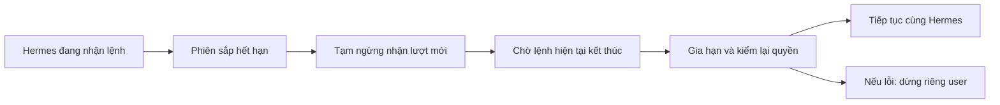

Sơ đồ mô tả code đã kiểm cục bộ, chưa là bằng chứng vận hành dịch vụ thật.


### Tiếp tục ngày 13/10/2026 — ghép gia hạn phiên vào backend

- **Code mới:** trusted maintenance nhận duy nhất opaque token, lấy credentialRef/binding từ authority và store đã xác minh. Phiên gần hết hạn đi qua refresh có fence → đợi tác vụ thật kết thúc → xác minh Auth/CRM mới và revision tăng đúng một → gia hạn cùng connection token → kiểm authority cuối. Không nhận actor/ref từ caller, không trả credential và không mở route HTTP/MCP. Backend ghép manager/provider/store vào cùng dependency scope và đợi đóng trước khi xóa key.
- **Giới hạn tích hợp:** đây là API cho host, chưa tự chạy theo lịch. Host phải dừng nhận/chạy lệnh và chờ lượt đang chạy kết thúc trước refresh, giữ trạng thái đó tới khi maintenance drained. Chưa nối vào timer supervisor vì timer đang chạy đồng thời với command pump; chưa có scheduler sở hữu cơ chế tạm dừng/tiếp tục, durable handoff/restart hoặc product service entrypoint. Không tính P2 hoàn thành từ API này.
- **Finding P2 đã sửa:** handle refresh thiếu/sai drained hoặc begin ném lỗi từng làm thả slot và báo close thành công dù provider có thể còn chạy. Bốn regression FAIL trước tại `.cache/hermes-maintenance-malformed-before.txt`; sau sửa giữ ownership, chặn lượt tiếp và close báo unknown, bắt late rejection ở các Promise đã nhận mà không chạy getter. Probe độc lập đổi từ refreshCalls=2/acceptedAgain=true sang 1/false; không suy unknown là rollback.
- **Kiểm và review:** maintenance + renewal **43/43**, backend dùng constructors thật **24/24**, routing **99/99**; **4/4** mutation trên bản sao bị bắt, hash source/test gốc giữ nguyên. Receipt ở `.cache/hermes-connection-maintenance-fixed.txt`, `.cache/hermes-maintenance-backend-focused.txt`, `.cache/hermes-maintenance-routing.txt` và `.cache/hermes-maintenance-mutations.json`. Review độc lập maintenance/fix và backend không còn P1/P2 đã xác minh trong phạm vi; reports `.cache/hermes-connection-maintenance-review.md` và `.cache/hermes-maintenance-backend-review.md` giữ hash/baseline. DB/Auth/provider vẫn giả lập; kiểm này chưa chứng minh refresh Supabase thật, PostgreSQL nhiều transaction hoặc runtime parking.
- **Gate hoàn tất:** **47/47 local**, **20/20 file Vitest liên quan**, 141 giây; tree `daf69c70622df926b9ff503b9a346e6df03895e8`, run `local-88e31ccf-9818-418f-a8d4-13266f2bcf39`. Log `.cache/hermes-maintenance-gate.txt`, receipts `.cache/hermes-maintenance-gate-receipts/`. Gate cập nhật hai metadata inventory; code giữ nguyên so với snapshot review. Tám hash input browser vẫn khớp, tái dùng bằng chứng synthetic đúng phạm vi tại `.cache/hermes-maintenance-browser-reuse.json`. Native Linux/live vẫn chưa kiểm; WIP chưa CI. Không thay SQL/UI, chưa commit/push/apply/deploy. Checklist **5/65 = 7,7%** mục nghiệm thu không trọng số; phần code đang làm không tự đổi thành tỷ lệ hoàn thành.


### Tiếp tục ngày 13/10/2026 — điều phối từng user và chờ tác vụ thật kết thúc

- **Code mới:** `runtime-orchestrator` lấy owner qua opaque token, tạo logical home bằng marker đúng user/công ty, register gateway rồi `beginStart` supervisor. Có vòng pump luân phiên, một lượt/user, prune riêng; unknown dừng đúng lane, không tự gọi lại. `beginStart` cấp handle trước I/O để dừng user ngay khi còn khởi động. `releaseRegistration` chỉ thu hồi ticket đã cleanup thật. Homes không nhận dữ liệu cũ chưa có owner, không lấy lại crash lock và chưa là memory bền vững.
- **Ghép lifetime:** runner có `beginRun/beginPrune`, driver có `beginExecutePrivateCommand`, trả riêng `{result, drained}`. Backend `createRuntimeSupervisor` dùng cùng dependency scope với SQL/Auth/runner. Đóng runner và supervisor đồng thời, chờ runtime thật dừng rồi mới gateway/model/key; orchestrator đóng pool sau cùng. Public timeout/abort không giải phóng slot trước khi query/process/endTurn thật kết thúc.
- **Refresh:** manager/provider có begin/close và actual drain qua fetch/query/body cancellation. Reconciliation stage/publish giữ nguyên claim và ciphertext, chỉ chạy sau lượt trước đã drain; không retry provider. Chưa nối scheduler vào host/backend, chưa có durable token handoff/restart recovery.
- **Ba finding P2 đã sửa:** (1) driver báo drained sau protocol failure dù child còn chạy: hai regression FAIL trước, bốn beginExecute cases PASS sau sửa; đợi stop thật, failed hard kill giữ lỗi. (2) refresh vẫn stage/publish khi provider result thành công nhưng drain thất bại: bốn regression FAIL trước, tám selected cases PASS sau sửa; probe review nay chỉ dispatch → quarantine, không publish. (3) resolver trả lỗi public sớm làm thả slot startup khi query thật còn pending: regression backend thật FAIL với 16 lượt đã settle, sau sửa resolver chờ finite authority scope drain và vẫn giữ trần 16. Backend final **22/22**; không bọc callback sống lâu của runtime vào scope. Giữ finding/hash trước và bằng chứng sau trong reports, không ghi đè lịch sử.
- **Focused:** runner **35/35**; driver **25/25** trước finding mới, delta sau finding **4/4**; supervisor/gateway **91/91** và witness bổ sung **1/1**; backend composition **21/21**; orchestrator **15/15**; homes **6 PASS / 1 Linux SKIP**; refresh **98/98** trước finding, delta sau sửa **8/8**. Các receipt có phạm vi riêng, không cộng thành gate. Mutations: supervisor/gateway **7/7**, orchestrator/homes **7/7**, refresh **8/8 + 1/1 delta**, root runner/backend **4/4** trên bản sao, hash source giữ nguyên. Hai lần đầu root mutation harness chưa phân loại đúng rejected cleanup; đã chỉnh biến thể để tạo lỗi invariant được assertion bắt, không sửa product để làm test xanh.
- **Review:** root đọc độc lập supervisor/gateway và orchestrator/homes; agent khác review runner/driver, refresh, backend, orchestration/homes và routing. Sau ba fixes không còn P1/P2 đã xác minh trong phạm vi các report. Xem `.cache/hermes-orchestration-root-review.md`, `.cache/hermes-command-drain-independent-review.md`, `.cache/hermes-refresh-drain-independent-review.md`, `.cache/hermes-owned-supervisor-backend-review.md`, `.cache/hermes-runtime-orchestration-independent-review.md`, `.cache/hermes-orchestrator-routing-review.md`. Report giữ snapshot trước/sau; review resolver cuối nằm trong report orchestration.
- **Gate hoàn tất:** **47/47 local**, **20/20 file Vitest**, 147 giây, tree `4141eb57b79d1c263600d2b859009673a8aff890`, run `local-94632039-b57e-4282-ac6d-d6b6f3ffdb84`. Log `.cache/hermes-orchestration-gate.txt`, receipts sao lưu `.cache/hermes-orchestration-gate-receipts/`; routing focused **98/98**. Tám input hash UI vẫn khớp, tái dùng đúng phạm vi desktop/mobile fixture qua `.cache/hermes-orchestration-browser-reuse.json`. Native Linux cases vẫn cần môi trường thật; gate local không thay CI hoặc nghiệm thu live. Hai tài liệu plan/status cập nhật kết quả sau gate được kiểm docs riêng.
- **Tiếp theo:** compose host entrypoint nhận handoff token mã hóa, nối refresh dựa trên credentialRef/binding lấy từ dữ liệu đã xác minh và kiểm quyền lại sau publish; cấu hình quyền/scope đọc phòng trên UI. Cần product runtime Linux/CI, PostgreSQL nhiều transaction và Zalo thật. Chưa apply, commit/push, deploy hoặc hoàn tất thêm mục nghiệm thu; P0 vẫn 5/65, toàn P0–P11 tiếp tục.

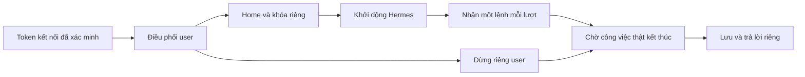

Sơ đồ là các thành phần đã có code cục bộ; chưa phải dịch vụ chạy toàn tuyến hoặc memory bền vững.

### Tiếp tục ngày 13/10/2026 — gateway theo user và bộ chạy container

- **Code mới:** backend dựng model-service bằng authority/store/crypto/Auth hiện có rồi chuyển tới llm-proxy; opaque token/JWT vẫn ở host. Gateway gắn một connection với profile, kiểm quyền hiện hành, chỉ mở model/tool đọc phòng trong lượt được cấp. Sidecar chỉ chuyển HTTP tới socket riêng; runtime không nhận credential CRM/provider. Container driver dùng image đã ghim, profile mới, admission đóng khi startup và đợi READY/inspection trước mở. Transport sở hữu socket, bridge và sidecar riêng; khi cleanup chưa rõ thì giữ resource receipt và ownership.
- **Thu hồi và dừng:** dependency scope giữ các tác vụ thật còn chạy sau timeout; không coi abort là đã dừng hoặc hoàn tiền. Driver chờ container/child thực sự kết thúc và drain trước trả ownership. Docker endpoint được resolve một lần rồi ghim cho mọi lệnh, kể cả attach/network; sửa nguy cơ biến môi trường đổi đích. Trên Linux, UID:GID container phải khớp host để dùng file 0600/thư mục 0700.
- **Kiểm cục bộ:** dependency/adapters **75/75**; relay HTTP/socket **6/6**; model-service **21/21**; gateway **26/26**; container driver **23/23**; gateway transport **18 PASS, 2 Linux SKIP**; routing **98/98**. Backend cũ **17/17**, integration model **2/2**, delta context MCP **1/1**, mỗi receipt giữ phạm vi riêng. Không cộng các lượt thành một gate. Gateway dùng MCP client Python **2.0.0** thật cho hai user, phát hiện/sửa metadata `_meta: {}` của SDK. Test này có thể skip nếu CI thiếu venv; receipt Windows hiện tại không có skip ở lượt gateway 26/26.
- **Mutation và review:** root **7/7** trên bản sao byte-identical, model-service **6/6**, gateway **8/8**, driver **11/11**, transport **6/6** đều bị bắt và khôi phục hash. Review độc lập dependency/relay/backend, routing, driver và transport; root review model-service/gateway không có P1/P2 đã xác minh trong phạm vi ban đầu. Khảo sát CI sau đó phát hiện một thiếu sót volume thật của image, đang sửa riêng bên dưới; kết luận review cũ không thay kết luận cho delta này. Reports/receipts ở `.cache/hermes-runtime-drain-relay-independent-review.md`, `.cache/hermes-runtime-routing-independent-review.md`, `.cache/hermes-container-driver-independent-review.md`, `.cache/hermes-runtime-model-service-root-review.md`, `.cache/hermes-runtime-gateway-root-review.md`, `.cache/hermes-gateway-transport-independent-review.md`.
- **Tương thích upstream đã sửa:** chuẩn hóa leading `developer` → `system`, yêu cầu đúng một `max_tokens`/`max_completion_tokens` và giữ trần 4.096 trước tính dấu chống gọi lặp. Hai regression FAIL trước sửa, **7/7 selected PASS**, **6/6 mutation** bị bắt; review delta `.cache/hermes-runtime-final-delta-review.md` không có P1/P2 đã xác minh. Assembler Hermes thật sinh bốn tổ hợp payload; OpenAI SDK **2.24.0** thật đã gửi **4/4** qua relay + gateway thật tới model-service giả lập. Unknown backend: một request/một dispatch; disconnect sau nhận body: một request, không retry. Receipt `.cache/hermes-model-wire-receipt.json`, source hash trước/sau khớp. Venv mới riêng, Python 3.12.14; đây chưa phải AIAgent/container Python >=3.14, MCP tool cycle nhiều lượt hoặc provider/quota thật.
- **Gate checkpoint đầu 45/47**, tree `f9f56ff7c72f75edbf34759c2bd4fad1e241d1c3`, run `local-ad2406e9-2369-4c2e-93d2-8852f9808544`, 140 giây. Node-native: 1.845 PASS/2 FAIL/2 Linux SKIP; Vitest: 19/20 file đạt, 402 assertion đạt nhưng một file không import được. Log `.cache/hermes-runtime-gateway-gate.txt`, receipts giữ ở `.cache/hermes-runtime-gateway-first-gate-receipts/`. Không gọi lượt này là xanh: cần sửa fixture deadline chạy dưới tải và Python import startup; lỗi ENOBUFS đã tìm nguyên nhân do venv SDK mới chưa ignore làm Git inventory vượt 1 MiB. Chỉ ignore chính thư mục venv sinh ra, không đổi verifier hoặc loại test sản phẩm. Gate chạy lại sẽ dùng receipt đúng đầu vào theo Contract.
- **Finding image thật đã sửa:** config blob hiện tại đã đối chiếu digest/size với image ghim, xác nhận `Volumes: /opt/data`. Sidecar trước sửa thiếu mount đè, khiến Docker tạo anonymous volume và inspection từ chối startup. Đã thêm explicit tmpfs chỉ đọc 1 MiB, giữ chặn volume/mount thừa; fixture mô phỏng đúng volume do image tạo, regression FAIL trước sửa. Timer test nay kích sau khi network create thực sự bắt đầu, không kéo dài deadline sản phẩm. **20 PASS, 2 Linux SKIP; 4/4 mutation delta** bị bắt/khôi phục. Receipts `.cache/hermes-current-image-config-verified.json` và `.cache/hermes-gateway-transport-narrow-fix-report.md`; review delta `.cache/hermes-gateway-transport-fix-review.md` không còn P1/P2 đã xác minh trong phạm vi. Chưa thực thi Docker ở máy này.
- **MCP test dưới tải:** gate cũ không ghi phase nên chưa kết luận được timeout nằm ở imports hay protocol. Fixture mới chờ ready sau pinned imports rồi mới cho chạy giao thức; startup giới hạn riêng 90 giây, watchdog giao thức vẫn 20 giây, timeout SDK từng request vẫn 5 giây. Giữ child ownership tới close thật, không cho late-ready chạy tiếp. Focused **2/2**, pressure 15 Node files đồng thời mỗi file **2/2, không skip**; **3/3 mutation** bị bắt và root review delta không có P1/P2 đã xác minh. Xem `.cache/hermes-mcp-pressure.json`, `.cache/hermes-mcp-lifecycle-root-review.md`. Không thay các assertions giao thức hoặc timeout sản phẩm để né lỗi.
- **Gate sau sửa 47/47**, tree `d340c7f5a083e4307eb4f95d59fa35e7cc981cbf`, run `local-8b8e2e55-d0d4-49fa-8f76-8769132b75b5`, 175 giây, **20/20 file Vitest**. Log `.cache/hermes-runtime-gateway-gate-fixed.txt`; receipts sao lưu `.cache/hermes-runtime-gateway-fixed-gate-receipts/`. Đây là gate local, không thay CI, Linux tests bị skip hoặc nghiệm thu live. Tám browser input hashes vẫn khớp nên tái dùng đúng desktop/mobile fixture ở `.cache/hermes-runtime-browser-reuse.json`. Không chạy lại UI không đổi. Hai tài liệu plan/status được cập nhật sau snapshot gate; chỉ kiểm lại docs cho delta ghi kết quả.
- **Giới hạn và bước tiếp:** thiếu orchestration nhận token tin cậy, register/start/refresh/stop, pump và prune; cần giữ thứ tự đóng runner + supervisor cùng lúc, đợi runtime đã gỡ rồi mới backend/gateway và pool. Khảo sát `.cache/hermes-runtime-orchestration-source-plan.md` xác định token hiện chỉ trả UI một lần, DB lưu digest: cần handoff mã hóa/reconciliation để restart; renewal chưa nối provider refresh; connect UI chưa cấp được quyền/scope đọc phòng. Không tự suy danh tính hoặc cấp thêm quyền để né những việc này. Docker daemon hiện tại không khả dụng; chưa kiểm native Linux, network/egress/mount thật, PostgreSQL nhiều transaction, quota live, JWT/Supabase/Zalo thật. Không apply, commit/push hoặc deploy. P5–P11 và các cửa nghiệm thu chưa đóng vẫn tiếp tục.

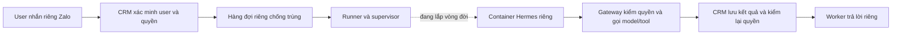

Các khối đã có code và kiểm cục bộ; toàn sơ đồ chưa chạy live. Memory bền vững và Hermes tổng thuộc các phần tiếp theo, chưa có trong container hiện tại.


### Tiếp tục ngày 13/10/2026 — trả lời riêng và tiến trình Hermes

- **Phạm vi đã code:** migration mới `20261013095000_hermes_zalo_private_reply_v1.sql`; RPC service-role claim/dispatch/ack nhận nguồn phiên worker đã ghim, lấy người nhận và nội dung từ binding/ledger. Một delivery/account, dispatch lần đầu mới cấp quyền gửi; ACK trùng chỉ nhận cùng kết quả/provider ID. Câu trả lời không đi qua inbox/queue chung. Sau thu hồi/đổi phiên, ACK cũ chỉ được ghi metadata đúng delivery; không lấy nội dung hoặc mở gửi lại. Prune giữ tombstone, xóa body/reply, xử lý mất ACK và receipt đến muộn.
- **Quyền trước và sau sinh nội dung:** lưu phiên bản quyền CRM ngay trước runtime; kiểm lại khi ghi READY, đọc và gửi trả lời. Chụp thêm mốc hiệu lực tiếp theo của membership/role/override để hết hạn theo đồng hồ cũng bị chặn dù version không tăng. Dòng cũ thiếu capture không được gửi. Candidate bỏ qua binding/user/quyền cũ để user bị thu hồi không chặn user khác cùng nick bot. Chưa chứng minh mọi writer quyền hoặc catalog live đều tuân thủ contract version hiện có.
- **Worker:** `hermes-reply.js` dùng đúng API của phiên Zalo hiện tại, polling 5 giây khi ingress ready, giữ một tác vụ đang chạy; kiểm ACK đúng account/org/generation và kiểm phiên/hạn ngay trước provider call. Unknown admission không tự retry; timeout giữ slot đến khi promise thật kết thúc. Teardown/relogin/error đóng admission. Thư viện zca-js 2.2.0 đã đối chiếu archive integrity/source; ba constructor đặt logging false. Lỗi listener chỉ log mã cố định, regression tái hiện FAIL trước sửa/PASS sau.
- **Kiểm đã có:** SQL mới **265/265** trên PGlite, migrations chạy hai lần; receipt `.cache/hermes-private-reply-timed-authority-fixed.txt`. Worker **185/185** trước delta log; delta log **2/2** (39 unrelated skipped) ở `.cache/hermes-private-listener-log-focused.txt`. ACL/log source **49/49**, routing **97/97**. Không cộng các lượt thành một gate và không đổi nhãn receipts lỗi trước đó. SQL bốn mutation và worker ba mutation đều bị bắt, byte/hash khôi phục; xem `.cache/hermes-private-reply-mutations.json` và worker agent report. Review SQL `.cache/hermes-private-reply-independent-review.md`, worker `.cache/hermes-private-reply-worker-root-review.md`, routing/ACL/logging `.cache/hermes-private-reply-routing-independent-review.md` không còn P1/P2 đã xác minh trong phạm vi tương ứng.
- **Wrapper:** `infra/hermes-runtime/agent-process.py` dùng AIAgent/SessionDB/MCP của upstream commit đã ghim, bootstrap không có token, JSONL giới hạn và command ID chống lặp, tool CRM allowlist, kiểm owner/context quyền trước/sau model. Memory bền vững tạm tắt; SessionDB dùng thư mục tạm và history chỉ giữ khi context không đổi. Subprocess **12/12**, mutation **6/6** ở snapshot đầu. Review phát hiện mismatch với relay; đã sửa streaming false, tối đa 4096 token, app retry một lần, recovery 0/fallback rỗng. History budget chừa system/user và các vòng gọi hai tool; vượt thì bỏ toàn bộ agent/DB/session, không cắt cặp tool. Delta **5/5**, mutation **7/7**; source SHA `594748225935c0e0bf86e6d5164b3d198f4c2a9d6dcbac39649b4e87c680db41`, test SHA `7ab490acb0f6e8e6f21d9bd8183554c1fa9e7215d151c549f97d9cf47a9e4718`. Report `.cache/hermes-agent-process-independent-review.md` giữ finding cũ và re-review riêng: mới giải quyết một phần, chưa bảo đảm 64 messages nếu model gọi lặp nhiều tool trong một vòng; cần gateway giới hạn số tool call/round, project request thật và chặn retry khi kết quả chưa rõ. Gateway/model/container chưa triển khai nên chưa gọi Hermes/model thật.
- **Gate local outbound/process 47/47**, tree `f5e6a069f30d0d70bb77e1d92bf08077436b5974`, run `local-f83b0136-546d-42e3-b96a-b92d38764fda`; log `.cache/hermes-private-reply-local-gate.txt`, receipts sao lưu `.cache/hermes-private-reply-gate-receipts/`. Đây là kiểm local trên snapshot đã stage; chưa có CI cho WIP mới. Gate dispatch cũ vẫn chỉ thuộc snapshot riêng. Chưa apply TEST/production, commit/push/deploy; tám input hash của browser fixture vẫn khớp, đã tái dùng đúng phạm vi desktop/mobile cũ.
- **Tiếp tục:** xây gateway giữ token ngoài runtime, nối model relay/quota và cổng MCP đang có; container driver prepare/start/stop với admission và chứng minh exit thật; orchestration pump/prune; kiểm Linux Docker, PostgreSQL nhiều transaction, JWT và Zalo thật theo lane. Sau đó tiếp tục toàn bộ P0–P11, gồm memory riêng/Hermes tổng và nghiệp vụ/UI/vận hành. Không đóng goal từ checkpoint offline.

```mermaid
flowchart LR
  A[User nhắn riêng Zalo] --> B[Worker xác minh nguồn]
  B --> C[CRM kiểm user và quyền]
  C --> D[Hàng đợi riêng chống trùng]
  D --> E[Runner và supervisor]
  E -. gateway và container driver chưa nối .-> F[Tiến trình Hermes]
  F -. chưa chạy toàn tuyến .-> G[CRM kiểm lại quyền và lưu câu trả lời]
  G --> H[Worker nhận quyền gửi một lần]
  H -. chưa gửi Zalo thật .-> I[User nhận trả lời riêng]
```

Nét liền biểu thị code đã kiểm trong phạm vi fixture; không phải bằng chứng triển khai hoặc chat live.

Thiết kế bước tiếp theo đã tra source tại `.cache/hermes-runtime-gateway-driver-design.md`: model-service trong backend tái dùng authority/store/crypto/Auth và llm-proxy; không lấy JWT từ runtime. Trên Linux Engine 28+, mỗi profile có private bridge và relay sidecar riêng nối một Unix socket của host; token ở host, runtime không mount socket. `prepare` chưa có side effect, startup chỉ mở context/list/ping cần READY, model/room chỉ mở trong turn đã cấp. Stop phải đóng admission, đợi process/container thực sự thoát và drain transport trước trả lease. Gateway còn phải project request đúng relay, giới hạn hai tool calls/round và giữ trạng thái unknown để chặn gọi model lại; actual wire/SDK cần kiểm với upstream đã ghim. Đây là thiết kế cần hiện thực/kiểm, không phải hạ tầng đã có.


### Tiếp tục ngày 13/10/2026 — nối claim, thực thi và lưu trả lời riêng

- **SQL:** migration mới `20261013084000_hermes_private_command_dispatch_v1.sql`, SHA `a03317beaf250c373e1ccea29a921161979b72e4dc4420eb32d3a46714cdde29`. Chỉ executor gọi năm hàm cố định claim/dispatch/finish/fail/prune; helper và bảng không có quyền trực tiếp. Danh tính lấy từ digest token thật, kiểm session/connection/member/policy và binding/bot/worker hiện tại dưới khóa. Claim giữ một lệnh đang chạy/connection. Chỉ ACK dispatch lần đầu cho phép gọi runtime; lệnh đã dispatch không quay lại QUEUED.
- **Lưu trữ:** READY chỉ là câu trả lời đã lưu riêng, chưa gửi Zalo. Hàm prune dọn tối đa 256 dòng hết hạn mỗi lần, xóa body/reply và giữ tombstone chống trùng. Lệnh đang dispatch hết hạn thành UNKNOWN_EFFECT. Chưa có lịch gọi prune trong vận hành; TTL tự nó không thực thi việc xóa.
- **Supervisor:** nhận branded handle cùng command do DB cấp; dùng token nội bộ kiểm owner trước/sau runtime, không chuyển token vào nội dung lệnh. Mỗi handle một lệnh đang chạy, nhớ ID để chặn replay trong vòng đời. Cancel/deadline đóng gate, stop và giữ profile/slot tới khi công việc thực sự kết thúc. Bộ nhớ ID này không thay ledger qua restart.
- **Runner/backend:** factory nội bộ `backend.createPrivateCommandRunner(supervisor)`, không route HTTP/MCP. Resolve → claim → kiểm owner → dispatch → supervisor → kiểm owner → finish. Lost/malformed/already-dispatched ACK không gọi lại runtime; finish unknown không bị cleanup ghi đè. Kết quả chỉ metadata. Một tác vụ/token, tối đa 16, deadline 120 giây; close hủy và drain trước xóa keyring. Chưa có polling tự động hoặc runtime adapter sản phẩm.
- **Kiểm:** `.cache/hermes-private-dispatch-sql-focused.txt` **251/251** (PGlite, gồm intake cũ sau extract fixture; phần testbody cũ giữ nguyên). Supervisor 47/47 trước/sau sửa P2; xem receipt fix và `.cache/hermes-supervisor-command-independent-review.md` cho source/hash cùng probe sau sửa. Store `.cache/hermes-private-command-store-focused.txt` **53/53**; runner `.cache/hermes-private-runner-focused.txt` **49/49**. ACL `.cache/hermes-dispatch-acl-fixed.txt` **34/34**; lượt đầu FAIL chỉ do expected message cho role anon, đã sửa đúng nhánh verifier.
- **Review và sửa lỗi:** review intake/bốn fixes cũ sạch trong phạm vi. Review supervisor phát hiện cancel/deadline chưa đóng admission; đã sửa và probe lại cancel/timeout/claim-expiry đều đóng gate, giữ lease khi work còn pending. Review SQL phát hiện QUEUED cũ chặn binding mới; regression FAIL trước sửa ở `.cache/hermes-private-dispatch-hol-before.json`, sau sửa chỉ chọn candidate còn hợp lệ rồi vẫn lock/recheck, regression nhận/dispatch B và giữ A chưa chạy. Hai reports giữ finding/hash trước và appendix sau sửa. Root review store của agent và review độc lập runner/backend không có P1/P2 đã xác minh (`.cache/hermes-private-command-store-root-review.md`, `.cache/hermes-private-runner-independent-review.md`). Backend drain public promises; nơi quản lý runtime vẫn phải đóng/đợi supervisor để chứng minh process thực sự dừng.
- **Mutation:** `.cache/hermes-dispatch-mutations.json` bốn biến thể SQL thật đều bị bắt (dispatch ACK lặp, reply thay đổi, bỏ epoch binding, mở helper), khôi phục byte/SHA. Store bốn, runner sáu, supervisor năm mutation trước fix và mutation nhánh halt sau fix được lưu riêng; không đổi nhãn receipt cũ.
- **Giới hạn:** chưa chứng minh PostgreSQL đa transaction, Auth/JWT/Supabase/Zalo thật, runtime adapter sản phẩm hoặc gửi trả lời. Chưa apply TEST/production, commit/push/deploy. Provenance production đã sinh lại bằng đọc catalog, candidate vẫn unknown/chưa apply; classification khớp digest, không là quyền apply. Gate local delta **47/47**, **19 file Vitest**, 85 giây, Node 24.18.0; log `.cache/hermes-dispatch-local-gate.txt`, tree `0435648b08accbbefe646ec6aee4d6219c5789e9`, run `local-e42f2a93-7fe8-4250-a66b-7ceb3e091856`. Receipts sao lưu `.cache/hermes-dispatch-gate-receipts/`. Routing riêng **96/96**. Tám hash input browser desktop/mobile trước đó vẫn khớp nên tái dùng đúng phạm vi fixture; không chạy lại UI không đổi. Chưa có CI cho candidate này; các gate 47/47/46/47 cũ chỉ thuộc snapshot được ghi bên dưới.
- **Điểm code tiếp theo đã tra source:** (1) runtime adapter sản phẩm quanh image/commit đã ghim và `AIAgent.run_conversation`, JSONL giới hạn/ID chính xác, prepare inert, start admission đóng, stop phải chờ process/container thực sự dừng; bridge MCP/model bên ngoài runtime giữ token và tái dùng broker, không chép bearer theo fixture. Chứng minh container cần native Linux + Docker Engine 28+, chưa có ở máy hiện tại. (2) private reply runner theo session hiện có trong `worker/lib/inbound.js`; không dùng queue/finalizeSend chung vì lưu inbox và log lỗi raw. RPC claim/dispatch/ack lấy UID nhận từ binding DB, fence account/lease/generation/login; mất ACK không gửi lại, ghi receipt cũ không cấp quyền gửi mới. Cần xác minh receipt/text limit/cancel của zca-js 2.2.0 trước live. (3) lắp lifecycle pump/prune, runtime shutdown và kiểm toàn tuyến; mới cân nhắc apply đúng schema lane. Hai lượt tra source này chỉ đọc, không phải implementation hay bằng chứng runtime.


```mermaid
flowchart LR
  A[Nick chính gửi lệnh] --> B[Worker nick bot kiểm tin riêng]
  B --> C[CRM xác minh user và quyền]
  C --> D[Hàng đợi riêng chống trùng]
  D --> E[Claim và cho chạy một lần]
  E --> F[Supervisor của đúng user]
  F -. adapter thật chưa nối .-> G[Hermes xử lý]
  G --> H[Kiểm quyền và lưu câu trả lời riêng]
  H -. chưa nối .-> I[Worker gửi riêng qua Zalo]
```

Nét liền là đường code đã kiểm bằng fixture; nét đứt còn thiếu tích hợp sản phẩm. Không có bằng chứng gửi tin thật từ sơ đồ này.


### Tiếp tục ngày 13/10/2026 — đã nối nhận lệnh riêng vào hàng đợi

- **Quyền phiên đã nạp:** danger-full-access, approval never; không yêu cầu cấp lại quyền. Gate mới ban đầu dừng trước tests do thiếu biến credential; giữ hai logs riêng. Đã nạp đúng PAT vào process qua helper vault của repo và chạy gate đạt **47/47**, **19 file Vitest**, 293 giây. Log: `.cache/hermes-p4-fixes-local-gate-hydrated.txt`; tree `3df945e7baf43494d9cd24f974617596af4438d2`, run `local-b275df04-46c7-4423-a899-66ee449a0936`. Receipt này là trước private intake mới, không gán cho delta mới.
- **Listener → SQL:** chỉ live DM plain text đã parse mới đi tới RPC cố định `hermes_zalo_private_command_v1`, sau ACK private đúng phạm vi. Snapshot trước async; không đưa user/assistant/connection do tin nhắn tự khai. ACK phải khớp account/org/provider ID, command UUID và queued/duplicate. Unknown không retry, giữ slot tới khi transport settle; overload rõ trạng thái. History/self/media/quote không enqueue, lỗi transport không log nội dung và không rơi vào shared inbox.
- **SQL nhận lệnh:** migration `20261013055055_hermes_zalo_private_command_v1.sql`, SHA `a03b0abd71b5a44c008f67eac361172f6ee2c07823bd158a165b37b759b38347`. Bảng private với RLS và không cấp SELECT/UPDATE cho API hoặc executor. DB lấy user/org/assistant/connection từ binding ACTIVE; kiểm membership, session, token, policy, bot/version, lease, generation và login snapshot. `activated_at` chặn tin có trước liên kết; thời gian live tối đa 5 phút cũ/30 giây tương lai. Khóa chống trùng account/provider ID gắn payload, không mất khi đổi generation. Tối đa 64 dòng QUEUED/account; TTL không quá 15 phút và không vượt token/session. Chưa có consumer hoặc dọn TTL; không mở sử dụng khi chưa nối hai phần này.
- **Kiểm:** `.cache/hermes-private-command-worker-fixed.txt` **196/196**, `.cache/hermes-private-command-sql-final.txt` **43/43**, `.cache/hermes-private-command-routing.txt` **96/96**. SQL chạy PGlite với foundation/member/session validators thật và bảng CRM tối thiểu; credential/binding được seed giả, không chứng minh handshake/Auth JWT/provider hoặc concurrency. Hai lỗi kiểm worker đầu tiên do kỳ vọng cũ và label sync đã sửa; giữ log đầu. SQL harness đầu tiên mắc lỗi RESET ROLE che lỗi transaction đã abort, đã sửa bằng savepoint/rollback và giữ log riêng.
- **Mutation:** năm thay đổi source thật bị bắt và khôi phục đúng SHA ở `.cache/hermes-private-command-mutations.json`: bỏ đối chiếu payload, bỏ sender binding, bỏ mốc activated_at, mở SELECT bảng private, cho private rơi vào shared inbox. Mutation mốc thời gian ban đầu không bị bắt vì test dùng ID đã tồn tại; đổi sang ID mới để tránh dedup che lỗi, rồi chạy lại đạt.
- **Gate delta mới:** `.cache/hermes-private-command-local-gate.txt` **46/47**, 80 giây, **19 file Vitest**; tree `b8e9cae13237e2464e2af9093c731d12f4f50d5c`, run `local-da26a0df-e8c4-4647-a72e-da5ecc5087cc`. Chỉ node-native đỏ do hai assertions trong verifier ACL chưa cho worker execute đúng RPC intake mới. Đã thêm chính xác một RPC vào allowlist service_role; negative controls vẫn chặn authenticated/executor và thu hồi nhầm grant. `.cache/hermes-private-command-acl-fixed.txt` **33/33**. Giữ nguyên receipt đỏ; các code product/SQL không đổi sau gate. Không đổi nhãn lượt này thành 47/47 hoặc lặp lại toàn bộ các kiểm xanh chỉ để có một số tổng. Review độc lập/CI còn mở.
- **Review:** đã hoàn tất review độc lập phần intake và bốn fixes, không có P1/P2 đã xác minh; xem cập nhật mới nhất bên trên. Claim/dispatch và runtime mới cần review delta riêng. Chưa commit/push/apply/deploy.
- **Tiếp theo:** claim/dispatch cùng ledger private này → supervisor dùng token/handle đáng tin để resolve quyền mới → runtime → queue trả lời riêng có recheck; không giả JWT/user. Bổ sung dọn TTL/tombstone, xử lý queue đầy/unknown và thông báo người dùng. Sau đó tiếp tục P5–P11; không đánh dấu P4.03 hoàn tất từ kiểm offline này.

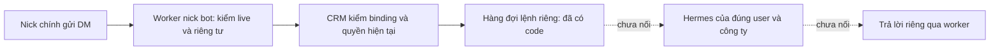


### Tiếp tục ngày 13/10/2026 — hoàn tất code sửa bốn findings

- **Worker:** bad/expired challenge chỉ tiêu thụ ticket; mỗi observation mới vẫn qua SQL. Registration phục hồi chỉ sau HTTP 403 + SQLSTATE 42501 từ eligible live handshake, cùng một RPC và generation ACK thật. Unknown/timeout/malformed/context mismatch không retry ghi. Privacy dùng chung RPC đang chạy, giữ slot đến khi transport settle kể cả timeout, batch sau đọc mới. Ca listener chín DM đều lưu đủ với một privacy RPC. Lượt trước **36 fail/55 pass**, lượt cuối **94/94** trên hai suite; logs `.cache/hermes-worker-fixes-before.txt` và `after.txt`.
- **SQL:** conversation `FOR KEY SHARE` cho preview legacy cập nhật, giữ account SHARE đối với setBot UPDATE; đọc lại phân loại parent sau account lock. Mọi conversation của retained bot giữ thread type/id, kể cả group hoặc bot tắt. Bổ sung kiểm nullable/forged account, parent/org, FK và hai RPC gửi text/media legacy. `.cache/hermes-sql-fix-after.txt` **33/33**, SHA P4 `d57bf2f2f25dd890951c0de64006f89cf478f401b19f1e422c30f7338c224f54`. Đây là SQL tuần tự trên PGlite, chưa chứng minh contention/MVCC nhiều transaction. Docker CLI có nhưng daemon không chạy.
- **Mutation:** `.cache/hermes-worker-fix-mutations.json` có bốn mutation thật bị bắt: poison ingress, retry kết quả bất định, burst overload, cache shared quá lâu; SHA khôi phục khớp. `.cache/hermes-sql-fix-mutation.txt` khôi phục ngoại lệ group gây assertion failures ở bot bật/tắt, sau đó byte/hash SQL khớp lại green receipt.
- **Review:** parser review `.cache/hermes-parser-review.md` hoàn tất, không có P1/P2 đã xác minh, năm input hashes trước/sau giống nhau. `.cache/hermes-p4-preserved-inputs.json` xác nhận tám browser inputs và bốn supervisor inputs không đổi; tái dùng bằng chứng đúng phạm vi. Agent SQL hoàn tất code/kiểm nhưng phản hồi cuối bị router token_revoked; không coi là review độc lập. Re-review chưa hoàn tất tại checkpoint này; kết quả cập nhật ở đầu tài liệu.
- **Trạng thái:** chưa commit/push/apply/deploy; SQL P4 vẫn chưa áp dụng TEST/production. Hàng đợi riêng/dispatch/reply vẫn chưa nối. Phần tiếp theo là private durable command intake và DB-derived binding, tiếp đó runtime admission/outbound recheck; tiếp tục toàn bộ P0–P11.

### Tiếp tục ngày 13/10/2026 — sửa findings và chuẩn bị nhận lệnh riêng

- **Review đã chạy được:** CLI có sẵn từng hoàn tất hai review độc lập trong checkpoint này; báo cáo và receipts được giữ làm bằng chứng lịch sử. Không dùng lệnh cấu hình agent cũ làm hướng dẫn cho session tiếp theo.
- **Candidate đã kiểm:** `.cache/hermes-p4-private-local-gate.txt` đạt **47/47**, 18 file Vitest liên quan; HEAD `c69cf0d053edc3347bf45cda459b99f0fde39cc6`, tree `91c12a8454b256c6db05a6a046aa41716def26fb`, run `local-6b317d07-1249-40b3-a463-a5d1c17bf4ae`. Không đổi nhãn các lượt lỗi trước; candidate sau sửa cần kiểm delta.
- **Supervisor:** `.cache/hermes-supervisor-cli-review.md` hoàn tất review độc lập, không có P1/P2 đã xác minh trên snapshot trên. Dùng lại review vì source không đổi. Runtime adapter thật, startup treo và việc runtime đã ngừng thực thi vẫn chưa được chứng minh.
- **Bốn lỗi P4:** `.cache/hermes-p4-private-cli-review.md` phát hiện mã sai làm vô hiệu toàn ingress; bật bot sau attach không phục hồi registration; burst chín DM bị giới hạn tám RPC làm rơi tin shared; khóa conversation SHARE xung đột với cập nhật preview của legacy send. Root đã tái hiện hai lỗi vòng đời trong `.cache/hermes-link-recovery-before.json`. Hai nhánh worker và SQL đã sửa xong, focused tests xanh; findings chưa khép nghiệm thu vì delta chưa được re-review.
- **Parser riêng:** `worker/lib/hermes-command.js` chỉ chiếu live DM plain text thành payload cố định, không nhận user/assistant/connection từ tin nhắn. Kiểm nguồn đã ghim, người gửi/người nhận, provider ID, timestamp canonical, giới hạn 8.192 byte; từ chối self/group/history/media/quote/forward/handshake và getter. Agent parser kiểm **85/85**; chưa gắn inbound/SQL, chưa dedup, chưa kiểm freshness bằng đồng hồ DB. Parser SHA `1b4031a31e1eab0e3b402a89ad87176065411b887feff80e3f0445e71123440a`.
- **Routing/mutation:** `.cache/hermes-parser-routing-before.txt` có hai assertion FAIL vì chưa khai báo native dependency và tier quyền; sau sửa manifest, `.cache/hermes-parser-routing-after.txt` **96/96**. Có negative control bỏ rule/tier quyền. `.cache/hermes-parser-mutations.json`: ba mutation file thật (sai người nhận, self echo, mã liên kết) đều bị bắt, khôi phục SHA khớp. Lượt startup native loader thiếu `__dirname` được giữ riêng; không tính là kiểm hành vi.
- **Tiếp nối bắt buộc:** hoàn tất fix/re-review bốn findings; sinh provenance theo digest cuối; hàng đợi private lưu bền + chống trùng; lấy user/org/assistant/connection từ binding DB; admission runtime và trả lời riêng kiểm lại quyền. Không apply/deploy P4 khi phần nhận và trả lời còn thiếu. P0–P11 vẫn là phạm vi đầy đủ.

### Tiếp tục ngày 13/10/2026 — chặn nội dung riêng khỏi inbox chung

- **Worker:** `createHermesIngress.privacy()` gọi fixed RPC bằng nguồn account/org/owner/UID/login đã ghim, không gửi nội dung chat trong truy vấn phân loại. Chỉ ACK `shared` đúng account/org và phiên còn sống mới cho đi tiếp; lỗi, timeout, mất lease, sai ACK hoặc thiếu ingress đều đóng luồng inbox. Vẫn kiểm được khi đăng ký bot bị từ chối, để bot đã tắt không trở lại luồng chung. Admission giữ tới lúc RPC thực sự kết thúc, không retry tự động.
- **Điểm tích hợp:** `handleInbound` chặn DM trước conversation/message/preview/log nội dung/push/auto-reply; `upsertMessagesForThread` lọc history trước ghi, gồm self echo và media. Handshake vẫn lưu đúng bản đã che mã phục vụ liên kết. Tin nhóm và account chưa từng cấu hình bot vẫn được nhận khi quyết định hợp lệ. Tin riêng bị chặn hiện **chưa được lưu vào hàng đợi Hermes hoặc trả lời**; đây chưa phải router sản phẩm hoàn chỉnh, không deploy worker trước khi nối phần còn thiếu.
- **Database candidate:** thêm `privacy` vào RPC service-role hiện có và `hermes_zalo_shared_inbox_guard_v1()` cho hai bảng public. Bot row còn tồn tại sau disable giữ ranh giới riêng tư. Trigger resolve account qua conversation, không tin `account_id` nullable; chặn chuyển parent/account/org/thread type để thoát ranh giới. Chỉ identity row có marker che mã được lưu; raw được dựng lại từ UID số, xóa media/reply/reaction, preview che và unread=0. Khóa account SHARE ở cửa ghi và UPDATE ở `setBot` dành cho thứ tự bật bot/ghi tin; chưa có bằng chứng chạy hai transaction đồng thời. Không xóa dữ liệu lịch sử từng được ghi hợp lệ trước khi account làm bot.
- **Focused:** `.cache/hermes-p4-private-worker-fixed.txt` **57/57**, bốn file worker; giữ log FAIL đầu `.cache/hermes-p4-private-worker.txt` (fixture đếm cả sync nhãn và đếm nhầm spy, đã sửa assertion đúng phạm vi). `.cache/hermes-p4-private-schema.txt` **78/78** cho binding/source privacy/ACL. Bảy mutation SQL trong memory đều bị bắt; riêng verifier privacy có thay đổi chuẩn hóa CRLF sau lượt này, cần lượt kiểm kế tiếp. `.cache/hermes-p4-private-mutations.json` có bốn mutation file thật: bỏ live guard, bỏ history guard, cho unknown vào shared, bỏ scope ACK; đều bị assertion bắt và khôi phục hash. Inbound SHA `e113b48b5b7a62630cea711d762548122dea64a294da07430637e684ba3049ba`, ingress SHA `a1f61a45242b83ccb57669aa97da441eb4b34ecb1c7251ad692c639d66311fef`.
- **SQL trên database bỏ đi:** `.cache/hermes-p4-private-sql-fixed.txt` **11/11** với PGlite **0.5.4** đã ghim sẵn trong repo. Chạy nguyên candidate hai lần; dùng ba input validator thật, bảng tối thiểu và Auth/member/permission/audit stub. Thực thi nhánh `privacy`, `setBot`, hai trigger: shared trước cấu hình, stale decision rồi enable, nullable account, private body/media/quote, preview, reparent/cross-org, disable, source giả, role/lease và đối chứng bỏ trigger cho thấy body rò rồi ROLLBACK khôi phục. Lượt FAIL đầu do fixture chọn sai file chứa validator; đã sửa và thêm assertion đủ ba hàm. Đây không phải baseline restore, Supabase/JWT thật, toàn bộ nhánh P4, MVCC/concurrency hoặc schema apply trên TEST. Database memory đã đóng; không cài dependency mới.
- **UI/browser:** thêm cảnh báo chỉ dùng nick dành riêng, DM không vào hộp thư chung kể cả sau tắt bot. Component **8/8** (`.cache/hermes-p4-private-ui.txt`). `.cache/hermes-p4-private-browser/receipt.json` và log cùng tên: desktop 1440×1000/mobile 390×844 PASS, hash trước/sau khớp, không console error/request ngoài fixture/tràn ngang. Đã xem hai ảnh `admin-enable-*`; cảnh báo và nút đọc được. Chỉ Auth/layout/HTTP giả lập, không Zalo thật.
- **Schema/review:** SHA P4 `20150a5fb5b9b77f144b9ac86cfc7b0527afee3825da3c2c42f1a637c9f1ec08`; provenance production sinh lại bằng đọc catalog, vẫn unknown, classification khớp SHA/missingObjects. Không sửa sáu migration TEST đã áp dụng. Review độc lập chưa có tại checkpoint này; trạng thái mới hơn ở đầu tài liệu. Chưa apply TEST/production, CI hoặc deploy; không coi root kiểm/PGlite là cross-review.
- **Tiếp theo:** giữ private boundary, thêm inbox/queue riêng lưu bền và dedup theo account/provider message ID; chỉ live DM hợp lệ được enqueue, bind user/org/assistant/connection từ DB, recheck quyền lúc runtime nhận và lúc trả lời. Hoàn tất review/TEST race và lệch đồng hồ trước mở P4. P2/P3 runtime/refresh/quota, memory/Hermes tổng và P5–P11 vẫn thuộc mục tiêu đầy đủ.

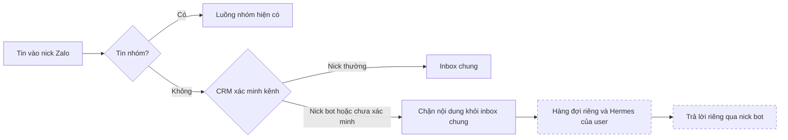

Nét đứt là phần nhận/xử lý/trả lời còn phải nối. Bật bot và lưu inbox có chốt SQL candidate; kiểm cạnh tranh database thật vẫn chưa thực hiện.

### Tiếp tục ngày 13/10/2026 — quản trị nick phụ làm bot

- **Đã code:** API `manageBots/setBot`, client và `HermesZaloBotSettings.tsx` gắn vào trang Hermes. Dùng JWT user với quyền CRM hiện hành `users.edit` và `chat_zalo.manage_automation` trong SQL; không clone quyền. Danh sách 100 account/trang, chỉ cùng công ty, không trả session/credential. Bật cần account connected và UID hợp lệ; tắt được khi disconnected. `expectedVersion` chống ghi đè cấu hình mới; thay đổi thu hồi challenge/binding và tăng epoch, giữ lịch sử.
- **UI:** phần quản trị đóng mặc định, không probe quyền trước khi mở; phân biệt không có bot với thiếu quyền/lỗi dịch vụ. Yêu cầu xác nhận nick phụ; cảnh báo liên kết cũ bị ngắt. Unknown write khóa ghi đến khi đọc lại; đổi user/org, tải lại hoặc chọn account khác xóa consent. Callback cấu hình remount phần liên kết, xóa mã chờ và tải lại danh sách bot. Có kiểm StrictMode, phân trang và kết quả trả muộn.
- **Kiểm API:** `.cache/hermes-p4-admin-api.txt` **105/105** (service/adapter/HTTP/backend/schema ACL); sau bổ sung composition, `.cache/hermes-p4-admin-server.txt` **15/15** cho toàn bộ file backend. Kiểm JWT caller, từ chối của SQL, directory, stale write và không dùng private pool. Sáu mutation SQL trong memory bắt thiếu quyền, CAS, org, binding epoch và lọc directory; chỉ là kiểm source, không chứng minh DB thật.
- **Kiểm UI:** `.cache/hermes-p4-admin-ui.txt` **46/46** trên bốn file; sau bổ sung hai regression, `.cache/hermes-p4-admin-ui-composed.txt` **24/24** cho component quản trị và page. Client/linking không đổi từ lượt trước; không gọi đây là một lượt 48/48. Strict `.cache/hermes-p4-admin-strict.txt` exit 0. Baseline lượt đầu lỗi kiểu mock test; đã sửa, `.cache/hermes-p4-admin-baseline-final.txt` exit 0, **0 fingerprint**; giữ log FAIL cũ.
- **Mutation dịch vụ:** `.cache/hermes-p4-admin-mutations.json` ghi bốn biến thể bị bắt: phân loại ghi thành đọc, cho sai org, nhả capacity sớm khi timeout và coi lost ACK là known. Khôi phục source đúng SHA `99e34c55bfde979f3984d44c04d3f89f6fe72e952459fb346ec8714aafc30450`.
- **Browser:** `.cache/hermes-p4-admin-browser/receipt.json`, log `.cache/hermes-p4-admin-browser.txt`, exit 0. Page/client/CSS thật, Auth/layout/HTTP giả; viewport 1440×1000 và 390×844. Bật bot → tạo/copy mã → quan sát/confirm UID → unlink → tạo mã khác → tắt bot/xóa mã/directory rỗng → đổi công ty. Mỗi viewport đúng hai `setBot`, một confirm, một unlink; không replay ghi. Không console error/request ngoài fixture/tràn ngang; hash đầu/cuối giống nhau. Đã xem `admin-enable-1440.png`, `admin-enable-390.png`, `admin-disabled-390.png`; checkbox/nút/nhãn và cảnh báo đọc được.
- **SQL/provenance:** candidate P4 SHA `389300b76b6765b9302746347c1b6fa5b3f62db7b1f20b5dd3c077cd47ba0dd6`; generator provenance production đã chạy đọc catalog, vẫn unknown/chưa apply. Cập nhật classification cùng SHA; không sửa migration TEST immutable. Classification không là cross-review hay giấy phép apply. SQL P4 chưa compile, chưa kiểm concurrent transactions/clock skew.
- **Gate candidate quản trị:** `.cache/hermes-p4-admin-local-gate.txt` **47/47**, 73 giây, Node 24.18.0; tree `05871d8a1b4d844d2b2be6dec66c289a173dfd1c`, run `local-f082cfa1-6c98-49c6-ba4d-902c37c14e99`. Vitest liên quan **18/18 file**; strict, baseline, lint, schema/source, provenance, unknown-review và docs đều đạt trong lượt này. Gate tự sinh/stage artifacts; `migration-policy.json` chỉ cập nhật số thống kê unknown từ provenance, không đổi lane/đích hay lịch sử migration. Bộ kiểm CI/live được runner liệt kê vẫn chưa được chứng minh. Tài liệu ghi kết quả được cập nhật sau snapshot này, kiểm riêng; không sửa receipt hoặc gọi đây là CI.
- **Còn thiếu:** review độc lập và CI candidate cuối; router nội dung riêng, runtime/trả lời Zalo thật. Kết quả gate 44/47 và browser liên kết cũ phía dưới là lịch sử. Không có commit/push/merge/deploy trong checkpoint này.
- **Điểm code tiếp theo P4.03:** `handleInbound` ghi conversation/message trước auto-reply; `handleOldMessages` gọi `upsertMessagesForThread`, nên cả live DM, history, self echo/media phải đi qua quyết định riêng tư trước lưu/log/preview/push. Giữ dấu riêng tư cho liên kết đã thu hồi; outage không được biến thành inbox chung. Cần kiểm race giữa quyết định định tuyến và admin bật/tắt bot ở DB, không chỉ lọc bằng cache worker. `queue.js` hiện gọi helper history cho nhóm; không chặn nhầm đường nhóm. Sau lớp này mới nối hàng đợi riêng với runtime và trả lời DM, kiểm dedup/lease/generation/quyền sống; hiện chưa có thay đổi code router trong checkpoint này.

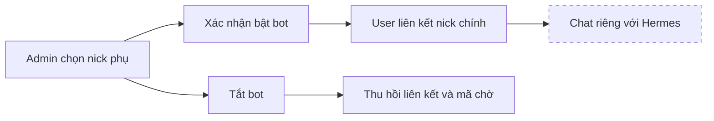

Đường quản trị và liên kết đã có code/kiểm giả lập. Nét đứt là luồng hội thoại còn phải nối; chưa bật sản phẩm.

### Tiếp tục ngày 13/10/2026 — API và UI liên kết nick Zalo

- **Backend:** `infra/hermes-zalo-router/binding-adapter.mjs` dùng Auth adapter hiện có, kiểm user/session/membership/org trước và sau RPC. Chỉ gọi public RPC bằng JWT caller, không service role/private store/runtime token. `binding-http.mjs` mount sáu POST `/api/hermes/zalo/{bots,begin,status,confirm,unlink,list}` qua `infra/hermes-broker/server.mjs`; kiểm Host/Origin, JWT, body/response, deadline và admission. Service giữ capacity đến khi dependency thực sự kết thúc, close chờ drain. Chỉ rejection RPC đã xác minh mới chứng nhận thao tác không thành công; mất ACK là outcome unknown, không retry ghi.
- **UI:** `src/hermes/zaloBindingClient.ts` và `HermesZaloBindings.tsx` được gắn vào `/settings/hermes`. Chọn kết nối/bot → tạo/copy mã → kiểm người gửi → tick xác nhận đúng UID → liên kết hoặc ngắt. Mã chỉ ở memory; xóa khi hết hạn, đổi org/user/generation hoặc connection bị thu hồi. Unknown write chặn thao tác đến khi đọc lại. Danh sách bot/liên kết có cursor; hợp nhất theo binding ID và epoch để liên kết vừa tạo không lặp ở trang sau.
- **SQL candidate:** `20261012165523_hermes_zalo_binding_v1.sql` thêm operation `bots` chỉ trả bot personal đã bật/connected trong org, projection accountId/name/zaloUid và 100 dòng mỗi trang. Không apply hay sửa sáu migration TEST đã áp dụng. `setBot` đã có kiểm `users.edit` + `chat_zalo.manage_automation` trong SQL nhưng chưa có API/UI quản trị. Candidate cần cross-review/compile/live concurrency trước mở.
- **Focused tests:** `.cache/hermes-p4-api-http.txt` **67/67** (service, adapter, HTTP và backend composition); `.cache/hermes-p4-api-routing.txt` **95/95**. `.cache/hermes-p4-ui-final.txt` **37/37** trên client/component/page. `.cache/hermes-p4-pagination-before.txt` chứng minh duplicate row và `.cache/hermes-p4-strictmode-before.txt` chứng minh initial loading kẹt trước sửa; regression sau sửa đã đạt. TS báo `Object.hasOwn` không thuộc lib hiện tại; đổi sang `Object.prototype.hasOwnProperty.call`, không nới lib/baseline. Strict gate của snapshot tổng đạt; narrow strict cuối `.cache/hermes-p4-ui-strict-complete.txt` exit 0 sau sửa generic Zod tương thích cả strict và cấu hình app.
- **Mutation API:** `.cache/hermes-p4-api-mutations.json`: ba ca bỏ kiểm org, nhả capacity sớm khi timeout và coi lost ACK là known đều bị bắt; source khôi phục SHA `0391e5a00b4efb2fefd921b1a55673c05093abcdc843aef2b77c014effefb79d`. Giữ nguyên bằng chứng worker của checkpoint trước.
- **Browser:** `.cache/hermes-p4-browser-diagnostic2.txt`, `.cache/hermes-p4-browser/receipt.json` exit 0, hai viewport 1440×1000 và 390×844; hash đầu/cuối không đổi, consoleErrors/externalRequests rỗng. Đã xem ảnh `confirm-1440.png`, `confirm-390.png`, `unlinked-390.png`; không tràn ngang, checkbox xác nhận và trạng thái đã ngắt hiển thị rõ. Dùng page/client/CSS thật với Auth/layout/HTTP giả. Các log FAIL cũ giữ tại `.cache/hermes-p4-browser.txt`, `hermes-p4-browser-diagnostic.txt`, `hermes-p4-browser-final.txt`: lần đầu timeout tải dependency; bổ sung prebundle date-fns trong fixture; phát hiện và sửa StrictMode. Một lượt timeout click sau đó chưa xác định chắc nguyên nhân, lượt chẩn đoán tiếp theo đạt; không dùng kết quả này để tuyên bố E2E live hay hết mọi lỗi thời điểm.
- **Gate tổng P2/P3/P4:** đã stage đúng các dependency còn thiếu; giữ riêng migration legacy EOL và `.cache`. Lượt `.cache/hermes-p234-local-gate.txt` đạt **44/47**, 93 giây, tree `912eeb47336bd90f29f9cd404de7af5f093d5ca4`, run `local-a0a54804-76a9-4fa6-95a7-db5afccb72cd`; Vitest liên quan 17 file đạt, Node native 1055/1057. Ba cửa đỏ có nguyên nhân: thiếu bốn entry provenance; generic Zod suy luận khác khi app tắt strictNullChecks; ACL source verifier chưa khai báo hai RPC P4. Đã sửa và chỉ kiểm lại phần bị ảnh hưởng: baseline **0 fingerprint**, baseline runner **3/3**, schema/ACL **33/33** gồm năm biến thể cấp/thu hồi quyền sai bị bắt, strict cuối exit 0, provenance và unknown-review đều exit 0. Log tương ứng: `.cache/hermes-p4-ts-baseline-fixed.txt`, `hermes-p4-baseline-runner.txt`, `hermes-p4-acl-final.txt`, `hermes-p4-ui-strict-complete.txt`, `hermes-p4-provenance-check.txt`, `hermes-p4-unknown-check.txt`. Không đổi receipt FAIL của lượt tổng thành PASS hoặc gọi đây là 47/47 trên snapshot cuối; CI/final cross-review chưa có.
- **Bảo toàn bằng chứng:** thay đổi client cuối chỉ là kiểu TypeScript; `.cache/hermes-p4-type-only.json` kiểm raw SHA trước đúng receipt browser và JS transpile trước/sau giống nhau, nên dùng lại kiểm UI runtime. SHA client cuối `156ca21a2439214c9c1f0874f92b2291e9c6cf017f5fd1f2f2febe9ce164a946`; component `7c1040b1e8c9ebe84620c89350678dd26ee29153d851dbb3e8bb8f2bc0e2db4b`. SQL P4 chỉ bỏ blank EOF sau gate, SHA cuối `767fd82c86c6db30c25bc527dcf061aff65697b43670b8c330e4d2fa70f60e31`. Provenance được generator đọc production tạo lại; bốn file vẫn **unknown/chưa áp dụng production**. Ba hồ sơ P2/P3 tái dùng từ worktree CI sau kiểm SHA/object; hồ sơ P4 nói rõ mới phân loại sự vắng mặt, chưa có cross-review/SQL live, không cấp phép apply.
- **Review:** review độc lập chưa hoàn tất tại checkpoint này; kết quả cập nhật ở đầu tài liệu. Chưa commit/push/merge mới.
- **Tiếp theo:** nối cấu hình bot quản trị cùng router hội thoại riêng; hoàn tất review/CI đúng candidate trước tích hợp. Trước bật P4, kiểm TEST đúng lane (confirm/register/relogin cạnh tranh và clock skew), Auth/UI/Zalo thật. P2/P3 vẫn còn runtime sản phẩm/provider refresh/quota; P5–P11 và memory/Hermes tổng tiếp tục nằm trong mục tiêu đầy đủ. Không chạy durable harness TEST từ primary đang có P4 SQL chưa apply; worktree CI vẫn giữ snapshot P2/P3 riêng.

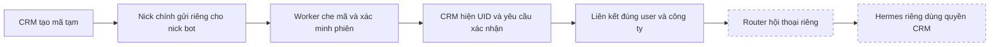

A–E có code/kiểm offline từng phần; chưa chứng minh toàn tuyến database/Zalo thật. Nét đứt là các phần tích hợp sản phẩm còn thiếu.

### Tiếp tục ngày 13/10/2026 — gate P2/P3 và handshake worker

- **P2/P3 local:** gate đạt **47/47**, 62 giây, Node 24.18.0, staged tree `3d248131508307f6e7d622c26ea6b6186e65fe5e`, run `local-013185e7-49fa-449e-a437-9136c116df70`. Log `.cache/hermes-p23-local-gate-final.txt` và receipts `.cache/gate-receipts/` ở worktree CI. Generator đã cập nhật artifacts qua runner. Đây là snapshot trước cập nhật tài liệu này, chưa có CI/commit mới và không chứa P4. Lượt trước 44/47 được giữ: sửa fixture HTTP còn giả lập `40001` thành `PT409`, hai catch cleanup có lý do và lỗi lint client; không tăng baseline hoặc nới kiểm lỗi.
- **Công cụ:** generator types trên Windows cần `npm_execpath=C:/Users/Nguyen Tam/AppData/Local/Temp/codex-node24-npm11-runtime/node_modules/npm/bin/npm-cli.js` cùng Node 24 đã ghim trên PATH. Thiếu biến này khiến CLI tìm npm sai thư mục; đã sửa môi trường chạy, không sửa generator/gate.
- **P4 code ở primary:** `worker/lib/hermes-link.js` chứa parser dùng chung và ingress theo phiên; service binding re-export parser để worker Docker chỉ cần thư mục `worker/lib`. `inbound.js` che handshake trước classify/raw/history/storage/log/preview, không push/auto-reply, chỉ gọi observe sau INSERT mới. `attachSession` đăng ký login snapshot/generation với RPC cố định; `login.js` chuyển loginRequestedAt và teardown đóng ingress trước dừng listener. Không thêm Zalo login client hoặc gửi tin thật.
- **Kiểm worker:** `.cache/hermes-p4-worker-routing.txt` có **22 file worker đạt**, routing có một lỗi mới do truy cập nhầm `zones` thay `tiers`; sửa đúng tên manifest rồi `.cache/hermes-p4-routing-final.txt` đạt **95/95**. Reuse kết quả worker vì source không đổi. `.cache/hermes-p4-listener-focused.txt` đạt 34/34 trên ba file mới/liên quan, `.cache/hermes-p4-binding-focused.txt` đạt **30/30**. Regression trước sửa `.cache/hermes-p4-inbound-before.txt`: **9 FAIL / 1 PASS**. Các kiểm chỉ dùng provider/DB giả lập.
- **Mutation:** `.cache/hermes-p4-mutations.json` xác nhận ba biến thể đều bị assertion bắt: bỏ dedup, bỏ live-lease check, bỏ che mã live; source được khôi phục đúng SHA sau từng ca. `inbound.js` SHA `162e3ea3712c444d97556fc6c834f6e2bb487eb76f294895884430418d7916ee`; `hermes-link.js` SHA `54ea873e875cb5198f3deab843368661a8a3d4a6809120a66f9ebf5bcd485e59`.
- **Review còn thiếu tại checkpoint này:** delta supervisor/P4 và final candidate; không suy root self-review hay unit thành cross-review. Trạng thái cập nhật ở đầu tài liệu. Mọi WIP được giữ; chưa commit/push/merge/deploy.
- **Bước tiếp theo:** mount binding service bằng Auth/RPC/HTTP có deadline/admission và UI xác nhận; nối router lệnh riêng cùng runtime adapter. Trước mở P4, kiểm SQL trên TEST qua đúng lane, gồm cạnh tranh confirm/register/relogin và lệch đồng hồ worker/DB. DM đã liên kết phải đi vào luồng riêng có kiểm quyền, không mặc nhiên lưu vào inbox chung/auto-reply; hiện mới handshake có ưu tiên. Sau đó tiếp tục P5–P11, không đánh dấu hoàn thành từ candidate này.

Luồng hiện đã code, mới kiểm offline:

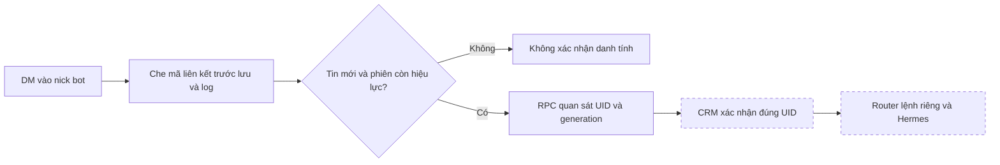

Nét đứt: phần HTTP/UI hoặc luồng chat còn phải nối và nghiệm thu. RPC quan sát cũng chưa được gọi trên DB thật trong P4.

### Tiếp tục ngày 13/10/2026 — TEST 28/28 đã đạt

- **TEST cuối:** lúc 00:32 ngày 13/10 (Asia/Bangkok), run `6ec1844e-2e9e-432d-84ed-7fd6ea19d369`, **28 PASS / 0 FAIL**. Receipt `.cache/hermes-durable-store.6ec1844e-2e9e-432d-84ed-7fd6ea19d369.json` ở cả hai worktree; có cleanup PASS và inputsUnchanged=true. Phòng 5/5, gia hạn 5/5; ca giả actor/session/scope/version và membership revoked nay đạt. Chưa chứng minh provider refresh trong cùng luồng, cạnh tranh SQL nội bộ, UI/Auth thật hoặc Zalo thật.
- **Forward conflict đã apply TEST:** `20261012165809_hermes_public_conflict_http_v1.sql`, SHA `b2f087aa089334446dfef3606a6c81ea6ae5b7cf4ec122da0630e30ba4a79e50`, lúc 00:29 ngày 13/10. Review độc lập sạch, dry-run ROLLBACK và hai lượt preflight đạt; full backup 627 bảng. Catalog shape không đổi vì chỉ đổi error code; harness đã xác minh thân hàm/owner thật và PostgREST. Sáu migration TEST hiện immutable. Production chưa apply; provenance production vẫn unknown đúng chủ đích.
- **Routing P2/P3:** đăng ký Node runner cho schema test conflict; routing **94/94**. Candidate đã stage trong worktree CI, generated provenance production đã sinh bằng đọc catalog. Chưa hoàn tất gate/cross-review/CI của WIP.
- **Sửa supervisor startup:** giữ handle đồng bộ bằng `runtime.prepare` trước khi `runtime.start` tạo tài nguyên; failure vẫn gọi stop và giữ lease nếu stop không xác nhận. Hai regression tái hiện FAIL trước sửa, sau sửa **14/14**; chưa có production Docker adapter hoặc review độc lập delta mới.
- **Sửa candidate P4:** thứ tự khóa lease → account → bot → ingress → challenge trước confirm; phân trang history 100 dòng có cursor và vẫn giữ revoked cho đối soát. **30/30 source/unit**, có witness bỏ khóa bị bắt. Chưa kiểm contention SQL/live worker; candidate chưa apply, chưa review độc lập delta. Không dùng unit làm chứng minh DB concurrency.
- **Điểm tiếp theo:** hoàn tất unknown-review/generated artifacts/gate P2/P3; tích hợp handshake worker có che mã trước log/lưu/auto-reply; kiểm P4 SQL và race trên TEST riêng trước mở sản phẩm. Không chạy durable harness ở primary khi chứa P4 SQL chưa apply; dùng worktree CI hiện chỉ có sáu SQL đã apply.

### Bàn giao ngày 13/10/2026 — chờ chủ dự án tiếp tục

- **Giữ WIP:** code chưa commit ở worktree chính của task; không reset/clean hoặc gom migration legacy EOL vào commit. Worktree CI `C:/Users/Nguyen Tam/codex-worktrees/hermes-runtime-ci-20261012` ở cùng checkpoint `c69cf0d0`, giữ `.cache/pending-p3-generated/` gồm hai SQL đã apply TEST và provenance/unknown-review đã sinh trước đó. Không ghi đè bằng manifest cũ khi thêm forward migration mới.
- **Runtime Linux:** [run 38279246924](https://github.com/zxGreenxz/whiteboard-ihomecrm/actions/runs/38279246924) **21/21**, status `PASSED_SYNTHETIC_RUNTIME_UNSIGNED_RELEASE_RECEIPT`, 15 hash đầu/cuối không đổi; đúng image `ffa4fbb4…`. Đã đo TCP/DNS/host IPv4/IPv6 bằng positive controls trước/sau và cách ly A/B. Receipt `.cache/hermes-runtime-c69cf0d0-receipts/hermes-runtime-receipts-1/hermes-p1-1791823345800-0c3d70/receipt.json`. Dữ liệu/model/broker giả, upstream receipt chưa ký; không chứng minh VPS hoặc mạng production. [CI Gates 38279246925](https://github.com/zxGreenxz/whiteboard-ihomecrm/actions/runs/38279246925) SUCCESS. Watcher local chỉ dành cho main đã dừng sau khi đối chiếu PR runs, không hủy CI.
- **Phục hồi TEST:** run lỗi `de970487…` được dọn đúng hai org/ba actor/24 connection và role giả lập, dưới cùng advisory lock. Client TLS độc lập xác minh mọi số dư bằng 0 gồm profiles/auth.sessions trước khi xóa đúng marker. Recovery receipt `.cache/hermes-recovery-de970487-d9baa100-3899-49a7-8fe3-d450f483dcad.json`; không đổi receipt FAIL cũ.
- **Live cuối:** run `b7748049-1aad-46a0-9f67-2ceb8582c6e7` ngày 12/10 lúc `16:54:15Z`: **26/28**, cleanup và hash đầu/cuối xác minh. Hai ca đều có từ chối: sai expected epoch trả mã chưa phân loại; membership revoked bị chuyển thành `backend_unavailable`. Không có bằng chứng accidental success trong hai ca này, nhưng chưa được tính PASS.
- **Bản sửa chờ apply:** authority chỉ chuyển typed `DurableConnectionStoreError('store_denied')` thành forbidden; outage/unknown/lookalike vẫn lỗi hạ tầng. Forward `20261012165809_hermes_public_conflict_http_v1.sql`, SHA `b2f087aa089334446dfef3606a6c81ea6ae5b7cf4ec122da0630e30ba4a79e50`, đổi đúng sáu conflict có chủ đích trong hai public RPC sang `PT409`, giữ thân kiểm quyền/owner/ACL và private CAS. Adapter chỉ nhận cặp HTTP409 + PT409 là context_changed. **89/89 focused tests**, root đã soát delta; chưa dry-run/apply/rerun. [Supabase mô tả retry do SQLSTATE40001](https://supabase.com/docs/guides/troubleshooting/high-cpu-and-infinite-transaction-retries-when-using-custom-error-codes-in-rpc-functions-77326b); phiên bản PostgREST trên TEST chưa đo, nguyên nhân timeout cụ thể vẫn là suy luận có căn cứ.
- **Gia hạn/supervisor:** lifecycle renewal giữ admission tới khi dependency trực tiếp kết thúc, close abort/drain; 27 tests renewal + 10 tests server trước resolver, ba mutation bị bắt, review độc lập sạch. Server thêm resolver owner sống dùng chung admission, kiểm **12/12**, mutation bỏ authority bị bắt và review độc lập sạch. `connection-supervisor.mjs` dùng ProfileLeaseStore thật, kiểm owner trước/sau start, watchdog hết hạn độc lập và không retry khi kết quả chưa rõ; **12/12**, ba mutation bị bắt. Root review sửa hai lỗi gate-failure bỏ stop và owner mutable, delta đã khép. Chưa có production runtime adapter hoặc refresh provider xuyên tuyến; drain không chứng minh SQL rollback.
- **UI:** 15 UI + 1 route tests đạt; strict ba module mới sạch. Browser synthetic **1440×1000 và 390×844 đạt**, đã xem bốn ảnh, không lỗi console/request ngoài localhost. Bao phủ tạo/sao chép/giới hạn/thu hồi, đổi user/công ty, xóa password và mã khỏi màn hình. Ảnh/receipt `.cache/hermes-ui-browser/`; dùng page/client/CSS thật nhưng Auth/org/layout/HTTP giả, chưa full app/deploy. Routing thêm supervisor đạt **91/91**; strict manifest đã thêm hook/page.
- **P4 candidate đã bàn giao:** `infra/hermes-zalo-router/binding-service.mjs` + `.test.mjs` và `20261012165523_hermes_zalo_binding_v1.sql`; **27/27 source/unit + JS syntax**, chưa review độc lập SQL/mutation/compile/live/gate. Flow: CRM tạo challenge một lần, worker chứng minh sender bằng DM sống, CRM xác nhận chính xác candidate sender mới kích hoạt; có TTL, CAS/epoch và thu hồi. Bot/assistant cùng org để giữ ACL inbox/queue hiện hữu; superadmin dùng binding riêng theo công ty/bot, chưa có một bot trung tâm xuyên công ty. Cấu hình bot cần quyền CRM hiện có `users.edit` và `chat_zalo.manage_automation`. Không dùng link customer/lead làm danh tính user. Worker sau này phải đăng ký ingress generation, xác minh lease/session, chặn event cũ và che challenge trước log/persist; chỉ xử lý event live mới. Metadata forward quan sát được bị từ chối, chưa chứng minh phát hiện mọi forward.
- **P4 chưa mounted:** các port `verifyCaller`/`rpc` cần adapter thật và vòng đời có giới hạn; chưa sửa worker, gửi Zalo, apply DB hay mở HTTP. SHA service `180c02649c398e09a0a42825c16ea04f7ef2901930cad27b3b80909b42270ba1`, test `519e8b81bd6273577c853c87cdfbe28745a4aa715895ebf2a020d6feaaae0973`, SQL `b5f4fafa9f30d48481d6a84335a0a5f23623e8df221a04b580cd4cf3af560286`. Receipt `.cache/hermes-zalo-binding-focused.txt`. Runtime production adapter cũng chưa bắt đầu; không suy supervisor unit thành container sản phẩm.

### Việc cần làm ngay khi được tiếp tục

1. Đọc điểm bàn giao này và `git status`, giữ mọi WIP. Không chạy durable harness trực tiếp trong primary khi candidate P4 chưa apply: harness đọc tất cả SQL Hermes và sẽ so latest bodies. Đồng bộ **chỉ P2/P3 + forward conflict** sang worktree CI để kiểm/apply hẹp; P4 tách riêng.
2. Đăng ký Node runner cho schema test conflict mới (và các test P4 khi tích hợp), cập nhật routing/risk theo phạm vi, stage đúng SQL rồi sinh provenance đúng đích. Hai generated files đang giữ trong cache chỉ là bằng chứng cũ, không thay generation cho forward mới.
3. Forward conflict: review snapshot cuối, dry-run + hai ROLLBACK và backup/apply qua lane TEST. Năm SQL đã apply trước đó immutable. Chạy durable TEST với full backup còn mới, yêu cầu 28/28 + cleanup/source hash; không nhận timeout như từ chối hợp lệ. Giữ repo và TEST metadata đồng bộ.
4. Khép gate local/cross-review/PR trên candidate cuối; reuse receipts đúng hash. Chưa có quyền suy CI `c69cf0d0` thành pass cho WIP mới. Chưa merge, apply production hoặc deploy VPS.
5. Nối runtime adapter + model quota/refresh, rồi tích hợp worker Zalo bằng binding đã xác nhận; tiếp tục các giai đoạn còn lại của PLAN. Không tạo worker đăng nhập Zalo thứ hai.

### Tiếp tục sau `c69cf0d0`

- Lượt TEST `de970487-8a8c-43dc-88a8-6b63b2814ec0`, kết thúc `2026-10-12T09:07:50.467Z`: **25 PASS / 3 FAIL**, hash đầu vào không đổi. Gia hạn 5/5 đạt; đọc phòng 3/5 đạt. Hai ca từ chối actor/session/scope/version và thu hồi quyền/membership chỉ ghi `expected_rejection_missing`; receipt cũ không phân biệt không từ chối với mã lỗi khác, chưa kết luận lỗi SQL. Cleanup `fixture_sql_failed`, `cleanupVerified=false`; giữ TEST marker để phục hồi có kiểm chứng.
- Harness đã sửa thứ tự xóa scope BUILDING của tòa giả lập trước khi xóa tòa; thêm chẩn đoán lỗi an toàn theo từng ca, không nới mã được chấp nhận. Focused 44/44 đạt; chưa có live rerun. Đọc lại TEST xác nhận fixture p2 vẫn tồn tại, chưa xóa marker hoặc nhận cleanup thành công.
- UI quản lý kết nối: review độc lập sạch, 15 tests UI + 1 route đạt; strict của client/hook/page không có diagnostic. Chưa kiểm browser hoặc backend triển khai. Primitive gia hạn trước wiring đạt 24/24 + bắt hai mutation; source đang bổ sung admission/close để giữ tác vụ ghi khi timeout, kết quả cũ không thay cho kiểm delta mới.
- Broker/tool phòng + server candidate: 39 tests đạt và bắt ba mutation, review source/receipt sạch. Có audit và kiểm quyền cuối trước trả projection; chưa chứng minh MCP HTTP đọc phòng qua TEST.
- CI Gates đúng head `9ecd4843` đã SUCCESS; các job bị skip không được tính pass. Runtime head đó FAILED DNS IPv6. Delta `c69cf0d0` sửa wire AAAA 16 byte và thêm DNS resolver thật; local gate 12/12, đang chờ CI runtime mới.

### Candidate sau checkpoint `9ecd4843`

- `20261012083555_hermes_connection_renewal_v1.sql`, SHA-256 `05d5d2961e307cc2c0c18f94e586ca9a8dba33f86da44d6189c8762ed4a542e2`: review độc lập sạch, dry-run và hai lượt ROLLBACK đạt; đã áp TEST qua lane, backup full 627 bảng. Giữ nguyên token opaque, CAS chống ghi đè, đồng hồ DB tính hạn tối đa 15 phút và chặn quá hạn session/tuổi token 30 ngày. Store/transport/schema riêng 51 tests đạt. Chưa có caller gia hạn sản phẩm hoặc chứng minh refresh toàn tuyến.
- `20261012083047_hermes_room_scope_read_v1.sql`, SHA-256 `04c5dd53033220c7398fb0a64944e995663327f84fb20caab1009c7e2191ddf9`: review độc lập sạch, dry-run và hai lượt ROLLBACK đạt; đã áp TEST qua lane, backup full 627 bảng. RPC cuối quyết định phiên/kết nối/quyền/phạm vi cùng snapshot; map AREA/BUILDING/CASHBOOK không trộn namespace. Reader dùng receipt nội bộ một lần để đặt audit trước kiểm cuối. Service 19 tests và SQL tĩnh 12 tests đạt; chưa có bằng chứng đọc phòng qua JWT live mới.
- HTTP quản lý kết nối có năm endpoint cố định (cấp, danh sách, context, thu hẹp, thu hồi), kiểm Host/Origin/JWT và giới hạn request. HTTP 13 tests và review độc lập đạt. Client frontend 34 tests, TypeScript strict và review độc lập đạt; không cache password/token, không tự retry khi kết quả ghi chưa rõ. UI đang nối; chưa deploy endpoint hoặc kiểm UI/E2E thật.
- Runtime `9ecd4843`, [run 38226737974](https://github.com/zxGreenxz/whiteboard-ihomecrm/actions/runs/38226737974), đã đi qua bridge setup rồi FAILED tại positive DNS IPv6. Phát hiện canary mã hóa AAAA thành 17 byte. Delta sửa về 16 byte; phép kiểm bằng DNS Resolver thật RED trước sửa, GREEN sau sửa, runtime-contract **25/25**. Review delta sạch, chờ CI mới; không gọi runtime đầy đủ là đạt. CI Gates `b6f98ef8` bị cancelled khi có commit mới, không tính pass.
- Routing mới đã bắt 40 lỗi trước cập nhật runner/mapping rồi đạt **90/90** sau sửa. Hai SQL schema tests chạy bằng node:test và được loại khỏi Vitest; vẫn giữ kiểm shared lease/migration guard. Gate tổng của candidate mới chưa chạy.

### Delta TEST sau checkpoint `494d306a`

- Đối chiếu upstream cho thấy digest runtime cũ `32d095e8…` không thuộc receipt phát hành v0.21.6. [Annotated tag chính thức](https://api.github.com/repos/NousResearch/hermes-agent/git/tags/f27cdbce5ab63eafe8633b293a75151409da5769) gắn commit `818c13be…` → index `9774f4f3…` → Linux amd64 `ffa4fbb4…`; đã tự kiểm hash metadata. Đang chuyển pin và chạy lại CI. Receipt upstream chưa ký, revision label trống; không gọi là signed attestation. 17 checks cũ vẫn là lịch sử image cũ, không chứng minh image mới.
- Runtime egress đã thêm canary TCP/DNS IPv4/IPv6, positive trước/sau và bộ đếm nhận gói. Review sửa host listener sang exact gateway; unit mặc định loopback. 19/19 runtime-contract tests tại delta bind đạt; actual Docker cho delta và pin mới còn chờ CI.
- Sau ghim image mới và bổ sung kiểm chuỗi hash receipt, runtime-contract đạt **23/23**. Receipt upstream chưa ký; kiểm metadata không thay cho Docker chạy image mới. Bộ kiểm container mới còn chờ CI Linux.

- Lượt durable store `32ab1850-5bd7-491e-9599-0ee7eb7bd582`: schema/owner, login PostgreSQL riêng + ACL, fixture scope tổ chức và cleanup đạt; 8 ca kích hoạt/lưu phiên chưa đạt (`store_rejected`). Hash nguồn đầu/cuối không đổi. Không diễn giải các ca lỗi thành pass.
- Đã chứng minh nguyên nhân bằng truy vấn chỉ đọc trên TEST: regex ciphertext `{1,87382}` phát SQLSTATE `2201B`. Mẫu thay thế kiểm riêng `char_length` và bộ ký tự base64url cho đúng kết quả tại 0, 1, 87.382, 87.383 ký tự và ký tự sai. Receipt: `.cache/hermes-envelope-regex-proof.json`.
- Hai migration đã apply giữ nguyên. Forward `20261012074002_hermes_envelope_length_guard_v1.sql`, SHA-256 `0f0b4b039fc6af6596df5e0816d3b9c057689979dce2c3fbdb45dcd89141b74d`, đã review độc lập, schema tests 26/26 gồm mutation regression, dry-run và hai lượt ROLLBACK TEST đạt. Apply qua lane thành công với full backup 627 bảng có dữ liệu; receipt ở `.cache/migration-targets/test/hzulujxgonszuleqticb/schema-change-evidence/`. Catalog public không đổi vì sửa helper private; lượt live sau đó xác minh chính xác thân hàm mới, không suy từ catalog public.
- Lượt durable store cuối `2790ccfc-8985-423e-ac98-b462881f4b49`: **12/12 đạt**, gồm login DB riêng + ACL, JWT A/B/superadmin, kích hoạt lặp cùng payload, từ chối payload khác, composite FK, stage/publish, lease hết hạn, thu hồi connection/session và cleanup. Hash nguồn đầu/cuối khớp. Đây là kiểm tuần tự; chưa có broker thật đi xuyên durable authority, refresh provider trong cùng luồng hoặc proof cạnh tranh nhiều transaction.
- Control plane đã đổi sang backend tạo phiên Auth mới bằng đăng nhập độc lập, xác minh cùng user/khác phiên trình duyệt. Cách này đóng khe refresh ngoài lease khi bàn giao lại một phiên đã được quản lý. 20/20 focused tests và review delta đạt; không nhận cặp token từ browser. Chưa có HTTP endpoint/UI hoặc bằng chứng toàn tuyến cuối.
- Refresh manager hỗ trợ hủy theo giai đoạn, cleanup dùng deadline độc lập; sau dispatch không suy lỗi mạng thành global revoke. Manager/adapter 57/57 focused tests và review delta đạt; chưa kiểm provider + DB + broker trong cùng luồng.
- Primitive quản lý kết nối đã có list/context/thu hẹp/thu hồi theo JWT đúng chủ và công ty. Review đóng lỗi trả context quyền cũ và JWT hết hạn trong lần đọc quyền cuối; 28/28 focused tests đạt. Chưa mở HTTP/UI, chưa có management TEST toàn tuyến, phân trang lịch sử hoặc luồng offboarding khi user mất membership.
- Lượt tích hợp broker `b5281a38-d78a-411e-9ca0-39c333ddac93`: 5 đạt/2 lỗi, cleanup đã xác minh. Phép đọc quyền song song gọi cùng phiên kiểm lease chỉ nhận một lệnh, làm fixture tự báo mất lease. Đang sửa bộ kiểm và chạy lại; không tính lượt này là integration pass.
- Sau sửa queue kiểm lease, lượt `adf8b077-5a20-4334-9422-6b6e650b1b87` đạt **17/18**, cleanup xác minh và hash nguồn không đổi. Cách ly broker/user/org, deny input, quota riêng, restrict/revoke và kiểm sau audit đã đạt. Ca cấp phiên mới còn `context_changed`; truy vấn chỉ đọc TLS xác định clock host nhanh hơn TEST khoảng 6,7–6,8 giây, trong khi token mới dùng host + đúng 15 phút nên vượt trần DB. Đang sửa mốc tính hạn theo timestamp prepare của DB, giữ nguyên trần SQL; chưa báo toàn tuyến đạt. Clock receipt `.cache/hermes-test-clock-proof.json`.
- Lượt cuối `247ce314-8e53-4cc2-a62f-01dff37802fc`, lúc `2026-10-12T08:21:34.929Z`: **18/18 đạt**, `cleanupVerified=true`, `inputsUnchanged=true`. Cấp kết nối dùng phiên Auth mới cùng user nhưng khác phiên browser, xuyên qua private store và broker thật trên TEST. Đã kiểm cách ly user/org, scope/context, từ chối input giả, quota tool riêng, hạn chế/thu hồi và kiểm quyền sau audit. Control plane dùng mốc prepare của DB để không vượt trần token 15 phút khi host lệch giờ; focused **25/25** đạt. Harness queue lease **29/29** đạt. Không suy kết quả này thành proof refresh provider + store trong cùng luồng, cạnh tranh nhiều transaction, HTTP/UI, quota model hoặc production.
- Gate checkpoint durable lượt đầu đạt **46/47**, thiếu hồ sơ giải thích ba migration chưa có trên production. Đã bổ sung `migration-unknown-review.json` theo đúng trạng thái chỉ áp dụng TEST; giữ production provenance là `unknown`, không nâng trạng thái dựa trên TEST. Cửa đối chiếu hồ sơ đã đạt; gate cuối đang chạy lại với biên nhận đầu vào không đổi được tái dùng.
- Gate durable cuối **47/47**, 118 giây, tree `53561be9f1ca99a1698094c1d2f04068983a7009`, đã commit/push `66acfbdb` vào PR #165. Review độc lập non-runtime và root review runtime không có P1/P2 mới. Vitest related đạt 2 file; không suy thành full suite. [CI runtime 38224302318](https://github.com/zxGreenxz/whiteboard-ihomecrm/actions/runs/38224302318) đã kéo đúng image/config của receipt upstream và kiểm mạng actor riêng, sau đó lỗi `Both live host gateways are required` ở setup canary. Receipt `hermes-p1-1791794033506-91647e` ghi FAILED, input hash không đổi; không báo runtime đạt.
- Delta sửa canary đọc địa chỉ bridge thực tế trên native Linux, giao với subnet Docker đã kiểm; không suy địa chỉ đầu subnet hoặc bind wildcard. Đã thêm bằng chứng network/bridge vào receipt. Runtime unit **24/24**, review độc lập sạch; Docker chạy lại còn chờ. Hai mạng actor vẫn dùng isolated gateway, không thay mức cách ly để vượt kiểm.
- CI runtime checkpoint `b6f98ef8`, [run 38225284882](https://github.com/zxGreenxz/whiteboard-ihomecrm/actions/runs/38225284882), vẫn FAILED ở setup với `Actual control bridge is missing`; image và hai mạng actor đã đạt, chưa chạy các phép cách ly. [Mã libuv Linux](https://github.com/libuv/libuv/blob/v1.51.0/src/unix/linux.c#L1832-L1834) bỏ interface thiếu `IFF_RUNNING`; bridge mới chưa có endpoint có thể chưa có carrier. Delta tiếp theo khởi động và kiểm canary trên mạng control trước khi đọc bridge; vẫn yêu cầu địa chỉ host thực, positive trước/sau và bộ đếm. Đây là giả thuyết có căn cứ, chờ CI xác minh, không đổi sang host networking hoặc nới cách ly actor.
- Projection phòng trống: 10/10 focused tests; mutation bỏ scope tòa, lộ field, bỏ deny scope rỗng đều bị bắt. Receipt `.cache/hermes-room-projection-mutation/receipt.json`, source SHA-256 `4e367b03898f12a2bd6be783b1626adb51e17370e1e2390153d0d7747eaa0f97`, input đầu/cuối không đổi. Chưa nối JWT reader hoặc tool vào broker.
- CA công khai của Supabase được ghim theo fingerprint DER; harness xác minh TLS cho cả login quản trị fixture và login private store. Nguồn: [Supabase SSL enforcement](https://supabase.com/docs/guides/platform/ssl-enforcement) và URL CA được khai trong Supabase Studio. Không tắt kiểm chứng certificate.

| Mốc | Công việc | Kết quả / giới hạn |
| --- | --- | --- |
| 12/10/2026 | Chủ dự án chốt plan và yêu cầu Markdown bàn giao | Đã duyệt cả Hermes riêng + Hermes tổng; không cần hỏi lại nguyên tắc |
| 12/10/2026 | P0.01 tạo worktree sau fetch | Đã tạo đúng nhánh/path; giữ WIP checkout chính |
| 12/10/2026 | Đối chiếu baseline mới | Worker/registry đã đổi; Zalo unit đã được mở lại ở main, Copilot vẫn hoãn. Inventory cần tái sinh |
| 12/10/2026 | Lưu PLAN/STATUS Markdown | Đã ghi kiến trúc, các giai đoạn, thêm T35–T42 cho memory/giám sát; chưa phải kết quả test |
| 12/10/2026 | Inventory tĩnh có thể tái sinh | Generator + snapshot + 15 mutation/behavior tests đạt; chưa có runtime/DB evidence |
| 12/10/2026 | Chuẩn bị dependencies | Root package-lock của worktree và checkout chính cùng SHA-256; node_modules junction dùng existing deps. Không npm install/ci qua junction |
| 12/10/2026 | P1 preflight chỉ đọc | Có git 2.52, Node 22.20, Python 3.12.10, Docker CLI 29.6.2, psql 17.10; không thấy hermes/uv/deno trên PATH. Chưa kiểm daemon/runtime |
| 12/10/2026 | Khôi phục kiểm offline có chọn lọc | Core permission/tool/plan/memory chạy lại; UI/model/live và Zalo fleet vẫn hoãn. Không thay runtime sản phẩm |
| 12/10/2026 | Focused tests trước gate | Core 113/113; routing/registry 50/50; verifier 65/65; inventory 15/15. Đây là các bộ riêng, không suy ra full app hoặc live đạt |
| 12/10/2026 | Gate local lượt đầu | 46/47 đạt; Vitest related lỗi 2 assertion vẫn kỳ vọng Copilot core bị hoãn. Giữ kết quả lỗi, sửa policy regression trước khi chạy lại |
| 12/10/2026 | Review độc lập lượt đầu | Một P2: gate corpus chưa được chọn khi capability visibility/tài liệu nguồn đổi; cần thêm mapping và regression. Chưa kết luận review đạt |
| 12/10/2026 | Sửa delta sau review | 5 ca routing lỗi trước sửa đã đạt sau sửa; focused 76/76 gồm regression 29, routing 13, gate-plan 34. Matrix: 1.295 file active / 16 suite / 0 mồ côi / 75 deferred. Gate cuối và re-review delta đang chờ |
| 12/10/2026 | Gate local sau sửa | 47/47 đạt, exit 0, 76 giây. Có 46 receipts static/suite và output Vitest related 7/7 file; 10 nghĩa vụ CI chưa kiểm local |
| 12/10/2026 | Cross-review kết thúc | Reviewer kiểm source + delta + receipts cùng snapshot, không còn finding P1/P2; không xác nhận runtime/TEST/CI/production |
| 12/10/2026 | Lưu commit code | `c833d379e6f83b1d0a44ca4964f2cbf7e3831ae6`; tree `a05a740f2fc2819f679bbc0795e468567380106b` |
| 12/10/2026 | Lưu checkpoint và mở draft PR | `053b3eca` cập nhật PLAN/STATUS; docs gate 5/5 (không JS/TS để Vitest), reviewer không thấy claim sai; draft PR #165 đã tạo |
| 12/10/2026 | Xác minh lại PR #165 | OPEN/draft, head `386296cb`, các job bắt buộc và aggregate SUCCESS; job bỏ qua theo scope không được coi đã kiểm. Chưa phải release production |
| 12/10/2026 | P0.02 inventory v2 | 67 tool, 32 action, 29 UI capability, 47 page contracts, 6 safe controls; 28/28 focused tests + generator check đạt. Disposition hai tool kế hoạch đã ghi; chưa bật runtime Hermes |
| 12/10/2026 | P0.03 TEST catalog | `BEGIN READ ONLY`, marker TEST hợp lệ; 32/32 registry khớp; 135/135 tên hàm ở schema đúng. 69 cờ enabled/2 disabled trên TEST; không suy ra quyền Hermes hoặc production |
| 12/10/2026 | Comparator catalog | 23/23 tests, gồm empty evidence, registry drift, public/private helper, thiếu ACL, RPC giả; không dùng ledger legacy để yêu cầu replay migration |
| 12/10/2026 | P1 upstream/runtime | Ghim đề xuất Hermes v0.21.6, source `818c13be1dc4fd28987e1e881a9408224afd4535`, image digest cụ thể. Docker Desktop đã khởi động nhưng daemon chưa sẵn sàng; fixture/broker đang hiện thực, chưa có runtime pass |
| 12/10/2026 | Chẩn đoán Docker local | Backend log báo không truy cập được socket `Docker/run/dockerInference` (reparse point cũ 13/08). Thử đổi tên dự phòng bị Windows từ chối; chưa đổi/xóa file, chưa reset Docker. Không coi lần gọi Start-Process là engine đã chạy |
| 12/10/2026 | P1 JWT thử đầu | Lỗi thiếu Content-Profile gây PGRST202; đã giữ receipt lỗi, sửa adapter và regression. Cleanup đã xác minh |
| 12/10/2026 | P1 broker + JWT cuối | Broker 28/28 unit/HTTP; harness 11/11. JWT TEST thật 17/17 với 3 user giả/2 org giả, cleanup=true, active_run=0; 8 hash nguồn đầu/cuối khớp. Không sửa schema hoặc xuất tool phòng |
| 12/10/2026 | Review broker/harness | Sửa khe thời gian sau audit bằng kiểm quyền cuối; SQL timeout không rõ kết quả giữ khóa TEST. Review độc lập harness/inventory/routing không còn P1/P2; gate tổng chưa chạy |
| 12/10/2026 | Hermes MCP client thật | Upstream ghim + MCP 2.0.0 chạy native Python riêng: 4/4 transport checks đạt. Chỉ chứng minh initialize/list/call/revoke; chưa phải AIAgent/container/model/CRM end-to-end |
| 12/10/2026 | Đường kiểm runtime Linux | Thêm workflow Ubuntu 24.04 + Node 24.18.0, container ghim digest, fixture/model giả, không secret CRM. Chờ CI chạy; chỉ upload JSON receipt |
| 12/10/2026 | Gate P0/P1 | Local 47/47 đạt, 215 giây, tree `9740e5d899900caa67547c7a530c82df1fb5afc6`; còn 18 nghĩa vụ CI/live chưa kiểm local. Delta sau đó chỉ chuẩn hóa EOL lock mới và cập nhật tài liệu, gate tái dùng bằng chứng đúng đầu vào |
| 12/10/2026 | Checkpoint P0/P1 cuối | Commit `6ecdc399`, tree `e894e37e`; local 47/47 đạt, 110 giây, 46 receipts + Vitest related 1/1 file. Review xác minh receipts cùng snapshot; đã cập nhật draft PR #165 |
| 12/10/2026 | CI runtime lượt 1 | Run `38209692628` kéo được image ghim và tạo mạng nội bộ; FAIL ở fixture vì upstream khai VOLUME /opt/data sinh anonymous volume. Verifier chặn đúng, chưa chạy AIAgent. Image không có revision label nên chưa chứng minh digest tương ứng source commit |
| 12/10/2026 | Sửa mount runtime | Ba file sửa để override /opt/data bằng tmpfs chỉ đọc và kiểm map tmpfs chính xác, focused 18/18. Gate/push fix ở worktree riêng `hermes-runtime-ci-20261012` để giữ WIP P2; chờ CI mới |
| 12/10/2026 | Bắt đầu nền P2 | Target binding migration lane và crypto/refresh primitive đang code, chưa gọi DB/schema/apply. Chưa có store bền vững hoặc refresh thật |
| 12/10/2026 | CI runtime lượt 2 | Run `38210160244`, head `9691e3b9`: mount đã đạt; AIAgent FAIL do progressive tool search mặc định thay tool CRM bằng bridge. Giữ receipt lỗi, không nới tool allowlist |
| 12/10/2026 | CI runtime lượt 3 | Run `38210992537`, head `005e0d26`: tắt tool_search cho spike, 12/12 checks đạt với AIAgent thật, model/broker giả, inputsUnchanged=true. Digest image khớp; revision label trống nên source provenance chưa xác minh |
| 12/10/2026 | Primitive credential P2 | Crypto/refresh 25/25; review độc lập không còn P1/P2 trong phạm vi module. AES-GCM binding và fence/CAS/lease đã kiểm với store/provider giả; chưa durable storage hoặc refresh thật |
| 12/10/2026 | Model relay P2 | 15/15, review đóng lỗi HTTP200 chứa error/debug bằng response projection. Chỉ gọi proxy hiện có, không retry, request snapshot chống mutation. Chưa route/broker integration hoặc quota live |
| 12/10/2026 | Target lane P2.0 | 33/33 Node + 10/10 backup Node + 30/30 Vitest; review source không còn P1/P2. TEST credentials/evidence riêng, marker/lease, giữ khóa khi write chưa rõ; chưa backup/dry-run/apply TEST thật |
| 12/10/2026 | Gate checkpoint nền P2 | `8bfc0682`, tree `b8ee37ac`: local 47/47, 343 giây; Vitest related 25/25 file, còn 18 nghĩa vụ CI/live chưa kiểm local. Review crypto/relay/target/routing/docs đã khép trong phạm vi. Hai dòng tiến độ docs cũ được sửa ở checkpoint tiếp theo |
| 12/10/2026 | Delta mạng/profile | 23/23 focused, native transport 4/4; mạng riêng A/B và single-host profile lease đã viết, chưa có container CI cho delta. Review sửa race inspect trước container restart sẵn sàng; không coi local tests là runtime pass |
| 12/10/2026 | Gate và CI mạng/profile | `9ad5ca42`, tree `d5998263`: local 47/47, 102 giây; CI run `38212601959` đạt 17/17, 12/12 hash khớp. Peer listener bị chặn qua IPv4/Docker DNS hai chiều; duplicate/đổi chủ/revoke restart bị chặn. Chưa chứng minh mọi host/IPv6 egress |
| 12/10/2026 | Backend transport P2 | Provider refresh 19/19, private store transport 10/10, pool 5/5. Review đã đóng thiếu kiểm session_user, PGOPTIONS ambient và async observer rejection; chưa kết nối PostgreSQL/Auth thật hoặc dựng package triển khai broker |

## Bảng tiến độ

Cập nhật 16/10/2026; bằng chứng từng ô ở [PLAN.md](PLAN.md) mục 14.

| Gói | Trạng thái | Còn thiếu để đóng |
| --- | --- | --- |
| P0 | Đạt P0.01–P0.06 | — |
| P1 | Đạt P1.01–P1.08 (production + TEST JWT) | — |
| P2 | Đạt P2.01–P2.06 (đổi kết nối 3 lần trên production) | — |
| P3 | Đạt P3.01–P3.06 (52 tool qua MCP) | — |
| P4 | Đạt P4.01–P4.06 (DM nick chính ↔ bot Ihome) | — |
| P5 | Đạt P5.01–P5.06 (canary nhóm Web nội bộ 15/10) | — |
| P6 | Đạt P6.01–P6.04 (lịch thật `e6968b09…` 16/10 + TEST CDE 11/11) | P6.05 restart/catch-up/đồng thời/quá tải/lỗi một phần chưa thử đủ; P6.06 cutover lịch cũ |
| P7 | Đạt P7.01–P7.03, P7.06, P7.07 | P7.04 lịch sử Copilot cũ còn xem được; P7.05 revoke khi context CRM mở |
| P8 | Chủ hoãn 16/10 | P8.01–P8.06: miền ghi hợp đồng, cọc, hoá đơn, lương/cổ đông, tài sản |
| P9 | Đạt P9.01–P9.03 | P9.04 diễn tập lỗi (hết quota, đĩa đầy…); P9.05 backup/restore connector thật |
| P10 | Đạt P10.01, P10.06 | P10.02 số đo; P10.03 user thứ hai; P10.04 trần ngân sách/độ trễ; P10.05 nghiệm thu toàn tuyến |
| P11 | Đạt P11.02–P11.05 | P11.01: chọn disposition cho 131 RPC `copilot_*` (P11-COPILOT-RETIREMENT §5B) |

## WIP phải giữ

- Checkout chính có `docs/doi-chieu/so-quy-686tcb.md` sửa sẵn và nhiều file untracked của việc khác; không đưa vào thay đổi này.
- Worktree mới báo diff `supabase/migrations/20260528000007_drop_beds_fix_rpcs.sql` ngay sau checkout (306 dòng thay; Git cảnh báo CRLF/LF). `git diff --ignore-space-at-eol --numstat` trả rỗng: chênh lệch EOL. Không sửa/restore/stage. Migration legacy immutable, nằm ngoài scope.

## Inventory và kiểm đã có

- Generator: `scripts/generate-hermes-crm-inventory.mjs`.
- Snapshot: [hermes-crm-inventory.generated.json](../../../tooling/hermes-crm-inventory.generated.json); có digest từng file nguồn. Dùng snapshot thay số đếm chép tay ở tài liệu lịch sử.
- Focused command: `node --test scripts/__tests__/generate-hermes-crm-inventory.test.mjs` — 28/28 đạt (agent inventory, 12/10/2026).
- `node scripts/generate-hermes-crm-inventory.mjs --check` — đạt cùng source đầu vào.
- Đã kiểm các mutation: parser mất nguồn, tool trùng, dạng khai báo lạ, permission drift, RPC thiếu và snapshot cũ. Không suy từ các test này rằng quyền runtime đã đúng.
- Snapshot v2 bao phủ scope/input-output/consent/channel/acceptance từng tool/action/capability/page/control. Input lấy từ khai báo schema; output/RPC source có provenance, phần server chưa đo vẫn ghi chưa đo. Không chứng nhận builtin từ thư viện PageAgent ngoài explicit override.
- Hai tool: `lap_ke_hoach` → `migrate_to_gateway`; `thuc_thi_buoc` → `retain_backend_executor`. Đây là disposition triển khai; P1/P3 chứng minh identity, P5 nối thực thi. Cả hai còn `superAdminOnly`; chưa thay quyền runtime hoặc gọi lại engine Copilot.
- Source adapter: `src/copilot/tools/planTools.ts`, `src/copilot/plan/planClient.ts`. Hook `src/copilot/useHangDoiSauDuyet.ts` chưa là queue server bền vững. UI inventory đã đọc createAgent/pageScope/safeControls/uiControlAvailability/safetyGuard và page contracts; DOM runtime chưa đo.
- TEST xác nhận `copilot_available_rooms_v1` cấp EXECUTE cho authenticated, không cấp anon/service_role. JWT fixture đã kiểm scope phòng A/B và membership; đây là control RPC trực tiếp, chưa là tool Hermes được mở.

## Bằng chứng P0.03 có thể tái tạo

Chạy trong worktree, output chỉ lưu cache cục bộ:

```powershell
node scripts/db-query.mjs --env test --file tooling/hermes-crm/catalog-test.sql --json > .cache/hermes-p0/catalog-complete-test.raw.json
node scripts/compare-hermes-crm-catalog.mjs tooling/hermes-crm-inventory.generated.json .cache/hermes-p0/catalog-complete-test.raw.json .cache/hermes-p0/catalog-comparison.json
```

- Thời điểm catalog: `2026-10-12T05:10:35.299091Z`; inventory SHA-256 `f1aa4fa257965ade2ca460fd302d130db4961bfa3585987dc968b83e1d2131b7`; catalog SHA-256 `f462eb8a4345dd14a626acdf89a5b1f2b330cf7f7d4a11be4a1ebbc329fa7c06` (JSON bỏ BOM).
- 135 tên gồm 134 hàm public và `app_private.copilot_plan_submit_voucher_v1`. Helper `maker_submit_v1` cố ý không là public RPC, không cấp EXECUTE cho authenticated/anon/service_role. Không tạo public wrapper để làm báo cáo xanh.
- Sáu dynamic callsite còn nguyên trong inventory: bốn wrapper forwarding và hai tên preview/execute từ catalog. Tên literal tại caller/catalog được thống kê riêng; chưa khẳng định quét mọi lời gọi runtime.
- Ledger có 372 dòng, max `20260727095000`; migration-policy đã đóng băng ledger legacy. Không suy các migration mới chưa deploy từ max này, không replay/backfill ledger.
- Snapshot chỉ quan sát tên/chữ ký/ACL/digest/registry/flags. Chưa chứng minh thân hàm khớp source, RLS với JWT thật, production config hoặc toàn bộ UI/runtime parity.

## Đường tiếp tục P1 sau P0

1. Ghim runtime Hermes, kiểm platform/MCP transport; không suy khả năng chạy từ Python có sẵn.
2. Spike loopback với dữ liệu giả: credential hạn chế → user/org/connection server; hai user thường và superadmin, expiry/revoke/forgery.
3. Kiểm profile/process/file isolation thật, không chỉ tạo hai thư mục; broker secrets ngoài vùng runtime.
4. Đọc DATA_ENVIRONMENTS và dùng guard/lock TEST trước kiểm JWT/RPC thật; thử một tool đọc, không cần model trả phí hay gửi Zalo.
5. `npm run test-env:check` có tạo fixture JWT và chạy Chrome, `--sync` thay TEST; không gọi là preflight chỉ đọc. Helper credential có thể tạo seed vào vault. Chỉ nạp key cần dùng qua lane hiện có, không in/sao chép secret.
6. Ghi ADR và evidence offline/TEST riêng; không dùng giả lập thay JWT/RLS thật.

## Bằng chứng P1 đã có

- JWT receipt cuối: `.cache/hermes-broker-authz.34c60b80-1c82-4920-a9f4-b5b52d69ce8f.json`, lúc `2026-10-12T05:31:27Z`: 17 PASS, cleanup xác minh, inputsUnchanged=true. Harness SHA-256 `169355df224885e46906d4897cf229d057dde69a1d2c5e8b4a974795743c3e9f`; broker `4f2bd4da4dd33f237a8fa7f901a3f4e92b2df39840f9462c94a299882d623c31`.
- Kiểm user A/B, superadmin theo từng org, actor/org giả, membership revoke/expiry, role/superadmin downgrade, read restriction và connection revoke/expiry. Reconnect giữ assistant trong cùng memory store; chưa chứng minh lưu bền qua restart.
- Broker chỉ xuất `crm_auth_context`. Token opaque không là Supabase JWT; raw phiên user ở broker. Không có arbitrary RPC, service-role hoặc chức năng ghi/gửi trong transport.
- Receipt MCP cuối sau chuẩn hóa EOL lock: `.cache/hermes-p1/transport-1791783946200-1eea8c/receipt.json`, `PASSED_TRANSPORT_COMPATIBILITY_ONLY`, 4/4 checks; runtime focused 17/17. Kiểm đúng mã deny cùng HTTP do fixture quan sát, hash đầu/cuối khớp; lỗi backend không được tính thành policy deny đạt.
- Gate P0/P1 cuối lưu ở `.cache/hermes-p1/gate-final-passed/`, tree `e894e37e6fef3d2769f6070c4cf9473b7f5458b0`. Có 46 receipts và Vitest related 1/1 file; không coi đó là 18 nghĩa vụ CI/live đã đạt. Lượt trước giữ ở `gate-code-passed/`, không đổi nhãn.
- Docker local: `.cache/hermes-p1/hermes-p1-1791782870130-8575bb/receipt.json` ghi BLOCKED khi daemon timeout. Chưa pull/run container. Không sửa/reset Windows để thay bằng chứng này.
- Container receipt: `.cache/hermes-p1/ci-38210992537/hermes-p1-1791785241203-4c40eb/receipt.json`, status `PASSED_SYNTHETIC_RUNTIME_PROVENANCE_UNVERIFIED`, 12/12 checks; [CI đúng head 005e0d26](https://github.com/zxGreenxz/whiteboard-ihomecrm/actions/runs/38210992537). Kiểm A/B MCP/model turns, mount/tool allowlist, memory/session/token, restart riêng và revoke trước model. Không dùng kết quả này chứng minh live CRM/model/Zalo.
- Receipt 12 checks trên dùng bridge chung, nên không chứng minh chặn peer. Delta sau đó có receipt `.cache/hermes-p1/ci-38212601959/hermes-runtime-receipts-1/hermes-p1-1791786459120-7f9436/receipt.json`: [CI head 9ad5ca42](https://github.com/zxGreenxz/whiteboard-ihomecrm/actions/runs/38212601959), 17/17, 12/12 hash khớp, `PASSED_SYNTHETIC_RUNTIME_PROVENANCE_UNVERIFIED`. Hai mạng riêng và single-host owner đã được đo; chưa chứng minh mọi host/IPv6 egress, native CRM-memory purge/regrant, distributed supervisor hoặc quota provider.

## Nền P2 đã viết, chưa nối sản phẩm

- `infra/hermes-broker/session-crypto.mjs`, `refresh-manager.mjs`: mã hóa và điều phối refresh với adapter store/provider được inject. Durable backend dùng fence/CAS; kết quả commit không rõ không được coi là đã thu hồi toàn hệ. Bảng và adapter lưu bền đang được kiểm TEST ở checkpoint bên dưới, chưa nối sản phẩm.
- `infra/hermes-broker/model-relay.mjs`: transport nội bộ dùng `llm-proxy`, server cung cấp user JWT/org/request ID; allowlist model mặc định rỗng. Response chỉ project trường hợp lệ. Proxy hiện tại chưa được chứng minh hard concurrent budget hoặc settlement đúng một lần; không gọi relay test là bằng chứng ngân sách.
- `supabase-refresh-provider.mjs` dùng endpoint Auth cố định, xác minh qua adapter hiện có với byte/deadline cap; không retry provider. `store-transport.mjs` chỉ gọi 11 hàm private đã định danh và kiểm cả login/session principal; write ACK mất trả unknown, không retry ngầm. `store-pool.mjs` bắt TLS verification, role/project binding, giới hạn kết nối/statement và không nhận PGOPTIONS môi trường. Các adapter chưa nối vào broker hoặc DB thật.
- Hai forward migration identity/policy và encrypted store đang đi qua lane TEST; trạng thái mới nhất và biên nhận nằm ở checkpoint bên dưới. Refresh đã chuyển sang STAGED → publish với đối soát cùng claim; checkpoint 25/25 cũ không chứng nhận giao thức mới này. DB mất liên lạc thì caller/jobs phải dừng; chưa có quy trình đối soát tự phục hồi sau crash.
- `scripts/lib/migration-target.mjs` và bốn runner migration/backup/catalog/provenance: `--env test --expected-project-ref <TEST_REF>` ràng buộc cùng đích. Evidence TEST ở `.cache/migration-targets/test/<ref>/`, không thay production inventory/provenance. Không đổi `.temp/project-ref` hoặc alias TEST credential vào tên production.
- Gate nền P2 lưu tại worktree kiểm riêng `C:/Users/Nguyen Tam/codex-worktrees/hermes-runtime-ci-20261012/.cache/hermes-p2/gate-foundation-passed/`; primary đã fast-forward giữ WIP của các phần tiếp theo. Hai repository inventory được generator cập nhật theo bốn test mới, không sửa tay.
- Node backup test phải chạy bằng `node --test`; một lần chọn nhầm Vitest báo no-suite đã được chạy lại đúng runner. Không có DB thật bị thay đổi trong checkpoint code này.

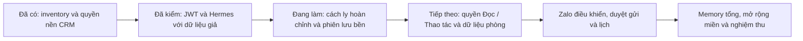

## Việc tiếp theo

Checkpoint đang làm ngày 12/10/2026 (chưa tích hợp hoặc phát hành sản phẩm):

- Auth refresh thật trên TEST đạt **5/5**, receipt `.cache/hermes-refresh-auth.14b27434-2cb9-4538-ad6b-5ecbc326c490.json` lúc `2026-10-12T06:54:19.380Z`. Một user tổng hợp có hai phiên độc lập; refresh Hermes rồi refresh trình duyệt đều giữ đúng user/session. Token lỗi bị từ chối; users/profiles/sessions thử đã dọn sạch. Tám hash nguồn đầu/cuối khớp. Không dùng tài khoản sao chép, không thử UI, durable store hoặc Auth production.
- Harness `scripts/test-hermes-refresh-auth.mjs` có **9/9** kiểm tra offline và review delta sạch. Đã sửa race timeout: theo dõi toàn bộ POST, chờ kết thúc trước cleanup; không xác định được kết quả thì giữ khóa TEST. Receipt chỉ xác nhận kết quả đã đo.
- `store-transport` có **12/12** kiểm tra: SQL ERROR từ chối chắc chắn không bị coi là mất ACK để thử lại; FATAL, lỗi mạng và completion-unknown vẫn đóng quyền. Provider **19/19**, pool **5/5** đã kiểm/review; chưa nối broker sản phẩm.
- Giao thức refresh mới có **49/49** kiểm tra (manager 37 + adapter 12), root review delta và đối chiếu producer SQL. STAGED chưa cho đọc; publish/reconcile cùng claim, giữ nguyên ciphertext, không gọi provider lần hai. Chỉ quarantine có ACK mới báo reconnect xác định; còn lại trả unknown và dừng caller. ACTIVE mới đã commit là quyết định của DB, cần kiểm quyền mới trước đọc; không coi mất ACK là thu hồi toàn hệ. Chưa có chứng minh DB/concurrency/crash hoặc quy trình phục hồi tự động.
- Hai migration mới đã review độc lập, static **23/23**, apply đúng TEST qua forward lane có hai lượt preflight ROLLBACK, backup full và catalog trước/sau. Identity/policy `20261012061447`: digest `ae88a8523c00c4b92deb659ea9cb9a06edfe40ca10f2f3160a90865b820f64a4`, backup 621 bảng có dữ liệu, log `.cache/hermes-p2-identity-apply-test.txt`. Encrypted store `20261012062043`: digest `1d5708a6a4a3d319719b7dd78aa81bc0a9db75a66914d4f047a1ec2137f5bbfd`, backup 627 bảng có dữ liệu, log `.cache/hermes-p2-store-apply-test.txt`. Hai evidence nằm tại cache TEST `schema-change-evidence/`, không ghi schema production. Provenance TEST sau apply nhận đúng hai biên nhận; ledger legacy giữ nguyên.
- Catalog/provenance TEST đã lưu riêng trong `.cache/migration-targets/test/hzulujxgonszuleqticb/`. Catalog hiện đếm bảng public và hàm public/app_private; chưa dùng nó để chứng minh đầy đủ bảng/ACL private mới. `measure-org-leak --env test --expected-project-ref hzulujxgonszuleqticb --write` đã đạt (log `.cache/hermes-p2-org-leak-test.txt`); kiểm bằng role/claims trong transaction, không phải đăng nhập JWT thật. Harness durable store đã có 14/14 kiểm offline và review; chưa chạy DB.
- Gate checkpoint transport lần đầu **11/13**, lần kế **12/13** đều chưa đạt; chẩn đoán docs 13/13, Node 570/570 và 17 file app từng lỗi **346/346** đạt khi giảm số worker. Runner giữ nguyên selection/timeout nhưng giới hạn tối đa hai worker. Gate cuối `.cache/gate-backend-bounded.txt` **47/47** đạt, 96 giây, tree `249e63db2ddad634a3f3f894e89395628630a8ca`; review độc lập không có P1/P2 mới, đã commit/push `494d306a12c4e9bba440eb31c113007206849d14` vào draft PR #165. Tập app-unit vẫn đủ 1119 file nhưng mode all được giao CI theo luật hiện có; local related không chứng minh toàn bộ suite đã đạt. CI đúng head còn đang chạy.
- [CI checkpoint `494d306a`](https://github.com/zxGreenxz/whiteboard-ihomecrm/actions/runs/38216879225) đã SUCCESS: app-unit **1119/1119 file, 14029 ca PASS, 1 ca Windows-only không chạy trên Linux** (`with-cred.test.mjs`). Quality/strict/timezone/secret jobs đạt; security/cross-tenant/generated-types và các job bị skip không được tính là đã kiểm. Log app-unit lưu `.cache/hermes-ci-494d306a-vitest.txt`. Kết quả này không chứng minh WIP broker/SQL/harness sau checkpoint.
- Resolver `durable-authority` có 16/16 kiểm offline, review độc lập không có P1/P2 mới: xác minh phiên, đối chiếu membership/version, đọc lại store và kiểm quyền trước/sau. `assistantScopeIds` là ID scope chính sách; `scopesByPermission` là ID tòa/sổ CRM theo từng quyền. Hai miền ID chưa được ánh xạ để mở business tools. Adapter Auth mở rộng có 11/11 kiểm offline và root review; chưa có JWT/RPC thật cho đường mới. Đang nối authority vào dispatcher broker hiện có; khi broker đổi hash, receipt JWT 17/17 cũ chỉ còn bằng chứng lịch sử, phải kiểm delta.
- Delta broker/authority đã nối, **55/55** kiểm tập trung đạt (gồm 28 ca tương thích P1), review độc lập không có P1/P2 mới. JWT TEST kiểm lại với broker hash `d46ec4c56291802316f302d98f945e290e53dfb9db18ad7b82f17aa733028834`: **17/17**, cleanup xác minh, inputsUnchanged=true, receipt `.cache/hermes-broker-authz.f8158417-026a-4850-b521-a6a16fd030b4.json` lúc `2026-10-12T07:28:37.408Z`. Đây là đường P1 còn tương thích, chưa thay bằng chứng durable integration.
- Baseline SQL harness đầu tiên dừng trước fixture do thiếu CA cho TLS pooler: receipt `.cache/hermes-durable-store.de71e186-33cd-4d7e-b642-637d73e42fb0.json`, không đạt. Đối soát chỉ đọc xác nhận active_run/role/user thử đều 0; không xóa marker thủ công. CA chính thức đã được đối chiếu nguồn Supabase và kiểm kết nối đọc với certificate verification bật; đang bổ sung CA vào harness trước chạy lại. Backup full TEST sau hai migration đã có, manifest tại thư mục backup ngoài repo; không commit dump/credential.

1. Gate/review checkpoint code nền P2, push draft và đọc CI đúng head; giữ receipt cũ nếu đầu vào không đổi. CI xanh của head cũ không chứng minh WIP mới.
2. Giữ JWT receipt cuối khi đầu vào không đổi; không chạy lại TEST chỉ để đếm thêm pass. Chưa bật business tools hoặc gửi Zalo.
3. Giữ runtime receipt 17/17 khi hash nguồn còn khớp; tiếp tục invalidation/regrant và egress còn thiếu. Fixture model/MCP không được báo thành CRM/model trả phí đã tích hợp.
4. Chốt ADR auth/network/quota dựa bằng chứng P1, giữ P1 checkbox mở nếu refresh/context invalidation hoặc isolation chưa đạt.

Lưu ý kiểm CI: `npm run ci:wait -- --sha <sha>` chỉ kết luận cho push/workflow_dispatch trên main, không tính run pull_request. Với draft PR dùng `gh pr checks 165 --watch` để đọc checks của PR, không dispatch/rerun main; kết quả PR vẫn chưa phải evidence promote production. `ci:wait` yêu cầu GH_TOKEN trong env; chỉ nạp khóa cần thiết bằng helper vault hiện có, không in token.

## Bàn giao session / agent

Đọc PLAN.md để biết quyết định đã duyệt, rồi STATUS.md để tiếp tục đúng điểm. Không tái tạo plan từ PDF/HTML v1.0 hoặc chạy lại script xuất plan cũ. Cập nhật checkbox trong PLAN và ghi việc thực hiện, kiểm chứng, giới hạn, commit/PR ở STATUS sau mỗi phần.

Evidence local nằm ở `.cache/gate-receipts/` (plan và receipt theo gate) và `.cache/hermes-p0/` trong worktree này. Đây là cache chưa commit; không giả định có khi clone sang máy khác. `focused-summary.json` là bản tổng hợp do agent ghi, không phải receipt gốc của runner. Lượt gate đầu: snapshot tree `ae8744095db7fb65d834aa869b10a2d5cc189047`, kết quả 46/47, lưu tại `.cache/hermes-p0/gate-first-failed/`; snapshot mới phải được kiểm theo Contract.

Lượt code đạt: `.cache/hermes-p0/gate-code-passed/`, tree `a05a740f2fc2819f679bbc0795e468567380106b`, base/head khi chạy là `7367b7007f096f20471bf1309bc51e0b971439b6`. Commit code trên có đúng tree này; không đổi nhãn receipt thành CI hoặc runtime evidence. Tài liệu checkpoint cập nhật sau commit code được kiểm theo phạm vi docs riêng.

Checkpoint P0 cũ `c833d379` có 10 nghĩa vụ chưa kiểm local; không dùng số này cho checkpoint P1. Snapshot P1 mới có 18 nghĩa vụ CI/live như plan receipt; JWT TEST có bằng chứng riêng ở trên. UI/E2E và gửi Zalo thật chưa kiểm.

Không `npm install`/`npm ci` qua node_modules junction hiện tại. Không stage toàn bộ worktree: migration EOL và cache nằm ngoài thay đổi. Khi chuyển worktree/máy, lấy đúng branch/commit đã ghi và cài dependency riêng nếu cần.

Prompt tiếp tục gợi ý: “Đọc docs/plans/hermes-crm/PLAN.md và STATUS.md trên nhánh codex/hermes-crm-foundation-20261012. Giữ WIP, kiểm gate/review delta P0/P1 và CI runtime. Tái dùng JWT receipt còn khớp nguồn; hoàn tất P1 rồi triển khai P2. Mục tiêu vẫn là toàn bộ P0–P11; cập nhật hai file sau mỗi phần.”

## Quy tắc evidence

Source tĩnh không chứng minh runtime; local/TEST không chứng minh production. JWT/RPC và MCP đã có bằng chứng hẹp như trên; chưa có OAuth sản phẩm, cách ly runtime đầy đủ, model usage hoặc gửi Zalo của Hermes. Không mở ghi/gửi dựa trên tài liệu này.
