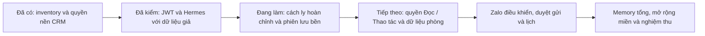

# Trạng thái triển khai Hermes × iHomeCRM

Cập nhật: 12/10/2026 · Asia/Bangkok. Kế hoạch gốc được duy trì tại [PLAN.md](PLAN.md).

## Điểm tiếp tục

- **Đang làm:** Sửa lỗi mount phát hiện trên Linux CI để hoàn tất spike runtime P1; song song chuẩn bị target migration TEST và crypto/refresh primitive P2. Broker/JWT thật đã có evidence; runtime cách ly đầy đủ còn mở.
- **P0 đã hiện thực:** inventory chi tiết v2 và đối chiếu catalog TEST chỉ đọc; focused tests và gate local 47/47 đạt. CI của delta mới còn chờ; bản ghi review cuối ở PR.
- **Chưa hoàn thành:** AIAgent trong container, mạng cách ly đầy đủ, refresh/lưu bền/quota model, schema/kết nối/user memory, Hermes tổng, UI hoặc gửi tin thật. P2 mới bắt đầu code nền; P3–P11 chưa triển khai.
- **Worktree:** `C:/Users/Nguyen Tam/codex-worktrees/hermes-crm-foundation-20261012`.
- **Branch:** `codex/hermes-crm-foundation-20261012`.
- **Base:** `7367b7007f096f20471bf1309bc51e0b971439b6` (origin/main sau fetch).
- **Commit checkpoint:** `005e0d2678d9852407dc4cfac200ddff811f1667`, tree `6c4b57c6dda7c254cbe2d34b25a6ce8867a55718`: fix discovery local 8/8; CI runtime 12/12 với dữ liệu giả. Nền trước đó `6ecdc399` local 47/47, fix mount `9691e3b9` local 12/12. P2 code nền còn chờ gate checkpoint; chưa merge/phát hành.
- **Draft PR:** [#165 — nền CRM dùng chung và plan Hermes](https://github.com/zxGreenxz/whiteboard-ihomecrm/pull/165). Đọc checks đúng head hiện tại của PR; trạng thái GitHub có thể mới hơn checkpoint này.

## Nhật ký đã xác minh

| Mốc | Công việc | Kết quả / giới hạn |
| --- | --- | --- |
| 12/10/2026 | Chủ dự án chốt plan và yêu cầu Markdown bàn giao | Đã duyệt cả Hermes riêng + Hermes tổng; không cần hỏi lại nguyên tắc |
| 12/10/2026 | P0.01 tạo worktree sau fetch | Đã tạo đúng nhánh/path; giữ WIP checkout chính |
| 12/10/2026 | Đối chiếu baseline mới | Worker/registry đã đổi; Zalo unit đã được mở lại ở main, Copilot vẫn hoãn. Inventory cần tái sinh |
| 12/10/2026 | Lưu PLAN/STATUS Markdown | Đã ghi kiến trúc, các giai đoạn, thêm T35–T42 cho memory/giám sát; chưa phải kết quả test |
| 12/10/2026 | Inventory tĩnh có thể tái sinh | Generator + snapshot + 15 mutation/behavior tests đạt; chưa có runtime/DB evidence |
| 12/10/2026 | Chuẩn bị dependencies | Root package-lock của worktree và checkout chính cùng SHA-256; node_modules junction dùng existing deps. Không npm install/ci qua junction |
| 12/10/2026 | P1 preflight chỉ đọc | Có git 2.52, Node 22.20, Python 3.12.10, Docker CLI 29.6.2, psql 17.10; không thấy hermes/uv/deno trên PATH. Chưa kiểm daemon/runtime |
| 12/10/2026 | Khôi phục kiểm offline có chọn lọc | Core permission/tool/plan/memory chạy lại; UI/model/live và Zalo fleet vẫn hoãn. Không thay runtime sản phẩm |
| 12/10/2026 | Focused tests trước gate | Core 113/113; routing/registry 50/50; verifier 65/65; inventory 15/15. Đây là các bộ riêng, không suy ra full app hoặc live đạt |
| 12/10/2026 | Gate local lượt đầu | 46/47 đạt; Vitest related lỗi 2 assertion vẫn kỳ vọng Copilot core bị hoãn. Giữ kết quả lỗi, sửa policy regression trước khi chạy lại |
| 12/10/2026 | Review độc lập lượt đầu | Một P2: gate corpus chưa được chọn khi capability visibility/tài liệu nguồn đổi; cần thêm mapping và regression. Chưa kết luận review đạt |
| 12/10/2026 | Sửa delta sau review | 5 ca routing lỗi trước sửa đã đạt sau sửa; focused 76/76 gồm regression 29, routing 13, gate-plan 34. Matrix: 1.295 file active / 16 suite / 0 mồ côi / 75 deferred. Gate cuối và re-review delta đang chờ |
| 12/10/2026 | Gate local sau sửa | 47/47 đạt, exit 0, 76 giây. Có 46 receipts static/suite và output Vitest related 7/7 file; 10 nghĩa vụ CI chưa kiểm local |
| 12/10/2026 | Cross-review kết thúc | Reviewer kiểm source + delta + receipts cùng snapshot, không còn finding P1/P2; không xác nhận runtime/TEST/CI/production |
| 12/10/2026 | Lưu commit code | `c833d379e6f83b1d0a44ca4964f2cbf7e3831ae6`; tree `a05a740f2fc2819f679bbc0795e468567380106b` |
| 12/10/2026 | Lưu checkpoint và mở draft PR | `053b3eca` cập nhật PLAN/STATUS; docs gate 5/5 (không JS/TS để Vitest), reviewer không thấy claim sai; draft PR #165 đã tạo |
| 12/10/2026 | Xác minh lại PR #165 | OPEN/draft, head `386296cb`, các job bắt buộc và aggregate SUCCESS; job bỏ qua theo scope không được coi đã kiểm. Chưa phải release production |
| 12/10/2026 | P0.02 inventory v2 | 67 tool, 32 action, 29 UI capability, 47 page contracts, 6 safe controls; 28/28 focused tests + generator check đạt. Disposition hai tool kế hoạch đã ghi; chưa bật runtime Hermes |
| 12/10/2026 | P0.03 TEST catalog | `BEGIN READ ONLY`, marker TEST hợp lệ; 32/32 registry khớp; 135/135 tên hàm ở schema đúng. 69 cờ enabled/2 disabled trên TEST; không suy ra quyền Hermes hoặc production |
| 12/10/2026 | Comparator catalog | 23/23 tests, gồm empty evidence, registry drift, public/private helper, thiếu ACL, RPC giả; không dùng ledger legacy để yêu cầu replay migration |
| 12/10/2026 | P1 upstream/runtime | Ghim đề xuất Hermes v0.21.6, source `818c13be1dc4fd28987e1e881a9408224afd4535`, image digest cụ thể. Docker Desktop đã khởi động nhưng daemon chưa sẵn sàng; fixture/broker đang hiện thực, chưa có runtime pass |
| 12/10/2026 | Chẩn đoán Docker local | Backend log báo không truy cập được socket `Docker/run/dockerInference` (reparse point cũ 13/08). Thử đổi tên dự phòng bị Windows từ chối; chưa đổi/xóa file, chưa reset Docker. Không coi lần gọi Start-Process là engine đã chạy |
| 12/10/2026 | P1 JWT thử đầu | Lỗi thiếu Content-Profile gây PGRST202; đã giữ receipt lỗi, sửa adapter và regression. Cleanup đã xác minh |
| 12/10/2026 | P1 broker + JWT cuối | Broker 28/28 unit/HTTP; harness 11/11. JWT TEST thật 17/17 với 3 user giả/2 org giả, cleanup=true, active_run=0; 8 hash nguồn đầu/cuối khớp. Không sửa schema hoặc xuất tool phòng |
| 12/10/2026 | Review broker/harness | Sửa khe thời gian sau audit bằng kiểm quyền cuối; SQL timeout không rõ kết quả giữ khóa TEST. Review độc lập harness/inventory/routing không còn P1/P2; gate tổng chưa chạy |
| 12/10/2026 | Hermes MCP client thật | Upstream ghim + MCP 2.0.0 chạy native Python riêng: 4/4 transport checks đạt. Chỉ chứng minh initialize/list/call/revoke; chưa phải AIAgent/container/model/CRM end-to-end |
| 12/10/2026 | Đường kiểm runtime Linux | Thêm workflow Ubuntu 24.04 + Node 24.18.0, container ghim digest, fixture/model giả, không secret CRM. Chờ CI chạy; chỉ upload JSON receipt |
| 12/10/2026 | Gate P0/P1 | Local 47/47 đạt, 215 giây, tree `9740e5d899900caa67547c7a530c82df1fb5afc6`; còn 18 nghĩa vụ CI/live chưa kiểm local. Delta sau đó chỉ chuẩn hóa EOL lock mới và cập nhật tài liệu, gate tái dùng bằng chứng đúng đầu vào |
| 12/10/2026 | Checkpoint P0/P1 cuối | Commit `6ecdc399`, tree `e894e37e`; local 47/47 đạt, 110 giây, 46 receipts + Vitest related 1/1 file. Review xác minh receipts cùng snapshot; đã cập nhật draft PR #165 |
| 12/10/2026 | CI runtime lượt 1 | Run `38209692628` kéo được image ghim và tạo mạng nội bộ; FAIL ở fixture vì upstream khai VOLUME /opt/data sinh anonymous volume. Verifier chặn đúng, chưa chạy AIAgent. Image không có revision label nên chưa chứng minh digest tương ứng source commit |
| 12/10/2026 | Sửa mount runtime | Ba file sửa để override /opt/data bằng tmpfs chỉ đọc và kiểm map tmpfs chính xác, focused 18/18. Gate/push fix ở worktree riêng `hermes-runtime-ci-20261012` để giữ WIP P2; chờ CI mới |
| 12/10/2026 | Bắt đầu nền P2 | Target binding migration lane và crypto/refresh primitive đang code, chưa gọi DB/schema/apply. Chưa có store bền vững hoặc refresh thật |
| 12/10/2026 | CI runtime lượt 2 | Run `38210160244`, head `9691e3b9`: mount đã đạt; AIAgent FAIL do progressive tool search mặc định thay tool CRM bằng bridge. Giữ receipt lỗi, không nới tool allowlist |
| 12/10/2026 | CI runtime lượt 3 | Run `38210992537`, head `005e0d26`: tắt tool_search cho spike, 12/12 checks đạt với AIAgent thật, model/broker giả, inputsUnchanged=true. Digest image khớp; revision label trống nên source provenance chưa xác minh |
| 12/10/2026 | Primitive credential P2 | Crypto/refresh 25/25; review độc lập không còn P1/P2 trong phạm vi module. AES-GCM binding và fence/CAS/lease đã kiểm với store/provider giả; chưa durable storage hoặc refresh thật |
| 12/10/2026 | Model relay P2 | 15/15, review đóng lỗi HTTP200 chứa error/debug bằng response projection. Chỉ gọi proxy hiện có, không retry, request snapshot chống mutation. Chưa route/broker integration hoặc quota live |
| 12/10/2026 | Target lane P2.0 | 33/33 Node + 10/10 backup Node + 30/30 Vitest; review source không còn P1/P2. TEST credentials/evidence riêng, marker/lease, giữ khóa khi write chưa rõ; chưa backup/dry-run/apply TEST thật |

## Bảng tiến độ

| Gói | Trạng thái | Còn thiếu để đóng |
| --- | --- | --- |
| P0 | Nội dung + focused + local gate đạt | CI/review snapshot cuối và tích hợp PR; không suy inventory thành runtime parity |
| P1 | Đang hiện thực | JWT/broker, MCP và AIAgent/container với dữ liệu giả đã đạt; còn mạng từng user, một owner profile, provenance, refresh, model quota và context invalidation đầy đủ |
| P2 | Đang chuẩn bị nền, chưa tích hợp | Target TEST an toàn, schema/store bền vững, quyền Đọc/Thao tác và refresh; chưa đủ điều kiện nghiệm thu khi P1 còn mở. |
| P3 | Chưa bắt đầu | Đọc đúng dữ liệu; deny không trả rỗng giả; không lộ trường nội bộ/cross-tenant. Dữ liệu không vào context dùng chung; ngân sách, timeout và dừng khẩn cấp đã có hiệu lực. |
| P4 | Chưa bắt đầu | Người khác/nhóm/forward không giả danh chủ; không trả lời lặp; một account chỉ có một chủ session. |
| P5 | Chưa bắt đầu | Không tự duyệt; nội dung/đích đổi phải duyệt lại; không báo đã gửi khi chỉ enqueue; không retry mù. |
| P6 | Chưa bắt đầu | Một scheduler; không chạy đôi; dữ liệu mới; không mở rộng nhóm bằng grant cũ. |
| P7 | Chưa bắt đầu | Không lẫn user/org/private-group; thông tin hiện hành lấy CRM; UX xem rõ quyền và trạng thái. |
| P8 | Chưa bắt đầu | Không mất ngầm năng lực; không mở lại action đã gỡ/tắt; các miền nhạy cảm qua kiểm riêng. |
| P9 | Chưa bắt đầu | Giải thích được mọi tác vụ và chi phí; fail closed khi auth lỗi; tắt Hermes không phá queue/lịch độc lập. |
| P10 | Chưa bắt đầu | Các invariant bắt buộc đạt; không có lỗi quyền/side effect chưa xử lý; người dùng hoàn thành luồng không cần kỹ thuật. |
| P11 | Chưa bắt đầu | Không còn luồng mồ côi, job trùng, quota tách đôi hay hai nơi sửa nghiệp vụ; rollback đã diễn tập. |

## WIP phải giữ

- Checkout chính có `docs/doi-chieu/so-quy-686tcb.md` sửa sẵn và nhiều file untracked của việc khác; không đưa vào thay đổi này.
- Worktree mới báo diff `supabase/migrations/20260528000007_drop_beds_fix_rpcs.sql` ngay sau checkout (306 dòng thay; Git cảnh báo CRLF/LF). `git diff --ignore-space-at-eol --numstat` trả rỗng: chênh lệch EOL. Không sửa/restore/stage. Migration legacy immutable, nằm ngoài scope.

## Inventory và kiểm đã có

- Generator: `scripts/generate-hermes-crm-inventory.mjs`.
- Snapshot: [hermes-crm-inventory.generated.json](../../../tooling/hermes-crm-inventory.generated.json); có digest từng file nguồn. Dùng snapshot thay số đếm chép tay ở tài liệu lịch sử.
- Focused command: `node --test scripts/__tests__/generate-hermes-crm-inventory.test.mjs` — 28/28 đạt (agent inventory, 12/10/2026).
- `node scripts/generate-hermes-crm-inventory.mjs --check` — đạt cùng source đầu vào.
- Đã kiểm các mutation: parser mất nguồn, tool trùng, dạng khai báo lạ, permission drift, RPC thiếu và snapshot cũ. Không suy từ các test này rằng quyền runtime đã đúng.
- Snapshot v2 bao phủ scope/input-output/consent/channel/acceptance từng tool/action/capability/page/control. Input lấy từ khai báo schema; output/RPC source có provenance, phần server chưa đo vẫn ghi chưa đo. Không chứng nhận builtin từ thư viện PageAgent ngoài explicit override.
- Hai tool: `lap_ke_hoach` → `migrate_to_gateway`; `thuc_thi_buoc` → `retain_backend_executor`. Đây là disposition triển khai; P1/P3 chứng minh identity, P5 nối thực thi. Cả hai còn `superAdminOnly`; chưa thay quyền runtime hoặc gọi lại engine Copilot.
- Source adapter: `src/copilot/tools/planTools.ts`, `src/copilot/plan/planClient.ts`. Hook `src/copilot/useHangDoiSauDuyet.ts` chưa là queue server bền vững. UI inventory đã đọc createAgent/pageScope/safeControls/uiControlAvailability/safetyGuard và page contracts; DOM runtime chưa đo.
- TEST xác nhận `copilot_available_rooms_v1` cấp EXECUTE cho authenticated, không cấp anon/service_role. JWT fixture đã kiểm scope phòng A/B và membership; đây là control RPC trực tiếp, chưa là tool Hermes được mở.

## Bằng chứng P0.03 có thể tái tạo

Chạy trong worktree, output chỉ lưu cache cục bộ:

```powershell
node scripts/db-query.mjs --env test --file tooling/hermes-crm/catalog-test.sql --json > .cache/hermes-p0/catalog-complete-test.raw.json
node scripts/compare-hermes-crm-catalog.mjs tooling/hermes-crm-inventory.generated.json .cache/hermes-p0/catalog-complete-test.raw.json .cache/hermes-p0/catalog-comparison.json
```

- Thời điểm catalog: `2026-10-12T05:10:35.299091Z`; inventory SHA-256 `f1aa4fa257965ade2ca460fd302d130db4961bfa3585987dc968b83e1d2131b7`; catalog SHA-256 `f462eb8a4345dd14a626acdf89a5b1f2b330cf7f7d4a11be4a1ebbc329fa7c06` (JSON bỏ BOM).
- 135 tên gồm 134 hàm public và `app_private.copilot_plan_submit_voucher_v1`. Helper `maker_submit_v1` cố ý không là public RPC, không cấp EXECUTE cho authenticated/anon/service_role. Không tạo public wrapper để làm báo cáo xanh.
- Sáu dynamic callsite còn nguyên trong inventory: bốn wrapper forwarding và hai tên preview/execute từ catalog. Tên literal tại caller/catalog được thống kê riêng; chưa khẳng định quét mọi lời gọi runtime.
- Ledger có 372 dòng, max `20260727095000`; migration-policy đã đóng băng ledger legacy. Không suy các migration mới chưa deploy từ max này, không replay/backfill ledger.
- Snapshot chỉ quan sát tên/chữ ký/ACL/digest/registry/flags. Chưa chứng minh thân hàm khớp source, RLS với JWT thật, production config hoặc toàn bộ UI/runtime parity.

## Đường tiếp tục P1 sau P0

1. Ghim runtime Hermes, kiểm platform/MCP transport; không suy khả năng chạy từ Python có sẵn.
2. Spike loopback với dữ liệu giả: credential hạn chế → user/org/connection server; hai user thường và superadmin, expiry/revoke/forgery.
3. Kiểm profile/process/file isolation thật, không chỉ tạo hai thư mục; broker secrets ngoài vùng runtime.
4. Đọc DATA_ENVIRONMENTS và dùng guard/lock TEST trước kiểm JWT/RPC thật; thử một tool đọc, không cần model trả phí hay gửi Zalo.
5. `npm run test-env:check` có tạo fixture JWT và chạy Chrome, `--sync` thay TEST; không gọi là preflight chỉ đọc. Helper credential có thể tạo seed vào vault. Chỉ nạp key cần dùng qua lane hiện có, không in/sao chép secret.
6. Ghi ADR và evidence offline/TEST riêng; không dùng giả lập thay JWT/RLS thật.

## Bằng chứng P1 đã có

- JWT receipt cuối: `.cache/hermes-broker-authz.34c60b80-1c82-4920-a9f4-b5b52d69ce8f.json`, lúc `2026-10-12T05:31:27Z`: 17 PASS, cleanup xác minh, inputsUnchanged=true. Harness SHA-256 `169355df224885e46906d4897cf229d057dde69a1d2c5e8b4a974795743c3e9f`; broker `4f2bd4da4dd33f237a8fa7f901a3f4e92b2df39840f9462c94a299882d623c31`.
- Kiểm user A/B, superadmin theo từng org, actor/org giả, membership revoke/expiry, role/superadmin downgrade, read restriction và connection revoke/expiry. Reconnect giữ assistant trong cùng memory store; chưa chứng minh lưu bền qua restart.
- Broker chỉ xuất `crm_auth_context`. Token opaque không là Supabase JWT; raw phiên user ở broker. Không có arbitrary RPC, service-role hoặc chức năng ghi/gửi trong transport.
- Receipt MCP cuối sau chuẩn hóa EOL lock: `.cache/hermes-p1/transport-1791783946200-1eea8c/receipt.json`, `PASSED_TRANSPORT_COMPATIBILITY_ONLY`, 4/4 checks; runtime focused 17/17. Kiểm đúng mã deny cùng HTTP do fixture quan sát, hash đầu/cuối khớp; lỗi backend không được tính thành policy deny đạt.
- Gate P0/P1 cuối lưu ở `.cache/hermes-p1/gate-final-passed/`, tree `e894e37e6fef3d2769f6070c4cf9473b7f5458b0`. Có 46 receipts và Vitest related 1/1 file; không coi đó là 18 nghĩa vụ CI/live đã đạt. Lượt trước giữ ở `gate-code-passed/`, không đổi nhãn.
- Docker local: `.cache/hermes-p1/hermes-p1-1791782870130-8575bb/receipt.json` ghi BLOCKED khi daemon timeout. Chưa pull/run container. Không sửa/reset Windows để thay bằng chứng này.
- Container receipt: `.cache/hermes-p1/ci-38210992537/hermes-p1-1791785241203-4c40eb/receipt.json`, status `PASSED_SYNTHETIC_RUNTIME_PROVENANCE_UNVERIFIED`, 12/12 checks; [CI đúng head 005e0d26](https://github.com/zxGreenxz/whiteboard-ihomecrm/actions/runs/38210992537). Kiểm A/B MCP/model turns, mount/tool allowlist, memory/session/token, restart riêng và revoke trước model. Không dùng kết quả này chứng minh live CRM/model/Zalo.
- Mạng bridge nội bộ dùng chung và probe một IP/port chưa chứng minh chặn peer, DNS/IPv6 hoặc mọi đường đi vòng. Native memory purge/regrant, một owner profile và quota provider còn cần kiểm; không gọi tất cả P1 đã hoàn tất.

## Nền P2 đã viết, chưa nối sản phẩm

- `infra/hermes-broker/session-crypto.mjs`, `refresh-manager.mjs`: mã hóa và điều phối refresh với adapter store/provider được inject. Durable backend phải bảo đảm atomic fence/CAS; kết quả commit không rõ và invalidation lỗi phải cách ly connection/jobs cho tới đối soát. Chưa có bảng hoặc adapter lưu bền.
- `infra/hermes-broker/model-relay.mjs`: transport nội bộ dùng `llm-proxy`, server cung cấp user JWT/org/request ID; allowlist model mặc định rỗng. Response chỉ project trường hợp lệ. Proxy hiện tại chưa được chứng minh hard concurrent budget hoặc settlement đúng một lần; không gọi relay test là bằng chứng ngân sách.
- `scripts/lib/migration-target.mjs` và bốn runner migration/backup/catalog/provenance: `--env test --expected-project-ref <TEST_REF>` ràng buộc cùng đích. Evidence TEST ở `.cache/migration-targets/test/<ref>/`, không thay production inventory/provenance. Không đổi `.temp/project-ref` hoặc alias TEST credential vào tên production.
- Node backup test phải chạy bằng `node --test`; một lần chọn nhầm Vitest báo no-suite đã được chạy lại đúng runner. Không có DB thật bị thay đổi trong checkpoint code này.



## Việc tiếp theo

1. Gate/review checkpoint code nền P2, push draft và đọc CI đúng head; giữ receipt cũ nếu đầu vào không đổi. CI xanh của head cũ không chứng minh WIP mới.
2. Giữ JWT receipt cuối khi đầu vào không đổi; không chạy lại TEST chỉ để đếm thêm pass. Chưa bật business tools hoặc gửi Zalo.
3. Hoàn thiện mạng từng user, một owner profile, invalidation/regrant trên Linux CI. Fixture model/MCP không được báo thành CRM/model trả phí đã tích hợp.
4. Chốt ADR auth/network/quota dựa bằng chứng P1, giữ P1 checkbox mở nếu refresh/context invalidation hoặc isolation chưa đạt.

Lưu ý kiểm CI: `npm run ci:wait -- --sha <sha>` chỉ kết luận cho push/workflow_dispatch trên main, không tính run pull_request. Với draft PR dùng `gh pr checks 165 --watch` để đọc checks của PR, không dispatch/rerun main; kết quả PR vẫn chưa phải evidence promote production. `ci:wait` yêu cầu GH_TOKEN trong env; chỉ nạp khóa cần thiết bằng helper vault hiện có, không in token.

## Bàn giao session / agent

Đọc PLAN.md để biết quyết định đã duyệt, rồi STATUS.md để tiếp tục đúng điểm. Không tái tạo plan từ PDF/HTML v1.0 hoặc chạy lại script xuất plan cũ. Cập nhật checkbox trong PLAN và ghi việc thực hiện, kiểm chứng, giới hạn, commit/PR ở STATUS sau mỗi phần.

Evidence local nằm ở `.cache/gate-receipts/` (plan và receipt theo gate) và `.cache/hermes-p0/` trong worktree này. Đây là cache chưa commit; không giả định có khi clone sang máy khác. `focused-summary.json` là bản tổng hợp do agent ghi, không phải receipt gốc của runner. Lượt gate đầu: snapshot tree `ae8744095db7fb65d834aa869b10a2d5cc189047`, kết quả 46/47, lưu tại `.cache/hermes-p0/gate-first-failed/`; snapshot mới phải được kiểm theo Contract.

Lượt code đạt: `.cache/hermes-p0/gate-code-passed/`, tree `a05a740f2fc2819f679bbc0795e468567380106b`, base/head khi chạy là `7367b7007f096f20471bf1309bc51e0b971439b6`. Commit code trên có đúng tree này; không đổi nhãn receipt thành CI hoặc runtime evidence. Tài liệu checkpoint cập nhật sau commit code được kiểm theo phạm vi docs riêng.

Checkpoint P0 cũ `c833d379` có 10 nghĩa vụ chưa kiểm local; không dùng số này cho checkpoint P1. Snapshot P1 mới có 18 nghĩa vụ CI/live như plan receipt; JWT TEST có bằng chứng riêng ở trên. UI/E2E và gửi Zalo thật chưa kiểm.

Không `npm install`/`npm ci` qua node_modules junction hiện tại. Không stage toàn bộ worktree: migration EOL và cache nằm ngoài thay đổi. Khi chuyển worktree/máy, lấy đúng branch/commit đã ghi và cài dependency riêng nếu cần.

Prompt tiếp tục gợi ý: “Đọc docs/plans/hermes-crm/PLAN.md và STATUS.md trên nhánh codex/hermes-crm-foundation-20261012. Giữ WIP, kiểm gate/review delta P0/P1 và CI runtime. Tái dùng JWT receipt còn khớp nguồn; hoàn tất P1 rồi triển khai P2. Mục tiêu vẫn là toàn bộ P0–P11; cập nhật hai file sau mỗi phần.”

## Quy tắc evidence

Source tĩnh không chứng minh runtime; local/TEST không chứng minh production. JWT/RPC và MCP đã có bằng chứng hẹp như trên; chưa có OAuth sản phẩm, cách ly runtime đầy đủ, model usage hoặc gửi Zalo của Hermes. Không mở ghi/gửi dựa trên tài liệu này.
