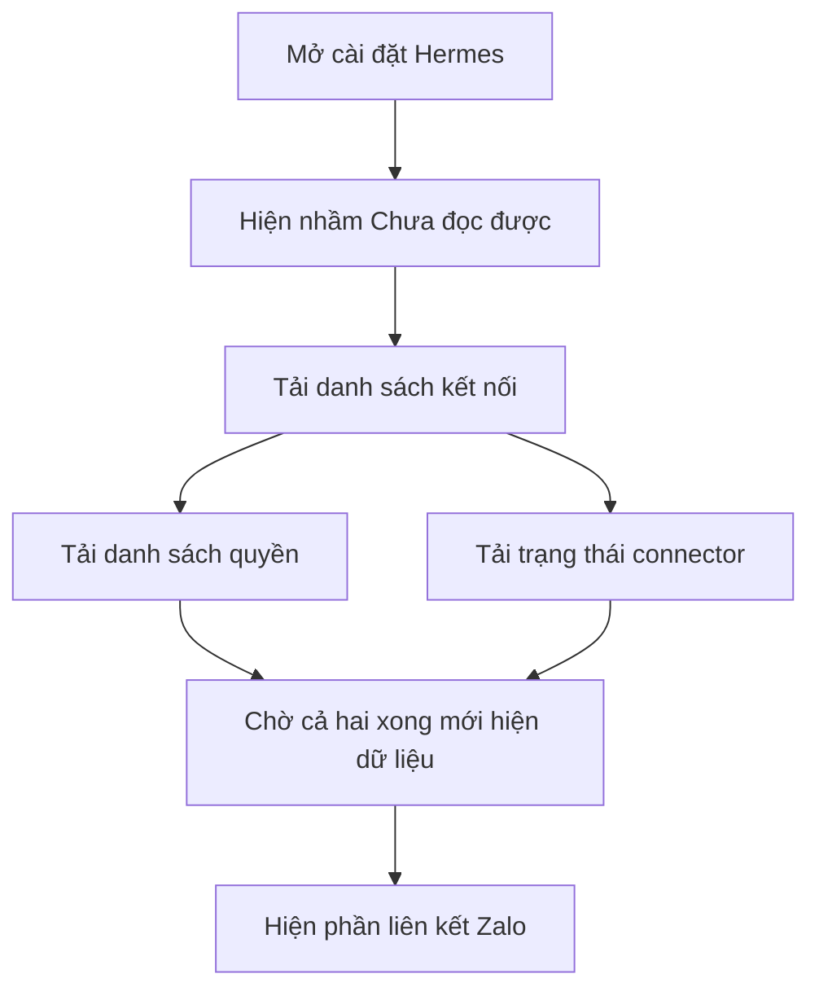
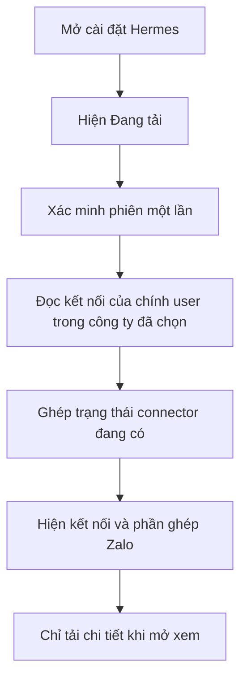
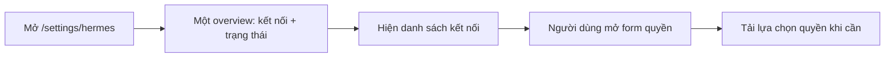
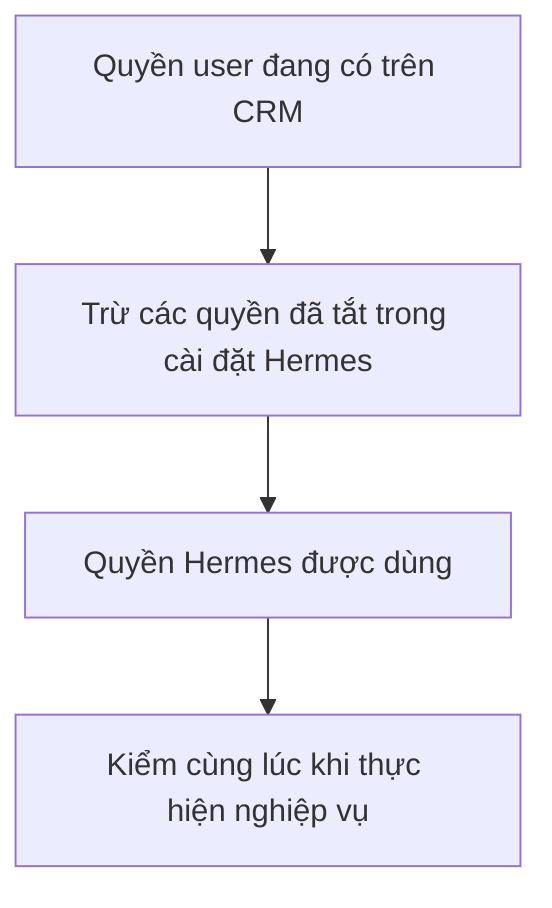
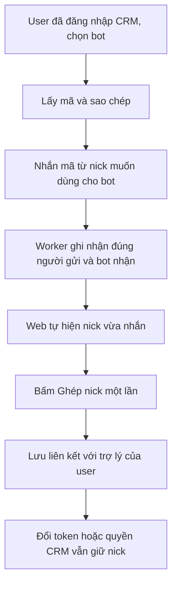
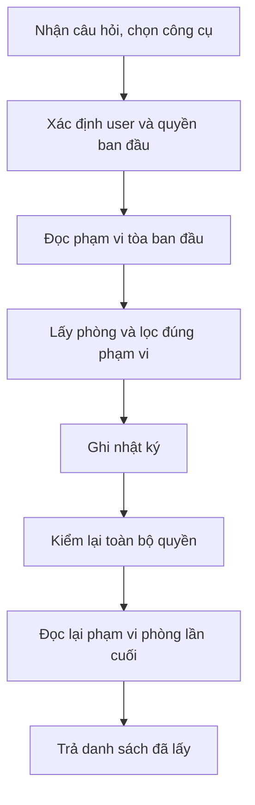
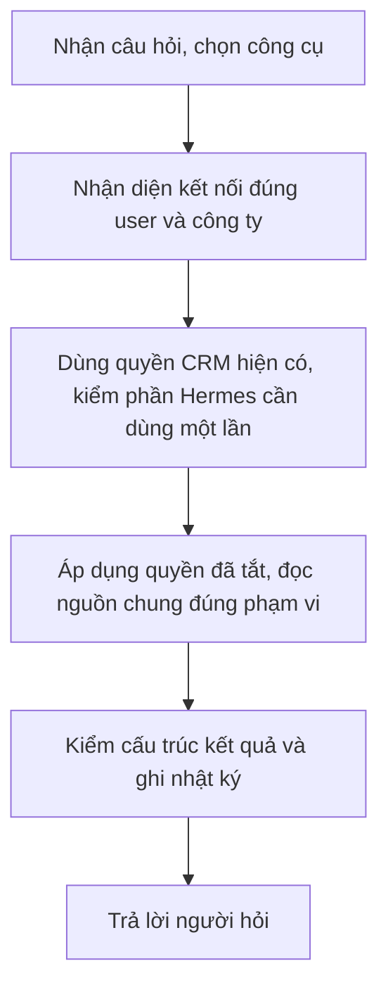
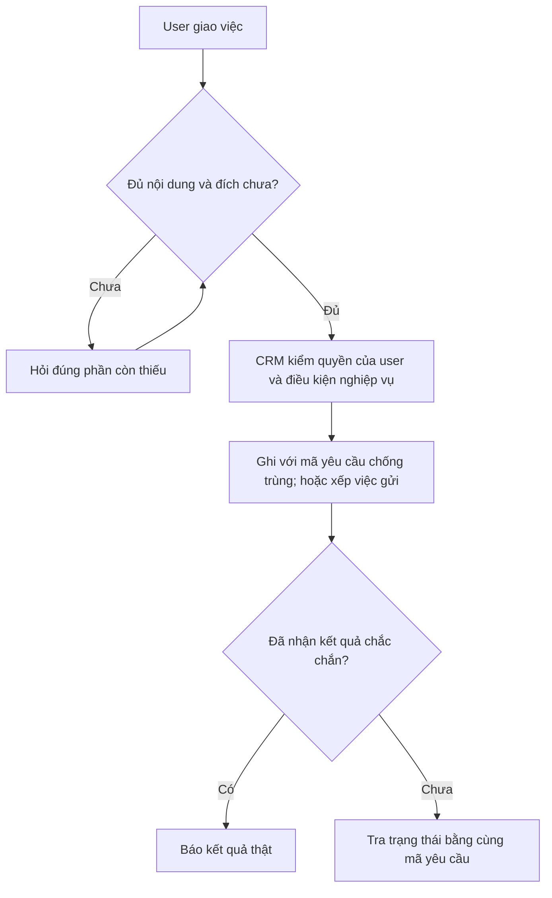
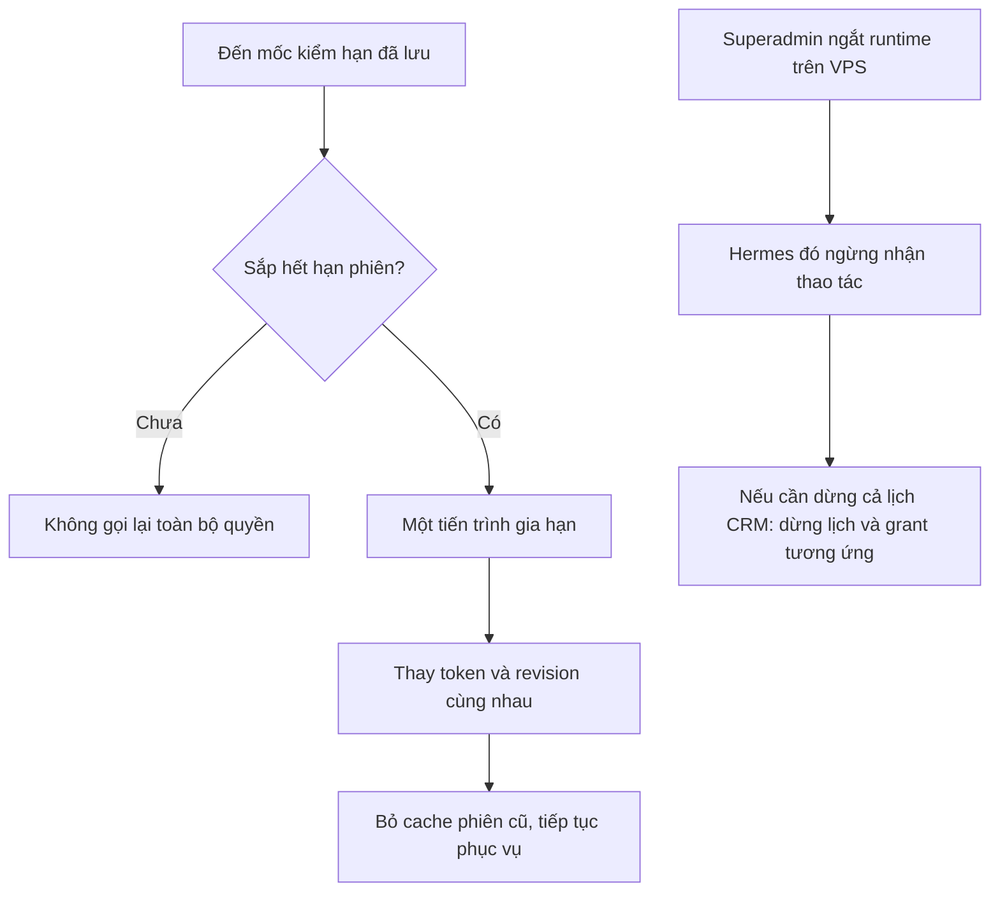

# Báo cáo và plan tinh giản kiểm quyền Hermes × iHomeCRM

## Tiếp tục từ checkpoint 19/10, 23:44 UTC+7

**Đã lên Vercel production — xác minh 07:43 ngày 20/10/2026 (UTC+7):** `https://ptcrm.vercel.app/` thực sự phục vụ `b5a0686d61d296ecc73eb82efb9c8653ca158298`, deployment READY; canonical `release:verify` PASS. Bản này chứa main `a9ef26308` và cập nhật PR #229, gồm thông báo liên kết Zalo mới. Đây là xác minh bản đang phục vụ, chưa phải kiểm UI/E2E thông báo mới. PR #229 đã merge lúc 07:46 ngày 20/10 vào main `34d59969`; nhánh Git `production` còn `039fc36a`; không đánh đồng việc đã lên Vercel với hoàn tất lane phát hành trong Git. Theo yêu cầu chủ, lượt này chỉ cập nhật trạng thái tài liệu.

**Trạng thái vận hành duy nhất cần đọc trước là [STATUS — checkpoint hiện hành](STATUS.md#checkpoint-hiện-hành).** Các checkpoint có giờ sớm hơn bên dưới là lịch sử, không ghi đè trạng thái này. Bản tài liệu kiểm UI `be910be0b` đã lên main, [CI đúng commit đạt](https://github.com/zxGreenxz/whiteboard-ihomecrm/actions/runs/39243588199).

- **Mốc trước lúc 19:05 UTC+7:** code `0fbc263f` và bảy migration đã triển khai ở VPS/DB; web Vercel phục vụ đúng SHA này, `release:verify` PASS. Đây là bằng chứng lịch sử; trạng thái mới nhất ở checkpoint dưới. Không chạy lại migration/promote để tạo thêm biên nhận.
- **Browser đã dùng được.** Ba tài khoản thật chủ/quản lý/hệ thống trên Supabase TEST riêng đã kiểm loading, tạo kết nối kế thừa CRM, đọc lại quyền, thu hồi và logout; tài khoản chủ kiểm thêm tắt/bật lại một quyền. Có 23 request HTTP 200, đã dọn toàn bộ hạ tầng UI thử; production không đổi, fast OFF. Đây là bản build TEST tĩnh qua proxy/SSH riêng, chưa phải HTTPS Vercel hoặc Zalo gửi nhận. [Số đo và sơ đồ](../2026-10-19-crm-hermes-jev-performance.md#nghiệm-thu-giao-diện-bằng-ba-tài-khoản-test-thật).
- **Checkpoint 23:44 UTC+7:** bản sửa phòng PR #227 đã áp production bằng forward lane lúc 23:41:30, sau backup full 650 bảng và CI nguồn `b16d9afd` được canonical `ci:wait` xác nhận 4/4 SUCCESS. Function body sống khớp source; không thêm trigger/lock hoặc đổi quyền. MCP kiểm lại initialize + phòng đạt 2/2, phòng HTTP 200 có 1 dòng trong 2,16 giây. Zalo Chat riêng 23:43 báo đọc thành công 1 dòng, trace đúng tool: tổng 15,35 giây, CRM 4,62 giây, ngoài CRM 10,73 giây; chưa phải p95. Khách hàng/hợp đồng/hóa đơn dùng lại bằng chứng trước, không ghi thành vừa rerun toàn bộ. Fast production vẫn OFF. Nhãn đồng bộ còn pending, không tự ACK. Không ghép nick lại. **Hướng tiếp: giảm lượt model và hoàn tất đối chiếu fast**, xem [báo cáo tốc độ hiện hành](TOI-UU-TOC-DO-HIEN-HANH.md). [Bản dễ hiểu cho chủ, có sơ đồ](BAO-CAO-TOC-DO-DE-HIEU.md) giải thích cùng kết luận. Chi tiết rollout ở [STATUS](STATUS.md#checkpoint-hiện-hành).
- Jev là pilot tùy chọn, chưa có key/nhà cung cấp đo; TG6 chữ công khai vẫn giữ hành vi hiện có và chọn riêng. Không chặn phát hành ba lỗi bằng hai nhánh tùy chọn này, cũng không tự đánh dấu P0–P11 hoàn tất. Không chạy lại migration, benchmark hoặc bộ kiểm không đổi chỉ để chờ Vercel.

Ngày 19/10/2026. **Snapshot lịch sử tới 16:05:01 UTC+7:** candidate `0fbc263f48d896baf633eba84dbf3cd4a222387a`, tree `519a726286fe951826004f9589554124f177c76c`, PR #222. Gate7 delta **65/65 PASS** trong 529 giây; Gate5/6 **67/67** được dùng lại vì đầu vào không đổi. Main CI **5/5 PASS** (CI `39211903664`, synthetic `39211903814`, Android `39211903731`, migrationvalidation `39211903783`, restoredrill `39211903671`). Chạy thử promote chính thức **18 jobs/178 bước PASS**; receipt E2E fleet bảy spec là LOCAL tại `docs/generated/e2e-fleet-evidence/2026-10-19-d4818a9a682c-fa428022.json`, không phải CI E2E thật.

Lệnh promote `--apply` trước đó chưa tạo được bản phát hành do API trả `402 payment_required`; chưa gọi lại. Lần kiểm web trước ghi nhận `81c49363`, checkpoint này chưa kiểm lại. Artifact backup mã hóa được xác minh lúc `07:03:56Z`; VPS được chuyển sang release `0fbc263f`, lần đọc đầy đủ PID/MCP gần nhất lúc `07:37:26Z` xác nhận PID `192430`. Kiểm tra production sau đó chỉ đọc config/trạng thái. Chưa thay profile owner, restart Hermes hoặc gửi Zalo. Cả 7 migration đã áp TEST/production; migration thứ bảy hậu kiểm **7/7 mỗi đích**. `readFastPath` vắng mặt, mặc định false; `zaloProvisioning` được bỏ khỏi connector config ở layout ba UID. Credential owner hết hạn; chính chủ cần kết nối lại sau khi web sẵn sàng.

DEMO lượt ba dừng ở scope guard; source cho thấy giả định harness về sổ quỹ rỗng không đúng contract, nhưng chưa xác định nhánh live gây dữ liệu rỗng. Lượt bốn chạy `07:35:11–07:36:46Z`: report **12 PASS/0 FAIL**, đối chiếu Web **3/3**; cả ba fast query trả 0 dòng, normal mỗi query trả 1 dòng. Strict legacy parity false do `items/nextCursor`, chưa chứng minh sai lệch location. Kết quả chỉ xác nhận phần lõi trên dữ liệu rỗng, chưa phải kiểm nonempty, nghiệm thu fast hay so tốc độ cùng dữ liệu. Fast đã rollback OFF; readback `07:37:26Z` khớp hash gốc, PID `192430` chạy `0fbc`, không có cấu hình tạm. Bốn lượt cleanup PASS; không còn benchmark đang chạy. Bước tiếp theo là xử lý Billing → web phát hành → owner reconnect → nghiệm thu MCP nonempty cùng scope và Zalo; giữ fast OFF tới khi có bằng chứng. Source audit và giới hạn ở [STATUS](STATUS.md#checkpoint-hiện-hành).

**Cập nhật 16:05 UTC+7:** run3 có 15 cặp customer TEST; fast khớp shared core CRM 15/15, còn bốn trường contract/building/room chỉ có ở normal. Đây là run riêng, không cộng với 45 cặp run2; trạng thái/RLS từng record chưa xác minh. Cả ba run đã cleanup, không còn benchmark. Fast production OFF; browser, phiên MCP owner production và Zalo chưa nghiệm thu. Chi tiết ở [STATUS](STATUS.md#checkpoint-hiện-hành); số đo ở [tài liệu hiệu năng](../2026-10-19-crm-hermes-jev-performance.md).

**Lịch sử khảo sát, biên nhận và kế hoạch bên dưới:** các checkpoint cũ được giữ làm chứng cứ theo thời điểm; không dùng các mô tả Gate6, sáu migration hoặc VPS chưa đổi làm trạng thái hiện hành.

## 1. Kết luận cho chủ hệ thống

**Nên tinh giản cách cấp và kiểm quyền, nhưng giữ khả năng tắt bớt quyền cho Hermes. Quyền Hermes = quyền CRM hiện tại của user − những quyền bị tắt trong cài đặt Hermes.** Kết nối xác định đúng người/công ty; CRM là quyền nền; một cấu hình tắt bớt chỉ thu hẹp và được áp dụng cùng điểm quyết định, không cần nhiều vòng dựng lại quyền.

Yêu cầu chủ đã chốt:

- Hermes kế thừa quyền web rồi trừ các quyền bị tắt riêng. Không tự thiếu thêm quyền ngoài phần tắt có chủ đích và giới hạn chức năng đã hỗ trợ. Thiếu công cụ báo “chưa hỗ trợ”; user tắt quyền thì báo đúng quyền đang tắt cho Hermes. Không được xóa khả năng chỉnh giới hạn trong cài đặt.
- Công ty ít người; chấp nhận lượt đọc đã được nhận theo quyền/phạm vi ban đầu hoàn tất và độ trễ cập nhật quyền vài phút. Bỏ hai kiểm cuối của luồng phòng. Superadmin có thể ngắt runtime tại VPS; giữ nút Thu hồi web đang có, không thêm yêu cầu thu hồi chính xác từng giây.
- **Chủ làm rõ sau audit: §9 chỉ là ý kiến agent khác, không phải ba quyết định đã chốt.** Không áp đặt mốc 100 ms, cấm cache hoặc bắt mọi RPC thêm epoch. Giữ quyền CRM/RLS/writer vốn có; tinh giản các kiểm Hermes trùng lặp, không xóa nền quyền của web.
- Xác nhận chữ công khai và rào PII là nội dung cần đánh giá. §10 phân biệt đề nghị nên làm, chưa cần làm và trường hợp cần xem riêng; chưa coi chúng là yêu cầu mới của chủ.
- **Cả ba lỗi `/settings/hermes` thuộc đợt tinh giản này:** báo lỗi khi đang tải; API mất 7–9 giây theo báo cáo vận hành; liên kết Zalo khó dùng.
- Khảo sát → đánh giá → plan → hiện thực theo yêu cầu tiếp theo của chủ → cập nhật Markdown bàn giao. Repo public: không lưu token, mật khẩu hoặc ID người dùng thật.

Không dùng Jev để quyết định quyền. Nút thắt đang xác định nằm ở cách gọi API và SQL; Jev chỉ đáng thử sau đó cho phân loại câu hỏi/hạng mục. [Đánh giá CRM/Jev và số đo chi tiết](../2026-10-19-crm-hermes-jev-performance.md).

## 2. Ba lỗi đã truy nguyên đến đâu?

| Lỗi | Đã xác nhận từ source | Hướng sửa và điều kiện hoàn tất |
|---|---|---|
| “Chưa đọc được…” khi đang tải | `options = null` được dùng cho cả chưa tải xong và thất bại. UI không phân biệt hai trạng thái | Có trạng thái đang tải/thành công/lỗi riêng. Mạng chậm chỉ hiện “Đang tải”; lỗi thật mới có nút thử lại |
| API quản trị chậm | Mỗi API dựng quyền toàn CRM hai lần. Trang chờ danh sách xong mới gọi quyền + trạng thái; danh sách còn bị giữ tới khi cả nhóm xong | Một API tổng quan nhẹ, một lần xác minh phiên và đọc các kết nối của chính user; ghép trạng thái đang có trong bộ nhớ. Bỏ tải bộ quyền nghiệp vụ để chỉ xem kết nối; hiển thị dữ liệu ngay khi có |
| Liên kết Zalo khó dùng | Chọn connection + bot → mã 5 phút → gửi mã → bấm kiểm tra → checkbox → xác nhận. API link cũng dựng toàn quyền hai lần; binding ghim connection/epoch | Endpoint nhẹ trước; tự cập nhật khi bot nhận mã; bỏ nút kiểm tra và checkbox, giữ một nút ghép nick đã nhận diện. Ghép theo danh tính trợ lý ổn định, không bắt ghép lại khi đổi quyền/token CRM |

Nguồn: [hook tải trang](../../../src/hermes/useHermesConnections.ts), [UI](../../../src/pages/settings/HermesConnectionsPage.tsx), [API quản trị](../../../infra/hermes-broker/connection-management.mjs), [UI ghép Zalo](../../../src/hermes/HermesZaloBindings.tsx), [dịch vụ ghép](../../../infra/hermes-zalo-router/binding-service.mjs).

Mốc **7–9 giây/API** được chủ và `STATUS` sáng 19/10 báo; phiên này chưa có trace mới tách network, Auth, SQL và chờ khóa cho từng API. Nguyên nhân phát sinh công việc lặp đã rõ, nhưng chưa quy được bao nhiêu giây cho mỗi phần.

## 3. Đánh giá tám lớp: bỏ, gộp hay giữ?

Đây là tám trách nhiệm ở nhiều luồng khác nhau, **không phải tám request luôn nối tiếp trong mọi lần chat**. Link Zalo chủ yếu là việc ban đầu; registry/rào schema có phần chỉ tính trong bộ nhớ.

| Lớp | Vai trò hiện tại | Quyết định kiến trúc đề xuất |
|---|---|---|
| 1. Quyền CRM + RLS | Quyết người nào xem/làm gì, tại công ty/tòa/sổ nào | **Giữ làm nguồn quyền nền và trần tối đa.** Gọi cùng RPC/RLS/writer như web bằng JWT user; sau đó áp dụng phần user/quản trị đã tắt cho Hermes. Không dùng service-role giả người dùng |
| 2. Policy Hermes công ty | Trần quyền/phạm vi bổ sung; khi không cấu hình mới trung tính | **Gộp các giới hạn có chủ đích vào một kết quả quyền hiệu lực.** Giữ quyền quản trị đã có; không bắt cấp lại cùng danh mục nhiều nơi và không âm thầm xóa các quyền đang bị tắt ở cấp công ty |
| 3. Quyền/phạm vi từng connection | Lưu danh sách lúc tạo, chỉ được thu hẹp; quyền mới cần connection mới | **Kế thừa quyền CRM trừ phần tắt riêng**, biểu diễn `inherit_crm` kèm exclusions. Chỉnh tắt/bật lại trong cài đặt trên kết nối hiện có; bật lại chỉ khôi phục quyền user thực sự có. Giữ token/session/binding khi hợp lệ |
| 4. Registry bật/tắt khóa | Đánh dấu khả năng đã triển khai và được phát hành | **Giữ như danh mục tính năng**, không là bộ quyền user phải tick. Ba khóa chưa có báo cáo tiếp tục là chưa hỗ trợ; không bật tất cả mù quáng |
| 5. Cổng báo cáo Wave2 | Vừa kiểm nghiệp vụ/RLS, vừa giao thêm overlay và kiểm lại context | **Gộp vào một quyết định cho nghiệp vụ:** quyền web trừ cấu hình tắt cho Hermes. Giữ quyền trang, RLS, self/platform, sổ quỹ, owner và tham số. Không ép mọi báo cáo theo cùng một tập tòa |
| 6. Broker, PII, chữ công khai | Lọc công cụ/kết quả; một số chỗ che thêm dữ liệu; xác nhận công khai hai lượt | **Bỏ quyền lặp; xét PII từng rào theo §10.3.** Giữ schema, đúng actor/org, phân trang. Khuyến nghị giữ tạm xác nhận cho đúng thao tác công khai hiện có, không thêm xác nhận cho đọc/ghi thông thường; đây là đề nghị, chưa phải chủ chốt |
| 7. Epoch/contextVersion kiểm lại | Bắt thay đổi quyền hoặc phiên giữa lúc xử lý | **Bỏ so lại toàn bộ quyền cuối lượt đọc.** Không bổ sung epoch ở mọi RPC để đạt 100 ms. Dùng lại quyền/RLS nghiệp vụ; cache có hạn khi phù hợp, giữ expiry/session revision và version bản ghi khi ghi. Khi gom RPC thì gộp trách nhiệm kiểm đang có, không tạo lớp kiểm mới |
| 8. Link Zalo theo tài khoản | Chứng minh nick nào thuộc user nào và định tuyến đúng bot/profile | **Giữ việc xác minh một lần, đơn giản hóa thao tác.** Gắn theo assistant + bot + người gửi đã chứng thực; thay quyền/credential không làm mất ghép nick |

Catalog code có 52 khóa đọc + 11 khóa thao tác; không phải 63 tool. Snapshot bàn giao có 48 + 11 khóa trên connection cụ thể. Wave2 có 70 báo cáo qua hai tool, 35 khóa mới trong đó 32 đã bật và ba chưa có báo cáo. Số tool model thực nhận còn phụ thuộc quyền và cấu hình Tool Search.

## 4. Sơ đồ thao tác và phần thay đổi

### 4.1 Mở trang quản trị

Hiện tại:

Mỗi ô gọi API ở giữa hiện xác minh người dùng và dựng toàn bộ quyền hai lần. Đề xuất:

Không đợi tải toàn bộ quyền khách hàng, tài chính, lịch và memory để hiện danh sách kết nối. Sơ đồ thể hiện phụ thuộc dữ liệu trong một API, không yêu cầu bỏ chạy song song: các việc độc lập vẫn song song; ghép health từ bộ nhớ không thêm một lượt mạng. Refresh cùng tài khoản giữ nội dung đang có; đổi tài khoản/công ty phải bỏ nội dung cũ.

Flow dưới đây mô tả cách trang tải dữ liệu sau thay đổi; số đo từng endpoint nằm riêng ở §5. Không cộng các số đo endpoint thành thời gian tải toàn trang hoặc suy ra p95:

Overview duy nhất gồm kết nối và trạng thái; không gọi endpoint list/status riêng nối tiếp. Lựa chọn quyền chỉ tải khi mở form quyền. Đây không phải thời gian tải toàn trang hay phép đo flow quản trị qua trình duyệt. Số đo browser qua môi trường TEST riêng đã có ở checkpoint mới; HTTPS Vercel, p95 và LLM/Zalo end-to-end vẫn chưa đo. Phần giao diện mới vẫn chờ Vercel phát hành. Xem [benchmark và giới hạn](STATUS.md#checkpoint-hiện-hành).

### 4.2 Tạo kết nối và giữ quyền được tắt bớt

**Quyền Hermes = quyền CRM hiện tại của user − những quyền bỏ bớt trong cài đặt Hermes.** Tắt/bật lại trên cùng kết nối chỉ thay phần giới hạn Hermes, không thay quyền của user trên web.

| Cách làm | Quyền hiệu lực | Khác biệt |
|---|---|---|
| Code hiện tại | Quyền web giao với danh sách đã cấp cho connection, cộng các trần hiện hành | Danh sách cấp được chụp lúc tạo; chỉ thu hẹp được, thêm quyền lại phải tạo connection mới |
| Đích đúng | Quyền web hiện tại trừ danh sách tắt bớt cho Hermes | Giữ ý nghĩa giới hạn ban đầu; đơn giản hóa cách lưu/cập nhật và số vòng kiểm |

Ví dụ user có xem phòng, xem khách, tạo phiếu chi và duyệt phiếu chi. Tắt riêng “duyệt phiếu chi” cho Hermes thì Hermes chỉ còn ba quyền đầu; user vẫn tự duyệt trên web bình thường. Bật lại chỉ cho Hermes dùng quyền duyệt mà user đang có, không cấp vượt quyền user.

Trải nghiệm đề xuất: tạo kết nối với “Theo quyền CRM của tôi”; mở “Giới hạn cho Hermes” khi muốn tắt bớt. Vẫn có công tắc theo quyền/nhóm quyền, không buộc tích gần 60 ô từ đầu. Thay đổi ngay trên kết nối hiện có, không đổi token/ghép Zalo chỉ để tắt hoặc bật lại một quyền. Mỗi thay đổi lưu audit cùng transaction: người thực hiện, kết nối, phần quyền/phạm vi trước–sau và revision; không ghi token/mật khẩu. Bật lại không vượt quyền CRM hoặc trần công ty; “chỉ thu hẹp” không có nghĩa cấm bật lại phần đã tắt.

Khi quyền web đổi, Hermes theo công thức trên: user mất quyền thì Hermes mất; user được thêm quyền thì Hermes có nếu chưa bị tắt. Lựa chọn tắt phải được giữ qua refresh/reconnect và cả khi quyền web bị mất rồi cấp lại. Chức năng chưa hỗ trợ là trạng thái triển khai riêng, không được ghi thành “user đã tắt”.

Đối với dữ liệu cũ, không thể suy chắc ý định từ một khóa vắng trong danh sách cấp: có thể từng bỏ chọn, cũng có thể lúc đó chức năng chưa tồn tại. Migration phải giữ các hạn chế có chủ đích đã biết; trường hợp chưa phân loại giữ hợp đồng cũ tới khi có ánh xạ rõ, không tự bật lại hoặc tắt vĩnh viễn mọi khóa vắng. Giới hạn tòa/sổ được cấu hình riêng, nếu có, vẫn chỉ thu hẹp quyền CRM; không tự xóa chúng khi đổi cách biểu diễn quyền.

Giữ danh sách tắt không đòi thêm một vòng Auth/network: tính quyền nền và áp dụng phần tắt tại cùng điểm quyết định. Yêu cầu bỏ hai kiểm cuối vẫn giữ nguyên; đó là thay đổi **thời điểm và số lần kiểm**, không phải bỏ các quyền đã tắt.

### 4.3 Ghép nick Zalo

Đề xuất hạn mã 15 phút để thao tác thoải mái hơn; đây là lựa chọn kỹ thuật, cần đổi cả constraint/hàm SQL, không chỉ đồng hồ trên UI. Chỉ tự tải trạng thái sau khi endpoint đã nhẹ, dừng khi ghép xong/hết hạn/rời trang. Nguồn định danh là DM worker nhận thật; không lấy tên hiển thị hoặc UID user tự nhập làm bằng chứng.

Danh tính trợ lý ổn định đã tồn tại theo user + công ty. Binding hiện vừa có assistant vừa ghim connection/epoch; cần tách hai việc. Native Zalo đang định tuyến theo bot + nick đã ghép + profile từ cấu hình VPS, không tra toàn bộ SQL binding mỗi tin. Phải nối provisioning từ binding đã xác minh sang cấu hình đó; không chỉ sửa màn web rồi coi đã đồng bộ VPS.

### 4.4 Hỏi dữ liệu, ví dụ xem phòng

Hiện tại, rút gọn đường đọc phòng:

Hai bước F/G chỉ bắt thay đổi trong khi đang xử lý; không lấy một danh sách phòng mới. Đích toàn diện:

Với thay đổi hẹp của `crm_available_rooms`, có thể bỏ F/G ở Node mà giữ scope-map ban đầu và projection theo tòa được phép; riêng diff này chưa cần migration và không phải chờ làm cơ chế thu hồi mới. Nó vẫn còn hai lượt SQL: scope-map ban đầu và lấy phòng. Có thể gom tiếp thành một RPC nếu đo thấy cần; đó là tối ưu công việc đang có, không phải bắt thêm kiểm epoch để đạt 100 ms.

Sửa đồng bộ broker và room finalizer, giới hạn đúng nhánh đọc trực tiếp. Giữ receipt gắn token, dùng một lần, expiry/deadline/abort, audit và `roomResult` kiểm schema/phạm vi ban đầu; không xóa nguyên finalizer. Chỉ xóa broker check thì service có thể tự kiểm lại, không giảm công việc. Service đọc phòng còn dùng khi preview/gửi nhóm nên không xóa global. `tools/list`/cấp request ID không có SQL nghiệp vụ: dùng admission phiên có hạn phù hợp, không thêm chuyến DB chỉ vì yêu cầu 100 ms chưa được chủ chốt.

Đích một RPC nghiệp vụ cho đường đọc thường cần thêm migration và hợp đồng SQL mới; không phải kết quả đã đạt từ việc bỏ hai bước cuối.

### 4.5 Tạo/sửa dữ liệu hoặc gửi tin

Sửa một bản ghi vẫn kiểm version của bản ghi; ghi tiền vẫn theo writer và thang duyệt của web. Job gửi vẫn giữ đúng tài khoản/nhóm/nội dung, worker claim một lần và đối soát nếu mất phản hồi. Job mới xếp hàng chưa phải đã được phép gửi: giữ admission ở lần worker chuẩn bị gọi nhà cung cấp; sau Thu hồi commit, job chưa qua điểm này phải bị chặn. Job đã qua admission/gọi nhà cung cấp có thể hoàn tất hoặc chưa rõ kết quả; không gửi lại mù. Lịch chạy sau nhiều giờ/ngày dùng quyền CRM khi job chạy, không giữ snapshot lúc lập lịch mãi mãi.

**Đánh giá, chưa phải quyết định của chủ:** khuyến nghị tạm giữ rào hai lượt riêng cho pass phòng có tên/SĐT/chính sách, vì broker chưa nhận được nguyên văn ý định công khai của user. Bỏ rào giúp bớt một lượt xác nhận nhưng model có thể biến yêu cầu soạn/xem thử thành đăng, dùng nhầm thông tin riêng hoặc ghi sai nội dung ra công khai. Giữ rào giảm thao tác nhầm; `confirmToken` chỉ gắn lần gọi với preview/nội dung, chưa chứng minh broker đã nhận tin đồng ý thật của người dùng. Không thêm xác nhận cho mọi công cụ. TG6 có thể thiết kế đường truyền ý định thật để lệnh đăng đã rõ được thực hiện ngay; model tự đặt `confirmed=true` không thay được nguồn đó. Dữ liệu hồ sơ CRM riêng không tự đi vào nhóm; thông tin liên hệ được chủ đích công khai là trường hợp khác.

### 4.6 Gia hạn nền và ngắt Hermes

Hiện maintenance cứ 30 giây lấy toàn quyền rồi mới kiểm có cần gia hạn không. Đề xuất tính mốc tiếp theo theo hạn và dùng chung một lần refresh. Worker lịch/nhắc việc chạy độc lập với process Hermes; tắt runtime không tự xóa lịch đã tạo. Không thêm kiểm quyền lặp cho mọi câu hỏi để xử lý việc quản trị này.

## 5. Thời gian: đã biết gì, chưa biết gì?

| Bằng chứng | Kết quả | Cách hiểu đúng |
|---|---|---|
| Báo cáo vận hành trang kết nối | 7–9 giây/API | Chưa có trace mới riêng từng endpoint |
| Đếm source một lần reload thành công, superadmin, không fallback | 6 Auth + 88 REST trên ba API list/options/status | Có request song song; không nhân số request với một RTT. Chưa gồm truy vấn nội bộ SQL hay refresh SDK phát sinh |
| Quan sát DB chỉ đọc 40,276 giây sáng 19/10 | 126 capability RPC; 21/74 mẫu có câu Hermes bị khóa chặn | Đã xác nhận contention thật. Chưa chứng minh toàn bộ do trang quản trị hoặc maintenance |
| Mô phỏng ba lượt phòng ấm | Hai kiểm cuối tổng 340–344 ms; cả connector 1.401–1.415 ms | Chỉ là harness có độ trễ giả lập, không phải số giây chắc chắn tiết kiệm trên VPS |
| API Zalo ghép nick | Source có full authority trước/sau | Chưa đo thời gian riêng, không gán mốc 7–9 giây của connections cho Zalo |
| Benchmark VPS quản trị, 19/10 | Cùng DEMO/list rỗng, n=5 mỗi endpoint: list 2732.44→205.93 ms; options 5060.10→1260.06 ms; status 2667.77→177.53 ms; overview sau 173.27 ms; tổng 20/20 HTTP 200 | Đo loopback median. Browser/WAN, p95, LLM và Zalo end-to-end **chưa đo/chưa xác minh**. Tệp thô ngoài repo: `hermes-readonly-baseline-before-20261019.json` và `hermes-readonly-baseline-after-20261019.jsonl` |
| Candidate đang triển khai | Overview: 1 Auth + 1 REST; đọc phòng ấm: 11 → 7 bước mạng, khoảng 1.396 → 1.047 ms mô phỏng | Có kiểm request qua HTTP local/harness; chưa có p50/p95 VPS, không hứa tỷ lệ tăng tốc production |

Trong baseline trước thay đổi, một lần tải gồm `list` (2 Auth + 29 REST), rồi `options` (2 + 30) song song `status` (2 + 29). Luồng hiện tại dùng một overview; chỉ tải lựa chọn quyền khi mở form. Các phép đọc nghiệp vụ DEMO bình thường là bằng chứng riêng: khách hàng, hợp đồng và hóa đơn đều trả một dòng; danh sách rỗng của benchmark quản trị không phủ định các phép đọc có kết quả này. `getSession()` trong client chủ yếu đọc phiên cục bộ; không đếm mặc định thành request mạng. User thường còn có thể phát sinh probe tổ chức nên số khác. Cụ thể về SQL, fixture và giả định xem [bằng chứng chi tiết](../2026-10-19-crm-hermes-jev-performance.md#bằng-chứng-và-giới-hạn-của-số-liệu).

## 6. Tác động dùng chung và các chỗ phải sửa cùng nhau

| Nhóm | Đánh giá và phạm vi thay đổi |
|---|---|
| Broker, domain, Wave2, memory, status | `broker.invoke` dùng chung. `bound-user-operation` còn `checkUnchanged`; thiếu receipt sau audit thì có thể fresh-resolve. SQL v1/v2/v3/W2 còn kiểm cuối. Phải thay cả trách nhiệm JS/SQL, không chỉ xóa một dòng |
| Phòng và gửi nhóm | `room-read-service` dùng cho đọc trực tiếp lẫn `group-room-preview`; group adapter còn điểm quyết định gửi riêng. Không áp thời gian mô phỏng phòng trực tiếp cho group-send |
| Kết nối và cache | Các validator đòi effective nằm trong restrictions/company ceilings, binding so phiên bản quyền/policy/session. `inherit_crm` kèm danh sách tắt phải đổi đồng bộ SQL, DTO, discovery/output validation; tính exclusions cùng quyết định quyền, không thêm full Auth round. Cache có hạn là lựa chọn hợp lệ với mức trễ chủ chấp nhận; credential theo expiry/revision thật. TTL phải ghi rõ, đổi cài đặt cùng phiên bỏ cache liên quan; không tự retry thao tác ghi |
| Superadmin | Web có sentinel superadmin sớm; helper Hermes có đường bắt membership trước. Đây là khác biệt contract cần đối chiếu role thật, chưa chứng minh tài khoản chủ đang bị chặn. Dùng đúng ngoại lệ canonical của từng route/RLS/writer, không gán mọi quyền thành true |
| Sổ quỹ, owner, dữ liệu không gắn tòa | Không quy mọi quyền về giao tòa. Phiếu cọc giữ chỗ đã sửa theo RLS của sổ quỹ ở #217; mode mới giữ quyền CRM thật và giới hạn tài nguyên được cấu hình có chủ đích, không tự bỏ giới hạn đó. Rà xe/tài sản không gắn tòa, hàng dùng chung và tổng toàn công ty |
| PII trong câu trả lời riêng | Hồ sơ khách/hợp đồng đã trả SĐT/CCCD theo quyền. Xét từng trường và cả tìm kiếm theo §10.3; không coi toàn bộ `full-read-contract` là dư. Riêng Network Center, web RPC dùng DEFINER JOIN khách: giữ rào RLS khách tới khi chuẩn hóa nguồn chung, không sao chép việc đọc vượt phạm vi chỉ để giống UI |
| Dữ liệu công khai/nhóm | “User được xem” không tự xác định “gửi cho ai”. Giữ nội dung và người nhận theo lệnh, không trộn private report vào mẫu phòng công khai. Nhãn `private=true` hiện không là một lượt gọi quyền riêng; có ràng buộc cấu trúc và hướng dẫn model |
| Nguồn dữ liệu chung | Web đã dùng `customer_list_v1`, `contract_list_v1`, `invoice_list_v1` và thống kê tương ứng; Hermes vẫn có phần chép. Chuyển từng nhóm sang cùng RPC INVOKER/JWT, cập nhật parity map. Không gọi INVOKER từ thân DEFINER rồi coi RLS vẫn như web |
| Background | Refresh tự tăng session revision; worker tự cập nhật job/version, retention tự hết hạn memory. Ít user không làm các revision này bất biến. Giữ refresh single-flight, CAS bản ghi, receipt, lease và unknown-outcome |

Nguồn: [broker](../../../infra/hermes-broker/broker.mjs), [bound operation](../../../infra/hermes-broker/bound-user-operation.mjs), [room service](../../../infra/hermes-broker/room-read-service.mjs), [group](../../../infra/hermes-broker/group-room-preview.mjs), [Wave2 SQL hiện hành](../../../supabase/migrations/20261018185339_hermes_w2_rls_buildings_scope_v1.sql), [parity map](../../../infra/hermes-broker/web-parity.json), [công thức dùng chung](../../CODEBASE_STRUCTURE.md#công-thức-dùng-chung).

## 7. Plan triển khai sau đánh giá

Các gói dưới đây là phạm vi đã được chủ yêu cầu hiện thực. Tiến độ gói chi tiết ở §8 là snapshot trước checkpoint 14:15; trạng thái rollout hiện hành ở đầu file và [STATUS](STATUS.md#checkpoint-hiện-hành). Tên gói là để agent nhận việc và ghi tiến độ, không phải thêm tầng runtime.

| Gói / thứ tự | Việc làm cụ thể | Điều kiện hoàn tất |
|---|---|---|
| TG0 — tài liệu và baseline | Dùng lại số đo có sẵn; trace bản phục vụ: list/options/status, Zalo status, tool đọc và job ghi TEST. Ghi version, endpoint, cache lạnh/ấm, cỡ mẫu, Auth/SQL/mạng/chờ khóa; đo Thu hồi nếu sửa đường này | Tách source/live/mô phỏng. Tài liệu đã xong; trace mới chưa làm; không đặt nghiệm thu 100 ms |
| TG1 — tải trang/API quản trị | Tách loading/ready/error; API tổng quan xác thực nhẹ + `hermes_my_connections_v1`, ghép health có sẵn; tải quyền khi cần. Bỏ full-catalog pre/postcheck ở metadata/Zalo onboarding. Tách đường Thu hồi khỏi dựng 11 nhóm quyền nhưng giữ quyền chủ kết nối/quản trị thật, CAS và audit | Hết lỗi giả/waterfall; list/status không gọi 11 nhóm capability. Đo cả nút Thu hồi, không coi tối ưu list là đã tối ưu revoke |
| TG-L — metadata không khóa tổ chức | Làm trước TG2: lập danh sách RPC capability và toàn chuỗi helper của từng RPC; bỏ khóa chỉ trên đường đọc đã kiểm. Group/schedule cần evaluator đọc phù hợp; không xóa helper dùng chung. Sidebar/báo cáo tài chính tách nghiệm thu riêng | Quyền/scope không đổi trên snapshot nhất quán; đọc cùng org không chặn nhau trên TEST thật; writer/queue/refresh giữ giao thức khóa. Không gọi đây là sửa ít rủi ro mặc định |
| TG3 — cắt kiểm lặp, rồi gom việc còn lại | TG3a bỏ F/G ở đọc phòng trực tiếp, giữ kiểm ban đầu và receipt/projection. TG3b gom quyền domain/exclusions/dữ liệu vào RPC dùng chung khi cần; cache có hạn, tránh dựng full context. Không bắt thêm epoch cho mọi RPC. TG3m maintenance theo hạn, refresh single-flight có thể làm độc lập | Đọc đã nhận được hoàn tất; lượt mới vẫn theo quyền/RLS và thời hạn cache đã công bố; giữ lane ghi/gửi. Không chuyển kiểm dư từ broker sang service. Đo giảm request/p50/p95, không hứa mốc thu hồi tuyệt đối |
| TG2 — quyền web trừ phần tắt | Migration `inherit_crm` kèm exclusions; giới hạn có chủ đích và registry readiness. UI “Giới hạn cho Hermes”, chỉnh trên connection hiện có; audit transaction mọi bật/tắt. Đồng bộ DTO/discovery/output fences, revision/resolver và narrow-only; chuyển dữ liệu cũ có bằng chứng | Quyền theo CRM mà không tạo token/link mới; tắt bền vững; bật lại không vượt CRM/trần công ty; không tự bật khi chuyển đổi; metadata cập nhật không tạo vòng `context_changed` liên tục |
| TG4 — link Zalo dễ dùng | Endpoint nhẹ từ TG1; tự cập nhật mã, bỏ kiểm tra/checkbox, một nút ghép; hạn mã 15 phút. Binding ổn định theo assistant/bot/sender; resolver chọn credential hiện hành rõ ràng, đồng bộ provisioning native và luồng legacy nếu còn dùng | Ghép lần đầu hoàn tất trên điện thoại; đổi quyền/credential không yêu cầu gửi mã lại; đổi bot/người dùng vẫn nhận diện đúng; không tự chọn connection mới nhất |
| TG5 — parity dữ liệu/công thức | Chuyển khách/hợp đồng/hóa đơn sang RPC chung; rà scope/superadmin/global/null-building. Chốt từng dòng PII ở §10.3, cả output/search và exclusions. Network Center chuẩn hóa nguồn chung trước khi xét gỡ rào khách | Cùng quyền CRM hợp lệ và phần tắt; tiền/lifecycle không đổi. Parity marker/hash không thay bằng chứng JWT/RLS/dữ liệu; không xóa rào cả file |
| TG6 — ý định công khai, cần chọn riêng | Đề nghị giữ tạm rào hiện có; nếu đơn giản hóa, nối ý định thật user/turn/bot/nội dung để phân biệt soạn với đăng. Không nhận cờ do model tự khẳng định | Chưa được chủ chốt giữ hay bỏ. Không là phụ thuộc của ba lỗi/UI/quyền; vận hành/ngắt runtime/lịch ở §4.6 vẫn nằm trong các gói liên quan |
| TG7 — tối ưu CRM/Jev tiếp theo | Theo báo cáo tổng thể: SQL dashboard/doanh thu, request web; thử Jev chọn hạng mục Báo chi nhanh và router so với native Tool Search | Chỉ mở rộng khi đo được lợi ích; Jev không tham gia quyền hay tính tiền; không là phụ thuộc của TG1–TG6 |

Thứ tự ưu tiên: **TG0 baseline theo gói → TG1 → TG-L + TG3a/TG3m → TG2 → TG4 → TG3b/TG5 theo từng họ RPC**; TG6 chọn riêng, TG7 độc lập. TG0 không bắt đo toàn CRM mới được sửa loading. Những gói độc lập có thể làm song song; không chặn sửa F/G bởi dự án epoch mới. TG3a giữ allowlist hiện hành; TG2 chuyển sang exclusions tương thích dữ liệu cũ. Gói chỉ bỏ F/G không tự đạt mục tiêu một RPC của TG3b.

### Chuyển đổi và kiểm đúng phạm vi

- Migration tiến tới hỗ trợ hợp đồng mới trước; backend/web hiểu mode mới rồi mới bật chuyển kết nối. Không sửa migration lịch sử, không drop bảng policy/connection ngay, không đưa DB về trạng thái broker cũ không đọc được.
- Trong giai đoạn chuyển, giữ đọc được mode cũ; đích là quyền CRM trừ phần tắt bớt, không bắt cấp lại cùng bộ quyền. Giữ exclusions qua thay quyền web, registry, refresh/reconnect. Không suy toàn bộ khóa thiếu trong allowlist cũ là bị tắt hoặc được bật; chưa phân loại được thì giữ hợp đồng cũ. Nếu có scope exclusions, phân biệt rõ “không loại trừ” với `scopeIds=[]` cũ vốn là không có phạm vi. Rollback chỉ về release hiểu mode dữ liệu mới.
- Giữ connection/assistant/token/session khi chuyển mode; epoch cập nhật quản trị một lần phải đi kèm thay resolver binding/cache. Không tự thu hồi kết nối hoặc ngắt nick đang chạy trong nhiệm vụ lập plan.
- Kiểm chính xác các thay đổi: loading chậm/lỗi; request counts; cùng user thường phạm vi hẹp, người giữ sổ và superadmin so web; quyền bị tắt/bật lại và giữ tắt sau refresh/mất rồi cấp lại quyền CRM; dữ liệu nhúng/không gắn tòa; receipt/mất ACK; group recipients; link đổi token. Test cũ “thu hồi khi audit phải chặn lượt đọc” phải đổi theo yêu cầu mới, không thêm workaround để giữ hợp đồng đã bỏ.
- Mọi gói có SQL/quyền (TG-L/TG3/TG2/TG4/TG5) theo Project Contract: draft PR, review độc lập theo `crossReview` trên diff cuối/receipts, kiểm JWT/RLS và mutation đúng scope; migration mới có provenance, TEST trước, production qua `migrate:forward` với backup/digest/receipt. `unknown-review` chỉ khi gate xác định cần. Không sửa migration đã merge.
- Chọn gate theo diff cuối bằng `gate:truoc-push -- --plan`, giữ receipt đầu vào không đổi. `check-hermes-web-parity` là kiểm drift source/RPC, không chứng minh RLS/PII đúng. `tools/list`: 64.000 B là ngân sách tương thích/test; runtime hiện 192 KiB, tools/call 64 KiB. Snapshot bàn giao 63.872 B không thay diagnostic của candidate. Không tự nâng trần để test xanh. Các file test cụ thể ở §10.4; phiên audit tài liệu không chạy lại toàn bộ test/gate.

## 8. Tiến độ và bàn giao

**Snapshot lịch sử 19/10, trước 14:15 UTC+7:** bảng tiến độ dưới đây giữ trạng thái gói, biên nhận và mô tả candidate tại thời điểm trước Gate7/deploy VPS. Các câu “chưa deploy/chưa CI/chưa benchmark” trong bảng chỉ đúng tại snapshot đó; không dùng chúng làm rollout hiện hành. Checkpoint mới ở đầu file và [STATUS](STATUS.md#checkpoint-hiện-hành).

**Phân bổ agent phụ do chủ chốt 19/10:** agent điều phối tự chọn theo phạm vi công việc, không cần hỏi lại từng lần. Cấu hình này áp dụng cho nhiệm vụ Hermes/CRM này, không tự thay model của phiên chính.

| Công việc | Model / effort |
|---|---|
| Việc phù hợp giao Luna: tra cứu có phạm vi rõ, tổng hợp đơn giản, cập nhật tài liệu theo nội dung đã chốt | `gpt-6-luna` — **high mặc định** |
| Tổng hợp nhiều kết quả thành báo cáo và plan thống nhất | `gpt-6.1-sol` — **high** |
| Đánh giá phương án, tìm mâu thuẫn, review code thông thường | `gpt-6-astra` — **high** |

**Các phần chưa liệt kê: agent điều phối tự phân bổ**, không yêu cầu chủ chọn từng model/effort. Điểm xuất phát: code UI/loading/hook/API thông thường dùng GPT-6.1 Sol medium; triển khai quyền/RLS/binding/migration/chống ghi trùng dùng GPT-6.1 Sol high; review quyền/RLS/SQL/tiền và xử lý khóa/lỗi đồng thời khó dùng Astra high. Chỉ nâng Astra xhigh khi bài toán đặc biệt khó hoặc bằng chứng mâu thuẫn chưa giải quyết được. Điều chỉnh theo phạm vi thực tế nhưng giữ ba lựa chọn chủ chốt trong bảng. Khi giao agent với model riêng, truyền brief và file liên quan thay vì sao chép toàn bộ hội thoại; không mở thêm agent cho việc nhỏ không có lợi. Quy tắc phân bổ không tạo thêm vòng review/gate ngoài Project Contract.

| Hạng mục | Trạng thái |
|---|---|
| Ghi yêu cầu mới, đọc bộ tài liệu chủ chỉ định, đối chiếu source tám lớp | Hoàn tất |
| Truy nguyên ba lỗi trang/link; rà shared callers, DB/Wave2, viết plan và sơ đồ | Hoàn tất ở mức khảo sát source; thiếu số đo live từng endpoint đã nêu |
| DB read-only + harness connector trước đó | Có bằng chứng trong báo cáo tổng thể; không chạy lại khi đầu vào không đổi |
| TG1 frontend và backend | Candidate có overview, tải quyền khi cần, loading/error rõ; metadata/revoke không dựng 11 họ quyền. TG1 client 67 + page 38 ca đạt trước TG2; backend/HTTP/proxy/server 108 ca đạt trước test settings mới |
| TG3a/TG3m | Candidate bỏ hai kiểm cuối chỉ đọc phòng trực tiếp, giữ group lane; maintenance lưu nextDue. Focused tests và 4 mutation đạt; giảm request trong mô phỏng, chưa đo VPS |
| TG-L | Migration mới và 26 ca PostgreSQL 17.10 cục bộ đạt: 11 RPC không chờ org lock, writer giữ khóa, snapshot/lượt sau; replay/digest/ACL/mutation. Group revoked_at và scoped DENY theo canonical CRM đọc được từ chối, là thay đổi parity có chủ đích |
| TG2 | Candidate đầy đủ DTO/UI/HTTP/private SQL, preserve token/session, audit atomic. 160 ca Node, PG17 local, management/HTTP/proxy81/81; 3 mutation kiểm quản trị được bắt |
| TG4 | Stable binding/reconciler và helper operator hẹp đã qua Astra review; 30 focused cases PASS. Chưa Linux/live. Helper chọn credential qua stdin, chạy dưới profile owner; trên VPS ba UID bỏ trường `zaloProvisioning` khỏi connector config, không đặt `false`. Không auto reload/ack; chưa deploy VPS hoặc nghiệm thu Zalo E2E |
| TG3b / TG5 | Fast read 3 domain + shared INVOKER cores có candidate; TEST read-only signed-JWT 64/64, fast fixture 15/15 và binding 19/19 PASS. Auth/cap requests mô phỏng 93→7; không phải độ trễ production. PII copied text phiếu cọc/chủ xe theo nguồn RLS/exclusions; giữ rào tài chính/thanh lý/Network Center chưa đủ bằng chứng. Chưa có benchmark sau rollout |
| TG7 | Đã cho alerts/activities đọc song song,11/11 regression. Có baseline3 RPC trên TEST signed JWT, chưa đủ mẫu để hứa p95 hoặc đổi SQL tiền. Jev không có key, chưa bật |
| TG6 công khai | Giữ guard hiện hành trong đợt này; phương án truyền ý định thật vẫn cần chọn riêng |
| UI/E2E thực, benchmark MCP/VPS authenticated, Jev tiếng Việt | Browser desktop1440/phone390 đạt với TEST + broker mock; dashboard TEST API thật đạt. MCP/VPS và Jev chưa đo |
| Migration production | Cả sáu official forward lane PASS lúc 2026-10-19T05:51:09.263Z |
| Phát hành runtime / xác nhận đã nhanh hơn | Chưa deploy VPS hoặc promote app; production read-only harness đang chạy, chưa tính PASS; chưa CI trên head cuối hay benchmark sau |

**Ghi chú lịch sử trước checkpoint đầu file:** khi đó Vercel chưa tạo bản phát hành và benchmark nghiệp vụ còn tiếp tục. Trạng thái, source audit và bước tiếp theo hiện hành ở [STATUS](STATUS.md#checkpoint-hiện-hành). Giữ CRM-exclusions, không áp mốc 100 ms và không tự đóng P0–P11.

Các tài liệu `PLAN`, `BAN-GIAO`, `CAPABILITY-MAP` còn mô tả hệ thống overlay đang chạy để phục vụ vận hành. Phần cập nhật ngày 19/10 và báo cáo này thay thế chúng ở **đích quyền cần triển khai**, không giả rằng runtime đã đổi. Những kiểm riêng của hệ thống cũ chỉ có giá trị giải thích/hồi quy mode cũ, không tự trở thành điều kiện thiết kế mới.

## 9. Ý kiến audit độc lập nhận ngày 19/10

**Đây là đề xuất của agent khác, không phải quyết định đã chốt của chủ.** Chủ đã làm rõ điều này khi yêu cầu đánh giá lại. Phân loại ở §10 và kế hoạch §7 mới là kết quả audit hiện hành; không chuyển nguyên các đề nghị dưới đây thành tiêu chí bắt buộc.

Audit trước xác nhận đúng các nguyên nhân source: UI gộp loading/error; tải list rồi options/status; quản trị dựng quyền hai lần; full resolve cuối lượt; maintenance 30 giây; capability dùng khóa tổ chức. Audit đề nghị thêm: thu hồi ≤100 ms, cấm cache quyền/epoch, epoch gộp mọi RPC; giữ hai bước chữ công khai; rà PII từng rào; tách gói khóa; audit bật/tắt; bổ sung test/gate và thứ tự gói.

Số đo mạng **do audit trước báo, phiên này chưa xác minh raw trace**: bảy mẫu VPS → Supabase; HTTPS mới 183–281 ms, TLS 137–201 ms; keep-alive 57 ms; lookup DB khoảng 1–2 ms. Những số này không chứng minh “chỉ gộp SQL mới đạt 100 ms”, không phải p95 và không phải số đo toàn thao tác Thu hồi. §10.1 nêu vì sao không nhận kết luận đó.

Phần ngoài phạm vi đã được loại khỏi tài liệu; không chép lại nội dung tin nhắn vào mục audit. Các ràng buộc test/review/migration ở §7 áp dụng theo Project Contract cho diff thực tế, không tạo thêm vòng kiểm chỉ vì ý kiến audit.

## 10. Kết quả audit lại và đề nghị thực hiện

Đối chiếu source trên worktree `b4050f6b` (code thực thi `81c49363`), với ba nhánh đọc độc lập về epoch, khóa/gate và PII/plan. **Chỉ sửa tài liệu, chưa thay runtime hoặc chạy thử thu hồi trên production.** Phát hiện quan trọng: audit trước gán đề xuất thành quyết định của chủ; thân plan và phụ lục có hướng trái nhau; cam kết 100 ms không có đủ bằng chứng; gói bỏ khóa và rào PII có trường hợp không thể gỡ hàng loạt.

### 10.1 Kiểm SQL và 100 ms: cần gì, không cần gì?

| Nội dung | Đánh giá theo nhu cầu của chủ |
|---|---|
| Quyền CRM/RLS/writer sẵn có | Giữ. Đây là quyền nền user dùng trên web; bỏ hết sẽ trái công thức Hermes = CRM trừ phần tắt. Không yêu cầu thêm một lần HTTP để kiểm lại |
| Phần tắt riêng cho Hermes | Áp dụng một lần cùng điểm quyết định. Có thể nằm trong broker/adapter hoặc RPC theo thiết kế từng họ; không bắt tính lại nhiều vòng |
| Hai kiểm cuối đọc phòng | Bỏ theo yêu cầu. Giữ kiểm/phạm vi ban đầu, receipt và projection; lượt đã nhận được hoàn tất |
| Thêm epoch vào mọi RPC, cấm cache, thu hồi ≤100 ms | **Không đưa vào yêu cầu triển khai.** Chủ chấp nhận chậm cập nhật vài phút và có quyền ngắt VPS; chi phí thiết kế/kiểm thêm không được biện minh bởi nhu cầu hiện tại |
| Gom quyền và dữ liệu vào một RPC | Hợp lý nếu giảm công việc/số lượt mạng đang có. Là tối ưu tiếp TG3b, không phải điều kiện để bỏ hai kiểm cuối TG3a |
| Cache | Cho phép có hạn nếu không lẫn user/org/exclusions và không dùng credential quá hạn/revision cũ. TTL 5 phút chỉ là điểm xuất phát cần chọn/đo; không biến thành cam kết bắt buộc hoặc tự cache mọi thao tác ghi |

Mốc 100 ms còn trộn ba thứ: bấm Thu hồi → DB commit; thời điểm request mới thấy thay đổi; thời gian mạng trả lỗi. Lookup 1–2 ms không chứng minh cả ba. Mẫu keep-alive 57 ms cũng không chứng minh mọi request riêng đều vượt 100 ms. Gộp SQL tránh một chuyến mạng nhưng vẫn có hàng đợi, mạng và thời gian query. Không hứa số ms cho thao tác chưa đo.

Source còn chỉ ra lý do khác: `connection-management.mjs:157–165,223–241` dựng quyền đầy đủ cả đường revoke. SQL revoke lấy `FOR UPDATE` trên session/connection (`20261012062043_hermes_encrypted_session_store_v1.sql:212–216`), trong khi reader gọi helper giữ `FOR SHARE` trên các dòng đó (`20261014000503_hermes_optional_org_policy_v1.sql:604–608`). Query đọc dài có thể chặn giao dịch Thu hồi. Bỏ khóa tổ chức ở capability không tự xử lý việc này. Đây là căn cứ không hứa 100 ms, không phải lý do tự mở thêm một dự án thu hồi tức thời.

Nếu sau này chủ yêu cầu thu hồi ngay ở lượt kế tiếp, phải thiết kế/đo riêng ranh giới commit và snapshot. Cùng transaction chưa mặc nhiên cùng snapshot: STABLE và VOLATILE có hành vi khác nhau. [PostgreSQL về snapshot](https://www.postgresql.org/docs/current/transaction-iso.html), [volatility của hàm](https://www.postgresql.org/docs/current/xfunc-volatility.html). Hiện không thêm điều kiện này vào ba lỗi cần sửa.

### 10.2 Chữ công khai, khóa và các đường dùng chung

| Điểm audit | Kết luận và giới hạn |
|---|---|
| Bỏ hai bước chữ công khai | Giảm một lượt hỏi/xác nhận, không làm SQL đọc CRM nhanh hơn. Rủi ro cụ thể: yêu cầu soạn bị hiểu thành đăng; nhầm tên/SĐT/chính sách; thông tin hồ sơ riêng xuất hiện trên trang Sale công khai. Rào hiện không bảo vệ thay đổi giá/ngày/cờ. Khuyến nghị giữ tạm đúng rào hiện có ở `crm_room_pass_upsert`, không áp cho mọi câu hỏi; chủ chưa chốt giữ/bỏ |
| Hai bước hiện tại bảo đảm gì | `public-text-guard.mjs:48–71` gắn connection, tool, roomId và ba trường chữ `customerName/customerPhone/salePolicy`; token dùng một lần/hết hạn. Token không bind requestId hoặc mọi trường khác. Không chứng minh broker đã nhận tin đồng ý thật; model có thể gửi lại token. Muốn bỏ lượt hỏi mà vẫn phân biệt soạn/đăng cần nguồn ý định từ worker, không thêm cờ tự khai của model |
| Bỏ khóa capability | Nên ưu tiên TG-L, nhưng phải rà danh sách RPC và helper. Group/schedule dùng evaluator có khóa; chỉ xóa lệnh khóa ngoài có thể vẫn chờ khóa hoặc đổi hợp đồng. Giữ helper writer chống deadlock (`20260731040000_fix_org_lock_upgrade_deadlock.sql:109–124`) |
| Tác động Sidebar | `business_performance_authorized_buildings_v1` dùng cả version trả từ khóa và evaluator dùng chung báo cáo tài chính (`20260725001000_business_performance_rpc_authz.sql:278–322`). Tách khỏi nghiệm thu Hermes metadata; chưa có trace chứng minh Sidebar nhanh thêm bao nhiêu |
| Đọc phòng so với tool khác | Scope-map đã có binding/epoch; RPC phòng chưa nhận chúng (`room-read-service.mjs:196–203,270–281`). Domain read đã có epoch/policy/membership/session (`20261014081902_hermes_domain_reads_v1.sql:94–108`). Không mô tả mọi RPC đang thiếu epoch, không xóa mọi `checkUnchanged` theo tên |
| Catalog/request ID | `broker.mjs:767–786` có kết quả tạo tại broker, không có SQL nghiệp vụ để gộp. Không bắt thêm DB chỉ cho catalog/UUID khi chính sách chấp nhận admission phiên có hạn; giữ request ID qua retry |
| Gửi/ghi/refresh | “Đọc đang chạy được hoàn tất” không áp thành “job đã xếp hàng thì được gửi mãi”. Giữ transaction/version/idempotency và admission trước provider (`worker/lib/queue.js:68–99`); đây là ranh giới thao tác thật. Giữ refresh single-flight/revision. Không thêm vòng full quyền cuối mọi lượt đọc |

TG-L cần rà evaluator theo source hiện hành, không chỉ fixture cũ: group ở `20261014000503_hermes_optional_org_policy_v1.sql:780–785`, schedule ở `20261014082532_hermes_assistant_capabilities_v3.sql:20`; hướng read evaluator đã có trong `20260725070000_authz_read_path_v3.sql:10–19`. Kiểm Postgres TEST thật cho đọc đồng thời và đổi quyền; fixture giả khóa không chứng minh hết contention.

### 10.3 PII: tách từng rào, không gỡ nguyên lớp

Đây là ma trận đầu vào cho TG5, **chưa phê chuẩn gỡ toàn bộ các dòng**. Mỗi PR chốt quyền nền/RLS, exclusions áp dụng, field output/search và test của chính dòng đó. “Giống web” là cùng quyền dữ liệu hợp lệ, không sao chép một reader đặc quyền có thể vượt phạm vi.

| Rào / nguồn source | Bằng chứng web và đánh giá | Hành động trong plan |
|---|---|---|
| Tên phiếu/người nộp của phiếu cọc: `20261018182656_hermes_w2a_reservation_fund_member_v1.sql:198–213` | `src/hooks/useDeposits.ts:156,217–218` đọc name/payer_name; Hermes còn che và bỏ tìm kiếm theo chúng | Ứng viên gỡ điều kiện PII tự thêm sau đối chiếu RLS sổ quỹ/quyền phiếu. Kiểm cả search và output; không tự bỏ exclusion liên quan đã cấu hình |
| Tên chủ xe: `20261018030500_hermes_w2c_shared_review_v1.sql:84,93` | Web đọc tên ghi trên xe; Hermes gộp điều kiện RLS khách và `customers.view`, ảnh hưởng cả tìm kiếm; xem `web-parity.json:1115` | Tách `owner_name` thuộc xe khỏi tên/SĐT hồ sơ khách JOIN. Xét bỏ rào dư cho tên chủ xe; hồ sơ nhúng vẫn theo RLS/quyền đã tắt |
| Người nộp/ghi chú tài chính: `20261018080100_hermes_w2z_receivables_pii_v1.sql` | Các nhánh sổ tiền thối, chi tiết hóa đơn có quyền nguồn/khóa báo cáo khác nhau | Tách từng field/nhánh và dẫn hook/page/RLS trước khi đổi; chưa đủ căn cứ gỡ cả migration |
| Ghi chú thanh lý và “mọi khách đều thấy”: `20261018080300_hermes_w2z_catalog_fixes_v1.sql`; `web-parity.json:709` | Web báo cáo hiện ghi chú; Hermes thêm rào khách đại diện + mọi khách + quyền khách theo tòa | Rà quyền báo cáo so với nội dung nhúng và exclusions; không đổi số liệu/mẫu số báo cáo để giống lỗi web đã biết. Chưa duyệt gỡ hàng loạt |
| Hồ sơ nhúng đợt 1: `full-read-contract.mjs:64–75,198–204` | Có kiểm quyền khóa/phạm vi thật của dữ liệu khách nhúng, không chỉ một bộ lọc tên | Giữ phần đúng quyền; chỉ bỏ điều kiện được chứng minh dư. Không xóa nguyên file/validator |
| Tên khách Network Center: `20260729145000_network_center_connection_host_fix.sql:415,442,457` | Web RPC DEFINER JOIN customers; `wave2-c.test.mjs:339` và `web-parity.json:1456` ghi trường hợp ngoài RLS khách | **Giữ tạm rào RLS khách**, chuẩn hóa nguồn chung/web trước nếu cần parity. Tách rào RLS khỏi phần tắt `customers.view`; chưa xác minh lại dữ liệu production |

Không coi mọi tên/SĐT đều cấm công khai: liên hệ được chủ đích đăng theo đúng luồng Sale khác với hồ sơ riêng vô tình được chép sang nhóm. Bật lại một exclusion trên connection hiện có hợp lệ nếu vẫn trong quyền CRM/trần công ty; ghi audit thay đổi, không quay lại narrow-only cũ.

### 10.4 Kiểm thử và bằng chứng triển khai cần có

Chỉ chọn những ca bị diff đổi; bảng dưới không yêu cầu chạy toàn bộ ngay cho audit tài liệu.

| Gói | File test hiện có / ca cần đổi hoặc giữ |
|---|---|
| TG1 loading/API/link | `src/hermes/connectionClient.test.ts`, `src/hermes/HermesZaloBindings.test.tsx`, `infra/hermes-broker/connection-management.test.mjs`, `connection-options.test.mjs`, `connection-http.test.mjs`; thêm ca hook/page loading chậm/ready/error và đổi user/org. Kiểm UI thật đúng viewport/vai trò chịu ảnh hưởng |
| TG3a hai kiểm cuối | `room-read-service.test.mjs`, `broker.test.mjs`, `durable-authority.test.mjs`, `server.test.mjs`, `mcp-latency.test.mjs`: chỉ ca đọc trực tiếp được đổi sang hoàn tất theo admission ban đầu. Giữ token/receipt dùng một lần, expiry/abort, scope ban đầu; lượt mới vẫn kiểm đúng hợp đồng hiện hành hoặc TTL được triển khai |
| Domain/TG2/TG3b | `domain-composition.test.mjs`, `domain-v2.test.mjs`, `domain-v3.test.mjs`, `connection-management.test.mjs`, `connection-options-sql.test.mjs`; thêm quyền mới, mất rồi cấp lại quyền, exclusion bền vững, bật lại không vượt trần, audit và migration mode cũ. Có JWT/RLS/cross-org thật; mock không thay phép kiểm DB |
| Giữ lane gửi/công khai | `group-send-composition.test.mjs`, `group-preview-composition.test.mjs`, `public-text-guard.test.mjs`: không đổi kỳ vọng chỉ vì cũng có chữ “after audit”. TG3a không thay hợp đồng gửi hoặc tự bỏ confirmToken |
| TG3m maintenance | `connector-maintenance.test.mjs`, `connection-maintenance.test.mjs`, `connection-renewal.test.mjs`: chưa đến hạn không resolve, refresh single-flight, revision/ACK và lỗi chưa rõ kết quả |
| TG-L khóa | Test Postgres TEST thật đọc đồng thời cùng/khác org, đổi quyền giữa lượt, writer giữ giao thức. Nếu đụng financial-report helper: `scripts/test-business-performance-authz.mjs`, `scripts/__tests__/business-performance-authz-harness.test.mjs`, `src/lib/__tests__/businessPerformanceRpcAuthzMigration.test.ts` |
| TG5 PII | `wave2-a-coc-quy.test.mjs`, `wave2-c.test.mjs`, `wave2-d.test.mjs`, họ `wave2-z-a/c/d.test.mjs`, `full-read-report.test.mjs`; case/mutation theo từng field của §10.3, gồm tìm kiếm và khách ngoài phạm vi |
| Catalog/parity | `tool-argument-shape.test.mjs`, `wave2-registry.test.mjs`, `check-hermes-web-parity`; lấy byte-size candidate thật. Không thay budget hoặc marker để xanh |

Tên ngắn trong bảng là dưới `infra/hermes-broker/`, trừ đường dẫn đã ghi đầy đủ. Thay expectation phải có yêu cầu hành vi mới tương ứng; không xóa ca bảo vệ vẫn còn hiệu lực. Gói có migration theo §7/Project Contract; unknown-review chỉ khi provenance gate yêu cầu. Audit log quyền cần kiểm nội dung và atomicity, không ghi token/credential.

### 10.5 Snapshot sau audit, trước triển khai

Đây là snapshot lịch sử của lần audit tài liệu. Tiến độ code, TEST và gate mới nhất ở §8 và STATUS; các dòng “chưa sửa/chưa kiểm” dưới đây chỉ nói thời điểm audit.

- Đã đồng bộ thân plan: không nhận 100 ms/cấm cache/mọi RPC thêm epoch thành yêu cầu; giữ bỏ hai kiểm cuối; sửa ranh giới SQL, khóa, PII, chữ công khai và thứ tự gói.
- Ba lỗi UI/API/link vẫn chưa sửa. Số đếm 6 Auth + 88 REST vẫn là source count. Chưa có trace mới từng endpoint, p50/p95 sau sửa, số đo khóa theo caller hoặc benchmark thu hồi.
- Chưa kiểm UI/E2E, áp migration, chạy Postgres concurrency mới hay gọi VPS/production trong lần audit này. Không có nghiệm thu runtime mới; chỉ kiểm nội dung/diff/liên kết tài liệu.
