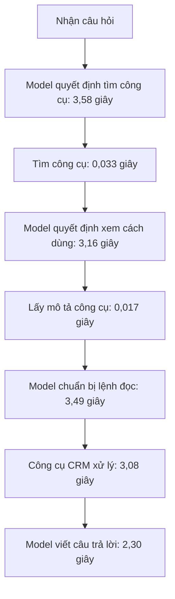
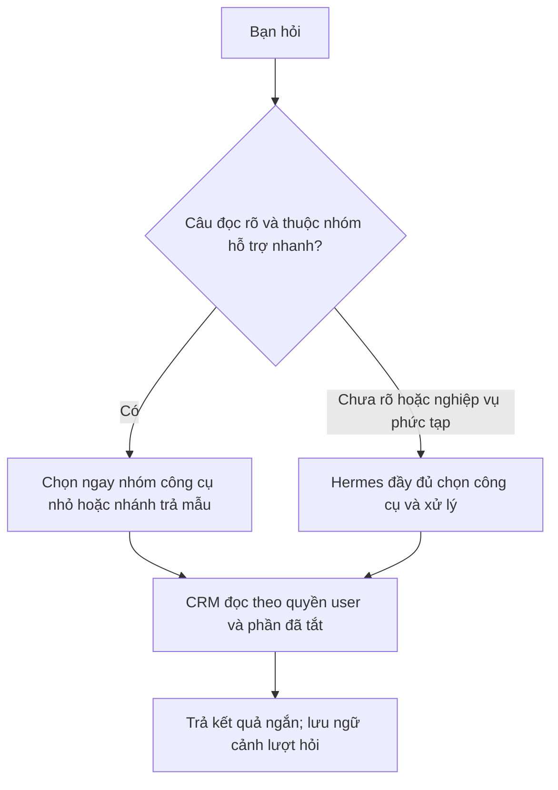

# Hermes × iHomeCRM — chậm ở đâu và ưu tiên xử lý

**Đã lên Vercel production — xác minh 07:43 ngày 20/10/2026 (UTC+7):** `https://ptcrm.vercel.app/` thực sự phục vụ `b5a0686d61d296ecc73eb82efb9c8653ca158298`, deployment READY; canonical `release:verify` PASS. Bản này chứa main `a9ef26308` và cập nhật PR #229, gồm thông báo liên kết Zalo mới. Đây là xác minh bản đang phục vụ, chưa phải kiểm UI/E2E thông báo mới. PR #229 vẫn Draft/chưa merge, nhánh Git `production` còn `039fc36a`; không đánh đồng việc đã lên Vercel với hoàn tất lane phát hành trong Git. Theo yêu cầu chủ, lượt này chỉ cập nhật trạng thái tài liệu.

Cập nhật 19/10/2026, bằng chứng vận hành tới 23:44 UTC+7. Đây là bản tổng hợp hiện hành từ các báo cáo hiệu năng, tinh giản quyền, thử model và checkpoint; không thay lịch sử phép đo. Đã đối chiếu source tại `a9ef26308` với runtime VPS `8ee1fd0`, migration production và trace hội thoại thật. Tài liệu này là **đánh giá và kế hoạch tiếp theo**, không có nghĩa các tối ưu đề xuất đã được bật.

**Dành cho chủ hệ thống:** [báo cáo dễ hiểu với các sơ đồ luồng](BAO-CAO-TOC-DO-DE-HIEU.md). Bản dưới giữ chi tiết để agent triển khai.

**Lịch sử đối chiếu phiên bản web, VPS và DB lúc gần 00:00 ngày 20/10 (Vercel đã cập nhật sau mốc này):** canonical `release:verify` xác nhận `https://ptcrm.vercel.app/` vẫn phục vụ `039fc36a`, deployment READY, chưa phải main `a9ef26308`. Diff frontend tới bản mới gồm thông báo `sender_already_linked` và phép kiểm của nó; chưa nghiệm thu thông báo mới trên Vercel. VPS chạy `8ee1fd0`; diff broker từ đó tới main chỉ thay chú thích trong `room-read-service.mjs` và test, không đổi lệnh thực thi. Phần sửa phòng thật nằm ở migration đã áp production 23:41. Vì vậy trace chat đo đúng luồng Hermes/DB đang chạy, nhưng không chứng minh frontend mới đã phát hành. UI TEST đo candidate `0fbc263f`, ghi riêng; không đổi nhãn thành E2E frontend main mới nhất.

## 1. Kết luận và trạng thái thật

**Ưu tiên giảm số lượt model trước, đồng thời hoàn tất đường đọc nhanh đã có.** Trong mẫu đọc khách hàng 15,66 giây, công cụ CRM chiếm 3,08 giây; ngoài công cụ là 12,59 giây, khoảng 80%. Đọc hợp đồng và lượt đọc phòng sau sửa cũng có hơn 10 giây ngoài công cụ. Không thể giải quyết phần lớn thời gian chờ chỉ bằng bỏ thêm kiểm quyền hoặc tối ưu SQL.

| Phần | Trạng thái xác minh | Kết luận hiện hành |
|---|---|---|
| Đọc phòng Sale báo `backend_unavailable` | **Đã sửa production 23:41**; MCP HTTP 200 có 1 dòng, Zalo 23:43 trả thành công | Đóng lỗi đúng nguyên nhân scope đã xóa mềm; không còn là blocker của lượt đọc đã kiểm |
| Loading báo nhầm “Chưa đọc được…” | Đã sửa; kiểm ba tài khoản TEST và quan sát production | Không làm lại như việc chưa sửa; chưa có p95 render toàn trang |
| Quản trị kết nối mất 7–9 giây | Đã giảm rõ ở tổng quan; mở quyền và tạo kết nối vẫn chậm hơn | Phân biệt mở trang, mở chi tiết và tạo mới, không cộng chúng vào mỗi câu chat |
| Kế thừa quyền CRM trừ phần user tắt | Đã triển khai | Giữ làm nền; không quay về chọn lại khoảng 60 ô |
| Khóa org trong 11 nhóm capabilities đọc; hai kiểm cuối đọc phòng; maintenance dựng quyền mỗi 30 giây | Đã xử lý trong đợt tinh giản | Dữ liệu khóa trước triển khai không chứng minh hiện vẫn là nút thắt |
| Đọc nhanh khách hàng/hợp đồng/hóa đơn | Code và SQL đã có; TEST có dữ liệu; **production OFF** | Có lợi ích lớn ở phần CRM, cần đóng khác biệt nghiệp vụ và nghiệm thu đúng phiên trước khi bật |
| Model tìm và đọc mô tả công cụ | Còn thấy trong trace thật | Nút thắt ưu tiên cao nhất cho câu đọc đơn giản |
| Ghép Zalo | Đã ghép đúng user và bot, chat thật thành công | Nhãn “Đang đồng bộ…” còn thiếu xác nhận từ tiến trình; đây là lỗi trạng thái UX riêng |
| Dashboard, doanh thu, Realtime, danh sách lớn | Có tín hiệu cũ và điểm cần khảo sát trong source | Chưa đủ số đo mới để khẳng định mức chậm hiện tại hoặc hứa số giây giảm |

Quyền vẫn theo yêu cầu chủ: **Hermes = quyền CRM của user − phần tắt trong cài đặt**. Không thêm yêu cầu thu hồi 100 ms hoặc epoch ở mọi RPC từ audit §9. Giữ RLS, công thức tiền, đúng tài khoản/công ty và chống ghi/gửi trùng. Giảm kiểm Hermes lặp ở đúng nhánh đọc; không biến classifier thành nơi cấp quyền.

## 2. Một câu hỏi hiện tốn thời gian ở đâu?

Số dưới lấy timestamp tin người dùng trong Hermes → assistant kết thúc. Không phải thời gian bấm nút trên CRM → hiện trên điện thoại; mỗi hàng chỉ là một mẫu, không phải trung vị hay p95. “Trong công cụ CRM” gồm đường MCP/broker/Auth/DB/mạng của tool, **không phải thời gian SQL thuần**. “Ngoài công cụ” gồm các lượt gọi model, truyền tải, điều phối và discovery; chưa đo riêng thời gian suy luận bên trong provider.

| Lượt chat thật ngày 19/10 | Tổng | Trong công cụ CRM | Ngoài công cụ | Kết quả |
|---|---:|---:|---:|---|
| Hỏi bot có nhận tin | 4,12 s | Không gọi | 4,12 s | Có trả lời |
| Đọc 1 khách hàng, 23:03 | 15,66 s | 3,08 s | 12,59 s | Thành công |
| Đọc 1 hợp đồng, 23:04 | 18,02 s | 5,12 s | 12,90 s | Thành công |
| Đọc 1 phòng sau sửa, 23:43 | 15,35 s | 4,62 s | 10,73 s | Thành công |
| Đọc phòng trước sửa, 23:03 | 13,15 s | 2,10 s | 11,06 s | Lỗi; không dùng làm benchmark đọc thành công |

### Ví dụ khách hàng, tách từng bước

Các ô “Model” là khoảng chờ quan sát quanh lượt model, có thể gồm mạng/điều phối. Tổng số đã làm tròn có thể lệch vài mili giây. Hàm tìm/mô tả tự chạy tổng cộng khoảng **0,05 giây**; phần tốn thời gian là phải gọi model thêm để đi qua chúng. Tối ưu tốc độ tìm kiếm nội bộ vài mili giây không thay được việc giảm số lượt model.

Lượt phòng 23:43 đã không còn `tool_describe`, nhưng vẫn có `tool_search`: 5,14 s trước tìm → 0,036 s tìm → 3,01 s chuẩn bị gọi → 4,62 s CRM → 2,54 s trả lời. Vì vậy không mặc định mọi câu đều có đủ ba bước discovery, cũng không coi cache mô tả là đã giải quyết xong.

**Giới hạn lợi ích:** ngay cả giả sử công cụ khách hàng giảm từ 3,08 xuống 0 giây, mẫu đó vẫn còn 12,59 giây ngoài công cụ. Đây là phép tính giới hạn từ một mẫu, không phải dự báo production. MCP phòng gọi trực tiếp đo 2,16 giây, trong chat là 4,62 giây ở thời điểm khác; chưa có trace nối cùng request nên không quy phần chênh cho mạng hay Zalo.

## 3. Những chỗ còn chậm và cách xử lý

### 3.1 Model và công cụ — ưu tiên số 1

Runtime của các lượt trên dùng `cx/gpt-6-luna`. Chưa xác minh effort provider hiện hành; phân bổ Luna high/Sol/Astra cho agent Codex không tự đổi cấu hình Hermes của công ty.

**Không tắt Tool Search toàn cục để nạp tất cả công cụ.** [Đợt 1](TOI-UU-TOC-DO-DOT1.md#0-kết-quả-thực-hiện-16102026) đã thử và phải trả về `auto`: đối chứng request thật với 78 tool có 6/25 lượt sinh tham số kéo dài bất thường, tập khoảng 29 tool có 0/15. Đây là replay không thực thi tool, mẫu nhỏ; đủ để tránh lặp lại phương án từng gây lỗi, không chứng minh tập nhỏ luôn an toàn. Đổi sang model mạnh hơn cũng không giải quyết chắc chắn hiện tượng đó.

Đề xuất thử **một tập nhỏ, ổn định các công cụ đọc thường dùng**: phòng, khách hàng, hợp đồng, hóa đơn. Mục tiêu là cho model gọi công cụ cần thiết ngay, thay vì tìm rồi xin mô tả. Phần ít dùng vẫn discovery như hiện tại. Cần kiểm cơ chế native Tool Search và phiên bản Hermes thực tế để tập này không lại bị giấu sau bridge; middleware chỉ lọc ba tool bridge không phải đã chọn đúng nhóm CRM.

Giữ phần trả lời ngắn khi người dùng chỉ hỏi kết quả kiểm tra. Với yêu cầu rõ và mẫu trả đủ đơn giản, có thể dùng nhánh đọc trực tiếp + mẫu hiển thị, bỏ cả lượt soạn lại. Câu mơ hồ, đa ý, tham chiếu lượt trước hoặc cần suy luận quay về Hermes đầy đủ. Cache schema/tool metadata theo catalog và ngữ cảnh kết nối; không lấy cache này làm quyền thực thi hay cache chung kết quả riêng của các user.

Không xóa lịch sử tùy tiện để rút prompt: phải giữ kết quả ghi/gửi, mã yêu cầu chống trùng, trạng thái chưa rõ và đối tượng người dùng đang nhắc tới. [Khảo sát model](MODEL-SURVEY.md) có 284 request tổng hợp ngày 16/10; chỉ là nguồn chọn ứng viên thử, không phải benchmark của câu chat thật hiện nay.

### 3.2 Phần CRM — đường nhanh đã có, nhưng chưa bật

Trên TEST, 45 cặp đo cùng tài khoản/phạm vi, ba vai × ba miền × năm lượt: đường thường có trung vị **2,04–2,60 s**, đường nhanh **0,49–0,54 s**. 45/45 kết quả nhanh khớp shared core web; hợp đồng/hóa đơn cũng khớp đường thường ở 30/30 cặp. Đó là số của broker TEST, chưa gồm model/Zalo và không thể cộng trực tiếp vào số chat production để hứa tổng thời gian.

Khách hàng khác bốn trường `contractId`, `buildingId`, `roomId`, `roomName`: normal có giá trị, fast/core để `null`. Lượt bổ sung 15 cặp xác nhận cùng khách hàng và bốn trường này; không phải 15 khách hàng khác nhau. Source cho thấy đường cũ có thể chọn hợp đồng lịch sử/EXTENDED, core web chọn ACTIVE được thấy qua RLS. **Chưa kiểm trạng thái/RLS của chính những record đó để xác nhận nguyên nhân cụ thể.** Bước tiếp là đối chiếu đúng mẫu, chốt theo nghĩa web; không mở quyền hoặc quay về công thức cũ chỉ để giống legacy. Mẫu fast đầu của lượt bổ sung còn tới 1,10–1,79 s, nên không hứa mọi lần dưới một giây.

Source hiện dùng một cờ boolean `readFastPath`, bật chung ba miền; chưa có cờ riêng từng miền. Nếu muốn phát hành hợp đồng/hóa đơn trước thì phải thiết kế chọn miền nhỏ, kiểm cả đường thường/nhanh và fallback; không ghi trong plan như thể đã có sẵn. Đơn giản nhất là đóng đối chiếu ba miền rồi bật chung sau nghiệm thu; không kéo dài kiểm toàn bộ hệ thống khi chỉ còn bốn trường đã khoanh.

Đường thường vẫn dựng stack capabilities rộng và một số nhánh còn kiểm cuối; source fast dùng authority đọc gọn và RPC nghiệp vụ chung. Các kiểm epoch/session binding đang nằm trong RPC fast là thiết kế candidate hiện có, không phải yêu cầu mới phải thêm vào mọi nghiệp vụ. Phần cache catalog tối đa năm phút không thay quyết định quyền/RLS của câu SQL nghiệp vụ.

Đọc phòng chưa thuộc ba miền fast. Source phòng còn ánh xạ phạm vi rồi đọc payload Sale và lọc/phân trang. Cần trace thời gian authority, scope map, listing và kích thước payload trước khi gom RPC/đẩy lọc xuống. Bản sửa tombstone vừa áp là sửa đúng dữ liệu/phạm vi, không phải bằng chứng toàn đường phòng đã nhanh tối đa.

Nguồn source: [server](../../../infra/hermes-broker/server.mjs), [domain mount](../../../infra/hermes-broker/domain-mount.mjs), [cache catalog đọc](../../../infra/hermes-broker/read-catalog-authority.mjs), [room service](../../../infra/hermes-broker/room-read-service.mjs), [broker](../../../infra/hermes-broker/broker.mjs). Bằng chứng TEST: [báo cáo chi tiết](../2026-10-19-crm-hermes-jev-performance.md#kết-quả-broker-test-với-ba-tài-khoản-thật).

### 3.3 Trang cài đặt và liên kết Zalo

| Thao tác TEST thật | Số đo | Hướng xử lý |
|---|---:|---|
| Mở tổng quan | 0,50–0,61 s, n=3 | Đã có `overview`, không đợi toàn bộ quyền |
| Tải lựa chọn quyền | 1,79–3,31 s, n=3 | Chỉ tải khi mở form; trace query/options trước khi thêm cache |
| Tạo kết nối | 4,49–5,95 s, n=3 | Tách đo xác nhận đăng nhập, chuẩn bị quyền, lưu kết nối/bàn giao; tránh gọi full authority lặp |
| Mở lại quyền | 1,83–2,99 s, n=4 | Đo cùng options; tránh tải lại khi dữ liệu vẫn hợp lệ |
| Lưu phần tắt quyền | 1,04 s, n=1 | Chưa đủ mẫu để kết luận cần viết lại |
| Thu hồi | 0,48–1,02 s, n=3 | Không thêm mốc 100 ms mà chủ không yêu cầu |

Đồng hồ trên bắt đầu khi proxy TEST gửi request, kết thúc lúc nhận response headers qua SSH; không phải render hoặc HTTPS Vercel. Số loopback DEMO riêng n=5 giảm list 2,73→0,21 s, options 5,06→1,26 s, status 2,67→0,18 s; không trộn hai môi trường thành một mức cải thiện người dùng.

Link đã thành công, không cần ghép lại. Nút thắt UX còn lại: chọn kết nối khó phân biệt, xung đột nick đã thuộc tài khoản cũ, thông báo đồng bộ chưa phản ánh tiến trình thực. Cần phân biệt “đã lưu”, “đã nạp vào trợ lý”, “đã gọi CRM được”, có cập nhật trạng thái khi tiến trình xác nhận. Không tự ACK queue chỉ từ file cấu hình. Đường superadmin xử lý nick cũ có thể là cải tiến riêng, cần audit và xác định đúng tài khoản nguồn/đích; không cộng thêm vòng xác nhận cho mỗi câu hỏi.

Nguồn: [hook quản trị](../../../src/hermes/useHermesConnections.ts), [management](../../../infra/hermes-broker/connection-management.mjs), [STATUS](STATUS.md#checkpoint-hiện-hành).

### 3.4 Web, báo cáo và database chung

| Điểm khảo sát | Bằng chứng | Hướng tiếp theo |
|---|---|---|
| Doanh thu `revenue_by_month` | SQL tích lũy cũ trung bình 2,76 s, n=704 | Trace bộ lọc hiện tại, xem plan scan/join, lọc org/ngày/tòa sớm; giữ công thức ledger |
| `get_dashboard_summary` | Trung bình cũ 1,14 s, n=2.160 | Đo các aggregate bên trong; chỉ gộp scan khi cùng nghĩa nghiệp vụ |
| Thống kê hóa đơn | Một dạng query cũ 0,44 s, n=3.026 | Đo riêng list, count và stats theo bộ lọc thật |
| Danh sách hợp đồng/khách hàng | Cũ 0,219 s/n=5 và 0,0068 s/n=8 | Mẫu nhỏ; chưa có cơ sở ưu tiên viết lại danh sách khách hàng |
| Thu chi | Source còn projection rộng/count exact và query phụ | Đo waterfall, lấy đúng cột cần, tải chi tiết khi mở; không đổi số tổng sang ước lượng |
| Realtime | Hơn 5 triệu lượt SQL trong thống kê tích lũy; source subscribe theo bảng | Đo event→invalidation→refetch trong khoảng mới; tìm request thừa thực tế |
| Render/bundle | Chưa có profile mới | Đo màn chậm thực tế; lazy tải export/OCR/biểu đồ khi có bằng chứng chi phí |

Thống kê DB này tích lũy từ 30/08 qua nhiều phiên bản, không phải phép đo production hôm nay sau tinh giản. Hub Realtime **đã có ref-count, debounce và gom một số invalidation**; cần tìm phần dư chứ không đề xuất “thêm debounce” như chưa tồn tại. Subscription hiện không lọc org ở nơi đăng ký; phải giữ đúng đổi công ty và UPDATE/DELETE nếu bổ sung filter.

Dashboard đã gom summary, cache năm phút; QueryProvider mặc định stale một phút và không refetch khi focus. TG7 đã chạy song song nhóm cảnh báo/hoạt động độc lập trong `useDashboard.ts`. Các mô tả “useAlerts đang tuần tự” ở báo cáo khảo sát ban đầu là lịch sử, không phải việc còn phải làm.

Chủ chấp nhận dữ liệu tổng quan cũ vài phút: ưu tiên dùng cache tổng quan có mốc cập nhật nếu trace cho thấy refetch thừa. Cache phải phân biệt user/org/phạm vi/filter; ghi thu tiền/quyết toán vẫn theo dữ liệu nghiệp vụ hiện hành. Chỉ làm bảng tổng hợp ngày/tháng nếu tối ưu query và cache chưa đủ, vì cần xử lý duyệt/đảo/điều chỉnh và đối soát ledger.

Nguồn: [dashboard](../../../src/hooks/useDashboard.ts), [thu chi](../../../src/hooks/income-expenses/queries.ts), [Realtime](../../../src/hooks/useRealtimeDataSync.ts), [QueryProvider](../../../src/app/providers/QueryProvider.tsx).

### 3.5 Hạ tầng, phiên dài và thao tác gửi nhóm

Đợt 1 đã đưa model/MCP từ đường vòng Cloudflare sang nội bộ VPS, đổi cache agent và poll Zalo, thêm guard luồng sinh tham số. Không dùng các treo TLS 30–74 giây ngày 15/10 để nói luồng hiện tại vẫn đi vòng. Không hạ MCP connect timeout xuống 5 giây: thử trước đã làm init CRM thất bại, phải trả về 30. Giá trị cấu hình từng mục ngày 16/10 cần đọc lại bản sống trước khi sửa, không suy toàn bộ từ runbook.

Chưa có bằng chứng mới CPU/RAM/pool, quota `busy`/429, chờ maintenance hay phiên dài là nguyên nhân chính của bốn lượt đọc hiện tại. Không tăng cấu hình VPS, pool hoặc concurrency theo cảm tính. `connector-maintenance.mjs` đã có `nextDue`, pool giữ ấm và authority được dùng lại trong một request.

Gửi nhóm từng mất 53–68 giây với 6–11 lượt model trong log cũ. Chưa benchmark lại sau các thay đổi; không dùng số đó làm hiện trạng chắc chắn. Nếu còn chậm, tối ưu gom chuẩn bị đối tượng/preview/metadata bằng code, giữ ý định gửi, người nhận và chống gửi trùng. Hai bước chữ công khai là lựa chọn riêng TG6; bỏ chúng không làm câu đọc khách hàng nhanh hơn. Chưa có luồng truyền ý định thật từ worker để tự bỏ xác nhận một cách đúng nghĩa.

## 4. Jev có cần nối thêm không?

**Có thể thử, chưa phải điều kiện để tối ưu và chưa có benchmark Jev trên VPS/tiếng Việt của công ty.** Ưu tiên phương án ít phụ thuộc: tập nhỏ công cụ đọc và quy tắc cho câu rõ. Chỉ nối Jev nếu phân loại ngữ nghĩa giúp loại bỏ lượt model hiện có, không gọi Jev rồi vẫn đi nguyên chuỗi search→describe→call.

| Ứng dụng | Đề xuất |
|---|---|
| Chọn nhóm phòng/khách/hợp đồng/hóa đơn/công việc | Một classifier trước lượt model, có nhãn không rõ và fallback; tool group giữ đủ phụ thuộc |
| Câu đọc rõ + trả mẫu | Router → tool CRM → renderer; ghi nhận lịch sử/đối tượng tham chiếu để câu tiếp không mất ngữ cảnh |
| Báo chi nhanh chỉ thiếu hạng mục | Thay đúng lượt phân loại đang có; giữ tiền, ngày, tòa và ô người dùng đã sửa |
| Tính tiền, kiểm quyền, retry ghi/gửi | Không giao cho Jev; dùng logic nghiệp vụ xác định |
| Nén toàn bộ lịch sử qua plugin cộng đồng | Chưa ưu tiên; phải giữ receipt và đối chiếu với nén đơn giản trước |
| Web chậm, SQL, Realtime | Không dùng Jev để thay index/query/cache |

Cần adapter/plugin nhỏ phía runtime, provider key ở server, deadline ngắn, không retry foreground làm kéo dài chờ, có cờ tắt. Native `llm_request`/`post_gateway_admission` đã được khảo sát ở một pin upstream; phải đối chiếu pin VPS trước tích hợp. Nhánh trả trực tiếp cần transcript và ledger giao tin, không chỉ `handled/reply`. Chi tiết điểm nối và luồng báo chi ở [báo cáo khảo sát](../2026-10-19-crm-hermes-jev-performance.md#phần-cần-nối-thêm-theo-từng-ứng-dụng). Không lấy giá/model Jev chép từ báo cáo cũ làm giá hiện hành; kiểm provider lúc triển khai.

## 5. Thứ tự triển khai đề xuất

| Ưu tiên | Gói việc | Điều kiện hoàn tất |
|---|---|---|
| Đã xong | Sửa scope phòng xóa mềm | Production + MCP + một lượt Zalo thật thành công; giữ lỗi trước sửa trong lịch sử |
| P1 | Chuẩn hóa trace và thử tập nhỏ công cụ đọc | So cùng câu/tài khoản/phạm vi; biết số lượt model, thời gian CRM, thời gian tổng và lỗi; giảm lượt discovery mà không làm prompt/arguments chạy bất thường |
| P1 song song về thiết kế | Đóng đối chiếu bốn trường khách hàng, nghiệm thu ba miền fast | Theo nghĩa web và đúng quyền; rồi mới bật cờ theo cấu hình đã kiểm, có cách tắt lại |
| P2 | Nhánh đọc rõ trả mẫu; Jev chỉ là biến thể thử | Không thêm lượt model ẩn, không mất tham chiếu câu tiếp, không biến lỗi thành danh sách rỗng |
| P2 | Hoàn thiện trạng thái kết nối/Zalo; đo options/create | Nhãn phản ánh đúng runtime, thao tác ít hơn; số đo cùng đường HTTPS thực |
| P3 | Dashboard/doanh thu/thu chi/Realtime | Trace mới chọn query/request thực sự tốn thời gian; đối soát công thức và phạm vi sau tối ưu |
| P4 | Gửi nhóm, phiên dài, đổi model/effort, mở rộng Jev | Có baseline riêng chứng minh cần; không kéo vào phát hành nhánh đọc đơn giản |

“Song song” ở đây là các gói độc lập có thể làm song song, không phải chạy các thao tác phụ thuộc của một câu hỏi cùng lúc. Trong một câu, phải biết tool và tham số rồi mới đọc, có dữ liệu rồi mới trả lời. Mục tiêu là **bỏ công việc trung gian**, không ép tuần tự hóa các query đang độc lập.

Đây là sơ đồ đề xuất, chưa chạy production. Với câu cần model, đích thử là một lượt chọn/gọi và một lượt soạn, thay bốn lượt trong mẫu khách hàng; với trả mẫu đủ rõ có thể bỏ lượt soạn. Không cam kết mọi câu 3–5 giây. Chỉ ấn định mục tiêu thời gian sau baseline cùng đầu vào; lợi ích TEST, live MCP và Zalo không cộng trừ như cùng một phép đo.

## 6. Cách đo đủ để chốt, không thêm vòng kiểm vô ích

- Dùng cùng bộ câu tiếng Việt: đọc đơn giản, tên tòa gần giống, câu mơ hồ, phân trang, câu nối “phòng thứ hai/tháng trước”, đổi chủ đề; các kiểm ghi/gửi theo Contract khi đụng nhánh đó.
- Đo trước/sau tối thiểu khoảng 20–30 cặp cho pilot, báo n và phân biệt phiên mới/đã ấm, lịch sử ngắn/dài. Nếu báo p95 cần tập lớn hơn và công bố độ bất định; không lấy 3–5 mẫu làm p95.
- Nối mã trace không chứa PII qua worker→Hermes→tool→broker→RPC; đo thời gian tới phản hồi cuối, số lượt model, tokens/schema, Auth/capabilities, SQL, mạng và retry khi có dữ liệu. Trace hiện có đã dùng lại; chỉ bổ sung những khoảng chưa tách.
- So cả đúng nghiệp vụ và độ trễ: kết quả/phạm vi đúng web, phần user tắt được tôn trọng, lỗi báo lỗi, không nhầm số dòng trang đầu là tổng. Không coi câu trả lời nhanh nhưng dữ liệu sai là tối ưu.
- Chỉ chạy gate/review/lane do Contract và diff chọn; dùng lại receipt đầu vào không đổi. Không mở thêm yêu cầu instant revocation hoặc thử lại toàn bộ hệ thống cho một sửa câu chữ.

## 7. Bằng chứng, giới hạn và bàn giao

Nguồn đã tổng hợp: [báo cáo CRM/Jev 19/10](../2026-10-19-crm-hermes-jev-performance.md), [tinh giản quyền](TINH-GON-KIEM-QUYEN.md), [STATUS](STATUS.md), [PLAN](PLAN.md), [bàn giao](BAN-GIAO.md), [đợt 1](TOI-UU-TOC-DO-DOT1.md), [khảo sát model](MODEL-SURVEY.md), cùng source nêu theo từng phần. Các file có snapshot nhiều giờ khác nhau; trạng thái mới ở đầu STATUS và bảng §1 của tài liệu này, không lấy một đề xuất cũ làm việc chưa triển khai.

Receipt riêng đã lược bỏ nội dung chat/dữ liệu khách: `hermes-zalo-chat-evidence-20261019.json`, `hermes-zalo-room-fixed-trace-20261019.jsonl`, `hermes-room-after-production-fix-20261019.jsonl`, các report TEST run2/run3/UI. Chúng nằm ngoài repo. Screenshot lần cuối timeout, không có artifact ảnh cuối; có xác minh UI và trace công cụ. Migration production có [receipt công khai](../../generated/schema-change-evidence/20261019144508_hermes_inherited_room_scope_tombstones_v1.json).

Chưa xác minh: p95 đầu cuối production; decomposition trong từng tool; effort provider đang dùng; cấu hình toàn bộ runtime có còn đúng mọi giá trị ngày 16/10; trạng thái/RLS cụ thể của bốn trường khách hàng; cold start/phiên dài hiện hành; tốc độ/độ đúng Jev tiếng Việt; hiệu năng dashboard và gửi nhóm sau đợt này. Không đổi model/effort, bật fast, cài Jev hoặc bỏ thêm rào trong lượt lập báo cáo.
