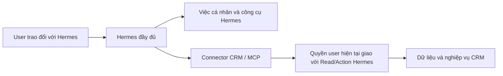

# Kết nối Hermes độc lập với iHomeCRM

Hermes là trợ lý upstream do người dùng cấu hình và cập nhật độc lập. CRM cung cấp công cụ qua connector; không thay engine, model, personal memory hoặc native tools của Hermes bằng Copilot.



Quyền CRM chỉ kiểm khi gọi công cụ CRM. Ngắt kết nối hoặc thu hồi quyền CRM chặn truy cập CRM, không chặn hội thoại và công cụ cá nhân của Hermes. Connector không được đưa JWT CRM, refresh token, khóa provider hay service-role credential vào model/workspace Hermes. Máy Hermes chỉ nhận token kết nối opaque; backend xác minh user và áp dụng quyền hiện tại.

**Phạm vi toà không rộng hơn web** (`20261021170452_hermes_read_web_building_scope_v1`, CHƯA áp TEST/production): RLS web lọc mọi dòng gắn toà theo `buildings.view` (`has_full_building_scope()` hoặc `accessible_building_ids()`/`can_access_building()`), độc lập với khoá của module. Bốn hàm tính phạm vi đọc của Hermes — `hermes_domain_capabilities_v1` (họ v1), `hermes_domain_grant_v2` (v2, v3, khoá phụ, W2), `hermes_metadata_domain_grant_v1` (capabilities v2/v3, đường nhanh, trang phòng), `hermes_task_follow_buildings_v1` (danh sách theo dõi việc) — giao thêm tập toà đó qua `app_private.hermes_web_building_ids_v1` (super admin: mọi toà; còn lại `authorized_scope_v3('buildings.view')` của đúng công ty): khoá đọc được cấp rộng hơn `buildings.view` (vd. override thành viên phạm vi ORGANIZATION) không còn cho bot đọc toà mà web giấu (sự cố TEST 21/10: `crm_read_tasks` trả việc của toà ngoài phạm vi). Hai khoá có nhánh web KHÔNG theo toà giữ phạm vi khoá ở hai grant, reader tự áp lọc web: `customers.view` (RLS khách theo thực thể công ty; v3 chỉ hiện hợp đồng/toà/phòng qua phạm vi `contracts.view` đã thu hẹp; nhờ vậy `withoutContract` R2d vẫn null khi phạm vi hợp đồng không phủ tập khách Toàn tổ chức) và `income_expenses.view` (`hermes_domain_read_v2`: phiếu thuộc phạm vi khoá ∩ overlay khi toà thuộc tập web HOẶC tài khoản/tài khoản thối/làm tròn thuộc `accessible_account_ids()` — như `income_expenses_select_fund_member`; phiếu ở toà ngoài tập web không kèm tên toà/phòng, như embed RLS của web; rào capabilities v2 giữ phạm vi khoá để connector nhận). `allowed`/`orgWide` và quy tắc dòng không gắn toà (khoá module, như `can_access_org_entity` của web) giữ nguyên; khoá hẹp hơn `buildings.view` không đổi. Mỗi grant đọc `authorized_scope_v3` của khoá một lần (trước: hai) cộng tập web một lần — đo TEST: capabilities v1/v2/v3 không chậm hơn. Chưa phủ (cùng mẫu, ngoài `crm_read_*`; ghi ở `tooling/known-gaps.yaml` mục `hermes-pham-vi-toa-chua-giao-web`): `hermes_scope_buildings_v1('rooms.view')` (tin sale/bản đồ phòng/toà của `crm_auth_context`), capabilities hành động và nhắc của lượt theo dõi đang chạy. Lùi: `docs/plans/hermes-crm/revert/hermes_read_web_building_scope_revert_v1.sql`.

## Bề mặt hiện có

`createHermesBackend` trong `server.mjs` cung cấp HTTP/MCP, quản lý kết nối và bảo trì kết nối; không chạy runtime và không gọi model. Connector-only là chế độ duy nhất: model/provider do profile Hermes của user cấu hình (production đi 9router trực tiếp).

MCP bên ngoài hiện là JSON trên Streamable HTTP stateless tại `/mcp`, với header `Authorization: Bearer <token kết nối>`. `initialize`, `tools/list`, `tools/call` đều xác minh kết nối; tool arguments không nhận user/JWT/quyền do model tự khai. Trước validator, broker chuẩn hoá đối số theo định nghĩa gốc (`tool-argument-shape.mjs`): chỗ trống/nil UUID của trường nullable thành null (16/10); với tool đọc (`readOnlyHint`) khoá snake_case đổi sang camelCase khi schema có khoá đó và `limit` nguyên ngoài khoảng bị kẹp về cận (20/10, B1c); `status` cấp một sai chữ đổi thành đúng phần tử enum của chính tool đó — không phân biệt hoa thường, rồi bốn từ đồng nghĩa cố định khi đích có trong enum: `pending`→`UNAPPROVED`, `open`→`IN_PROGRESS`, `overdue`→`OVERDUE`, `liquidated`→`TERMINATED` (21/10, R2b); ngoài các luật đó không đoán từ đồng nghĩa, tool ghi và `tools/list` giữ nguyên. Hermes kiểm đối số `tool_call` theo schema QUẢNG BÁO (`additionalProperties:false`, enum) trước khi gọi connector, nên alias và hint lời gọi sai (dưới) chỉ tác dụng với lời gọi tới được connector. Kết quả `tools/call` giới hạn 64 KiB; `tools/list` (danh mục tĩnh theo quyền, không phải dữ liệu CRM) có trần riêng 192 KiB (`TOOLS_LIST_MAX_BYTES`); vượt trần thì trả `response_too_large`, không cắt bớt danh sách. Host thực tế cần HTTPS reverse proxy và cấu hình Host/Origin đúng đích.

Endpoint bên ngoài đã nối context, phòng, nhóm, soạn/gửi/trạng thái, lịch phòng, work memory, mười ba miền đọc CRM cùng họ đọc đầy đủ v3 (hồ sơ khách, chi tiết hợp đồng, sáu báo cáo), giao/theo dõi/huỷ việc, tạo khách/lead, ghi phiếu chi nhanh và tin "Khách nhờ sale" (tra phòng, tạo/sửa, bật/ẩn). Actor/công ty lấy từ kết nối đã xác minh; không cần giả private DM claim. Tool chỉ hiện trong `tools/list` khi quyền hiệu lực cho phép. Thiếu RPC capability (PGRST202) thì họ tool đó đóng, nhưng RPC capability có sẵn KHÔNG chứng minh RPC thao tác của họ đó đã apply: họ lịch phòng dùng `hermes_room_schedule_capabilities_v1` có từ trước `hermes_room_schedule_manage_v2`. Khi `manage_v2` trả PGRST202, adapter lịch lùi `manage_v1` cho create/update/revoke/list (`openIssues` rỗng, `reason` null) và trả `backend_unavailable` cho `issues`/`reconcile`. Tương tự, họ tin pass dùng chung `hermes_room_pass_capabilities_v1`: thiếu `hermes_room_pass_upsert_v2` (bọc v1, migration `20261016162104`) thì `crm_room_lookup`/`crm_room_pass_upsert` trả `backend_unavailable` (không ghi, không lùi về đường che SĐT), `crm_room_pass_status` lùi `upsert_v1` rồi action v1 cho biên nhận bật/ẩn. Tin pass apply `20261015162454_hermes_room_pass_upsert_v1` rồi `20261015163023_hermes_room_pass_registry_enable_v1` (chỉ bật đúng dòng registry, chặn khi dòng hoặc RPC upsert chưa có) trước khi deploy connector. **Thứ tự phát hành:** apply đủ migration đợt 15/10 (`20261015100000`…`20261015130000`) qua lane trên đúng đích trước, rồi mới deploy connector/worker từ SHA tương ứng; không deploy connector trước migration. Trạng thái apply SQL theo lane ghi ở [STATUS](../../docs/plans/hermes-crm/STATUS.md); 8 migration `20261015100000`…`20261015120200` của gói C/D/E đã apply TEST (chưa production), `20261015130000_hermes_review_fixes_v1` là source chưa apply. Client options/context/chính sách gọi `*_v6` (= task-follow(v5), v5 = tài chính(task(v4))) và chỉ lùi bản cũ khi PGRST202. Chưa nghiệm thu Hermes/model/Zalo thật.

| Công cụ | Phạm vi hiện có |
| --- | --- |
| `crm_read_leads/contracts/invoices/assets/services/tasks/occupancy` (họ v1) và `crm_read_income_expenses/receivables/meter_readings/deposits_held/building_profit` (họ v2) | Projection cố định, phân trang tối đa 50; quyền đọc của từng miền và scope tòa. Occupancy chỉ là snapshot. Họ v2 thêm `fromDate`/`toDate`, `source`, `fetchedAt`; thu chi loại hạng mục hạn chế/lương/cổ đông, cọc chỉ tổng theo tòa, lãi lỗ kỳ ≤ 366 ngày; số tiền là chuỗi thập phân. Dịch vụ: hiện khi đang bật ở toà của kết nối, hoặc (kết nối Toàn tổ chức) khi không đang bật ở toà CÒN SỐNG nào — R2d (`20261021063452`, đã áp TEST 16:09 + production 16:56 giờ VN 21/10): liên kết bật tới toà đã xoá mềm không còn làm sót dịch vụ như trước. B5d (21/10, migration `20261020175803_hermes_name_directory_v1` đã áp TEST + production 21/10 (prod 02:31 giờ VN)): mọi tool danh sách (họ v1/v2/v3 và `crm_read_report` qua `params`) nhận thêm `buildingName` và — nơi hàng có phòng — `roomName` (tên, không phải ID); connector giải tên → ID qua `hermes_building_directory_v1`/`hermes_room_directory_v1` (SECURITY INVOKER, RLS của người hỏi, chỉ các toà trong phạm vi của khoá) bằng JWT người hỏi TRƯỚC validator (validator và tập khoá input SQL không đổi); 0 hoặc ≥2 toà khớp ⇒ tool error `read_name_unresolved` kèm `detail`; R2b (21/10): lời gọi bị validator từ chối mà khớp một dạng sai quen thuộc (ngày ở `crm_read_contracts`/`crm_read_invoices`, `type` ở thu chi, toà/trạng thái ở `crm_read_pending_approvals`, nhắc xe ở tài sản, mã toà ở `buildingId`) trả `invalid_request` kèm `detail` là một câu TĨNH của `read-misuse-hints.mjs` chỉ tool/tham số đúng (không chứa dữ liệu đã gửi; mcp-http chỉ chuyển đúng các câu đó); phòng trùng tên ở nhiều toà gộp tới 5 phòng như web, hơn thì hỏi lại; SQL đọc không nhận ID phòng nên connector lọc hàng theo `roomId` trên các trang đã lấy (trang 50 dòng, tối đa 4 trang, `roomFilter` trong kết quả), riêng nơi SQL khớp `room.name` (`receivables`, `meter_readings`, `contract_search`, `contracts` đường nhanh) đặt thêm `query` = tên phòng. `crm_auth_context` trả thêm `organizationName` và `buildings` (id, tên, mã) của phạm vi đọc rộng nhất qua `hermes_organization_name_v1` (DEFINER, chỉ thành viên ACTIVE) và danh bạ toà; R2c phần 2 (21/10, `20261021044821_hermes_user_display_name_v1`, đã áp TEST + production 21/10 13:31 giờ VN): thêm `userName` = tên hiển thị (`profiles.full_name`) của CHÍNH người hỏi qua `hermes_user_display_name_v1()` (INVOKER, RLS hồ sơ của chính họ, không email/SĐT; id SQL trả phải là người của kết nối, khác ⇒ `backend_unavailable`), hàm chưa có (PGRST202) ⇒ `null`. Thu chi Mốc 3 (22/10, **chưa áp**): khoá `income_expenses.view` (`crm_read_income_expenses`, báo cáo `expense_vouchers`/`expense_categories`) giải tên toà qua `hermes_building_directory_v2(..., true)` — nhận toà ảo (chi phí chung); khoá khác giữ v1. `crm_read_report` có tên lạ trong `params` hoặc thiếu tham số bắt buộc ⇒ `invalid_request` + câu tĩnh của đúng báo cáo (`W2_PARAM_HINTS` của `read-misuse-hints.mjs`: tên nhận, bắt buộc, chỗ đúng) |
| `crm_read_customers`, `crm_read_customer_detail`, `crm_read_contract_detail` và báo cáo `crm_read_occupancy_report/invoice_report/monthly_pnl/pending_approvals/zalo_conversations/contract_search` (họ v3, `hermes_domain_read_v3`, migration `20261016162104_hermes_full_read_v1` → `20261016172206_hermes_full_read_review_fixes_v1` → `20261017021554_hermes_full_read_web_parity_v1` → `20261017033630_hermes_full_read_owner_scope_v1`; từ 17/10 `crm_read_occupancy` cũng sang v3; áp đủ bốn file trước khi đổi connector, câu kiểm ở [BAN-GIAO](../../docs/plans/hermes-crm/BAN-GIAO.md)) | Đọc đầy đủ cho NGƯỜI HỎI như web (chủ chốt 16/10): SĐT, CCCD dạng chữ, ngày sinh, địa chỉ, người ở, điều khoản/cọc/dịch vụ hợp đồng; không ảnh CCCD, file hợp đồng, mã công khai, tài khoản ngân hàng. Chỉ dùng khoá ĐÃ CÓ (`customers.view`, `contracts.view`, `invoices.view`, `reports_real_estate.occupancy`, `reports_finance.analysis`, `income_expenses.view`, `chat_zalo.view`), không có hàm capabilities riêng; SQL kiểm binding, quyền CRM hiện tại ∩ overlay Read/scope toà ∩ chính sách ∩ registry mỗi lượt. Khách: kết nối Toàn tổ chức thấy cả khách chưa có hợp đồng. Khoá thứ hai như embed của web: người ở trong chi tiết hợp đồng và tên khách/tìm theo tên trong `crm_read_contract_search` cần thêm `customers.view`, hợp đồng trong hồ sơ/danh sách khách cần `contracts.view` (quyền CRM ∩ Read kết nối ∩ toà overlay); thiếu thì `tenants=[]`/`tenantsVisible=false`, `contracts=[]`/`contractsVisible=false`, `customerName=null`. Báo cáo KHÔNG phụ thuộc hàm `copilot_*` (chủ chốt 17/10; bảng `hermes_report_catalog_v1` ↔ `full-read-contract.mjs`): màn web có RPC riêng thì gọi thẳng RPC đó (`occupancy_snapshot_v2`, `occupancy_upcoming_vacancy_v2`, `fa_monthly_pnl_accrual`/`fa_monthly_pnl`, `list_my_pending_approvals_v1`), web đọc bảng thì SQL theo đúng bộ lọc web (hoá đơn, hợp đồng, Chat Zalo — dẫn file:line trong migration). Lãi lỗ mặc định dồn tích, `summary.pending*` là phần chờ duyệt mà BC Doanh Thu Chi Phí cộng thêm. Hàng có toà thì lọc theo toà đã giao; nguồn không nhận tham số toà (hộp chờ duyệt của chính người hỏi, hội thoại Zalo) chỉ cho kết nối Toàn tổ chức, Zalo còn cần `chat_zalo.view` toàn công ty như web; thiếu thì `unavailable=organization_scope_required`. Thống kê hoá đơn tính thẳng trên `invoices`/`invoice_items` theo quyền `invoices.view` thật ∩ toà kết nối (không qua `get_invoice_statistics_v2`, hàm đó lấy phạm vi theo `staff_assignments`); báo cáo theo toà mà kết nối không còn toà nào trả `unavailable=no_building_scope` thay vì số 0. Mọi nhánh đọc khách (danh sách, hồ sơ, người ở, tên/SĐT khách trong tìm hợp đồng/hoá đơn, khách đại diện của `crm_room_lookup`) theo RLS `customers_select_rbac` của web: chủ hồ sơ `customers.user_id` phải là thành viên ACTIVE của công ty (`current_visible_owner_ids`). Phân trang offset/limit ≤ 50, trần ~40 KB mỗi trang và 60 KB mỗi kết quả, đo SAU escape JSON (như khi broker bọc kết quả, trần 64 KB); quá trần SQL trả PT413 ⇒ tool error `result_too_large` kèm gợi ý giảm limit/thu hẹp bộ lọc. Dữ liệu riêng tư chỉ trả lời riêng người hỏi; bản tin nhóm Zalo không đi đường này và giữ lọc công khai. Connector trước migration: các tool này trả `backend_unavailable` |
| `summary` của 13 tool danh sách (R2a, 21/10; migration `20261020233934_hermes_domain_summary_v1` (v1, v2, reader nhanh) rồi `20261021004841_hermes_w2_domain_summary_v1` (v3 customers/occupancy + báo cáo monthly_pnl; dải nền đợt 2), đã áp production 21/10 09:46–09:51; R2c `20261021035022_hermes_domain_summary_largest_by_type_v1` (v2: `largest` theo loại thu/chi) cùng R2c phần 2, đã áp production 21/10 13:16–13:31 giờ VN; R2d `20261021063452_hermes_domain_without_contract_latest_count_v1` (reader nhanh + v1 + hàm phụ DEFINER) rồi `20261021063453_hermes_w2_customers_without_contract_v1` (v3, dải nền), đã áp TEST + production 21/10 16:12/16:58 giờ VN) | Kết quả có thêm `summary` ngay sau `domain`, tính trong CÙNG lời gọi trên TOÀN tập đã lọc (query/buildingId/status/fromDate/toDate), bỏ cursor/limit, cùng phạm vi công ty/toà (đường nhanh: cùng RLS người hỏi) với `items` — mô hình đọc số đếm/tổng ở đây thay vì tự cộng hàng hay đọc thêm trang để đếm. Khuôn chung `{count, byStatus, sum}`; phần riêng theo miền: `tasks.overdue` (Mốc 3b Công việc, `20261022153345_hermes_domain_tasks_assignee_v1`, CHƯA áp — ma trận 22/10 CV-R01/R03/R04/R06: dòng `tasks` thêm `assigneeName` = tên người nhận như web /tasks (hồ sơ, rồi tên gõ tay; null = chưa giao); `query` khớp thêm tên người nhận bỏ dấu — lọc theo người không thêm khoá input; summary thêm `tasks.byBuilding` [{buildingId, buildingName, count, overdue}] và `tasks.byAssignee` [{assigneeName, count, overdue}] (≤ 50 nhóm, nhiều việc trước; hoà: id toà / tên theo byte, null cuối) cùng `tasks.givenByMe` {count, overdue} = việc người hỏi tạo mà người nhận khác người hỏi, kể cả chưa giao; broker kiểm nhóm ≥ 1 việc, quá hạn ≤ số việc, không trùng, giảm dần, cộng ≤ tổng và BẰNG đúng `count`/`overdue` khi dưới 50 nhóm, toà trong phạm vi khoá/đúng toà lọc, `givenByMe` ≤ `count`; summarizeRows tính nhóm từ dòng, `givenByMe` null; cửa sổ một bản `DOMAIN_READS.tasks.tolerant` + `DOMAIN_SUMMARY_KEY_TOLERANT.tasks` ⇒ connector Mốc 3b lên TRƯỚC migration, connector cũ từ chối khoá mới), `income_expenses.byType/largest` (tiền không gồm phiếu CANCELLED, `count`/`byStatus` gồm; R2c: mỗi phần tử `byType.<INCOME|EXPENSE>` thêm `largest` — phiếu lớn nhất CỦA LOẠI đó, cùng khuôn `largest`; câu "khoản chi lớn nhất" đọc `byType.EXPENSE.largest` vì tool không lọc loại và `largest` gồm cả phiếu thu; R2c phần 2 (`20261021044801` + `20261021044814`, đã áp TEST + production 21/10 13:16–13:31 giờ VN): `customers.byStatus` đếm khách theo `status_v2` — đúng ba tab của /customers: RENTING đang thuê, MOVED_OUT đã chuyển đi, WALK_IN vãng lai = chưa có hợp đồng — đường nhanh trả `null` khi có `query`; dòng `assets` thêm `createdAt` (ngày thêm theo múi giờ nghiệp vụ của công ty) và `assets.latest` = tài sản thêm gần đây nhất của cả tập (`created_at` đầy đủ giảm dần rồi id); R2d: `customers.withoutContract` = số khách của cả tập KHÔNG có hợp đồng nào (mọi trạng thái; hợp đồng đã xoá mềm không tính, phòng đã xoá vẫn tính) ở toà thuộc phạm vi hợp đồng của kết nối — câu "bao nhiêu khách chưa có hợp đồng" đọc đây, KHÔNG đọc `byStatus.WALK_IN` (production không có khách WALK_IN: khách chưa từng có hợp đồng mang RENTING); `null` khi đường nhanh có `query` hoặc phạm vi hợp đồng của kết nối không phủ phạm vi khách (số khi đó chỉ có thể sai). Đường nhanh (INVOKER) đếm qua hàm riêng `app_private.hermes_customers_without_contract_v1` (DEFINER, chỉ trả SỐ: kiểm lại người gọi là thành viên ACTIVE chưa offboard, chỉ khách sống có chủ hồ sơ thấy được trong danh sách id của chính tập RLS, chỉ toà người gọi có `contracts.view` CRM; client không gọi thẳng được — không USAGE `app_private`) vì RLS hợp đồng (`buildings.view`) có thể giấu hợp đồng mà phạm vi hợp đồng cho thấy; v3 (DEFINER) đếm thẳng trong `v_contract_scope`. `assets.latestCount` = số tài sản của cả tập có `created_at` BẰNG ĐÚNG mốc của `latest` (cùng thời điểm, không phải cùng ngày — production nhập cả kho trong MỘT đợt nên `latest` chỉ là một món của đợt), 0 khi tập rỗng), `receivables.byBuilding` (≤ 50 toà, `remainingAmount` giảm dần), `meter_readings.byType/rooms`, occupancy/deposits_held/building_profit là tổng các toà, `monthly_pnl.summary` thêm `revenue/expense/net/rows` (mọi hàng của báo cáo); bảng đủ ở [B2-BANG-MIEN-DOC](../../docs/plans/hermes-crm/B2-BANG-MIEN-DOC-2026-10-20.md). Đường nhanh: customers/invoices `count` = tổng lõi web tính trước khi chia trang, contracts `byStatus` = null khi có `query`. Broker kiểm khuôn chính xác theo miền (`DOMAIN_SUMMARIES`, khoá lạ/sai kiểu ⇒ `backend_unavailable`) và bất biến: `count` ≥ số dòng trang (không đòi bằng — lõi nhanh có thể đếm dòng không phòng), tổng `byStatus` ≤ `count` và chỉ giá trị lọc khi có `status`, `byBuilding` trong phạm vi khoá/đúng toà lọc/giảm dần, `largest` trong kỳ (R2c: `byType.<loại>.largest` đúng loại, trong kỳ, không vượt tổng của loại và không đứng trước `largest`; `largest` chính là largest của loại nó; có ở MỌI phần tử, hoặc — chỉ trong cửa sổ phát hành — vắng ở mọi phần tử), `rows` của monthly_pnl khớp offset + số hàng ở trang cuối; R2d: `withoutContract` ≤ `count` − số dòng trang có `contractId`, `latestCount` = 0 ⇔ `latest` null và ≤ `count` (summarizeRows của lọc phòng trả `null` cho cả hai: dòng không mang lịch sử hợp đồng hay thời điểm thêm). Lọc theo phòng ở connector (`roomName`): `summary` SQL tả tập chưa lọc phòng nên được thay bằng summary của chính các hàng giữ lại khi đã đọc hết (`nextCursor` null), còn trang thì `null`. Không đổi tham số tool hay byte `tools/list`. **Thứ tự phát hành:** R2a xong (connector 3762b3a0 chấp nhận vắng summary lên trước, production áp hai migration 21/10). Bản connector R2c ĐÓNG cửa sổ R2a (`DOMAIN_SUMMARY_TOLERANT` = [], monthly_pnl bỏ `summaryTolerant`: summary và bốn tổng bắt buộc) và MỞ cửa sổ riêng cho `byType.*.largest` (`DOMAIN_SUMMARY_ENTRY_TOLERANT`: vắng đồng loạt ở mọi phần tử vẫn qua) ⇒ deploy connector R2c trước, rồi áp `20261021035022` qua lane; bản connector kế tiếp đưa `DOMAIN_SUMMARY_ENTRY_TOLERANT` về `{}`. Phần 2 cùng bản connector: `assets.createdAt` (`DOMAIN_READS.assets.tolerant`) và `assets.latest` (`DOMAIN_SUMMARY_KEY_TOLERANT`) được vắng CÙNG NHAU một bản (dòng có ngày mà summary không latest, hay ngược lại ⇒ từ chối); `customers.byStatus` mới và `userName` không cần cửa sổ ({} cũ vẫn hợp lệ, hàm vắng ⇒ null) ⇒ áp `20261021044801` → `20261021044814` → `20261021044821` sau connector. Production đã áp đủ bốn migration R2c (21/10 13:16–13:31) ⇒ bản connector R2d ĐÓNG các cửa sổ R2c (`DOMAIN_SUMMARY_ENTRY_TOLERANT` = {}, `assets.tolerant` = [], `assets.latest` bắt buộc) và MỞ cửa sổ một bản cho `customers.withoutContract` + `assets.latestCount` (`DOMAIN_SUMMARY_KEY_TOLERANT`; connector R2c từ chối hai khoá này) ⇒ deploy connector R2d trước, rồi áp `20261021063452` → `20261021063453` qua lane; bản kế đưa `DOMAIN_SUMMARY_KEY_TOLERANT` về {}. Lùi: revert soạn sẵn ở `docs/plans/hermes-crm/revert/` — R2d: `hermes_domain_without_contract_latest_count_revert_v1.sql` (về đúng thân R2c phần 2 của reader + v1 rồi DROP hàm phụ) và `hermes_w2_customers_without_contract_revert_v1.sql` (v3 về thân `20261021044814`), chạy TRƯỚC revert R2c phần 2 (revert đó từ chối khi thân R2d còn sống), connector R2d nhận kết quả (cửa sổ); `hermes_domain_summary_largest_by_type_revert_v1.sql` (về đúng thân v2 của R2a) khi connector đang chạy còn cửa sổ R2c; bỏ cả summary thì revert R2c trước, lùi connector về 3762b3a0, rồi revert R2a (đúng thân B5c bước 2 / `20261020173819` / `20261017033630`) |
| Mốc giờ trong kết quả (R2e, 21/10) | Mọi chuỗi ngày-giờ ISO có đuôi UTC (`Z`, `+00:00`, `+0000`, `+00`) trong kết quả `tools/call` được connector đổi sang giờ Việt Nam đuôi `+07:00` ngay trước khi trả (`vietnam-time.mjs`, gắn ở `mcp-http.mjs`); ngày thuần (`YYYY-MM-DD`), chuỗi có múi giờ khác và khoá con trỏ (`nextCursor`, `cursor`) giữ nguyên; khối text không phải JSON giữ nguyên. Lý do: full50e câu 66 — hạn `…T16:59:59.999+00:00` (23:59 giờ VN) bị mô hình đọc thành ngày hôm sau dù SOUL có ví dụ. Tham số đầu vào vẫn nhận UTC hoặc có múi giờ như cũ |
| `crm_read_report_list`, `crm_read_report` (đợt 2 đọc đầy đủ, 18/10, chưa áp TEST/production) | Hai tool meta cho 70 báo cáo (sổ `wave2-registry.mjs` ← `wave2-{a,b,c,d}-contract.mjs`; mục lục theo khoá còn được cấp lúc gọi, chạy một báo cáo với `params` đúng tên mục lục, `limit` ≤ 50, `offset` ≤ 2000, `sourceCapped` khi nguồn > 2000 hàng). Một lối vào INVOKER `public.hermes_w2_read_v1` bằng JWT người hỏi: bước kiểm quyền DEFINER (quyền CRM thật ∩ registry ∩ chính sách công ty ∩ Read kết nối ∩ toà overlay) → hàm đọc gói INVOKER dưới RLS người hỏi → bước kết thúc rào đầu ra (mọi hàng đúng công ty/toà/sổ đã giao, khuôn sai ⇒ XX000) rồi broker rào lần hai theo `fence`. Mọi báo cáo `private=true` (chỉ trả lời riêng); như đợt 1, tin nhóm không đi đường này: kênh Zalo cá nhân chỉ DM, tool gửi nhóm chỉ nhận ID (khoá bằng `wave2-z.test.mjs`). **Thứ tự phát hành:** áp đủ chuỗi `20261018000000 → 000500 → 000600 → 000700`, A `010000 → 010100`, B `020050 → 020200 → 020250 → 020300`, C `030100`…`030600`, D `040000`…`040300`, Z `080000` (hàm dùng chung) `→ 080100 → 080200 → 080300` (hàm đọc A, B, D), cuối cùng công tắc `20261018090000_hermes_w2_enable_v1` (bật 32 khoá; RAISE nếu thiếu bản sửa Z), rồi mới deploy connector; chủ tạo lại kết nối (chọn khoá mới ở `/settings/hermes`) và liên kết lại Zalo. Connector trước migration: hai tool vẫn có thể hiện nhờ khoá đợt 1 dùng lại (`invoices.view`, `deposits.view`, `reports_finance.analysis`, `assets.view`, `services.view`, `rooms.view`) nhưng trả `backend_unavailable`. Trang Hợp đồng (Đợt 2, chưa áp): `contracts.view` thêm vào tập khoá dùng lại (`20261022043540`, áp TRƯỚC `20261022043617`), để Quản lý toà đọc `re_contracts_ending` / `re_move_out_notices` / `re_exit_cases_pending`; báo cáo `rooms_occupancy` (`rooms.view`) đếm phòng theo toà cho người không có quyền báo cáo BĐS. Ba file đọc này không phụ thuộc file trang `20261022022951` |
| `crm_work_memory_status/list/configure/upsert/forget` và `crm_work_memory_search` | Work memory opt-in riêng user/công ty; retention và version. `search` (Hermes tổng) cần Read `assistant.memory.supervise` và quyền CRM `users.view`, chỉ trả ghi chú được chia sẻ. Không nhập personal memory/chat |
| `crm_task_input_options`, `crm_task_create`, `crm_task_status` | Action `tasks.create` và scope tòa cho phép lấy ID/tên tòa, phòng, loại việc và người nhận theo RLS hiện tại, kể cả khi Read tắt; không trả dữ liệu công việc hoặc liên hệ. Chính sách CRM `task_types.view` vẫn áp dụng cho loại việc. Chỉ `kind=rooms` bắt buộc `buildingId`; `jobTypes`/`assignees` (danh mục công ty) bỏ trống được khi người dùng có `tasks.create` ở ít nhất một tòa trong phạm vi kết nối (migration `20261021172540_hermes_task_input_options_no_building_v1`, sửa nhanh 22/10, câu 29; có `buildingId` thì như cũ). Gọi sai cách nhận MỘT câu hướng dẫn tĩnh (`TASK_OPTIONS_HINTS`) dạng kết quả thường `{ok:false,code,huongDan}`, không `isError` (Hermes tạm khoá cả MCP server ~59 s sau ba lỗi liền nhau); SQL chưa có migration trên từ chối lời gọi thiếu tòa ⇒ câu hướng dẫn "truyền buildingId". Tạo/giao dưới chính actor, recipient cùng tổ chức và còn chọn được theo RLS. Request UUID cố định; mất ACK trả `task_outcome_unknown` + requestId, chỉ đối soát status, không tự tạo lại. INSERT giữ nguyên trigger thông báo giao việc E4. Chưa gồm ảnh, vật tư, hoàn thành hoặc thưởng. **Đợt 2b:** khi `task.create` SỐNG phía SQL (có trong `hermes_action_capabilities_v1.actions` của lời gọi gần nhất) thì ba tool này ẩn VÀ bị từ chối (`tool_not_available`); tạo việc đi `crm_action_run` `task.create`. Connector mới gặp DB chưa có dòng `task.create` ⇒ ba tool này và quyền `tasks.create` kiểu cũ giữ nguyên |
| `crm_task_follow_list/set/stop`, `crm_task_progress`, `crm_task_cancel` | Theo dõi/nhắc cần Read `tasks.view` + Action `tasks.create` (Đợt 2b: khoá này do lớp thao tác ghi dùng chung cấp, phạm vi đã giao `buildings.view`; lớp task cũ chỉ còn thêm `tasks.edit`/`tasks.delete`); `role=assigned_to_me` còn trả việc giao cho chính người hỏi ở toà ngoài phạm vi (Q35, `20261022031600_jobs_assignee_visible_v1`, chưa áp); tiến độ cần `tasks.edit`; huỷ cần `tasks.delete`. Nhắc theo pg_cron `hermes-task-follow-15m`. Công ty lấy từ kết nối: tool không nhận `organizationId` (20/10, B5b; adapter gắn vào `p_input` trước RPC, SQL vẫn so với công ty kết nối); model vẫn gửi thì phải trùng, khác thì `forbidden` trước mọi RPC **Mốc 3:** `task.update` / `task.cancel` SỐNG phía SQL ⇒ `crm_task_progress` / `crm_task_cancel` ẩn VÀ bị từ chối, lớp theo dõi thôi cấp `tasks.edit` / `tasks.delete` (lớp khung chung cấp); DB chưa có `074741` ⇒ như cũ. **Mốc 3b:** connector nhận mục ngoài phạm vi toà của `role=assigned_to_me` khi `assigneeId` là người hỏi, đúng như SQL Q35 (trước: `backend_unavailable` cả trang — ma trận 22/10 CV-R13); `assigned_by_me` / `team` vẫn rào phạm vi toà. **Lượt 11 (nghiệm thu 24/10, `20261023185118` — chưa áp):** `crm_task_follow_list` thêm `total` + `summary` {total, open, overdue, completed, byBuilding ≤ 50} của cả tập lọc (trước chỉ một trang 20 dòng) và `buildingName` / `roomName` trên mỗi dòng; connector nhận cả khuôn cũ lẫn mới (đủ cặp), kiểm chặt khi có ⇒ phát hành connector TRƯỚC migration. |
| `crm_customer_create/status`, `crm_lead_create/status` | Action `customers.create`/`leads.create`; khách WALK_IN cá nhân hoặc lead B1_LEAD chưa gắn tòa, ghi bằng JWT user qua RLS canonical; kết nối phải chọn overlay **Toàn tổ chức**. CRM cho trùng số điện thoại; request UUID cố định; mất ACK trả `customer_outcome_unknown` + requestId, chỉ đối soát status |
| `crm_task_cancel` (tắt) | **TẮT TẠM từ 21/10/2026** (chủ dự án duyệt, câu 28): registry `tasks.delete` = false (migration `20261021162612_hermes_task_cancel_disable_v1`). Khi thử bot thật trên TEST, bot xoá nhầm việc cùng tên ở toà khác mà không hỏi lại; huỷ là DELETE không lùi được. Tạo việc, theo dõi, ghi tiến độ giữ nguyên; huỷ việc làm trên web cho tới khi có bước xem trước ở máy chủ. Migration từ chối khi còn kết nối `legacy_allowlist` ACTIVE giữ khoá (gia hạn token của chúng sẽ hỏng). **Mốc 3:** `task.cancel` (luôn xem trước) thay tool này; chỉ bật lại registry `tasks.delete` SAU KHI connector có Mốc 3 chạy trên mọi host — xem `docs/plans/hermes-crm/CONG-VIEC-THAO-TAC-GHI.md` mục 19. **29/10/2026:** file CV `20261027234537_hermes_task_actions_activation_v1` bật lại `tasks.delete` trên production; huỷ việc đi qua `task.cancel` (luôn xem trước), tool này nghỉ hưu theo danh mục sống (`TASK_RETIRED_BY`). |
| `crm_action_run` thao tác trang Thu chi `expense.create`, `expense.note`, `expense.edit`, `expense.cancel`, `expense.approve` (Đợt 2, [thiết kế](../../docs/plans/hermes-crm/THU-CHI-THAO-TAC-GHI.md); RPC trang `hermes_expense_write_v1` + hàm dùng chung với web `ie_category_suggest_v1`/`ie_default_cashbook_v1` — Mốc 2–3b đã áp production 22/10; Mốc 4 `20261022075102` đã áp production 23/10 (B1)) | Thay họ `crm_expense_input_options/create/status` (đã gỡ khỏi connector; SQL cũ giữ, không DROP). Khoá `income_expenses.create` (registry đang TẮT từ 21/10, `20261021113528`; bật lại bằng migration riêng kèm rào legacy). `expense.create`: phiếu CHI lập tay, `items` 1–5 khoản (mỗi khoản một phiếu, một lần đồng ý); toà/phòng/hạng mục/sổ là TÊN, SQL giải dưới RLS người hỏi (hạng mục trống ⇒ gợi ý bằng `ie_category_suggest_v1`, không chắc ⇒ `needs_input`; sổ trống ⇒ `ie_default_cashbook_v1`). Luôn xem trước: bản xem trước = chạy thử `create_income_expense_v1` trong savepoint rồi lùi ⇒ nói đúng "vào sổ ngay" / "chờ duyệt vì …" + cảnh báo trùng ô kỳ; lượt 2 ghi cả lô hoặc không gì (lệch bản đã xem ⇒ `state_changed`, không chốt biên nhận). `expense.note`: `append_income_expense_supplement_v1`, ghi thẳng (chính sách `never`). Kết quả có tên + `link` trang phiếu (thêm ảnh trên web; chưa nhận ảnh qua Zalo). Lý do riêng: `system_voucher`, `evidence_required`. Mốc 3 (22/10, `20261022044120`/`044123`, **chưa áp**): phạm vi toà của `expense.create` = guard ∩ `authorize_income_expense_on_building` gọi đúng như hàm ghi web (toà hàm ghi không cho ⇒ `outside_scope` ngay khi giải tên, không còn xem trước "được" rồi ghi 42501); toà ảo (chi phí chung) giải được qua `hermes_write_name_resolve_v2`; `expense.note` khi phải xem trước cũng chạy thử hàm bổ sung. Mốc 4 (`20261022075102`, đã áp production 23/10 — B1; khoá `income_expenses.edit` / `.cancel` seed TẮT, quyền CRM giao vào `income_expenses.create`): `expense.edit` sửa phiếu CHI chờ duyệt bằng `revise_pending_income_expense_v1` (đổi tiền/hạng mục/sổ/toà ⇒ hàm web đòi lý do ⇒ `needs_input reason_required`; phiếu nhiều dòng hạng mục ⇒ đổi tiền làm trên web), `expense.cancel` huỷ bằng `cancel_income_expense_flex_v1` (lý do 8–1000; phiếu đã vào sổ ⇒ bản xem trước nói "tạo bút toán đảo, KHÔNG khôi phục được"); cả hai chạy thử hàm web rồi lùi, lượt 2 so phiên bản phiếu (lệch ⇒ `state_changed`). Phiếu THU ⇒ `web_only`; phiếu hệ thống, hoặc phiếu con định kỳ khi cờ `app_private.hermes_action_flags` `expense.recurring_child_manual` tắt (TC5, mặc định) ⇒ `system_voucher`. Lô bị từ chối ở bản xem trước nói khoản số mấy: `action_rejected` kèm `item` (1–20) và `detail` = "Khoản N: " + câu tĩnh; lý do dạng hỏi lại thì `detail` cũng có "Khoản N: ". Gợi ý hạng mục tự động không nhận hạng mục dòng tiền (nội bộ, bổ sung hoàn cọc, trả tiền thừa khách, chia lợi nhuận) ⇒ hỏi lại. Mốc 5 (`20261023013109`, **chưa áp**; khoá `income_expenses.approve_vouchers` seed TẮT, quyền CRM giao vào `income_expenses.approve`): `expense.approve` duyệt hoặc duyệt + chi `voucherCodes` 1–10 phiếu CHI lập tay (`post=false` ⇒ chỉ duyệt); xem trước nêu kế hoạch từng phiếu (duyệt + CHI / chỉ duyệt vì chưa ảnh, không giữ sổ … / không làm vì …), lượt 2 chạy từng phiếu, kết quả `items[{code, outcome, reason?, statusText}]`, `totalPosted`; phiếu đang bị web giữ ⇒ `state_changed`. Lượt 8 (`20261023031258`, **chưa áp**): bước ghi khoá NOWAIT trước mọi dòng mà hàm web sẽ khoá (phiếu của note; sổ / phòng của create; yêu cầu duyệt, sổ, phòng của sửa / huỷ / duyệt) ⇒ web đang giữ dòng đó thì trả `state_changed` ngay, không bao giờ deadlock. Mốc 6: web Báo chi nhanh gọi đúng hai hàm bot dùng (`ie_category_suggest_v1` cho gợi ý hạng mục, `ie_default_cashbook_v1` cho sổ chọn sẵn; bản TypeScript đã xoá) ⇒ bot và web cùng một công thức, không cần migration mới. Lượt 11 (nghiệm thu 24/10; `20261023210633` + `20261023210634`, **chưa áp**): gợi ý hạng mục có lớp từ vựng vật tư / sửa chữa / văn phòng phẩm (web đổi cùng lúc); chọn hạng mục `hermes_expense_category_pick_v1` (chưa nêu ⇒ `why=unspecified` với ≤ 5 ứng viên đúng nghĩa, nêu tên nhóm ⇒ cả nhóm); `voucherCode` khớp đúng mã đầy đủ trước, nhận kèm ngày / toà hoặc nguyên nhãn ứng viên khi mã bị dùng lại giữa các toà; bản xem trước khoản cam kết có `commitment` (Q12) trong từng khoản + tóm tắt; sửa phiếu đã huỷ ⇒ `web_only`, hết chờ duyệt ⇒ `not_pending` (kèm `link`); lô hỏi lại mang `item`. Connector chỉ đổi câu (mã phiếu trùng, hạng mục không có), không cần phát hành trước. Lượt 13 (nghiệm thu 24/10; `20261024094809` + `20261024095547`, **chưa áp**): khoản thuộc luồng hệ thống — hoa hồng / thưởng sale, thanh lý / trả tiền thừa cho khách, cọc (hoàn / trả / bỏ / bổ sung cọc, giữ chỗ), lương, chia lợi nhuận, chuyển nội bộ — ⇒ `expense.create` / `expense.edit` từ chối `web_only` kèm `link` màn gốc (`/contracts`, `/deposits`, `/finance/salary`, `/finance/shareholder-profit`, `/finance/cashbooks`; sửa phiếu đang mang hạng mục đó ⇒ link trang phiếu), chặn TRƯỚC khi hỏi lại toà / hạng mục; nhận theo `rule_key` của danh mục chuẩn hoặc cụm từ (`public.hermes_expense_system_flow_v1`), kể cả khi luật khoá cứng của web xếp nội dung vào hạng mục luồng hệ thống ("tiền phòng 5 ngày"); hạng mục luồng hệ thống không bao giờ là ứng viên / gợi ý của bot (kể cả "Bổ sung hoàn cọc", "Trả lại tiền thừa cho khách" mà web vẫn cho lập tay). Connector không cần trước (mã `web_only` + `link` đã đi qua mọi bản); bản mới chỉ thêm `web_only` vào danh sách lý do của `expense.create`. Báo cáo W2 `expense_vouchers` nhận `days` = phiếu chờ duyệt từ N ngày trở lên (`pendingDays ≥ N`, lâu nhất trước, không nêu ngày ⇒ 366 ngày tới hôm nay; trạng thái khác UNAPPROVED ⇒ sai tham số) — SQL TRƯỚC connector (connector gửi `days` khi SQL chưa nhận ⇒ `hermes_domain_invalid`). Lượt 14 (nghiệm thu vòng 1, 24/10; `20261024120207` / `120208` / `120210` / `120211`, **chưa áp**): hạng mục "khác" (Chi khác (ghi rõ)) không bao giờ là ứng viên / gợi ý / tự nhận, chỉ nhận khi người dùng nêu tên có chữ "khác" (nội dung khớp cứng hạng mục khác ⇒ cảnh báo); gợi ý dùng chung thêm nội thất / điện máy / ăn uống; `voucherCode(s)` nhận `voucherId` (UUID) của dòng `expense_vouchers`; hạng mục chi theo trần ⇒ bản xem trước nêu trần một phiếu; `expense_vouchers` nhận `maxAmount` (chỉ phiếu nhỏ hơn hẳn) và `status=UNAPPROVED` không ngày ⇒ 366 ngày. Connector: lượt đồng ý chỉ gửi lệnh ghi khi trần cả lời gọi còn ≥ 75 % (không đủ ⇒ `timeout` trước khi đổi token: chưa gửi gì, gọi lại y nguyên được — nghiệm thu từng ra `action_outcome_unknown` khi DB chậm); 57014 ⇒ `state_changed`; `confirmation_invalid` mang câu tĩnh nói phần lệch (`requestId` / `params` / hết hạn / đã dùng / thiếu `requestId`). Connector phát hành SAU `120208` + `120210` (gửi `maxAmount`). Lượt 16 (nghiệm thu C3d, 24/10; `20261024210500`, **chưa áp**): `expense.approve` / `note` / `cancel` nhận `buildingName` tuỳ chọn (edit đã có) = toà của phiếu — mã trùng giữa các toà ⇒ đúng phiếu của toà đó; phiếu của toà nêu chỉ ngoài phạm vi khoá ⇒ `outside_scope`; không khớp ⇒ hỏi như cũ (SQL cũ bỏ qua khoá này ⇒ không phụ thuộc thứ tự). Connector (dùng chung mọi trang): lượt xác nhận lấy `requestId` theo bản ghi của `confirmToken` — mô hình chép thiếu / sai khuôn / khác / bỏ trống vẫn ghi đúng `requestId` của bản xem trước, kết quả trả `requestId` đó, dòng audit prepared ghi `requestIdFix` {action, requestId, supplied}; token của kết nối / thao tác / params khác vẫn `confirmation_invalid`. `requestId` sai khuôn ở lượt không có token (xem trước, `crm_action_status`) ⇒ `invalid_request` kèm câu tĩnh nêu số ký tự |
| `crm_action_run` Thu chi lượt 20 (nghiệm thu c3q 27/10, ca G02 + A04; migration `20261027140949_hermes_expense_approve_code_pick_v1` — **đã áp production 27/10 23:18** (biên nhận `5a4d2f97cc20c79b`; connector production 3bd1313b), TEST chưa, [thiết kế](../../docs/plans/hermes-crm/THU-CHI-THAO-TAC-GHI.md) mục 31) | SQL (lõi giải dựng từ thân 074419): `expense.approve` — mã trùng còn nhiều phiếu ⇒ chỉ giữ phiếu CHỜ DUYỆT (bước ghi không duyệt / chi phiếu đã duyệt); không còn phiếu nào ⇒ như cũ; gợi ý toà / ngày / chữ toà không khớp phiếu nào ⇒ không lọc. Lô còn nhiều mã mơ hồ ⇒ MỘT `name_unresolved` (`wanted` nối các mã bằng ", ", ứng viên "mã · ngày · toà · tiền" theo từng mã, trọn từng mã trong trần 8, `more` = còn ứng viên chưa nêu); lỗi khác đứng trước mã mơ hồ đầu ⇒ như cũ. `expense.note` / `edit` / `cancel` không đổi. Connector: mã phiếu mơ hồ thuộc tham số DANH SÁCH của thao tác luôn xem trước (`voucherCodes`) ⇒ detail "gọi lại `voucherCodes` dạng 'MÃ dd/mm/yyyy' hoặc nhãn ứng viên; vừa đọc danh sách theo bộ lọc người dùng nêu thì chọn phiếu khớp và gọi lại NGAY; chỉ hỏi khi không suy ra được"; hạng mục chi chưa nêu có NHIỀU gợi ý ⇒ "gọi lại NGAY với category = gợi ý hợp nội dung nhất (gợi ý đầu khớp nhất), bản xem trước nêu hạng mục đã chọn và gợi ý còn lại" (người / toà / phòng / sổ / khách / loại việc giữ "hỏi người dùng chọn một, không tự chọn"). Khuôn kết quả không đổi ⇒ SQL và connector phát hành độc lập (nên connector trước hoặc cùng lúc). |
| `crm_action_run` thao tác trang Hoá đơn `invoice.collect` (Đợt 3 Mốc 3, [thiết kế](../../docs/plans/hermes-crm/HOA-DON-THAO-TAC-GHI.md); RPC trang `hermes_invoice_action_v1` + hàm dùng chung với web `invoice_collection_plan_v1` — **chưa áp**) | Ghi nhận khách đã trả bằng chuyển khoản (`TK`) hoặc thanh toán (`TT`, sổ POS của toà; nhãn như web): một phòng (`roomName`, `month` trống = hoá đơn còn nợ thực duy nhất; ≥ 2 ⇒ hỏi lại, ứng viên có số hoá đơn, chọn bằng `invoiceNumber`) hoặc lô `items` 1–10 phòng cùng toà, một lần đồng ý. Khoá riêng Hermes `thu_tien.collect_transfer` (seed TẮT; quyền CRM giao vào `thu_tien.collect`); phạm vi toà = guard ∩ `authorize_tenant_action_v3('thu_tien.collect')` đúng như `record_invoice_collection_v5`, kiểm sau khi khoá dòng hoá đơn `FOR UPDATE NOWAIT` (guard đã giữ dòng công ty; bận ⇒ `55P03` ⇒ `state_changed`, không 40P01 với web). `TM` ⇒ `cash_collection_web_only` (chỉ đường `/thu-tien`). Luôn xem trước: chạy thử v5 trong khối con rồi lùi (số sau, ĐÃ THANH TOÁN, làm tròn < 10.000đ như web; dòng cọc/NON_PNL ⇒ không làm tròn, nói rõ); khách trả dư chưa chọn ⇒ bản xem trước HỎI giữ lại (`overpay=keep`) hay trả lại (`overpay=return`), xác nhận nhầm ⇒ `needs_input overpay_needs_choice`; mục lô không thu được (đã thu đủ, nháp/huỷ, nợ đã kéo sang kỳ sau) bị loại và nêu ở bản xem trước; lượt 2 cả tập hoặc không gì. Lý do riêng: `cash_collection_web_only`, `nothing_to_collect`, `debt_carried`, `overpay_needs_choice`, `invoice_not_collectible`, `credit_requires_contract`, `receiving_book_missing`, `reconciliation_required`. Khoá idempotency v5 `hermes-inv:<requestId>[:n]`; `link` `/invoices/<id>`. Lượt 8 (`20261024041712`, **chưa áp**; connector phải lên TRƯỚC): mã mới `receiving_book_not_held` (toà đã cài sổ nhận mà người hỏi không giữ/biết sổ nào; `receiving_book_missing` chỉ còn nghĩa toà chưa cài); "ĐÃ THANH TOÁN ĐỦ" chỉ khi hết nợ thật — làm tròn ⇒ câu nói số lẻ không thu, cột còn nợ vẫn hiện số đó, trường `rounding` ở bản xem trước; hoá đơn thanh lý gọi đúng tên ở ứng viên / dòng xem trước / câu đã ghi. Lượt 14 (`20261024181440`, **chưa áp**; connector phải lên TRƯỚC): ngày thu ở tháng toà đã chốt lợi nhuận ⇒ `period_closed` + `facts.month` ngay sau kiểm phạm vi (trước nợ đã kéo / sổ / kế hoạch; cùng `profit_month_locked_v1` của trigger phiếu web); sổ nhận người dùng nêu `cashbookName` (tên phụ `cashbook`) tìm ở CẢ sổ TK lẫn TT của toà, bỏ dấu / khoảng trắng ("HKD Tâm" = HKDTAM), sổ chỉ thuộc một hình thức ⇒ ghi theo hình thức của sổ, không khớp / nhiều sổ ⇒ hỏi lại sổ (không rơi về sổ mặc định); bản xem trước mở đầu "Sổ nhận: «…» — hình thức, sổ mặc định / theo sổ người dùng nêu" (+ `receivingBook`, `method`), chưa nêu sổ mà toà còn sổ khác ⇒ cảnh báo đầu (kèm ghi chú giống tên sổ); `buildingName` tuỳ chọn (phòng duy nhất trong phạm vi quyết định toà, không thấy ⇒ hỏi toà `why=unspecified`) |
| `crm_action_run` thao tác trang Hoá đơn `invoice.meter_record` (Đợt 3 Mốc 4, [thiết kế](../../docs/plans/hermes-crm/HOA-DON-THAO-TAC-GHI.md) mục 4.2, 6.2; vỏ RPC trang thay ở `20261022183445` để chuyển theo thao tác + hàm dùng chung với form web `record_meter_readings_v2` / `meter_readings_plan_v1` — **chưa áp**) | Ghi chỉ số điện/nước tháng cho 1 hoặc nhiều phòng cùng toà (`readings` 1–60 dòng `{roomName, value, meterCode}`, trần riêng HDN7), một lần đồng ý. Khoá `meter_readings.create` (seed TẮT; "sửa" `replace=true` cần thêm `meter_readings.edit`). Ngày chốt Q16 = a: tháng trống/tháng này ⇒ hôm nay, tháng đã qua ⇒ ngày cuối tháng, tháng sau ⇒ `date_out_of_range`. Luôn xem trước: bảng phòng — đầu → cuối — tiêu thụ, dòng không ghi được bị loại và nêu ra (trùng tháng, nhỏ hơn số đầu, nhiều công tơ, đã lên hoá đơn, có chỉ số sau ngày chốt), cảnh báo tiêu thụ ≥ 3 lần trung bình 3 kỳ / bằng 0 / hoá đơn sẽ tính số đầu khác (chưa có chỉ số đã duyệt). Lượt 2 lấy khoá tư vấn theo toà KHÔNG CHỜ (bận ⇒ 55P03 ⇒ `state_changed`), ghi cả tập hoặc không gì, khoá idempotency `hermes-meter:<requestId>`. Lý do riêng: `meter_not_found`, `meter_ambiguous`, `meter_duplicate_month`, `meter_lower_than_previous` (hỏi lại), `meter_used_by_invoice`, `meter_has_later_reading`. `link` `/meter-readings`. Lượt 8 (`20261024041049`, hàm dùng chung, **chưa áp**): chỉ số chốt kỳ trước mà lập hoá đơn Excel ghi trước ngày (tạo cuối tháng trước, ngày = cuối kỳ) không còn làm chỉ số tháng này "trùng tháng" / "có chỉ số sau"; chỉ số tháng đã lên hoá đơn ⇒ `meter_used_by_invoice` ngay (không qua "nói sửa"). E03 (`20261027093517`, **chưa áp**; connector lên TRƯỚC): không còn dòng ghi được mà dòng quyết định lý do nhỏ hơn số đầu ⇒ `meter_lower_than_previous` kèm `facts {room, value, previous, meterCode?}` (khuôn đóng ở `broker.mjs`) ⇒ `needs_input` với câu "Chỉ số mới 8.500 nhỏ hơn chỉ số đầu 8.580 (phòng 102); hỏi lại số trên công tơ." |
| `crm_action_run` thao tác trang Hoá đơn `invoice.adjust` / `invoice.adjustment_check` / `invoice.cancel` / `invoice.restore` (Đợt 3 Mốc 5, [thiết kế](../../docs/plans/hermes-crm/HOA-DON-THAO-TAC-GHI.md) mục 4.3–4.5, 6.3; vỏ RPC trang thay ở `20261023042723` + hàm dùng chung với form Điều chỉnh web `invoice_adjustment_build_v1` — **chưa áp**) | Hoá đơn giải bằng toà + phòng + kỳ (`invoiceNumber` chọn đích danh); kỳ trống ⇒ hoá đơn tháng mới nhất (khôi phục: mới nhất đã huỷ; xác nhận kiểm tra: điều chỉnh chờ duy nhất). Khoá `invoices.edit` / `invoices.approve` (irreversible) / `invoices.cancel` (seed TẮT). Điều chỉnh: `discount` (giảm THÊM), `addItems` ≤ 5, `setItems` ≤ 5 `{match, amount}` khớp đúng một dòng theo mô tả; dòng điện/nước có chỉ số, cọc, nội bộ ⇒ `adjust_meter_line_web_only`; lý do 8–1000; điều chỉnh chờ người khác xác nhận. Xác nhận kiểm tra chỉ cho điều chỉnh do NGƯỜI KHÁC làm (`adjustment_self_check_web_only`). Huỷ chỉ hoá đơn chưa thu (quá hạn ⇒ web), khôi phục chặn trùng kỳ; lý do 8–500 chỉ ở biên nhận. Luôn xem trước = chạy thử đúng hàm ghi web (`adjust_invoice_v2`, `review_invoice_adjustment_v2`, `cancel/restore_invoice_with_credit_v1`) rồi lùi; hợp đồng → hoá đơn (→ điều chỉnh) khoá KHÔNG CHỜ (bận ⇒ 55P03 ⇒ `state_changed`). Khoá idempotency `hermes-adj:` / `hermes-cancel:` / `hermes-restore:<requestId>`. Lý do riêng: `adjust_no_change`, `nothing_to_check` (hỏi lại), `adjust_meter_line_web_only`, `adjust_has_rounding_or_credit`, `adjust_debt_carried`, `adjust_below_collected`, `adjustment_self_check_web_only`, `cancel_has_payment`, `cancel_overdue_web_only`, `restore_conflict`, `invoice_already_cancelled`, `invoice_not_cancelled`. `link` `/invoices/<id>`. Lượt 14 (`20261024181440`, **chưa áp**): `reason` tuỳ chọn ở khuôn — bản xem trước chạy mọi kiểm cứng + chạy thử hàm ghi TRƯỚC (điều chỉnh chưa có lý do chạy thử với lý do tạm), qua hết mới `reason_required`; `adjust_below_collected` kèm `facts {collected, totalAfter}` ⇒ câu "Đã thu …; tổng sau điều chỉnh …" |
| `crm_action_list/run/status` (Đợt 1 nền chung thao tác ghi, [thiết kế](../../docs/plans/hermes-crm/NEN-CHUNG-THAO-TAC-GHI.md); migration `20261021132433_hermes_write_name_resolve_v1`, `20261021133823_hermes_action_foundation_v1`, `20261021134531_hermes_action_keys_seed_v1` — **chưa áp**) | **ẨN** khi danh mục rỗng hoặc kết nối không giữ khoá thao tác nào. Production Đợt 1 danh mục rỗng nên `tools/list` không đổi một byte và không gọi RPC nào của họ này; cờ host `actionProbe: true` (chỉ connector TEST) nạp danh mục thử `probe.note`/`probe.confirm` (khoá `assistant.action_probe`, seed TẮT, chỉ ghi biên nhận + audit). Ba tool chung (1 870 B) thay cho tool riêng từng thao tác; khuôn tham số nằm trong kết quả `crm_action_list`. Lượt 1 không confirmToken: thao tác lạ/params sai/tên không giải được ⇒ KẾT QUẢ `needs_input` (không phải lỗi, tránh rào "3 lời gọi bị từ chối" của Hermes); money/irreversible luôn xem trước (sàn trong mã + ràng buộc `hermes_action_policy_floor`), reversible theo `app_private.hermes_action_policies`; phạm vi toà của thao tác = khoá CRM giao vào ∩ overlay kết nối ∩ tập toà web (`buildings.view`, `app_private.hermes_web_building_ids_v1` của #261, áp ở cả guard lẫn capabilities); connector cấp `requestId`; token một lần, 10 phút, gắn [kết nối, thao tác, params chuẩn hoá, requestId], bản ghi chờ giữ đầu vào đã giải + basis; token mô hình chép lệch (C3n, `confirm-guard.mjs` `redeemNear`) chỉ được nhận khi đúng MỘT bản ghi chờ cùng khoá + 8 ký tự đầu, audit ghi `confirmTokenFix`. Lượt 2 gửi đúng bản đã giải; SQL tính lại basis, lệch ⇒ `state_changed`. Lỗi thật ⇒ `action_rejected` + `reason`/`detail` của danh sách đóng `action-reasons.mjs` (sổ audit host nhận `reason`). Ánh xạ lỗi SQL của RPC trang (§6.2): PGRST202 ⇒ `action_disabled`; lỗi tạm 40001/40P01/55P03 (giao dịch đã lùi) ⇒ `state_changed`; 42501 ⇒ `forbidden`; PT409 ⇒ `context_changed`. Cả bốn là kết cục đã biết. Ba trường hợp sau ⇒ `action_outcome_unknown` + requestId, đối soát bằng `crm_action_status`: mất ACK sau khi gửi; phản hồi lệch khuôn sau khi lệnh ghi đã gửi; broker hỏng SAU khi SQL đã ghi (quá cỡ, hết giờ đúng lúc trả). `result` của thao tác đã ghi lớn hơn 8 192 B thì trả `applied` gọn (`result: null`, `resultOmitted: true`). Họ phiếu chi cũ (`crm_expense_*`) đã gỡ ở Đợt 2 Thu chi (danh mục production = thao tác `expense.*`). Danh mục chỉ nhận đầu ra của `defineAction`, với khoá ⊆ `HERMES_ACTION_CAPABILITIES`. Giải tên cho thao tác ghi bằng `hermes_write_name_resolve_v1` (INVOKER + RLS, phòng khớp đúng, `why` = ambiguous/outside_scope/not_visible). Thứ tự phát hành: connector (chịu được thiếu hàm: `hermes_action_capabilities_v1` vắng ⇒ không cấp khoá) → ba migration qua lane → `gen:types` → promote web (14 khoá đã có trong `capability-contract.mjs` `HERMES_ACTION_FOUNDATION_KEYS` + nhãn `src/hermes/capabilityLabels.ts`) cùng lúc với M2, trước khi BẬT khoá nào. Rào đồng ý (lượt 12 Hợp đồng, `consent-guard.mjs`): lượt xác nhận của thao tác lớp `irreversible` phải kèm `consentText` = nguyên văn câu đồng ý của người dùng (ngoài `params`, ngoài binding token); chưa rõ ⇒ `needs_input` `consent_unclear`, token chưa tiêu; câu đã qua rào vào dòng `prepared` của sổ audit host. Lượt 14 Hoá đơn: `crm_action_list` kèm `notPermitted: [{action, title, reason: 'forbidden'}]` — thao tác ẩn vì người dùng THIẾU QUYỀN CRM (cùng điều kiện `forbidden` của `crm_action_run`: khoá đã bật cho kết nối + công ty, `crm-permission-gaps` ghi nhận cho đúng ảnh chụp quyền), không params, lọc theo `page`; khoá chưa bật ⇒ không nêu. Mỗi mục nhỏ hơn mục `items` của chính nó (test ngân sách) nên kết quả không lớn hơn bản đủ quyền; `tools/list` không đổi. Từ chối có thể kèm `facts` (danh sách đóng theo mã, `actionFacts` ở `broker.mjs`: `period_closed {month}`, `adjust_below_collected {collected, totalAfter?}`) ⇒ `detail` = câu tĩnh + câu ghép; lệch khuôn ⇒ `backend_unavailable`, MCP chỉ chuyển câu khớp đúng dữ kiện. Tham số tên có thể khai tên phụ (`alias`) và câu gợi ý riêng (`hint`, ≤ 160 ký tự) |
| `crm_action_run` — trang Hợp đồng (Đợt 2, [thiết kế](../../docs/plans/hermes-crm/HOP-DONG-THAO-TAC-GHI.md); migration `20261022022951_hermes_contract_action_v1`, Mốc 4 `20261022061813_hermes_contract_return_v1` thay tra cứu + bước ghi; Mốc 5 `20261022074815_hermes_contract_party_draft_v1` thay vỏ + bước ghi, thêm tra khách INVOKER — Mốc 5 **chưa áp**) | Chỉ nạp khi cấu hình host khai `actionPages: ["contract"]` (vắng ⇒ không nạp thao tác Hợp đồng; danh mục production còn thao tác Thu chi `expense.*`). Bốn thao tác reversible, ghi thẳng theo Q2 = a, và `contract.renew` (Mốc 3; khoá `contracts.renew`, irreversible ⇒ luôn xem trước; `renew_contract_with_notice_v1` giữ nguyên giá/cọc; ngày theo `months` tính bằng hàm dùng chung `contract_renewal_end_date_v1` `20261022042822`, web cùng gọi): `contract.notice_set` / `contract.notice_cancel` (khoá + quyền CRM `contracts.terminate`; hàm web `set_contract_move_out_notice_v1`), `contract.room_lock` / `contract.room_unlock` (`sale_phong.lock_room`; `lock_room_for_sale_v1` / `release_room_sale_lock_v1`). Một RPC trang `public.hermes_contract_action_v1`: vỏ INVOKER SQL-standard → giải tên ghi (RLS) → tra cứu INVOKER `hermes_contract_action_lookup_v1` (HĐ hiện hành + tên khách đại diện dưới RLS người hỏi) → bước ghi DEFINER phát lại biên nhận đã chốt theo requestId trước mọi phép tính lại, đối chiếu lại id (FOR UPDATE), basis, biên nhận chung, gọi đúng hàm ghi web, hậu điều kiện. Toà và phòng bắt buộc. Lý do riêng trang ở khối `contract` của `action-reasons.mjs` (`room_has_no_active_contract`, `notice_date_past`, `already_returned`, `no_notice`, `room_not_lockable`, `room_already_locked`, `no_open_lock`, `renew_reason_ask`, `notice_choice_required`, `renew_price_change_web_only`…; dạng rejected cũng ở `host-ownership.mjs`). `contract.return` (Mốc 4; cùng khoá `contracts.terminate`, irreversible ⇒ luôn xem trước): ghi nhận khách đã trả phòng qua `confirm_contract_return_v1` chế độ DEFERRED, quyết toán làm trên web; loại suy từ ngày, `forfeit` chỉ khi người dùng nói; hậu điều kiện không phát sinh tiền + đúng một hồ sơ PENDING; ngày tương lai ⇒ `return_date_future`. Khoá `contracts.terminate` mở cả báo trả lẫn trả phòng: bản connector nào chưa khai `contract.return` thì bật khoá chỉ mở báo trả. Khoá `sale_phong.lock_room` của `contract.room_lock` / `room_unlock` là khoá **mượn** của lớp Sale: lớp Sale (`hermes_sale_capabilities_v1`, cùng dòng registry / chính sách / quyền CRM) là nguồn cấp duy nhất, lớp thao tác (`createActionAuth({ borrowedKeys })`, server.mjs lấy khoá ∈ `SALE_ACTIONS`) không kiểm và không cấp lại. Trước đó hai lớp cùng cấp ⇒ `context_changed` cho mọi kết nối khi host bật `actionPages: ["contract"]` cùng khoá này (sự cố TEST 23/10); test `action-shared-keys.test.mjs` khoá bất biến "một khoá một nguồn" (ngoài `tasks.*` đã phối hợp bằng `live`). Mốc 5: `contract.occupant_add` / `contract.occupant_remove` (khoá `contracts.edit`; `reconcile_contract_customers_v1`; không bỏ được người đại diện) và `contract.draft` (khoá `contracts.create`; `save_contract_draft`, nháp không giữ phòng / không tiền, ký trên web; máy chủ đòi xác nhận khi phòng còn HĐ hoặc trùng nháp 24 giờ); khách tìm dưới RLS bằng `hermes_contract_party_lookup_v1` (SĐT ưu tiên, rồi tên) giao với tập toà của khoá (khách chỉ có HĐ ở toà ngoài ⇒ `name_unresolved` `outside_scope`, không tên; bước ghi DEFINER kiểm lại), lượt 2 tra lại khách đã chọn (mất thấy / đổi ⇒ `state_changed`); bớt người có ghi chú ⇒ máy chủ đòi xác nhận (ghi chú mất); biên nhận lưu băm SĐT, không lưu SĐT; chống vòng khoá 40P01: ở lượt ghi, dòng HĐ / phòng / khoá tạm lấy NOWAIT (hàm ghi web khoá các dòng đó trước khoá công ty) ⇒ đang bị giữ thì 55P03 ⇒ `state_changed`; đọc nháp chờ ký = báo cáo W2D `contract_drafts`. Mốc 6 (`20261023030305_hermes_contract_renew_batch_v1`, **chưa áp**): `contract.renew_batch` (khoá `contracts.renew`, irreversible ⇒ luôn xem trước, một lần đồng ý) gia hạn ≤ 20 HĐ ACTIVE hết hạn trong `endMonth` (toà tuỳ chọn, trong tập toà của khoá), đúng luật `contract.renew` (giữ giá/cọc, `contract_renewal_end_date_v1`, lý do chung / `noReason`); HĐ có báo trả bị loại và nêu trong cảnh báo; xem trước dạng bảng `preview.rows`; mỗi dòng một savepoint (lỗi dòng ⇒ `rows[].renewed=false` + `reason`, lỗi tạm ⇒ cả lô lùi ⇒ `state_changed`); dòng HĐ khoá NOWAIT; lô rỗng ⇒ needs_input `renew_batch_empty`; vỏ chuyển lô sang bước ghi riêng `hermes_contract_batch_step_v1`, chọn HĐ dưới RLS bằng `hermes_contract_batch_lookup_v1`. **Lượt 11 (nghiệm thu 24/10; ba migration `20261024040001`–`040003` — chưa áp):** (1) giải tên toà dùng chung (lõi ghi v1 — dựng trên thân danh xưng `20261023185114` của #304, áp sau nó — / v2 + `matchBuildings` đọc) thêm bậc khớp token số nhà + tên đường SAU bằng/chứa ("45 Hoa Mai" ⇒ "45/3 Hoa Mai"; nhiều toà ⇒ hỏi lại; ca cũ giữ nguyên); (2) `contract.return` xem trước nêu NGÀY TRẢ kèm thứ ở đầu câu + `preview.returnDateLabel`, cảnh báo "NGÀY TRẢ KHÁC NGÀY BÁO TRẢ" / "NGÀY TRẢ ĐÃ QUA N NGÀY" (> 7 ngày); (3) `crm_read_contract_detail` trả `publicLink` = origin host `publicWebOrigin` (https) + `publicPath` `/c/<public_code>` của SQL, chỉ khi web cũng có link (không TERMINATED/DRAFT); vắng origin ⇒ null; connector nhận cả SQL cũ (thiếu `publicPath` ⇒ null) nên phải lên TRƯỚC `040003`; (4) thao tác bị từ chối vì người dùng thiếu quyền CRM (khoá đã bật cho kết nối + công ty) ⇒ lý do `forbidden` ("Anh/chị chưa có quyền CRM…"), khoá chưa bật ⇒ vẫn `action_disabled` (`crm-permission-gaps.mjs`: durable-authority ghi theo `contextVersion`). **Lượt 12 (nghiệm thu C3 24/10; `20261024160001`, `160002` — chưa áp):** (1) báo cáo `contract_drafts` hỏng `backend_unavailable` vì id nháp do `contract.draft` tạo là `md5(…)::uuid` (không đúng bit RFC) ⇒ `draftId` nhận mọi UUID dạng chuẩn (connector); (2) `contract.return` với ngày trước HĐ hiện hành (phòng đã có HĐ mới) ⇒ `rejected` `room_has_new_contract` + link HĐ trước, kiểm trước khoảng ngày (thay `date_out_of_range`); (3) `invoice_room_detail` có `summary.publicLink` (SQL `summary.publicPath`, luật như chi tiết HĐ, chỉ khi xem được khách; khoá `tolerant` của W2 kit: vắng ⇒ null) — connector lên TRƯỚC `160002` |
| `crm_action_run` `task.create` (Đợt 2b Công việc, [thiết kế](../../docs/plans/hermes-crm/CONG-VIEC-THAO-TAC-GHI.md); migration `20261022031548_hermes_task_action_create_v1` — **chưa áp**) | Tạo/giao việc bằng tên toà/phòng/loại/người nhận qua `hermes_task_action_v1`: vỏ INVOKER → chuẩn bị DEFINER (guard chung, phạm vi, basis, hạn mức, biên nhận) → INSERT `jobs` INVOKER dưới RLS + trigger như web (mã việc, người tạo, E4) → chốt DEFINER (đối chiếu hàng, sổ `hermes_task_jobs`, audit `HERMES_TASK_CREATED`). Lớp reversible + chính sách never: tự giao đủ thông tin ⇒ ghi thẳng; máy chủ đòi xem trước khi giao người khác, đoán loại/phòng, có việc trùng đang mở (cùng toà + phòng/cả toà + loại), người nhận không có `tasks.edit` ở toà, hoặc đề xuất người quản lý toà khi thiếu người nhận (đúng một người, kể cả chính người hỏi; 0 hoặc ≥ 2 ⇒ `needs_input` `why: unspecified` kèm gợi ý). Hạn trống = hết ngày mai giờ công ty (`job_deadline_v1`); giờ `deadlineTime` HH:MM. Toà ảo không nhận (khớp web). Hạn mức qua bot `app_private.hermes_task_limits` (member 30/giờ người tạo, 10/giờ cặp hai chiều; OWNER 60/40), từ chối trước khi ghi ⇒ `task_quota_user` / `task_quota_pair`. Cùng `requestId` đã có biên nhận ⇒ phát lại trước mọi quyết định. Người nhận: chỉ `tôi`/`tui`/`chính mình`/`bản thân` (+ `self`/`me`) là tự giao; `mình`/`anh`/`chị`/`em` và tên chính mình đi giải tên như mọi tên và luôn xem trước kèm câu "hiểu là …" (không khớp ai ⇒ chính người hỏi). Kết quả có `result.job.jobId` (UUID) để gọi thẳng `crm_task_follow_set`. Song song: khoá dòng công ty của guard + khoá tư vấn (công ty, toà) trước khi tính trùng. Loại việc (Mốc 2c, migration `20261022065634`): `jobType` không khớp loại nào ⇒ máy chủ coi như chưa nêu, tự suy theo nội dung + chính chuỗi đó (đồng nghĩa trỏ tới tên loại thật) và luôn xem trước "(loại X, tự chọn theo nội dung)"; không suy được ⇒ `needs_input` `why: unspecified` kèm ≤ 5 gợi ý xếp theo độ gần. **Thứ tự phát hành:** migration trước connector; connector mới gặp DB cũ tự nhận ra qua danh mục sống (`createActionLiveCatalog`): không quảng bá `task.create`, lớp task cũ cấp `tasks.create` và giữ tool tạo việc cũ; connector cũ bỏ qua khoá lạ. Q64 (người nhận hoàn thành việc của mình) là bản nháp chờ chủ ở `docs/plans/hermes-crm/cho-chu/`, không phải migration |
| `crm_action_run` `task.update` / `task.cancel` (Mốc 3, [thiết kế](../../docs/plans/hermes-crm/CONG-VIEC-THAO-TAC-GHI.md) mục 19; migration `20261022074741_hermes_task_action_edit_v1` — **chưa áp**) | Cùng vỏ `hermes_task_action_v1`. Tìm việc (`job`): mã đầy đủ, 3–4 số cuối, "vừa giao", tiêu đề bỏ dấu (ba cách sau chỉ việc đang mở), trong phạm vi toà của khoá; khớp nhiều ⇒ `needs_input` ambiguous kèm "mã · tiêu đề (phòng, người nhận)" + toà, không bao giờ tự chọn. `task.update` (`tasks.edit`, reversible): ghi chú tiến độ ghi NỐI vào `completion_description` (giờ + tên), đổi hạn / người nhận / ưu tiên / tiêu đề / mô tả; ghi thẳng chỉ khi tìm bằng mã đầy đủ và chỉ ghi chú / ưu tiên, còn lại xem trước; ghi chú báo người giao đang theo dõi. `task.cancel` (`tasks.delete`, irreversible ⇒ luôn xem trước): xoá hẳn như web, audit `HERMES_TASK_CANCELLED` giữ mã + tiêu đề, đóng + báo theo dõi; việc có vật tư / ảnh hoàn thành ⇒ `cancel_blocked`; việc đã xong ⇒ `task_not_open`. **CV12:** từ chối của RPC trang kèm `link` web tương đối (`ACTION_WEB_LINK`), runtime kiểm khuôn, mcp-http chuyển cùng `reason` + câu tĩnh. Registry `tasks.delete` đang tắt ở production ⇒ `task.cancel` chưa chạy được ở đó |
| `crm_action_run` `task.create_batch` (Mốc 4, [thiết kế](../../docs/plans/hermes-crm/CONG-VIEC-THAO-TAC-GHI.md) mục 21; migration `20261022164201_hermes_task_batch_v1` — **chưa áp**, sau `074741`) | Cùng vỏ `hermes_task_action_v1`, khoá `tasks.create`, chính sách `always` ⇒ LUÔN xem trước MỘT lần cho cả lô. `items` (1–20 bản ghi: toà, phòng, nội dung, loại, người nhận, hạn, giờ, ưu tiên; giá trị chung ở ngoài — kể cả `buildingName` cho "toà X, mỗi phòng một việc" — mục đè từng trường) hoặc `buildingsManagedBy` (không kèm `buildingName`) (tên người ⇒ mỗi toà người đó quản lý trong phạm vi khoá một việc; người nhận trống = chính người đó; luật quản lý toà Q31). Mỗi mục theo đúng luật `task.create` (giải tên dưới RLS, đoán loại, hạn trống = hết ngày mai, toà ảo không nhận) nhưng người nhận phải nêu rõ (không đề xuất Q31 trong lô). Mục đầu tiên chưa ổn ⇒ `needs_input` kèm `item` (số mục 1–20; câu "Mục #n: …"); > 20 mục ⇒ `batch_too_large` ("Tối đa 20 việc một lần giao…"). Cảnh báo theo mục: việc trùng đang mở, hai mục trùng nhau trong lô, người nhận không quản lý toà. Hạn mức Q37 tính cho CẢ lô, vượt ⇒ từ chối ngay ở bản xem trước (`task_quota_user` / `task_quota_pair`) và kiểm lại ở lượt ghi. Lượt 2: khoá công ty → khoá tư vấn (công ty, toà) theo thứ tự → mọi INSERT trong một khối dưới RLS + trigger như web; một hàng lỗi ⇒ cả lô lùi; basis lệch ⇒ `state_changed`. Chốt: đối chiếu từng hàng, sổ `hermes_task_jobs`, audit `HERMES_TASK_CREATED` từng việc; `result` = câu tóm tắt + `count` + `jobs[]` (id, mã, tiêu đề, toà, phòng, người nhận, hạn), `link` `/tasks`. Khuôn `list`/`record` của khung chung (thêm loại `time` cho trường bản ghi). **Thứ tự phát hành:** migration trước connector như `task.create` (danh mục sống quyết quảng bá) |
| `crm_read_report` `tasks_board` (W2 gói C, Mốc 4; migration `20261022180359` → `20261022180400` → `20261022180402` — **chưa áp**) | Bảng việc như `/tasks`: khoá `tasks.view` (khoá đợt 1 thêm vào tập dùng lại `hermes_w2_reused_keys_v1`), phạm vi `rls_buildings` (toà công ty ∩ phạm vi kết nối; RLS `jobs` của người hỏi quyết từng việc, kể cả việc giao cho chính người hỏi ở toà ngoài khoá — Q35). Lọc `status` IN_PROGRESS / COMPLETED / OVERDUE, trục ngày `kind` deadline / created / completed + `fromDate`/`toDate` (ngày giờ công ty), `query` (mã, tiêu đề, tên người nhận bỏ dấu), toà, phòng, người nhận. Hàng: loại, người nhận, người giao, hạn "YYYY-MM-DD HH:MM", số ngày quá hạn, tiến độ (300 ký tự đầu), ngày tạo/xong, `link`. `summary` trên CẢ tập khớp do SQL tính: `total`, `overdue`, `byAssignee` (≤ 20), `byBuilding` (≤ 50, toà null cuối). Nguồn hàm dùng chung `public.jobs_board_v1` (INVOKER, `search_path=''`). Rào broker nhận đúng các hàng (toà trong phạm vi, không toà chỉ khi Toàn tổ chức) |
| `crm_action_run` `task.recurring_create` / `task.recurring_update` / `task.recurring_pause` / `task.recurring_delete` (Mốc 5, [thiết kế](../../docs/plans/hermes-crm/CONG-VIEC-THAO-TAC-GHI.md) mục 22; migration `20261023042424` bảng + hàm ghi CRM, `20261023042431` bộ sinh, `20261023042436` thao tác — lúc soạn **chưa áp, khoá để TẮT**; **sống trên production từ 29/10/2026** khi file CV `20261027234537` chèn bốn dòng chính sách và bật `tasks.delete`) | Việc định kỳ. Không migration nào chèn dòng chính sách ⇒ bốn thao tác KHÔNG có trong danh mục sống, connector không quảng bá; phiên chính bật bằng migration riêng (bốn dòng, chính sách `always`). Tạo (`tasks.create`): toà / phòng / loại / nội dung / người nhận theo luật `task.create` (Q31) + lịch `frequency` daily / weekly / monthly, `every` 1–12, `weekdays` MON…SUN, `monthDay` -1–31 (-1 = cuối tháng), `startDate`, `endDate`, `dueDays` 0–30. Sửa (`tasks.edit`): lịch, người nhận, nội dung, mô tả, ưu tiên. Tạm dừng (`tasks.edit`, `resume=true` = chạy lại, không bù ngày đã dừng). Xoá mềm (`tasks.delete`, bật trên production từ 29/10). Quy tắc tìm theo mã `DK-NNNN` hoặc nội dung bỏ dấu, mơ hồ ⇒ hỏi lại, không tự chọn. Luôn xem trước: lịch dạng chữ + ba lần tới. Lượt 2: CAS theo `version`, khoá dòng quy tắc NOWAIT (bận ⇒ `state_changed`), ghi qua đúng hàm ghi CRM dùng chung dưới RLS + trigger. Lý do riêng: `recurrence_quota` (trần 100 quy tắc đang chạy mỗi công ty), `recurrence_unchanged`. Bộ sinh cron `job-recurrence-daily` 00:10 giờ VN: một việc mỗi (quy tắc, ngày), bù ≤ 7 ngày, người tạo quy tắc đứng tên việc, mất quyền / thành viên / đối tượng ⇒ tự tạm dừng + audit |
| `crm_read_report` `task_recurrences` (W2 gói C, Mốc 5; migration `20261023042445` → `20261023042450` — **chưa áp**) | Việc định kỳ: khoá `tasks.view`, phạm vi `rls_buildings` (RLS `job_recurrence_rules` soi gương `jobs`). Lọc `status` ACTIVE / PAUSED / ENDED, `query` (mã, nội dung, tên người nhận bỏ dấu), `buildingId`. Hàng: mã, nội dung, loại, toà / phòng, người nhận, lịch dạng chữ, từ / tới ngày, hạn sau N ngày, trạng thái + lý do tạm dừng, lần sinh kế tiếp. `summary`: tổng / đang chạy / tạm dừng / đã kết thúc. Nguồn `public.job_recurrences_list_v1` (INVOKER, `search_path=''`) |
| `crm_read_report` `invoice_reminders` / `invoice_adjustments` (W2 gói A, nghiệm thu Hoá đơn H03 + F06 27/10; migration `20261027131639_hermes_w2a_invoice_reminders_month_oldest_pending_v1` — **đã áp production 27/10 23:16** (biên nhận `37acf9d09aeace6e`; connector production 3bd1313b), TEST chưa, [thiết kế](../../docs/plans/hermes-crm/HOA-DON-THAO-TAC-GHI.md) mục "Lượt H03 + F06") | `invoice_reminders` nhận thêm `month` (YYYY-MM): chỉ phòng có hoá đơn kỳ đó còn nợ thực; `messageText`, `details`, `debtTotal` của phòng vẫn nêu TOÀN BỘ nợ (như `days`, chỉ chọn phòng). `invoice_adjustments` thêm `summary.oldestPending` = `{invoiceNumber, buildingName, roomName, billingMonth, adjustedDate, adjustedTime, beforeTotal, afterTotal, delta, revision}` của điều chỉnh chờ kiểm bản hiện hành cũ nhất theo (lúc điều chỉnh, id) trên đúng tập hàng (null nếu không có); khoá `tolerant` nên connector nhận cả SQL cũ. **Thứ tự:** connector TRƯỚC rồi áp ngay migration — bộ kiểm tham số SQL đòi đúng tập tên nên giữa hai bước `invoice_reminders` trả lỗi tham số; áp SQL trước thì connector cũ hỏng cả `invoice_reminders` (thiếu `month`) lẫn `invoice_adjustments` (khoá summary lạ) |
| `crm_action_run` — bật quyền ghi theo trang trên production ([runbook](../../docs/plans/hermes-crm/BAT-KHOA-GHI-4-TRANG.md), áp đích danh từng trang sau lượt kiểm cuối): `20261027234537_hermes_task_actions_activation_v1` (CV) — **đã áp production 29/10 20:55** (biên nhận `a010c92cb5de1402`); `20261027234454_hermes_invoice_actions_activation_v1` (HĐn) — **đã áp production 30/10 20:04** (biên nhận `8a31ecb80db5865f`); `20261027234335_hermes_contract_actions_activation_v1` (HĐ) — **đã áp production 30/10 22:21** (biên nhận `56c8be74a6725d31`; connector production `"actionPages": ["contract"]`, SOUL owner v4.41). TC tách khỏi PR #349 sang PR riêng: file đổi mốc `20261030065028_hermes_expense_actions_activation_v1` có rào, chỉ lên SAU split báo cọc Sale `20261030050424_hermes_sale_deposit_receipt_key_v1` (thứ tự split → TC; runbook mục 0.2; PR TC nhánh `claude/hermes-tc-activation-after-split`) — **chưa áp** | Mỗi file bật đúng khoá registry của một trang (= khoá danh mục connector của trang, trừ khoá mượn `sale_phong.lock_room` của lớp Sale), kiểm phụ thuộc trước khi ghi, idempotent; CV chèn thêm bốn dòng chính sách `task.recurring_*` (mục 22). Connector `3bd1313b` đã có mã cả bốn trang: TC / HĐn / CV trong danh mục production, chỉ HĐ cần `"actionPages": ["contract"]` (giá trị hợp lệ duy nhất; tên khác ⇒ `invalid_backend_config`, connector không khởi động). Riêng TC: connector production phải mang `SALE_DEPOSIT_RECEIPT_KEY` (PR #364) TRƯỚC khi áp — `3bd1313b` chưa có, bật `income_expenses.create` khi đó vẫn hiện hai tool báo cọc (SQL chặn nhờ split, runbook 5.2). Kết nối `inherit_crm` nhận / mất khoá qua trigger chiếu lại, không đổi epoch, không cần tạo lại. File lùi (rào `legacy_allowlist`) ở `docs/plans/hermes-crm/revert/` (file lùi TC `hermes_expense_actions_activation_revert_v1.sql` đi cùng PR TC; lùi TC trước khi lùi split) |
| `crm_room_lookup`, `crm_room_pass_upsert`, `crm_room_pass_observe/set_active/status` | Tin "Khách nhờ sale" ở `/sale-phong`. Action `sale_phong.manage_pass_listings` (registry bật bằng migration riêng) ∩ quyền CRM hiện tại theo toà (context, `authorize_tenant_action_v3`, `authorized_scope_v3`, `can_manage_pass_listing`) ∩ overlay phạm vi toà, kiểm lại mỗi lượt. `crm_room_lookup` chỉ đọc: toà (tên/mã/địa chỉ, không phân biệt dấu) + tên/mã phòng → roomId, gồm phòng đang có khách; trạng thái, hợp đồng hiệu lực, khách đại diện kèm SĐT đầy đủ khi Read `customers.view` của kết nối ∩ quyền CRM ∩ toà overlay phủ toà đó, ngược lại giữ SĐT che `***`+4 số của v1 (qua `hermes_room_pass_upsert_v2`, bọc v1), tin pass hiện có; chỉ toà mà form đọc được (chủ toà hoặc `can_access_building`); tối đa 10 phòng. `crm_room_pass_upsert` ghi qua writer canonical `upsert_room_pass_listing` của form "Thêm phòng pass": sửa tin đang hiện của phòng, không có thì tạo; không gửi trường (hoặc chuỗi rỗng) = giữ (sửa)/mặc định (tạo), chỉ null mới xoá; tạo mới không có SĐT lẫn tên thì điền khách đại diện như form nhưng luôn bật "Liên hệ quản lý" (không công khai số người dùng không đưa), kết quả trả `contactSource` (`provided`/`representative`/`unchanged`) và liên hệ có SĐT đầy đủ cho người hỏi theo cùng điều kiện `customers.view`; tra phòng lọc toà được phép trước rồi mới cắt 10 phòng; giá nguyên VND ≤ 1 tỷ, chính sách ≤ 2000 ký tự, SĐT 10–11 số. Có chữ mới ở `customerName`/`customerPhone`/`salePolicy` (in trên trang công khai) thì lần gọi đầu luôn trả `confirmation_required` + bản xem trước nguyên văn, chưa ghi, bất kể kết nối đã đọc gì; chỉ lần gọi lại kèm `confirmToken` (một lần, 10 phút, đúng kết nối/phòng/nội dung) mới ghi, sai thì `confirmation_invalid`; chỉ đổi giá/ngày/cờ hoặc gửi null thì ghi thẳng (`public-text-guard.mjs`). Không đổi hợp đồng, khách hay trạng thái phòng; audit actor/connection, không ghi SĐT vào audit. Request UUID cố định trên bảng biên nhận `hermes_room_pass_receipts`; mất ACK trả `room_pass_outcome_unknown` + requestId, đối soát bằng `crm_room_pass_status` (đọc cả biên nhận bật/ẩn lẫn upsert), không tự ghi lại |
| `crm_zalo_broadcast_status/recipients/send/cancel/update` | Tự động hoá CRM "Gửi ảnh phòng trống" (`zalo_automations` kind `broadcast_vacant`) là bộ lập lịch DUY NHẤT cho việc này. Một RPC JWT user `hermes_zalo_broadcast_v1` (migration `20261016111855` rồi `20261016140535`, chạy sau `20261016101450` + `20261016110539`). Read `chat_zalo.view` cho mọi tool; ghi thêm Action `chat_zalo.manage_automation` và phạm vi kết nối **Toàn tổ chức**; `send` — và `update` khi lịch sau ghi BẬT mà lượt đó bật lại hoặc thêm/thay nhóm nhận — thêm `chat_zalo.send` — khoá có sẵn, SQL kiểm lại binding kết nối, overlay, trần công ty, registry và quyền CRM mỗi lượt. `status`: bật/tắt, giờ, chế độ từng thứ, người nhận (chuẩn hoá đúng luật `worker/lib/automation-config.js`), khung giờ, trần ngày, dừng khẩn cấp, lượt một lần, `version` = sha256(enabled, config). `recipients`: chỉ nhóm + đánh dấu sale của nick công ty, kèm phân loại khoá `accountId:labelId` và tên nick. `send` qua `zalo_hen_gui_phong_trong_v1` (origin `hermes`, mặc định `full`, `runAt` có múi giờ hoặc gửi ngay); cùng requestId cùng tham số ⇒ `reused`, khác tham số ⇒ `ma_yeu_cau_da_dung`. `update` đọc-sửa-ghi qua `zalo_luu_tu_dong_hoa` dưới khoá công ty, chỉ đổi enabled/giờ/thứ/người nhận, `expectedVersion` lệch ⇒ `cau_hinh_vua_doi`, biên nhận `hermes_zalo_broadcast_receipts`; không gỡ dừng khẩn cấp. Từ chối của CRM trả `code`/`reason` nguyên văn + `huongDan`. Mất ACK trả `zalo_broadcast_outcome_unknown` (+ requestId với send/update): gọi lại đúng lệnh cùng requestId |
| Lịch chữ cũ `crm_room_schedule_list/revoke/issues/reconcile` | Cutover P6.06: `crm_room_schedule_create/update` không còn trong `tools/list` và bị từ chối nếu gọi thẳng; SQL (`20261016140535`) cũng từ chối tạo/sửa (`hermes_schedule_retired`); lịch cũ chỉ xem/thu hồi. Probe/sweep ghi sự cố (quyền, chính sách, người nhận) và báo chủ lịch; `issues` đọc sự cố và lần giao chưa rõ; `reconcile` chỉ ghi xác nhận của người cho lần giao UNKNOWN_EFFECT của chính kết nối, không bao giờ gửi lại |
| `crm_new_request_id` | Trả `{ "requestId": "<UUID v4 ngẫu nhiên>" }` cho một lệnh mới; không đọc/ghi CRM, không lưu mã. Chỉ hiện khi danh sách tool của kết nối có ít nhất một action cần `requestId` (tạo/theo dõi/tiến độ/huỷ việc, khách/lead, phiếu chi, tin pass, thu hồi lịch cũ, gửi/sửa lịch ảnh phòng trống, gửi nhóm); vẫn qua xác thực token/quyền hiện tại, audit, kiểm lại quyền sau audit và quota `tools/call`, nên kết nối thu hồi/hết hạn không nhận mã. Hermes upstream không có tool sinh UUID (v0.21.6): mô tả mọi action dặn lấy UUID bằng tool này, không tự tạo, thử lại cùng yêu cầu thì giữ mã, yêu cầu mới thì lấy mã mới; tool `*_status` dùng mã của lệnh gốc. Validation UUID, idempotency và UNKNOWN_EFFECT của từng action giữ nguyên |

Capability mới mặc định chưa mở ở registry triển khai. Danh sách quyền hỗ trợ không tự cấp quyền user hoặc tự bật overlay. Việc triển khai/rollout cần bằng chứng TEST và canary riêng. Ghi phiếu chi và tạo khách/lead mới kiểm bằng PGlite với cổng writer/quyền giả lập cùng chữ ký (MCP → broker → SQL), chưa qua writer, RLS và PostgREST thật; tạo/sửa tin pass kiểm bằng PGlite với writer canonical thật (`upsert_room_pass_listing`, `can_manage_pass_listing`) trên bảng CRM tối giản, chưa qua PostgREST/RLS thật hay Hermes/model thật; duyệt/vào sổ, vòng đời hợp đồng, cọc và các miền ghi khác chưa có.

Kênh nhắn riêng dùng [plugin Zalo native](../hermes-zalo-native/README.md) và phiên nick phụ sẵn có của worker. Token kênh `hzn_` tách biệt token CRM `hc_`; tắt CRM không xóa personal profile. Worker hiện vẫn cần lease database để giữ duy nhất một chủ phiên Zalo, nên chưa đảm bảo kênh sống qua mất database vượt TTL. Không đánh đồng giới hạn hạ tầng này với revoke quyền connector.

Lệnh ghi chỉ trong chat riêng (K1, [NEN-CHUNG-THAO-TAC-GHI.md §8.2](../../docs/plans/hermes-crm/NEN-CHUNG-THAO-TAC-GHI.md#82-câu-3-chỉ-nhận-lệnh-ghi-trong-chat-riêng)): connector **không** biết tin đến từ DM hay nhóm. Rào nằm ở profile: `profile-provisioning.mjs` từ chối (`native_profile_shared_platform`, không sửa file nào) khi profile sẽ mang token CRM mà bật một nền tảng khác `zalo_personal`, theo một trong hai đường:
- `platforms` trong `config.yaml` còn mục chưa ghi đúng `enabled: false`;
- biến trong `.env` bật nền tảng theo đúng Hermes v0.21.6 (`gateway/config_env.py`, commit `818c13be`), vd `TELEGRAM_BOT_TOKEN`, `DISCORD_BOT_TOKEN`, `SLACK_BOT_TOKEN`, `WHATSAPP_ENABLED`, `SIGNAL_HTTP_URL`, `MATRIX_*`, `EMAIL_*`, `API_SERVER_KEY`, `WEBHOOK_ENABLED`, `GATEWAY_RELAY_URL`. YAML ghi `enabled: false` thì thắng biến môi trường, như upstream.

`platforms` vắng hoặc `null` được coi như rỗng; thu hồi hay chờ credential vẫn gỡ được token. Bộ đồng bộ liên kết (`binding-reconciler.mjs`) kiểm K1 **trước** khi ghi liên kết native hay xác nhận `restart_pending`, rồi báo `status().blocked = [{profile, code}]`, không nuốt thành "pending" trơn. Coi mọi token CRM là có thể có khoá ghi (kết nối `inherit_crm` tự nhận khoá registry vừa bật).

Giới hạn còn lại: plugin bên thứ ba bật bằng biến khác danh sách, biến môi trường của tiến trình (systemd/docker) ngoài `.env`, và sửa tay profile sau provisioning đều không bị chặn. Dữ liệu VPS (22/10): 6 profile mang token CRM đều không có khối `platforms`; chỉ `owner` có `HERMES_ZALO_*`; không profile nào có biến nền tảng khác. Trước khi thêm kênh thứ hai dùng token có khoá ghi phải làm K2 (`channel_binding` + `private_only` ở connector).

## Chạy dịch vụ CRM riêng

Dùng `infra/hermes-runtime/host-cli.mjs --config /etc/ihome-hermes/connector.json` với mẫu [connector-config.example.json](../hermes-runtime/connector-config.example.json), `version: 2`, `mode: "connector"`. Dịch vụ dùng Linux, Node 24.18.0, database principal giới hạn và keyring như backend hiện có. `pg` là dependency runtime (store của connector): cài release bằng `npm ci --omit=dev --ignore-scripts` từ đúng `package-lock.json`. CLI nhận diện file chính bằng realpath nên chạy được qua symlink release `current/`. Config/password/key phải là file riêng tư đúng owner, state root mode 0700; password/key mode 0600. Khóa mã hóa là 32 byte thô; không đặt secret trong profile Hermes. Startup không tạo quyền hoặc apply schema.

[hermes-connector.service](../hermes-runtime/hermes-connector.service) chạy CLI này mà không cần Docker, model hoặc image Hermes. Host chỉ tạo thư mục handoff/audit, mở listener loopback và vòng gia hạn kết nối; không tạo profile, không gọi model, không chạy runtime của user. CLI từ chối config `version: 1` (chế độ host v1 đã gỡ). Không chạy hai service cùng port/state root. TLS reverse proxy phải giữ Host, chỉ forward các route đã cấu hình và không ghi Authorization/body vào access log. Cấu hình proxy frontend quản trị giữ theo [HOST_SERVICE.md](../hermes-runtime/HOST_SERVICE.md#frontend-on-vercel); `/mcp` là endpoint HTTPS riêng cho Hermes.

Handoff lưu token opaque đã cấp ở dạng mã hóa. Vòng bảo trì đọc lại quyền, tạm chặn call MCP của đúng kết nối, chờ các call cũ kết thúc rồi refresh phiên/gia hạn. Call MCP đến trong lúc chặn được giữ tối đa `limits.maintenanceWaitMs` (mặc định 5 s, tối đa 2 call/kết nối) và chỉ chạy sau khi hàng rào mở; quá hạn thì trả `503 connection_maintenance`. Token opaque giữ nguyên khi gia hạn thành công; JWT/refresh token chỉ ở backend. Mất ACK hoặc kết quả chưa rõ không được thử lại mù: sau 30 s → 60 s → 120 s → 240 s (lịch thử lại không muộn hơn 30 s trước hạn token) vòng đọc lại DB qua `resolveConnection`; hạn đã tiến thì chỉ xếp lịch, chưa tiến thì chạy lại đúng lane single-flight (gia hạn là CAS trên trạng thái vừa đọc; lease refresh trong SQL không bao giờ gửi lại refresh token chưa rõ kết quả); DB từ chối (`unauthorized`) sau hạn đã xác nhận, hoặc từ chối liên tục quá TTL 15 phút + 5 s lệch đồng hồ (kể cả token đã chết trước khi restart), thì dừng hẳn kết nối đó (`expired`). Drain chưa rõ giữ hàng rào/tài nguyên của chính kết nối đó tới khi dừng tiến trình (exit 2); vòng vẫn chạy cho kết nối khác, nhưng nếu lỗi drain đến từ refresh provider thì refresh manager dùng chung từ chối mọi refresh sau đó, nên các kết nối khác lần lượt bị `retained` ở lần refresh phiên kế tiếp (trong khoảng 1 giờ): thấy `retained` thì lên lịch restart có kiểm soát sớm. Sự kiện `connector_maintenance_*` (connectionId = 8 ký tự cuối như trang `/settings/hermes`) và runbook: [HOST_SERVICE.md](../hermes-runtime/HOST_SERVICE.md). Backend không khôi phục token đã hết hạn/thu hồi, không tự bật lại quyền.

Giới hạn theo kết nối (cửa sổ trượt 60 s, cấu hình `limits` trong connector.json, mặc định 60 request và 30 `tools/call` mỗi phút) trả kết quả tool `isError` với `{"error":"rate_limited","retryAfterSeconds":N}` để model chờ, không làm rớt phiên MCP. Deadline cả lượt gọi `limits.callTimeoutMs` mặc định 20 s, dưới timeout MCP 30 s của profile mẫu; mỗi lượt `tools/call` vẫn đọc lại Auth/SQL lúc vào và sau audit nên thu hồi có hiệu lực cho lượt kế tiếp. Trong một lượt, kết quả authority chỉ được dùng lại đúng một lần cho service ngay sau nó (cùng checkpoint); giữa các lượt chỉ ping/initialize, `tools/list` và làn gia hạn được dùng quyền CRM đã nhớ (mục dưới), `tools/call` thì không. Trang `/settings/hermes` đọc `status` để hiện phiên bản connector, lần gọi MCP/tool thành công gần nhất và mã lỗi gần nhất của kết nối của chính user (bộ nhớ tiến trình, mất khi restart). Runbook vận hành ở [HOST_SERVICE.md](../hermes-runtime/HOST_SERVICE.md#connector-operations-version-2).

### Nhớ quyền CRM 30 phút (28/10/2026)

**Vì sao.** Đo production 28/10 (`pg_stat_statements` từ 13:37Z, edge log, journal connector a3efeb87, `agent.log` của `hermes-owner`): ~103 lần dựng authority đầy đủ mỗi giờ, cả đêm, từ một phiên Auth (kết nối owner). Mỗi lần = `/auth/v1/user` + 15 RPC PostgREST (`get_authorization_context_v1`, `get_my_organizations`, `hermes_scope_buildings_v1`, 12 hàm `hermes_*_capabilities*`/`hermes_group_action_context_v1`), ~7,5 s thời gian DB ⇒ ~760 s DB/giờ. Không có bộ hẹn giờ 36 s: đó là trung bình 3 600 s/100 lần. Hai nguồn thật: keepalive `ping` của MCP client Hermes mỗi 180 s (`_DEFAULT_KEEPALIVE_INTERVAL`, `tools/mcp_tool.py`) ⇒ `authenticate` dựng 2 lần (lúc nhận + kiểm sau audit), ~40 lần/giờ; và vòng gia hạn của host (token 15 phút, gia hạn trước 5 phút ⇒ ~10 phút/lượt), mỗi lượt 9 lần dựng (11 khi refresh phiên), ~60 lần/giờ.

**Nhớ gì, ai dùng.** `authority-context-cache.mjs` giữ trong bộ nhớ tiến trình (≤ 256 mục, theo token kết nối) đúng kết quả `auth.readAuthorization` — phần đọc quyền CRM. Ảnh chụp kết nối trong kho (`hermes_store_read_connection_v1`, ~2 ms) vẫn đọc 2 lần và phiên Auth (`/auth/v1/user`) vẫn xác minh ở MỌI lượt; mọi kiểm của DurableAuthority chạy trên giá trị nhớ. Chỉ lời gọi mang cờ `AUTHORITY_CONTEXT_CACHE` được dùng lại: `authenticate` (ping/initialize), `tools/list` và làn host (`resolveConnection`, gia hạn, refresh). `tools/call` — mọi lệnh đọc/ghi, kể cả đường đọc nhanh — không bao giờ mang cờ: luôn đọc quyền CRM thật lúc nhận và sau audit, rồi làm mới mục nhớ bằng kết quả thật; RPC nghiệp vụ vẫn tự kiểm quyền trong SQL mỗi lượt.

**Thời hạn.** `authorityCacheTtlMs` trong connector.json: vắng = 1 800 000 (30 phút); `0` = tắt (đọc thật mọi lượt như trước 28/10); khác `0` phải trong 60 000–3 600 000. Mục nhớ không sống quá hạn phiên Auth của kết nối.

**Bỏ/không dùng mục nhớ ngay khi:**
- khoá lệch — vân tay ảnh chụp kho trừ hạn token: id, epoch, trạng thái, giới hạn và phạm vi kết nối; credentialRef, revision, hạn và binding của phiên (refresh token ⇒ revision mới); `membershipId`, `authorizationVersion` (tổ chức tự tăng khi đổi vai trò, override, phạm vi, thành viên — trigger `a10_bump_authz_version`), `isSuperadmin`; phiên bản, quyền và phạm vi chính sách trợ lý;
- kết nối bị thu hồi/hết hạn hay phiên không còn (kho trả `unavailable`), Auth trả 401 ⇒ `unauthorized`;
- `forbidden`/`context_changed` ở bất kỳ lần dựng nào hay `checkUnchanged` lệch;
- lượt đã nhận diện kết nối gặp lỗi quyền: 401, 42501 (`forbidden`), PT409 (`context_changed`) của RPC, hoặc `action_rejected` lý do `forbidden`/`not_allowed`/`action_disabled`; lượt đọc quyền đang chạy lúc đó cũng không được ghi lại;
- hết TTL.

**Rủi ro còn lại.** Đổi quyền mà không tăng `authorizationVersion`/epoch/chính sách (bật/tắt khoá trong registry Hermes, trần quyền công ty, phạm vi toà theo `staff_assignments`, super admin) ⇒ danh sách tool (`tools/list`) và ping có thể trễ tối đa 30 phút, hoặc tới `tools/call` kế tiếp của kết nối (lượt đó đọc thật và làm mới). Thao tác vẫn bị chặn ngay: `tools/call` đọc quyền thật và SQL tự kiểm. Làn host có thể gia hạn token thêm 15 phút dựa trên quyền đã nhớ; SQL gia hạn tự kiểm thành viên, chính sách và giới hạn kết nối, và token đó không đọc/ghi được gì khi `tools/call` bị từ chối. Bộ nhớ theo tiến trình: restart là mất, nhiều bản connector không chia sẻ.

**Ước tính tải.** Khi rảnh: từ ~103 lần dựng/giờ (~1 550 RPC quyền, ~100 `/auth/v1/user`, ~760 s DB) xuống ~2–4 lần/giờ (hết TTL + refresh phiên) ≈ 30–60 RPC quyền/giờ; `/auth/v1/user` giữ ~100/giờ (rẻ). `tools/call` không đổi. Chỉ đổi connector, không migration: deploy release như thường; lùi bằng `authorityCacheTtlMs: 0` + restart có kiểm soát, hoặc về release trước.

## Cài vào Hermes upstream

Trên máy chạy Hermes, dùng profile riêng của user. Nếu đã có profile thì dùng profile đó; không tạo một bộ memory CRM thay cho memory cá nhân.

```sh
hermes profile create my-assistant
hermes --profile my-assistant mcp add ihomecrm --url "https://hermes-crm.example.com/mcp" --auth header --connect-timeout 30
hermes --profile my-assistant mcp test ihomecrm
```

Lệnh `mcp add` là luồng tương tác của Hermes gốc: chọn Bearer và nhập mã kết nối `hc_…` vừa cấp ở CRM. Không nhập JWT hoặc mật khẩu CRM vào Hermes. CLI lưu mã trong secret scope của profile, config chỉ tham chiếu biến; không đặt token trên dòng lệnh hoặc trong nội dung chat. Với cấu hình thủ công, phần thêm vào `config.yaml` là:

```yaml
mcp_servers:
  ihomecrm:
    url: https://hermes-crm.example.com/mcp
    transport: http
    headers:
      Authorization: Bearer ${MCP_IHOMECRM_API_KEY}
    connect_timeout: 30
    timeout: 30
    enabled: true
```

`connect_timeout` bao cả bắt tay MCP (`initialize` → `notifications/initialized` → `tools/list`); mỗi bước connector đều xác minh kết nối với Supabase, đo thật 3–8 s tổng. Đặt 5 s làm Hermes huỷ kết nối (`CancelledError`) và khởi động không có công cụ CRM.

Các option/secret interpolation/profile này được đối chiếu source Hermes v0.21.6, commit `818c13be1dc4fd28987e1e881a9408224afd4535`. Đây là phiên bản tương thích để kiểm, không buộc user ngừng cập nhật engine. Không ghi đè model, tools, skills hoặc memory đang có. Hermes gốc xử lý lỗi từng MCP server; CRM lỗi không phải điều kiện dừng personal startup. Chưa xác minh hội thoại model thật trong môi trường triển khai.

Khi Hermes chạy cùng host với connector (sidecar Docker), không gọi `/mcp` qua tên miền công khai: đường vòng qua tunnel từng làm bắt tay TLS treo 30 s mỗi lần. Dùng cửa nội bộ `http://172.17.0.1:8740/mcp` theo [host-network](../hermes-runtime/host-network/README.md) và thêm `"172.17.0.1:8740"` vào `http.allowedHosts`; lưu lượng không rời host nên không cần TLS. Đường HTTPS công khai giữ cho web CRM và Hermes ở máy khác.

Khi đổi token, thu hồi kết nối cũ rồi cấu hình mã mới và kết nối lại MCP trong profile; transport HTTP có thể giữ header cũ tới lúc reconnect. Không giả định đổi file secret tự thay header của transport đang chạy. Thu hồi chỉ ngắt CRM; profile cá nhân giữ nguyên.

Gửi nhóm cần `requestId` UUID cố định cho yêu cầu đó, lấy bằng `crm_new_request_id`; model không tự sinh mã (bằng terminal hay cách khác). Khi mất phản hồi, dùng `crm_group_send_status` với ID này; không tạo yêu cầu mới để thử gửi lại. `queued` chỉ có nghĩa đã vào queue. Backend kiểm quyền hiện tại lần nữa trước provider call. Nguồn gửi phải có đúng một binding nick phụ đang hoạt động trong kết nối; chưa có hoặc nhiều nguồn thì trả lỗi để làm rõ cấu hình.

## Phần phải giữ độc lập

- Model/provider, personal memory, skills và công cụ ngoài CRM dùng cấu hình Hermes của user. Quyền hoặc công tắc Copilot không được quyết định những phần này.
- Quyền user trong CRM đã bao gồm công ty, scope và điều kiện nghiệp vụ. Read/Action là giới hạn riêng của connector; không tạo role hoặc bản sao quyền user.
- Công cụ đọc không đòi quyền ghi. Các thao tác thực hiện trực tiếp khi yêu cầu rõ và nằm trong quyền; nếu user chỉ yêu cầu soạn/xem thì chưa thực hiện.
- Cập nhật Hermes upstream dùng hợp đồng connector ổn định. Không buộc sửa kernel Hermes hoặc chạy qua một engine Copilot ở giữa.
- Thu hồi quyền vô hiệu hóa cache/token và job CRM theo quyền hiện tại. Không xóa personal memory hay hứa có thể thu hồi mọi bản sao dữ liệu mà user đã được phép nhận trước đó.

## Chế độ host v1 đã gỡ

Chế độ host v1 (runtime CRM có quản lý: wrapper `agent-process.py`, gateway/driver container, supervisor/runner lệnh riêng và relay model qua Edge `llm-proxy` của Copilot) là prototype chưa từng deploy; chủ chốt gỡ khỏi repo ngày 17/10/2026, không còn phương án relay model tuỳ chọn. Cần tham khảo thì tra lịch sử git. Gate `copilot-independence.test.mjs` giữ allowlist infra rỗng: mã `infra/hermes-*` không nhắc Copilot.

Còn lại chưa gỡ vì nằm trong module dùng chung, cần review riêng: nhóm phương thức broker nhận ngữ cảnh lệnh riêng (`listGroupTools`/`sendGroupRooms`/`groupDirectory`/`groupSendStatus`/`previewGroupRooms`, cùng mount `group-preview-*`), năm mục RPC hàng đợi lệnh riêng trong `store-transport.mjs`, và hàng đợi lệnh riêng phía SQL/worker (`hermes_zalo_private_command_v1`). Connector-only không gọi các đường này.

Các lớp Auth, giao quyền, mã hóa credential, queue và chống gửi trùng được tái dùng. CLI/config connector, gia hạn và kênh Zalo native đã có code. Plugin đã kiểm với bộ xử lý upstream thật qua loopback và provider tổng hợp; chưa model/Zalo thật. Các miền CRM còn lại, mapping grant tự phục vụ, vòng đời rotate/recovery đầy đủ và kiểm nâng cấp upstream vẫn phải hoàn thiện/nghiệm thu trong plan.
