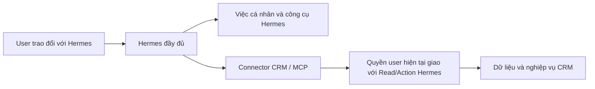

# Kết nối Hermes độc lập với iHomeCRM

Hermes là trợ lý upstream do người dùng cấu hình và cập nhật độc lập. CRM cung cấp công cụ qua connector; không thay engine, model, personal memory hoặc native tools của Hermes bằng Copilot.



Quyền CRM chỉ kiểm khi gọi công cụ CRM. Ngắt kết nối hoặc thu hồi quyền CRM chặn truy cập CRM, không chặn hội thoại và công cụ cá nhân của Hermes. Connector không được đưa JWT CRM, refresh token, khóa provider hay service-role credential vào model/workspace Hermes. Máy Hermes chỉ nhận token kết nối opaque; backend xác minh user và áp dụng quyền hiện tại.

## Bề mặt hiện có

`createHermesBackend` trong `server.mjs` có thể cung cấp HTTP/MCP mà không gọi `createRuntimeGateway`, `createRuntimeSupervisor` hoặc `createPrivateCommandRunner`. Các chức năng runtime/model được tạo riêng khi caller chọn dùng; chúng không phải điều kiện của giao thức MCP.

MCP bên ngoài hiện là JSON trên Streamable HTTP stateless tại `/mcp`, với header `Authorization: Bearer <token kết nối>`. `initialize`, `tools/list`, `tools/call` đều xác minh kết nối; tool arguments không nhận user/JWT/quyền do model tự khai. Host thực tế cần HTTPS reverse proxy và cấu hình Host/Origin đúng đích.

Endpoint bên ngoài đã nối context, phòng, nhóm, soạn/gửi/trạng thái, lịch phòng, work memory và tám miền đọc CRM. Actor/công ty lấy từ kết nối đã xác minh; không cần giả private DM claim. SQL A/B đã apply TEST, SQL C/D/E theo lane riêng ghi ở [STATUS](../../docs/plans/hermes-crm/STATUS.md). Chưa nghiệm thu Hermes/model/Zalo thật.

| Công cụ | Phạm vi hiện có |
| --- | --- |
| `crm_read_customers/leads/contracts/invoices/assets/services/tasks/occupancy` (tám tên riêng) | Projection cố định, phân trang tối đa 50; quyền đọc của từng miền và scope tòa. Khách hàng trong hợp đồng, số điện thoại che bớt; occupancy chỉ là snapshot trạng thái phòng hiện tại |
| `crm_work_memory_status/list/configure/upsert/forget` (năm tên riêng) | Work memory opt-in riêng user/công ty; retention và version. Superadmin chỉ đọc owner chia sẻ và còn đủ quyền. Không nhập personal memory/chat |
| Lịch phòng | Tạo, xem, sửa, thu hồi grant; dùng scheduler/queue hiện có và kiểm quyền mới nhất mỗi lượt. Chưa có detector đổi chính sách hoặc thông báo lỗi chủ lịch |

Capability mới mặc định chưa mở ở registry triển khai. Danh sách quyền hỗ trợ không tự cấp quyền user hoặc tự bật overlay. Việc triển khai/rollout cần bằng chứng TEST và canary riêng; các thao tác tiền, vòng đời hợp đồng và các miền ghi chưa được coi là hoàn tất.

Kênh nhắn riêng dùng [plugin Zalo native](../hermes-zalo-native/README.md) và phiên nick phụ sẵn có của worker. Token kênh `hzn_` tách biệt token CRM `hc_`; tắt CRM không xóa personal profile. Worker hiện vẫn cần lease database để giữ duy nhất một chủ phiên Zalo, nên chưa đảm bảo kênh sống qua mất database vượt TTL. Không đánh đồng giới hạn hạ tầng này với revoke quyền connector.

## Chạy dịch vụ CRM riêng

Dùng `infra/hermes-runtime/host-cli.mjs --config /etc/ihome-hermes/connector.json` với mẫu [connector-config.example.json](../hermes-runtime/connector-config.example.json), `version: 2`, `mode: "connector"`. Dịch vụ dùng Linux, Node 24.18.0, database principal giới hạn và keyring như backend hiện có. Config/password/key phải là file riêng tư đúng owner, state root mode 0700; password/key mode 0600. Khóa mã hóa là 32 byte thô; không đặt secret trong profile Hermes. Startup không tạo quyền hoặc apply schema.

[hermes-connector.service](../hermes-runtime/hermes-connector.service) chạy CLI này mà không cần Docker, model hoặc image Hermes. Host chỉ tạo thư mục handoff/audit, mở listener loopback và vòng gia hạn kết nối; không tạo profile, model relay hay runtime của user. Không chạy hai service cùng port/state root. TLS reverse proxy phải giữ Host, chỉ forward các route đã cấu hình và không ghi Authorization/body vào access log. Cấu hình proxy frontend quản trị giữ theo [HOST_SERVICE.md](../hermes-runtime/HOST_SERVICE.md#frontend-on-vercel); `/mcp` là endpoint HTTPS riêng cho Hermes.

Handoff lưu token opaque đã cấp ở dạng mã hóa. Vòng bảo trì đọc lại quyền, tạm chặn call MCP của đúng kết nối, chờ các call cũ kết thúc rồi refresh phiên/gia hạn. Token opaque giữ nguyên khi gia hạn thành công; JWT/refresh token chỉ ở backend. Mất ACK hoặc kết quả refresh chưa rõ không được thử lại mù; kết nối đó cần kiểm lại hoặc kết nối mới. Backend không khôi phục token đã hết hạn/thu hồi, không tự bật lại quyền.

## Cài vào Hermes upstream

Trên máy chạy Hermes, dùng profile riêng của user. Nếu đã có profile thì dùng profile đó; không tạo một bộ memory CRM thay cho memory cá nhân.

```sh
hermes profile create my-assistant
hermes --profile my-assistant mcp add ihomecrm --url "https://hermes-crm.example.com/mcp" --auth header --connect-timeout 5
hermes --profile my-assistant mcp test ihomecrm
```

Lệnh `mcp add` là luồng tương tác của Hermes gốc: chọn Bearer và nhập mã kết nối `hc_…` vừa cấp ở CRM. Không nhập JWT hoặc mật khẩu CRM vào Hermes. CLI lưu mã trong secret scope của profile, config chỉ tham chiếu biến; không đặt token trên dòng lệnh hoặc trong nội dung chat. Với cấu hình thủ công, phần thêm vào `config.yaml` là:

```yaml
mcp_servers:
  ihomecrm:
    url: https://hermes-crm.example.com/mcp
    transport: http
    headers:
      Authorization: Bearer ${MCP_IHOMECRM_API_KEY}
    connect_timeout: 5
    timeout: 30
    enabled: true
```

Các option/secret interpolation/profile này được đối chiếu source Hermes v0.21.6, commit `818c13be1dc4fd28987e1e881a9408224afd4535`. Đây là phiên bản tương thích để kiểm, không buộc user ngừng cập nhật engine. Không ghi đè model, tools, skills hoặc memory đang có. Hermes gốc xử lý lỗi từng MCP server; CRM lỗi không phải điều kiện dừng personal startup. Chưa xác minh hội thoại model thật trong môi trường triển khai.

Khi đổi token, thu hồi kết nối cũ rồi cấu hình mã mới và kết nối lại MCP trong profile; transport HTTP có thể giữ header cũ tới lúc reconnect. Không giả định đổi file secret tự thay header của transport đang chạy. Thu hồi chỉ ngắt CRM; profile cá nhân giữ nguyên.

Gửi nhóm cần `requestId` UUID cố định cho yêu cầu đó. Khi mất phản hồi, dùng `crm_group_send_status` với ID này; không tạo yêu cầu mới để thử gửi lại. `queued` chỉ có nghĩa đã vào queue. Backend kiểm quyền hiện tại lần nữa trước provider call. Nguồn gửi phải có đúng một binding nick phụ đang hoạt động trong kết nối; chưa có hoặc nhiều nguồn thì trả lỗi để làm rõ cấu hình.

## Phần phải giữ độc lập

- Model/provider, personal memory, skills và công cụ ngoài CRM dùng cấu hình Hermes của user. Quyền hoặc công tắc Copilot không được quyết định những phần này.
- Quyền user trong CRM đã bao gồm công ty, scope và điều kiện nghiệp vụ. Read/Action là giới hạn riêng của connector; không tạo role hoặc bản sao quyền user.
- Công cụ đọc không đòi quyền ghi. Các thao tác thực hiện trực tiếp khi yêu cầu rõ và nằm trong quyền; nếu user chỉ yêu cầu soạn/xem thì chưa thực hiện.
- Cập nhật Hermes upstream dùng hợp đồng connector ổn định. Không buộc sửa kernel Hermes hoặc chạy qua một engine Copilot ở giữa.
- Thu hồi quyền vô hiệu hóa cache/token và job CRM theo quyền hiện tại. Không xóa personal memory hay hứa có thể thu hồi mọi bản sao dữ liệu mà user đã được phép nhận trước đó.

## Adapter prototype

`infra/hermes-runtime/agent-process.py` và host runtime hiện có là prototype thực thi tác vụ CRM có giới hạn, với tool allowlist, model relay và history giới hạn. Chúng **không phải cấu hình mặc định của Hermes cá nhân đầy đủ**. Model relay hiện còn qua admission chat Copilot; chỉ được giữ như phương án quản lý model tùy chọn sau khi tách admission phù hợp. Không dùng relay đó làm điều kiện trò chuyện cá nhân.

Các lớp Auth, giao quyền, mã hóa credential, queue và chống gửi trùng được tái dùng. CLI/config connector, gia hạn và kênh Zalo native đã có code. Plugin đã kiểm với bộ xử lý upstream thật qua loopback và provider tổng hợp; chưa model/Zalo thật. Các miền CRM còn lại, mapping grant tự phục vụ, vòng đời rotate/recovery đầy đủ và kiểm nâng cấp upstream vẫn phải hoàn thiện/nghiệm thu trong plan.
