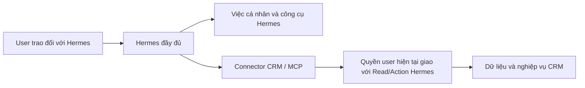

# Kết nối Hermes độc lập với iHomeCRM

Hermes là trợ lý upstream do người dùng cấu hình và cập nhật độc lập. CRM cung cấp công cụ qua connector; không thay engine, model, personal memory hoặc native tools của Hermes bằng Copilot.



Quyền CRM chỉ kiểm khi gọi công cụ CRM. Ngắt kết nối hoặc thu hồi quyền CRM chặn truy cập CRM, không chặn hội thoại và công cụ cá nhân của Hermes. Connector không được đưa JWT CRM, refresh token, khóa provider hay service-role credential vào model/workspace Hermes. Máy Hermes chỉ nhận token kết nối opaque; backend xác minh user và áp dụng quyền hiện tại.

## Bề mặt hiện có

`createHermesBackend` trong `server.mjs` có thể cung cấp HTTP/MCP mà không gọi `createRuntimeGateway`, `createRuntimeSupervisor` hoặc `createPrivateCommandRunner`. Các chức năng runtime/model được tạo riêng khi caller chọn dùng; chúng không phải điều kiện của giao thức MCP.

MCP bên ngoài hiện là JSON trên Streamable HTTP stateless tại `/mcp`, với header `Authorization: Bearer <token kết nối>`. `initialize`, `tools/list`, `tools/call` đều xác minh kết nối; tool arguments không nhận user/JWT/quyền do model tự khai. Host thực tế cần HTTPS reverse proxy và cấu hình Host/Origin đúng đích.

Endpoint bên ngoài đã nối context, phòng, nhóm, soạn/gửi/trạng thái, lịch phòng, work memory, mười ba miền đọc CRM, giao/theo dõi/huỷ việc, tạo khách/lead, ghi phiếu chi nhanh và tin "Khách nhờ sale" (tra phòng, tạo/sửa, bật/ẩn). Actor/công ty lấy từ kết nối đã xác minh; không cần giả private DM claim. Tool chỉ hiện trong `tools/list` khi quyền hiệu lực cho phép. Thiếu RPC capability (PGRST202) thì họ tool đó đóng, nhưng RPC capability có sẵn KHÔNG chứng minh RPC thao tác của họ đó đã apply: họ lịch phòng dùng `hermes_room_schedule_capabilities_v1` có từ trước `hermes_room_schedule_manage_v2`. Khi `manage_v2` trả PGRST202, adapter lịch lùi `manage_v1` cho create/update/revoke/list (`openIssues` rỗng, `reason` null) và trả `backend_unavailable` cho `issues`/`reconcile`. Tương tự, họ tin pass dùng chung `hermes_room_pass_capabilities_v1`: thiếu `hermes_room_pass_upsert_v1` thì `crm_room_lookup`/`crm_room_pass_upsert` trả `backend_unavailable` (không ghi), `crm_room_pass_status` lùi v1 cho biên nhận bật/ẩn. Tin pass apply `20261015162454_hermes_room_pass_upsert_v1` rồi `20261015163023_hermes_room_pass_registry_enable_v1` (chỉ bật đúng dòng registry, chặn khi dòng chưa có) trước khi deploy connector. **Thứ tự phát hành:** apply đủ migration đợt 15/10 (`20261015100000`…`20261015130000`) qua lane trên đúng đích trước, rồi mới deploy connector/worker từ SHA tương ứng; không deploy connector trước migration. Trạng thái apply SQL theo lane ghi ở [STATUS](../../docs/plans/hermes-crm/STATUS.md); 8 migration `20261015100000`…`20261015120200` của gói C/D/E đã apply TEST (chưa production), `20261015130000_hermes_review_fixes_v1` là source chưa apply. Client options/context/chính sách gọi `*_v6` (= task-follow(v5), v5 = tài chính(task(v4))) và chỉ lùi bản cũ khi PGRST202. Chưa nghiệm thu Hermes/model/Zalo thật.

| Công cụ | Phạm vi hiện có |
| --- | --- |
| `crm_read_customers/leads/contracts/invoices/assets/services/tasks/occupancy` (họ v1) và `crm_read_income_expenses/receivables/meter_readings/deposits_held/building_profit` (họ v2) | Projection cố định, phân trang tối đa 50; quyền đọc của từng miền và scope tòa. Khách hàng trong hợp đồng, số điện thoại che bớt; occupancy chỉ là snapshot. Họ v2 thêm `fromDate`/`toDate`, `source`, `fetchedAt`; thu chi loại hạng mục hạn chế/lương/cổ đông, cọc chỉ tổng theo tòa, lãi lỗ kỳ ≤ 366 ngày; số tiền là chuỗi thập phân |
| `crm_work_memory_status/list/configure/upsert/forget` và `crm_work_memory_search` | Work memory opt-in riêng user/công ty; retention và version. `search` (Hermes tổng) cần Read `assistant.memory.supervise` và quyền CRM `users.view`, chỉ trả ghi chú được chia sẻ. Không nhập personal memory/chat |
| `crm_task_input_options`, `crm_task_create`, `crm_task_status` | Action `tasks.create` và scope tòa cho phép lấy ID/tên tòa, phòng, loại việc và người nhận theo RLS hiện tại, kể cả khi Read tắt; không trả dữ liệu công việc hoặc liên hệ. Chính sách CRM `task_types.view` vẫn áp dụng cho loại việc. Tạo/giao dưới chính actor, recipient cùng tổ chức và còn chọn được theo RLS. Request UUID cố định; mất ACK trả `task_outcome_unknown` + requestId, chỉ đối soát status, không tự tạo lại. INSERT giữ nguyên trigger thông báo giao việc E4. Chưa gồm ảnh, vật tư, hoàn thành hoặc thưởng |
| `crm_task_follow_list/set/stop`, `crm_task_progress`, `crm_task_cancel` | Theo dõi/nhắc cần Read `tasks.view` + Action `tasks.create`; tiến độ cần `tasks.edit`; huỷ cần `tasks.delete`. Nhắc theo pg_cron `hermes-task-follow-15m` |
| `crm_customer_create/status`, `crm_lead_create/status` | Action `customers.create`/`leads.create`; khách WALK_IN cá nhân hoặc lead B1_LEAD chưa gắn tòa, ghi bằng JWT user qua RLS canonical; kết nối phải chọn overlay **Toàn tổ chức**. CRM cho trùng số điện thoại; request UUID cố định; mất ACK trả `customer_outcome_unknown` + requestId, chỉ đối soát status |
| `crm_expense_input_options/create/status` | Action `income_expenses.create`; một phiếu CHI 1–20 dòng, VND nguyên, qua writer `create_income_expense_v1` với JWT user. Thang duyệt CRM quyết `UNAPPROVED`/`APPROVED`; người lập có quyền duyệt cần thêm overlay `income_expenses.approve`, không có tool duyệt/vào sổ. Nhãn sổ quỹ che dãy số. Mất ACK trả `expense_outcome_unknown` + requestId, chỉ đối soát status |
| `crm_room_lookup`, `crm_room_pass_upsert`, `crm_room_pass_observe/set_active/status` | Tin "Khách nhờ sale" ở `/sale-phong`. Action `sale_phong.manage_pass_listings` (registry bật bằng migration riêng) ∩ quyền CRM hiện tại theo toà (context, `authorize_tenant_action_v3`, `authorized_scope_v3`, `can_manage_pass_listing`) ∩ overlay phạm vi toà, kiểm lại mỗi lượt. `crm_room_lookup` chỉ đọc: toà (tên/mã/địa chỉ, không phân biệt dấu) + tên/mã phòng → roomId, gồm phòng đang có khách; trạng thái, hợp đồng hiệu lực, khách đại diện chỉ SĐT che `***`+4 số cuối, tin pass hiện có; chỉ toà mà form đọc được (chủ toà hoặc `can_access_building`); tối đa 10 phòng. `crm_room_pass_upsert` ghi qua writer canonical `upsert_room_pass_listing` của form "Thêm phòng pass": sửa tin đang hiện của phòng, không có thì tạo; trường vắng = giữ (sửa)/mặc định (tạo), null = xoá; tạo mới không có SĐT lẫn tên thì điền khách đại diện như form; giá nguyên VND ≤ 1 tỷ, chính sách ≤ 2000 ký tự, SĐT 10–11 số. Không đổi hợp đồng, khách hay trạng thái phòng; audit actor/connection, không ghi SĐT vào audit. Request UUID cố định trên bảng biên nhận `hermes_room_pass_receipts`; mất ACK trả `room_pass_outcome_unknown` + requestId, đối soát bằng `crm_room_pass_status` (đọc cả biên nhận bật/ẩn lẫn upsert), không tự ghi lại |
| Lịch phòng `crm_room_schedule_create/list/update/revoke/issues/reconcile` | Tạo, xem, sửa, thu hồi grant qua scheduler/queue hiện có, kiểm quyền mới nhất mỗi lượt. Probe/sweep ghi sự cố (quyền, chính sách, người nhận) và báo chủ lịch; `issues` đọc sự cố và lần giao chưa rõ; `reconcile` chỉ ghi xác nhận của người cho lần giao UNKNOWN_EFFECT của chính kết nối, không bao giờ gửi lại |
| `crm_new_request_id` | Trả `{ "requestId": "<UUID v4 ngẫu nhiên>" }` cho một lệnh mới; không đọc/ghi CRM, không lưu mã. Chỉ hiện khi danh sách tool của kết nối có ít nhất một action cần `requestId` (tạo/theo dõi/tiến độ/huỷ việc, khách/lead, phiếu chi, tin pass, lịch phòng, gửi nhóm); vẫn qua xác thực token/quyền hiện tại, audit, kiểm lại quyền sau audit và quota `tools/call`, nên kết nối thu hồi/hết hạn không nhận mã. Hermes upstream không có tool sinh UUID (v0.21.6): mô tả mọi action dặn lấy mã MỘT lần cho mỗi lệnh mới, dùng lại khi thử lại/tra trạng thái; tool `*_status` dùng mã của lệnh gốc. Validation UUID, idempotency và UNKNOWN_EFFECT của từng action giữ nguyên |

Capability mới mặc định chưa mở ở registry triển khai. Danh sách quyền hỗ trợ không tự cấp quyền user hoặc tự bật overlay. Việc triển khai/rollout cần bằng chứng TEST và canary riêng. Ghi phiếu chi và tạo khách/lead mới kiểm bằng PGlite với cổng writer/quyền giả lập cùng chữ ký (MCP → broker → SQL), chưa qua writer, RLS và PostgREST thật; tạo/sửa tin pass kiểm bằng PGlite với writer canonical thật (`upsert_room_pass_listing`, `can_manage_pass_listing`) trên bảng CRM tối giản, chưa qua PostgREST/RLS thật hay Hermes/model thật; duyệt/vào sổ, vòng đời hợp đồng, cọc và các miền ghi khác chưa có.

Kênh nhắn riêng dùng [plugin Zalo native](../hermes-zalo-native/README.md) và phiên nick phụ sẵn có của worker. Token kênh `hzn_` tách biệt token CRM `hc_`; tắt CRM không xóa personal profile. Worker hiện vẫn cần lease database để giữ duy nhất một chủ phiên Zalo, nên chưa đảm bảo kênh sống qua mất database vượt TTL. Không đánh đồng giới hạn hạ tầng này với revoke quyền connector.

## Chạy dịch vụ CRM riêng

Dùng `infra/hermes-runtime/host-cli.mjs --config /etc/ihome-hermes/connector.json` với mẫu [connector-config.example.json](../hermes-runtime/connector-config.example.json), `version: 2`, `mode: "connector"`. Dịch vụ dùng Linux, Node 24.18.0, database principal giới hạn và keyring như backend hiện có. `pg` là dependency runtime (store của connector): cài release bằng `npm ci --omit=dev --ignore-scripts` từ đúng `package-lock.json`. CLI nhận diện file chính bằng realpath nên chạy được qua symlink release `current/`. Config/password/key phải là file riêng tư đúng owner, state root mode 0700; password/key mode 0600. Khóa mã hóa là 32 byte thô; không đặt secret trong profile Hermes. Startup không tạo quyền hoặc apply schema.

[hermes-connector.service](../hermes-runtime/hermes-connector.service) chạy CLI này mà không cần Docker, model hoặc image Hermes. Host chỉ tạo thư mục handoff/audit, mở listener loopback và vòng gia hạn kết nối; không tạo profile, model relay hay runtime của user. Không chạy hai service cùng port/state root. TLS reverse proxy phải giữ Host, chỉ forward các route đã cấu hình và không ghi Authorization/body vào access log. Cấu hình proxy frontend quản trị giữ theo [HOST_SERVICE.md](../hermes-runtime/HOST_SERVICE.md#frontend-on-vercel); `/mcp` là endpoint HTTPS riêng cho Hermes.

Handoff lưu token opaque đã cấp ở dạng mã hóa. Vòng bảo trì đọc lại quyền, tạm chặn call MCP của đúng kết nối, chờ các call cũ kết thúc rồi refresh phiên/gia hạn. Call MCP đến trong lúc chặn được giữ tối đa `limits.maintenanceWaitMs` (mặc định 5 s, tối đa 2 call/kết nối) và chỉ chạy sau khi hàng rào mở; quá hạn thì trả `503 connection_maintenance`. Token opaque giữ nguyên khi gia hạn thành công; JWT/refresh token chỉ ở backend. Mất ACK hoặc kết quả refresh chưa rõ không được thử lại mù; kết nối đó cần kiểm lại hoặc kết nối mới. Backend không khôi phục token đã hết hạn/thu hồi, không tự bật lại quyền.

Giới hạn theo kết nối (cửa sổ trượt 60 s, cấu hình `limits` trong connector.json, mặc định 60 request và 30 `tools/call` mỗi phút) trả kết quả tool `isError` với `{"error":"rate_limited","retryAfterSeconds":N}` để model chờ, không làm rớt phiên MCP. Deadline cả lượt gọi `limits.callTimeoutMs` mặc định 20 s, dưới timeout MCP 30 s của profile mẫu; mỗi lượt vẫn đọc lại Auth/SQL lúc vào và sau audit nên thu hồi có hiệu lực cho lượt kế tiếp. Trong một lượt, kết quả authority chỉ được dùng lại đúng một lần cho service ngay sau nó (cùng checkpoint), không có cache quyền giữa các lượt. Trang `/settings/hermes` đọc `status` để hiện phiên bản connector, lần gọi MCP/tool thành công gần nhất và mã lỗi gần nhất của kết nối của chính user (bộ nhớ tiến trình, mất khi restart). Runbook vận hành ở [HOST_SERVICE.md](../hermes-runtime/HOST_SERVICE.md#connector-operations-version-2).

## Cài vào Hermes upstream

Trên máy chạy Hermes, dùng profile riêng của user. Nếu đã có profile thì dùng profile đó; không tạo một bộ memory CRM thay cho memory cá nhân.

```sh
hermes profile create my-assistant
hermes --profile my-assistant mcp add ihomecrm --url "https://hermes-crm.example.com/mcp" --auth header --connect-timeout 5
hermes --profile my-assistant mcp test ihomecrm
```

Lệnh `mcp add` là luồng tương tác của Hermes gốc: chọn Bearer và nhập mã kết nối `hc_…` vừa cấp ở CRM. Không nhập JWT hoặc mật khẩu CRM vào Hermes. CLI lưu mã trong secret scope của profile, config chỉ tham chiếu biến; không đặt token trên dòng lệnh hoặc trong nội dung chat. Với cấu hình thủ công, phần thêm vào `config.yaml` là:

```yaml
mcp_servers:
  ihomecrm:
    url: https://hermes-crm.example.com/mcp
    transport: http
    headers:
      Authorization: Bearer ${MCP_IHOMECRM_API_KEY}
    connect_timeout: 5
    timeout: 30
    enabled: true
```

Các option/secret interpolation/profile này được đối chiếu source Hermes v0.21.6, commit `818c13be1dc4fd28987e1e881a9408224afd4535`. Đây là phiên bản tương thích để kiểm, không buộc user ngừng cập nhật engine. Không ghi đè model, tools, skills hoặc memory đang có. Hermes gốc xử lý lỗi từng MCP server; CRM lỗi không phải điều kiện dừng personal startup. Chưa xác minh hội thoại model thật trong môi trường triển khai.

Khi đổi token, thu hồi kết nối cũ rồi cấu hình mã mới và kết nối lại MCP trong profile; transport HTTP có thể giữ header cũ tới lúc reconnect. Không giả định đổi file secret tự thay header của transport đang chạy. Thu hồi chỉ ngắt CRM; profile cá nhân giữ nguyên.

Gửi nhóm cần `requestId` UUID cố định cho yêu cầu đó, lấy bằng `crm_new_request_id`; model không tự sinh mã (bằng terminal hay cách khác). Khi mất phản hồi, dùng `crm_group_send_status` với ID này; không tạo yêu cầu mới để thử gửi lại. `queued` chỉ có nghĩa đã vào queue. Backend kiểm quyền hiện tại lần nữa trước provider call. Nguồn gửi phải có đúng một binding nick phụ đang hoạt động trong kết nối; chưa có hoặc nhiều nguồn thì trả lỗi để làm rõ cấu hình.

## Phần phải giữ độc lập

- Model/provider, personal memory, skills và công cụ ngoài CRM dùng cấu hình Hermes của user. Quyền hoặc công tắc Copilot không được quyết định những phần này.
- Quyền user trong CRM đã bao gồm công ty, scope và điều kiện nghiệp vụ. Read/Action là giới hạn riêng của connector; không tạo role hoặc bản sao quyền user.
- Công cụ đọc không đòi quyền ghi. Các thao tác thực hiện trực tiếp khi yêu cầu rõ và nằm trong quyền; nếu user chỉ yêu cầu soạn/xem thì chưa thực hiện.
- Cập nhật Hermes upstream dùng hợp đồng connector ổn định. Không buộc sửa kernel Hermes hoặc chạy qua một engine Copilot ở giữa.
- Thu hồi quyền vô hiệu hóa cache/token và job CRM theo quyền hiện tại. Không xóa personal memory hay hứa có thể thu hồi mọi bản sao dữ liệu mà user đã được phép nhận trước đó.

## Adapter prototype

`infra/hermes-runtime/agent-process.py` và host runtime hiện có là prototype thực thi tác vụ CRM có giới hạn, với tool allowlist, model relay và history giới hạn. Chúng **không phải cấu hình mặc định của Hermes cá nhân đầy đủ**. Model relay hiện còn qua admission chat Copilot; chỉ được giữ như phương án quản lý model tùy chọn sau khi tách admission phù hợp. Không dùng relay đó làm điều kiện trò chuyện cá nhân.

Các lớp Auth, giao quyền, mã hóa credential, queue và chống gửi trùng được tái dùng. CLI/config connector, gia hạn và kênh Zalo native đã có code. Plugin đã kiểm với bộ xử lý upstream thật qua loopback và provider tổng hợp; chưa model/Zalo thật. Các miền CRM còn lại, mapping grant tự phục vụ, vòng đời rotate/recovery đầy đủ và kiểm nâng cấp upstream vẫn phải hoàn thiện/nghiệm thu trong plan.
