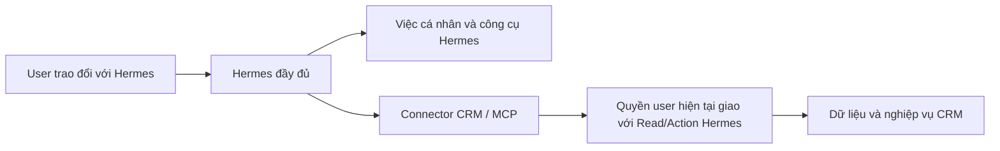

# Kết nối Hermes độc lập với iHomeCRM

Hermes là trợ lý upstream do người dùng cấu hình và cập nhật độc lập. CRM cung cấp công cụ qua connector; không thay engine, model, personal memory hoặc native tools của Hermes bằng Copilot.



Quyền CRM chỉ kiểm khi gọi công cụ CRM. Ngắt kết nối hoặc thu hồi quyền CRM chặn truy cập CRM, không chặn hội thoại và công cụ cá nhân của Hermes. Connector không được đưa JWT CRM, refresh token, khóa provider hay service-role credential vào model/workspace Hermes. Máy Hermes chỉ nhận token kết nối opaque; backend xác minh user và áp dụng quyền hiện tại.

## Bề mặt hiện có

`createHermesBackend` trong `server.mjs` cung cấp HTTP/MCP, quản lý kết nối và bảo trì kết nối; không chạy runtime và không gọi model. Connector-only là chế độ duy nhất: model/provider do profile Hermes của user cấu hình (production đi 9router trực tiếp).

MCP bên ngoài hiện là JSON trên Streamable HTTP stateless tại `/mcp`, với header `Authorization: Bearer <token kết nối>`. `initialize`, `tools/list`, `tools/call` đều xác minh kết nối; tool arguments không nhận user/JWT/quyền do model tự khai. Trước validator, broker chuẩn hoá đối số theo định nghĩa gốc (`tool-argument-shape.mjs`): chỗ trống/nil UUID của trường nullable thành null (16/10); với tool đọc (`readOnlyHint`) khoá snake_case đổi sang camelCase khi schema có khoá đó và `limit` nguyên ngoài khoảng bị kẹp về cận (20/10, B1c); `status` cấp một sai chữ đổi thành đúng phần tử enum của chính tool đó — không phân biệt hoa thường, rồi bốn từ đồng nghĩa cố định khi đích có trong enum: `pending`→`UNAPPROVED`, `open`→`IN_PROGRESS`, `overdue`→`OVERDUE`, `liquidated`→`TERMINATED` (21/10, R2b); ngoài các luật đó không đoán từ đồng nghĩa, tool ghi và `tools/list` giữ nguyên. Hermes kiểm đối số `tool_call` theo schema QUẢNG BÁO (`additionalProperties:false`, enum) trước khi gọi connector, nên alias và hint lời gọi sai (dưới) chỉ tác dụng với lời gọi tới được connector. Kết quả `tools/call` giới hạn 64 KiB; `tools/list` (danh mục tĩnh theo quyền, không phải dữ liệu CRM) có trần riêng 192 KiB (`TOOLS_LIST_MAX_BYTES`); vượt trần thì trả `response_too_large`, không cắt bớt danh sách. Host thực tế cần HTTPS reverse proxy và cấu hình Host/Origin đúng đích.

Endpoint bên ngoài đã nối context, phòng, nhóm, soạn/gửi/trạng thái, lịch phòng, work memory, mười ba miền đọc CRM cùng họ đọc đầy đủ v3 (hồ sơ khách, chi tiết hợp đồng, sáu báo cáo), giao/theo dõi/huỷ việc, tạo khách/lead, ghi phiếu chi nhanh và tin "Khách nhờ sale" (tra phòng, tạo/sửa, bật/ẩn). Actor/công ty lấy từ kết nối đã xác minh; không cần giả private DM claim. Tool chỉ hiện trong `tools/list` khi quyền hiệu lực cho phép. Thiếu RPC capability (PGRST202) thì họ tool đó đóng, nhưng RPC capability có sẵn KHÔNG chứng minh RPC thao tác của họ đó đã apply: họ lịch phòng dùng `hermes_room_schedule_capabilities_v1` có từ trước `hermes_room_schedule_manage_v2`. Khi `manage_v2` trả PGRST202, adapter lịch lùi `manage_v1` cho create/update/revoke/list (`openIssues` rỗng, `reason` null) và trả `backend_unavailable` cho `issues`/`reconcile`. Tương tự, họ tin pass dùng chung `hermes_room_pass_capabilities_v1`: thiếu `hermes_room_pass_upsert_v2` (bọc v1, migration `20261016162104`) thì `crm_room_lookup`/`crm_room_pass_upsert` trả `backend_unavailable` (không ghi, không lùi về đường che SĐT), `crm_room_pass_status` lùi `upsert_v1` rồi action v1 cho biên nhận bật/ẩn. Tin pass apply `20261015162454_hermes_room_pass_upsert_v1` rồi `20261015163023_hermes_room_pass_registry_enable_v1` (chỉ bật đúng dòng registry, chặn khi dòng hoặc RPC upsert chưa có) trước khi deploy connector. **Thứ tự phát hành:** apply đủ migration đợt 15/10 (`20261015100000`…`20261015130000`) qua lane trên đúng đích trước, rồi mới deploy connector/worker từ SHA tương ứng; không deploy connector trước migration. Trạng thái apply SQL theo lane ghi ở [STATUS](../../docs/plans/hermes-crm/STATUS.md); 8 migration `20261015100000`…`20261015120200` của gói C/D/E đã apply TEST (chưa production), `20261015130000_hermes_review_fixes_v1` là source chưa apply. Client options/context/chính sách gọi `*_v6` (= task-follow(v5), v5 = tài chính(task(v4))) và chỉ lùi bản cũ khi PGRST202. Chưa nghiệm thu Hermes/model/Zalo thật.

| Công cụ | Phạm vi hiện có |
| --- | --- |
| `crm_read_leads/contracts/invoices/assets/services/tasks/occupancy` (họ v1) và `crm_read_income_expenses/receivables/meter_readings/deposits_held/building_profit` (họ v2) | Projection cố định, phân trang tối đa 50; quyền đọc của từng miền và scope tòa. Occupancy chỉ là snapshot. Họ v2 thêm `fromDate`/`toDate`, `source`, `fetchedAt`; thu chi loại hạng mục hạn chế/lương/cổ đông, cọc chỉ tổng theo tòa, lãi lỗ kỳ ≤ 366 ngày; số tiền là chuỗi thập phân. Dịch vụ: hiện khi đang bật ở toà của kết nối, hoặc (kết nối Toàn tổ chức) khi không đang bật ở toà CÒN SỐNG nào — R2d (`20261021063452`, đã áp TEST 16:09 + production 16:56 giờ VN 21/10): liên kết bật tới toà đã xoá mềm không còn làm sót dịch vụ như trước. B5d (21/10, migration `20261020175803_hermes_name_directory_v1` đã áp TEST + production 21/10 (prod 02:31 giờ VN)): mọi tool danh sách (họ v1/v2/v3 và `crm_read_report` qua `params`) nhận thêm `buildingName` và — nơi hàng có phòng — `roomName` (tên, không phải ID); connector giải tên → ID qua `hermes_building_directory_v1`/`hermes_room_directory_v1` (SECURITY INVOKER, RLS của người hỏi, chỉ các toà trong phạm vi của khoá) bằng JWT người hỏi TRƯỚC validator (validator và tập khoá input SQL không đổi); 0 hoặc ≥2 toà khớp ⇒ tool error `read_name_unresolved` kèm `detail`; R2b (21/10): lời gọi bị validator từ chối mà khớp một dạng sai quen thuộc (ngày ở `crm_read_contracts`/`crm_read_invoices`, `type` ở thu chi, toà/trạng thái ở `crm_read_pending_approvals`, nhắc xe ở tài sản, mã toà ở `buildingId`) trả `invalid_request` kèm `detail` là một câu TĨNH của `read-misuse-hints.mjs` chỉ tool/tham số đúng (không chứa dữ liệu đã gửi; mcp-http chỉ chuyển đúng các câu đó); phòng trùng tên ở nhiều toà gộp tới 5 phòng như web, hơn thì hỏi lại; SQL đọc không nhận ID phòng nên connector lọc hàng theo `roomId` trên các trang đã lấy (trang 50 dòng, tối đa 4 trang, `roomFilter` trong kết quả), riêng nơi SQL khớp `room.name` (`receivables`, `meter_readings`, `contract_search`, `contracts` đường nhanh) đặt thêm `query` = tên phòng. `crm_auth_context` trả thêm `organizationName` và `buildings` (id, tên, mã) của phạm vi đọc rộng nhất qua `hermes_organization_name_v1` (DEFINER, chỉ thành viên ACTIVE) và danh bạ toà; R2c phần 2 (21/10, `20261021044821_hermes_user_display_name_v1`, đã áp TEST + production 21/10 13:31 giờ VN): thêm `userName` = tên hiển thị (`profiles.full_name`) của CHÍNH người hỏi qua `hermes_user_display_name_v1()` (INVOKER, RLS hồ sơ của chính họ, không email/SĐT; id SQL trả phải là người của kết nối, khác ⇒ `backend_unavailable`), hàm chưa có (PGRST202) ⇒ `null` |
| `crm_read_customers`, `crm_read_customer_detail`, `crm_read_contract_detail` và báo cáo `crm_read_occupancy_report/invoice_report/monthly_pnl/pending_approvals/zalo_conversations/contract_search` (họ v3, `hermes_domain_read_v3`, migration `20261016162104_hermes_full_read_v1` → `20261016172206_hermes_full_read_review_fixes_v1` → `20261017021554_hermes_full_read_web_parity_v1` → `20261017033630_hermes_full_read_owner_scope_v1`; từ 17/10 `crm_read_occupancy` cũng sang v3; áp đủ bốn file trước khi đổi connector, câu kiểm ở [BAN-GIAO](../../docs/plans/hermes-crm/BAN-GIAO.md)) | Đọc đầy đủ cho NGƯỜI HỎI như web (chủ chốt 16/10): SĐT, CCCD dạng chữ, ngày sinh, địa chỉ, người ở, điều khoản/cọc/dịch vụ hợp đồng; không ảnh CCCD, file hợp đồng, mã công khai, tài khoản ngân hàng. Chỉ dùng khoá ĐÃ CÓ (`customers.view`, `contracts.view`, `invoices.view`, `reports_real_estate.occupancy`, `reports_finance.analysis`, `income_expenses.view`, `chat_zalo.view`), không có hàm capabilities riêng; SQL kiểm binding, quyền CRM hiện tại ∩ overlay Read/scope toà ∩ chính sách ∩ registry mỗi lượt. Khách: kết nối Toàn tổ chức thấy cả khách chưa có hợp đồng. Khoá thứ hai như embed của web: người ở trong chi tiết hợp đồng và tên khách/tìm theo tên trong `crm_read_contract_search` cần thêm `customers.view`, hợp đồng trong hồ sơ/danh sách khách cần `contracts.view` (quyền CRM ∩ Read kết nối ∩ toà overlay); thiếu thì `tenants=[]`/`tenantsVisible=false`, `contracts=[]`/`contractsVisible=false`, `customerName=null`. Báo cáo KHÔNG phụ thuộc hàm `copilot_*` (chủ chốt 17/10; bảng `hermes_report_catalog_v1` ↔ `full-read-contract.mjs`): màn web có RPC riêng thì gọi thẳng RPC đó (`occupancy_snapshot_v2`, `occupancy_upcoming_vacancy_v2`, `fa_monthly_pnl_accrual`/`fa_monthly_pnl`, `list_my_pending_approvals_v1`), web đọc bảng thì SQL theo đúng bộ lọc web (hoá đơn, hợp đồng, Chat Zalo — dẫn file:line trong migration). Lãi lỗ mặc định dồn tích, `summary.pending*` là phần chờ duyệt mà BC Doanh Thu Chi Phí cộng thêm. Hàng có toà thì lọc theo toà đã giao; nguồn không nhận tham số toà (hộp chờ duyệt của chính người hỏi, hội thoại Zalo) chỉ cho kết nối Toàn tổ chức, Zalo còn cần `chat_zalo.view` toàn công ty như web; thiếu thì `unavailable=organization_scope_required`. Thống kê hoá đơn tính thẳng trên `invoices`/`invoice_items` theo quyền `invoices.view` thật ∩ toà kết nối (không qua `get_invoice_statistics_v2`, hàm đó lấy phạm vi theo `staff_assignments`); báo cáo theo toà mà kết nối không còn toà nào trả `unavailable=no_building_scope` thay vì số 0. Mọi nhánh đọc khách (danh sách, hồ sơ, người ở, tên/SĐT khách trong tìm hợp đồng/hoá đơn, khách đại diện của `crm_room_lookup`) theo RLS `customers_select_rbac` của web: chủ hồ sơ `customers.user_id` phải là thành viên ACTIVE của công ty (`current_visible_owner_ids`). Phân trang offset/limit ≤ 50, trần ~40 KB mỗi trang và 60 KB mỗi kết quả, đo SAU escape JSON (như khi broker bọc kết quả, trần 64 KB); quá trần SQL trả PT413 ⇒ tool error `result_too_large` kèm gợi ý giảm limit/thu hẹp bộ lọc. Dữ liệu riêng tư chỉ trả lời riêng người hỏi; bản tin nhóm Zalo không đi đường này và giữ lọc công khai. Connector trước migration: các tool này trả `backend_unavailable` |
| `summary` của 13 tool danh sách (R2a, 21/10; migration `20261020233934_hermes_domain_summary_v1` (v1, v2, reader nhanh) rồi `20261021004841_hermes_w2_domain_summary_v1` (v3 customers/occupancy + báo cáo monthly_pnl; dải nền đợt 2), đã áp production 21/10 09:46–09:51; R2c `20261021035022_hermes_domain_summary_largest_by_type_v1` (v2: `largest` theo loại thu/chi) cùng R2c phần 2, đã áp production 21/10 13:16–13:31 giờ VN; R2d `20261021063452_hermes_domain_without_contract_latest_count_v1` (reader nhanh + v1 + hàm phụ DEFINER) rồi `20261021063453_hermes_w2_customers_without_contract_v1` (v3, dải nền), đã áp TEST + production 21/10 16:12/16:58 giờ VN) | Kết quả có thêm `summary` ngay sau `domain`, tính trong CÙNG lời gọi trên TOÀN tập đã lọc (query/buildingId/status/fromDate/toDate), bỏ cursor/limit, cùng phạm vi công ty/toà (đường nhanh: cùng RLS người hỏi) với `items` — mô hình đọc số đếm/tổng ở đây thay vì tự cộng hàng hay đọc thêm trang để đếm. Khuôn chung `{count, byStatus, sum}`; phần riêng theo miền: `tasks.overdue`, `income_expenses.byType/largest` (tiền không gồm phiếu CANCELLED, `count`/`byStatus` gồm; R2c: mỗi phần tử `byType.<INCOME|EXPENSE>` thêm `largest` — phiếu lớn nhất CỦA LOẠI đó, cùng khuôn `largest`; câu "khoản chi lớn nhất" đọc `byType.EXPENSE.largest` vì tool không lọc loại và `largest` gồm cả phiếu thu; R2c phần 2 (`20261021044801` + `20261021044814`, đã áp TEST + production 21/10 13:16–13:31 giờ VN): `customers.byStatus` đếm khách theo `status_v2` — đúng ba tab của /customers: RENTING đang thuê, MOVED_OUT đã chuyển đi, WALK_IN vãng lai = chưa có hợp đồng — đường nhanh trả `null` khi có `query`; dòng `assets` thêm `createdAt` (ngày thêm theo múi giờ nghiệp vụ của công ty) và `assets.latest` = tài sản thêm gần đây nhất của cả tập (`created_at` đầy đủ giảm dần rồi id); R2d: `customers.withoutContract` = số khách của cả tập KHÔNG có hợp đồng nào (mọi trạng thái; hợp đồng đã xoá mềm không tính, phòng đã xoá vẫn tính) ở toà thuộc phạm vi hợp đồng của kết nối — câu "bao nhiêu khách chưa có hợp đồng" đọc đây, KHÔNG đọc `byStatus.WALK_IN` (production không có khách WALK_IN: khách chưa từng có hợp đồng mang RENTING); `null` khi đường nhanh có `query` hoặc phạm vi hợp đồng của kết nối không phủ phạm vi khách (số khi đó chỉ có thể sai). Đường nhanh (INVOKER) đếm qua hàm riêng `app_private.hermes_customers_without_contract_v1` (DEFINER, chỉ trả SỐ: kiểm lại người gọi là thành viên ACTIVE chưa offboard, chỉ khách sống có chủ hồ sơ thấy được trong danh sách id của chính tập RLS, chỉ toà người gọi có `contracts.view` CRM; client không gọi thẳng được — không USAGE `app_private`) vì RLS hợp đồng (`buildings.view`) có thể giấu hợp đồng mà phạm vi hợp đồng cho thấy; v3 (DEFINER) đếm thẳng trong `v_contract_scope`. `assets.latestCount` = số tài sản của cả tập có `created_at` BẰNG ĐÚNG mốc của `latest` (cùng thời điểm, không phải cùng ngày — production nhập cả kho trong MỘT đợt nên `latest` chỉ là một món của đợt), 0 khi tập rỗng), `receivables.byBuilding` (≤ 50 toà, `remainingAmount` giảm dần), `meter_readings.byType/rooms`, occupancy/deposits_held/building_profit là tổng các toà, `monthly_pnl.summary` thêm `revenue/expense/net/rows` (mọi hàng của báo cáo); bảng đủ ở [B2-BANG-MIEN-DOC](../../docs/plans/hermes-crm/B2-BANG-MIEN-DOC-2026-10-20.md). Đường nhanh: customers/invoices `count` = tổng lõi web tính trước khi chia trang, contracts `byStatus` = null khi có `query`. Broker kiểm khuôn chính xác theo miền (`DOMAIN_SUMMARIES`, khoá lạ/sai kiểu ⇒ `backend_unavailable`) và bất biến: `count` ≥ số dòng trang (không đòi bằng — lõi nhanh có thể đếm dòng không phòng), tổng `byStatus` ≤ `count` và chỉ giá trị lọc khi có `status`, `byBuilding` trong phạm vi khoá/đúng toà lọc/giảm dần, `largest` trong kỳ (R2c: `byType.<loại>.largest` đúng loại, trong kỳ, không vượt tổng của loại và không đứng trước `largest`; `largest` chính là largest của loại nó; có ở MỌI phần tử, hoặc — chỉ trong cửa sổ phát hành — vắng ở mọi phần tử), `rows` của monthly_pnl khớp offset + số hàng ở trang cuối; R2d: `withoutContract` ≤ `count` − số dòng trang có `contractId`, `latestCount` = 0 ⇔ `latest` null và ≤ `count` (summarizeRows của lọc phòng trả `null` cho cả hai: dòng không mang lịch sử hợp đồng hay thời điểm thêm). Lọc theo phòng ở connector (`roomName`): `summary` SQL tả tập chưa lọc phòng nên được thay bằng summary của chính các hàng giữ lại khi đã đọc hết (`nextCursor` null), còn trang thì `null`. Không đổi tham số tool hay byte `tools/list`. **Thứ tự phát hành:** R2a xong (connector 3762b3a0 chấp nhận vắng summary lên trước, production áp hai migration 21/10). Bản connector R2c ĐÓNG cửa sổ R2a (`DOMAIN_SUMMARY_TOLERANT` = [], monthly_pnl bỏ `summaryTolerant`: summary và bốn tổng bắt buộc) và MỞ cửa sổ riêng cho `byType.*.largest` (`DOMAIN_SUMMARY_ENTRY_TOLERANT`: vắng đồng loạt ở mọi phần tử vẫn qua) ⇒ deploy connector R2c trước, rồi áp `20261021035022` qua lane; bản connector kế tiếp đưa `DOMAIN_SUMMARY_ENTRY_TOLERANT` về `{}`. Phần 2 cùng bản connector: `assets.createdAt` (`DOMAIN_READS.assets.tolerant`) và `assets.latest` (`DOMAIN_SUMMARY_KEY_TOLERANT`) được vắng CÙNG NHAU một bản (dòng có ngày mà summary không latest, hay ngược lại ⇒ từ chối); `customers.byStatus` mới và `userName` không cần cửa sổ ({} cũ vẫn hợp lệ, hàm vắng ⇒ null) ⇒ áp `20261021044801` → `20261021044814` → `20261021044821` sau connector. Production đã áp đủ bốn migration R2c (21/10 13:16–13:31) ⇒ bản connector R2d ĐÓNG các cửa sổ R2c (`DOMAIN_SUMMARY_ENTRY_TOLERANT` = {}, `assets.tolerant` = [], `assets.latest` bắt buộc) và MỞ cửa sổ một bản cho `customers.withoutContract` + `assets.latestCount` (`DOMAIN_SUMMARY_KEY_TOLERANT`; connector R2c từ chối hai khoá này) ⇒ deploy connector R2d trước, rồi áp `20261021063452` → `20261021063453` qua lane; bản kế đưa `DOMAIN_SUMMARY_KEY_TOLERANT` về {}. Lùi: revert soạn sẵn ở `docs/plans/hermes-crm/revert/` — R2d: `hermes_domain_without_contract_latest_count_revert_v1.sql` (về đúng thân R2c phần 2 của reader + v1 rồi DROP hàm phụ) và `hermes_w2_customers_without_contract_revert_v1.sql` (v3 về thân `20261021044814`), chạy TRƯỚC revert R2c phần 2 (revert đó từ chối khi thân R2d còn sống), connector R2d nhận kết quả (cửa sổ); `hermes_domain_summary_largest_by_type_revert_v1.sql` (về đúng thân v2 của R2a) khi connector đang chạy còn cửa sổ R2c; bỏ cả summary thì revert R2c trước, lùi connector về 3762b3a0, rồi revert R2a (đúng thân B5c bước 2 / `20261020173819` / `20261017033630`) |
| Mốc giờ trong kết quả (R2e, 21/10) | Mọi chuỗi ngày-giờ ISO có đuôi UTC (`Z`, `+00:00`, `+0000`, `+00`) trong kết quả `tools/call` được connector đổi sang giờ Việt Nam đuôi `+07:00` ngay trước khi trả (`vietnam-time.mjs`, gắn ở `mcp-http.mjs`); ngày thuần (`YYYY-MM-DD`), chuỗi có múi giờ khác và khoá con trỏ (`nextCursor`, `cursor`) giữ nguyên; khối text không phải JSON giữ nguyên. Lý do: full50e câu 66 — hạn `…T16:59:59.999+00:00` (23:59 giờ VN) bị mô hình đọc thành ngày hôm sau dù SOUL có ví dụ. Tham số đầu vào vẫn nhận UTC hoặc có múi giờ như cũ |
| `crm_read_report_list`, `crm_read_report` (đợt 2 đọc đầy đủ, 18/10, chưa áp TEST/production) | Hai tool meta cho 70 báo cáo (sổ `wave2-registry.mjs` ← `wave2-{a,b,c,d}-contract.mjs`; mục lục theo khoá còn được cấp lúc gọi, chạy một báo cáo với `params` đúng tên mục lục, `limit` ≤ 50, `offset` ≤ 2000, `sourceCapped` khi nguồn > 2000 hàng). Một lối vào INVOKER `public.hermes_w2_read_v1` bằng JWT người hỏi: bước kiểm quyền DEFINER (quyền CRM thật ∩ registry ∩ chính sách công ty ∩ Read kết nối ∩ toà overlay) → hàm đọc gói INVOKER dưới RLS người hỏi → bước kết thúc rào đầu ra (mọi hàng đúng công ty/toà/sổ đã giao, khuôn sai ⇒ XX000) rồi broker rào lần hai theo `fence`. Mọi báo cáo `private=true` (chỉ trả lời riêng); như đợt 1, tin nhóm không đi đường này: kênh Zalo cá nhân chỉ DM, tool gửi nhóm chỉ nhận ID (khoá bằng `wave2-z.test.mjs`). **Thứ tự phát hành:** áp đủ chuỗi `20261018000000 → 000500 → 000600 → 000700`, A `010000 → 010100`, B `020050 → 020200 → 020250 → 020300`, C `030100`…`030600`, D `040000`…`040300`, Z `080000` (hàm dùng chung) `→ 080100 → 080200 → 080300` (hàm đọc A, B, D), cuối cùng công tắc `20261018090000_hermes_w2_enable_v1` (bật 32 khoá; RAISE nếu thiếu bản sửa Z), rồi mới deploy connector; chủ tạo lại kết nối (chọn khoá mới ở `/settings/hermes`) và liên kết lại Zalo. Connector trước migration: hai tool vẫn có thể hiện nhờ khoá đợt 1 dùng lại (`invoices.view`, `deposits.view`, `reports_finance.analysis`, `assets.view`, `services.view`, `rooms.view`) nhưng trả `backend_unavailable` |
| `crm_work_memory_status/list/configure/upsert/forget` và `crm_work_memory_search` | Work memory opt-in riêng user/công ty; retention và version. `search` (Hermes tổng) cần Read `assistant.memory.supervise` và quyền CRM `users.view`, chỉ trả ghi chú được chia sẻ. Không nhập personal memory/chat |
| `crm_task_input_options`, `crm_task_create`, `crm_task_status` | Action `tasks.create` và scope tòa cho phép lấy ID/tên tòa, phòng, loại việc và người nhận theo RLS hiện tại, kể cả khi Read tắt; không trả dữ liệu công việc hoặc liên hệ. Chính sách CRM `task_types.view` vẫn áp dụng cho loại việc. Tạo/giao dưới chính actor, recipient cùng tổ chức và còn chọn được theo RLS. Request UUID cố định; mất ACK trả `task_outcome_unknown` + requestId, chỉ đối soát status, không tự tạo lại. INSERT giữ nguyên trigger thông báo giao việc E4. Chưa gồm ảnh, vật tư, hoàn thành hoặc thưởng |
| `crm_task_follow_list/set/stop`, `crm_task_progress`, `crm_task_cancel` | Theo dõi/nhắc cần Read `tasks.view` + Action `tasks.create`; tiến độ cần `tasks.edit`; huỷ cần `tasks.delete`. Nhắc theo pg_cron `hermes-task-follow-15m`. Công ty lấy từ kết nối: tool không nhận `organizationId` (20/10, B5b; adapter gắn vào `p_input` trước RPC, SQL vẫn so với công ty kết nối); model vẫn gửi thì phải trùng, khác thì `forbidden` trước mọi RPC |
| `crm_customer_create/status`, `crm_lead_create/status` | Action `customers.create`/`leads.create`; khách WALK_IN cá nhân hoặc lead B1_LEAD chưa gắn tòa, ghi bằng JWT user qua RLS canonical; kết nối phải chọn overlay **Toàn tổ chức**. CRM cho trùng số điện thoại; request UUID cố định; mất ACK trả `customer_outcome_unknown` + requestId, chỉ đối soát status |
| `crm_expense_input_options/create/status` | **TẮT TẠM từ 21/10/2026** (chủ dự án duyệt): registry `income_expenses.create` = false (migration `20261021113528_hermes_expense_tools_disable_v1`), nên connector không quảng bá và SQL từ chối ba tool này với mọi kết nối; bộ tool ghi dùng chung có xác nhận hai lượt sẽ thay. Lưu ý: gia hạn token kiểm lại `action_capabilities` đã lưu với registry, nên kết nối `legacy_allowlist` còn giữ khoá này sẽ không gia hạn được; migration vì thế từ chối khi còn kết nối như vậy (production 21/10: không có). Khi bật: Action `income_expenses.create`; một phiếu CHI 1–20 dòng, VND nguyên, qua writer `create_income_expense_v1` với JWT user. Thang duyệt CRM quyết `UNAPPROVED`/`APPROVED`; phiếu ra đời `APPROVED` được CRM vào sổ quỹ ngay (cầu vào sổ của phiếu đã duyệt); người lập có quyền duyệt cần thêm overlay `income_expenses.approve`. Hermes vẫn không có tool duyệt hay vào sổ phiếu đang chờ. Nhãn sổ quỹ che dãy số. Mất ACK trả `expense_outcome_unknown` + requestId, chỉ đối soát status |
| `crm_room_lookup`, `crm_room_pass_upsert`, `crm_room_pass_observe/set_active/status` | Tin "Khách nhờ sale" ở `/sale-phong`. Action `sale_phong.manage_pass_listings` (registry bật bằng migration riêng) ∩ quyền CRM hiện tại theo toà (context, `authorize_tenant_action_v3`, `authorized_scope_v3`, `can_manage_pass_listing`) ∩ overlay phạm vi toà, kiểm lại mỗi lượt. `crm_room_lookup` chỉ đọc: toà (tên/mã/địa chỉ, không phân biệt dấu) + tên/mã phòng → roomId, gồm phòng đang có khách; trạng thái, hợp đồng hiệu lực, khách đại diện kèm SĐT đầy đủ khi Read `customers.view` của kết nối ∩ quyền CRM ∩ toà overlay phủ toà đó, ngược lại giữ SĐT che `***`+4 số của v1 (qua `hermes_room_pass_upsert_v2`, bọc v1), tin pass hiện có; chỉ toà mà form đọc được (chủ toà hoặc `can_access_building`); tối đa 10 phòng. `crm_room_pass_upsert` ghi qua writer canonical `upsert_room_pass_listing` của form "Thêm phòng pass": sửa tin đang hiện của phòng, không có thì tạo; không gửi trường (hoặc chuỗi rỗng) = giữ (sửa)/mặc định (tạo), chỉ null mới xoá; tạo mới không có SĐT lẫn tên thì điền khách đại diện như form nhưng luôn bật "Liên hệ quản lý" (không công khai số người dùng không đưa), kết quả trả `contactSource` (`provided`/`representative`/`unchanged`) và liên hệ có SĐT đầy đủ cho người hỏi theo cùng điều kiện `customers.view`; tra phòng lọc toà được phép trước rồi mới cắt 10 phòng; giá nguyên VND ≤ 1 tỷ, chính sách ≤ 2000 ký tự, SĐT 10–11 số. Có chữ mới ở `customerName`/`customerPhone`/`salePolicy` (in trên trang công khai) thì lần gọi đầu luôn trả `confirmation_required` + bản xem trước nguyên văn, chưa ghi, bất kể kết nối đã đọc gì; chỉ lần gọi lại kèm `confirmToken` (một lần, 10 phút, đúng kết nối/phòng/nội dung) mới ghi, sai thì `confirmation_invalid`; chỉ đổi giá/ngày/cờ hoặc gửi null thì ghi thẳng (`public-text-guard.mjs`). Không đổi hợp đồng, khách hay trạng thái phòng; audit actor/connection, không ghi SĐT vào audit. Request UUID cố định trên bảng biên nhận `hermes_room_pass_receipts`; mất ACK trả `room_pass_outcome_unknown` + requestId, đối soát bằng `crm_room_pass_status` (đọc cả biên nhận bật/ẩn lẫn upsert), không tự ghi lại |
| `crm_zalo_broadcast_status/recipients/send/cancel/update` | Tự động hoá CRM "Gửi ảnh phòng trống" (`zalo_automations` kind `broadcast_vacant`) là bộ lập lịch DUY NHẤT cho việc này. Một RPC JWT user `hermes_zalo_broadcast_v1` (migration `20261016111855` rồi `20261016140535`, chạy sau `20261016101450` + `20261016110539`). Read `chat_zalo.view` cho mọi tool; ghi thêm Action `chat_zalo.manage_automation` và phạm vi kết nối **Toàn tổ chức**; `send` — và `update` khi lịch sau ghi BẬT mà lượt đó bật lại hoặc thêm/thay nhóm nhận — thêm `chat_zalo.send` — khoá có sẵn, SQL kiểm lại binding kết nối, overlay, trần công ty, registry và quyền CRM mỗi lượt. `status`: bật/tắt, giờ, chế độ từng thứ, người nhận (chuẩn hoá đúng luật `worker/lib/automation-config.js`), khung giờ, trần ngày, dừng khẩn cấp, lượt một lần, `version` = sha256(enabled, config). `recipients`: chỉ nhóm + đánh dấu sale của nick công ty, kèm phân loại khoá `accountId:labelId` và tên nick. `send` qua `zalo_hen_gui_phong_trong_v1` (origin `hermes`, mặc định `full`, `runAt` có múi giờ hoặc gửi ngay); cùng requestId cùng tham số ⇒ `reused`, khác tham số ⇒ `ma_yeu_cau_da_dung`. `update` đọc-sửa-ghi qua `zalo_luu_tu_dong_hoa` dưới khoá công ty, chỉ đổi enabled/giờ/thứ/người nhận, `expectedVersion` lệch ⇒ `cau_hinh_vua_doi`, biên nhận `hermes_zalo_broadcast_receipts`; không gỡ dừng khẩn cấp. Từ chối của CRM trả `code`/`reason` nguyên văn + `huongDan`. Mất ACK trả `zalo_broadcast_outcome_unknown` (+ requestId với send/update): gọi lại đúng lệnh cùng requestId |
| Lịch chữ cũ `crm_room_schedule_list/revoke/issues/reconcile` | Cutover P6.06: `crm_room_schedule_create/update` không còn trong `tools/list` và bị từ chối nếu gọi thẳng; SQL (`20261016140535`) cũng từ chối tạo/sửa (`hermes_schedule_retired`); lịch cũ chỉ xem/thu hồi. Probe/sweep ghi sự cố (quyền, chính sách, người nhận) và báo chủ lịch; `issues` đọc sự cố và lần giao chưa rõ; `reconcile` chỉ ghi xác nhận của người cho lần giao UNKNOWN_EFFECT của chính kết nối, không bao giờ gửi lại |
| `crm_new_request_id` | Trả `{ "requestId": "<UUID v4 ngẫu nhiên>" }` cho một lệnh mới; không đọc/ghi CRM, không lưu mã. Chỉ hiện khi danh sách tool của kết nối có ít nhất một action cần `requestId` (tạo/theo dõi/tiến độ/huỷ việc, khách/lead, phiếu chi, tin pass, thu hồi lịch cũ, gửi/sửa lịch ảnh phòng trống, gửi nhóm); vẫn qua xác thực token/quyền hiện tại, audit, kiểm lại quyền sau audit và quota `tools/call`, nên kết nối thu hồi/hết hạn không nhận mã. Hermes upstream không có tool sinh UUID (v0.21.6): mô tả mọi action dặn lấy UUID bằng tool này, không tự tạo, thử lại cùng yêu cầu thì giữ mã, yêu cầu mới thì lấy mã mới; tool `*_status` dùng mã của lệnh gốc. Validation UUID, idempotency và UNKNOWN_EFFECT của từng action giữ nguyên |

Capability mới mặc định chưa mở ở registry triển khai. Danh sách quyền hỗ trợ không tự cấp quyền user hoặc tự bật overlay. Việc triển khai/rollout cần bằng chứng TEST và canary riêng. Ghi phiếu chi và tạo khách/lead mới kiểm bằng PGlite với cổng writer/quyền giả lập cùng chữ ký (MCP → broker → SQL), chưa qua writer, RLS và PostgREST thật; tạo/sửa tin pass kiểm bằng PGlite với writer canonical thật (`upsert_room_pass_listing`, `can_manage_pass_listing`) trên bảng CRM tối giản, chưa qua PostgREST/RLS thật hay Hermes/model thật; duyệt/vào sổ, vòng đời hợp đồng, cọc và các miền ghi khác chưa có.

Kênh nhắn riêng dùng [plugin Zalo native](../hermes-zalo-native/README.md) và phiên nick phụ sẵn có của worker. Token kênh `hzn_` tách biệt token CRM `hc_`; tắt CRM không xóa personal profile. Worker hiện vẫn cần lease database để giữ duy nhất một chủ phiên Zalo, nên chưa đảm bảo kênh sống qua mất database vượt TTL. Không đánh đồng giới hạn hạ tầng này với revoke quyền connector.

## Chạy dịch vụ CRM riêng

Dùng `infra/hermes-runtime/host-cli.mjs --config /etc/ihome-hermes/connector.json` với mẫu [connector-config.example.json](../hermes-runtime/connector-config.example.json), `version: 2`, `mode: "connector"`. Dịch vụ dùng Linux, Node 24.18.0, database principal giới hạn và keyring như backend hiện có. `pg` là dependency runtime (store của connector): cài release bằng `npm ci --omit=dev --ignore-scripts` từ đúng `package-lock.json`. CLI nhận diện file chính bằng realpath nên chạy được qua symlink release `current/`. Config/password/key phải là file riêng tư đúng owner, state root mode 0700; password/key mode 0600. Khóa mã hóa là 32 byte thô; không đặt secret trong profile Hermes. Startup không tạo quyền hoặc apply schema.

[hermes-connector.service](../hermes-runtime/hermes-connector.service) chạy CLI này mà không cần Docker, model hoặc image Hermes. Host chỉ tạo thư mục handoff/audit, mở listener loopback và vòng gia hạn kết nối; không tạo profile, không gọi model, không chạy runtime của user. CLI từ chối config `version: 1` (chế độ host v1 đã gỡ). Không chạy hai service cùng port/state root. TLS reverse proxy phải giữ Host, chỉ forward các route đã cấu hình và không ghi Authorization/body vào access log. Cấu hình proxy frontend quản trị giữ theo [HOST_SERVICE.md](../hermes-runtime/HOST_SERVICE.md#frontend-on-vercel); `/mcp` là endpoint HTTPS riêng cho Hermes.

Handoff lưu token opaque đã cấp ở dạng mã hóa. Vòng bảo trì đọc lại quyền, tạm chặn call MCP của đúng kết nối, chờ các call cũ kết thúc rồi refresh phiên/gia hạn. Call MCP đến trong lúc chặn được giữ tối đa `limits.maintenanceWaitMs` (mặc định 5 s, tối đa 2 call/kết nối) và chỉ chạy sau khi hàng rào mở; quá hạn thì trả `503 connection_maintenance`. Token opaque giữ nguyên khi gia hạn thành công; JWT/refresh token chỉ ở backend. Mất ACK hoặc kết quả refresh chưa rõ không được thử lại mù; kết nối đó cần kiểm lại hoặc kết nối mới. Backend không khôi phục token đã hết hạn/thu hồi, không tự bật lại quyền.

Giới hạn theo kết nối (cửa sổ trượt 60 s, cấu hình `limits` trong connector.json, mặc định 60 request và 30 `tools/call` mỗi phút) trả kết quả tool `isError` với `{"error":"rate_limited","retryAfterSeconds":N}` để model chờ, không làm rớt phiên MCP. Deadline cả lượt gọi `limits.callTimeoutMs` mặc định 20 s, dưới timeout MCP 30 s của profile mẫu; mỗi lượt vẫn đọc lại Auth/SQL lúc vào và sau audit nên thu hồi có hiệu lực cho lượt kế tiếp. Trong một lượt, kết quả authority chỉ được dùng lại đúng một lần cho service ngay sau nó (cùng checkpoint), không có cache quyền giữa các lượt. Trang `/settings/hermes` đọc `status` để hiện phiên bản connector, lần gọi MCP/tool thành công gần nhất và mã lỗi gần nhất của kết nối của chính user (bộ nhớ tiến trình, mất khi restart). Runbook vận hành ở [HOST_SERVICE.md](../hermes-runtime/HOST_SERVICE.md#connector-operations-version-2).

## Cài vào Hermes upstream

Trên máy chạy Hermes, dùng profile riêng của user. Nếu đã có profile thì dùng profile đó; không tạo một bộ memory CRM thay cho memory cá nhân.

```sh
hermes profile create my-assistant
hermes --profile my-assistant mcp add ihomecrm --url "https://hermes-crm.example.com/mcp" --auth header --connect-timeout 30
hermes --profile my-assistant mcp test ihomecrm
```

Lệnh `mcp add` là luồng tương tác của Hermes gốc: chọn Bearer và nhập mã kết nối `hc_…` vừa cấp ở CRM. Không nhập JWT hoặc mật khẩu CRM vào Hermes. CLI lưu mã trong secret scope của profile, config chỉ tham chiếu biến; không đặt token trên dòng lệnh hoặc trong nội dung chat. Với cấu hình thủ công, phần thêm vào `config.yaml` là:

```yaml
mcp_servers:
  ihomecrm:
    url: https://hermes-crm.example.com/mcp
    transport: http
    headers:
      Authorization: Bearer ${MCP_IHOMECRM_API_KEY}
    connect_timeout: 30
    timeout: 30
    enabled: true
```

`connect_timeout` bao cả bắt tay MCP (`initialize` → `notifications/initialized` → `tools/list`); mỗi bước connector đều xác minh kết nối với Supabase, đo thật 3–8 s tổng. Đặt 5 s làm Hermes huỷ kết nối (`CancelledError`) và khởi động không có công cụ CRM.

Các option/secret interpolation/profile này được đối chiếu source Hermes v0.21.6, commit `818c13be1dc4fd28987e1e881a9408224afd4535`. Đây là phiên bản tương thích để kiểm, không buộc user ngừng cập nhật engine. Không ghi đè model, tools, skills hoặc memory đang có. Hermes gốc xử lý lỗi từng MCP server; CRM lỗi không phải điều kiện dừng personal startup. Chưa xác minh hội thoại model thật trong môi trường triển khai.

Khi Hermes chạy cùng host với connector (sidecar Docker), không gọi `/mcp` qua tên miền công khai: đường vòng qua tunnel từng làm bắt tay TLS treo 30 s mỗi lần. Dùng cửa nội bộ `http://172.17.0.1:8740/mcp` theo [host-network](../hermes-runtime/host-network/README.md) và thêm `"172.17.0.1:8740"` vào `http.allowedHosts`; lưu lượng không rời host nên không cần TLS. Đường HTTPS công khai giữ cho web CRM và Hermes ở máy khác.

Khi đổi token, thu hồi kết nối cũ rồi cấu hình mã mới và kết nối lại MCP trong profile; transport HTTP có thể giữ header cũ tới lúc reconnect. Không giả định đổi file secret tự thay header của transport đang chạy. Thu hồi chỉ ngắt CRM; profile cá nhân giữ nguyên.

Gửi nhóm cần `requestId` UUID cố định cho yêu cầu đó, lấy bằng `crm_new_request_id`; model không tự sinh mã (bằng terminal hay cách khác). Khi mất phản hồi, dùng `crm_group_send_status` với ID này; không tạo yêu cầu mới để thử gửi lại. `queued` chỉ có nghĩa đã vào queue. Backend kiểm quyền hiện tại lần nữa trước provider call. Nguồn gửi phải có đúng một binding nick phụ đang hoạt động trong kết nối; chưa có hoặc nhiều nguồn thì trả lỗi để làm rõ cấu hình.

## Phần phải giữ độc lập

- Model/provider, personal memory, skills và công cụ ngoài CRM dùng cấu hình Hermes của user. Quyền hoặc công tắc Copilot không được quyết định những phần này.
- Quyền user trong CRM đã bao gồm công ty, scope và điều kiện nghiệp vụ. Read/Action là giới hạn riêng của connector; không tạo role hoặc bản sao quyền user.
- Công cụ đọc không đòi quyền ghi. Các thao tác thực hiện trực tiếp khi yêu cầu rõ và nằm trong quyền; nếu user chỉ yêu cầu soạn/xem thì chưa thực hiện.
- Cập nhật Hermes upstream dùng hợp đồng connector ổn định. Không buộc sửa kernel Hermes hoặc chạy qua một engine Copilot ở giữa.
- Thu hồi quyền vô hiệu hóa cache/token và job CRM theo quyền hiện tại. Không xóa personal memory hay hứa có thể thu hồi mọi bản sao dữ liệu mà user đã được phép nhận trước đó.

## Chế độ host v1 đã gỡ

Chế độ host v1 (runtime CRM có quản lý: wrapper `agent-process.py`, gateway/driver container, supervisor/runner lệnh riêng và relay model qua Edge `llm-proxy` của Copilot) là prototype chưa từng deploy; chủ chốt gỡ khỏi repo ngày 17/10/2026, không còn phương án relay model tuỳ chọn. Cần tham khảo thì tra lịch sử git. Gate `copilot-independence.test.mjs` giữ allowlist infra rỗng: mã `infra/hermes-*` không nhắc Copilot.

Còn lại chưa gỡ vì nằm trong module dùng chung, cần review riêng: nhóm phương thức broker nhận ngữ cảnh lệnh riêng (`listGroupTools`/`sendGroupRooms`/`groupDirectory`/`groupSendStatus`/`previewGroupRooms`, cùng mount `group-preview-*`), năm mục RPC hàng đợi lệnh riêng trong `store-transport.mjs`, và hàng đợi lệnh riêng phía SQL/worker (`hermes_zalo_private_command_v1`). Connector-only không gọi các đường này.

Các lớp Auth, giao quyền, mã hóa credential, queue và chống gửi trùng được tái dùng. CLI/config connector, gia hạn và kênh Zalo native đã có code. Plugin đã kiểm với bộ xử lý upstream thật qua loopback và provider tổng hợp; chưa model/Zalo thật. Các miền CRM còn lại, mapping grant tự phục vụ, vòng đời rotate/recovery đầy đủ và kiểm nâng cấp upstream vẫn phải hoàn thiện/nghiệm thu trong plan.
