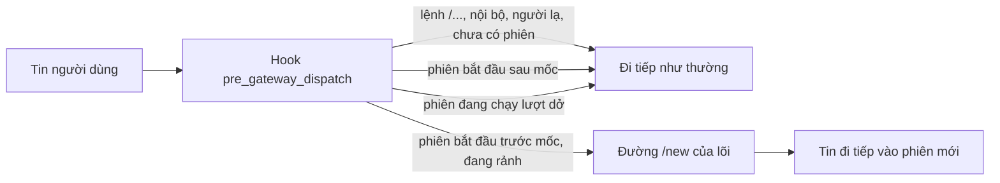

# Làm mới phiên Hermes mỗi ngày lúc 04:00 (`ihome-session-reset`)

Plugin Hermes tự viết, cài theo **từng hồ sơ**. Mỗi ngày tới mốc (mặc định 04:00 giờ Việt Nam), tin người dùng đầu tiên gửi tới một phiên đã bắt đầu trước mốc sẽ mở phiên mới — áp cho chat 1-1 và nhóm, mọi platform (gồm `zalo_personal`). `/new` vẫn gõ được bất cứ lúc nào.

Lý do: hội thoại Zalo của chủ là một phiên liền từ 17/10, mỗi lượt gửi lại khoảng 272 nghìn ký tự, trả lời 15–37 giây và mang theo thói quen tool đã nghỉ hưu. Hermes 0.22.2 đã bỏ xoay phiên theo giờ khỏi lõi (`hermes_cli/session_reset_retirement.py`: lõi không còn đọc `session_reset`). Plugin cộng đồng trong danh mục không được dùng theo quyết định của chủ; mã này viết lại từ đầu, không đọc mã repo đó.

## Cách hoạt động



- Hook `pre_gateway_dispatch` (Hermes gọi ở `gateway/run_inbound.py::_hm_pre_gateway_dispatch_hook`, trước kiểm quyền, qua `ainvoke_hook` nên callback `async` chạy ngay trên event loop của gateway). Hook nhận `event`, runner (`gateway`) và `session_store`; plugin luôn trả `None` nên tin không bao giờ bị chặn hay sửa.
- Quyết định: lấy mục định tuyến của phiên (`SessionStore.lookup_by_session_key`, khóa từ `GatewayRunner._session_key_for_source`). Phiên được làm mới khi `created_at` **trước** mốc gần nhất (04:00 hôm nay, hoặc hôm qua nếu chưa tới 04:00). Đúng 04:00 tính là đã qua mốc; phiên vắt nhiều ngày chỉ làm mới một lần.
- Làm mới bằng đúng đường `/new`: `GatewayRunner._handle_reset_command` với bản sao sự kiện có chữ `/new` (với tin thường, `get_command_args()` trả nguyên văn tin và lõi sẽ lấy làm tiêu đề phiên mới). Đường này vô hiệu lượt cũ; nếu agent cũ còn trong cache thì dọn tài nguyên và xả bộ nhớ của nó (`flush_pending` → `shutdown_memory_provider` → `close`, còn agent đã bị đẩy khỏi cache thì đã xả lúc đẩy); rồi `on_session_finalize`, `session:end`/`session:reset`, `on_session_reset` và `SessionStore.reset_session`. Banner "phiên mới" bị bỏ: người dùng không nhận thêm tin.
- Không đụng phiên đang chạy dở: `_is_session_running` đúng thì để tin rảnh kế tiếp làm mới. Từ lúc kiểm tới phần đồng bộ đầu của `_handle_reset_command` không có `await`, nên không lượt nào chen vào giữa.
- Bỏ qua: lệnh `/...` (gồm `/new`, `/stop`; lõi tự xử lý), sự kiện nội bộ, sự kiện chủ động của plugin (`allow_gateway_control=False`), người gửi không được phép, chat chưa có phiên. Hai tin cùng lúc chỉ làm mới một lần (khóa theo session key, xét lại sau khi chờ khóa).

## Các quyết định đã tra mã (Hermes 0.22.2, commit `d923a5eb`)

1. **Chỉ "lười", không xoay chủ động.** API plugin không đưa session store hay runner ra ngoài hook dispatch (`PluginContext` chỉ có `inject_message`, không có reset). Xoay chủ động phải giữ handle runner từ lần gọi trước và dựng `MessageEvent` giả cho từng phiên lúc không có ai nhắn — thêm rủi ro cho Zalo mà không cần cho yêu cầu. Cái giá: tin đầu tiên sau 04:00 chờ thêm phần dọn phiên cũ.
2. **So `created_at`, không so `updated_at`.** Lượt chạy vắt qua mốc chạm `updated_at` sau mốc; so `updated_at` thì phiên đó thoát mốc cả ngày. Hệ quả: lần bật đầu tiên, tin kế tiếp làm mới mọi phiên mở trước mốc gần nhất (đúng mục đích).
3. **`end_reason` trong `state.db` vẫn là `session_reset`, như `/new`.** Lõi coi phiên đã hết khi `end_reason` thuộc `_RESET_END_REASONS` (`hermes_state_common.py`: `session_reset`, `session_switch`, `idle`, `daily`, `suspended`, `resume_pending_expired`) — hàng rào khôi phục phiên (`hermes_state_gateway.py`), đếm ranh giới hội thoại, `session_search`. Tên tự đặt như `daily_reset_0400` lọt khỏi tập này. `daily` thì an toàn nhưng chỉ ghi được bằng cách kết thúc hàng phiên **trước** khi gọi `/new` (`end_session`/`promote_to_session_reset` là "lý do đầu tiên thắng"): làm đồng bộ trên event loop có thể chặn cả gateway tới `_WRITE_PATIENCE_S = 20` giây; đẩy sang thread thì mở khe cho một lượt khác chen vào và bị `/new` vô hiệu, mất câu trả lời. Vì vậy lý do được ghi ở ba chỗ dễ tìm, gắn với id phiên cũ:
   - log gateway: dòng `ihome-session-reset: daily_reset_0400 ... old=<id> new=<id>`;
   - mục định tuyến của phiên mới: `metadata.ihome_session_reset = {reason, boundary, previous_session_id, at}` (`set_session_metadata`, bền qua restart);
   - sổ `<hồ sơ>/plugin-data/agent-plugin-ihome-session-reset-*/state.json`, khóa `resets` (100 mục gần nhất).
4. **Cấu hình ở `plugins.entries.ihome-session-reset.settings`.** Đây là chỗ chính thức Hermes dành cho plugin (`ctx.get_config`; khai `config_schema` trong `plugin.yaml` để Desktop/TUI hiện ô sửa). Không dùng `session_reset` (lõi in cảnh báo "retired", plugin danh mục đọc khối này). Không thêm khóa gốc mới như `ihome_session_reset`: `hermes config set` cảnh báo khóa gốc lạ. Khóa ở `plugins.entries` không kích cảnh báo retired (chỉ xét `session_reset` và `gateway.session_reset`).
5. **Không dùng `post_gateway_admission`.** Hook đó chỉ nhận ảnh chụp dữ liệu và chạy bên trong slot đã chiếm cho lượt hiện tại; gọi `/new` ở đó sẽ vô hiệu chính lượt đang vào.
6. **Múi giờ.** Mốc tính theo `timezone` của plugin, không theo giờ container. `created_at` Hermes ghi là `datetime.now()` không múi, tức giờ tường của tiến trình gateway (container `hermes-owner` chạy UTC): plugin hiểu theo luật giờ địa phương của tiến trình. Thiếu tzdata thì `Asia/Ho_Chi_Minh` dùng UTC+7 cố định (Việt Nam không có giờ mùa hè).

## Cấu hình theo hồ sơ

Trong `config.yaml` của hồ sơ (`<HERMES_HOME>/profiles/<tên>/config.yaml`):

```yaml
plugins:
  enabled:
    - ihome-zalo-native
    - ihome-session-reset
  entries:
    ihome-session-reset:
      settings:
        mode: daily              # daily | observe | off
        at: "04:00"              # HH:MM, nên để trong ngoặc kép
        timezone: Asia/Ho_Chi_Minh
        applies_to: [dm, group]  # dm, group (nhóm/kênh/thread) hoặc all
```

- Thiếu khối `settings` (hoặc từng khóa) thì mặc định: `daily`, 04:00, `Asia/Ho_Chi_Minh`, cả `dm` lẫn `group`.
- `mode: observe` chỉ ghi log và sổ việc *sẽ* làm, không đổi phiên. `mode` sai chính tả thì plugin **tắt** và log cảnh báo (không đoán thành `daily`). YAML 1.1 và `hermes config set ... off` biến `off` thành `false`: plugin hiểu `false` là tắt.
- `at` không ngoặc kép như `4:00` bị YAML 1.1 đọc thành 240 (cơ số 60); plugin vẫn hiểu là 04:00. Giá trị sai thì dùng 04:00 và log cảnh báo.
- Plugin đọc lại cấu hình ở mỗi tin (Hermes cache theo mtime): đổi `mode` có hiệu lực từ tin kế tiếp, không cần restart.
- Plugin chỉ chạy trong **gateway**, cần `plugins.isolation: in_process` (mặc định). Với `host`, hook chỉ nhận placeholder: plugin log một lần rồi đứng ngoài.

## Cài đặt

`ops.sh` chạy trên host VPS bằng root, từ một bản repo đã ghim commit (script lấy plugin từ chính thư mục của nó). Không có `--apply` thì chỉ in kế hoạch. Script không in `config.yaml`/`.env`, chỉ đọc vài khóa plugin.

| Lệnh | Việc |
| --- | --- |
| `probe --profile P` | Chỉ đọc: bản Hermes, các điểm mã plugin dựa vào (grep trong `/opt/hermes`), tzdata, `plugins.isolation` |
| `install --profile P [--mode observe] [--activate live\|restart\|none] --apply` | probe → chờ gateway rảnh → sao lưu → chép 4 tệp plugin (chủ sở hữu = user container) → ghi `mode` → `hermes plugins enable` → kích hoạt → kiểm |
| `set-mode daily\|observe\|off --profile P --apply` | Sao lưu rồi `hermes config set plugins.entries.ihome-session-reset.settings.mode …` (hiệu lực ở tin kế tiếp) |
| `status --profile P` | Chỉ đọc: tệp khớp nguồn, cấu hình, trạng thái gateway, log, 10 mục sổ gần nhất kèm `end_reason` của phiên cũ trong `state.db` (mở `mode=ro`) |
| `uninstall --profile P [--purge-settings] --apply` | Sao lưu → `hermes plugins disable` → chuyển thư mục plugin vào bản sao lưu → kích hoạt |

Sao lưu nằm ở `/root/ihome-hermes-backups/session-reset/<hồ sơ>/<thời điểm>/` (ngoài HERMES_HOME để tool của agent không đọc được bản `config.yaml` chứa secret; root 0700).

**Kích hoạt:** `hermes plugins enable` tự gửi `reload-plugins` qua control socket của gateway đang chạy (`hermes_cli/plugins_activation.py::activate_plugin_now`), hook có hiệu lực ngay, không restart (`--activate live`, mặc định). Gateway không in `Gateway reloaded plugins` thì script chuyển sang khởi động lại có kiểm soát. `plugins disable` không gửi lệnh này, nên `uninstall` với `live` luôn khởi động lại. Lần nạp lại buộc mọi plugin của hồ sơ (gồm `ihome-zalo-native`) nạp lại; adapter Zalo đang sống được giữ và nối lại handler (`gateway/run_plugin_rewire.py`). Muốn tránh hẳn, dùng `--activate restart`.

**Thứ tự khởi động lại an toàn cho Zalo** (`restart_gateway`):

1. Không đụng `ihome-zalo-worker` (giữ phiên đăng nhập Zalo).
2. `hermes-owner` phải còn trỏ `container:<id worker hiện tại>`; nếu worker đã bị tạo lại thì dừng — phải tạo lại sidecar theo [README Zalo native](../hermes-zalo-native/README.md), `docker restart` không chuyển namespace mạng.
3. Chờ `gateway_state.json` báo `running` và `active_agents = 0` (tối đa 10 phút).
4. `docker restart -t 180 hermes-owner`: SIGTERM cho gateway drain, 180 giây trước SIGKILL.
5. Chờ dòng mới trong `gateway-starts.log`, `gateway_state = running` và `platforms.zalo_personal.state = connected` (tối đa 5 phút). Theo [README Zalo native](../hermes-zalo-native/README.md), tin tới lúc gateway nghỉ nằm trong journal của worker (`queued`) và được giao khi adapter poll lại; điều này chưa được kiểm riêng cho lần restart này.

### Lộ trình đề xuất

Các hồ sơ nghiệm thu `tkt`/`tkh`/`tkj` được harness chạy bằng CLI (`docker exec hermes-owner hermes --profile tkt chat … --continue …`); container chỉ có **một** gateway là `--profile owner`. Cài vào hồ sơ nghiệm thu chỉ chứng minh plugin nạp được và cấu hình đọc đúng; hook không bao giờ bắn ở đó và không ảnh hưởng lô nghiệm thu đang chạy.

1. Đưa thư mục `infra/hermes-session-reset/` của commit đã review lên VPS.
2. `bash ops.sh probe --profile tkt` và `bash ops.sh probe --profile owner`.
3. `bash ops.sh install --profile tkt --apply` (mode `observe`, không restart). Kiểm `bash ops.sh status --profile tkt`: 4 tệp khớp nguồn, `plugins list` thấy plugin.
4. `bash ops.sh install --profile owner --mode observe --apply` vào giờ vắng; kiểm `status`: log `ihome-session-reset: đã đăng ký hook`, Zalo `connected`, nhắn thử một tin.
5. Phiên Zalo của chủ mở từ 17/10, tức trước mốc gần nhất, nên ngay tin kế tiếp đã có log `observe — sẽ daily_reset_0400 …` và một mục `observe` trong sổ; phiên không đổi. Không thấy dòng này thì hook chưa chạy: xem log cảnh báo `ihome-session-reset:`.
6. Báo chủ rằng bot sẽ "quên" hội thoại dài hiện tại, rồi `bash ops.sh set-mode daily --profile owner --apply`. Tin kế tiếp làm mới phiên 17/10 ngay (không đợi 04:00): `status` có mục `reset` với `old_session_id`/`new_session_id`, `end_reason` của phiên cũ là `session_reset`, log có dòng `ihome-session-reset: daily_reset_0400 …`.
7. Sau 04:00 sáng hôm sau, tin đầu tiên lại mở phiên mới; các tin sau trong ngày giữ phiên đó.

## Lùi

1. Tắt tức thì, không restart: `bash ops.sh set-mode off --profile owner --apply` (hook còn nạp nhưng không làm gì).
2. Gỡ hẳn: `bash ops.sh uninstall --profile owner --apply` (khởi động lại có kiểm soát; `--activate none` để gỡ ở lần khởi động tự nhiên sau). `--purge-settings` xóa luôn khối `plugins.entries.ihome-session-reset`.
3. Phiên đã làm mới không tự quay lại. Cần nội dung phiên cũ thì gõ `/resume <old_session_id>` (id trong `status` hoặc log).
4. `config.yaml` gốc trong thư mục sao lưu chỉ để đối chiếu; chỉ chép đè khi chắc không có thay đổi nào khác sau lần cài.

## Kiểm thử

```sh
cd infra/hermes-session-reset && python -B -m unittest discover -s tests -p "test_*.py" -v
node --test infra/hermes-session-reset/session-reset.test.mjs   # entrypoint CI: đỏ khi 0 test hoặc có skip
```

Chỉ dùng stdlib (Python ≥ 3.11) và bash; không cài gói. `support.py` nạp plugin như Hermes (gói tên tổng hợp, import tương đối).

- `test_policy.py`: cấu hình và mặc định, mốc 03:59/04:00/04:01, sang ngày/tháng/năm, phiên vắt nhiều ngày, giờ không múi khi container chạy UTC, dm/group, tắt, thiếu tzdata.
- `test_hook.py`: hook với runner/store giả (chỉ phần plugin gọi): làm mới đúng một lần, `/new` không bị chặn và không làm mới kép, phiên đang chạy, người lạ, sự kiện nội bộ, hai tin cùng lúc, thiếu API (`isolation: host`), event loop lạ, lỗi trong đường `/new`, `observe`, đổi cấu hình không restart, `register(ctx)`, manifest khớp mặc định của mã.
- `test_ops.py`: `ops.sh` với `docker` giả: kế hoạch không ghi gì, `--apply` chép/sao lưu/ghi mode trước khi bật, rơi về restart khi gateway im lặng, chặn khi gateway bận hoặc sidecar trỏ worker khác, hồ sơ không có gateway, `status`, `uninstall`.

**Chỉ kiểm được khi chạy thật** (chưa làm): hành vi thật của `_handle_reset_command` trong gateway (finalize, xả bộ nhớ, `end_reason` trong `state.db`); nạp nóng qua control socket với adapter Zalo đang sống; `hermes config set`/`plugins enable` và dạng output của chúng; giờ mốc thật lúc 04:00; restart thật và việc worker giữ tin trong lúc gateway nghỉ; `ctx.get_config`/`ctx.state` thật.

## Bề mặt Hermes plugin dựa vào

Đã đọc mã Hermes 0.22.2 (`d923a5eb`) trong container. Ngoài API công khai (`ctx.register_hook`, `ctx.get_config`, `ctx.state`, hook `pre_gateway_dispatch`, `SessionStore.lookup_by_session_key`/`set_session_metadata`), plugin gọi bốn phương thức nội bộ của runner: `_session_key_for_source`, `_is_session_running`, `_is_user_authorized_for_source`, `_handle_reset_command`. Thiếu cái nào thì plugin log một lần và đứng ngoài; `ops.sh probe` grep các điểm này trước khi cài. Khi nâng Hermes, chạy lại `probe` và đọc lại `gateway/slash_commands_session.py::_handle_reset_command`.
