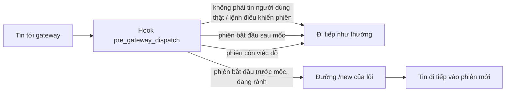

# Làm mới phiên Hermes mỗi ngày lúc 04:00 (`ihome-session-reset`)

Plugin Hermes tự viết, cài theo **từng hồ sơ**. Mỗi ngày tới mốc (mặc định 04:00 giờ Việt Nam), tin người dùng đầu tiên gửi tới một phiên đã bắt đầu trước mốc sẽ mở phiên mới — áp cho chat 1-1 và nhóm, mọi platform (gồm `zalo_personal`). `/new` vẫn gõ được bất cứ lúc nào.

Lý do: hội thoại Zalo của chủ là một phiên liền từ 17/10, mỗi lượt gửi lại khoảng 272 nghìn ký tự, trả lời 15–37 giây và mang theo thói quen tool đã nghỉ hưu. Hermes 0.22.2 đã bỏ xoay phiên theo giờ khỏi lõi (`hermes_cli/session_reset_retirement.py`: lõi không còn đọc `session_reset`). Plugin cộng đồng trong danh mục không được dùng theo quyết định của chủ; mã này viết lại từ đầu, không đọc mã repo đó.

## Cách hoạt động



- Hook `pre_gateway_dispatch` (Hermes gọi ở `gateway/run_inbound.py::_hm_pre_gateway_dispatch_hook`, trước kiểm quyền và trước khi giữ slot; qua `ainvoke_hook` nên callback `async` chạy ngay trên event loop của gateway, không bị cắt thời gian). Hook nhận `event`, runner (`gateway`) và `session_store`; plugin luôn trả `None` nên tin không bao giờ bị chặn hay sửa.
- Quyết định: lấy mục định tuyến của phiên (`SessionStore.lookup_by_session_key`, khóa từ `GatewayRunner._session_key_for_source`). Phiên được làm mới khi `created_at` **trước** mốc gần nhất (04:00 hôm nay, hoặc hôm qua nếu chưa tới 04:00). Đúng 04:00 tính là đã qua mốc; phiên vắt nhiều ngày chỉ làm mới một lần.
- Làm mới bằng đúng đường `/new`: `GatewayRunner._handle_reset_command` với bản sao sự kiện có chữ `/new` (với tin thường, `get_command_args()` trả nguyên văn tin và lõi sẽ lấy làm tiêu đề phiên mới). Đường này vô hiệu lượt cũ; nếu agent cũ còn trong cache thì dọn tài nguyên và xả bộ nhớ của nó (`flush_pending` → `shutdown_memory_provider` → `close`, còn agent đã bị đẩy khỏi cache thì đã xả lúc đẩy); rồi `on_session_finalize`, `session:end`/`session:reset`, `on_session_reset` và `SessionStore.reset_session`. Banner "phiên mới" bị bỏ: người dùng không nhận thêm tin.

**Chỉ tin người dùng thật mới được xét.** Bỏ qua:

- sự kiện nội bộ, sự kiện chủ động của plugin (`allow_gateway_control=False`);
- sự kiện **không có `message_id`** — lõi tự sinh: `/retry` gửi lại câu hỏi, heartbeat, lượt tiếp nối `/goal`/`/loop` (`gateway/run_goals.py::_synthetic_prompt_event`). Adapter Zalo luôn gán `messageId`; platform nào không gán `message_id` (vd. có thể là `api_server`) thì không bao giờ kích làm mới;
- sự kiện có `_heartbeat_session_id` hay được `_is_goal_continuation_event` nhận ra (thêm một lớp, phòng sau này lõi gán `message_id`);
- **lệnh điều khiển hay xem phiên hiện tại, hoặc trả lời prompt đang chờ**: `/new` `/reset` `/resume` `/sessions` `/retry` `/undo` `/branch` `/title` `/save` `/compress` `/topic` `/stop` `/approve` `/deny` `/steer` `/status` `/help` `/whoami` … (danh sách `SESSION_CONTROL_COMMANDS` trong `hook.py`, so cả tên gốc qua `hermes_cli.commands.resolve_command`). Lệnh **có nội dung** — skill, `/plan`, `/moa`, `/model`, `/yolo`… — vẫn được xét như tin thường, để việc đầu ngày bắt đầu trong phiên mới. Giới hạn: danh sách viết tay theo Hermes 0.22.2; lệnh mới của Hermes mặc định được xét như lệnh có nội dung.
- `/goal`, `/loop` (`/proactive`), `/queue` (`/q`), `/heartbeat` (`/hb`) vừa quản lý vừa khởi tạo việc. Chúng chỉ là lệnh điều khiển khi **không có tham số** hoặc tham số đầu là lệnh con quản lý (theo `args_hint` của `hermes_cli/commands.py`): `/goal show|pause|resume|clear|status|wait|unwait|gate …`, `/loop status|pause|resume|stop`, `/queue list|edit|rm|move|clear`, `/heartbeat status|pause|resume|clear`. Có tham số khác — `/goal làm báo cáo`, `/goal draft …`, `/loop 30m kiểm hàng`, `/queue việc mới`, `/queue add …`, `/heartbeat every 1h …` — là khởi tạo việc mới, được xét như lệnh có nội dung (việc mới bắt đầu trong phiên mới).

**Phiên còn việc dở thì để tin rảnh kế tiếp** (đường `/new` sẽ xoá hay ngắt chúng). Cùng điều kiện lõi dùng trước khi bắn heartbeat (`run_goals.py`), cộng:

- đang chạy lượt (slot runner `_is_session_running`), một task **khác** của adapter đang giữ phiên, còn tin xếp hàng (`_queue_depth` > 0 — `/new` xoá `queued_events`);
- `resume_pending` (lượt bị ngắt lúc khởi động lại đang chờ chạy tiếp);
- còn delegation chạy nền (`tools.async_delegation.has_live_for_session`) hay tiến trình nền (`process_registry.has_active_for_session(…, max_active_age=…)`) của phiên cũ;
- còn prompt chờ trả lời: `/update`, clarify, lệnh chờ xác nhận, lệnh nguy hiểm chờ duyệt. Không kiểm được một mục (module đổi tên) thì cũng hoãn, log cảnh báo một lần.

Hook chạy **bên trong** lượt xử lý của chính tin hiện tại, nên không điều kiện nào được tính dấu vết của tin đó:

- Adapter gốc đặt `_active_sessions[key]` **rồi mới** tạo task gọi handler, và task đó là `_session_tasks[key]` (`gateway/platforms/base.py::_start_session_processing`; task xả hàng `_drain_after` cũng vậy); handler await thẳng `_handle_message` → hook, không qua task mới. Guard ấy luôn có khi hook chạy, nên plugin **không** xét `_active_sessions` — xét nó thì phiên không bao giờ được làm mới. Plugin chỉ hoãn khi `_session_tasks[key]` là một task khác `asyncio.current_task()` và chưa xong.
- Tin trong slot `_pending_messages` được lấy ra trước khi task xả hàng gọi handler, nên `_queue_depth` > 0 là tin **khác** đang xếp hàng; slot runner chỉ được giữ sau hook; `resume_pending`, prompt chờ, delegation, tiến trình nền không do chính tin này sinh ra.

Tiến trình nền đã chạy quá `process_max_age_hours` (mặc định 4 giờ) không còn hoãn làm mới — như tham số `max_active_age` Hermes dành cho việc này, để một `http.server` bị quên không chặn làm mới mãi; đường `/new` khi đó xử lý nó như khi người dùng gõ `/new`. Mỗi mốc, phiên bị hoãn có **một** mục `deferred` trong sổ, kèm `detail` là lý do, để `status` thấy vì sao chưa làm mới. Người lạ (không được phép) không làm xoay phiên. Hai tin cùng lúc chỉ làm mới một lần (khóa theo session key, xét lại sau khi chờ khóa).

**Lỗi khi làm mới:** so session id trước/sau cả khi có ngoại lệ. Phiên không đổi thì ghi `reset_failed` vào sổ, log cảnh báo từng lần, và **chờ 10 phút** mới thử lại cho phiên đó (không lặp `/new` ở mọi tin). Phiên đã đổi nhưng lõi báo lỗi sau đó thì vẫn ghi là đã làm mới, kèm lỗi.

## Các quyết định đã tra mã (Hermes 0.22.2, commit `d923a5eb`)

1. **Chỉ "lười", không xoay chủ động.** API plugin không đưa session store hay runner ra ngoài hook dispatch (`PluginContext` chỉ có `inject_message`, không có reset). Xoay chủ động phải giữ handle runner từ lần gọi trước và dựng `MessageEvent` giả cho từng phiên lúc không có ai nhắn — thêm rủi ro cho Zalo mà không cần cho yêu cầu. Cái giá: tin đầu tiên sau 04:00 chờ thêm phần dọn phiên cũ.
2. **So `created_at`, không so `updated_at`.** Lượt chạy vắt qua mốc chạm `updated_at` sau mốc; so `updated_at` thì phiên đó thoát mốc cả ngày. Hệ quả: lần bật đầu tiên, tin kế tiếp làm mới mọi phiên mở trước mốc gần nhất (đúng mục đích).
3. **`end_reason` trong `state.db` vẫn là `session_reset`, như `/new`.** Lõi coi phiên đã hết khi `end_reason` thuộc `_RESET_END_REASONS` (`hermes_state_common.py`: `session_reset`, `session_switch`, `idle`, `daily`, `suspended`, `resume_pending_expired`) — hàng rào khôi phục phiên (`hermes_state_gateway.py`), đếm ranh giới hội thoại, `session_search`. Tên tự đặt như `daily_reset_0400` lọt khỏi tập này. `daily` thì an toàn nhưng chỉ ghi được bằng cách kết thúc hàng phiên **trước** khi gọi `/new` (`end_session`/`promote_to_session_reset` là "lý do đầu tiên thắng"): làm đồng bộ trên event loop có thể chặn cả gateway tới `_WRITE_PATIENCE_S = 20` giây; đẩy sang thread thì mở khe cho một lượt khác chen vào và bị `/new` vô hiệu, mất câu trả lời. Vì vậy lý do được ghi ở ba chỗ dễ tìm, gắn với id phiên cũ:
   - log gateway: dòng `ihome-session-reset: daily_reset_0400 ... old=<id> new=<id>`;
   - mục định tuyến của phiên mới: `metadata.ihome_session_reset = {reason, boundary, previous_session_id, at}` (`set_session_metadata`, bền qua restart);
   - sổ `<hồ sơ>/plugin-data/agent-plugin-ihome-session-reset-*/resets.jsonl`: mỗi dòng một mục `reset`/`reset_failed`/`observe`/`deferred` (kèm `detail`); ghi thêm dưới một khóa tệp, mỗi mục một lần `write` `O_APPEND`, quá 256 KB thì xoay sang `resets.jsonl.1`.
4. **Cấu hình ở `plugins.entries.ihome-session-reset.settings`.** Đây là chỗ chính thức Hermes dành cho plugin (`ctx.get_config`; khai `config_schema` trong `plugin.yaml` để Desktop/TUI hiện ô sửa). Không dùng `session_reset` (lõi in cảnh báo "retired", plugin danh mục đọc khối này). Không thêm khóa gốc mới như `ihome_session_reset`: `hermes config set` cảnh báo khóa gốc lạ. Khóa ở `plugins.entries` không kích cảnh báo retired (chỉ xét `session_reset` và `gateway.session_reset`).
5. **Không dùng `post_gateway_admission`.** Hook đó chỉ nhận ảnh chụp dữ liệu và chạy bên trong slot đã chiếm cho lượt hiện tại; gọi `/new` ở đó sẽ vô hiệu chính lượt đang vào.
6. **Múi giờ.** Mốc tính theo `timezone` của plugin, không theo giờ container. `created_at` Hermes ghi là `datetime.now()` không múi, tức giờ tường của tiến trình gateway (container `hermes-owner` chạy UTC): plugin hiểu theo luật giờ địa phương của tiến trình. Thiếu tzdata thì `Asia/Ho_Chi_Minh` dùng UTC+7 cố định (Việt Nam không có giờ mùa hè).

## Cấu hình theo hồ sơ

Trong `config.yaml` của hồ sơ (`<HERMES_HOME>/profiles/<tên>/config.yaml`):

```yaml
plugins:
  enabled:
    - ihome-zalo-native
    - ihome-session-reset
  entries:
    ihome-session-reset:
      settings:
        mode: daily              # daily | observe | off
        at: "04:00"              # chuỗi HH:MM trong ngoặc kép
        timezone: Asia/Ho_Chi_Minh
        applies_to: [dm, group]  # dm, group (nhóm/kênh/thread) hoặc all
        process_max_age_hours: 4 # số giờ, 0 < giờ ≤ 168
```

- Thiếu khối `settings` (hoặc từng khóa) thì mặc định: `daily`, 04:00, `Asia/Ho_Chi_Minh`, cả `dm` lẫn `group`, `process_max_age_hours: 4`.
- `process_max_age_hours`: tiến trình nền của phiên cũ chạy lâu hơn số giờ này thì không còn hoãn làm mới. Phải là số (không ngoặc kép) trong (0, 168]; sai thì dùng mặc định 4 và log cảnh báo (plugin vẫn chạy).
- `mode: observe` chỉ ghi log và sổ việc *sẽ* làm, không đổi phiên. `mode` sai chính tả thì plugin **tắt** và log cảnh báo (không đoán thành `daily`). YAML 1.1 và `hermes config set ... off` biến `off` thành `false`: plugin hiểu `false` là tắt.
- `at` **chỉ** nhận chuỗi `"HH:MM"`. Số nguyên bị từ chối vì YAML 1.1 đọc `4:00` không ngoặc kép thành 240, `0430` thành 280 (bát phân), `430` là 430 — plugin **tắt** và log cảnh báo thay vì đoán giờ.
- Plugin đọc lại cấu hình ở mỗi tin (Hermes cache theo mtime): đổi `mode` có hiệu lực từ tin kế tiếp, không cần restart.
- Plugin chỉ chạy trong **gateway**, cần `plugins.isolation: in_process` (mặc định). Với `host`, hook chỉ nhận placeholder: plugin log một lần rồi đứng ngoài.
- Làm mới giống `/new`: xoá cả `/model` riêng và `/yolo` của phiên cũ; `/goal`, `/loop`, `/heartbeat` gắn với phiên cũ cũng dừng.

## Cài đặt

`ops.sh` chạy trên host VPS bằng root, từ một bản repo đã ghim commit (script lấy plugin từ chính thư mục của nó). Không có `--apply` thì chỉ in kế hoạch. Script không in `config.yaml`/`.env`, chỉ đọc vài khóa plugin.

| Lệnh | Việc |
| --- | --- |
| `probe --profile P` | Chỉ đọc: bản Hermes, các điểm mã plugin dựa vào (grep trong `/opt/hermes`), hai bất biến (hook không nằm trong `_HOOK_TIMEOUT_BOUNDED_HOOKS`; `_handle_reset_command` nhả slot trước `await` đầu tiên), tzdata, `plugins.isolation` |
| `install --profile P [--mode …] [--activate live\|restart\|none] --apply` | probe → chờ gateway rảnh → sao lưu → chép 4 tệp plugin (chủ sở hữu = user container) → ghi `mode` → `hermes plugins enable` → kích hoạt → kiểm |
| `set-mode daily\|observe\|off --profile P --apply` | Sao lưu rồi `hermes config set plugins.entries.ihome-session-reset.settings.mode …` (hiệu lực ở tin kế tiếp) |
| `status --profile P` | Chỉ đọc: tệp khớp nguồn, cấu hình, trạng thái gateway, log, 10 mục sổ gần nhất (bỏ qua dòng hỏng) kèm `end_reason` của phiên cũ trong `state.db` (mở `mode=ro`) |
| `uninstall --profile P [--purge-settings] [--activate restart\|none] --apply` | Sao lưu → **`mode off` trước tiên** → `hermes plugins disable` → chuyển thư mục plugin vào bản sao lưu → (tuỳ chọn) khởi động lại |

- `install` không có `--mode` thì **giữ mode đang có**; chỉ lần cài đầu (chưa có mode) mới đặt `observe`. Chạy lại `install` để cập nhật mã không hạ `daily` về `observe`.
- Sao lưu nằm ở `/root/ihome-hermes-backups/session-reset/<hồ sơ>/<thời điểm>/` (ngoài HERMES_HOME để tool của agent không đọc được bản `config.yaml` chứa secret; root 0700); giữ 10 bản mới nhất mỗi hồ sơ (`IHOME_KEEP_BACKUPS`).

**Kích hoạt khi cài.** Khi plugin chưa có trong `plugins.enabled`, `hermes plugins enable` **luôn** gửi `reload-plugins` qua control socket nếu gateway của hồ sơ đang chạy (`hermes_cli/plugins_cmd.py::cmd_enable` → `plugins_activation.activate_plugin_now`): gateway nạp lại **mọi** plugin của hồ sơ, gồm `ihome-zalo-native` (adapter Zalo đang sống được giữ và nối lại handler, `gateway/run_plugin_rewire.py`). Lệnh này không có cờ tắt, nên không chế độ nào tránh được lần nạp lại đó; script chờ gateway rảnh trước khi bật. Cài lại khi plugin đã bật thì `enable` chỉ báo "already enabled", không nạp lại: chế độ `live` khi đó khởi động lại có kiểm soát để nạp mã mới.

- `--activate live` (mặc định): coi là đã kích hoạt **chỉ** khi chính tiến trình gateway ghi dòng log **mới** `ihome-session-reset: đã đăng ký hook pre_gateway_dispatch (hồ sơ P, tiến trình gateway)` vào `logs/agent.log` của hồ sơ gateway (đếm trước và sau `enable`; dòng của CLI hay tiến trình khác ghi "tiến trình khác" nên không tính). Output của `enable` chỉ để tham khảo: `gateway_transforms` có thể là activation của dashboard hay `hermes serve`, không phải gateway; câu "Gateway reloaded plugins" cũng xuất hiện khi plugin **không** nạp được (`plugins_activation.py::activation_hint`). Không thấy dòng mới trong 15 giây thì khởi động lại có kiểm soát. Nếu log của gateway không ghi INFO của plugin thì lối này luôn khởi động lại — an toàn, chỉ chậm hơn.
- `--activate restart`: sau lần nạp lại đó, khởi động lại có kiểm soát (dừng trước mọi bước ghi nếu còn lượt CLI nghiệm thu trong container).
- `--activate none`: không khởi động lại. Gateway nạp được thì hook chạy ngay; không thì chạy ở lần khởi động sau.

**Gỡ.** `plugins disable` không gửi `reload-plugins`, nên module còn trong bộ nhớ gateway tới lần khởi động sau — vô hại vì bước đầu đã đặt `mode off`. `--activate restart` để gỡ khỏi bộ nhớ ngay. `--purge-settings` chỉ xoá khối cấu hình sau khi đã khởi động lại (xoá sớm thì module còn nạp sẽ về mặc định `daily`). Dừng giữa chừng thì chạy lại `uninstall`: plugin đã tắt từ bước đầu; nếu thư mục đã chuyển đi mà tên vẫn trong `plugins.enabled` thì script bỏ tên đó bằng `hermes config set plugins.enabled …`.

**Thứ tự khởi động lại an toàn cho Zalo** (`restart_gateway`):

1. Không đụng `ihome-zalo-worker` (giữ phiên đăng nhập Zalo).
2. `hermes-owner` phải còn trỏ `container:<id worker hiện tại>`; nếu worker đã bị tạo lại thì dừng — phải tạo lại sidecar theo [README Zalo native](../hermes-zalo-native/README.md), `docker restart` không chuyển namespace mạng.
3. Không còn tiến trình `hermes` nào khác trong container (`docker top`), vd. lượt CLI nghiệm thu `hermes --profile tkt chat …` — restart sẽ giết chúng. Kiểm lại ngay trước khi restart.
4. Chờ `gateway_state.json` báo `running` và `active_agents = 0` (tối đa 10 phút).
5. `docker restart -t 180 hermes-owner`: SIGTERM cho gateway drain, 180 giây trước SIGKILL.
6. Chờ `start_time` mới trong `gateway_state.json`, `gateway_state = running` và `platforms.zalo_personal.state = connected` (tối đa 5 phút). Theo [README Zalo native](../hermes-zalo-native/README.md), tin tới lúc gateway nghỉ nằm trong journal của worker (`queued`) và được giao khi adapter poll lại; điều này chưa được kiểm riêng cho lần restart này.

### Lộ trình đề xuất

Các hồ sơ nghiệm thu `tkt`/`tkh`/`tkj` được harness chạy bằng CLI (`docker exec hermes-owner hermes --profile tkt chat … --continue …`); container chỉ có **một** gateway là `--profile owner`. Cài vào hồ sơ nghiệm thu chỉ chứng minh plugin nạp được và cấu hình đọc đúng; hook không bao giờ bắn ở đó và không ảnh hưởng lô nghiệm thu đang chạy.

1. Đưa thư mục `infra/hermes-session-reset/` của commit đã review lên VPS.
2. `bash ops.sh probe --profile tkt` và `bash ops.sh probe --profile owner`.
3. `bash ops.sh install --profile tkt --apply` (lần đầu: mode `observe`, không restart). Kiểm `bash ops.sh status --profile tkt`: 4 tệp khớp nguồn, `plugins list` thấy plugin.
4. `bash ops.sh install --profile owner --mode observe --apply` vào giờ vắng, khi không có lô nghiệm thu; kiểm `status`: dòng log `đã đăng ký hook … tiến trình gateway`, Zalo `connected`, nhắn thử một tin.
5. Phiên Zalo của chủ mở từ 17/10 (mục định tuyến `created_at = 2026-10-17T06:42:19`, giờ UTC), tức trước mốc gần nhất, nên ngay tin kế tiếp đã có log `observe — sẽ daily_reset_0400 …` và một mục `observe` trong sổ; phiên không đổi. Không thấy dòng này thì xem log `ihome-session-reset:` (hoãn vì việc dở, hay cảnh báo).
6. Báo chủ rằng bot sẽ "quên" hội thoại dài hiện tại, rồi `bash ops.sh set-mode daily --profile owner --apply`. Tin kế tiếp làm mới phiên 17/10 ngay (không đợi 04:00): `status` có mục `reset` với `old_session_id`/`new_session_id`, `end_reason` của phiên cũ là `session_reset`, log có dòng `ihome-session-reset: daily_reset_0400 …`.
7. Sau 04:00 sáng hôm sau, tin đầu tiên lại mở phiên mới; các tin sau trong ngày giữ phiên đó.

## Lùi

1. Tắt tức thì, không restart: `bash ops.sh set-mode off --profile owner --apply` (hook còn nạp nhưng không làm gì).
2. Gỡ hẳn: `bash ops.sh uninstall --profile owner --apply` (không restart; thêm `--activate restart` để gỡ khỏi bộ nhớ ngay, `--purge-settings` để xoá khối cấu hình sau restart).
3. Phiên đã làm mới không tự quay lại. Cần nội dung phiên cũ thì gõ `/resume <old_session_id>` (id trong `status` hoặc log).
4. `config.yaml` gốc trong thư mục sao lưu chỉ để đối chiếu; chỉ chép đè khi chắc không có thay đổi nào khác sau lần cài.

## Kiểm thử

```sh
cd infra/hermes-session-reset && python -B -m unittest discover -s tests -p "test_*.py" -v
node --test infra/hermes-session-reset/session-reset.test.mjs   # entrypoint CI: đỏ khi 0 test hoặc có skip
```

Chỉ dùng stdlib (Python ≥ 3.11) và bash; không cài gói. `support.py` nạp plugin như Hermes (gói tên tổng hợp, import tương đối).

- `test_policy.py`: cấu hình và mặc định, `at` chỉ nhận `"HH:MM"`, `process_max_age_hours` hợp lệ/sai, mốc 03:59/04:00/04:01, sang ngày/tháng/năm, phiên vắt nhiều ngày, giờ không múi khi container chạy UTC, dm/group, tắt, thiếu tzdata.
- `test_hook.py`: hook với runner/store giả (chỉ phần plugin gọi); mặc định mỗi tin đi qua adapter giả đặt guard `_active_sessions` và task chủ `_session_tasks` **trước** khi gọi hook như `base.py`, nên mọi ca làm mới đều chạy với guard của chính tin đó (daily qua hai ngày, observe, tin xả hàng). Làm mới đúng một lần; `/retry`, heartbeat, lượt `/goal` không kích làm mới; lệnh điều khiển phiên (gồm lệnh con `/goal status`, `/loop stop`, `/q rm 2`) bị bỏ qua còn skill/`/plan`/`/model`/`/goal <mục tiêu>`/`/loop 30m …` vẫn xét; hoãn khi đang chạy, task khác của adapter giữ phiên (task đã xong thì không), còn tin xếp hàng, `resume_pending`, prompt `/update`, delegation, tiến trình nền, clarify, lệnh chờ xác nhận/duyệt, hay không kiểm được — mỗi mốc một mục `deferred` kèm lý do; `process_max_age_hours` tới `max_active_age` của probe thật (module công cụ giả); lỗi làm mới lùi 10 phút và log từng lần, lỗi sau khi đã đổi phiên vẫn ghi là đã làm mới; người lạ, sự kiện nội bộ, hai tin cùng lúc, thiếu API (`isolation: host`), event loop lạ; sổ JSONL ghi đồng thời không mất mục và xoay vòng; `register(ctx)` ghi rõ tiến trình; manifest khớp mặc định của mã.
- `test_ops.py`: `ops.sh` với `docker` giả có trạng thái: kế hoạch không ghi gì; `--apply` chép/sao lưu/ghi mode trước khi bật; cài lại không hạ `daily`; chỉ coi là đã nạp khi gateway ghi dòng đăng ký **mới** của chính nó (`gateway_transforms` không có dòng log, dòng của tiến trình khác, dòng cũ đều dẫn tới restart); restart chờ `start_time` mới; chặn restart khi còn CLI nghiệm thu, gateway bận hay sidecar trỏ worker khác; probe chặn khi hook bị cắt thời gian hay `/new` await trước khi nhả slot; hồ sơ gateway đọc từ Entrypoint + Cmd; xoay vòng sao lưu; `status` không văng lỗi với sổ hỏng; `uninstall` đặt `off` trước, chạy lại được, chỉ xoá cấu hình sau restart; tham số thiếu giá trị.

**Chỉ kiểm được khi chạy thật** (chưa làm): hành vi thật của `_handle_reset_command` trong gateway (finalize, xả bộ nhớ, `end_reason` trong `state.db`); nạp nóng qua control socket với adapter Zalo đang sống; `hermes config set`/`plugins enable` và dạng output của chúng; các phép kiểm việc dở với module công cụ thật; giờ mốc thật lúc 04:00; restart thật và việc worker giữ tin trong lúc gateway nghỉ; `ctx.get_config`/`ctx.state` thật.

**Nhóm Zalo:** adapter `ihome-zalo-native` hiện chỉ nhận DM của người dùng đã ghép (`chat_type="dm"`); nhóm Zalo chưa là phiên Hermes, nên nhánh `group` của plugin mới kiểm bằng bản giả, chưa kiểm với adapter thật.

## Bề mặt Hermes plugin dựa vào

Đã đọc mã Hermes 0.22.2 (`d923a5eb`) trong container. Ngoài API công khai (`ctx.register_hook`, `ctx.get_config`, `ctx.state`, hook `pre_gateway_dispatch`, `SessionStore.lookup_by_session_key`/`set_session_metadata`, các hàm module `tools.async_delegation.has_live_for_session`, `tools.process_registry.process_registry.has_active_for_session`, `tools.clarify_gateway.get_pending_for_session`, `tools.slash_confirm.get_pending`, `tools.approval.has_blocking_approval`, `hermes_cli.commands.resolve_command`), plugin gọi các phương thức nội bộ của runner: `_session_key_for_source`, `_is_session_running`, `_is_user_authorized_for_source`, `_delivery_adapter_for`, `_queue_depth`, `_peek_session_state`, `_is_goal_continuation_event`, `_handle_reset_command`, và đọc `_session_tasks` (task chủ phiên) của adapter gốc. Thiếu phương thức bắt buộc thì plugin log một lần và đứng ngoài; `ops.sh probe` grep các điểm này trước khi cài, cùng chuỗi gọi khiến hook chạy trong chính task chủ phiên (`base.py` đặt `_session_tasks[key]` rồi await handler; `run_adapters.py` chỉ bọc scope rồi await `_handle_message`; `run_inbound.py` await `_hm_admit_event` → hook; `plugins_dispatch.py` await thẳng callback). Khi nâng Hermes, chạy lại `probe` và đọc lại `gateway/slash_commands_session.py::_handle_reset_command`.
