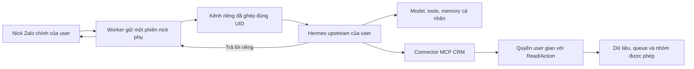

# Kênh Zalo cá nhân cho Hermes upstream

Plugin này chuyển tin nhắn riêng giữa nick chính của user và Hermes cá nhân qua **phiên nick phụ đang có của worker**. Hermes chạy upstream, dùng model, tools và memory do user cấu hình. CRM là kết nối MCP riêng, có quyền **user hiện tại ∩ Read/Action Hermes**; token CRM không phải token kênh Zalo.



## Cấu hình worker

Đây là cấu hình opt-in cho operator; chưa có wizard xuất grant từ CRM. Operator phải đối chiếu đúng account nick phụ, UID phiên đăng nhập và UID user đã xác minh. Không lấy mapping từ tin nhắn hoặc để model tự cấp grant. `mainUid` luôn bằng `pairedUid`; mỗi profile và token chỉ thuộc một kênh.

Worker đọc đường dẫn tuyệt đối trong `HERMES_ZALO_NATIVE_CONFIG`. File JSON có mẫu:

```json
{
  "version": 1,
  "listenPort": 8991,
  "stateRoot": "/var/lib/ihome-zalo-native",
  "channels": [
    {
      "accountId": "11111111-1111-4111-8111-111111111111",
      "ownUid": "100",
      "pairedUid": "200",
      "mainUid": "200",
      "profile": "my-assistant",
      "generation": "22222222-2222-4222-8222-222222222222",
      "tokenFile": "/etc/ihome-zalo-native/my-assistant.token"
    }
  ]
}
```

Các ID trên là fixture, phải thay bằng mapping thật. Token kênh có dạng `hzn_` + 32 byte ngẫu nhiên mã hóa hex. Sinh ở phía operator và chuyển qua secret store của đúng profile; không gửi trong chat hoặc đưa lên dòng lệnh/log. Token này chỉ cho nhận và trả lời đúng DM đã cấu hình, không cấp quyền CRM hay gửi nhóm.

Thư mục config/token/state phải canonical, không symlink; thư mục mode 0700, file mode 0600, đúng UID/GID worker trên Linux. Không hardlink, không sửa quyền tự động nếu đang sai. Thư mục cha của state root phải tồn tại. Config tối đa 64 KiB, tối đa 100 kênh. Journal mỗi kênh tối đa 16 MiB/100.000 bản ghi mỗi chiều; đầy thì dừng nhận việc mới, không xóa dấu chống trùng để tiếp tục gửi.

Chạy Hermes dưới OS user/container riêng, không cho native tools đọc config/state/token của worker, CRM credential hoặc profile khác. Profile Hermes tách memory theo tên; cách ly filesystem giữa những user không tin cậy cần ranh giới OS/container này. Không cấp quyền sudo/root của worker cho Hermes.

Bridge chỉ listen `127.0.0.1`. Hermes và worker cần cùng network namespace; nếu worker đang trong Docker, dùng sidecar cùng namespace nhưng không chia sẻ volume credential/config của worker. Không mở bridge ra `0.0.0.0`, Internet hoặc proxy công khai. Launcher hỗ trợ opt-in theo quy trình dưới đây; chưa có bằng chứng triển khai VPS thật.

## CLI cấp, đổi và thu hồi token kênh

Chạy `node infra/hermes-zalo-native/operator.mjs --help` bằng đúng OS principal của worker. CLI dùng `--config <đường dẫn tuyệt đối>` hoặc `HERMES_ZALO_NATIVE_CONFIG`, cùng schema và kiểm file với worker. Thư mục config/token/state phải tồn tại và đúng quyền trước khi chạy; CLI không sửa quyền hay tạo cây thư mục tự động. Mapping account/UID phải được operator xác minh trước; CLI chỉ kiểm cấu trúc và tính nhất quán, không đăng nhập hay xác minh danh tính Zalo từ xa.

Mặc định `create`, `rotate`, `revoke` chỉ trả kế hoạch, không ghi file. Đọc `expectedRevision`, rồi chạy lại đúng lệnh với `--apply --expect <expectedRevision>`. Revision bao gồm config và token hiện có; config hoặc token thay đổi sau khi xem kế hoạch sẽ bị từ chối. Ví dụ fixture cho cấu hình chưa tồn tại:

```sh
export HERMES_ZALO_NATIVE_CONFIG=/etc/ihome-zalo-native/config.json
node infra/hermes-zalo-native/operator.mjs create \
  --profile my-assistant \
  --account-id 11111111-1111-4111-8111-111111111111 \
  --own-uid 100 --paired-uid 200 \
  --token-file /etc/ihome-zalo-native/my-assistant.token \
  --state-root /var/lib/ihome-zalo-native --listen-port 8991
```

Khi thêm user vào config đã có, bỏ `--state-root` và `--listen-port`. `generation` luôn tự sinh cho binding mới; CLI không cho thay generation, đổi binding hay tạo lại profile/peer đã có. Token chỉ sinh ở phía operator và ghi file riêng tư mới. Output không chứa secret. Sau apply create/rotate, chuyển nội dung token qua secret store của đúng profile, không qua chat/log/đối số shell.

```sh
node infra/hermes-zalo-native/operator.mjs rotate \
  --profile my-assistant --token-file /etc/ihome-zalo-native/my-assistant-next.token
node infra/hermes-zalo-native/operator.mjs revoke --profile my-assistant
node infra/hermes-zalo-native/operator.mjs inspect --profile my-assistant --limit 20
```

`revoke` thay token bằng secret mới **chưa cấp cho profile**, giữ grant entry, binding, generation và journal; không có secret export trong lệnh revoke. Cách này thu hồi credential cũ mà không tạo namespace journal mới hoặc cho phép create lại để vượt quarantine. `rotate` dùng đường dẫn token mới do operator chọn; đường dẫn đã tồn tại bị từ chối. Mọi token cũ đều được giữ, không xóa để giả lập thu hồi.

Apply trả `activation: pending_controlled_worker_restart`, `runtimeStatus: unverified`. Worker đang chạy vẫn giữ token cũ trong RAM. Dừng và khởi động lại **worker hiện có** theo cơ chế sở hữu/lease đang vận hành; CLI không restart service, mở phiên thứ hai hay xác nhận thu hồi live. Nếu apply lỗi ở giai đoạn commit, trạng thái file có thể đã đổi: inspect và đối chiếu config trước khi thử lại, không giả định rollback. Token chưa được tham chiếu có thể còn lại sau lỗi; không dùng chúng như bằng chứng cấp quyền.

Bootstrap chỉ nhận state directory trống. Apply đầu tiên ghi marker riêng tư `.native-operator-owner.json` ràng buộc state với đường dẫn config canonical trước khi công bố config, kể cả chưa có journal. Không dùng config path mới/copied config để tạo generation khác trên state đã dùng. Config cũ chưa có marker chỉ được tiếp nhận khi mọi entry trong state đều là journal của những generation hiện có; journal mồ côi, temp/crash leftover hoặc entry lạ làm CLI dừng, kể cả inspect, thay vì báo kênh mới an toàn. Không xóa marker/journal hoặc đổi generation để vượt kiểm. Mất config phải khôi phục đúng config/generation đã có bằng quy trình vận hành được xác minh; CLI này không cung cấp recovery/reset.

CLI dùng khóa `<config>.operator-lock` và `.native-operator-lock` trong state cho các lần sửa hợp tác, không tự phá khóa còn lại sau crash. Khóa state phối hợp cả những config path khác nhau; plan/inspect không tạo marker hay khóa. Không sửa config/token thủ công đồng thời hoặc chạy writer khác bỏ qua khóa. Marker giữ lại nếu commit config lỗi; trường hợp đó dừng thận trọng, không rollback marker để bootstrap lại. Token được ghi đầy đủ, fsync và công bố không ghi đè trước khi đổi config atomically; file cuối phải một link, mode 0600 và đúng owner. Windows không chứng minh quyền Linux hoặc directory fsync.

`inspect` chỉ đọc snapshot trên đĩa, không gọi bridge/provider và không thay journal. Nó trả số lượng inbound `queued`/`dispatch_unknown`/`accepted`/`rejected`, outbound `sent`/`outcome_unknown`, cùng tối đa 100 receipt mỗi chiều; không xuất nội dung DM/token. `queued` là inbound còn chờ giao; outbound `outcome_unknown` có thể đang chờ provider hoặc đã kết thúc mà thiếu receipt. Không suy ra trạng thái live từ snapshot. `quarantine: outcome_unknown` giữ nghĩa chặn gửi mới; `none_observed` chỉ là không thấy unknown trong snapshot. Chưa có provider lookup đủ tin cậy để đối soát thủ công; CLI không có clear-unknown, sửa receipt, mark-sent, đổi generation hoặc resend.

## Cài plugin vào profile

Tạo hoặc dùng profile Hermes hiện có. Chép `plugin.yaml`, `__init__.py`, `adapter.py` vào thư mục `plugins/ihome-zalo-native/` của **đúng profile**. Giữ nguyên cấu hình model/tools/skills/memory. Trong secret scope `.env` của profile đặt:

```dotenv
HERMES_ZALO_BRIDGE_URL=http://127.0.0.1:8991
HERMES_ZALO_BRIDGE_TOKEN=<token hzn_ được operator cấp riêng>
HERMES_ZALO_PROFILE=my-assistant
HERMES_ZALO_PAIRED_UID=<UID nick chính đã xác minh>
HERMES_ZALO_GENERATION=<generation trong grant worker>
```

Bật plugin và chạy gateway của profile:

```sh
hermes --profile my-assistant plugins enable ihome-zalo-native
hermes --profile my-assistant gateway run
```

Với tiến trình riêng cho named profile, cấu hình `gateway.standalone: true` theo Hermes upstream. Plugin kiểm profile home khớp grant. Không tạo lần đăng nhập Zalo khác. Để làm việc CRM, cài MCP theo [CONNECTOR.md](../hermes-broker/CONNECTOR.md); tin `/hermes-link` đi qua luồng ghép CRM đã che mã, không vào memory cá nhân.

## Triển khai Docker opt-in

Đây là thay container worker hiện có, giữ `sessions` và lease database hiện hành. Không chạy thêm worker hoặc Hermes đăng nhập Zalo. Image worker phải dựng từ source có `deploy/native-preflight.mjs`; image Hermes upstream do operator dựng và ghim digest, dùng pin đã kiểm ở mục bằng chứng. Preflight chỉ dùng image worker local đã chọn; lỗi cấu hình không khởi động model, provider hay kết nối database. Kiểm fixture Docker giả không thay cho nghiệm thu container/VPS thật.

Launcher dùng cố định các đường dẫn sau ở **cả host và container**, không sao chép/viết lại JSON:

| Nội dung | Đường dẫn | Quyền trong worker |
| --- | --- | --- |
| Config | `/opt/ihome-zalo-worker/native-config/config.json` | Chỉ đọc |
| Token của từng profile | File trực tiếp trong `/opt/ihome-zalo-worker/native-config/` | Chỉ đọc |
| Marker và journal | `/opt/ihome-zalo-worker/native-state/` | Đọc/ghi |

Hai thư mục phải tồn tại, canonical, mode 0700, UID/GID 10002; file config/token mode 0600 và một hardlink. Chuẩn bị thư mục mới bằng operator quản trị; không chạy chmod/chown để che một cấu hình sai đang tồn tại. Các thư mục cha, đặc biệt `/opt/ihome-zalo-worker`, phải cho UID 10002 quyền traverse. Ví dụ cây mới có thể dùng parent root:10002 mode 0710; giữ `worker.env` root:root mode 0600 và không cho user Hermes đọc. Nếu parent hiện là root:root 0700, kiểm và cấp traverse tối thiểu trước khi dùng CLI dưới UID 10002; quyền file con vẫn giữ nguyên. Chỉ bootstrap trên state trống. State đã có marker giữ nguyên config path/generation như mục CLI phía trên.

Trên host có Node 22 và `setpriv`, chạy CLI từ bản source đã ghim có cả `infra/hermes-zalo-native` và `worker/lib`. Ví dụ sau dùng ID fixture; operator thay bằng mapping đã xác minh. `create` lần đầu trả plan và `expectedRevision`, không trả token:

```sh
setpriv --reuid 10002 --regid 10002 --clear-groups \
  node /opt/ihome-zalo-worker/source/<sha12>/infra/hermes-zalo-native/operator.mjs \
  create --config /opt/ihome-zalo-worker/native-config/config.json \
  --profile my-assistant --account-id 11111111-1111-4111-8111-111111111111 \
  --own-uid 100 --paired-uid 200 \
  --token-file /opt/ihome-zalo-worker/native-config/my-assistant.token \
  --state-root /opt/ihome-zalo-worker/native-state --listen-port 8991
```

Sau khi đối chiếu plan, chạy lại cùng lệnh với `--apply --expect <expectedRevision>`. Khi thêm profile vào config đã có, bỏ hai cờ bootstrap `--state-root`/`--listen-port`. Để rotate, dùng cùng prefix `setpriv ... node ...operator.mjs`, lệnh `rotate --config <cùng config> --profile my-assistant --token-file /opt/ihome-zalo-worker/native-config/my-assistant-next.token`; xem plan rồi apply với revision đó. Revoke dùng `revoke --config <cùng config> --profile my-assistant`, cũng plan rồi apply. Không chọn đường dẫn token đã tồn tại. Revoke giữ token mới chưa cấp, binding/generation/journal vẫn giữ.

Sau mỗi create/rotate/revoke, thực hiện theo thứ tự:

1. Dừng gateway sidecar của profile bị đổi để không nhận thêm việc trong lúc chuyển credential. Các profile khác dùng chung worker cũng sẽ tạm mất kết nối khi worker được thay.
2. Với create/rotate, provision token mới qua secret store vào `.env` riêng của đúng profile; không `cat`, `echo`, đặt secret vào argv hoặc stdout/log. Giữ profile, UID và generation khớp grant. Revoke không chuyển secret mới cho Hermes; để sidecar bị thu hồi ở trạng thái dừng.
3. Chạy launcher dưới root: `zalo-worker.sh run ihome-zalo-worker:<sha12> --native`. Nó cố định image ID, kiểm host canonical path, rồi chạy chính validator worker dưới UID/GID 10002 trong container `--network none`, không mount `sessions` hay nạp `worker.env`. Config/token sai hoặc state directory thiếu/sai quyền làm lệnh dừng **trước** `docker stop`. Không có `--native` thì biến config luôn bị ép rỗng dù `worker.env` có đặt.
4. Launcher chờ worker cũ hoàn tất shutdown bằng `docker stop --time -1`, rồi mới remove và tạo worker mới. Provider chưa kết thúc có thể khiến lệnh chờ vô hạn. Nếu stop bị ngắt/lỗi, không có replacement; kiểm worker thực tế trước khi tiếp tục. Không thêm `kill`, timeout ngoài hoặc retry tự động để coi như đã drain. OOM/mất host/force-kill vẫn có thể cắt receipt; journal `outcome_unknown` tiếp tục quarantine. Không xóa state, marker hoặc đổi generation.
5. Sau khi worker mới chạy và giữ lease đúng, **tạo lại** các sidecar còn được cấp quyền theo ID container worker mới. `docker restart` sidecar cũ không chuyển nó sang network namespace mới. Dùng `inspect` trên đĩa để đối chiếu grant và receipt; inspect không chứng minh token đã được worker live nạp hay provider gửi thành công.

Ví dụ phần mạng/mount của sidecar cho **một profile**; `$HERMES_IMAGE` phải là image upstream đã kiểm, ghim `@sha256:...`, có executable `hermes`. `$PROFILE_HOME` là home riêng của OS principal 10003, canonical mode 0700, chứa `.hermes/profiles/my-assistant` với plugin đã bật, config model/tools/memory và secret scope riêng. Image phải chạy được bằng principal đó; không dùng chung home với worker hoặc profile khác:

```sh
WORKER_CONTAINER_ID="$(docker container inspect --format '{{.Id}}' ihome-zalo-worker)"
docker run -d --name hermes-my-assistant \
  --network "container:$WORKER_CONTAINER_ID" \
  --user 10003:10003 --init --restart unless-stopped \
  --read-only --cap-drop ALL --security-opt no-new-privileges:true \
  --tmpfs /tmp:rw,nosuid,nodev,size=64m,uid=10003,gid=10003,mode=0700 \
  --env HOME=/home/hermes \
  --mount "type=bind,source=$PROFILE_HOME,target=/home/hermes" \
  --entrypoint hermes "$HERMES_IMAGE" --profile my-assistant gateway run
```

Lần tạo lại cần dừng và remove đúng sidecar cũ trước khi dùng lại tên; không xóa `$PROFILE_HOME`. Không dùng `--network host`, `-p`/`--publish`, Docker socket, mount `native-config`, `native-state`, `sessions` hoặc `worker.env` vào sidecar. Token kênh được provision vào profile là credential riêng của kênh đó; CRM dùng connector token riêng với quyền user hiện tại ∩ Read/Action. Profile có thể gọi model/tools/memory upstream theo cấu hình cá nhân; bridge chỉ dùng phiên Zalo đã có của worker.

Đọc snapshot sau chuyển đổi bằng cùng principal, không xuất nội dung DM/secret:

```sh
setpriv --reuid 10002 --regid 10002 --clear-groups \
  node /opt/ihome-zalo-worker/source/<sha12>/infra/hermes-zalo-native/operator.mjs \
  inspect --config /opt/ihome-zalo-worker/native-config/config.json \
  --profile my-assistant --limit 20
```

`runtimeStatus: unverified` là đúng cho inspect. Kiểm live kết nối gateway và receipt bằng quy trình nghiệm thu riêng; preflight/inspect không gọi provider để tự xác nhận. Thay config/token đồng thời với preflight/restart không được hỗ trợ: hoàn tất một lần plan/apply và giữ nguyên file đến khi worker mới khởi động. Lùi image có native vẫn dùng cùng config/state và `--native`; image cũ thiếu preflight sẽ bị từ chối trước stop. Muốn tắt kênh, dừng sidecar và chạy launcher không có `--native`, giữ state để không phá chống trùng.

## Hành vi và phục hồi

- Mốc hiện tại hỗ trợ DM văn bản mới từ đúng user; ảnh/voice/file của kênh Zalo chưa nối. Nhóm, lịch sử, echo và tin chuyển tiếp không trở thành lệnh cá nhân. Lịch sử DM cá nhân không ghi vào inbox CRM; bản ghi ghép CRM chỉ lưu nội dung đã che mã.
- Gửi Zalo qua trả lời của gateway đang chạy hoặc cron live. Đường Zalo generic `send_message` và standalone/CLI bị từ chối rõ bằng `native_zalo_generic_send_unsupported`, kể cả tin mới; hook `PlatformEntry.send_message_handler` chặn trước đường adapter generic. Những đường này không giữ định danh lần giao ban đầu, nên fallback có thể gửi trùng khi bridge đã ghi `sent` nhưng phía gọi mất phản hồi HTTP. Cron live lỗi không tự chuyển thành một lần gửi standalone khác. Đây là giới hạn tích hợp của kênh Zalo này; model, tools và memory cá nhân khác không bị thay đổi.
- Cùng request ID và nội dung chỉ gửi một lần; đổi nội dung với ID cũ bị từ chối. Ghi trạng thái không chắc chắn hoặc mất phản hồi provider giữ `outcome_unknown`, không tự gửi lại. Không coi timeout là gửi thất bại chắc chắn.
- Khi journal của một kênh/generation còn bất kỳ `outcome_unknown`, bridge chặn **mọi request ID mới của kênh đó**, kể cả nội dung khác, sau restart hoặc do cron đổi/cắt văn bản giữa nhánh live và standalone. Request ID đã có chỉ đọc lại receipt; profile khác vẫn độc lập. Đổi lại, tin mới, tin chủ động và ledger `pending` của kênh cũng phải chờ khi chưa có kết quả chắc chắn. Không xóa journal hay đổi generation để vượt chặn. CLI inspect giúp đọc receipt; chưa có công cụ đối soát/giải phóng quarantine cho operator.
- Receipt provider hợp lệ đến muộn vẫn được ghi `sent` xuống journal trước khi nhả slot hoặc hoàn tất shutdown; khi không còn `outcome_unknown`, tin mới và nội dung lặp lại với ID mới được phép gửi. ACK không hợp lệ, provider lỗi hoặc không có receipt chắc chắn giữ quarantine. Đây là ghi nhận kết quả thực tế, không tự gửi lại.
- Plugin dùng hook `_send_retry_is_final` của upstream để giữ nguyên mọi lỗi gửi native: không retry, sửa nội dung qua plain-text fallback hoặc gửi thông báo thay thế. Ledger upstream vẫn bật. Bản phục hồi sau restart/reconnect/rate limit đã từng thử gửi mang marker upstream nhưng thiếu `reply_to` và ID lần giao; plugin giữ bản đó ở trạng thái lỗi `quarantined`, không tạo request ID mới và không báo gửi thành công. Điều này áp dụng cả reply nhận lại từ transcript sau crash. Ledger có thể thử phục hồi đến giới hạn rồi chuyển `abandoned`; mọi lần đó đều bị chặn trước bridge. Operator đối chiếu tin thực tế và journal trước khi quyết định gửi mới.
- Ba prefix `RECOVERED_MARKER`, `RECONNECTED_MARKER`, `FLOOD_MARKER` của upstream được dành riêng cho phục hồi; văn bản mới bắt đầu đúng một prefix này cũng bị chặn thận trọng. Khi kênh không có kết quả chưa rõ, tin mới có anchor, tin chủ động không anchor và ledger `pending` chưa từng thử gửi vẫn đi bình thường. Khi nâng pin upstream phải kiểm lại marker và cách chuyển định danh phục hồi.
- Bridge giới hạn 8 lệnh provider chưa kết thúc và 32 HTTP request đang xử lý. Timeout không nhả slot provider. Shutdown có kiểm soát dừng nhận việc mới, chờ provider thực sự kết thúc rồi mới cho worker nhả lease; heartbeat tiếp tục trong thời gian chờ nếu database còn kết nối. Launcher không áp SIGKILL sau 30 giây; OOM, mất host hoặc force-kill vẫn có thể cắt drain, nên không suy ra receipt đã ghi từ việc process đã dừng.
- Journal bị lỗi ghi thì kênh dừng sử dụng trạng thái RAM; sau restart đọc lại snapshot riêng tư. Không xóa journal hoặc đổi generation chỉ để gửi lại lệnh chưa rõ kết quả. Operator cần đối chiếu tin thực tế trước khi xử lý tiếp.
- Thu hồi CRM không tắt kênh cá nhân. Thu hồi kênh Zalo dùng CLI revoke thay token bằng secret chưa cấp rồi dừng và khởi động lại worker có kiểm soát; cấu hình không tự reload. Giữ binding/generation/journal cũ khi rotate hoặc revoke.

## Bằng chứng và giới hạn

Đã kiểm local với Hermes v0.21.6, commit `818c13be1dc4fd28987e1e881a9408224afd4535`: đăng ký plugin thật, `BasePlatformAdapter` nhận event, bridge HTTP thật, trả lời và chống trùng; wrapper retry/fallback thật; ledger SQLite thật phục hồi khi reconnect và giữa hai process Python, gồm `failed`, `attempting`, crash-left, rate limit và `pending` chưa gửi. Kiểm cron thật từ `_deliver_result` qua live→standalone với nội dung ngắn/dài; hook chính thức chặn standalone trước lần gọi adapter thứ hai, cả khi mất phản hồi HTTP sau `sent` và khi ACK đến muộn đã mở latch trước fallback. Kiểm generic route từ chối rõ và cron live mới/lặp nội dung vẫn gửi thành công. Bridge chặn request ID/nội dung mới đồng thời và sau restart khi còn kết quả chưa rõ, mở lại sau ACK hợp lệ đã ghi bền vững. Kiểm xác nhận không báo thành công giả; tin mới có anchor/chủ động và lặp nội dung đã thành công vẫn gửi qua gateway khi kênh không bị quarantine. Zalo provider tổng hợp, không gọi model. Trên Windows thiếu reader process-start, runtime test chỉ thay seam OS đó; kiểm restart dùng process thật đã thoát. Test upstream chạy khi có `HERMES_TEST_UPSTREAM` trỏ checkout đã ghim và `HERMES_TEST_PYTHON` trỏ Python môi trường riêng có dependencies upstream:

```sh
node --test infra/hermes-zalo-native/bridge.test.mjs infra/hermes-zalo-native/journal.test.mjs infra/hermes-zalo-native/upstream.test.mjs
```

Thiếu hai biến trên thì upstream test báo SKIP, không tính là đạt tương thích. `node --test worker/deploy/native-deployment.test.mjs` kiểm hành vi launcher với Docker giả và validator thật trong fixture cô lập: thứ tự preflight/stop, mount, opt-in, cấu hình lỗi, rotate/revoke và stop bị ngắt. Windows bỏ riêng kiểm Linux owner/mode; CI Linux phải chạy phần này không skip. Fixture không có Docker daemon, model, Zalo hay database. Windows không chứng minh Linux owner/mode hoặc directory fsync. Chưa nghiệm thu image worker được build/run với Docker thật, sidecar/network namespace trên VPS, model cá nhân, gửi Zalo thật, nhiều user thật hoặc UI cấu hình grant.

**Khoảng trống còn giữ rõ:** worker hiện vẫn dùng lease database CRM để bảo đảm một chủ phiên Zalo. Mất kết nối database vượt TTL sẽ dừng kênh, và chưa cold-boot được khi database không hoạt động. Đây khác với revoke/token CRM: revoke connector không chặn personal chat. Không bỏ lease hoặc dùng khóa local để che khoảng trống quyền sở hữu phân tán này.
